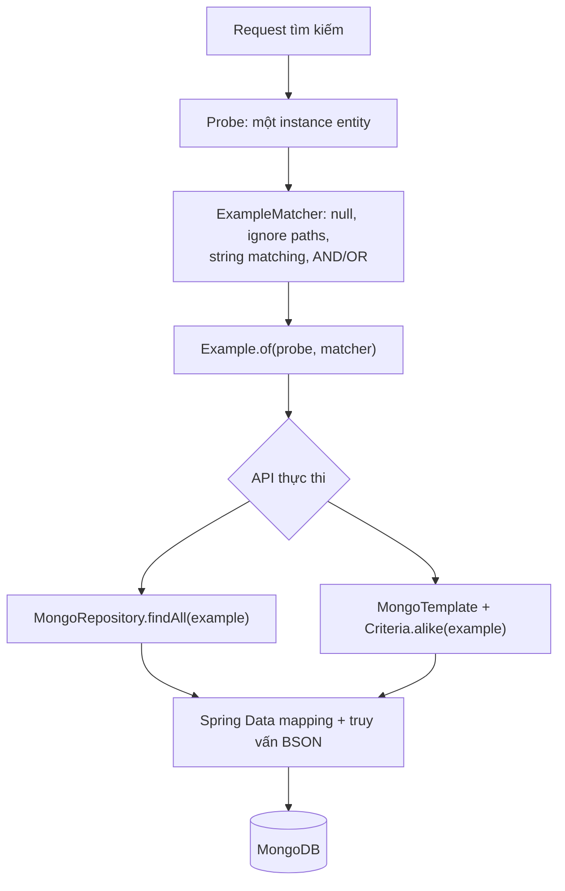

# Xử lý null, kiểu nguyên thủy và thuộc tính bỏ qua

Trong **Spring Data MongoDB**, **Query by Example (QBE)** cho phép tìm document bằng cách tạo một đối tượng Java làm **probe** (mẫu tìm kiếm), rồi bọc nó trong `Example<T>`. Spring Data đọc các property của probe, dùng `ExampleMatcher` để quyết định **property nào tham gia truy vấn**, chúng được so khớp như thế nào, và cuối cùng dựng bộ lọc MongoDB.

Điểm dễ gây sai nhất của QBE không nằm ở cú pháp `Example.of(probe)` mà nằm ở **giá trị vắng mặt**:

- Một property **tham chiếu** có giá trị Java `null` thường **không tham gia truy vấn mặc định**.
- Một property **nguyên thủy** như `boolean`, `int` hay `long` **luôn có giá trị** (`false`, `0`, …), nên **vẫn tham gia truy vấn**, dù người dùng chưa chọn bộ lọc.
- Một property được khai báo bằng `withIgnorePaths(...)` sẽ **không tham gia QBE** kể cả khi nó có giá trị khác null.
- Khi bật `withIncludeNullValues()`, những property tham chiếu đang null có thể trở thành **điều kiện tìm null**, vốn có ngữ nghĩa riêng trong MongoDB và đặc biệt dễ gây bất ngờ ở object lồng nhau.

Bài thuộc chương **Query by Example** của module **SPRING_DATA_MONGODB**. Trọng tâm là dùng `Example` và `ExampleMatcher` đúng với dữ liệu BSON, tránh bộ lọc ẩn từ primitive, phân biệt **bỏ qua null** với **tìm null**, kiểm soát danh sách property bị bỏ qua và viết integration test thực sự chứng minh hành vi.

## 1. QBE dùng probe, matcher và example như thế nào?

Một câu hỏi nghiệp vụ thông thường:

> Tìm các hồ sơ thuộc tenant T1 có tên hiển thị chứa “an”, không quan tâm số lần đăng nhập, cờ hoạt động hay ghi chú.

Với QBE, service có thể:

1. Tạo một entity dạng **probe**, gán `tenantId = "T1"`, `displayName = "an"`.
2. Tạo `ExampleMatcher`: chuỗi tên hiển thị so khớp kiểu *contains*, không phân biệt hoa/thường, và bỏ qua những property không phải điều kiện.
3. Bọc thành `Example.of(probe, matcher)`.
4. Gọi `repository.findAll(example)` hoặc dựng `Criteria.alike(example)` với `MongoTemplate`.



QBE **không phải** BSON schema validation, không phải công cụ lưu entity, cũng không tự bật một điều kiện “chỉ lấy dữ liệu người dùng có quyền xem”. Nó là **kỹ thuật tạo bộ lọc truy vấn** từ giá trị property Java.

### Ba thành phần API

| Thành phần | Vai trò |
| --- | --- |
| `Probe` | Object Java chứa giá trị mẫu, ví dụ một `UserProfile` mới |
| `ExampleMatcher` | Quyết định AND/OR, xử lý null, thuộc tính bỏ qua, string matching |
| `Example<T>` | Kết hợp probe và matcher thành mô tả QBE, dùng được cho repository/template |

`Example.of(probe)` sử dụng matcher mặc định; `Example.of(probe, matcher)` cho phép điều chỉnh cụ thể. Không nên nghĩ “probe mới chỉ gán một field” đồng nghĩa “query chỉ chứa một field”: các primitive trong entity vẫn có giá trị mặc định.

## 2. Entity mẫu: có cả reference type và primitive

Giả sử collection `profiles` lưu hồ sơ người dùng:

```javascript
{
  _id: ObjectId("674000000000000000000701"),
  tenant_id: "T1",
  display_name: "Lan",
  active: true,
  login_count: NumberInt(5),
  verified: false,
  optional_note: "Khách hàng thử nghiệm",
  created_at: ISODate("2026-11-20T02:00:00Z")
}
```

Java entity:

```java
import java.time.Instant;
import org.bson.types.ObjectId;
import org.springframework.data.annotation.Id;
import org.springframework.data.mongodb.core.mapping.Document;
import org.springframework.data.mongodb.core.mapping.Field;

@Document(collection = "profiles")
public class UserProfile {
    @Id
    private ObjectId id;

    @Field("tenant_id")
    private String tenantId;

    @Field("display_name")
    private String displayName;

    private boolean active;  // primitive, mặc định false

    @Field("login_count")
    private int loginCount;  // primitive, mặc định 0

    private Boolean verified; // wrapper, mặc định null

    @Field("optional_note")
    private String optionalNote;

    @Field("created_at")
    private Instant createdAt;

    public UserProfile() {}

    public ObjectId getId() { return id; }
    public String getTenantId() { return tenantId; }
    public String getDisplayName() { return displayName; }
    public boolean isActive() { return active; }
    public int getLoginCount() { return loginCount; }
    public Boolean getVerified() { return verified; }
    public String getOptionalNote() { return optionalNote; }
    public Instant getCreatedAt() { return createdAt; }

    public void setTenantId(String value) { tenantId = value; }
    public void setDisplayName(String value) { displayName = value; }
    public void setActive(boolean value) { active = value; }
    public void setLoginCount(int value) { loginCount = value; }
    public void setVerified(Boolean value) { verified = value; }
    public void setOptionalNote(String value) { optionalNote = value; }
}
```

Bảng giá trị của một `new UserProfile()`, **trước khi service gán bất kỳ bộ lọc nào**:

| Property | Kiểu Java | Giá trị mặc định | QBE mặc định |
| --- | --- | --- | --- |
| `id` | `ObjectId` | `null` | Bỏ qua |
| `tenantId` | `String` | `null` | Bỏ qua |
| `displayName` | `String` | `null` | Bỏ qua |
| `active` | `boolean` | `false` | **Tham gia** với `false` |
| `loginCount` | `int` | `0` | **Tham gia** với `0` |
| `verified` | `Boolean` | `null` | Bỏ qua |
| `optionalNote` | `String` | `null` | Bỏ qua |
| `createdAt` | `Instant` | `null` | Bỏ qua |

Đây là điểm khác biệt quan trọng: **`false` và `0` là giá trị thật**, không đồng nghĩa “người dùng chưa lọc”. Đổi sang wrapper `Boolean` và `Integer` cho các tiêu chí tìm kiếm tùy chọn có thể giải quyết sự nhập nhằng này.

## 3. QBE mặc định bỏ qua null nhưng không bỏ qua primitive

Repository:

```java
import org.bson.types.ObjectId;
import org.springframework.data.mongodb.repository.MongoRepository;

public interface UserProfileRepository
        extends MongoRepository<UserProfile, ObjectId> {
}
```

`MongoRepository` hỗ trợ `QueryByExampleExecutor`, do đó có thể gọi `findAll(Example)`, `count(Example)`, `exists(Example)` và các biến thể khác tùy phiên bản Spring Data.

Tạo probe mới và chỉ gán tenant:

```java
import org.springframework.data.domain.Example;

UserProfile probe = new UserProfile();
probe.setTenantId("T1");

Example<UserProfile> example = Example.of(probe);
var profiles = userProfileRepository.findAll(example);
```

Một người đọc code có thể nghĩ câu hỏi là “trả mọi hồ sơ của T1”. **Thực tế QBE còn đưa hai giá trị nguyên thủy mặc định** vào filter:

```javascript
// Hình dung predicate từ probe (chưa tính ràng buộc type _class):
{
  tenant_id: "T1",
  active: false,
  login_count: 0
}
```

Vì `active` là `boolean`, nó không có trạng thái `null` để Spring Data suy ra “bỏ qua”. `loginCount` cũng không thể là null khi dùng `int`. Nếu hầu hết hồ sơ đã đăng nhập hoặc active=true, truy vấn tưởng như rộng có thể trả rất ít hoặc không trả kết quả.

### Nguy cơ trong trang tìm kiếm

Giả sử UI có ba lựa chọn “Tất cả / Đang hoạt động / Không hoạt động”. Nếu DTO chỉ chứa:

```java
boolean active;
```

thì cả **“Tất cả”** và **“Không hoạt động”** đều có thể đi tới giá trị `false`. Khi truyền thẳng giá trị đó vào một primitive trong probe, QBE **không thể biết người dùng đã chọn “Tất cả”**. Đây là vấn đề thiết kế dữ liệu đầu vào, không phải lỗi ngẫu nhiên của MongoDB.

## 4. Cách 1: withIgnorePaths cho các primitive không cần lọc

Khi entity hiện tại vẫn dùng primitive vì nó có ý nghĩa domain, matcher có thể **bỏ qua chính xác những property không dùng**.

```java
import org.springframework.data.domain.Example;
import org.springframework.data.domain.ExampleMatcher;

UserProfile probe = new UserProfile();
probe.setTenantId("T1");

ExampleMatcher matcher = ExampleMatcher.matchingAll()
    .withIgnorePaths("active", "loginCount");

Example<UserProfile> example = Example.of(probe, matcher);

var profiles = userProfileRepository.findAll(example);
```

Ý nghĩa filter lúc này là:

```javascript
{
  tenant_id: "T1"
  // Không còn active:false và login_count:0 do matcher bỏ qua.
}
```

`withIgnorePaths(...)` làm Spring Data loại bỏ những property cụ thể **dù chúng đang mang giá trị nào**.

```java
UserProfile probe = new UserProfile();
probe.setTenantId("T1");
probe.setActive(true);
probe.setLoginCount(999);

ExampleMatcher ignore = ExampleMatcher.matching()
    .withIgnorePaths("active", "loginCount");

Example<UserProfile> example = Example.of(probe, ignore);
// active=true và loginCount=999 cũng không được dùng trong filter.
```

Đây là cơ chế **loại bỏ điều kiện**, không phải thay đổi giá trị được lưu. QBE là thao tác đọc, không tự sửa field `active` hay `login_count` trong MongoDB.

### Tên dùng trong ignore là property Java

Vì entity gắn `@Field("login_count")`, đường dẫn ignore đúng là:

```java
.withIgnorePaths("loginCount")
```

không phải:

```java
// Không dùng tên BSON nếu property Java là loginCount:
// .withIgnorePaths("login_count")
```

Với property lồng nhau, đường dẫn là dạng Java như `"address.city"` (tùy mô hình), không phải một chuỗi field BSON tùy ý. Test cần xác minh ignore thực sự áp dụng, đặc biệt khi đổi tên property.

## 5. Cách 2: dùng wrapper cho tiêu chí tùy chọn

Nếu API muốn phân biệt **ba trạng thái “không lọc / false / true”**, lựa chọn tự nhiên là `Boolean` thay cho `boolean`.

Tương tự, `Integer` thay cho `int` giúp phân biệt **“không lọc theo số lần đăng nhập”** với **“lọc loginCount = 0”**.

```java
// Một search DTO độc lập với entity lưu trữ:
public record ProfileSearchRequest(
    String displayName,
    Boolean active,
    Integer loginCount,
    Boolean verified
) {}
```

Các giá trị có ý nghĩa:

| Input HTTP/DTO | Giá trị trong DTO | Ý nghĩa |
| --- | --- | --- |
| Không gửi `active` | `null` | Không dùng điều kiện active |
| `active=false` | `Boolean.FALSE` | Tìm document có active=false |
| `active=true` | `Boolean.TRUE` | Tìm document có active=true |
| Không gửi `loginCount` | `null` | Không dùng điều kiện loginCount |
| `loginCount=0` | `Integer.valueOf(0)` | Tìm đúng số 0 |
| `verified=false` | `Boolean.FALSE` | Tìm đúng false |

**Nhưng chú ý:** entity `UserProfile` trong bài vẫn có primitive `boolean active` và `int loginCount`, nên **chỉ thay DTO sang wrapper chưa đủ** nếu sau đó đổ giá trị vào chính probe entity ấy: phải kết hợp `withIgnorePaths` cho property không lọc, hoặc thiết kế một loại probe có wrapper thích hợp.

### Giải pháp an toàn nếu có thể sửa entity

Trong một ứng dụng mà field thực sự có thể không hiện diện hoặc không có giá trị:

```java
@Document("profiles")
public class NullableSearchProfile {
    @Id
    private ObjectId id;

    private String tenantId;

    private Boolean active;
    private Integer loginCount;

    public NullableSearchProfile() {}
    // Getter/setter hoặc constructor binding phù hợp.
}
```

Đoạn trên là **ví dụ thiết kế thay thế**, không phải class được dùng đồng thời với `UserProfile` trên cùng repository mẫu. Khi dùng wrapper, probe mới để trống sẽ có `active == null`, `loginCount == null` nên matcher mặc định bỏ qua chúng. Khi người dùng chọn `false` hoặc `0`, QBE vẫn dùng chính các giá trị đó.

Tuy nhiên, việc **đổi entity lưu trữ** từ primitive sang wrapper ảnh hưởng code domain, validation và giả định dữ liệu cũ. Nhiều hệ thống sẽ phù hợp hơn với một search DTO có wrapper và xây `Query` động bằng `MongoTemplate` mà **không bắt buộc đổi entity**.

## 6. Chọn matcher theo các property thật sự được phép lọc

Một yêu cầu thực tế có thể gồm `displayName` tùy chọn và `active` tùy chọn. Với entity có primitive, hãy chọn matcher có chủ đích thay vì quên các giá trị mặc định.

```java
UserProfile probe = new UserProfile();
probe.setTenantId(authenticatedTenant);
probe.setDisplayName(request.displayName());

ExampleMatcher matcher = ExampleMatcher.matchingAll()
    .withIgnorePaths(
        "id", "createdAt", "optionalNote",
        "verified", "active", "loginCount"
    )
    .withMatcher(
        "displayName",
        match -> match.contains().ignoreCase()
    );

var result = userProfileRepository.findAll(
    Example.of(probe, matcher)
);
```

Trong ví dụ này, query **cố ý không lọc active/loginCount**, kể cả khi request có giá trị. Nếu UI cho phép lọc active thì cần tạo matcher theo nhánh:

```java
ExampleMatcher matcher = ExampleMatcher.matchingAll()
    .withIgnorePaths("id", "createdAt", "optionalNote",
                     "verified", "loginCount");

if (request.active() == null) {
    matcher = matcher.withIgnorePaths("active");
} else {
    probe.setActive(request.active());
}
```

**Cách dùng an toàn:** luôn khởi tạo matcher **mới cho mỗi kiểu filter** hoặc xây dựng từ bộ matcher bất biến chuẩn. Đừng dùng một matcher toàn cục bị sửa qua lại tùy request mà không hiểu ngữ nghĩa immutable của `ExampleMatcher`.

### Không bao giờ vô tình ignore tenant

Nếu `tenantId` là ranh giới phân quyền, mã sau rất nguy hiểm:

```java
// Sai về mặt bảo vệ dữ liệu đa tenant:
ExampleMatcher matcher = ExampleMatcher.matchingAny()
    .withIgnorePaths("tenantId");
```

Ngay cả khi probe có `tenantId = "T1"`, matcher trên **bỏ điều kiện tenant**. Mọi đường tìm kiếm phải thực hiện kiểm tra quyền ở service và truy vấn; QBE **không tự động áp đặt tenant isolation**.

## 7. Default null: “bỏ qua điều kiện” không có nghĩa “tìm null”

Giả sử `optionalNote == null` trên probe:

```java
UserProfile probe = new UserProfile();
probe.setTenantId("T1");
// optionalNote không được gán → null

Example<UserProfile> example = Example.of(
    probe,
    ExampleMatcher.matchingAll()
        .withIgnorePaths("active", "loginCount")
);

var result = userProfileRepository.findAll(example);
```

Ở matcher mặc định, `optionalNote` **không tham gia query**. Vì vậy cả những hồ sơ có ghi chú, những hồ sơ lưu BSON Null và những hồ sơ thiếu field `optional_note` đều có thể được trả về nếu thỏa các điều kiện khác.

Đây là khác biệt căn bản:

- **Java probe property null + matcher mặc định** → **không đặt điều kiện** cho field đó.
- **Java probe property null + matcher include null** → đặt **điều kiện liên quan tới null** cho field đó.
- **Truy vấn MongoDB để kiểm tra field thiếu hoặc có BSON Null** → cần xét đúng semantics của `$exists`, `$type`.

Đừng dùng cách “gán null vào probe” để diễn đạt yêu cầu “hồ sơ có `optional_note = null`” khi chưa chọn chính sách `NullHandler` phù hợp.

## 8. withIncludeNullValues: biến null thành điều kiện truy vấn

Khi nghiệp vụ thực sự muốn tìm những document có giá trị null, có thể bật:

```java
import org.springframework.data.domain.Example;
import org.springframework.data.domain.ExampleMatcher;

UserProfile probe = new UserProfile();
probe.setTenantId("T1");
probe.setOptionalNote(null);

ExampleMatcher matcher = ExampleMatcher.matchingAll()
    .withIncludeNullValues()
    .withIgnorePaths(
        "id", "displayName", "active", "loginCount",
        "verified", "createdAt"
    );

Example<UserProfile> example = Example.of(probe, matcher);

var result = userProfileRepository.findAll(example);
```

Vì chế độ include null áp dụng ở **cấp matcher**, phải **ignore các property tham chiếu null khác** mà ta **không muốn** biến thành điều kiện. Nếu quên, QBE có thể thêm hàng loạt điều kiện null cho `displayName`, `verified`, `createdAt`, `id`, v.v., khiến kết quả ít bất ngờ theo một cách khó phát hiện.

Có thể diễn đạt cùng ý định bằng:

```java
ExampleMatcher matcher = ExampleMatcher.matchingAll()
    .withNullHandler(ExampleMatcher.NullHandler.INCLUDE)
    .withIgnorePaths(
        "id", "displayName", "active", "loginCount",
        "verified", "createdAt"
    );
```

`withIncludeNullValues()` là cách viết dễ hiểu hơn khi muốn chọn `NullHandler.INCLUDE`. Không nên cố coi nó là thiết lập riêng cho `optionalNote`: bảng quyền ưu tiên của `ExampleMatcher` có **null handling ở mức matcher**, còn ignore paths là theo **từng property**.

### Nguy cơ khi mở rộng entity

Giả sử sau này entity được bổ sung `private String externalReference;` và field này thường null. Một matcher `withIncludeNullValues()` cũ **có thể tự phát sinh điều kiện null mới** cho property đó nếu nó chưa được ignore. Đây là lý do một QBE “include all nulls” cần test hồi quy khi schema/entity thay đổi.

## 9. BSON null và field thiếu không giống nhau

MongoDB phân biệt:

```javascript
// A: có trường, giá trị là BSON Null
{ _id: "A", optional_note: null }

// B: không có trường optional_note
{ _id: "B" }

// C: có trường, là chuỗi rỗng
{ _id: "C", optional_note: "" }

// D: có trường, có dữ liệu
{ _id: "D", optional_note: "Đã kiểm tra" }
```

Với field vô hướng, MongoDB có các quy tắc:

| BSON query | Khớp | Ý nghĩa |
| --- | --- | --- |
| `{ optional_note: null }` | A, B | Null **hoặc** field thiếu |
| `{ optional_note: { $type: 10 } }` | A | **Chỉ** field có kiểu BSON Null |
| `{ optional_note: { $exists: false } }` | B | **Chỉ** field thiếu |
| `{ optional_note: { $exists: true } }` | A, C, D | Field tồn tại, kể cả Null |
| `{ optional_note: { $ne: null } }` | C, D | Có giá trị khác null |

Một QBE include-null đơn giản trên property vô hướng có thể dẫn tới bộ lọc so sánh null trong MongoDB, nên **không phải công cụ chắc chắn để phân biệt BSON Null và missing**. Nếu nghiệp vụ cần chính xác “field có Null” hoặc “field thiếu”, nên dùng `MongoTemplate` với `Criteria` tường minh thay vì suy diễn từ giá trị null của object Java.

Ví dụ:

```java
import org.springframework.data.mongodb.core.query.Criteria;
import org.springframework.data.mongodb.core.query.Query;

// Null hoặc thiếu:
Query nullOrMissing = Query.query(
    Criteria.where("optionalNote").isNull()
);

// Chỉ BSON Null:
Query explicitBsonNull = Query.query(
    Criteria.where("optionalNote").isNullValue()
);

// Chỉ trường thiếu:
Query missing = Query.query(
    Criteria.where("optionalNote").exists(false)
);

// Field có tồn tại, kể cả BSON Null:
Query present = Query.query(
    Criteria.where("optionalNote").exists(true)
);
```

Các API `isNull()`, `isNullValue()` và `exists(...)` diễn đạt trực tiếp **ba câu hỏi khác nhau**; `Criteria` có thể ánh xạ property Java `optionalNote` sang BSON `optional_note` khi query với `UserProfile.class`.

**Lưu ý:** MongoDB có ngữ nghĩa matching phần tử bổ sung khi đường dẫn đi qua array. Những ví dụ này cố ý dùng trường vô hướng để tránh lẫn semantics array.

## 10. Property lồng nhau: include null có giới hạn đáng lưu ý

Xét document có object nhúng:

```javascript
{
  _id: ObjectId("674000000000000000000702"),
  tenant_id: "T1",
  address: {
    city: "Hà Nội",
    postal_code: null
  }
}
```

Java model có thể khai báo:

```java
record Address(String city, String postalCode) {}

@Document("profiles")
class ProfileWithAddress {
    @Id
    private ObjectId id;

    @Field("tenant_id")
    private String tenantId;

    private Address address;
}
```

Nếu chỉ muốn “`address.city == Hà Nội`” mà chưa quan tâm `postalCode`, matcher mặc định bỏ qua property tham chiếu null phù hợp hơn. Nhưng khi dùng `withIncludeNullValues()`, **Spring Data MongoDB có lưu ý riêng:** trong xử lý document nhúng, nó có thể chọn kiểu **embedded document matching** thay vì *dot notation* cho từng property; điều này khiến điều kiện **nhạy với giá trị toàn bộ subdocument và thứ tự field**.

So sánh hai loại bộ lọc MongoDB:

```javascript
// Dot notation: hỏi riêng một đường dẫn.
db.profiles.find({ "address.city": "Hà Nội" });

// Embedded document equality: hỏi cả object theo cấu trúc.
db.profiles.find({
  address: {
    city: "Hà Nội",
    postal_code: null
  }
});
```

Truy vấn dạng so khớp **cả document nhúng** có thể không khớp khi object thực tế còn field khác hoặc khác thứ tự các field. Đừng bật include null toàn cục rồi nghĩ QBE sẽ luôn chuyển thành các điều kiện đường dẫn nhỏ, độc lập.

**Khuyến nghị:** khi cần phân biệt null/missing trên một field lồng nhau, hãy dùng `Criteria.where("address.postalCode").isNullValue()` hoặc `exists(false)` tương ứng, kiểm tra BSON schema và test với các document có/không có field phụ. Khi cần kết hợp nhiều mệnh đề lồng phức tạp, `MongoTemplate` thường biểu đạt rõ hơn QBE.

## 11. withIgnorePaths là chủ động loại bỏ, không phải sửa dữ liệu

Ba khái niệm dễ lẫn:

| Cơ chế | Tầng ảnh hưởng | Tác dụng |
| --- | --- | --- |
| `withIgnorePaths("active")` | **Chỉ matcher của truy vấn QBE** | Không đưa property `active` vào predicate |
| `@Transient` trên một property | **Mapping entity** | Property không được ánh xạ như trường lưu trữ thông thường |
| `Update.unset("active")` | **Ghi MongoDB** | Xóa trường BSON trên document |

`withIgnorePaths` **không thay dữ liệu và không thay annotation**. Một property có thể được lưu bình thường nhưng bị bỏ qua ở một lần QBE.

Các ví dụ bỏ qua:

```java
ExampleMatcher matcher = ExampleMatcher.matchingAll()
    .withIgnorePaths("id", "createdAt")
    .withIgnorePaths("active", "loginCount");
```

Một lần gọi cũng đủ:

```java
ExampleMatcher matcher = ExampleMatcher.matchingAll()
    .withIgnorePaths("id", "createdAt", "active", "loginCount");
```

Khi phải sửa matcher theo nhánh, gán lại kết quả mà `withIgnorePaths` trả về. Đừng giả định `ExampleMatcher` thay đổi in-place theo cách thông thường của một mutable bean.

### Có nên luôn ignore id?

- Probe mới có `id == null`: matcher mặc định đã bỏ qua ID.
- Probe được tạo từ entity cũ có `id != null`: ID có thể **tham gia filter**, khiến kết quả bị giới hạn theo một document.
- Khi xây form tìm kiếm rộng, nên **tạo probe mới** thay vì lấy một entity vừa đọc từ MongoDB rồi sửa vài trường.
- Nếu yêu cầu không lọc ID, dùng `withIgnorePaths("id")` rõ ràng để tránh thay đổi hành vi về sau.

Tương tự, một property `@Version`, `createdAt` hoặc field auditing khác nếu có giá trị có thể vô tình trở thành bộ lọc. Hãy lập danh sách tiêu chí mà người dùng thực sự được phép chọn thay vì chấp nhận mọi property có giá trị trên entity.

## 12. matchingAll, matchingAny và ranh giới tenant

Mặc định `ExampleMatcher.matching()` hoặc `matchingAll()` yêu cầu **tất cả các predicate được chọn** đều khớp (AND):

```java
ExampleMatcher matcher = ExampleMatcher.matchingAll()
    .withIgnorePaths("active", "loginCount");

// Probe: tenantId="T1", verified=true.
// Ý nghĩa: tenant_id="T1" AND verified=true.
```

`matchingAny()` lại dùng logic **ít nhất một predicate phù hợp** (OR):

```java
ExampleMatcher any = ExampleMatcher.matchingAny()
    .withIgnorePaths("active", "loginCount");

// Probe có tenantId="T1", verified=true.
// Có thể nhận dữ liệu tenant T1 HOẶC verified=true từ tenant khác.
```

**Đây là lỗi nghiêm trọng trong hệ thống đa tenant:** nếu dùng matchingAny trên probe gồm cả tenant và các field tìm kiếm, tenant có thể trở thành **một nhánh OR** thay vì ràng buộc bắt buộc. Không coi việc gán `probe.tenantId` là đủ bảo vệ khi matcher thay đổi thành `matchingAny()`.

Giải pháp là luôn áp đặt tenant ở **lớp truy vấn bảo mật có AND bắt buộc**, ví dụ `MongoTemplate` ghép `Criteria.where("tenantId").is(authorizedTenant)` với bộ lọc người dùng, hoặc dùng matcher `matchingAll` và chỉ cho phép tổ hợp điều kiện không vi phạm ranh giới tenant.

**Một matcher tiện lợi không phải lớp authorization.** Service vẫn phải lấy tenant từ principal/session đáng tin cậy và áp dụng quy tắc quyền cho collection/truy vấn đang đọc.

## 13. StringMatcher không thay thế quy tắc null và primitive

`ExampleMatcher` hỗ trợ các cách so khớp chuỗi như exact, startsWith, endsWith, containing và ignoreCase:

```java
UserProfile probe = new UserProfile();
probe.setTenantId("T1");
probe.setDisplayName("an");

ExampleMatcher matcher = ExampleMatcher.matchingAll()
    .withIgnorePaths("id", "active", "loginCount", "createdAt")
    .withMatcher(
        "displayName",
        match -> match.contains().ignoreCase()
    );

var result = userProfileRepository.findAll(
    Example.of(probe, matcher)
);
```

Trong MongoDB, so khớp chuỗi dạng contains/ignoreCase có thể được chuyển thành điều kiện tương đương regex theo cấu hình. Regex không nhất thiết tận dụng index B-tree hiệu quả, nhất là dạng chứa ở giữa chuỗi hoặc không phân biệt hoa/thường. Với bài toán autocomplete/tìm kiếm văn bản lớn, cần thiết kế index, chuẩn hóa dữ liệu hoặc sử dụng cơ chế search phù hợp.

**Điều chỉnh matcher cho chuỗi không ảnh hưởng tự động tới primitive:** `active=false` và `loginCount=0` vẫn tham gia nếu không bị ignore. Đừng nghĩ `withMatcher("displayName", ...)` làm các property khác biến mất.

### Chuỗi rỗng không phải null

Một probe với `displayName=""` có **giá trị không null**, nên có thể tạo predicate. Với matcher containing, chuỗi rỗng có thể khớp rất rộng, làm query vô ích và gây tải cao.

Nên chuẩn hóa yêu cầu trước:

```java
String name = request.displayName();
if (name != null) {
    name = name.trim();
    if (name.isEmpty()) {
        name = null; // Nghĩa nghiệp vụ: không lọc theo tên.
    }
}
probe.setDisplayName(name);
```

Việc chuyển blank → null chỉ phù hợp nếu UI định nghĩa blank là “không lọc”. Nếu blank là giá trị nghiệp vụ hợp lệ, phải dùng một mô hình khác thay vì xóa ý nghĩa nó.

## 14. MongoTemplate: dùng Criteria.alike(example)

Không bắt buộc dùng repository để chạy QBE. Với `MongoTemplate`:

```java
import java.util.List;
import org.springframework.data.domain.Example;
import org.springframework.data.domain.ExampleMatcher;
import org.springframework.data.mongodb.core.MongoTemplate;
import org.springframework.data.mongodb.core.query.Criteria;
import org.springframework.data.mongodb.core.query.Query;

UserProfile probe = new UserProfile();
probe.setTenantId("T1");
probe.setDisplayName("an");

ExampleMatcher matcher = ExampleMatcher.matchingAll()
    .withIgnorePaths("id", "active", "loginCount")
    .withMatcher("displayName", m -> m.contains().ignoreCase());

Example<UserProfile> example = Example.of(probe, matcher);

Query query = new Query(new Criteria().alike(example));

List<UserProfile> result =
    mongoTemplate.find(query, UserProfile.class);
```

Khi cần thêm `Sort`, `limit`, projection hoặc hint, có thể cấu hình lên `Query`:

```java
import org.springframework.data.domain.Sort;

query.with(
    Sort.by(Sort.Order.asc("displayName"),
            Sort.Order.asc("id"))
);
query.limit(50);

List<UserProfile> page =
    mongoTemplate.find(query, UserProfile.class);
```

**Không dùng `findAll(example)` trên tập dữ liệu rất lớn mà không có giới hạn/truy vấn chọn lọc.** Tùy phiên bản Spring Data, repository cũng có overload phân trang `findAll(example, pageable)` hoặc API fluent; cần chọn phù hợp và đo số query thực tế.

## 15. Typed Example, _class và dữ liệu raw không có type hint

Spring Data MongoDB **mặc định dùng typed QBE**: truy vấn có thể mang ràng buộc theo kiểu domain để tránh trả các document có loại entity không phù hợp, dựa trên metadata kiểu như `_class` (khi type hints được bật).

Điều này rất quan trọng khi integration test chèn **raw BSON** bằng native driver mà **không có `_class`**:

```javascript
db.profiles.insertOne({
  tenant_id: "T1",
  display_name: "Lan",
  active: false,
  login_count: 0
  // Không có _class
});
```

Một truy vấn typed QBE có thể không trả document trên, mặc dù các field nghiệp vụ đều khớp, vì ràng buộc kiểu không khớp. Nếu cần truy vấn nhiều loại document trong cùng collection hoặc dữ liệu đã tắt type hints, Spring Data MongoDB có `UntypedExampleMatcher`:

```java
import org.springframework.data.domain.Example;
import org.springframework.data.mongodb.core.query.UntypedExampleMatcher;

UserProfile probe = new UserProfile();
probe.setTenantId("T1");

var matcher = UntypedExampleMatcher.matchingAll()
    .withIgnorePaths("id", "active", "loginCount");

Example<UserProfile> example = Example.of(probe, matcher);
var result = userProfileRepository.findAll(example);
```

**Đừng dùng untyped chỉ để “chữa query rỗng” mà không hiểu dữ liệu.** Nó bỏ ràng buộc kiểu và có thể làm tập khớp rộng hơn. Khi collection chứa nhiều domain type, cần bảo vệ thêm bằng field discriminator/điều kiện khác, hoặc thiết kế collection nhất quán. Nếu dùng `@TypeAlias`, cần cấu hình mapping context đủ để giải quyết alias đúng.

Trong integration test phần sau, ta **insert entity bằng `MongoTemplate`** để các type hints do Spring Data quản lý được ghi nhất quán; riêng thao tác test null-vs-missing dùng raw update nhưng **giữ nguyên `_class`** của document đã insert.

## 16. Ví dụ service: biến request thành QBE an toàn

Một cách thực dụng là dùng DTO để biết trường nào **được người dùng cung cấp** và lựa chọn ignore path có chủ đích:

```java
public record ProfileSearchRequest(
    String displayName,
    Boolean active,
    Integer loginCount,
    Boolean verified
) {}
```

Ví dụ service dùng `UserProfile` (entity vẫn có primitive):

```java
import java.util.List;
import org.springframework.data.domain.Example;
import org.springframework.data.domain.ExampleMatcher;

public class ProfileSearchService {
    private final UserProfileRepository repository;

    public ProfileSearchService(UserProfileRepository repository) {
        this.repository = repository;
    }

    public List<UserProfile> search(
            String authorizedTenant,
            ProfileSearchRequest request) {

        if (authorizedTenant == null || authorizedTenant.isBlank()) {
            throw new IllegalArgumentException("Thiếu tenant xác thực");
        }

        UserProfile probe = new UserProfile();
        probe.setTenantId(authorizedTenant);

        String name = request.displayName();
        if (name != null && !name.isBlank()) {
            probe.setDisplayName(name.trim());
        }

        ExampleMatcher matcher = ExampleMatcher.matchingAll()
            .withIgnorePaths("id", "createdAt", "optionalNote")
            .withMatcher("displayName",
                match -> match.contains().ignoreCase());

        if (request.active() == null) {
            matcher = matcher.withIgnorePaths("active");
        } else {
            probe.setActive(request.active());
        }

        if (request.loginCount() == null) {
            matcher = matcher.withIgnorePaths("loginCount");
        } else {
            probe.setLoginCount(request.loginCount());
        }

        if (request.verified() != null) {
            probe.setVerified(request.verified());
        }

        return repository.findAll(Example.of(probe, matcher));
    }
}
```

Code trên minh họa cách **tránh filter primitive mặc định** và áp đặt tenant theo AND. Để dùng trong production, cần bổ sung **phân trang/limit**, validation của `loginCount`, rate limiting khi cần và chính sách riêng cho truy vấn chuỗi chứa. Có thể bổ sung `Pageable` vào service hoặc dùng `MongoTemplate` để giới hạn rõ ràng.

**Ưu điểm của DTO tách biệt:** HTTP input có thể có ba trạng thái (bỏ qua, false/0, true/số khác); entity lưu trữ vẫn giữ primitive theo domain. Đây là cách tránh thay đổi schema chỉ để phục vụ form tìm kiếm.

### Bài toán nâng cao: cần tìm riêng “verified là BSON Null”

Với `Boolean verified`, DTO nullable có thể diễn đạt **“không lọc”** và **“lọc false/true”**, nhưng chưa diễn đạt được **“lọc field verified có BSON Null”** như trạng thái thứ tư.

Nếu UI cần cả bốn lựa chọn, hãy dùng enum truy vấn:

```java
public enum VerifiedFilter {
    ANY, TRUE, FALSE, EXPLICIT_NULL, MISSING
}
```

Với `TRUE/FALSE` có thể dùng QBE; với `EXPLICIT_NULL` và `MISSING`, nên chuyển sang `Criteria.isNullValue()` / `Criteria.exists(false)` trong một query tường minh. Không ép QBE nullable wrapper phải mang bốn ý nghĩa khác nhau bằng cùng một `null` Java.

## 17. Hiệu năng: xem query BSON thay vì chỉ xem probe Java

QBE có thể trông đơn giản nhưng server vẫn phải thực thi một bộ lọc trên collection thực:

- Nếu quên ignore primitive, query thêm `active:false`, `login_count:0`, ảnh hưởng cả **tập kết quả** lẫn **index choice**.
- Nếu bật `withIncludeNullValues`, query có thể có nhiều điều kiện null ngoài ý muốn hoặc yêu cầu so khớp embedded object phức tạp.
- Nếu dùng `matchingAny()`, điều kiện OR có thể mở rộng tập kết quả và gây **rò rỉ tenant** nếu không có AND bảo vệ.
- Nếu dùng `contains().ignoreCase()`, truy vấn chuỗi có thể không dùng index B-tree hiệu quả như equality hoặc prefix phù hợp.
- Nếu typed QBE chèn type hint, query plan có thể khác một lệnh tìm raw BSON không có điều kiện `_class`.

Một index phục vụ truy vấn phổ biến theo tenant và trạng thái:

```javascript
db.profiles.createIndex(
  { tenant_id: 1, active: 1, login_count: 1 },
  { name: "profiles_tenant_state_count" }
);
```

Index này có thể có ích nếu workload thực sự lọc `tenant_id + active + login_count`; **không tạo chỉ vì entity có các property ấy**. Nếu phần lớn query chỉ tìm theo tenant và tên hiển thị, cần kiểm tra phương án index khác, cân nhắc khả năng dùng search index khi có substring/case-insensitive search.

Đo truy vấn tương đương:

```javascript
db.profiles.find({
  tenant_id: "T1",
  active: false,
  login_count: 0
}).explain("executionStats");
```

Theo dõi `winningPlan`, `totalKeysExamined`, `totalDocsExamined`, `nReturned` và độ trễ dưới dữ liệu đại diện. Nên xem log/command monitoring cho **query QBE thực sự sinh ra** vì một `withIgnorePaths` bị thiếu có thể thay đổi toàn bộ bộ lọc.

Không dùng explain của một filter tự viết khác với QBE rồi khẳng định QBE đã dùng index đó; hãy đối chiếu đúng collection, field mapping và type restrictions.

## 18. Integration test: chứng minh primitive 0/false có tham gia QBE

Mock `UserProfileRepository` không kiểm tra được cách Spring Data biến `ExampleMatcher` thành filter BSON. Test với MongoDB thật trong môi trường cô lập (ví dụ Testcontainers) để chắc chắn:

1. Primitive `false` và `0` làm hẹp query mặc định.
2. `withIgnorePaths("active","loginCount")` đưa các bản ghi đó trở lại.
3. `withIncludeNullValues()` ảnh hưởng tới property null đúng chủ đích.
4. Null BSON và field thiếu có thể được phân biệt bằng `Criteria`.
5. Type hints `_class` không bị vô tình mất khi dựng dữ liệu test.

Ví dụ với JUnit 5, AssertJ và Spring Boot test slice:

```java
import static org.assertj.core.api.Assertions.assertThat;
import static com.mongodb.client.model.Filters.eq;
import static com.mongodb.client.model.Updates.set;

import java.util.UUID;
import org.bson.types.ObjectId;
import org.junit.jupiter.api.Test;
import org.springframework.beans.factory.annotation.Autowired;
import org.springframework.boot.test.autoconfigure.data.mongo.DataMongoTest;
import org.springframework.data.domain.Example;
import org.springframework.data.domain.ExampleMatcher;
import org.springframework.data.mongodb.core.MongoTemplate;
import org.springframework.data.mongodb.core.query.Criteria;
import org.springframework.data.mongodb.core.query.Query;

@DataMongoTest
class UserProfileQbeTest {
    @Autowired MongoTemplate template;
    @Autowired UserProfileRepository repository;

    @Test
    void primitiveDefaultsAreIncludedUnlessIgnored() {
        String tenant = "test-" + UUID.randomUUID();

        template.insert(profile(tenant, "P1", false, 0, null));
        template.insert(profile(tenant, "P2", true, 5, "vip"));
        template.insert(profile(tenant, "P3", false, 2, null));
        template.insert(profile("other-" + tenant, "P4", false, 0, null));

        UserProfile probe = new UserProfile();
        probe.setTenantId(tenant);

        assertThat(repository.findAll(Example.of(probe)))
            .extracting(UserProfile::getDisplayName)
            .containsExactly("P1");

        ExampleMatcher ignoringPrimitive = ExampleMatcher.matchingAll()
            .withIgnorePaths("active", "loginCount");

        assertThat(repository.findAll(
            Example.of(probe, ignoringPrimitive)))
            .extracting(UserProfile::getDisplayName)
            .containsExactlyInAnyOrder("P1", "P2", "P3");
    }

    @Test
    void includeNullDoesNotMeanOnlyExplicitBsonNull() {
        String tenant = "test-" + UUID.randomUUID();

        UserProfile missing = template.insert(
            profile(tenant, "Missing", false, 0, null));
        UserProfile explicit = template.insert(
            profile(tenant, "Explicit", false, 0, null));
        template.insert(
            profile(tenant, "Filled", false, 0, "Có ghi chú"));

        // Ghi trực tiếp BSON Null, vẫn giữ _class do template.insert tạo.
        template.getCollection("profiles").updateOne(
            eq("_id", explicit.getId()),
            set("optional_note", null)
        );

        UserProfile probe = new UserProfile();
        probe.setTenantId(tenant);

        ExampleMatcher includeNoteNull = ExampleMatcher.matchingAll()
            .withIncludeNullValues()
            .withIgnorePaths(
                "id", "displayName", "active", "loginCount",
                "verified", "createdAt"
            );

        assertThat(repository.findAll(
            Example.of(probe, includeNoteNull)))
            .extracting(UserProfile::getDisplayName)
            .containsExactlyInAnyOrder("Missing", "Explicit");

        Query onlyNull = Query.query(
            Criteria.where("tenantId").is(tenant)
                .and("optionalNote").isNullValue()
        );

        assertThat(template.find(onlyNull, UserProfile.class))
            .extracting(UserProfile::getDisplayName)
            .containsExactly("Explicit");

        // 'missing' được giữ để đối chiếu ID nếu cần test raw BSON.
        assertThat(missing.getId()).isInstanceOf(ObjectId.class);
    }

    private static UserProfile profile(
            String tenant, String name, boolean active,
            int loginCount, String note) {

        UserProfile profile = new UserProfile();
        profile.setTenantId(tenant);
        profile.setDisplayName(name);
        profile.setActive(active);
        profile.setLoginCount(loginCount);
        profile.setOptionalNote(note);
        return profile;
    }
}
```

Test **giả định** sử dụng phiên bản Spring Boot/Spring Data có package test slice phù hợp, entity được scan và MongoDB dành riêng cho test đã được kết nối. Khi thay đổi chính sách type hints hoặc converter null, cần điều chỉnh dữ liệu test cho đúng mapping thực tế; không chạy các thao tác tạo/sửa này trên production.

### Vì sao không chỉ insert raw Document?

Với **typed QBE**, một raw BSON document không có `_class` có thể bị loại trước khi các điều kiện `tenant_id`, `active` hay `login_count` được xét. Vì vậy ta dùng `template.insert(entity)` để giữ type hint thống nhất, rồi chỉ dùng **raw update** cho trường hợp cần mô phỏng `optional_note: null` tường minh.

### Những ca test cần bổ sung

- Probe có `active=true` và `loginCount=0`: xác nhận mỗi property có giá trị tham gia đúng.
- Probe chứa `verified=false` (wrapper): false **phải** tham gia, không bị nhầm với null.
- Probe chứa `verified=null`: mặc định bỏ qua, còn include-null sinh điều kiện theo chính sách matcher.
- `withIgnorePaths("tenantId")`: dùng test bảo vệ để chứng minh vì sao không được bỏ điều kiện phân vùng.
- `matchingAny()` với tenant+status: tập kết quả có thể mở rộng, yêu cầu outer AND hoặc không sử dụng.
- Property lồng có null và extra fields: đo sự khác biệt giữa dot notation và embedded document equality.
- Raw document không có `_class`: so sánh typed và `UntypedExampleMatcher` khi muốn biết lý do query rỗng.
- Điều kiện chuỗi chứa với khoảng trắng/case khác nhau; so sánh latency/index và giới hạn `Pageable`.

## 19. Những lỗi thường gặp và cách xử lý

| Sai lầm | Vì sao sai | Cách sửa |
| --- | --- | --- |
| Tưởng probe chỉ gán tenant thì query chỉ theo tenant | Primitive tự mang `false`, `0` | Ignore primitive không chọn, hoặc dùng wrapper |
| Dùng `boolean` trong request để biểu diễn “Tất cả” | `boolean` không có null | Dùng `Boolean` hoặc enum với trạng thái ANY |
| Gán `optionalNote=null` rồi mong tìm null | Null mặc định bị bỏ qua | `withIncludeNullValues()` hoặc `Criteria` |
| Bật include-null cho toàn entity mà không ignore property khác | Mọi nullable field null có thể tham gia | Ignore paths rõ ràng, test khi đổi schema |
| Nghĩ include-null luôn tìm chỉ BSON Null | Equality với null có thể gồm cả field thiếu | Dùng `Criteria.isNullValue()` để phân biệt |
| Dùng `withIgnorePaths("login_count")` | Matcher đọc tên property Java | Dùng `"loginCount"` |
| Ignore ID/tenant tùy tiện trên probe dùng cho authorization | Có thể mở rộng truy vấn quá scope | Tenant luôn do server ép AND, không tin probe |
| Dùng `matchingAny` cho tenant và filter tùy chọn | OR làm lọt dữ liệu tenant khác | Ràng buộc tenant riêng hoặc chỉ dùng matchingAll |
| Dùng entity đã tải làm probe tìm kiếm | ID/version/createdAt có thể vô tình lọc | Tạo probe mới, whitelist property |
| Nhầm `@Transient` với `withIgnorePaths` | Một bên mapping, một bên query-specific | Chọn đúng tầng hành vi |
| Tin `StringMatcher.CONTAINING` luôn dùng index tốt | Regex có thể scan nhiều data | Đo explain, chọn search/index thích hợp |
| Test bằng raw document thiếu `_class` rồi tưởng QBE hỏng | Typed QBE có thể áp thêm type restriction | Dùng template insert hoặc untyped có kiểm soát |
| Không giới hạn result | Query rộng có thể tải toàn collection | Validate filter, áp dụng Pageable/limit |

## 20. Bài thực hành và câu hỏi tự đánh giá

**Bài thực hành:** dựng collection `profiles` riêng trong MongoDB test với các entity `UserProfile` như trên. Thực hiện lần lượt:

1. Gọi `repository.findAll(Example.of(probe))` khi probe chỉ có tenant, quan sát `active=false` và `loginCount=0` xuất hiện trong điều kiện.
2. Gắn `withIgnorePaths("active","loginCount")`, so sánh số hồ sơ trả về.
3. Đổi form input sang `Boolean` và `Integer`, bảo đảm “ANY” khác `false/0`.
4. Bật `withIncludeNullValues()`, bỏ qua các null reference không liên quan, rồi kiểm tra null và field thiếu bằng raw BSON.
5. Viết `Criteria.isNullValue()`, `isNull()`, `exists(false)` và đối chiếu sự khác nhau.
6. Thử `matchingAll` và `matchingAny` trên hai property, chứng minh vì sao tenant phải được ép theo AND.
7. Thử `withMatcher("displayName", m -> m.contains().ignoreCase())` với dữ liệu nhiều bản ghi; xem `explain("executionStats")` trước/sau khi chọn index.
8. Thêm field mới vào entity để kiểm tra matcher include-null/ignore-path có còn đúng mong muốn.
9. So sánh QBE repository và `MongoTemplate` với `Criteria.alike(example)`.
10. Thử raw document không có `_class` và `UntypedExampleMatcher` để hiểu ảnh hưởng của type hint.

**Câu hỏi 1.** `new UserProfile()` có `boolean active=false`. QBE mặc định có bỏ qua `active` không?  
**Đáp án:** không. Primitive luôn có giá trị; muốn bỏ qua phải dùng `withIgnorePaths("active")` hoặc đổi mô hình tìm kiếm.

**Câu hỏi 2.** `Boolean verified=null` có tham gia QBE mặc định không?  
**Đáp án:** không. Đây là reference type nullable; mặc định giá trị null bị bỏ qua.

**Câu hỏi 3.** `Boolean verified=false` có bị bỏ qua vì “false giống rỗng” không?  
**Đáp án:** không. `Boolean.FALSE` là giá trị thực và tham gia điều kiện.

**Câu hỏi 4.** `withIgnorePaths("active")` có xóa field active trong MongoDB không?  
**Đáp án:** không. Nó chỉ loại property khỏi predicate QBE trong lần truy vấn đó.

**Câu hỏi 5.** `@Field("login_count")` thì `withIgnorePaths` dùng chuỗi nào?  
**Đáp án:** tên property Java `"loginCount"`.

**Câu hỏi 6.** Có thể dùng `withIncludeNullValues()` để chắc chắn tìm **chỉ BSON Null**, không gồm missing không?  
**Đáp án:** không nên giả định vậy. Với field vô hướng, equality với null trong MongoDB còn có thể khớp field thiếu; dùng `Criteria.isNullValue()` nếu yêu cầu chính xác.

**Câu hỏi 7.** Vì sao bật include-null cho object lồng nhau có thể không giống query từng field riêng biệt?  
**Đáp án:** Spring Data MongoDB có thể dùng embedded document matching, nhạy với toàn bộ giá trị và thứ tự field.

**Câu hỏi 8.** Tại sao `matchingAny()` nguy hiểm khi probe có tenant và trạng thái?  
**Đáp án:** các điều kiện có thể thành OR, làm trả document thuộc tenant khác nếu khớp trạng thái.

**Câu hỏi 9.** Vì sao QBE không tìm thấy raw document dù tên field và giá trị đều đúng?  
**Đáp án:** typed QBE có thể áp ràng buộc type hint `_class`; raw document không có type hint sẽ không khớp. Kiểm tra collection/mapping hoặc dùng untyped có chủ đích.

**Câu hỏi 10.** Khi nào nên bỏ QBE để dùng `MongoTemplate`?  
**Đáp án:** khi cần phân biệt explicit null và missing, range comparison, nhóm AND/OR phức tạp, kiểm soát tenant chặt chẽ hoặc các điều kiện MongoDB không được QBE diễn đạt rõ.

## 21. Tài liệu tham khảo và tổng kết

Các tài liệu chính thức để kiểm tra API và hành vi theo phiên bản:

- [Spring Data MongoDB — MongoDB-specific Query Methods, Query by Example](https://docs.spring.io/spring-data/mongodb/reference/mongodb/repositories/query-methods.html).
- [Spring Data Commons — Query by Example](https://docs.spring.io/spring-data/commons/reference/query-by-example.html).
- [Spring Data MongoDB — Querying Documents, QBE và UntypedExampleMatcher](https://docs.spring.io/spring-data/mongodb/reference/mongodb/template-query-operations.html).
- [Spring Data MongoDB — Criteria API: isNull, isNullValue, exists](https://docs.spring.io/spring-data/mongodb/reference/api/java/org/springframework/data/mongodb/core/query/Criteria.html).

**Kết luận:** trong QBE, **Java null mặc định là “không đặt điều kiện”**, nhưng **primitive `false`/`0` là điều kiện thật**. `withIgnorePaths(...)` giúp bỏ các property không cần lọc, trong khi `withIncludeNullValues()` biến null thành một phần của query và cần quản lý rõ các property còn lại. Với MongoDB, **BSON Null khác field thiếu**, typed QBE có thể gắn `_class`, và include-null trên object lồng có thể thay đổi cách matching. Hãy xây probe từ search DTO có ba trạng thái rõ ràng, giữ tenant dưới điều kiện AND, áp dụng index/limit và xác minh bằng integration test với dữ liệu BSON thật.

