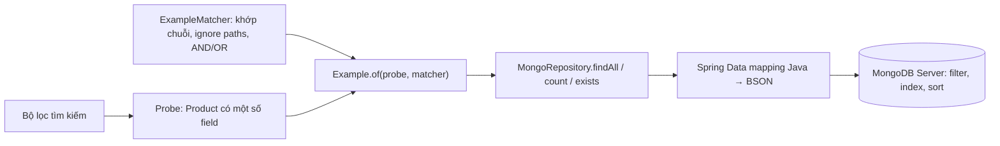

# Khớp chuỗi và tùy chỉnh theo từng thuộc tính

Khi xây một màn hình tìm kiếm sản phẩm, người dùng có thể nhập một phần tên, yêu cầu mã SKU khớp chính xác, tìm thương hiệu theo tiền tố và bỏ qua chữ hoa/chữ thường ở một số trường. **Spring Data MongoDB Query by Example (QBE)** cho phép diễn đạt các điều kiện này bằng **một object mẫu (probe)** và **`ExampleMatcher`**, không phải tự viết một phương thức repository cho mọi tổ hợp bộ lọc.

Điểm quan trọng của bài không chỉ là gọi `repository.findAll(example)`. Ta cần hiểu **thuộc tính nào của probe được đưa vào query**, `EXACT` khác `CONTAINING` như thế nào, cách override **từng property path** bằng `withMatcher`, và vì sao `matchingAny()` hoặc `ignoreCase()` áp dụng thiếu cẩn trọng có thể làm sai kết quả hoặc gây truy vấn tốn tài nguyên.

Bài học thuộc chương **Query by Example** của module `SPRING_DATA_MONGODB`. Spring Data MongoDB dùng repository hoặc `MongoTemplate` để kết nối, ánh xạ document và truy vấn MongoDB; khi truy vấn vượt khả năng QBE, ta có thể dùng `Query`/`Criteria`, aggregation, index và công cụ chẩn đoán hiệu năng. Các ví dụ bên dưới dùng Java 17+ với Spring Data MongoDB; hành vi cụ thể nên được xác minh qua integration test theo phiên bản đang triển khai.

Sau bài học, bạn có thể:

- Tạo `Example<T>` từ probe và `ExampleMatcher`, rồi dùng `MongoRepository` để tìm, đếm, kiểm tra tồn tại và phân trang.
- Phân biệt `EXACT`, `STARTING`, `ENDING`, `CONTAINING`, `REGEX` và cách Spring Data ánh xạ chúng sang điều kiện MongoDB.
- Kết hợp **mặc định toàn cục** với matcher riêng cho `name`, `sku`, `brand` hoặc thuộc tính lồng nhau.
- Dùng `withIgnorePaths`, `withIgnoreCase` và `withTransformer` một cách có chủ đích.
- Tránh đưa primitive mặc định, chuỗi rỗng, null và cả điều kiện phân quyền vào QBE sai cách.
- Nhận biết giới hạn của QBE, tác động của regex/collation lên index và thời điểm nên chuyển sang `MongoTemplate`.

## 1. QBE gồm ba phần: probe, matcher và executor



| Thành phần | Vai trò | Ví dụ |
| --- | --- | --- |
| **Probe** | Entity chứa giá trị muốn tìm | `tenantId = "T-A"`, `name = "note"`, các field còn lại null |
| **`ExampleMatcher`** | Quy định cách so sánh và bỏ qua thuộc tính | `name` dùng `contains().ignoreCase()` |
| **`Example<T>`** | Kết hợp probe với matcher | `Example.of(probe, matcher)` |
| **Repository executor** | Chạy `findAll`, `findOne`, `count`, `exists` hoặc phân trang | `repository.findAll(example)` |
| **MongoDB query** | Thực thi filter tại server | Điều kiện equality/regex được sinh từ example |

Không nên hiểu QBE như Java `equals()` so sánh hai object sau khi tải dữ liệu. QBE tạo **điều kiện truy vấn** từ các thuộc tính probe. MongoDB Server vẫn quyết định document khớp, dùng index nào, collation nào và số record trả về.

### 1.1. Khi nào QBE phù hợp?

QBE đặc biệt hữu ích cho **form tìm kiếm có nhiều ô nhập tùy chọn** với những so sánh tương đối đơn giản: bằng nhau, chứa chuỗi, bắt đầu/kết thúc bằng chuỗi, hoặc OR/AND giữa các thuộc tính.

Ví dụ người dùng chọn category BOOK, nhập tên chứa `"note"` và thương hiệu bắt đầu `"Sa"`. Cách thiết kế bằng QBE có thể ngắn, dễ bảo trì hơn một tên derived method ghép hàng loạt điều kiện. Tuy nhiên, QBE không phải query builder tổng quát: yêu cầu **giá trong khoảng**, `$in` theo danh sách, `$elemMatch` phức tạp, nhiều nhóm AND/OR có ngoặc, text search hoặc aggregation thường phù hợp hơn với `MongoTemplate`/`Criteria`.

## 2. Entity và dữ liệu minh họa

Giả sử mỗi sản phẩm trong collection `catalogProducts` có tenant, SKU, tên, thương hiệu, loại hàng, trạng thái, số lượng và ngày tạo:

```javascript
{
  _id: "P-101",
  tenantId: "T-A",
  sku: "BK-001",
  name: "Sakura Notebook",
  brand: "Sakura",
  category: "BOOK",
  active: true,
  stock: 12,
  createdAt: ISODate("2026-11-01T00:00:00Z"),
  _class: "catalog-product"
}
```

Entity Java được viết dưới dạng JavaBean để dễ tạo probe chỉ có vài field:

```java
import java.time.Instant;
import org.springframework.data.annotation.TypeAlias;
import org.springframework.data.mongodb.core.mapping.Document;
import org.springframework.data.mongodb.core.mapping.MongoId;

@Document(collection = "catalogProducts")
@TypeAlias("catalog-product")
public class CatalogProduct {

    @MongoId
    private String id;

    private String tenantId;
    private String sku;
    private String name;
    private String brand;
    private String category;
    private Boolean active;
    private Integer stock;
    private Instant createdAt;

    public CatalogProduct() {}

    public String getId() { return id; }
    public void setId(String id) { this.id = id; }
    public String getTenantId() { return tenantId; }
    public void setTenantId(String tenantId) { this.tenantId = tenantId; }
    public String getSku() { return sku; }
    public void setSku(String sku) { this.sku = sku; }
    public String getName() { return name; }
    public void setName(String name) { this.name = name; }
    public String getBrand() { return brand; }
    public void setBrand(String brand) { this.brand = brand; }
    public String getCategory() { return category; }
    public void setCategory(String category) { this.category = category; }
    public Boolean getActive() { return active; }
    public void setActive(Boolean active) { this.active = active; }
    public Integer getStock() { return stock; }
    public void setStock(Integer stock) { this.stock = stock; }
    public Instant getCreatedAt() { return createdAt; }
    public void setCreatedAt(Instant createdAt) { this.createdAt = createdAt; }
}
```

Kiểu wrapper `Boolean` và `Integer` ở đây là lựa chọn **có chủ đích**: một probe mới sẽ có `active == null`, `stock == null` và **không lọc theo hai trường đó** theo matcher mặc định. Nếu dùng primitive `boolean`/`int`, probe luôn có giá trị mặc định `false`/`0`, có thể sinh điều kiện ngoài ý muốn.

Repository:

```java
import org.springframework.data.mongodb.repository.MongoRepository;

public interface CatalogProductRepository
        extends MongoRepository<CatalogProduct, String> {
    // Không cần khai báo findAll(Example) để dùng QBE cơ bản.
}
```

`MongoRepository` cung cấp khả năng thực thi Query by Example thông qua các interface repository của Spring Data. `@MongoId String id` được chọn để dữ liệu demo giữ `_id` dưới dạng BSON String; nếu ứng dụng lưu ObjectId, phải khai báo/mapping nhất quán.

### 2.1. Dữ liệu thử nghiệm

```javascript
// Chỉ chạy trên database phát triển/test được phép reset.
db.catalogProducts.insertMany([
  { _id: "P-101", tenantId: "T-A", sku: "BK-001",
    name: "Sakura Notebook", brand: "Sakura", category: "BOOK",
    active: true, stock: 12,
    createdAt: ISODate("2026-11-01T00:00:00Z"),
    _class: "catalog-product" },
  { _id: "P-102", tenantId: "T-A", sku: "BK-002",
    name: "Basic Notebook", brand: "Zen", category: "BOOK",
    active: true, stock: 0,
    createdAt: ISODate("2026-11-02T00:00:00Z"),
    _class: "catalog-product" },
  { _id: "P-103", tenantId: "T-A", sku: "PN-001",
    name: "Blue Pen", brand: "Sakura", category: "PEN",
    active: false, stock: 25,
    createdAt: ISODate("2026-11-03T00:00:00Z"),
    _class: "catalog-product" },
  { _id: "P-104", tenantId: "T-B", sku: "BK-001",
    name: "Notebook for another tenant", brand: "Sakura",
    category: "BOOK", active: true, stock: 8,
    createdAt: ISODate("2026-11-04T00:00:00Z"),
    _class: "catalog-product" }
]);
```

Các SKU có thể trùng **giữa tenant** nhưng không nên trùng trong cùng tenant khi nghiệp vụ yêu cầu. Unique index gợi ý:

```javascript
db.catalogProducts.createIndex(
  { tenantId: 1, sku: 1 },
  { unique: true }
);
```

Trong thực tế phải kiểm tra dữ liệu trùng trước khi tạo index. **Không chạy `insertMany` nhiều lần với cùng `_id` trên collection đã có dữ liệu**; nếu muốn test tái lập, dùng MongoDB test instance/collection được cô lập.

Các document demo có `_class: "catalog-product"` tương ứng với `@TypeAlias("catalog-product")` vì **typed QBE** có thể đưa điều kiện type metadata vào query. Nếu dùng `mongosh` để insert document **không có `_class`**, một example typed có thể không tìm ra document dù các field khác hoàn toàn khớp. Trong ứng dụng thật, hãy seed dữ liệu qua mapping Spring Data hoặc cấu hình typed/untyped nhất quán; mục 10 sẽ giải thích sự khác biệt.

## 3. Tạo `Example` đầu tiên: so sánh chính xác

Ví dụ cần tìm SKU `"BK-001"` của tenant `"T-A"`:

```java
import java.util.List;
import org.springframework.data.domain.Example;
import org.springframework.data.domain.ExampleMatcher;

CatalogProduct probe = new CatalogProduct();
probe.setTenantId("T-A");
probe.setSku("BK-001");

ExampleMatcher matcher = ExampleMatcher.matchingAll();
Example<CatalogProduct> example = Example.of(probe, matcher);

List<CatalogProduct> results = repository.findAll(example);
// Với dữ liệu test: P-101 (không lấy P-104 của tenant T-B).
```

Trong đoạn này, `repository` là `CatalogProductRepository` được inject trong service/test. `ExampleMatcher.matchingAll()` yêu cầu **mọi thuộc tính được đưa vào query** cùng khớp (logic AND). Các property null trên probe bị bỏ qua theo mặc định, nên `name`, `brand`, `stock`... không trở thành điều kiện.

Ý nghĩa truy vấn gần như:

```javascript
db.catalogProducts.find({
  tenantId: "T-A",
  sku: "BK-001"
});
```

Đây là **minh họa filter nghiệp vụ**, không phải dump byte-for-byte của query mà Spring Data gửi. QBE MongoDB có thể bổ sung điều kiện kiểu dữ liệu (_class) theo chế độ typed matching; điều này được bàn thêm ở mục sau.

### 3.1. `matching()` và `matchingAll()`

`ExampleMatcher.matching()` là lựa chọn mặc định kiểu **tất cả điều kiện**; `matchingAll()` diễn đạt tường minh hơn khi bài toán yêu cầu AND. `matchingAny()` được dùng cho OR giữa các thuộc tính, **không thay thế cơ chế phân quyền**.

Trong ví dụ đa tenant, nên dùng `matchingAll()` để giữ `tenantId` là điều kiện bắt buộc. Một matcher OR đặt `tenantId` cùng `name` sẽ tạo lỗ hổng logic nếu được dùng không cẩn thận.

### 3.2. Thuộc tính `null` mặc định bị bỏ qua

Khi tạo một JavaBean mới:

```java
CatalogProduct probe = new CatalogProduct();
probe.setTenantId("T-A");
// Các field khác vẫn null.

Example<CatalogProduct> example = Example.of(probe);
```

Theo matcher mặc định, chỉ những property có giá trị thích hợp mới tham gia truy vấn. `null` không có nghĩa “tìm document có field null” mà thường là **không lọc field đó**. Nếu cần phân biệt BSON null/field vắng mặt, hãy thiết kế query rõ ràng bằng `Criteria` thay vì suy từ probe null.

## 4. Các kiểu khớp chuỗi: EXACT, STARTING, ENDING, CONTAINING, REGEX

`ExampleMatcher.StringMatcher` xác định cách một giá trị `String` trong probe được so với dữ liệu trong MongoDB. Các chế độ chính:

| Chế độ | Ý nghĩa | Probe `name = "note"` nên khớp |
| --- | --- | --- |
| `EXACT` | Toàn bộ chuỗi bằng giá trị probe | `"note"` |
| `STARTING` | Giá trị field bắt đầu bằng probe | `"notebook"`, `"note pad"` |
| `ENDING` | Giá trị field kết thúc bằng probe | `"my note"` |
| `CONTAINING` | Chuỗi probe xuất hiện ở bất kỳ vị trí nào | `"Notebook"` nếu bật ignoreCase |
| `REGEX` | Dùng probe như biểu thức chính quy | Kết quả phụ thuộc pattern và flag |
| `DEFAULT` | Theo mặc định được cấu hình | Thông thường khớp chính xác nếu chưa đặt lại |

**Lưu ý chữ hoa/chữ thường:** các ví dụ trong bảng chủ yếu giả định so sánh phân biệt case. `"Notebook"` không nên được coi tự động tương đương `"notebook"` nếu chưa bật `ignoreCase` hoặc thống nhất collation/chuẩn hóa.

### 4.1. Đặt mặc định khớp chuỗi toàn bộ

```java
import org.springframework.data.domain.ExampleMatcher.StringMatcher;

ExampleMatcher matcher = ExampleMatcher.matchingAll()
        .withStringMatcher(StringMatcher.CONTAINING)
        .withIgnoreCase();

CatalogProduct probe = new CatalogProduct();
probe.setTenantId("T-A");
probe.setName("note");

Example<CatalogProduct> example = Example.of(probe, matcher);
```

**Cảnh báo:** `withStringMatcher(CONTAINING)` và `withIgnoreCase()` áp dụng mặc định cho **các chuỗi được xét trong example**, trong đó có thể bao gồm `tenantId` hoặc `sku`. Nếu tenant `"T-A"` cần **khớp chính xác**, không nên dùng một mặc định quá rộng cho mọi String property. Phần tiếp theo sẽ khắc phục bằng matcher riêng cho từng field.

### 4.2. Chế độ khớp chuỗi có thể liên quan đến regex MongoDB

Về mặt ý nghĩa, `STARTING` thường tương đương một biểu thức được neo ở đầu như `^note`; `ENDING` là kết thúc như `note$`; `CONTAINING` là có phần chuỗi ở giữa. Spring Data có thể tạo các điều kiện regex phù hợp và áp dụng tùy chọn không phân biệt case.

Không cần giả định mọi chế độ khớp luôn phát cùng **BSON query literal** trong tất cả phiên bản. Khi hiệu năng hoặc ký tự đặc biệt quan trọng, kiểm tra command thật của Java Driver và thực thi trên MongoDB test instance.

### 4.3. Chế độ REGEX phải được dùng có kiểm soát

`REGEX` dành cho trường hợp nghiệp vụ thật sự cần pattern như `"^BK-[0-9]{3}$"`, không phải chế độ tìm kiếm mặc định cho input công khai. Một pattern do người dùng cung cấp có thể làm truy vấn khác ý định, tăng CPU hoặc gây từ chối dịch vụ khi quá phức tạp.

Với UI chỉ muốn “tên chứa từ khóa”, ưu tiên `contains()`, giới hạn độ dài từ khóa, xác định cách xử lý ký tự đặc biệt và đo trên dữ liệu thực. Nếu cần regex nâng cao, cân nhắc xây `Criteria.regex(...)` với validation và quyền truy cập rõ ràng.

## 5. `withMatcher`: cấu hình riêng từng property

Đây là kỹ thuật quan trọng nhất của chủ đề. Giả sử yêu cầu:

- `tenantId` phải **khớp chính xác**, phân biệt case.
- `sku` phải **khớp chính xác**, phân biệt case.
- `name` cần **chứa** một chuỗi và **không phân biệt case**.
- `brand` cần **bắt đầu bằng** một chuỗi và **không phân biệt case**.
- Các field khác không được tạo điều kiện ngoài ý muốn.

```java
import org.springframework.data.domain.Example;
import org.springframework.data.domain.ExampleMatcher;
import org.springframework.data.domain.ExampleMatcher.StringMatcher;

CatalogProduct probe = new CatalogProduct();
probe.setTenantId("T-A");
probe.setSku("BK-001");
probe.setName("note");
probe.setBrand("sa");

ExampleMatcher matcher = ExampleMatcher.matchingAll()
        // Mặc định tất cả String khác phải khớp chính xác, phân biệt case.
        .withStringMatcher(StringMatcher.EXACT)
        .withMatcher("name", rule -> rule.contains().ignoreCase())
        .withMatcher("brand", rule -> rule.startsWith().ignoreCase())
        .withMatcher("sku", rule -> rule.exact())
        .withIgnorePaths("id", "createdAt", "stock");

Example<CatalogProduct> example = Example.of(probe, matcher);
List<CatalogProduct> products = repository.findAll(example);
// Dữ liệu mẫu: P-101.
```

Ở đây `withMatcher("name", ...)` chỉ thay quy tắc cho **property `name`**. `brand` có thể có quy tắc khác, còn `tenantId` và `sku` giữ mặc định khớp chính xác. Các tên trong `withMatcher` là **property path Java được mapping**, không phải chuỗi SQL hoặc JSON tự do.

Về mặt logic, đây là:

```text
tenantId == "T-A"
AND sku == "BK-001"
AND lower(name) contains "note"     // Minh họa ý nghĩa, không phải cú pháp query MongoDB.
AND lower(brand) starts with "sa"
```

**Không suy rằng Spring Data gọi hàm `lower(...)` ở server.** Với MongoDB, khớp chuỗi không phân biệt case thường được diễn đạt bằng regex và flag thích hợp. Biểu diễn trên chỉ giúp đọc ý định của phép so sánh.

### 5.1. Matcher theo thuộc tính ghi đè mặc định toàn cục

Nếu đặt mặc định `CONTAINING` nhưng SKU cần exact, có thể override:

```java
ExampleMatcher matcher = ExampleMatcher.matchingAll()
        .withStringMatcher(StringMatcher.CONTAINING)
        .withMatcher("sku", rule -> rule.exact())
        .withMatcher("tenantId", rule -> rule.exact());
```

Tuy nhiên, khi thêm thuộc tính String mới vào entity, **nó cũng có thể thừa hưởng mặc định CONTAINING** nếu được đặt giá trị trong probe. Vì vậy, trong ứng dụng đa tenant hoặc dữ liệu nhạy cảm, thường an toàn hơn khi **mặc định EXACT và chỉ mở rộng cho field tìm kiếm được cho phép**, như ví dụ chính.

### 5.2. Bỏ qua thuộc tính bằng `withIgnorePaths`

```java
ExampleMatcher matcher = ExampleMatcher.matchingAll()
        .withIgnorePaths("id", "createdAt", "stock")
        .withMatcher("name", rule -> rule.contains().ignoreCase());
```

`withIgnorePaths` giúp loại các property khỏi query ngay cả khi probe có giá trị. Nó hữu ích với ID, timestamp hoặc các giá trị mặc định do object constructor tạo ra. **Nhưng bỏ qua không tương đương sửa dữ liệu gốc**: object probe vẫn có giá trị, chỉ matcher không dùng chúng làm điều kiện.

Nếu muốn kiểm tra tồn kho `stock >= 10`, bỏ qua `stock` rồi dùng QBE cũng **không thể biểu diễn phép so sánh lớn hơn**. Với truy vấn có khoảng số, chuyển sang `Criteria.where("stock").gte(10)`.

## 6. Tùy chỉnh chữ hoa/chữ thường theo từng thuộc tính

Giả sử SKU phân biệt case theo quy tắc nội bộ, nhưng người dùng có thể gõ tên không đúng chữ hoa/chữ thường. Mặc định an toàn thường là **case-sensitive**, chỉ bật `ignoreCase()` cho các field người dùng thật sự tìm kiếm linh hoạt.

```java
ExampleMatcher matcher = ExampleMatcher.matchingAll()
        .withMatcher("name", rule -> rule.contains().ignoreCase())
        .withMatcher("brand", rule -> rule.startsWith().ignoreCase())
        .withMatcher("sku", rule -> rule.exact());
```

Với `name = "NOTE"` và `tenantId = "T-A"`, ví dụ dữ liệu có `"Sakura Notebook"` và `"Basic Notebook"` đều có thể khớp nếu rule `name` là `contains().ignoreCase()`. `"Notebook for another tenant"` chỉ được loại nếu **tenant được áp điều kiện AND chính xác**.

### 6.1. Case-insensitive khác bỏ dấu tiếng Việt

`ignoreCase()` hướng tới xử lý khác biệt **chữ hoa/chữ thường**, không có nghĩa nó tự chuẩn hóa mọi dấu tiếng Việt, Unicode normalization hoặc quy tắc ngôn ngữ phức tạp. Chẳng hạn, một hệ thống cần xem `"ca phe"` tương đương `"cà phê"` phải có thiết kế tìm kiếm/chuẩn hóa riêng.

MongoDB có collation hỗ trợ so sánh theo locale cho nhiều kiểu truy vấn, nhưng **regex có `i` không tự sử dụng index collation theo cách so sánh equality thông thường**. Nếu yêu cầu là tìm kiếm đa ngôn ngữ, không phân biệt dấu, typo-tolerant hoặc full-text có xếp hạng, hãy cân nhắc cơ chế search phù hợp thay vì cố biến QBE thành công cụ tìm kiếm toàn văn.

### 6.2. Mặc định case-sensitive và override

```java
import org.springframework.data.domain.ExampleMatcher.StringMatcher;

ExampleMatcher matcher = ExampleMatcher.matchingAll()
        .withStringMatcher(StringMatcher.EXACT)
        .withMatcher("name", rule -> rule.endsWith().ignoreCase());
```

Ở đây `tenantId` và `sku` giữ mặc định exact; `name` dùng hậu tố không phân biệt case. Nếu trước đó bật `withIgnoreCase()` **toàn cục**, matcher của field không tự trở lại case-sensitive chỉ vì gọi `exact()`; mỗi setting có thứ tự ưu tiên riêng và property thừa hưởng default nếu chưa override. Cách dễ kiểm soát nhất là **không bật ignoreCase toàn cục khi có các field khóa phải chính xác**.

## 7. Làm sạch giá trị probe bằng `withTransformer`

`ExampleMatcher` còn hỗ trợ **property value transformer**, dùng để chuẩn bị giá trị probe trước khi xây predicate. Tình huống quen thuộc: UI gửi `"  note  "` nhưng người dùng muốn tìm `"note"`.

```java
import org.springframework.data.domain.ExampleMatcher;

ExampleMatcher matcher = ExampleMatcher.matchingAll()
        .withMatcher("name", rule -> rule.contains().ignoreCase())
        .withTransformer(
                "name",
                input -> input.map(value -> ((String) value).trim()));
```

`withTransformer` nhận `Optional<Object>` chứa giá trị của thuộc tính được cấu hình và trả về optional đã biến đổi. Trong ví dụ này, `"  note  "` được trim thành `"note"` trước khi áp matcher. **Chỉ ép kiểu `String` khi chắc chắn property là String**.

### 7.1. Nên chuẩn hóa input ở service hay matcher?

Thông thường, service vẫn nên chuẩn hóa và validate input trước khi tạo probe:

```java
String cleaned = rawName == null ? null : rawName.trim();

if (cleaned != null && cleaned.length() > 80) {
    throw new IllegalArgumentException("Từ khóa quá dài");
}
if (cleaned != null && cleaned.isBlank()) {
    cleaned = null; // Quy ước: không nhập gì thì không lọc tên.
}

CatalogProduct probe = new CatalogProduct();
probe.setTenantId(authorizedTenantId);
probe.setName(cleaned);
```

`withTransformer` hữu ích để dùng lại một quy tắc theo property, nhưng **không thay validation**, phân quyền, hoặc việc xác định input rỗng nghĩa là gì. Nếu chỉ dùng transformer để biến chuỗi trắng thành chuỗi rỗng, một matcher `contains()` có thể tạo filter rộng gần như khớp tất cả document.

### 7.2. Giữ nguyên dữ liệu gốc

Transformer tác động lên **giá trị dùng xây query**, không phải lệnh cập nhật MongoDB và không phải nơi để sửa entity đang lưu. Nếu nghiệp vụ muốn lưu SKU luôn ở dạng viết hoa, việc chuẩn hóa phải nằm trong đường **ghi dữ liệu** hoặc domain validation; chỉ chuẩn hóa query không bảo đảm dữ liệu đã được lưu nhất quán.

## 8. `matchingAll`, `matchingAny` và rủi ro lọt dữ liệu tenant

`matchingAll()` tương ứng việc các predicate từ probe cần đồng thời thỏa mãn. `matchingAny()` yêu cầu **ít nhất một** predicate khớp.

Ví dụ probe:

```java
CatalogProduct probe = new CatalogProduct();
probe.setTenantId("T-A");
probe.setName("blue");

ExampleMatcher matcher = ExampleMatcher.matchingAny()
        .withMatcher("name", rule -> rule.contains().ignoreCase());

Example<CatalogProduct> example = Example.of(probe, matcher);
```

Ý nghĩa có thể gần như:

```text
tenantId == "T-A"  OR  name contains "blue"
```

Điều này **không phù hợp** với một màn hình phải luôn giới hạn `tenantId = "T-A"`. Một sản phẩm của tenant khác có tên chứa `"blue"` cũng có thể khớp. Ngược lại, mọi sản phẩm T-A có thể được trả về dù tên chẳng liên quan `"blue"`.

**Không dùng `matchingAny()` để ghép một điều kiện bảo mật bắt buộc với các bộ lọc tùy chọn**. Với bài toán `tenant AND (name OR brand)`, dùng `MongoTemplate`:

```java
import java.util.List;
import java.util.regex.Pattern;
import org.springframework.data.mongodb.core.MongoTemplate;
import org.springframework.data.mongodb.core.query.Criteria;
import org.springframework.data.mongodb.core.query.Query;

// authorizedTenantId lấy từ security context; rawKeyword đã validate.
String keyword = rawKeyword.trim();
if (keyword.isEmpty() || keyword.length() > 80) {
    throw new IllegalArgumentException("Từ khóa không hợp lệ");
}
Pattern safePattern = Pattern.compile(
        Pattern.quote(keyword),
        Pattern.CASE_INSENSITIVE | Pattern.UNICODE_CASE);

Criteria filter = new Criteria().andOperator(
        Criteria.where("tenantId").is(authorizedTenantId),
        new Criteria().orOperator(
                Criteria.where("name").regex(safePattern),
                Criteria.where("brand").regex(safePattern)
        )
);

List<CatalogProduct> matches = mongoTemplate.find(
        Query.query(filter).limit(20),
        CatalogProduct.class
);
```

Đoạn này thuộc một method service có `mongoTemplate`, `authorizedTenantId` và `rawKeyword` đã được khai báo. `Pattern.quote(keyword)` biểu diễn **chuỗi chữ bình thường**, không cho input người dùng tự biến thành regex operator. Query vẫn cần index và giới hạn kết quả, nhất là với regex không neo ở đầu.

### 8.1. `matchingAny` không biểu diễn nhóm có ngoặc

QBE cơ bản không diễn đạt tùy ý các cấu trúc như:

```text
tenant = T-A
AND status = ACTIVE
AND (name contains "note" OR brand startsWith "sa")
AND priceVnd BETWEEN 50000 AND 150000
```

`matchingAny` chỉ đổi cách kết hợp **những predicate suy ra từ probe**, không tạo nhóm OR nằm bên trong một AND bao ngoài rồi thêm khoảng số. Đó là ranh giới rõ ràng để chuyển sang `Criteria` hoặc aggregation.

## 9. Null, chuỗi rỗng, primitive và các field không muốn lọc

QBE phụ thuộc mạnh vào **giá trị hiện có trên probe**:

| Giá trị trong probe | Hành vi thường gặp | Cần chú ý |
| --- | --- | --- |
| `name = null` | Không lọc theo name theo mặc định | Không có nghĩa tìm `name: null` |
| `name = ""` | Là String **không null**, có thể tham gia query | `contains("")` có thể khớp rất rộng |
| `active = Boolean.FALSE` | Lọc `active = false` | `false` có ý nghĩa khác với không truyền filter |
| `active = null` | Bỏ qua active | Phù hợp bộ lọc có ba trạng thái: mọi/true/false |
| `stock = Integer.valueOf(0)` | Lọc stock bằng 0 | Không phải `stock >= 0` |
| `id = "P-101"` | Có thể lọc theo ID | Dễ vô tình giới hạn còn một document |
| `createdAt` có giá trị | Có thể bị lọc equality chính xác | Thường không phù hợp bộ lọc khoảng thời gian |

### 9.1. Primitive luôn có giá trị

Một entity khác dùng:

```java
@Document("sampleProducts")
class PrimitiveProduct {
    @MongoId String id;
    int stock;       // Mặc định 0.
    boolean active;  // Mặc định false.
    String name;
}
```

Khi tạo `new PrimitiveProduct()` chỉ rồi set `name`, QBE vẫn thấy `stock = 0` và `active = false`. Vì các primitive không thể null, chúng có thể bị đưa vào điều kiện ngay cả khi form không yêu cầu.

Giải pháp: dùng wrapper nullable cho probe; hoặc cấu hình:

```java
ExampleMatcher matcher = ExampleMatcher.matchingAll()
        .withIgnorePaths("id", "stock", "active");
```

**Không bỏ qua field `active` nếu form thật sự muốn lọc active**. Lựa chọn đúng phụ thuộc ý nghĩa input, không phải luôn ignore mọi primitive.

### 9.2. `withIncludeNullValues()` không nên là mặc định của form tìm kiếm

```java
ExampleMatcher matcher = ExampleMatcher.matchingAll()
        .withIncludeNullValues();
```

Chế độ này yêu cầu kể cả các thuộc tính probe null cũng được xét. Với một entity có nhiều field optional, nó có thể sinh điều kiện null không mong muốn, thu hẹp kết quả hoặc làm logic với **embedded document** phức tạp hơn. Spring Data MongoDB có cách xử lý đặc thù khi include null cho embedded documents, liên quan tới so khớp cấu trúc document.

MongoDB cũng phân biệt yêu cầu **field có BSON null** với **field hoàn toàn không tồn tại** khi dùng các toán tử phù hợp; một filter equality với null có thể khớp cả hai. Nếu UI yêu cầu “chỉ tìm tài liệu thiếu trường `description`”, nên dùng query rõ:

```java
Query query = Query.query(
        Criteria.where("description").exists(false));
```

Với yêu cầu “field có giá trị null nhưng tồn tại”, có thể dùng `Criteria.where("description").is(null).exists(true)`. Các điều kiện này rõ nghĩa hơn việc kích hoạt include-null toàn cục rồi phải bỏ qua mọi property không liên quan.

### 9.3. Không dùng entity đã tải từ MongoDB làm probe một cách máy móc

Nếu lấy một `CatalogProduct` đầy đủ bằng `findById` rồi biến nó thành `Example`, tất cả các field không null như `id`, `active`, `stock`, `createdAt` có thể trở thành điều kiện. Query có thể vô tình chỉ tìm lại chính record đó.

Hãy **tạo probe mới chỉ chứa các field được chọn từ input đã xác thực**, không dùng entity đầy đủ hoặc object sinh sẵn default values làm query builder. Dùng `withIgnorePaths` để bổ sung lớp bảo vệ cho những property không bao giờ được tham gia form search.

## 10. Typed và untyped QBE trong Spring Data MongoDB

MongoDB có thể chứa nhiều loại document trong cùng một collection. Spring Data thường lưu metadata type vào field `_class`, ví dụ `"catalog-product"` khi entity có `@TypeAlias("catalog-product")`.

**Typed QBE** (mặc định) không chỉ so các field probe; Spring Data còn có thể giới hạn document theo **kiểu entity của probe và các kiểu tương thích**. Bởi vậy, nếu seed trực tiếp qua `mongosh` mà không có `_class`, một query typed có thể không tìm thấy dữ liệu dù `tenantId` và `sku` đúng.

### 10.1. Dùng `UntypedExampleMatcher` khi cố ý không lọc theo `_class`

```java
import org.springframework.data.domain.Example;
import org.springframework.data.domain.ExampleMatcher;
import org.springframework.data.mongodb.core.query.UntypedExampleMatcher;

CatalogProduct probe = new CatalogProduct();
probe.setTenantId("T-A");
probe.setName("note");

ExampleMatcher matcher = UntypedExampleMatcher.matchingAll()
        .withMatcher("name", rule -> rule.contains().ignoreCase());

Example<CatalogProduct> example = Example.of(probe, matcher);
List<CatalogProduct> matches = repository.findAll(example);
```

`UntypedExampleMatcher` bỏ yêu cầu type restriction do QBE mặc định thêm, cho phép tra cứu document không có metadata type hoặc ở collection chứa những loại đối tượng khác nhau, **miễn field và ánh xạ phù hợp**.

Nhưng untyped không phải cách “chữa mọi query không thấy kết quả”:

- Nó có thể trả document từ **loại entity khác** trong collection nếu field tình cờ khớp.
- Converter sẽ cố ánh xạ kết quả vào kiểu đích, có thể gặp giá trị không phù hợp.
- Việc bỏ type restriction **không thay thế filter tenant, status, quyền truy cập**.
- Nên dùng khi schema/collection thực sự hỗ trợ nhiều kiểu hoặc đã chủ động bỏ type hints.

### 10.2. `@TypeAlias` cần mapping context nhận diện

Khi lưu dữ liệu có `@TypeAlias`, Spring Data cần mapping context biết alias tương ứng với class. Trong những cấu hình đặc biệt (ví dụ đọc trước khi entity type được scan/khởi tạo), có thể cần cấu hình tập entity khởi tạo trước. **Không tự thêm hoặc xóa `_class` của dữ liệu production** chỉ để làm một test đi qua; xác minh converter, entity scanning và chiến lược typed/untyped.

## 11. Matcher cho thuộc tính lồng nhau

`withMatcher` không chỉ hỗ trợ field cấp đầu. Với embedded document, bạn có thể mô tả **property path** như `manufacturer.name` hoặc `address.city`, miễn Spring Data nhận diện được đường dẫn trên entity.

Giả sử một mô hình bổ sung:

```java
import org.springframework.data.mongodb.core.mapping.Document;
import org.springframework.data.mongodb.core.mapping.MongoId;

record Manufacturer(
        String name,
        String countryCode
) {}

@Document(collection = "suppliedProducts")
public record SuppliedProduct(
        @MongoId String id,
        String tenantId,
        Manufacturer manufacturer
) {}
```

Tạo probe có nested property:

```java
import org.springframework.data.domain.Example;
import org.springframework.data.domain.ExampleMatcher;

SuppliedProduct probe = new SuppliedProduct(
        null,
        "T-A",
        new Manufacturer("saku", null));

ExampleMatcher matcher = ExampleMatcher.matchingAll()
        .withMatcher(
                "manufacturer.name",
                rule -> rule.startsWith().ignoreCase());

Example<SuppliedProduct> example = Example.of(probe, matcher);
```

Về ý nghĩa, QBE kiểm tra `tenantId == "T-A"` **và** `manufacturer.name` bắt đầu bằng `"saku"` không phân biệt case. `manufacturer.countryCode == null` mặc định không tham gia; `id == null` cũng vậy.

### 11.1. Property path Java khác tên field BSON

Nếu model có:

```java
import org.springframework.data.mongodb.core.mapping.Field;

@Field("display_name")
private String displayName;
```

thì matcher thường khai báo `withMatcher("displayName", ...)` theo **thuộc tính domain**, để Spring Data mapper chuyển sang field `display_name` trong BSON. Không tự ghép tùy ý tên field từ request của client mà không kiểm tra nó nằm trong tập property được phép tìm kiếm.

### 11.2. Embedded object không phải mọi trường hợp đều đơn giản

QBE có thể hoạt động với property path lồng nhau, nhưng việc khớp **array, map, nested object phức tạp và null trong embedded document** có giới hạn. Đặc biệt, khi bật `withIncludeNullValues()`, Spring Data MongoDB có thể dùng cơ chế **khớp embedded document như một giá trị đầy đủ**, đòi hỏi đúng thứ tự property trong BSON và khác so sánh từng đường dẫn bằng dot notation.

Nếu yêu cầu là “mảng `tags` có ít nhất một phần tử thỏa điều kiện phức tạp”, “bất kỳ phần tử `lines` có SKU A và quantity trên 3”, hoặc cần điều kiện `$elemMatch`, hãy dùng `Query`/`Criteria`. Không nên cố tạo probe lồng nhiều object rồi hy vọng QBE biểu diễn chính xác mọi toán tử MongoDB.

## 12. Chạy example qua repository và `MongoTemplate`

### 12.1. Tìm tất cả, sắp xếp và phân trang

Ví dụ tìm sản phẩm thuộc tenant T-A có tên chứa từ khóa:

```java
import org.springframework.data.domain.Example;
import org.springframework.data.domain.ExampleMatcher;
import org.springframework.data.domain.Page;
import org.springframework.data.domain.PageRequest;
import org.springframework.data.domain.Sort;
import java.util.List;

CatalogProduct probe = new CatalogProduct();
probe.setTenantId("T-A");
probe.setName("note");

ExampleMatcher matcher = ExampleMatcher.matchingAll()
        .withMatcher("name", rule -> rule.contains().ignoreCase());
Example<CatalogProduct> example = Example.of(probe, matcher);

Sort sort = Sort.by(
        Sort.Order.asc("sku"),
        Sort.Order.asc("id"));

List<CatalogProduct> rows = repository.findAll(example, sort);
Page<CatalogProduct> page = repository.findAll(
        example, PageRequest.of(0, 20, sort));
```

`repository.findAll(example, sort)` phù hợp với kết quả nhỏ hoặc đã có giới hạn nghiệp vụ. Nếu collection lớn, nên dùng `PageRequest` hoặc API phân trang phù hợp, tránh trả về `List` không giới hạn cho endpoint công khai. `Page` có thể cần đếm thêm số document để tính metadata tổng; `Sort`/`Pageable` không sửa nội dung predicate được tạo từ probe.

### 12.2. Đếm và kiểm tra tồn tại

```java
long total = repository.count(example);
boolean found = repository.exists(example);
```

`count(example)` đếm document thỏa các điều kiện QBE; `exists(example)` chỉ trả boolean. Không cần gọi `findAll(example).size()` chỉ để đếm, vì cách đó có thể tải quá nhiều document. `exists` không thay thế unique index hay chính sách phân quyền: hai request có thể cùng thấy chưa có SKU rồi cùng insert.

### 12.3. `findOne(example)` không phải “lấy bản bất kỳ”

```java
import java.util.Optional;

Optional<CatalogProduct> one = repository.findOne(example);
```

`findOne` thích hợp khi nghiệp vụ mong **không quá một** document khớp, ví dụ `tenantId + sku` có unique index. Nếu nhiều document khớp, Spring Data có thể ném `IncorrectResultSizeDataAccessException`; không dùng `findOne` như cách thay thế `findFirst` khi người dùng chỉ muốn một kết quả bất kỳ.

### 12.4. Dùng QBE trong `MongoTemplate`

Spring Data MongoDB còn hỗ trợ tạo `Criteria` từ `Example`:

```java
import java.util.List;
import org.springframework.data.domain.Example;
import org.springframework.data.mongodb.core.MongoTemplate;
import org.springframework.data.mongodb.core.query.Criteria;
import org.springframework.data.mongodb.core.query.Query;

// example đã được tạo bằng probe và matcher ở trên.
Query query = Query.query(new Criteria().alike(example))
        .limit(20);

List<CatalogProduct> matches = mongoTemplate.find(
        query, CatalogProduct.class);
```

`Criteria.alike(example)` giúp sử dụng QBE ở tầng template khi cần query context khác. Nhưng đừng mặc định có thể ghép mọi loại filter phức tạp mà không kiểm tra BSON được sinh ra, đặc biệt nếu còn nhóm OR, typed restriction hoặc nested document. Nếu truy vấn đã có nhiều phép khoảng, aggregation hay geospatial, viết `Criteria` tường minh thường dễ bảo trì hơn.

## 13. Hiệu năng: regex, index và số lượng document trả về

Việc chuyển `findAll(Example)` xuống MongoDB Server không có nghĩa truy vấn tự nhanh. Tốc độ phụ thuộc **filter thực**, index, phân phối dữ liệu, số document match, regex pattern và số byte kết quả.

### 13.1. `DEFAULT` và `EXACT` giống ý nghĩa nhưng không nhất thiết giống BSON

Với Spring Data MongoDB, phần so sánh String mặc định và chế độ `EXACT` có thể được ánh xạ khác nhau:

| Chế độ | Hình dạng query thường gặp | Hệ quả cần đánh giá |
| --- | --- | --- |
| `DEFAULT` case-sensitive | `{sku: "BK-001"}` | Equality phù hợp với index theo khóa |
| `EXACT` case-sensitive | `{sku: {$regex: /^BK-001$/}}` | Regex neo cả đầu/cuối, tương đương về ý nghĩa nhưng query plan có thể khác |
| `STARTING` case-sensitive | `{name: {$regex: /^Note/}}` | Regex neo đầu, có thể tận dụng prefix index trong một số điều kiện |
| `ENDING` | `{name: {$regex: /book$/}}` | Thường khó tận dụng B-tree index để giới hạn prefix |
| `CONTAINING` | `{name: {$regex: /.*note.*/i}}` | Dễ phải quét nhiều index key/document |
| `REGEX` | Pattern tùy người gọi | Cần kiểm tra pattern, độ an toàn và kế hoạch thực thi |

Bảng mô tả **dạng truy vấn minh họa theo tài liệu Spring Data**, không bảo đảm chuỗi JSON/regex chính xác cho mọi phiên bản/converter. MongoDB có thể tối ưu một số regex có prefix cố định; nhưng **không suy rằng regex chứa chuỗi hoặc case-insensitive sẽ dùng index hiệu quả**.

**Khuyến nghị cho khóa nghiệp vụ:** với `tenantId` và `sku` cần equality chính xác, hãy để `StringMatcher.DEFAULT` case-sensitive khi phù hợp, thay vì áp `EXACT` dạng anchored regex chỉ để diễn đạt chữ “exact”. Trong bài, `withMatcher("sku", rule -> rule.exact())` minh họa override matcher; với workload thật, so sánh query plan và cân nhắc giữ matcher mặc định để dùng index equality hiệu quả hơn.

### 13.2. Thiết kế index theo query thực tế

```javascript
// Tìm SKU chính xác trong tenant.
db.catalogProducts.createIndex(
  { tenantId: 1, sku: 1 },
  { unique: true }
);

// Nếu thường lọc tenant + category và sắp xếp theo SKU:
db.catalogProducts.createIndex(
  { tenantId: 1, category: 1, sku: 1 }
);
```

Không tạo mọi index trong ví dụ nếu workload không cần; mỗi index tốn lưu trữ và làm chậm ghi. Với trường `name` tìm chứa chuỗi không phân biệt case, một B-tree index thông thường thường không đem lại hiệu quả như tìm equality/prefix case-sensitive. Nếu tìm kiếm văn bản là chức năng chính, hãy đánh giá chiến lược **normalized search field**, MongoDB Search hoặc search engine chuyên biệt tùy môi trường.

### 13.3. Dùng `explain` để phân tích

```javascript
db.catalogProducts.find({
  tenantId: "T-A",
  sku: "BK-001"
}).explain("executionStats");

db.catalogProducts.find({
  tenantId: "T-A",
  name: { $regex: ".*note.*", $options: "i" }
}).limit(20).explain("executionStats");
```

Quan sát `IXSCAN`/`COLLSCAN`, `totalDocsExamined`, `totalKeysExamined`, số document trả về và thời gian thực thi. Kết quả với bốn document demo không phản ánh đúng collection triệu bản ghi; đo trên dữ liệu đại diện và quan sát command thực do Spring Data sinh ra.

Trong MongoDB, regex case-insensitive có những giới hạn với collation-aware indexes. Việc chỉ thêm index collation để “tăng tốc mọi truy vấn ignoreCase” có thể không đem lại kết quả mong muốn nếu query thực tế là `$regex` với option `i`.

### 13.4. Dừng sớm và giới hạn request

Một tìm kiếm `contains("a")` có thể khớp gần hết collection. Ngoài index, endpoint cần:

- Giới hạn **độ dài và độ hợp lệ** của input; từ chối hoặc bỏ qua chuỗi rỗng theo hợp đồng API.
- Bắt buộc **tenant/permission** trong điều kiện truy vấn; không dựa vào lọc sau khi nhận dữ liệu.
- Có **limit/Pageable**, giới hạn page size; tránh offset quá sâu khi dữ liệu lớn.
- Đo **query latency**, số kết quả, số byte trả về; bảo vệ API bằng quota/rate limit khi phù hợp.
- Không ghi dữ liệu cá nhân hoặc toàn bộ keyword nhạy cảm vào log truy vấn một cách không kiểm soát.

**QBE là công cụ tạo filter, không phải cơ chế tự quản lý hiệu năng.** Một matcher “thân thiện với lập trình viên” vẫn có thể gửi một regex rất đắt xuống MongoDB Server.

## 14. Kiểm thử tích hợp với MongoDB thật

Khi dùng QBE, unit test mock repository có thể xác nhận `findAll(example)` đã được gọi, nhưng **không xác nhận** matcher tạo đúng BSON filter, `_class` có khớp, case-insensitive hoạt động theo kỳ vọng hay query có quét dữ liệu quá rộng. Nên kiểm thử với **MongoDB test instance riêng**, ví dụ Testcontainers và `@DataMongoTest` trong Spring Boot 3.x.

### 14.1. Chuẩn bị dữ liệu từ mapping Spring Data

Với `CatalogProduct` và repository ở mục 2:

```java
import static org.assertj.core.api.Assertions.assertThat;

import java.time.Instant;
import java.util.List;
import org.junit.jupiter.api.BeforeEach;
import org.junit.jupiter.api.Test;
import org.springframework.beans.factory.annotation.Autowired;
import org.springframework.boot.test.autoconfigure.data.mongo.DataMongoTest;
import org.springframework.data.domain.Example;
import org.springframework.data.domain.ExampleMatcher;
import org.springframework.data.domain.Sort;
import org.springframework.data.mongodb.core.MongoTemplate;
import org.springframework.data.mongodb.core.query.Query;

@DataMongoTest
class CatalogQbeIntegrationTest {

    @Autowired CatalogProductRepository repository;
    @Autowired MongoTemplate template;

    @BeforeEach
    void setUp() {
        // Chỉ thực hiện trên MongoDB test được cô lập.
        template.remove(new Query(), CatalogProduct.class);

        template.insertAll(List.of(
                item("P-101", "T-A", "BK-001",
                        "Sakura Notebook", "Sakura", "BOOK", true, 12),
                item("P-102", "T-A", "BK-002",
                        "Basic Notebook", "Zen", "BOOK", true, 0),
                item("P-103", "T-A", "PN-001",
                        "Blue Pen", "Sakura", "PEN", false, 25),
                item("P-104", "T-B", "BK-001",
                        "Notebook for another tenant",
                        "Sakura", "BOOK", true, 8)
        ));
    }

    private CatalogProduct item(
            String id, String tenantId, String sku,
            String name, String brand, String category,
            boolean active, int stock
    ) {
        CatalogProduct p = new CatalogProduct();
        p.setId(id);
        p.setTenantId(tenantId);
        p.setSku(sku);
        p.setName(name);
        p.setBrand(brand);
        p.setCategory(category);
        p.setActive(active);
        p.setStock(stock);
        p.setCreatedAt(Instant.parse("2026-11-01T00:00:00Z"));
        return p;
    }

    @Test
    void containsIgnoreCaseMatchesOnlyAuthorizedTenant() {
        CatalogProduct probe = new CatalogProduct();
        probe.setTenantId("T-A");
        probe.setName("NOTE");

        ExampleMatcher matcher = ExampleMatcher.matchingAll()
                .withMatcher(
                        "name",
                        rule -> rule.contains().ignoreCase());

        List<CatalogProduct> found = repository.findAll(
                Example.of(probe, matcher),
                Sort.by(Sort.Order.asc("sku")));

        assertThat(found).extracting(CatalogProduct::getId)
                .containsExactly("P-101", "P-102");
    }

    @Test
    void differentPropertiesCanUseDifferentStringRules() {
        CatalogProduct probe = new CatalogProduct();
        probe.setTenantId("T-A");
        probe.setSku("BK-001");
        probe.setName("note");
        probe.setBrand("sa");

        ExampleMatcher matcher = ExampleMatcher.matchingAll()
                .withMatcher("name",
                        rule -> rule.contains().ignoreCase())
                .withMatcher("brand",
                        rule -> rule.startsWith().ignoreCase());

        List<CatalogProduct> found =
                repository.findAll(Example.of(probe, matcher));
        assertThat(found).extracting(CatalogProduct::getId)
                .containsExactly("P-101");
    }

    @Test
    void nullableBooleanIsOnlyIncludedWhenSupplied() {
        CatalogProduct probe = new CatalogProduct();
        probe.setTenantId("T-A");
        probe.setCategory("PEN");

        // active == null: không lọc trạng thái, vẫn tìm P-103.
        assertThat(repository.count(Example.of(probe))).isEqualTo(1);

        probe.setActive(true);
        // P-103 có active=false, không còn khớp.
        assertThat(repository.count(Example.of(probe))).isZero();
    }

    @Test
    void matchingAnyDoesNotEnforceTenantBoundary() {
        CatalogProduct probe = new CatalogProduct();
        probe.setTenantId("T-A");
        probe.setName("another tenant");

        ExampleMatcher unsafe = ExampleMatcher.matchingAny()
                .withMatcher("name",
                        rule -> rule.contains().ignoreCase());

        List<CatalogProduct> matches =
                repository.findAll(Example.of(probe, unsafe));

        // CỐ Ý chứng minh rủi ro, KHÔNG dùng matcher này cho endpoint.
        assertThat(matches).extracting(CatalogProduct::getId)
                .contains("P-104");
    }
}
```

Test dùng `template.insertAll` để Spring Data tự ghi metadata mapping phù hợp (nếu cấu hình có lưu type hints), tránh vấn đề seed `mongosh` không có `_class`. Nếu production chủ động tắt type hints, cần thêm test `UntypedExampleMatcher` trên dữ liệu đúng schema.

**Lưu ý:** `@DataMongoTest` không có nghĩa tự có MongoDB Server trên mọi máy. Phải cấu hình URI/database test riêng; không chạy `template.remove(new Query(), ...)` hoặc insert fixture trên database dùng chung hay production.

### 14.2. Các trường hợp biên nên bổ sung

| Test | Kỳ vọng |
| --- | --- |
| `name = "note"` với `contains().ignoreCase()` | Lấy cả `Sakura Notebook` và `Basic Notebook` |
| `sku = "BK-001"` với default exact case-sensitive | Khớp đúng SKU, không coi `"bk-001"` luôn tương đương |
| `brand = "sa"` với `startsWith().ignoreCase()` | Khớp `Sakura` |
| `name = null` | Bỏ điều kiện name theo mặc định |
| `name = ""` | Không ngầm coi là null; service phải xử lý quy tắc rỗng |
| `active = Boolean.FALSE` | Có predicate trạng thái false rõ ràng |
| Primitive `stock` mặc định 0 | Xem QBE có thêm điều kiện ngoài ý muốn không |
| `matchingAny` chứa tenant | Test phát hiện document tenant khác có thể khớp |
| `matchingAll` chứa tenant và tên | Không truy vấn vượt tenant |
| Document thiếu `_class`, typed QBE | Quan sát có thể không khớp; kiểm tra untyped nếu schema cho phép |
| `@Field` đổi tên trường BSON | `withMatcher` theo property path vẫn mapping đúng |
| `withIncludeNullValues` trên embedded object | Xác minh null và cấu trúc BSON cụ thể |
| Regex chứa ký tự đặc biệt | Xác minh ý định literal/pattern và giới hạn query |
| Filter rỗng hoặc quá dài | Validation không cho truy vấn toàn collection ngoài dự định |
| Dữ liệu lớn với contains/regex | Quan sát index, số document quét và latency thực |

## 15. Khi nào nên rời QBE để dùng `Criteria`, derived query hoặc Search?

QBE giúp diễn đạt **truy vấn dựa trên object mẫu**, nhưng không nên bắt nó giải quyết mọi bài toán:

| Yêu cầu | Lựa chọn phù hợp | Lý do |
| --- | --- | --- |
| Tìm theo SKU chính xác, query ổn định | `findByTenantIdAndSku` hoặc QBE | Ít field, equality rõ nghĩa |
| Tìm tên chứa chuỗi và brand có tiền tố | **QBE + `ExampleMatcher` theo property** | Gọn, dễ tái sử dụng |
| Tìm theo 8 ô input tùy chọn, chỉ AND và khớp String/equality | QBE có validation tốt | Probe trực quan, không cần nhiều tên method |
| `tenant AND (name OR brand)` | **`MongoTemplate` + `Criteria`** | Cần nhóm AND/OR đúng, không dùng `matchingAny` sai |
| `priceVnd >= min AND priceVnd <= max` | `Criteria.gte/lte` | QBE không diễn đạt toán tử khoảng số |
| Text search có relevance, typo-tolerant, stemming | Search chuyên biệt tùy deployment | Regex QBE không phải full-text ranking |
| `tags` array với `$elemMatch` phức tạp | `Query`/`Criteria` | Cần toán tử array của MongoDB |
| Tổng stock theo category, đếm distinct SKU | `Aggregation`/template | Cần `$group`, `$sum` hoặc pipeline |
| Cập nhật document, tăng version | `MongoTemplate.updateFirst`/`save` theo use case | QBE là **cơ chế tạo điều kiện đọc**, không phải lệnh ghi |

### 15.1. Ví dụ chuyển từ QBE sang `Criteria` vì có khoảng số

Nếu hệ thống bổ sung điều kiện “sản phẩm ACTIVE có tồn kho từ 5 đến 20 đơn vị”:

```java
import org.springframework.data.mongodb.core.MongoTemplate;
import org.springframework.data.mongodb.core.query.Criteria;
import org.springframework.data.mongodb.core.query.Query;

Criteria filter = Criteria.where("tenantId").is(authorizedTenantId)
        .and("active").is(true)
        .and("stock").gte(5).lte(20);

Query query = Query.query(filter).limit(20);
List<CatalogProduct> result =
        mongoTemplate.find(query, CatalogProduct.class);
```

Đây là ví dụ trong một service có `mongoTemplate` và `authorizedTenantId` đã được xác thực. Field `stock` có sẵn trên `CatalogProduct` ở mục 2; điều kiện giới hạn bao gồm cả hai đầu 5 và 20. Nếu nghiệp vụ yêu cầu giá hoặc ngày trong khoảng, dùng `Criteria.gte/lte/lt/gt` với kiểu dữ liệu phù hợp tương tự.

Điều kiện range được MongoDB xử lý tại server, có thể tận dụng index theo filter phổ biến. Đừng dùng QBE để “giả lập” khoảng giá bằng hai String field hoặc một tên method khiến ý nghĩa nghiệp vụ bị sai.

## 16. Lỗi thường gặp và cách chẩn đoán

| Triệu chứng | Nguyên nhân có thể | Hướng xử lý |
| --- | --- | --- |
| `findAll(example)` trả rỗng dù thấy document đúng | Typed QBE lọc `_class`, BSON ID/type khác, hoặc field giá trị không khớp | Kiểm tra raw BSON, `@TypeAlias`, matcher và lựa chọn typed/untyped |
| Chỉ tìm được một document bất ngờ | Probe chứa `id` hoặc nhiều property không null | Tạo probe riêng; dùng `withIgnorePaths` |
| Tìm chữ `"note"` nhưng không thấy `"Notebook"` | Matcher mặc định phân biệt case hoặc dùng EXACT | `contains().ignoreCase()` đúng trên field cần tìm |
| Tìm SKU chính xác nhưng query chậm | Dùng regex `EXACT` hoặc ignoreCase, index không tối ưu | Cân nhắc `DEFAULT` case-sensitive với equality và unique index |
| Tìm tên không phân biệt case nhưng tenant cũng không phân biệt case | Bật `withIgnoreCase()` toàn cục | Chỉ bật `ignoreCase()` cho name/brand; giữ tenant chính xác |
| `matchingAny()` trả dữ liệu khác tenant | Tenant được đưa vào nhóm OR | Dùng `matchingAll` hoặc `tenant AND (...)` bằng `Criteria` |
| Probe không nhập stock mà lại lọc `stock = 0` | Primitive `int` luôn có default 0 | Wrapper `Integer` hoặc ignore path thích hợp |
| Không nhập active nhưng query lọc `false` | Primitive `boolean` mặc định false | Wrapper `Boolean` ba trạng thái |
| Input chỉ có khoảng trắng trả nhiều kết quả | `trim` thành chuỗi rỗng rồi `contains("")` | Chuẩn hóa input và bỏ điều kiện/không thực hiện search |
| Không tìm được ký tự tiếng Việt không dấu | `ignoreCase` không tự bỏ dấu | Thiết kế normalized field/collation/search phù hợp |
| `withIncludeNullValues` làm kết quả lạ | Nhiều field null tham gia query hoặc embedded document matching đặc thù | Để null mặc định bị bỏ qua; dùng `Criteria` cho null/exists rõ nghĩa |
| `findOne(example)` ném lỗi có quá nhiều kết quả | Filter không unique | Dùng `findAll`/phân trang hoặc unique index theo nghiệp vụ |
| Tìm trong array/nested phức tạp không đúng | QBE không biểu diễn đúng `$elemMatch`/nhóm OR | Dùng `Criteria`/aggregation |
| Regex trên tên quá chậm | `CONTAINING` không có prefix, quá nhiều document | Index/filter tenant, limit, đánh giá Search hoặc normalized data |
| Matcher khai báo cho field có `@Field` không hiệu lực | Dùng tên BSON thay vì property path Java | Đặt `withMatcher("displayName", ...)` theo mapping |
| Không rõ query thực gửi ra sao | Chỉ nhìn tên method/giá trị Java | Quan sát command monitoring/profiler và BSON của test |

### 16.1. `ExampleMatcher` là cấu hình bất biến

Phần lớn phương thức `with...` của `ExampleMatcher` **trả về matcher mới**. Cách viết sau không sửa matcher ban đầu:

```java
ExampleMatcher matcher = ExampleMatcher.matchingAll();

matcher.withMatcher("name",
        rule -> rule.contains().ignoreCase()); // Kết quả bị bỏ qua!

Example<CatalogProduct> example =
        Example.of(probe, matcher); // Vẫn là matcher cũ.
```

Cách đúng là **gán lại** hoặc dùng fluent chain:

```java
matcher = matcher.withMatcher(
        "name", rule -> rule.contains().ignoreCase());

Example<CatalogProduct> example = Example.of(probe, matcher);
```

Đây là lỗi khiến người học tưởng `withMatcher` không hoạt động, trong khi code thực tế đã **bỏ qua giá trị trả về**.

### 16.2. Nhiều cấu hình cho cùng một property

Không nên dựa vào việc gọi `withMatcher("name", ...)` nhiều lần liên tiếp rồi đoán chúng “cộng dồn” thành AND. Mỗi property có một cấu hình cuối cùng được xây từ các thiết lập được cho phép; để tránh nhầm thứ tự override, hãy diễn đạt các tùy chọn cần thiết trong **một lambda rõ ràng**:

```java
ExampleMatcher matcher = ExampleMatcher.matchingAll()
        .withMatcher(
                "name",
                rule -> rule.contains().ignoreCase());
```

Nếu cần “name vừa bắt đầu bằng A vừa kết thúc bằng Z”, đây không còn là một lựa chọn `StringMatcher` thông thường; hãy dùng regex đã kiểm soát hoặc `Criteria` với hai predicate đúng ý nghĩa.

### 16.3. Xem truy vấn và dữ liệu BSON

Trước tiên kiểm tra document thật:

```javascript
db.catalogProducts.findOne({ _id: "P-101" });

db.catalogProducts.aggregate([
  { $match: { _id: "P-101" } },
  {
    $project: {
      _id: 1,
      idType: { $type: "$_id" },
      classValue: "$_class",
      nameType: { $type: "$name" },
      stockType: { $type: "$stock" }
    }
  }
]);
```

Kiểm tra `_class` trong typed QBE, `String`/`ObjectId` của ID, kiểu Boolean/Number, tên field vật lý và dữ liệu case-sensitive thực. Đừng ghi toàn bộ nội dung nhạy cảm vào application log; ưu tiên quan sát cấu trúc và query metrics trong môi trường test/được cấp quyền.

## 17. Bài tập tình huống: tìm sách và văn phòng phẩm

Một website có bộ lọc:

- Tenant lấy từ session đã xác thực và **luôn bắt buộc**.
- SKU nếu có phải **bằng chính xác**, phân biệt hoa/thường.
- Tên nếu có cần **chứa** từ khóa, không phân biệt case.
- Brand nếu có cần **bắt đầu bằng** tiền tố, không phân biệt case.
- Category nếu có phải **bằng chính xác**.
- `active` có 3 lựa chọn: tất cả, true và false.
- Mỗi lượt chỉ trả tối đa **20 document**, sắp xếp theo SKU tăng dần.

Hãy thực hiện bằng `ExampleMatcher`, chỉ thêm những field người dùng thật sự chọn vào probe, và giải thích vì sao không dùng `matchingAny()`.

### 17.1. Một service mẫu

Input đã được ràng buộc rõ kiểu:

```java
public record CatalogSearchRequest(
        String sku,
        String name,
        String brand,
        String category,
        Boolean active
) {}
```

Service:

```java
import java.util.List;
import org.springframework.data.domain.Example;
import org.springframework.data.domain.ExampleMatcher;
import org.springframework.data.domain.PageRequest;
import org.springframework.data.domain.Sort;
import org.springframework.stereotype.Service;

@Service
public class CatalogSearchService {
    private final CatalogProductRepository repository;

    public CatalogSearchService(CatalogProductRepository repository) {
        this.repository = repository;
    }

    public List<CatalogProduct> search(
            String authorizedTenantId,
            CatalogSearchRequest input
    ) {
        if (authorizedTenantId == null
                || authorizedTenantId.isBlank()
                || input == null) {
            throw new IllegalArgumentException(
                    "Thiếu tenant hoặc bộ lọc");
        }

        CatalogProduct probe = new CatalogProduct();
        probe.setTenantId(authorizedTenantId);
        probe.setSku(clean(input.sku()));
        probe.setName(clean(input.name()));
        probe.setBrand(clean(input.brand()));
        probe.setCategory(clean(input.category()));
        probe.setActive(input.active());

        ExampleMatcher matcher = ExampleMatcher.matchingAll()
                .withMatcher("name",
                        rule -> rule.contains().ignoreCase())
                .withMatcher("brand",
                        rule -> rule.startsWith().ignoreCase())
                // Với SKU/tenant/category: giữ khớp mặc định
                // StringMatcher.DEFAULT phân biệt case.
                .withIgnorePaths("id", "stock", "createdAt");

        Example<CatalogProduct> example = Example.of(
                probe, matcher);
        PageRequest page = PageRequest.of(
                0, 20,
                Sort.by(Sort.Order.asc("sku"),
                        Sort.Order.asc("id")));

        return repository.findAll(example, page).getContent();
    }

    private static String clean(String input) {
        if (input == null) {
            return null;
        }
        String text = input.trim();
        if (text.length() > 80) {
            throw new IllegalArgumentException(
                    "Giá trị bộ lọc quá dài");
        }
        return text.isEmpty() ? null : text;
    }
}
```

**Giải thích:** `matchingAll()` bảo đảm mọi document phải khớp tenant **và** các field được người dùng nhập. `sku` và `category` giữ equality mặc định. `name` dùng substring ignoreCase, `brand` dùng prefix ignoreCase; `active == null` không lọc, còn `true`/`false` được đưa vào query.

`PageRequest.of(0, 20, ...)` giới hạn page size, nhưng người dùng có thể cần trang kế tiếp: khi đó API có thể nhận số trang sau validation hoặc thiết kế keyset pagination. Không trả toàn bộ `List` từ `findAll(example)` cho một form công khai có thể khớp hàng triệu document.

Đây là ví dụ tìm kiếm, **không phải giao diện phân quyền hoàn chỉnh**. Trong hệ thống đa tenant phức tạp, cần bảo đảm tenant/role được áp ở mọi đường truy cập, kể cả custom template, aggregation, các method repository khác và export, chứ không chỉ trong service này.

### 17.2. Nếu người dùng muốn tìm “name OR brand” thì sao?

Yêu cầu mới:

```text
tenantId = T-A
AND (name contains "note" OR brand contains "note")
AND active = true
```

Không đổi `ExampleMatcher.matchingAll()` thành `matchingAny()`, vì khi đó cả tenant và active cũng có thể trở thành OR. Hãy xây `Criteria` với nhóm `andOperator`/`orOperator` hoặc một query API khác biểu đạt **đúng dấu ngoặc logic**.

### 17.3. Câu hỏi kiểm tra

1. `withIgnoreCase()` toàn cục có phù hợp nếu SKU phải phân biệt case không? **Không nên**, vì nó có thể áp lên SKU và tenant.
2. Dùng `EXACT` với SKU có hoàn toàn giống query equality mặc định không? **Giống ý nghĩa so khớp chuỗi nhưng không nhất thiết giống BSON/hiệu năng**; `DEFAULT` case-sensitive thường biểu diễn equality.
3. Nếu probe có `stock = 0` do primitive mặc định, nó có bị lọc không? **Có thể có**; dùng wrapper hoặc ignore path.
4. Nếu chỉ có một filter `name = ""`, QBE có tự hiểu “không lọc” không? **Không**; service phải chuẩn hóa.
5. Nếu dữ liệu được nhập trực tiếp không có `_class`, typed QBE có thể bỏ sót không? **Có**, cần kiểm tra mapping/metadata và cân nhắc untyped nếu hợp lý.
6. Regex chứa `".*"` từ client có nên được coi như một chuỗi chữ thông thường không? **Không**, phải xác định dùng literal hay pattern và validate.
7. QBE có tự cập nhật version hay tạo audit event khi tìm kiếm không? **Không**, QBE diễn đạt điều kiện đọc.

## 18. Checklist áp dụng và tài liệu tham khảo

1. **Probe có thật sự chỉ chứa field được chọn không?** Kiểm tra null, primitive, ID, timestamp và constructor default.
2. **Điều kiện bắt buộc có nằm trong AND không?** Với tenant/permission, không dùng `matchingAny` làm ranh giới bảo mật.
3. **Mỗi field String khớp kiểu gì?** Xác định rõ `DEFAULT`, `EXACT`, `STARTING`, `ENDING`, `CONTAINING` hoặc `REGEX`.
4. **Case sensitivity là riêng từng field?** Ưu tiên `ignoreCase` có chủ đích ở name/brand, giữ khóa nghiệp vụ chính xác.
5. **Đã sử dụng tên property path Java chưa?** `withMatcher("displayName", ...)` khác field BSON `display_name`.
6. **Có làm sạch input không?** Trim, giới hạn độ dài, xử lý chuỗi rỗng và regex không đáng tin.
7. **Có null cần lọc hay chỉ bỏ qua?** Không bật `withIncludeNullValues()` cho mọi field theo thói quen.
8. **Có field nested/array hoặc nhóm logic phức tạp không?** Nếu có, kiểm tra giới hạn QBE và chuyển sang `Criteria`.
9. **Typed/untyped có khớp schema không?** Kiểm tra `_class`, `@TypeAlias`, kiểu ID và dữ liệu legacy.
10. **Đã hạn chế số kết quả chưa?** Dùng `PageRequest`/limit và sort ổn định, không kéo cả collection.
11. **Index có phù hợp filter thật không?** Equality/prefix khác contains case-insensitive; đo `explain`.
12. **Đã test với MongoDB thật chưa?** Bao phủ uppercase, suffix, null, primitive, tenant AND, typed/untyped và ký tự đặc biệt.
13. **Matcher có được gán lại sau `with...` không?** `ExampleMatcher` immutable, đừng bỏ qua giá trị trả về.
14. **QBE có còn mô tả đúng bài toán không?** Với range, `$elemMatch`, AND/OR lồng nhau hoặc aggregation, dùng query API phù hợp.

**Quy tắc ghi nhớ:** `ExampleMatcher` cho phép đặt **mặc định chung** rồi tùy chỉnh **theo từng property** bằng `withMatcher`, chẳng hạn `name` chứa chuỗi không phân biệt case và `brand` bắt đầu bằng tiền tố. Hãy giữ **tenant và khóa nghiệp vụ trong điều kiện AND chính xác**, loại các field probe không chủ định, hiểu sự khác biệt `DEFAULT`/`EXACT` về query BSON và đo hiệu năng regex trên MongoDB thực. Khi logic vượt khả năng biểu diễn của QBE, **chuyển sang `MongoTemplate`/`Criteria`** thay vì hy sinh tính đúng đắn.

### Tài liệu tham khảo chính thức

- [Spring Data MongoDB — MongoDB-specific Query Methods, Query by Example](https://docs.spring.io/spring-data/mongodb/reference/mongodb/repositories/query-methods.html): probe, `ExampleMatcher`, matching strategies và property-level rules.
- [Spring Data MongoDB — Querying Documents, Query by Example](https://docs.spring.io/spring-data/mongodb/reference/mongodb/template-query-operations.html): `Criteria.alike`, typed/untyped QBE và bảng ánh xạ `StringMatcher` sang regex.
- [Spring Data MongoDB — `UntypedExampleMatcher` API](https://docs.spring.io/spring-data/mongodb/docs/current/api/org/springframework/data/mongodb/core/query/UntypedExampleMatcher.html): bỏ type restriction khi schema cho phép.
- [Spring Data MongoDB — `MongoRepository` API](https://docs.spring.io/spring-data/mongodb/docs/current/api/org/springframework/data/mongodb/repository/MongoRepository.html): `findAll(Example)`, sort và repository execution.
- [Spring Data Commons — `ExampleMatcher` API](https://docs.spring.io/spring-data/commons/docs/current/api/org/springframework/data/domain/ExampleMatcher.html): global/property-specific configuration, null handling, transformer và immutability.
