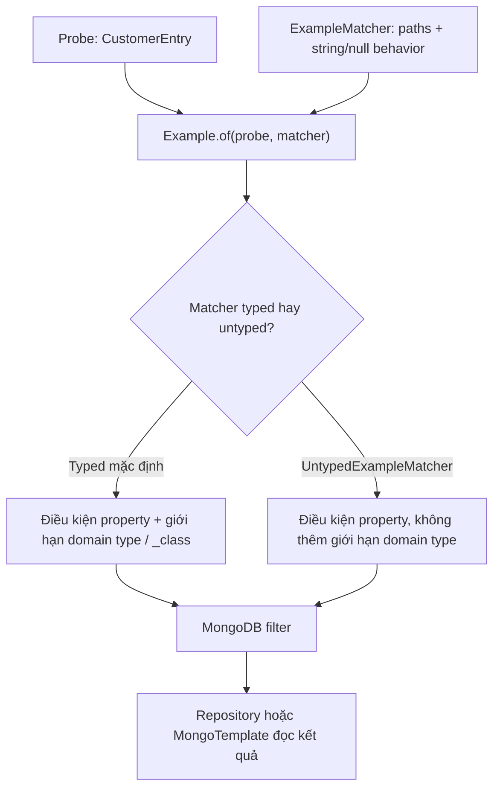

# Kiểm tra ảnh hưởng của kiểu miền và _class lên truy vấn

## 1. Tình huống: cùng điều kiện tìm kiếm nhưng kết quả khác nhau

Trong **Spring Data MongoDB**, *Query by Example* (**QBE**) tạo truy vấn từ một object mẫu gọi là **probe**. Lập trình viên đặt một vài thuộc tính lên probe, tạo `Example`, rồi gọi repository hoặc `MongoTemplate` để tìm document tương ứng. Cách này ngắn gọn khi màn hình tìm kiếm có những điều kiện bằng, lọc theo chuỗi và các field tùy chọn.

Tuy nhiên, QBE của Spring Data MongoDB có một đặc điểm quan trọng: **mặc định Example là typed**. Ngoài các field của probe, framework còn dùng **kiểu miền (domain type)** để hạn chế kết quả truy vấn. Trong cấu hình mapping mặc định, hạn chế này liên quan đến field **`_class`** được Spring Data MongoDB ghi vào document.

Giả sử collection `directory_entries` chứa ba document cùng `tenantId` và `nickname`:

```javascript
// Document được Spring Data ghi từ CustomerEntry:
{
  _id: "customer-101",
  tenantId: "tenant-42",
  nickname: "An",
  verified: true,
  score: NumberInt("10"),
  _class: "customer"
}

// Document được Spring Data ghi từ VendorEntry:
{
  _id: "vendor-201",
  tenantId: "tenant-42",
  nickname: "An",
  verified: true,
  score: NumberInt("30"),
  _class: "vendor"
}

// Document legacy nhập bằng driver hoặc script, không có _class:
{
  _id: "legacy-301",
  tenantId: "tenant-42",
  nickname: "An",
  verified: true,
  score: NumberInt("20")
}
```

Một truy vấn MongoDB thuần theo `tenantId` và `nickname` có thể tìm cả ba document. Nhưng **typed QBE với probe `CustomerEntry`** chỉ nhắm những document phù hợp với kiểu miền của probe; trong ví dụ có `@TypeAlias`, nó có thể chỉ tìm thấy document có type hint `customer`. Hai document còn lại không hề sai điều kiện tên/tenant: chúng **không thỏa ràng buộc kiểu** mà QBE thêm vào.

Bài thuộc chương **Query by Example** của module **SPRING_DATA_MONGODB**, nơi Spring Data được dùng để kết nối, ánh xạ document và thao tác MongoDB bằng `MongoTemplate`/repository, đồng thời kiểm thử, thiết kế truy vấn và chẩn đoán hiệu năng dữ liệu. Ta sẽ kiểm tra ảnh hưởng của **probe type**, **`_class`**, **`@TypeAlias`**, **`UntypedExampleMatcher`**, dữ liệu legacy và kiểu Java đến kết quả QBE.

## 2. Bốn thành phần của Query by Example

QBE có bốn khái niệm cần tách biệt:

| Thành phần | Vai trò | Ví dụ |
| --- | --- | --- |
| **Probe** | Object mẫu có các thuộc tính dùng làm điều kiện | `CustomerEntry` có `tenantId`, `nickname` |
| **ExampleMatcher** | Quy định cách khớp property, null, chuỗi, ignore paths, AND/OR | `matchingAll().withIgnorePaths("verified")` |
| **Example** | Ghép probe và matcher thành đặc tả truy vấn | `Example.of(probe, matcher)` |
| **Executor / Query** | Dùng Example để truy vấn MongoDB | `repository.findAll(example)` hoặc `Criteria.byExample(example)` |

Luồng xử lý:



Ví dụ tối giản:

```java
import org.springframework.data.domain.Example;
import org.springframework.data.domain.ExampleMatcher;

CustomerEntry probe = new CustomerEntry();
probe.setTenantId("tenant-42");
probe.setNickname("An");

ExampleMatcher matcher = ExampleMatcher.matchingAll()
    .withIgnorePaths("verified");

Example<CustomerEntry> example = Example.of(probe, matcher);
```

Ở đây, `tenantId` và `nickname` được dùng làm điều kiện. `score` là wrapper `Integer` chưa gán nên mặc định bị bỏ qua. `verified` là primitive `boolean` nên có giá trị mặc định `false`; nếu không ignore thì nó **được đưa vào QBE**, dù lập trình viên chưa chủ động chọn điều kiện này.

Mặc định `ExampleMatcher` yêu cầu tất cả các property được xét cùng khớp; các rule về null, string, type restriction và matcher có thể được tùy chỉnh. Nhưng **typed/untyped không giống với matchingAll/matchingAny**: đây là hai trục cấu hình khác nhau.

## 3. Spring Data MongoDB lưu _class để làm gì?

### 3.1. Type hint của MappingMongoConverter

Một MongoDB collection có thể chứa nhiều dạng document. `MappingMongoConverter` cần thông tin để khôi phục đúng kiểu Java, đặc biệt trong các cấu trúc đa hình hoặc field khai báo kiểu cha/interface.

Với bộ ánh xạ kiểu mặc định, Spring Data có thể ghi **tên class Java đầy đủ** vào `_class`:

```javascript
{
  _id: "customer-101",
  tenantId: "tenant-42",
  nickname: "An",
  _class: "example.directory.CustomerEntry"
}
```

`_class` là **type discriminator/type hint** của cơ chế ánh xạ Spring Data MongoDB, **không phải** field bắt buộc do MongoDB server tự tạo cho mọi document. Script `mongosh`, driver trực tiếp hoặc một hệ thống khác hoàn toàn có thể ghi document không có `_class`.

Một số ứng dụng còn tùy chỉnh tên field type hint hoặc tắt việc ghi type hint. Do đó, không nên coi `_class` luôn xuất hiện với đúng cùng giá trị trong mọi collection.

### 3.2. @TypeAlias thay tên Java dài bằng alias

`@TypeAlias` cho phép sử dụng chuỗi ngắn gọn để biểu diễn class:

```java
import org.springframework.data.annotation.TypeAlias;

@TypeAlias("customer")
public class CustomerEntry {
    // ...
}
```

Khi mapping và cấu hình tương thích, document ghi từ class này có thể chứa:

```javascript
{ _class: "customer" }
```

Đổi `@TypeAlias` **không tự chuyển** các document đã có `_class` là tên class cũ hoặc alias cũ. Phải có chiến lược tương thích/migration, vì truy vấn typed QBE và việc đọc object có thể chịu ảnh hưởng.

Một chú ý kỹ thuật: việc giải quyết alias cần **MappingContext biết class tương ứng**, thông qua quét entity/khởi tạo metadata hoặc cấu hình tập entity ban đầu. Nếu alias chỉ xuất hiện trong dữ liệu lịch sử mà application context không biết loại Java, quá trình đọc có thể không khôi phục đúng subtype.

### 3.3. Đừng hiểu _class là cơ chế phân quyền

`_class: "customer"` thể hiện metadata kiểu miền, không thay thế điều kiện `tenantId`, vai trò user hay các chính sách truy cập. Một typed QBE có thể loại vendor, nhưng vẫn trả customer thuộc tenant khác nếu service không gắn đúng filter tenant.

Không nhận `_class` do client gửi như một quyền để truy xuất dữ liệu. Phân tách tenant và authorization phải được xác định ở server.

## 4. Typed Example mặc định làm thay đổi BSON query

Theo tài liệu Spring Data MongoDB, **`Example.of(probe)` mặc định là strictly typed**. Điều này dẫn tới điều kiện kiểu được đưa vào **truy vấn đã ánh xạ**. Với type key mặc định, hình thức minh họa:

```javascript
{
  tenantId: "tenant-42",
  nickname: "An",
  _class: { $in: ["customer"] }
}
```

Đây là **BSON filter có tính minh họa** đối với entity `@TypeAlias("customer")`, không phải cam kết framework lúc nào cũng sinh đúng cùng một chuỗi. Tập kiểu được phép có thể phụ thuộc vào **probe type, các subtype có thể gán cho probe, metadata ánh xạ, alias và cấu hình type mapper**.

Với class không có `@TypeAlias`, ví dụ tương ứng có thể dùng tên fully-qualified như:

```javascript
{ _class: { $in: ["example.directory.CustomerEntry"] } }
```

Điều này giải thích một lỗi rất thực tế: chạy trong mongosh

```javascript
db.directory_entries.find({
  tenantId: "tenant-42",
  nickname: "An"
});
```

thì thấy ba record, nhưng gọi `repository.findAll(Example.of(probe))` lại thấy ít hơn. Hai truy vấn **không tương đương**, vì typed QBE có thêm điều kiện type.

### 4.1. "Typed" không nhất thiết chỉ là bằng chính xác một giá trị _class

Một probe thuộc kiểu cha có thể cần xét các kiểu con tương thích. Tài liệu mô tả hạn chế theo **các kiểu có thể gán cho kiểu probe**. Vì vậy, không nên tự viết `{_class: "com.example.Base"}` rồi giả định nó tương đương với mọi typed QBE có inheritance.

Nếu hệ thống lưu nhiều subtype trong một collection, hãy kiểm thử cụ thể theo hierarchy, `@TypeAlias` và entity metadata của phiên bản Spring Data đang dùng. Tránh suy luận chỉ từ tên class trong Java.

## 5. Chuẩn bị hai kiểu miền trong cùng một collection

Ta dùng hai class **không có quan hệ kế thừa** nhằm làm rõ ảnh hưởng của type restriction. Cả hai có các field tên giống nhau nhưng thể hiện hai miền nghiệp vụ khác nhau.

### 5.1. CustomerEntry

```java
package example.directory;

import org.springframework.data.annotation.TypeAlias;
import org.springframework.data.mongodb.core.mapping.Document;
import org.springframework.data.mongodb.core.mapping.FieldType;
import org.springframework.data.mongodb.core.mapping.MongoId;

@Document(collection = "directory_entries")
@TypeAlias("customer")
public class CustomerEntry {

    @MongoId(FieldType.STRING)
    private String id;

    private String tenantId;
    private String nickname;
    private Integer score;
    private boolean verified;

    public CustomerEntry() {}

    public CustomerEntry(
            String id, String tenantId, String nickname,
            Integer score, boolean verified) {
        this.id = id;
        this.tenantId = tenantId;
        this.nickname = nickname;
        this.score = score;
        this.verified = verified;
    }

    public String getId() { return id; }
    public String getTenantId() { return tenantId; }
    public String getNickname() { return nickname; }
    public Integer getScore() { return score; }
    public boolean isVerified() { return verified; }

    public void setId(String id) { this.id = id; }
    public void setTenantId(String tenantId) {
        this.tenantId = tenantId;
    }
    public void setNickname(String nickname) {
        this.nickname = nickname;
    }
    public void setScore(Integer score) { this.score = score; }
    public void setVerified(boolean verified) {
        this.verified = verified;
    }
}
```

Ta dùng `@MongoId(FieldType.STRING)` để thống nhất `_id` dạng BSON String. Trường `score` là `Integer` nên có thể để null khi không lọc theo điểm; `verified` là primitive cố ý để minh họa việc giá trị mặc định có thể lọt vào QBE.

### 5.2. VendorEntry

```java
package example.directory;

import org.springframework.data.annotation.TypeAlias;
import org.springframework.data.mongodb.core.mapping.Document;
import org.springframework.data.mongodb.core.mapping.FieldType;
import org.springframework.data.mongodb.core.mapping.MongoId;

@Document(collection = "directory_entries")
@TypeAlias("vendor")
public class VendorEntry {

    @MongoId(FieldType.STRING)
    private String id;

    private String tenantId;
    private String nickname;
    private Integer score;
    private boolean verified;

    public VendorEntry() {}

    public VendorEntry(
            String id, String tenantId, String nickname,
            Integer score, boolean verified) {
        this.id = id;
        this.tenantId = tenantId;
        this.nickname = nickname;
        this.score = score;
        this.verified = verified;
    }

    public String getId() { return id; }
    public String getTenantId() { return tenantId; }
    public String getNickname() { return nickname; }
    public Integer getScore() { return score; }
    public boolean isVerified() { return verified; }
}
```

Hai class dùng chung collection, nhưng `_class` sẽ khác khi được ghi bởi `MappingMongoConverter` có hỗ trợ `@TypeAlias`. Đây là một thiết kế nhằm minh họa QBE, **không phải khuyến nghị mặc định** rằng mọi domain nên chia sẻ collection.

### 5.3. Repository của CustomerEntry

```java
package example.directory;

import org.springframework.data.mongodb.repository.MongoRepository;

public interface CustomerEntryRepository
        extends MongoRepository<CustomerEntry, String> {
}
```

`MongoRepository` cung cấp các thao tác QBE thông dụng như `findAll(Example<S>)` thông qua hạ tầng Spring Data. Tập kết quả của repository này được thiết kế để trả `CustomerEntry`, **không phải một danh sách Java đa hình gồm mọi kiểu document trong collection**.

## 6. Ghi dữ liệu typed và dữ liệu legacy để đối chiếu

### 6.1. Hai document ghi qua Spring Data

```java
import org.springframework.data.mongodb.core.MongoTemplate;

template.save(new CustomerEntry(
    "customer-101",
    "tenant-42",
    "An",
    10,
    true
));

template.save(new VendorEntry(
    "vendor-201",
    "tenant-42",
    "An",
    30,
    true
));
```

Với cấu hình converter mặc định và alias hợp lệ, MongoDB chứa hai type hint khác nhau. Kiểm tra trực tiếp:

```javascript
db.directory_entries.find(
  { tenantId: "tenant-42" },
  { _id: 1, tenantId: 1, nickname: 1, verified: 1, _class: 1 }
);
```

### 6.2. Một document không có _class

Giả sử dữ liệu cũ được nhập bằng MongoDB driver trực tiếp:

```javascript
db.directory_entries.insertOne({
  _id: "legacy-301",
  tenantId: "tenant-42",
  nickname: "An",
  verified: true,
  score: NumberInt("20")
});
```

Document này **không có `_class`**. Điều đó không có nghĩa nó không tồn tại, cũng không có nghĩa field nickname sai. Nó chỉ thiếu metadata type mà typed QBE mặc định sử dụng.

### 6.3. Dự đoán ba bộ kết quả

Giả sử probe chỉ lọc `tenantId="tenant-42"` và `nickname="An"`, còn `verified` được ignore:

| Query | Customer `_class: customer` | Vendor `_class: vendor` | Legacy không `_class` |
| --- | --- | --- | --- |
| MongoDB find chỉ theo tenant/nickname | Có | Có | Có |
| QBE mặc định typed với `CustomerEntry` | Có | Không, vì không cùng kiểu miền | Không, vì thiếu type hint cần thiết |
| QBE dùng `UntypedExampleMatcher` | Có | Có về mặt điều kiện field | Có về mặt điều kiện field |

Hàng thứ ba nói về **phạm vi document được query chọn**, **không** bảo đảm rằng kết quả đa kiểu có thể an toàn ép tất cả thành một `CustomerEntry`. Phần 8 trình bày cách quan sát kết quả bằng raw `Document`.

## 7. Typed Example trong repository

### 7.1. Tạo probe và matcher

```java
import java.util.List;
import org.springframework.data.domain.Example;
import org.springframework.data.domain.ExampleMatcher;

CustomerEntry probe = new CustomerEntry();
probe.setTenantId("tenant-42");
probe.setNickname("An");

ExampleMatcher matcher = ExampleMatcher.matchingAll()
    .withIgnorePaths("verified");

Example<CustomerEntry> typedExample =
    Example.of(probe, matcher);

List<CustomerEntry> results =
    customerRepository.findAll(typedExample);
```

Với fixture phần 6, kỳ vọng `results` chứa **customer-101**. Các trường có giá trị `null` (`id`, `score`) không được dùng trong filter mặc định. `verified` đã bị bỏ qua tường minh.

`ExampleMatcher.matchingAll()` vẫn là matcher typed thông thường; nó không tương đương `UntypedExampleMatcher.matching()` dù cả hai đều có chữ `matching`.

### 7.2. Vì sao kết quả typed không thấy legacy?

Khi query đã ánh xạ chứa điều kiện type tương ứng với `CustomerEntry`, document thiếu `_class` không thỏa điều kiện đó. Không có lý do để database tự suy đoán rằng một document cũ không có type hint chính là customer.

Nếu migration từ một hệ thống ghi MongoDB trực tiếp sang Spring Data QBE, hãy kiểm tra **cả tên field, BSON type và metadata `_class`**, không chỉ đọc một record mẫu từ entity mapper.

### 7.3. Khi nào typed QBE phù hợp?

Typed QBE có ích khi collection được thiết kế có nhiều kiểu miền và chỉ muốn tìm những document thuộc **kiểu probe** cùng các subtype tương thích theo metadata hiện hành.

Nó kém phù hợp nếu:

- Dữ liệu cũ không có `_class`;
- Một collection chứa dữ liệu từ nhiều ứng dụng ghi type hint khác nhau;
- Bộ chuyển đổi đã tắt type hints nhưng code vẫn dùng typed QBE;
- Cần tìm trên nhiều loại document có cùng schema phần lõi;
- Một refactor thay tên class/alias khiến dữ liệu mới và cũ mang type hint khác nhau.

Lúc đó cần chọn chiến lược dữ liệu/truy vấn tường minh thay vì chỉ thêm `withIgnorePaths("_class")` rồi hy vọng ràng buộc kiểu biến mất.

## 8. UntypedExampleMatcher: bỏ type restriction có chủ đích

### 8.1. Cú pháp đúng

Spring Data MongoDB cung cấp:

```java
import org.springframework.data.domain.Example;
import org.springframework.data.domain.ExampleMatcher;
import org.springframework.data.mongodb.core.query.UntypedExampleMatcher;

CustomerEntry probe = new CustomerEntry();
probe.setTenantId("tenant-42");
probe.setNickname("An");

ExampleMatcher matcher = UntypedExampleMatcher.matching()
    .withIgnorePaths("verified");

Example<CustomerEntry> untypedExample =
    Example.of(probe, matcher);
```

`UntypedExampleMatcher.matching()` làm QBE **không thêm điều kiện hạn chế domain type**. Các điều kiện field do probe tạo vẫn được áp dụng. Đây là cách được Spring Data MongoDB cung cấp để xử lý những collection dùng nhiều kiểu document hoặc đã bỏ type hints. Nó **không** tắt mọi cơ chế mapping, không tự sửa alias và không ép dữ liệu cũ thành đúng kiểu Java.

### 8.2. Dùng MongoTemplate để xem BSON document

```java
import java.util.List;
import org.bson.Document;
import org.springframework.data.mongodb.core.query.Criteria;
import org.springframework.data.mongodb.core.query.Query;

Query query = new Query(
    new Criteria().alike(untypedExample)
);

List<Document> documents = template.find(
    query,
    Document.class,
    "directory_entries"
);
```

Với dữ liệu phần 6, query không có type restriction có thể trả cả ba document, vì `tenantId` và `nickname` đều khớp. Ở đây chủ ý dùng **`Document.class`** để quan sát dữ liệu BSON ở dạng thô và tránh giả định vendor có thể ánh xạ an toàn thành `CustomerEntry`.

Sự khác nhau quan trọng:

```java
// Typed: có thể chỉ tìm các document cùng domain type.
Example<CustomerEntry> typed =
    Example.of(probe, ExampleMatcher.matchingAll()
        .withIgnorePaths("verified"));

// Untyped: không thêm ràng buộc domain type.
Example<CustomerEntry> untyped =
    Example.of(probe, UntypedExampleMatcher.matching()
        .withIgnorePaths("verified"));
```

| Vấn đề | Typed Example | Untyped Example |
| --- | --- | --- |
| Dùng thuộc tính probe làm filter | Có | Có |
| Thêm giới hạn domain type | Mặc định có | Không |
| Có thể loại document thiếu `_class` | Có | Không phải vì thiếu `_class` |
| Đọc đúng subtype tự động | Phụ thuộc converter/metadata | Vẫn phụ thuộc converter/metadata |
| Tự thêm điều kiện tenant/authorization | Không | Không |
| Phù hợp nhiều kiểu trong một collection | Khi muốn giới hạn kiểu | Khi chủ động muốn tìm xuyên kiểu |

### 8.3. Cảnh báo: kết quả untyped không nhất thiết cùng kiểu Java

Nếu gọi một repository được khai báo trả `CustomerEntry` bằng một Example untyped, điều kiện MongoDB có thể chọn cả vendor hay document legacy. Trong khi đó, tầng đọc vẫn phải quyết định chuyển BSON thành kiểu Java nào. Với hierarchy không tương thích, dữ liệu thiếu discriminator hoặc field riêng của subtype, việc chuyển đổi có thể không như mong đợi hoặc gặp lỗi.

Vì vậy, **không nên bỏ type restriction chỉ để làm số kết quả tăng lên rồi coi mọi document trả về là CustomerEntry hợp lệ**. Khi cần tìm xuyên nhiều miền, dùng một read model chung được định nghĩa rõ, một collection/query trả `Document` để phân loại sau khi đọc, hoặc một custom repository có conversion được kiểm thử.

## 9. Kiểu miền ảnh hưởng cả property được đem ra so khớp

`_class` không phải yếu tố duy nhất. **Hình dạng probe theo class Java** cũng ảnh hưởng bộ điều kiện được tạo.

### 9.1. Property null bị bỏ qua mặc định

```java
CustomerEntry probe = new CustomerEntry();
probe.setTenantId("tenant-42");
probe.setNickname("An");
// probe.getScore() == null -> mặc định không lọc score.
```

Khi không yêu cầu include null một cách tường minh, các thuộc tính probe có giá trị `null` thường **không tham gia** QBE. Một property có mặt trong class nhưng chưa được đặt giá trị không tương đương điều kiện `field: null` ở MongoDB.

Điều này hữu ích cho tìm kiếm động, nhưng nếu nghiệp vụ cần phân biệt **missing**, **BSON null** và giá trị cụ thể, QBE có thể không đủ rõ; cân nhắc `Criteria`, `$exists` hoặc query JSON.

### 9.2. Primitive luôn có giá trị mặc định

Trong `CustomerEntry`:

```java
private boolean verified;
```

Khi tạo `new CustomerEntry()`, `verified` mặc định là `false` chứ không phải `null`. Nếu tạo:

```java
Example<CustomerEntry> naive = Example.of(probe);
```

thì QBE có thể thêm điều kiện `verified: false`. Với ba document phần 6 đều có `verified: true`, truy vấn này không tìm thấy bản ghi phù hợp, **ngay cả khi `_class` hoàn toàn đúng**.

Nếu muốn `verified` là một filter tùy chọn, hai hướng phổ biến:

```java
// Cách 1: bỏ qua field trên probe hiện tại.
ExampleMatcher matcher = ExampleMatcher.matchingAll()
    .withIgnorePaths("verified");

// Cách 2: mô hình hóa bằng Boolean thay vì boolean
// để có trạng thái null = không lọc, nếu phù hợp domain.
private Boolean verified;
```

Đoạn `private Boolean verified;` ở ví dụ là **phương án thay đổi định nghĩa entity**, không phải statement hợp lệ để đặt trực tiếp vào method. Với QBE, các primitive như `int`, `long`, `boolean` có thể âm thầm lọt vào filter nếu không ignore; đây là nguồn gốc phổ biến của kết quả rỗng.

### 9.3. matchingAll và matchingAny không giải quyết ràng buộc type

`matchingAll()` yêu cầu các predicate của probe cùng đúng. `matchingAny()` dùng logic OR giữa các property predicate; nó **không có nghĩa “tìm mọi loại entity”**.

```java
ExampleMatcher anyFields = ExampleMatcher.matchingAny()
    .withIgnorePaths("verified");

Example<CustomerEntry> exampleAny =
    Example.of(probe, anyFields);
```

Nếu probe chứa `tenantId` và `nickname`, dùng `matchingAny` có thể khiến document thỏa *nickname* nhưng **khác tenant** lọt vào tập kết quả. Không dùng `matchingAny` như một cách mở rộng tìm kiếm khi tenant phải được bảo vệ bắt buộc.

Với các field bắt buộc phải AND với điều kiện tìm kiếm tùy chọn, hãy xây `Criteria` tường minh để ràng buộc tenant ở cấp ngoài cùng; vẫn phải dùng tenant do server-side identity xác định.

## 10. Kiểu miền, @Field và đường dẫn BSON

Hai class Java có property trông cùng nghĩa không đồng nghĩa chúng trỏ tới cùng tên BSON.

Ví dụ:

```java
import org.springframework.data.mongodb.core.mapping.Field;

public class CustomerSearchProbe {
    @Field("nick_name")
    String nickname;
}
```

Nếu một nguồn dữ liệu lại ghi `nickname`, mà probe mới được mapping sang `nick_name`, query có thể không khớp, **dù đã dùng `UntypedExampleMatcher`**. Untyped chỉ bỏ ràng buộc type; nó không tự chuyển đổi schema của tất cả nguồn dữ liệu.

Với QBE trên một probe khác kiểu entity đích, cần xem:

1. Tên property Java của probe;
2. `@Field` hoặc custom naming strategy;
3. Tên field BSON thực tế;
4. Kiểu BSON và custom converter;
5. Loại kết quả mong muốn và cách map lại.

Tài liệu Spring Data cho phép sử dụng một class probe khác kiểu kết quả trong untyped example nếu các field được mapping tương thích. Nhưng với ứng dụng thật, nên dùng query/DTO hợp đồng rõ ràng thay vì giả định hai schema có các tên giống nhau sẽ luôn tương thích.

### 10.1. _id và @MongoId có thể làm QBE hẹp hơn dự kiến

Nếu probe được tạo từ một entity đã có `id`, QBE có thể dùng luôn ID làm predicate. Do `_id` là duy nhất, một search dự kiến nhiều kết quả lại chỉ trả một document.

```java
CustomerEntry probe = customerRepository
    .findById("customer-101")
    .orElseThrow();

// Probe này chứa cả id, tenantId, nickname, score, verified.
// Không tương đương probe mới chỉ đặt tenantId và nickname.
```

Khi dùng một entity đã lưu làm probe, cần chủ động ignore các field không thuộc hợp đồng tìm kiếm:

```java
ExampleMatcher matcher = ExampleMatcher.matchingAll()
    .withIgnorePaths("id", "score", "verified");
```

Để tránh lộ/nhầm trường nghiệp vụ, thường tốt hơn là tạo **probe mới từ các input tìm kiếm đã được validate**, không tái sử dụng entity đọc từ database với nhiều giá trị đã gán.

## 11. Dữ liệu legacy thiếu _class và thay đổi type-mapping

### 11.1. Vì sao mongosh tìm thấy nhưng typed QBE trả rỗng?

Giả sử legacy document:

```javascript
{
  _id: "legacy-301",
  tenantId: "tenant-42",
  nickname: "An",
  verified: true
}
```

Một query raw theo tenant/nickname không cần `_class`, nên tìm thấy document. Một typed Example có thể thêm điều kiện kiểu và loại document vì field type hint thiếu. Đây là **khác biệt về hợp đồng truy vấn**, không nhất thiết là lỗi kết nối hay lỗi index.

Để kiểm tra tỷ lệ document thiếu type hint:

```javascript
db.directory_entries.countDocuments({
  _class: { $exists: false }
});

db.directory_entries.aggregate([
  {
    $group: {
      _id: { $ifNull: ["$_class", "<missing-or-null>"] },
      count: { $sum: 1 }
    }
  },
  { $sort: { count: -1 } }
]);
```

Aggregation này phục vụ **kiểm kê**, không thay thế việc xác định domain type thực của từng document. Nếu một document không có `_class`, không nên suy diễn nó chắc chắn là customer.

### 11.2. Những phương án xử lý

| Phương án | Phù hợp khi | Rủi ro cần kiểm soát |
| --- | --- | --- |
| Giữ typed QBE và backfill type hint | Mỗi document có thể được xác định đúng loại | Migration nhầm loại có thể làm mapping sai |
| Dùng untyped example | Cần tìm xuyên type hoặc không dùng `_class` | Có thể chọn nhiều miền không tương thích |
| Dùng `Criteria` theo field nghiệp vụ | Query không cần discriminator Java | Tự quản lý filter, mapping và quyền truy cập |
| Thêm discriminator nghiệp vụ ổn định như `kind` | Có nhiều loại document trong một collection | Phải validate/migrate đầy đủ và tạo index phù hợp |
| Tách collection theo domain | Hai miền có vòng đời và schema khác biệt rõ | Chi phí migration và thay đổi truy vấn |
| Dùng converter/type mapper tùy chỉnh | Có lý do kiến trúc rõ ràng để đổi type hint | Ảnh hưởng toàn bộ đường ghi/đọc đa hình |

Chọn cách nào phụ thuộc dữ liệu thực tế và yêu cầu tương thích. **Không migration hàng loạt chỉ dựa vào việc một vài field trùng tên.**

### 11.3. Thay đổi tên Java package hoặc @TypeAlias

Nếu dữ liệu cũ dùng:

```javascript
{ _class: "old.package.CustomerEntry" }
```

nhưng ứng dụng mới tạo:

```javascript
{ _class: "customer" }
```

thì việc đổi alias/đường dẫn class có thể ảnh hưởng typed QBE. Hãy xây kế hoạch chuyển tiếp có test, xử lý mapping alias cũ nếu cần, và đo tỷ lệ record thuộc mỗi dạng `_class` trước khi cutover.

Không nên thay tất cả `_class` bằng một giá trị chung để “cho QBE tìm ra” nếu collection thật chứa các kiểu miền khác nhau.

### 11.4. Tắt type hints không đồng nghĩa typed QBE tự tắt typed

Ứng dụng có thể tùy biến `MappingMongoConverter` với `MongoTypeMapper` để thay cách ghi type hint. Đây là quyết định ở **mức cấu hình mapping**. Khi áp dụng, cần kiểm tra hành vi của typed QBE trong chính cấu hình đó: một typed Example vẫn được thiết kế có ràng buộc kiểu, trong khi document không còn metadata tương ứng có thể bị loại.

Trong những collection không dùng type hints, `UntypedExampleMatcher` hoặc `Criteria` tường minh thường dễ dự đoán hơn. Nhưng nếu hệ thống dựa vào polymorphic deserialization, việc bỏ type hints có thể làm mất khả năng khôi phục đúng subtype.

## 12. Kiểu miền kế thừa và quan hệ assignable

Trong một hierarchy:

```java
abstract class DirectoryEntry {
    String tenantId;
    String nickname;
}

class Customer extends DirectoryEntry {
    Integer loyaltyPoints;
}

class Vendor extends DirectoryEntry {
    String registrationCode;
}
```

Một probe kiểu `DirectoryEntry` và một probe kiểu `Customer` có thể tạo **phạm vi type restriction khác nhau**. Truy vấn typed được mô tả theo những kiểu có thể gán cho probe; metadata về subtype đã biết, alias và type mapper ảnh hưởng bộ giá trị type hint được dùng.

Ví dụ này chỉ diễn đạt hierarchy; chưa phải entity/repository hoàn chỉnh. Để vận dụng trong Spring Data MongoDB, phải chọn cấu hình `@Document`, mapping ID và strategy lưu đa hình cụ thể.

Kiểm thử cần trả lời các câu hỏi:

- Probe class cha có được match tất cả subtype cần thiết không?
- Probe class con có loại document thuộc class cha hoặc sibling không?
- Một subtype mới được thêm vào ứng dụng có được MappingContext nhận diện?
- Dữ liệu cũ lưu fully-qualified name và dữ liệu mới lưu alias có được đọc đúng?
- Khi đổi hierarchy, những document nào cần migration?

Không xem `_class` như một schema-version có thể thay tùy ý. Nếu cần version hóa cấu trúc dữ liệu, cân nhắc field schema version và quy trình migration riêng.

## 13. Null trong nested object và bất ngờ về exact matching

Spring Data MongoDB có một lưu ý đối với QBE: khi cấu hình **include null values** trong Example, đường tạo query cho embedded object có thể chuyển từ cách so khớp theo **dot notation** sang so khớp **embedded document**. Điều này có thể yêu cầu khớp chính xác các property và thứ tự field trong embedded document, khiến kết quả khác dự đoán.

Ví dụ document:

```javascript
{
  _id: "customer-101",
  address: {
    city: "Da Nang",
    street: "Tran Phu"
  }
}
```

Truy vấn chỉ theo `address.city`:

```javascript
{ "address.city": "Da Nang" }
```

không giống hoàn toàn một truy vấn so sánh cả object:

```javascript
{
  address: {
    city: "Da Nang",
    street: null
  }
}
```

Query thứ hai có ngữ nghĩa equality trên embedded document, có thể không khớp vì dữ liệu gốc chứa `street` khác null. Khi dùng `withIncludeNullValues()` trong matcher, **phải kiểm thử schema embedded và BSON query được sinh ra**, không chỉ dựa vào số field có giá trị null ở Java.

Nếu yêu cầu tìm kiếm nested field phức tạp, cần điều kiện range/OR, hoặc cần phân biệt missing/null một cách chắc chắn, `Criteria` và query MongoDB tường minh có thể là lựa chọn tốt hơn QBE.

## 14. QBE không thay thế Criteria cho mọi truy vấn

### 14.1. Những điều QBE làm tốt

- Một số field tùy chọn được xác định bằng property có/không có giá trị.
- So sánh bằng cho số, enum và các kiểu phù hợp.
- So khớp chuỗi dạng exact, prefix, suffix, contains hoặc regex tùy matcher hỗ trợ.
- Bật/tắt ignore field và quy tắc case sensitivity.
- Truy vấn từ cùng một domain model khi cấu trúc thay đổi theo refactor.

### 14.2. Những điều QBE không thuận tiện

- Khoảng số hoặc ngày như `price >= 100 AND price < 200`;
- Logic lồng nhau như `tenant = X AND (status = A OR score > 10)`;
- Tập giá trị `$in`, aggregation hoặc các phép array `$elemMatch` phức tạp;
- Kiểm soát chặt điều kiện BSON null/missing và type discriminator hỗn hợp;
- Tìm kiếm cross-domain cần phân loại kết quả theo nhiều subtype.

Ví dụ query có điều kiện tenant bắt buộc và giá tối thiểu:

```java
import org.springframework.data.mongodb.core.query.Criteria;
import org.springframework.data.mongodb.core.query.Query;

Query query = Query.query(
    Criteria.where("tenantId").is(authorizedTenantId)
        .and("nickname").is("An")
        .and("score").gte(10)
);
```

`Criteria` ở ví dụ không thêm type restriction của QBE. Nếu cần chỉ tìm customer, hãy thêm một **điều kiện discriminator được định nghĩa có chủ đích**, hoặc dùng collection phù hợp. Không trộn ngầm quy ước type hint Java với quy tắc domain khi dữ liệu do nhiều hệ thống cùng ghi.

### 14.3. Dùng QBE trong Criteria khi cần

Spring Data cho phép chuyển Example thành một phần của `Criteria`:

```java
Example<CustomerEntry> untyped = Example.of(
    probe,
    UntypedExampleMatcher.matching()
        .withIgnorePaths("verified")
);

Query query = Query.query(
    new Criteria().andOperator(
        Criteria.where("tenantId").is(authorizedTenantId),
        Criteria.byExample(untyped)
    )
);
```

Đây là cách hữu ích để giữ **tenant filter ở cấp AND bắt buộc** và dùng QBE cho phần tìm kiếm được phép. Khi probe cũng có `tenantId`, điều kiện tenant bị lặp về ý nghĩa; trong ứng dụng thật có thể tạo probe chỉ với field tùy chọn và để tenant duy nhất ở điều kiện ngoài.

Nếu matcher chuyển sang `matchingAny()`, điều kiện tenant bên ngoài vẫn phải áp dụng cho mọi nhánh OR. **Hãy xác minh BSON query thực tế**, nhất là với các matcher phức tạp.

## 15. Index và hiệu năng: _class cũng là một predicate

### 15.1. Index phải xét query shape thực tế

Nếu typed QBE thường tìm theo `tenantId`, `nickname` và type hint:

```javascript
db.directory_entries.find({
  tenantId: "tenant-42",
  nickname: "An",
  _class: "customer"
});
```

một index ứng viên:

```javascript
db.directory_entries.createIndex(
  { tenantId: 1, nickname: 1, _class: 1 },
  { name: "by_tenant_nickname_type" }
);
```

Tuy nhiên, typed QBE có thể sinh điều kiện `_class` dưới dạng `$in`, và query shape còn phụ thuộc matcher. Index trên chỉ là **ứng viên để đo**, không phải khẳng định luôn tối ưu. Nếu untyped query được dùng thường xuyên, tập filter không còn điều kiện type; index thích hợp có thể khác.

### 15.2. String matching có thể thay đổi đáng kể hiệu năng

`ExampleMatcher` hỗ trợ các lựa chọn như starts/ends/contains và ignoreCase. Một số cấu hình dùng **regex** ở MongoDB:

```java
import static org.springframework.data.domain.ExampleMatcher
    .GenericPropertyMatchers.startsWith;

ExampleMatcher matcher = ExampleMatcher.matchingAll()
    .withMatcher("nickname", startsWith().ignoreCase())
    .withIgnorePaths("verified");
```

Regex không được bảo đảm tận dụng index giống truy vấn equality; việc thêm `_class` vào filter cũng không tự làm query regex nhanh. Với lượng dữ liệu lớn, kiểm tra query BSON thực tế, tính chọn lọc, index, collation và kết quả `explain("executionStats")`.

Nếu input đến từ người dùng, giới hạn chiều dài và loại pattern mong muốn; không dùng regex tùy ý không giới hạn khi nghiệp vụ chỉ cần prefix/exact search.

### 15.3. Quan sát explain và raw BSON

```javascript
db.directory_entries.find({
  tenantId: "tenant-42",
  nickname: "An",
  _class: { $in: ["customer"] }
}).explain("executionStats");
```

Theo dõi `winningPlan`, `totalKeysExamined` và `totalDocsExamined`. `getIndexes()` xác nhận index thực sự tồn tại. Nếu query bị chậm, đừng xóa type restriction chỉ để giảm số predicate mà chưa hiểu tác động bảo mật/tính đúng đắn.

Kiểm tra loại dữ liệu trong collection:

```javascript
db.directory_entries.aggregate([
  {
    $group: {
      _id: { $type: "$_class" },
      count: { $sum: 1 }
    }
  },
  { $sort: { count: -1 } }
]);
```

Nó giúp nhận diện document có `_class` dạng string, null hoặc missing. Phân loại type hint đúng còn cần đối chiếu **giá trị** và version của converter.

## 16. Kiểm thử integration: typed khác untyped và khác raw query

Không chỉ viết một test `findAll` có dữ liệu đúng kiểu. Muốn kiểm tra ảnh hưởng của type hint, phải có **ít nhất hai loại document cùng field** và một document **không có `_class`**.

### 16.1. Test setup

Ví dụ dùng JUnit 5, Spring Boot MongoDB test slice và MongoDB test được cấu hình:

```java
package example.directory;

import static com.mongodb.client.model.Filters.eq;
import static org.junit.jupiter.api.Assertions.*;

import java.util.List;
import java.util.UUID;
import org.bson.Document;
import org.junit.jupiter.api.BeforeEach;
import org.junit.jupiter.api.Test;
import org.springframework.beans.factory.annotation.Autowired;
import org.springframework.boot.test.autoconfigure.data.mongo.DataMongoTest;
import org.springframework.data.domain.Example;
import org.springframework.data.domain.ExampleMatcher;
import org.springframework.data.mongodb.core.MongoTemplate;
import org.springframework.data.mongodb.core.query.Criteria;
import org.springframework.data.mongodb.core.query.Query;
import org.springframework.data.mongodb.core.query.UntypedExampleMatcher;

@DataMongoTest
class QueryByExampleTypeHintTest {

    @Autowired
    MongoTemplate template;

    @Autowired
    CustomerEntryRepository repository;

    private String tenantId;
    private String customerId;
    private String vendorId;
    private String legacyId;

    @BeforeEach
    void createFixtures() {
        String suffix = UUID.randomUUID().toString();
        tenantId = "tenant-" + suffix;
        customerId = "customer-" + suffix;
        vendorId = "vendor-" + suffix;
        legacyId = "legacy-" + suffix;

        template.save(new CustomerEntry(
            customerId, tenantId, "An", 10, true
        ));
        template.save(new VendorEntry(
            vendorId, tenantId, "An", 30, true
        ));

        template.getCollection("directory_entries").insertOne(
            new Document("_id", legacyId)
                .append("tenantId", tenantId)
                .append("nickname", "An")
                .append("score", 20)
                .append("verified", true)
        );
    }

    private CustomerEntry probe() {
        CustomerEntry probe = new CustomerEntry();
        probe.setTenantId(tenantId);
        probe.setNickname("An");
        return probe;
    }

    private ExampleMatcher typedMatcher() {
        return ExampleMatcher.matchingAll()
            .withIgnorePaths("verified");
    }

    // Các test method tiếp theo đặt trong class này.
}
```

Trong code thực tế, hãy chèn các method `@Test` của các phần sau vào **bên trong** class `QueryByExampleTypeHintTest`. Fixture tạo tenant/ID riêng theo mỗi test, không phụ thuộc tên dữ liệu ở môi trường khác.

**Môi trường:** `@DataMongoTest` cấu hình Spring context MongoDB nhưng không bảo đảm server sẽ tự khởi chạy ở mọi phiên bản/thiết lập. Dùng Testcontainers MongoDB hoặc MongoDB test đã cấu hình; đường import có thể cần điều chỉnh theo Spring Boot major version.

### 16.2. Xác minh type hints ghi thật

```java
@Test
void springMappingWritesAliasesButRawLegacyHasNoTypeHint() {
    Document customer = template.getCollection("directory_entries")
        .find(eq("_id", customerId))
        .first();
    Document vendor = template.getCollection("directory_entries")
        .find(eq("_id", vendorId))
        .first();
    Document legacy = template.getCollection("directory_entries")
        .find(eq("_id", legacyId))
        .first();

    assertNotNull(customer);
    assertNotNull(vendor);
    assertNotNull(legacy);
    assertEquals("customer", customer.getString("_class"));
    assertEquals("vendor", vendor.getString("_class"));
    assertFalse(legacy.containsKey("_class"));
}
```

Test này đồng thời xác nhận `@TypeAlias` đang hoạt động trong mapping context của ứng dụng. Nếu project cố ý dùng type mapper khác hoặc tắt type hints, assertion phải được sửa theo **hợp đồng cấu hình thật**, thay vì tự ép dữ liệu cho giống ví dụ.

### 16.3. Typed QBE chỉ chọn kết quả theo loại probe

```java
@Test
void typedExampleRestrictsResultsByDomainType() {
    Example<CustomerEntry> example =
        Example.of(probe(), typedMatcher());

    List<CustomerEntry> found = repository.findAll(example);

    assertEquals(1, found.size());
    assertEquals(customerId, found.get(0).getId());
}
```

Với fixture hiện tại, cả ba document khớp `tenantId` và `nickname`, nhưng only customer mang type hint hợp lệ cho probe `CustomerEntry`. Test cố ý không dựa vào thứ tự của `findAll` vì đây là truy vấn chỉ kỳ vọng một document.

### 16.4. Untyped QBE cho phép cả ba document vào tập kết quả

```java
@Test
void untypedExampleSkipsDomainTypeRestriction() {
    Example<CustomerEntry> example = Example.of(
        probe(),
        UntypedExampleMatcher.matching()
            .withIgnorePaths("verified")
    );

    Query query = new Query(new Criteria().alike(example));
    List<Document> documents = template.find(
        query, Document.class, "directory_entries"
    );

    List<String> ids = documents.stream()
        .map(doc -> doc.getString("_id"))
        .sorted()
        .toList();

    assertEquals(
        List.of(customerId, legacyId, vendorId)
            .stream().sorted().toList(),
        ids
    );
}
```

`Document.class` giúp test tập trung vào **document nào được query chọn** thay vì giả định converter có thể chuyển vendor và legacy thành cùng một entity Java. Trong code production, nếu muốn tìm xuyên miền, nên làm rõ kiểu kết quả và xử lý các document thuộc loại khác nhau có kiểm soát.

### 16.5. Probe primitive có thể gây kết quả rỗng

```java
@Test
void primitiveDefaultValueUnexpectedlyFiltersProbe() {
    // verified mặc định false, nhưng customer fixture verified=true.
    Example<CustomerEntry> naive = Example.of(probe());

    assertTrue(repository.findAll(naive).isEmpty());

    // Ignore primitive này để chỉ tìm theo tenantId/nickname.
    Example<CustomerEntry> corrected =
        Example.of(probe(), typedMatcher());

    assertEquals(1, repository.findAll(corrected).size());
}
```

Test này quan trọng vì nó cho thấy **hai nguyên nhân khác nhau của kết quả thiếu**: type restriction và các property không chủ ý trong probe. Khi debug, phải kiểm tra cả hai.

### 16.6. Đối chiếu query raw

```java
@Test
void rawQueryByFieldsDoesNotImposeProbeClass() {
    long count = template.getCollection("directory_entries")
        .countDocuments(
            new Document("tenantId", tenantId)
                .append("nickname", "An")
        );

    assertEquals(3L, count);
}
```

So sánh ba test:

| Cách tìm | Số document với fixture |
| --- | ---: |
| Typed QBE `CustomerEntry`, ignore `verified` | 1 |
| Untyped QBE, kết quả raw `Document` | 3 |
| Raw driver query theo tenant/nickname | 3 |
| Typed QBE naïve không ignore boolean primitive | 0 |

Chỉ khi có **fixture cùng điều kiện field nhưng khác `_class`**, những test này mới chứng minh được ảnh hưởng của domain type.

## 17. Quan sát BSON query thực sự được gửi

Đôi khi chuỗi object `Query` bạn nhìn thấy trong debugger chưa phản ánh đầy đủ query đã được **mapping** trước khi driver gửi. Spring Data có thể đổi property `id` thành `_id`, áp dụng `@Field` và bổ sung type restriction cho QBE.

Vì vậy, quy trình kiểm tra nên có nhiều lớp:

1. **Xem raw document** bằng MongoDB driver hoặc mongosh: `_class` có tồn tại và giá trị gì?
2. **Xác nhận probe và matcher**: field nào non-null, field primitive nào có giá trị mặc định, ignore paths nào đang bật?
3. **Quan sát lệnh MongoDB thực tế** qua command monitoring/log có kiểm soát để biết filter cuối cùng sau mapping.
4. **Chạy query tương đương trong mongosh** với toàn bộ filter, không bỏ `_class` khi so sánh.
5. **Kiểm thử kết quả typed/untyped** với dữ liệu cùng field nhưng khác type hint.
6. **Đo explain** cho filter có/không có `_class` nếu hiệu năng là vấn đề.

Ví dụ mongosh đối chiếu:

```javascript
// Chỉ dữ liệu customer (giả sử alias = customer):
db.directory_entries.find({
  tenantId: "tenant-42",
  nickname: "An",
  _class: { $in: ["customer"] }
});

// Dữ liệu cùng field, không giới hạn type:
db.directory_entries.find({
  tenantId: "tenant-42",
  nickname: "An"
});
```

Hai query có số document khác nhau là **điều dự kiến** với dữ liệu mẫu. Nó không chứng minh Spring Data trả sai. Muốn xác nhận query từ ứng dụng, cần quan sát filter thực tế hoặc test tích hợp trên cấu hình tương ứng.

**Bảo vệ log:** command monitoring có thể chứa tên người dùng, tenant ID, email hay giá trị nhạy cảm. Không bật ghi đầy đủ query/parameters lên log production mà không có chính sách kiểm soát quyền, redaction và retention.

## 18. Lỗi thường gặp và cách chẩn đoán

| Triệu chứng | Nguyên nhân có thể | Hướng giải quyết |
| --- | --- | --- |
| QBE trả ít hơn mongosh | Typed Example thêm điều kiện `_class` | Kiểm tra query đã mapping và type hints |
| Document legacy không được tìm thấy | Thiếu `_class` nhưng dùng typed QBE | Xác định loại thật, migration hoặc untyped/Criteria có chủ đích |
| Đổi package rồi QBE không tìm dữ liệu cũ | `_class` còn tên Java cũ | Xử lý compatibility type mapper/alias/migration |
| Dùng `@TypeAlias` nhưng dữ liệu vẫn có tên class | Metadata alias chưa được nhận diện hoặc document cũ chưa migration | Kiểm tra MappingContext, raw BSON và đường ghi |
| QBE trả rỗng dù type đúng | Primitive boolean/int có giá trị mặc định và bị đưa vào probe | Ignore path hoặc dùng wrapper nullable |
| Query đang quá rộng, khác tenant | `matchingAny()` tạo OR trên các field bắt buộc | Giữ tenant filter trong `Criteria` ở cấp AND |
| Untyped trả các document không đúng domain | Đã bỏ type restriction, cùng field tồn tại ở nhiều kiểu | Dùng discriminator nghiệp vụ/collection riêng, conversion rõ |
| Converter không map được subtype | Alias/type metadata không hợp lệ hoặc class chưa biết | Kiểm tra `@TypeAlias`, MappingContext và dữ liệu legacy |
| Không tìm được field nickname | `@Field`, naming strategy hoặc kiểu BSON khác | Đối chiếu tên Java/BSON, mapping và raw document |
| Dùng `withIncludeNullValues()` rồi nested query lạ | Embedded document equality khác dot notation | Kiểm tra query BSON; cân nhắc `Criteria` |
| QBE regex chậm | Matcher dùng contains/ignoreCase với regex khó dùng index | Đo explain, giới hạn search, cân nhắc index khác |
| Index không hỗ trợ typed query như mong đợi | Query shape có thêm `_class` và property predicates | Tối ưu theo filter BSON thực tế |
| Tưởng bỏ `_class` là sửa được dữ liệu | Type hint chỉ là một phần của schema/mapping | Kiểm tra nghiệp vụ và conversion trước khi migration |

### Checklist điều tra nhanh

1. Ghi rõ class của probe, class repository và collection thực sự được truy vấn.
2. Xem `_class` của document mẫu: alias, fully-qualified class name, null hay missing?
3. Kiểm tra `ExampleMatcher` có phải **UntypedExampleMatcher** hay chỉ là `matchingAll/matchingAny`.
4. Kiểm tra property non-null, primitive defaults, ID, nested fields và `@Field`.
5. Tái hiện query đã ánh xạ với toàn bộ điều kiện trong mongosh.
6. Kiểm tra compatibility của `@TypeAlias` và subtype metadata nếu có inheritance.
7. Kiểm thử typed/untyped và raw query trên dữ liệu cô lập.
8. Rà lại authorization/tenant, rồi đánh giá index và hiệu năng.

## 19. Bài tập thực hành

### Bài 1 — Ba kiểu document

Tạo collection chứa một `CustomerEntry`, một `VendorEntry` và một document legacy không có `_class` nhưng cùng `tenantId/nickname`. Gọi typed QBE và untyped QBE. Dự đoán số document, kiểm tra raw BSON và giải thích tại sao kết quả khác nhau.

### Bài 2 — Ảnh hưởng của primitive

Thêm field `boolean verified` vào entity. Ghi tất cả fixture với `verified=true`, tạo probe bằng no-args constructor và chỉ set nickname. Thử `Example.of(probe)` rồi thử `withIgnorePaths("verified")`. Phân biệt lỗi do field primitive với lỗi do `_class`.

### Bài 3 — Alias và migration

Ghi một số document với type hint dạng tên class đầy đủ, một số với alias mới. Xây kế hoạch migration an toàn để typed QBE tìm được dữ liệu mong muốn. Đề xuất test chứng minh không lẫn loại customer/vendor sau khi migration.

### Bài 4 — Type hints bị tắt

Trên môi trường thử có type mapper chủ động bỏ `_class`, kiểm thử typed Example, untyped Example và `Criteria`. Đối chiếu raw BSON, giải thích vì sao không nên tắt type hints tùy tiện khi entity có polymorphism.

### Bài 5 — matchingAny và phân tách tenant

Tạo customer tên An ở hai tenant, thêm một customer tên Bình trong tenant thứ nhất. Thử matcher `matchingAll` rồi `matchingAny` với probe có tenantId và nickname. Chứng minh tại sao một OR giữa hai property không thay thế được điều kiện tenant bắt buộc, và viết lại query bằng `Criteria` an toàn.

### Bài 6 — Hiệu năng

Benchmark trên dữ liệu thử với nhiều document có `_class` khác nhau: typed QBE exact, untyped QBE exact và untyped QBE chứa prefix regex. Dùng `explain("executionStats")` đánh giá index `tenantId/nickname/_class` và xác minh query shape thay vì chỉ dự đoán từ mã Java.

### Câu hỏi tự kiểm tra

- `Example.of(probe)` mặc định typed hay untyped trong Spring Data MongoDB?
- Field `_class` do MongoDB server tạo hay do cơ chế mapping Spring Data ghi?
- Vì sao raw `find({tenantId, nickname})` có thể trả nhiều document hơn typed QBE?
- `@TypeAlias` ảnh hưởng thế nào tới type hints và dữ liệu lịch sử?
- Khi nào cần dùng `UntypedExampleMatcher.matching()`?
- Có thể bỏ type restriction mà vẫn mặc định xem mọi kết quả là cùng một Java entity không?
- Vì sao `boolean verified` mặc định false có thể khiến QBE trả rỗng?
- `matchingAny()` có giống untyped matching không?
- Vì sao `withIgnorePaths("_class")` không phải là giải pháp thay cho UntypedExampleMatcher?
- Lúc nào nên chuyển sang `Criteria` thay vì dùng QBE?
- Nếu entity class được đổi tên package, bạn cần kiểm tra gì trong dữ liệu đang lưu?

## Ghi nhớ

**Query by Example trong Spring Data MongoDB mặc định là typed.** Bên cạnh các property của probe, query đã ánh xạ có thể mang **ràng buộc kiểu miền** dựa trên type hints như `_class`; document cùng field nhưng mang alias khác hoặc thiếu `_class` có thể bị loại. Dùng **`UntypedExampleMatcher.matching()`** khi chủ động muốn bỏ giới hạn kiểu, nhưng phải kiểm soát cách ánh xạ kết quả, khác biệt schema và quyền truy cập tenant. Đừng quên các yếu tố khác của probe như property null, giá trị mặc định primitive, `@Field`, `@TypeAlias` và hierarchy. Hãy đối chiếu **raw BSON**, query thực tế và integration test với dữ liệu typed/untyped/legacy trước khi kết luận một truy vấn QBE đúng hay sai.

## Tài liệu tham khảo

- [Spring Data MongoDB Reference — Query by Example trong Template API](https://docs.spring.io/spring-data/mongodb/reference/mongodb/template-query-operations.html#_query_by_example)
- [Spring Data MongoDB Reference — Query by Example với Repository](https://docs.spring.io/spring-data/mongodb/reference/mongodb/repositories/query-methods.html)
- [Spring Data MongoDB Reference — Type Mapping và TypeAlias](https://docs.spring.io/spring-data/mongodb/reference/mongodb/converters-type-mapping.html)
- [Spring Data MongoDB API — UntypedExampleMatcher](https://docs.spring.io/spring-data/mongodb/docs/current/api/org/springframework/data/mongodb/core/query/UntypedExampleMatcher.html)
- [Spring Data MongoDB API — Criteria.byExample](https://docs.spring.io/spring-data/mongodb/docs/current/api/org/springframework/data/mongodb/core/query/Criteria.html)
- [MongoDB Manual — Query Documents](https://www.mongodb.com/docs/manual/tutorial/query-documents/)
