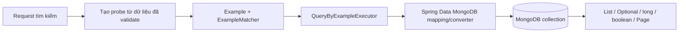

# Tìm, đếm và kiểm tra tồn tại qua QueryByExampleExecutor

Trong một ứng dụng sử dụng **Spring Data MongoDB**, màn hình tìm kiếm thường cho phép người dùng điền một số điều kiện và bỏ trống các điều kiện còn lại. Ví dụ: tìm khách hàng thuộc tenant hiện tại, có họ Nguyễn, trạng thái ACTIVE; hoặc chỉ kiểm tra có khách hàng nào khớp mà không cần tải toàn bộ danh sách. Viết một repository method riêng cho mọi tổ hợp trường sẽ khiến API dài và khó bảo trì.

**Query by Example (QBE)** xây điều kiện từ một object mẫu gọi là **probe** và quy tắc so khớp trong `ExampleMatcher`. Giao diện `QueryByExampleExecutor` cung cấp trực tiếp các thao tác **`findAll(Example)`, `findOne(Example)`, `count(Example)`, `exists(Example)`** và **`findBy(Example, queryFunction)`**. Bạn dùng cùng một `Example` để tìm dữ liệu, đếm số bản ghi hoặc hỏi “có tồn tại không?” mà không viết lại predicate.

Bài thuộc chương **Query by Example** của module `SPRING_DATA_MONGODB`, nơi bạn học kết nối, ánh xạ document và thao tác MongoDB qua `MongoTemplate` hoặc repository, đồng thời thiết kế query, aggregation, index, transaction, reactive access, kiểm thử và chẩn đoán hiệu năng. Trọng tâm bài là hành vi của `QueryByExampleExecutor` trong MongoDB, phân biệt kết quả của từng phương thức và hiểu khi nào phải chuyển sang `Criteria`/`MongoTemplate`.

> **Nguyên tắc:** QBE thích hợp với **điều kiện bằng nhau trên các property đã biết và tìm chuỗi theo quy tắc đơn giản**. Nó không thay thế mọi MongoDB query. Đặc biệt, **đừng dùng `matchingAny()` trên cả tenantId và các trường do người dùng nhập**: OR có thể mở rộng kết quả ra ngoài tenant được phép xem.

## 1. Mục tiêu học tập

Sau bài này, bạn có thể:

1. Giải thích bốn thành phần: **probe, Example, ExampleMatcher và QueryByExampleExecutor**.
2. Tạo `Example<Customer>` từ các trường có giá trị và hiểu vì sao trường `null` mặc định bị bỏ qua.
3. Dùng `MongoRepository` để gọi `findAll`, `findOne`, `count` và `exists` theo cùng điều kiện.
4. Phân biệt `Optional.empty()`, danh sách rỗng, kết quả `count=0` và `exists=false`.
5. Hiểu khi nào `findOne` ném `IncorrectResultSizeDataAccessException` thay vì trả một kết quả ngẫu nhiên.
6. Cấu hình `matchingAll()`/`matchingAny()`, `withIgnorePaths`, `withIgnoreCase` và `StringMatcher`.
7. Tránh các bẫy primitive default, `null`, object nhúng, type restriction `_class` và matcher dùng regex.
8. Dùng `findAll(example, Sort/Pageable)` và Fluent `findBy(example, q -> …)` để sort, giới hạn, projection hoặc phân trang.
9. Kết hợp QBE với `MongoTemplate` bằng `Criteria.alike(Example)` khi cần thêm điều kiện cố định.
10. Viết integration test, xem BSON query thực tế, đánh giá index/`explain` và bảo vệ truy vấn theo tenant.

## 2. QBE hoạt động như thế nào?

QBE có bốn mảnh ghép:

| Thành phần | Vai trò | Ví dụ |
| --- | --- | --- |
| **Probe** | Object domain mang các giá trị muốn tìm | `Customer(null, "tenant-a", …, "ACTIVE", …)` |
| **ExampleMatcher** | Quy tắc kết hợp và so sánh các property | `matchingAll()`, `withMatcher("lastName", …)` |
| **Example<T>** | Cặp probe + matcher, bất biến ở cấp object `Example` | `Example.of(probe, matcher)` |
| **QueryByExampleExecutor<T>** | Thực thi truy vấn và trả kết quả theo kiểu yêu cầu | `findAll`, `findOne`, `count`, `exists`, `findBy` |

Luồng xử lý khái niệm:



`Example` mô tả điều kiện; **nó không lưu kết quả**, không tự truy vấn và không cập nhật database. Chỉ khi gọi method trên repository hoặc tạo `Query` tương ứng cho template, MongoDB mới thực thi.

```java
Example<Customer> example = Example.of(probe); // Chưa truy vấn

List<Customer> found = repository.findAll(example); // Truy vấn
long total = repository.count(example);            // Truy vấn khác
boolean any = repository.exists(example);          // Truy vấn khác
```

Ba lời gọi độc lập không tự chia sẻ một snapshot. Nếu dữ liệu bị thêm/xóa/sửa giữa các lời gọi, `found.size()`, `total` và `any` có thể phản ánh các thời điểm khác nhau.

## 3. Mô hình dữ liệu dùng xuyên suốt

Để tập trung vào điều kiện QBE, entity có các property đơn giản và **dùng wrapper thay vì primitive** cho những giá trị có thể bỏ trống trong probe.

```java
package dev.learning.customers;

import java.time.Instant;
import org.springframework.data.annotation.Id;
import org.springframework.data.mongodb.core.mapping.Document;
import org.springframework.data.mongodb.core.mapping.Field;

@Document("qbe_customers")
public record Customer(
        @Id String id,
        @Field("tenant_id") String tenantId,
        String firstName,
        String lastName,
        String email,
        String status,
        Integer loyaltyPoints,
        Boolean verified,
        @Field("created_at") Instant createdAt) {
}
```

Tên Java và BSON:

| Java property | BSON field | Kiểu |
| --- | --- | --- |
| `id` | `_id` | String, theo quy tắc ID mapping |
| `tenantId` | `tenant_id` | String |
| `firstName` | `firstName` | String |
| `lastName` | `lastName` | String |
| `email` | `email` | String |
| `status` | `status` | String |
| `loyaltyPoints` | `loyaltyPoints` | BSON numeric |
| `verified` | `verified` | BSON boolean |
| `createdAt` | `created_at` | BSON Date |

Dùng `@Field` để thấy QBE dựa trên **metadata ánh xạ**, không chỉ so sánh tên key trong JSON. Trong ví dụ, các ID dùng tiền tố `CUS-` nên không giống chuỗi hex 24 ký tự có thể bị `@Id String` chuyển thành ObjectId.

### 3.1. Dữ liệu kiểm thử

Giả sử có các khách hàng:

| ID | tenantId | firstName | lastName | status | loyaltyPoints | verified |
| --- | --- | --- | --- | --- | ---: | --- |
| `CUS-A1` | tenant-a | Alice | Nguyen | ACTIVE | 120 | true |
| `CUS-A2` | tenant-a | Bob | Nguyen | ACTIVE | 0 | false |
| `CUS-A3` | tenant-a | Alice | Tran | INACTIVE | 10 | true |
| `CUS-B1` | tenant-b | Alice | Nguyen | ACTIVE | 50 | true |

Các document được tạo qua `MongoRepository.insert` hoặc `MongoTemplate.insert` trong **database test riêng**, để metadata kiểu `_class` nhất quán với Spring Data. Không gọi `deleteAll()` trên database production để seed dữ liệu ví dụ.

Dữ liệu minh họa dùng các email khác nhau:

```text
CUS-A1 -> alice.nguyen@example.test
CUS-A2 -> bob.nguyen@example.test
CUS-A3 -> alice.tran@example.test
CUS-B1 -> alice.nguyen.b@example.test
```

Chúng ta sẽ kiểm tra ba câu hỏi với cùng probe:

- **Tìm:** các khách thuộc tenant-a, họ Nguyen, trạng thái ACTIVE là ai?
- **Đếm:** có bao nhiêu khách thỏa điều kiện?
- **Tồn tại:** có ít nhất một khách thỏa điều kiện không?

## 4. Khai báo repository: MongoRepository đã hỗ trợ QBE

```java
package dev.learning.customers;

import org.springframework.data.mongodb.repository.MongoRepository;

public interface CustomerRepository
        extends MongoRepository<Customer, String> {
}
```

`MongoRepository<Customer, String>` kế thừa các chức năng truy vấn theo ví dụ, trong đó có `QueryByExampleExecutor<Customer>`; bạn **không cần tự định nghĩa** `findAll(Example)`, `count(Example)` hay `exists(Example)`.

Nếu dùng một repository abstraction tự thiết kế không kế thừa `MongoRepository`, bạn có thể cần cho nó kế thừa `QueryByExampleExecutor<Customer>` để có các method QBE.

### 4.1. Các phương thức chính

| Method | Return type | Khi nào dùng |
| --- | --- | --- |
| `findAll(example)` | `List<Customer>` trên `MongoRepository` | Lấy tất cả document khớp |
| `findOne(example)` | `Optional<Customer>` | Kỳ vọng **tối đa một** document |
| `findAll(example, sort)` | `List<Customer>` | Lấy danh sách có thứ tự xác định |
| `findAll(example, pageable)` | `Page<Customer>` | Phân trang và lấy metadata tổng |
| `count(example)` | `long` | Đếm tất cả document khớp |
| `exists(example)` | `boolean` | Kiểm tra có ít nhất một match |
| `findBy(example, queryFunction)` | Theo terminal method | Fluent sort, limit, projection, page, slice, scroll, stream… |

**Đừng nhầm** `findOne` với “lấy bản ghi đầu tiên”. `findOne` là API có kỳ vọng về **tính duy nhất** của kết quả; `findBy(example, q -> q.sortBy(sort).first())` phù hợp hơn khi muốn lấy **một bản đầu tiên** trong nhiều bản có thể khớp.

## 5. Tạo probe với các trường muốn tìm

Với Java record nhiều component, tạo một hàm helper để không lặp những `null` không liên quan:

```java
package dev.learning.customers;

public final class CustomerProbes {
    private CustomerProbes() {}

    public static Customer byTenantLastNameAndStatus(
            String tenantId,
            String lastName,
            String status) {

        return new Customer(
                null,        // id: bỏ qua
                tenantId,    // tenantId: đưa vào query
                null,        // firstName: bỏ qua
                lastName,    // lastName: đưa vào query
                null,        // email: bỏ qua
                status,      // status: đưa vào query
                null,        // loyaltyPoints: bỏ qua
                null,        // verified: bỏ qua
                null         // createdAt: bỏ qua
        );
    }
}
```

Gọi:

```java
import org.springframework.data.domain.Example;

Customer probe = CustomerProbes.byTenantLastNameAndStatus(
        "tenant-a", "Nguyen", "ACTIVE");

Example<Customer> example = Example.of(probe);
```

**Mặc định:** các property `null` trong probe được **bỏ qua**, còn property có giá trị được đưa vào truy vấn theo matcher mặc định `matchingAll()`. Với dữ liệu mẫu, match dự kiến là `CUS-A1` và `CUS-A2`.

Một BSON query có ý nghĩa tương đương, lược bỏ điều kiện type hint để dễ đọc:

```javascript
db.qbe_customers.find({
  tenant_id: "tenant-a",
  lastName: "Nguyen",
  status: "ACTIVE"
});
```

Thực tế, **typed Example** thường thêm điều kiện kiểu từ `_class`; ta sẽ phân tích ở phần sau. BSON ở đây chỉ minh họa các điều kiện từ probe, **không phải command captured từ driver**.

### 5.1. Probe không phải document mẫu cần lưu

`probe` có nhiều giá trị `null` vì nó biểu diễn **điều kiện truy vấn**, không phải một bản ghi hợp lệ. Đừng gọi `repository.save(probe)` hoặc dùng probe như command cập nhật: có thể tạo document thiếu trường bắt buộc hay ghi đè dữ liệu.

Nên đặt helper probe ở tầng read/search service, không đưa object này vào flow persistence write.

## 6. findAll: tìm tất cả document khớp

```java
import java.util.List;
import org.springframework.data.domain.Example;

Customer probe = CustomerProbes.byTenantLastNameAndStatus(
        "tenant-a", "Nguyen", "ACTIVE");

Example<Customer> example = Example.of(probe);

List<Customer> results = repository.findAll(example);
```

Với dữ liệu mẫu:

```text
results chứa CUS-A1 và CUS-A2.
CUS-A3 không khớp lastName/status.
CUS-B1 không khớp tenantId.
```

Nếu không có document nào khớp, `findAll` trả **danh sách rỗng**, không trả `null`. Query **không có `Sort`** không cam kết thứ tự. Không viết test dựa vào vị trí phần tử đầu tiên khi chỉ dùng `findAll(example)`.

### 6.1. Vì sao không dùng findAll cho danh sách vô hạn?

`findAll(example)` có thể tải rất nhiều entity nếu probe ít ràng buộc hoặc mọi property đều `null`. Trong API GET, hãy ưu tiên phân trang hoặc giới hạn số lượng được tải:

```java
import org.springframework.data.domain.Page;
import org.springframework.data.domain.PageRequest;
import org.springframework.data.domain.Sort;

Page<Customer> page = repository.findAll(
        example,
        PageRequest.of(
            0,
            20,
            Sort.by(
                Sort.Order.asc("lastName"),
                Sort.Order.asc("id")
            )
        )
);
```

`id` làm khóa phụ để thứ tự ổn định khi nhiều khách có cùng họ. `Page<T>` có metadata tổng và có thể cần thêm count query; với feed lớn, cân nhắc `Slice` hoặc keyset/scrolling tùy nhu cầu.

## 7. findOne: chỉ dùng khi kết quả tối đa một

Ví dụ tìm theo tenant và email đã được chuẩn hóa:

```java
Customer probe = new Customer(
    null, "tenant-a", null, null,
    "alice.nguyen@example.test",
    null, null, null, null);

Example<Customer> example = Example.of(probe);

java.util.Optional<Customer> candidate =
        repository.findOne(example);
```

Có ba tình huống:

| Số document khớp | `findOne(example)` |
| ---: | --- |
| 0 | `Optional.empty()` |
| 1 | `Optional.of(customer)` |
| 2 hoặc nhiều hơn | Ném `IncorrectResultSizeDataAccessException` |

Ví dụ kiểm tra:

```java
Customer customer = repository.findOne(example)
    .orElseThrow(() ->
        new IllegalStateException("Không tìm thấy khách hàng"));
```

**Không coi `findOne` là một phép “chọn đại một document”.** Nếu email được coi là duy nhất trong mỗi tenant, hãy tạo **compound unique index** (ví dụ `tenant_id + normalized_email`) để thực thi bất biến. QBE chỉ tạo query, **không** tự bảo đảm uniqueness.

### 7.1. Muốn lấy một kết quả đầu tiên trong nhiều match

```java
import java.util.Optional;
import org.springframework.data.domain.Sort;

Optional<Customer> first = repository.findBy(
    example,
    q -> q.sortBy(
            Sort.by(
                Sort.Order.asc("lastName"),
                Sort.Order.asc("id")
            )
         ).first()
);
```

`first()` lấy bản đầu trong sort đã chọn mà **không đòi toàn bộ tập khớp có đúng một phần tử**. Đây là lựa chọn có ý nghĩa khác với `one()` hoặc `findOne(example)`.

## 8. count: đếm tất cả kết quả khớp

```java
Example<Customer> example = Example.of(
    CustomerProbes.byTenantLastNameAndStatus(
        "tenant-a", "Nguyen", "ACTIVE"));

long total = repository.count(example);
```

Dữ liệu ví dụ trả `total == 2`.

`count` thực hiện truy vấn đếm dựa trên cùng điều kiện QBE, không phải `repository.findAll(example).size()`. Dùng `count` khi API chỉ cần số lượng, nhưng đừng coi count luôn rẻ: nếu predicate ít chọn lọc hoặc thiếu index, MongoDB có thể cần quét nhiều dữ liệu.

### 8.1. Count và page size là hai đại lượng khác nhau

Giả sử có 50.000 khách khớp và page size 20:

- `repository.count(example)`: tổng số document khớp, **50.000** tại thời điểm query.
- `page.getContent().size()`: số phần tử **trong trang** (tối đa 20).
- `page.getTotalElements()`: metadata tổng số phần tử của `Page` theo truy vấn phân trang, có thể phát sinh count query.

Không dùng `findAll(example).size()` để thay `count(example)` khi collection lớn. Tránh vừa gọi `count` vừa gọi `findAll(pageable)` chỉ để lấy tổng nếu `Page` đã có tổng phù hợp.

## 9. exists: kiểm tra sự hiện diện

```java
Example<Customer> example = Example.of(
    CustomerProbes.byTenantLastNameAndStatus(
        "tenant-a", "Nguyen", "ACTIVE"));

boolean hasMatchingCustomer = repository.exists(example);
```

Dữ liệu mẫu trả `true`. Với một probe tìm `lastName="Le"` và tenant-a nếu không có document nào tương ứng, `exists` trả `false`.

`exists` phù hợp khi câu hỏi chỉ là “có **ít nhất một** document khớp?”. Không cần materialize danh sách đầy đủ hoặc tính tổng số kết quả để trả lời câu hỏi đó.

### 9.1. Bảng chọn method theo mục tiêu

| Nghiệp vụ | Method nên dùng | Lý do |
| --- | --- | --- |
| Hiển thị danh sách | `findAll(example, pageable)` | Giới hạn số bản ghi trên mỗi trang |
| Lấy danh sách nhỏ và có sort | `findAll(example, sort)` | Kết quả và thứ tự rõ ràng |
| Tìm theo bộ khóa unique | `findOne(example)` | Bắt lỗi nếu có nhiều match |
| Lấy bản mới nhất trong nhiều match | `findBy(example, q -> q.sortBy(…).first())` | Một bản theo thứ tự, không ép unique |
| Hiển thị tổng số match | `count(example)` | Không tải full entity |
| Kiểm tra có ít nhất một match | `exists(example)` | Chỉ cần boolean |

**Đừng biến `exists` thành kiểm tra rồi ghi thiếu an toàn**. Ví dụ:

```java
if (!repository.exists(example)) {
    repository.insert(newCustomer);
}
```

Hai request có thể cùng thấy `false` rồi cùng insert. Khi cần unique email/tenant, dùng **unique index** và xử lý duplicate key; QBE existence check không thay thế ràng buộc ở database.

## 10. ExampleMatcher: mặc định và quy tắc kết hợp

`Example.of(probe)` sử dụng matcher mặc định, tương ứng cách viết rõ ràng:

```java
import org.springframework.data.domain.Example;
import org.springframework.data.domain.ExampleMatcher;

ExampleMatcher matcher = ExampleMatcher.matchingAll();

Example<Customer> example = Example.of(probe, matcher);
```

Các lựa chọn thường gặp:

| Lựa chọn | Ý nghĩa |
| --- | --- |
| `matchingAll()` | Các property được đưa vào phải **đều đúng** (AND) |
| `matchingAny()` | Chỉ cần **một** property được đưa vào đúng (OR) |
| `withIgnorePaths("id", …)` | Loại một hoặc nhiều property khỏi query |
| `withIgnoreCase()` | So sánh chuỗi không phân biệt hoa/thường theo hỗ trợ của datastore |
| `withIgnoreCase("firstName")` | Chỉ xử lý case-insensitive trên property được chỉ định |
| `withStringMatcher(CONTAINING)` | Matcher mặc định với các giá trị chuỗi |
| `withMatcher("firstName", …)` | Điều chỉnh riêng một property |
| `withIncludeNullValues()` | Đưa cả property `null` vào điều kiện; phải thận trọng |

`ExampleMatcher` mang cấu hình so khớp, **không truy vấn trực tiếp**. Mỗi lời gọi `with…` trả matcher đã được cấu hình; đặt giá trị trả về vào biến hoặc nối chuỗi method đúng cách.

### 10.1. matchingAll là AND, matchingAny là OR

Probe:

```java
Customer probe = CustomerProbes.byTenantLastNameAndStatus(
        "tenant-a", "Nguyen", "ACTIVE");
```

Với `matchingAll()`, ý nghĩa:

```text
tenantId == "tenant-a"
AND lastName == "Nguyen"
AND status == "ACTIVE"
```

Với `matchingAny()`:

```text
tenantId == "tenant-a"
OR lastName == "Nguyen"
OR status == "ACTIVE"
```

`matchingAny()` có thể trả **khách tenant-b** chỉ vì người đó ACTIVE hoặc họ Nguyen. Điều này **không an toàn** khi tenantId là điều kiện phân quyền.

Không dùng `matchingAny` để tạo kiểu query `tenantId == currentTenant AND (lastName == x OR status == y)`. QBE không hỗ trợ nhóm ngoặc tùy ý với OR/AND lồng nhau. Dùng `MongoTemplate`/`Criteria` hoặc query được xây động để bảo vệ điều kiện tenant ở ngoài OR.

## 11. String matching: EXACT, STARTING, ENDING, CONTAINING, REGEX

Spring Data MongoDB hỗ trợ nhiều cách so sánh chuỗi trên QBE. Trong bảng sau, `v` là chuỗi trong probe.

| `StringMatcher` | Ý nghĩa thường gặp | Biểu diễn MongoDB điển hình |
| --- | --- | --- |
| `DEFAULT`, case-sensitive | Bằng chuỗi | Equality BSON |
| `DEFAULT`, ignore-case | Không phân biệt hoa/thường | `$regex` với `i` |
| `EXACT` | Regex có neo đầu/cuối | `/^v$/` |
| `STARTING` | Bắt đầu bằng v | `/^v/` |
| `ENDING` | Kết thúc bằng v | `/v$/` |
| `CONTAINING` | Chứa v | `/.*v.*/` |
| `REGEX` | Dùng mẫu regex | Pattern tùy giá trị trong probe |

Spring Data MongoDB có thể escape hoặc chuyển đổi các giá trị khi dựng regex tùy `StringMatcher`; bảng là **mô tả logic**, không phải command bảo đảm giống từng ký tự trên mọi phiên bản.

### 11.1. Chỉ dùng contains trên tên hiển thị

```java
import org.springframework.data.domain.Example;
import org.springframework.data.domain.ExampleMatcher;

Customer probe = new Customer(
    null, "tenant-a", "ali", null,
    null, null, null, null, null);

ExampleMatcher matcher = ExampleMatcher.matchingAll()
    .withMatcher("firstName",
        m -> m.contains().ignoreCase());

Example<Customer> example = Example.of(probe, matcher);

List<Customer> found = repository.findAll(example);
```

`firstName` có thể khớp `Alice`, trong khi `tenantId` dùng so sánh chuỗi **mặc định**, không bị `contains/ignoreCase` áp dụng nhầm. Điều này quan trọng vì một matcher global:

```java
ExampleMatcher risky = ExampleMatcher.matchingAll()
    .withIgnoreCase()
    .withStringMatcher(ExampleMatcher.StringMatcher.CONTAINING);
```

sẽ áp dụng logic chứa/ignore-case cho **mọi property chuỗi được đưa vào**, có thể bao gồm cả tenantId, status và email. Với trường phân quyền, **phải dùng equality nghiêm ngặt do server tạo** chứ không theo matcher mềm do request quyết định.

### 11.2. Matcher theo property có ưu tiên hơn mặc định

```java
ExampleMatcher matcher = ExampleMatcher.matchingAll()
    .withStringMatcher(ExampleMatcher.StringMatcher.EXACT)
    .withMatcher("firstName",
        m -> m.startsWith().ignoreCase())
    .withIgnorePaths("createdAt");
```

Điều kiện cho `firstName` dùng STARTING + ignore-case, trong khi các chuỗi khác theo mặc định cấu hình. Khi dùng matcher chung cho nhiều API, hãy đưa cả property cần bảo vệ vào review.

### 11.3. Regex, dữ liệu không tin cậy và index

Các matcher case-insensitive, contains, ends-with hoặc regex có thể sinh query khó dùng B-tree index hiệu quả. `CONTAINING` với `.*substring.*` thường không tận dụng prefix index tốt như equality hoặc anchored prefix.

Không cho phép client gửi regex tùy ý qua `StringMatcher.REGEX` mà không kiểm soát độ dài, ký tự và độ phức tạp pattern. Regex có thể gây tiêu thụ CPU và query chậm. Với search toàn văn lớn, cân nhắc text index hoặc công cụ search chuyên dụng thay vì coi QBE là full-text search engine.

## 12. Null, primitive và giá trị mặc định

### 12.1. Null mặc định không phải điều kiện

```java
Customer probe = new Customer(
    null, "tenant-a", null, null, null,
    "ACTIVE", null, null, null);

Example<Customer> example = Example.of(probe);
```

Ở chế độ mặc định, QBE chỉ lọc `tenantId="tenant-a"` và `status="ACTIVE"`. Các property null bị **bỏ qua**, không phải “tìm document có trường bằng BSON null”.

Nếu mọi property trong probe đều null, query có thể rất rộng, ngoài type restriction mặc định. Với endpoint công khai, cần tenant filter do server xác định, validation và giới hạn kích thước trang.

### 12.2. Primitive int/boolean luôn có giá trị

```java
public record PrimitiveCustomer(
    String status,
    int loyaltyPoints,
    boolean verified) {}
```

Probe `new PrimitiveCustomer("ACTIVE", 0, false)` có ba giá trị được khởi tạo. QBE không thể biết `0` và `false` là do mặc định của Java hay do người dùng thực sự nhập. **Primitive được đưa vào điều kiện** trừ khi `ExampleMatcher` loại property bằng `withIgnorePaths`.

Với filter tùy chọn, ưu tiên `Integer`/`Boolean` ở entity và request DTO. Ví dụ: `verified=null` nghĩa là không lọc; `verified=false` nghĩa là tìm chính xác giá trị false; `loyaltyPoints=0` nghĩa là tìm chính xác số 0.

### 12.3. withIncludeNullValues có hệ quả đặc biệt

```java
ExampleMatcher matcher =
    ExampleMatcher.matchingAll().withIncludeNullValues();
```

Khi bật cờ này, các giá trị null cũng tham gia query. Trong Spring Data MongoDB, khi **bao gồm null**, việc khớp object nhúng có thể sử dụng **embedded-document equality** thay cho truy vấn dot notation, kéo theo yêu cầu **cấu trúc đầy đủ và thứ tự field** của document nhúng.

Không bật `withIncludeNullValues()` toàn cục chỉ vì muốn kiểm tra một trường null. Hãy xác định rõ ba trạng thái MongoDB:

| Trường hợp | Query BSON thường dùng |
| --- | --- |
| Field bằng null **hoặc missing** | `{ field: null }` |
| Field **không tồn tại** | `{ field: { $exists: false } }` |
| Field tồn tại và **khác null** | `{ field: { $ne: null } }` |

Khi cần phân biệt BSON null với missing chính xác hơn, dùng `$type` và điều kiện phù hợp qua `MongoTemplate`, rồi kiểm thử trên dữ liệu thô. QBE không phải công cụ diễn đạt mọi biến thể null/missing.

## 13. Object nhúng và giới hạn biểu thức QBE

QBE có thể ánh xạ property của object nhúng, ví dụ:

```java
public record Address(String city, String postalCode) {}
public record CustomerWithAddress(
    String id, String status, Address address) {}
```

Probe có `address.city="Hue"` có thể tạo điều kiện theo mapping path, nhưng không có nghĩa QBE hỗ trợ mọi tổ hợp logic:

- Không diễn đạt linh hoạt `status=ACTIVE AND (address.city=Hue OR address.city=Da Nang)` bằng một probe thông thường.
- Không thay thế `$elemMatch` khi cần nhiều điều kiện đúng trên **cùng phần tử array**.
- Không thay thế aggregation `$group`/`$lookup`, geo, range hoặc truy vấn full-text.
- Khi bật include-null, nested document matching có thể chặt hơn dot notation.

Đặc biệt, **giới hạn “không hỗ trợ nested/grouped property constraints”** trong tài liệu Spring Data QBE nói đến các **biểu thức logic nhóm điều kiện phức tạp**, không có nghĩa mọi đường dẫn property lồng nhau đều bị cấm. Khi yêu cầu vượt khả năng của probe/matcher, hãy viết `Criteria` minh bạch.

## 14. Typed Example: điều kiện _class có thể làm kết quả khác dự đoán

Mặc định:

```java
Example<Customer> typed = Example.of(
    CustomerProbes.byTenantLastNameAndStatus(
        "tenant-a", "Nguyen", "ACTIVE"));
```

là **typed example**. Spring Data MongoDB có thể thêm điều kiện **type restriction** dựa trên metadata kiểu lưu trong `_class`. Trong cấu hình type mapper thông dụng, query có thể tương đương:

```javascript
{
  _class: { $in: ["dev.learning.customers.Customer"] },
  tenant_id: "tenant-a",
  lastName: "Nguyen",
  status: "ACTIVE"
}
```

Đây là **minh họa**, không phải raw command cố định: type alias, kế thừa, cách cấu hình `MappingMongoConverter` và việc tắt `_class` có thể làm query khác.

### 14.1. Bẫy dữ liệu import không có _class

```javascript
db.qbe_customers.insertOne({
  _id: "CUS-LEGACY",
  tenant_id: "tenant-a",
  lastName: "Nguyen",
  status: "ACTIVE"
});
```

Document này có đủ business fields nhưng không có `_class`. Một typed Example có thể **không khớp** vì ràng buộc type.

### 14.2. UntypedExampleMatcher

```java
import org.springframework.data.mongodb.core.query.UntypedExampleMatcher;

Customer probe = CustomerProbes.byTenantLastNameAndStatus(
    "tenant-a", "Nguyen", "ACTIVE");

Example<Customer> untyped = Example.of(
    probe, UntypedExampleMatcher.matching());

List<Customer> found = repository.findAll(untyped);
```

`UntypedExampleMatcher` bỏ type restriction mặc định, phù hợp khi collection không lưu type hints hoặc chứa nhiều entity types có field trùng nhau. Nhưng nó có thể kéo cả document của type khác, không có nghĩa Spring Data sẽ mapping chúng an toàn. Phải kiểm thử schema thực tế, và tuyệt đối **không dùng _class làm cơ chế cấp quyền**.

## 15. findAll với Sort và Pageable

```java
import org.springframework.data.domain.Sort;

List<Customer> sorted = repository.findAll(
    example,
    Sort.by(
        Sort.Order.asc("lastName"),
        Sort.Order.asc("firstName"),
        Sort.Order.asc("id")
    ));
```

Sort cần được chỉ định nếu cần thứ tự ổn định. `id` là tie-breaker khi nhiều khách trùng tên.

Phân trang:

```java
import org.springframework.data.domain.Page;
import org.springframework.data.domain.PageRequest;
import org.springframework.data.domain.Sort;

Page<Customer> page = repository.findAll(
    example,
    PageRequest.of(0, 20,
        Sort.by(Sort.Order.asc("lastName"),
                Sort.Order.asc("id")))
);
```

`Page<Customer>` cung cấp `getContent()`, `getTotalElements()` và `hasNext()`. Để biết tổng, framework thường cần count query, và dữ liệu có thể thay đổi giữa query lấy content và query count.

Nếu UI chỉ cần “xem thêm”, `Slice` hoặc `Window`/keyset qua Fluent API có thể phù hợp hơn, tùy phiên bản Spring Data. Offset pagination ở trang sâu vẫn có chi phí skip, không được giải quyết chỉ nhờ QBE.

## 16. findBy: Fluent API cho Example

`QueryByExampleExecutor.findBy(example, queryFunction)` nhận lambda cấu hình truy vấn, sau đó thực thi terminal operation. Các method trung gian gồm `sortBy`, `limit`, `as` và `project`; terminal method gồm `all`, `first`, `one`, `page`, `slice`, `scroll`, `stream`, `count` và `exists` trên các phiên bản hỗ trợ.

### 16.1. Giới hạn danh sách và sort

```java
List<Customer> five = repository.findBy(
    example,
    q -> q.sortBy(Sort.by("id"))
          .limit(5)
          .all()
);
```

`sortBy`/`limit` không tự trả dữ liệu; `all()` là terminal method. Thêm sort xác định khi limit nếu cần kết quả lặp lại ổn định.

### 16.2. first khác one

```java
java.util.Optional<Customer> first = repository.findBy(
    example,
    q -> q.sortBy(Sort.by("id")).first()
);

java.util.Optional<Customer> unique = repository.findBy(
    uniqueEmailExample,
    q -> q.one()
);
```

- `first()` lấy phần tử đầu hoặc empty ngay cả khi có nhiều match.
- `one()` yêu cầu tối đa một match, có thể ném `IncorrectResultSizeDataAccessException` nếu nhiều.
- `firstValue()`/`oneValue()` là các biến thể nullable, không trả `Optional`.

### 16.3. Projection cho danh sách

```java
package dev.learning.customers;

public interface CustomerCard {
    String getId();
    String getFirstName();
    String getLastName();
    String getStatus();
}
```

```java
Page<CustomerCard> cards = repository.findBy(
    example,
    q -> q.as(CustomerCard.class)
          .page(PageRequest.of(
              0, 20, Sort.by("lastName", "id")))
);
```

`as(CustomerCard.class)` chọn kiểu kết quả; `project(...)` có thể giới hạn property trả về. Closed interface projection có thể giúp giảm số field được đọc; **open projection dùng SpEL** không có cùng bảo đảm tối ưu. Đừng coi projection là authorization; query vẫn phải áp đúng tenant.

### 16.4. stream cần đóng

```java
try (java.util.stream.Stream<Customer> stream =
        repository.findBy(example,
            q -> q.sortBy(Sort.by("id")).stream())) {
    stream.forEach(this::processCustomer);
}
```

`processCustomer` là hàm ứng dụng định nghĩa. Stream truy vấn có thể giữ tài nguyên driver nên cần `try-with-resources`. Đừng `toList()` hàng triệu document khi muốn xử lý từng phần.

### 16.5. Count và exists qua Fluent API

```java
long total = repository.findBy(
    example, q -> q.count());

boolean present = repository.findBy(
    example, q -> q.exists());
```

Dùng `repository.count(example)`/`repository.exists(example)` nếu không cần Fluent query. Lambda phải chạy các method trung gian và terminal **bên trong queryFunction**; không giữ `FetchableFluentQuery` để dùng tùy tiện sau khi callback kết thúc.

## 17. MongoTemplate với Criteria.alike(Example)

QBE cũng có thể dùng qua `MongoTemplate`:

```java
import org.springframework.data.domain.Example;
import org.springframework.data.mongodb.core.query.Criteria;
import org.springframework.data.mongodb.core.query.Query;

Example<Customer> example = Example.of(
    CustomerProbes.byTenantLastNameAndStatus(
        "tenant-a", "Nguyen", "ACTIVE"));

Query query = Query.query(new Criteria().alike(example));

List<Customer> result = mongoTemplate.find(
    query, Customer.class);
```

`Criteria.alike(example)` đưa QBE predicate vào query thông thường; vẫn chịu các quy tắc typed/untyped, matcher, mapping và conversion.

### 17.1. Giữ tenant filter ngoài matchingAny

Đây là mẫu quan trọng khi người dùng muốn OR giữa tên và trạng thái, nhưng **tenant phải luôn đúng**:

```java
String authorizedTenant = securityContext.currentTenantId();

Customer searchProbe = new Customer(
    null, null, "Ali", null, null,
    "ACTIVE", null, null, null
);

ExampleMatcher anyMatcher = ExampleMatcher.matchingAny()
    .withMatcher("firstName", m -> m.startsWith().ignoreCase());

Example<Customer> searchExample =
    Example.of(searchProbe, anyMatcher);

Criteria authorizedSearch = new Criteria().andOperator(
    Criteria.where("tenantId").is(authorizedTenant),
    new Criteria().alike(searchExample)
);

Query query = Query.query(authorizedSearch);

List<Customer> matches =
    mongoTemplate.find(query, Customer.class);
```

`securityContext.currentTenantId()` là API minh họa do ứng dụng cung cấp. Ý định logic:

```text
tenantId == serverAuthorizedTenant
AND (firstName STARTS_WITH "Ali" OR status == "ACTIVE")
```

**Không** cho client thay `authorizedTenant`; dùng principal/authorization context. Hãy integration test để bảo đảm nhóm `AND/OR` và field alias `tenant_id` được map đúng.

### 17.2. Khi cần range: dùng Criteria

```java
Query query = Query.query(
    new Criteria().andOperator(
        Criteria.where("tenantId").is(authorizedTenant),
        Criteria.where("status").is("ACTIVE"),
        Criteria.where("loyaltyPoints").gte(100).lte(500)
    )
);
```

QBE mặc định so **bằng** với giá trị non-string. Probe `loyaltyPoints=100` không biểu diễn “từ 100 đến 500”. Đừng gượng ép QBE cho phép so sánh range, aggregation, `$elemMatch` hoặc truy vấn có cấu trúc nhóm điều kiện phức tạp.

## 18. Thiết kế endpoint tìm kiếm an toàn

Một anti-pattern:

```java
// KHÔNG dùng nguyên entity do client truyền làm probe trên API công khai:
public List<Customer> unsafeSearch(Customer requestBody) {
    return repository.findAll(Example.of(requestBody));
}
```

Nguy cơ: client có thể đưa tenantId khác, search một field không được phép, tạo query rất rộng khi tất cả property null, hoặc đưa pattern regex tốn CPU.

### 18.1. Request DTO chỉ chứa filter được phép

```java
public record CustomerSearchRequest(
    String firstNamePrefix,
    String lastName,
    String status,
    Integer page,
    Integer size) {}
```

Service tạo probe từ DTO đã validate:

```java
Customer probe = new Customer(
    null,
    authenticatedTenantId,  // do server xác định
    request.firstNamePrefix(),
    request.lastName(),
    null,                   // Không tìm theo email ở API này
    request.status(),
    null, null, null
);

ExampleMatcher matcher = ExampleMatcher.matchingAll()
    .withMatcher("firstName",
        m -> m.startsWith().ignoreCase());

Example<Customer> example = Example.of(probe, matcher);
```

Như vậy `tenantId` so sánh bằng theo matcher mặc định, còn firstName được prefix + ignore-case. Với security nghiêm ngặt, cân nhắc **Criteria tenant cố định** bên ngoài QBE và dùng QBE chỉ cho bộ lọc người dùng được phép thay đổi.

Kiểm tra độ dài prefix, page size tối đa, status whitelist và default page trước khi thực thi query. Không biến QBE thành API cho phép client chọn tùy ý tên property, regex hay projection type.

### 18.2. exists không bảo đảm unique khi insert

```java
if (!repository.exists(example)) {
    repository.insert(newCustomer);
}
```

Hai request có thể cùng nhận false rồi cùng insert. Nếu email/tenant là unique business key, hãy dùng **compound unique index** trên tên field BSON thực và bắt duplicate-key error. `exists` là phép đọc, không tự khóa hoặc giữ chỗ một giá trị.

## 19. Hiệu năng và chỉ mục

QBE làm code đơn giản hơn, nhưng MongoDB vẫn dùng các quy tắc index/query plan như mọi query khác.

### 19.1. Index cho equality filter

Workload:

```text
tenant_id == tenant-a
AND status == ACTIVE
AND lastName == Nguyen
```

Một index ứng viên:

```javascript
db.qbe_customers.createIndex(
  { tenant_id: 1, status: 1, lastName: 1, _id: 1 },
  { name: "tenant_status_lastname_id" }
);
```

Đây là index thử nghiệm dựa trên equality filters và sort theo ID; không phải công thức chung. Nếu typed QBE thêm `_class`, cần kiểm tra kế hoạch thực có chịu ảnh hưởng của type restriction hay không.

### 19.2. Regex làm thay đổi khả năng sử dụng index

```javascript
{ firstName: { $regex: "^Ali" } }
```

khác về khả năng tối ưu với:

```javascript
{ firstName: { $regex: ".*ali.*", $options: "i" } }
```

Case-insensitive regex hoặc contains thường không tận dụng B-tree index như equality. Index theo collation không mặc nhiên tăng tốc mọi regex `i`. Với ứng dụng tìm kiếm toàn văn lớn, chọn giải pháp search phù hợp thay vì coi QBE là search engine.

### 19.3. Dùng explain và command monitoring

```javascript
db.qbe_customers.find({
  tenant_id: "tenant-a",
  status: "ACTIVE",
  lastName: "Nguyen"
}).sort({ lastName: 1, _id: 1 })
  .explain("executionStats");
```

Quan sát `winningPlan`, `totalKeysExamined`, `totalDocsExamined`, `nReturned` và có stage `SORT` hay không. Query minh họa này có thể thiếu type restriction `_class` hoặc regex do matcher sinh ra. Muốn phân tích đúng QBE thực tế, dùng **MongoDB Java Driver CommandListener**/profiler trong môi trường test và redact dữ liệu nhạy cảm.

`count` không nhất thiết rẻ khi predicate ít chọn lọc. `exists` thường là lựa chọn đúng cho câu hỏi tồn tại, nhưng tốc độ vẫn phụ thuộc index và filter. Đừng đo trên vài document seed rồi kết luận cho production.

## 20. Integration tests cho findAll, count, exists và findOne

Dùng database **test riêng** và Spring Boot test starter với MongoDB kết nối qua URI/Testcontainers tùy dự án.

### 20.1. Fixture và phép kiểm tra chính

```java
package dev.learning.customers;

import static org.assertj.core.api.Assertions.assertThat;
import static org.assertj.core.api.Assertions.assertThatThrownBy;

import java.time.Instant;
import java.util.List;
import java.util.UUID;

import org.junit.jupiter.api.Test;
import org.springframework.beans.factory.annotation.Autowired;
import org.springframework.boot.test.context.SpringBootTest;
import org.springframework.dao.IncorrectResultSizeDataAccessException;
import org.springframework.data.domain.Example;
import org.springframework.data.domain.ExampleMatcher;
import org.springframework.data.domain.Sort;

@SpringBootTest
class CustomerQbeIntegrationTest {

    @Autowired CustomerRepository repository;

    private Customer customer(String id, String tenant,
            String first, String last, String email,
            String status, int points, boolean verified) {
        return new Customer(id, tenant, first, last, email,
            status, points, verified,
            Instant.parse("2026-11-20T08:00:00Z"));
    }

    private String[] seed() {
        String unique = UUID.randomUUID().toString();
        String a = "tenant-a-" + unique;
        String b = "tenant-b-" + unique;

        repository.insert(List.of(
            customer("CUS-A1-" + unique, a, "Alice", "Nguyen",
                "alice-" + unique + "@example.test", "ACTIVE", 120, true),
            customer("CUS-A2-" + unique, a, "Bob", "Nguyen",
                "bob-" + unique + "@example.test", "ACTIVE", 0, false),
            customer("CUS-A3-" + unique, a, "Alice", "Tran",
                "tran-" + unique + "@example.test", "INACTIVE", 10, true),
            customer("CUS-B1-" + unique, b, "Alice", "Nguyen",
                "elsewhere-" + unique + "@example.test", "ACTIVE", 50, true)
        ));
        return new String[] {a, b, unique};
    }

    @Test
    void findCountAndExistsMatchSameExample() {
        String[] f = seed();
        String tenant = f[0];
        String unique = f[2];

        Example<Customer> ex = Example.of(
            CustomerProbes.byTenantLastNameAndStatus(
                tenant, "Nguyen", "ACTIVE"));

        List<Customer> rows =
            repository.findAll(ex, Sort.by("id"));

        assertThat(rows).extracting(Customer::id)
            .containsExactly(
                "CUS-A1-" + unique, "CUS-A2-" + unique);

        assertThat(repository.count(ex)).isEqualTo(2L);
        assertThat(repository.exists(ex)).isTrue();

        Example<Customer> absent = Example.of(
            CustomerProbes.byTenantLastNameAndStatus(
                tenant, "Le", "ACTIVE"));

        assertThat(repository.findAll(absent)).isEmpty();
        assertThat(repository.count(absent)).isZero();
        assertThat(repository.exists(absent)).isFalse();
    }

    @Test
    void findOneRejectsMultipleMatches() {
        String tenant = seed()[0];
        Example<Customer> ex = Example.of(
            CustomerProbes.byTenantLastNameAndStatus(
                tenant, "Nguyen", "ACTIVE"));

        assertThatThrownBy(() -> repository.findOne(ex))
            .isInstanceOf(IncorrectResultSizeDataAccessException.class);
    }

    @Test
    void matchingAnyCanLeakAcrossTenants() {
        String[] f = seed();
        String externalId = "CUS-B1-" + f[2];

        Customer probe =
            CustomerProbes.byTenantLastNameAndStatus(
                f[0], "Nguyen", "ACTIVE");

        Example<Customer> unsafe = Example.of(
            probe, ExampleMatcher.matchingAny());

        assertThat(repository.findAll(unsafe))
            .extracting(Customer::id)
            .contains(externalId);
    }
}
```

Test cuối **cố tình minh họa lỗi security của OR**; chỉ chạy trên database test. Các test dùng tenant/ID duy nhất và không gọi `deleteAll` để tránh vô tình xóa dữ liệu ngoài phạm vi.

### 20.2. findOne cho email unique

Thêm method vào cùng test class:

```java
@Test
void findOneReturnsUniqueEmail() {
    String[] f = seed();
    String email = "alice-" + f[2] + "@example.test";

    Example<Customer> ex = Example.of(
        new Customer(null, f[0], null, null,
            email, null, null, null, null));

    var match = repository.findOne(ex);

    assertThat(match).isPresent();
    assertThat(match.orElseThrow().id())
        .isEqualTo("CUS-A1-" + f[2]);
}
```

Trong production, nếu nghiệp vụ coi email unique theo tenant, vẫn cần unique index. Test duy nhất một match không chứng minh invariant sẽ đúng dưới concurrency.

### 20.3. Những test cần bổ sung

| Test | Cần chứng minh |
| --- | --- |
| `verified=null` | Property bị bỏ qua; có cả true và false |
| `verified=false` | Lọc đúng boolean false |
| `loyaltyPoints=0` | Lọc chính xác số 0, không bỏ qua |
| Primitive `int=0`/`boolean=false` | Luôn tham gia probe nếu không ignore |
| `withIncludeNullValues` | Khác nhau giữa BSON null, missing và object nhúng |
| Typed vs untyped | Khác biệt khi document không có `_class` |
| Sorting/Pageable | Thứ tự ổn định và metadata đúng |
| Regex ignore-case | Case matching đúng, chi phí được đo |
| Tenant cross-access | Chặn dữ liệu tenant-b ở endpoint thực |
| Empty probe | Không tạo unbounded endpoint vô tình |

**Giới hạn:** các ví dụ là minh họa API và chiến lược test; chưa chạy Gradle/test suite theo phạm vi bước soạn tài liệu. Người thực hành phải cấu hình MongoDB test riêng.

## 21. Reactive QBE

`ReactiveMongoRepository` hỗ trợ QBE theo giao diện reactive thích hợp, trả `Flux`/`Mono`:

```java
package dev.learning.customers;

import org.springframework.data.mongodb.repository.ReactiveMongoRepository;

public interface ReactiveCustomerRepository
        extends ReactiveMongoRepository<Customer, String> {
}
```

```java
reactor.core.publisher.Flux<Customer> rows =
    reactiveRepository.findAll(example);

reactor.core.publisher.Mono<Long> total =
    reactiveRepository.count(example);

reactor.core.publisher.Mono<Boolean> present =
    reactiveRepository.exists(example);
```

`Mono<Boolean>` thường phát boolean false khi không có match, không nên tự suy `Mono.empty()` là false. Các publisher là truy vấn độc lập, không tự tạo một snapshot chung hoặc transaction đa document.

Không gọi `block()` trong event loop; giữ validation, tenant authorization và matcher restrictions giống hệt API đồng bộ.

## 22. Khi nào dùng QBE, khi nào dùng Criteria?

| Yêu cầu | QBE? | Lựa chọn khi vượt giới hạn |
| --- | --- | --- |
| Equality trên nhiều field tùy chọn | Có | Derived methods hoặc `Criteria` |
| String starts/ends/contains | Có, theo datastore | Regex/search API có kiểm soát |
| Tìm tất cả/đếm/tồn tại | Có: `findAll`/`count`/`exists` | `MongoTemplate` khi query đặc biệt |
| Tìm tối đa một bản ghi | Có: `findOne` | Unique index vẫn bắt buộc nếu nghiệp vụ yêu cầu |
| Sort, page, projection | Có: `findAll`/`findBy` | Fluent template |
| Range `>`, `<`, BETWEEN | Không trực tiếp | `Criteria.gte/lte` |
| Nhóm AND/OR có ngoặc phức tạp | Không trực tiếp | `Criteria.andOperator/orOperator` |
| Cùng phần tử array | Không thay thế `$elemMatch` | `Criteria.elemMatch` |
| Aggregation/`$group`/`$lookup` | Không | `Aggregation` |
| Text/geo search phức tạp | Không phải mục tiêu | Operators/search chuyên dụng |
| Kiểm tra trước insert để chống trùng | Không đủ | Unique index + xử lý duplicate key |
| Update document | Không | `updateFirst`/`findAndModify`/`save` |
| Phân quyền đa tenant | Không tự bảo đảm | Tenant filter từ server, không đặt trong OR |

Có thể kết hợp `Criteria.alike(example)` với `Criteria` khác nếu phần QBE đơn giản mà query tổng thể phức tạp hơn.

## 23. Sai lầm và cách chẩn đoán

| Triệu chứng | Nguyên nhân | Cách xử lý |
| --- | --- | --- |
| findAll trả quá nhiều dữ liệu | Probe rỗng hoặc matcher quá rộng | Validate và bắt buộc pagination |
| findAll rỗng nhưng dữ liệu có | Typed `_class`, sai case, sai BSON type/alias | Xem raw document và command thực |
| findOne ném exception | Có nhiều match | Unique filter hoặc `first()` nếu lấy bản đầu |
| count khác danh sách đã đọc | Dữ liệu đổi giữa truy vấn hoặc điều kiện khác nhau | So Example và thời điểm |
| exists false ngoài dự đoán | Sai tenant, type hint, matcher | Kiểm tra predicate gửi tới MongoDB |
| Default int 0/boolean false làm lọc ngoài ý muốn | Primitive luôn tham gia query | Wrapper nullable hoặc ignorePaths |
| matchingAny trả tenant-b | Tenant nằm trong OR | Tách security filter thành AND |
| Regex chậm | Contains/ignore-case không tận dụng index | Prefix, index, đo `explain` |
| Include-null gây kết quả lạ | Object nhúng so exact document | Dùng Criteria phù hợp |
| QBE không tìm được điểm ≥100 | QBE mặc định exact non-string | Dùng `Criteria.gte` |
| QBE không ràng buộc array elements | Không có `$elemMatch` phù hợp | Query có cấu trúc |
| Check exists rồi insert vẫn bị trùng | Race condition | Unique index, catch duplicate key |

Quy trình debug: (1) probe có giá trị nào, (2) matcher AND hay OR, (3) có `_class` không, (4) field BSON có đúng alias/kiểu, (5) method cần uniqueness hay first, (6) tenant filter có tách biệt, (7) explain có dùng index không.

## 24. Bài tập thực hành

**Bài 1.** Tạo Example tenant-a, Nguyen, ACTIVE. Gọi `findAll`, `count`, `exists`. Đáp án trên dữ liệu mẫu: hai khách, `2L` và `true`.

**Bài 2.** Gọi `findOne` với cùng Example. Vì sao exception? Đáp án: QBE tìm nhiều document; `findOne` không chọn ngẫu nhiên một.

**Bài 3.** Tạo probe theo email unique; xử lý `Optional.empty()`; giải thích vì sao vẫn cần unique index ở database.

**Bài 4.** So sánh `Boolean verified=null`, `Boolean.FALSE` và primitive `boolean=false` trong probe.

**Bài 5.** Chỉ áp dụng `startsWith().ignoreCase()` cho firstName, còn tenantId phải so sánh bằng nghiêm ngặt.

**Bài 6.** Viết `matchingAny()` với tenantId và status, chỉ ra dữ liệu tenant-b bị lọt vào. Viết lại `Criteria.andOperator(tenantCriteria, alike(example))`.

**Bài 7.** Insert document cũ thiếu `_class`; so sánh typed và `UntypedExampleMatcher` và nêu rủi ro.

**Bài 8.** Dùng `findBy(example, q -> q.as(CustomerCard.class).page(...))` để trả danh sách không lộ email.

**Bài 9.** Viết query range từ 100 đến 500 điểm bằng `Criteria.gte(100).lte(500)`; vì sao probe điểm=100 không biểu diễn range?

**Bài 10.** Đo index cho equality và matcher CONTAINING ignore-case bằng `explain`; so sánh `keysExamined/docsExamined`.

**Bài 11.** Hai request cùng `exists=false` rồi insert; thiết kế unique compound index và xử lý duplicate key.

## 25. Checklist và nguồn chính thức

Trước khi đưa QBE vào ứng dụng:

- [ ] Dùng QBE cho property equality hoặc string matching đơn giản.
- [ ] Tạo probe từ request DTO đã validate, không bind nguyên entity từ client.
- [ ] Hiểu null mặc định bị bỏ qua, primitive 0/false vẫn tham gia.
- [ ] Chọn `matchingAll` hay `matchingAny` đúng logic; tenant luôn ở AND bắt buộc.
- [ ] Dùng `findAll` cho danh sách, `findOne` cho tối đa một match, `count` để đếm, `exists` cho boolean.
- [ ] Dùng pagination/limit/sort để tránh tải không giới hạn.
- [ ] Phân biệt `first()` và `one()` trong Fluent API.
- [ ] Không áp ignore-case/regex toàn cục lên tenant, email hoặc field không cần.
- [ ] Kiểm tra type restriction `_class` và chỉ chọn untyped khi có lý do.
- [ ] Tránh `withIncludeNullValues` toàn cục cho bài toán null đặc biệt.
- [ ] Dùng `Criteria` khi cần range, nested OR/AND, `$elemMatch`, aggregation.
- [ ] Bảo vệ uniqueness bằng unique index, không chỉ exists-before-insert.
- [ ] Integration test cả nhiều match, không match, false/0, tenant-b và dữ liệu cũ.
- [ ] Xác minh command thực, query plan và hiệu năng `count/exists` trên workload đại diện.

### Tài liệu chính thức

1. [Spring Data MongoDB — MongoDB-specific Query Methods, QBE](https://docs.spring.io/spring-data/mongodb/reference/mongodb/repositories/query-methods.html): QBE và repository.
2. [Spring Data Commons — Query by Example](https://docs.spring.io/spring-data/mongodb/reference/data-commons/query-by-example.html): probe, ExampleMatcher, QueryByExampleExecutor, Fluent API.
3. [Spring Data MongoDB — Template Query Operations](https://docs.spring.io/spring-data/mongodb/reference/mongodb/template-query-operations.html): `Criteria.alike(Example)`, typed/untyped, string matcher.
4. [Spring Data MongoDB — MongoRepository API](https://docs.spring.io/spring-data/mongodb/docs/current/api/org/springframework/data/mongodb/repository/MongoRepository.html): các overload `findAll(Example)`.
5. [Spring Data Commons — QueryByExampleExecutor API](https://docs.spring.io/spring-data/commons/docs/current/api/org/springframework/data/repository/query/QueryByExampleExecutor.html): `findOne`/`findAll`/`count`/`exists`/`findBy`.
6. [Spring Data MongoDB — UntypedExampleMatcher API](https://docs.spring.io/spring-data/mongodb/reference/api/java/org/springframework/data/mongodb/core/query/UntypedExampleMatcher.html): bỏ type restriction.
7. [Spring Data Commons — FluentQuery API](https://docs.spring.io/spring-data/commons/docs/current/api/org/springframework/data/repository/query/FluentQuery.html): `sortBy`, `limit`, `as` và `project`.
8. [MongoDB Manual — Null or Missing Fields](https://www.mongodb.com/docs/manual/tutorial/query-for-null-fields/): null và missing.
9. [MongoDB Manual — Explain Results](https://www.mongodb.com/docs/manual/reference/explain-results/): index plans và execution stats.
10. [MongoDB Manual — Unique Indexes](https://www.mongodb.com/docs/manual/core/index-unique/): uniqueness dưới concurrency.
11. [MongoDB Manual — Case-Insensitive Indexes](https://www.mongodb.com/docs/manual/core/index-case-insensitive/): collation và regex.

**Kết luận:** `QueryByExampleExecutor` cho phép **dùng một Example để tìm, đếm và kiểm tra tồn tại**: `findAll` trả danh sách, `findOne` yêu cầu tối đa một match, `count` trả số lượng và `exists` trả boolean. `ExampleMatcher` quyết định property nào được xét và cách so sánh; typed Example có thể thêm điều kiện `_class`. Với ứng dụng đa tenant, luôn giữ filter phân quyền độc lập; khi cần range hoặc grouped predicates, dùng `MongoTemplate` và `Criteria`. Kiểm thử trên MongoDB thật và xem kế hoạch thực thi trước khi đưa vào production.

