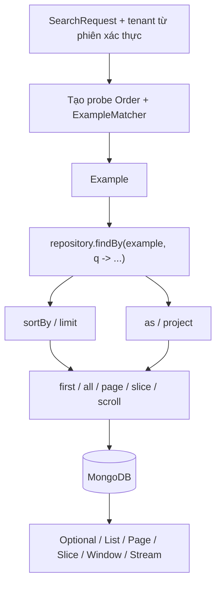
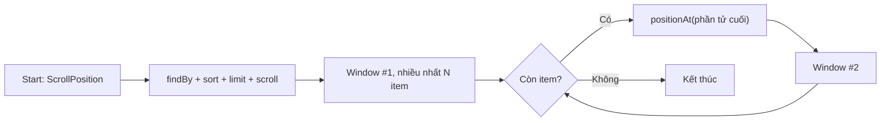

# Fluent query, projection, phân trang và scrolling theo phiên bản

> **Chương:** Query by Example  
> **Module:** `SPRING_DATA_MONGODB` — sử dụng Spring Data MongoDB để kết nối, ánh xạ document và thao tác MongoDB qua repository hoặc `MongoTemplate`. Bài học này đi sâu vào **Fluent Query by Example (QBE)**: kết hợp `Example` với sắp xếp, giới hạn, projection, `Page`/`Slice` và `Window`/scrolling. Ngoài cú pháp, bài giải thích **khác biệt theo phiên bản Spring Data**, rủi ro khi dùng keyset, chi phí count, index, reactive access và cách kiểm thử trên MongoDB thật.

## 1. Bài toán: tìm kiếm linh hoạt nhưng không muốn nhận toàn bộ document

Một trang quản trị đơn hàng cho phép lọc theo tenant, trạng thái và tiền tố mã khách hàng. Với cùng một bộ lọc, giao diện có thể yêu cầu:

1. **10 đơn mới nhất** để hiển thị ở dashboard.
2. **Trang số 2 trên tổng số trang** để có phân trang kiểu bảng.
3. **Tải tiếp 10 đơn** mà không cần biết tổng số bản ghi.
4. **Chỉ đọc ID, mã khách và thời gian tạo**, không chuyển mọi field của document.
5. **Duyệt nhiều cửa sổ (window)** để xuất dữ liệu, tránh truy vấn offset ngày càng lớn.

`Query by Example` tạo filter từ một **probe** (object mẫu) và `ExampleMatcher`. `FetchableFluentQuery` bổ sung cách thực thi cùng filter với những yêu cầu kết quả khác nhau:



**Nguyên tắc quan trọng:** Fluent API **không làm thay đổi bản chất bộ lọc QBE**. Nó cho phép định hình sort, kiểu kết quả, trường trả về và cơ chế đọc. Nếu một điều kiện nghiệp vụ vượt khả năng QBE, `as(…)` hoặc `scroll(…)` cũng không tự biến nó thành phép truy vấn MongoDB phức tạp hơn.

## 2. Mô hình dữ liệu dùng xuyên suốt

Chọn class với wrapper types để có thể dựng một probe mà các field không muốn lọc mang giá trị `null`:

```java
package demo.orders;

import java.time.Instant;
import org.springframework.data.annotation.Id;
import org.springframework.data.mongodb.core.mapping.Document;
import org.springframework.data.mongodb.core.mapping.Field;

@Document(collection = "orders")
public class Order {
    @Id
    private String id;
    private String tenantId;

    @Field("customer_code")
    private String customerCode;

    private String status;
    private Boolean deleted;
    private Instant createdAt;
    private Long totalCents;

    public Order() {}

    public Order(String id, String tenantId, String customerCode,
                 String status, Boolean deleted,
                 Instant createdAt, Long totalCents) {
        this.id = id;
        this.tenantId = tenantId;
        this.customerCode = customerCode;
        this.status = status;
        this.deleted = deleted;
        this.createdAt = createdAt;
        this.totalCents = totalCents;
    }

    public String getId() { return id; }
    public String getTenantId() { return tenantId; }
    public String getCustomerCode() { return customerCode; }
    public String getStatus() { return status; }
    public Boolean getDeleted() { return deleted; }
    public Instant getCreatedAt() { return createdAt; }
    public Long getTotalCents() { return totalCents; }

    public void setTenantId(String tenantId) { this.tenantId = tenantId; }
    public void setCustomerCode(String customerCode) {
        this.customerCode = customerCode;
    }
    public void setStatus(String status) { this.status = status; }
    public void setDeleted(Boolean deleted) { this.deleted = deleted; }
}
```

Document minh họa ở dạng Extended JSON:

```json
{
  "_id": "ORD-A3",
  "_class": "demo.orders.Order",
  "tenantId": "TENANT-A",
  "customer_code": "CUS-003",
  "status": "PAID",
  "deleted": false,
  "createdAt": { "$date": "2026-11-20T03:00:00Z" },
  "totalCents": 150000
}
```

`_class` trong ví dụ phản ánh **cấu hình type mapping mặc định thường gặp**; nó có thể không được ghi nếu ứng dụng dùng type mapper riêng. Phần type discriminator này quan trọng với QBE MongoDB, sẽ được giải thích ở mục 4.

**Tại sao `deleted` dùng `Boolean` thay vì `boolean`?** Với QBE, property kiểu nguyên thủy như `boolean` và `int` luôn có giá trị mặc định (`false`/`0`), nên có thể **bị đưa vào filter ngay cả khi người dùng không chọn**. Dùng wrapper cho các tiêu chí tùy chọn giúp probe phân biệt “không lọc” (`null`) với “lọc deleted=false”.

Repository:

```java
package demo.orders;

import org.springframework.data.mongodb.repository.MongoRepository;

// MongoRepository kế thừa khả năng Query by Example.
public interface OrderRepository extends MongoRepository<Order, String> {}
```

Trong các ví dụ tiếp theo, `orderRepository` là bean được inject và các lệnh giả định chạy trên MongoDB test hoặc ứng dụng đã cấu hình kết nối.

## 3. Tạo Example và ExampleMatcher đúng mục đích

### 3.1. Probe chỉ chứa những field muốn lọc

```java
import org.springframework.data.domain.Example;
import org.springframework.data.domain.ExampleMatcher;

Order probe = new Order();
probe.setTenantId("TENANT-A");
probe.setStatus("PAID");
probe.setDeleted(false);

ExampleMatcher matcher = ExampleMatcher.matchingAll()
    .withIgnoreNullValues()
    .withIgnorePaths("id", "createdAt", "totalCents");

Example<Order> example = Example.of(probe, matcher);
```

`matchingAll()` kết hợp các property đã chọn bằng **AND**. `withIgnoreNullValues()` bỏ qua property null; đây cũng là hành vi QBE mặc định thông thường, nhưng viết tường minh giúp người học thấy chủ đích. `withIgnorePaths(...)` loại những property không thuộc phạm vi search dù sau này có ai đó gán nhầm giá trị vào probe.

Filter mang ý nghĩa:

```javascript
db.orders.find({
  tenantId: "TENANT-A",
  status: "PAID",
  deleted: false
});
```

Thực tế, **typed QBE** có thể thêm điều kiện type discriminator vào truy vấn, vì vậy JSON trên chỉ minh họa **các predicate nghiệp vụ**, không phải cam kết raw query sẽ đúng hoàn toàn như vậy.

### 3.2. Tìm chuỗi theo tiền tố

Nếu ô tìm kiếm nhập `CUS`, thêm matcher theo riêng property `customerCode`:

```java
import static org.springframework.data.domain.ExampleMatcher.GenericPropertyMatchers.startsWith;

Order probe = new Order();
probe.setTenantId("TENANT-A");
probe.setStatus("PAID");
probe.setDeleted(false);
probe.setCustomerCode("CUS");

ExampleMatcher matcher = ExampleMatcher.matchingAll()
    .withIgnoreNullValues()
    .withMatcher("customerCode", startsWith().ignoreCase());

Example<Order> example = Example.of(probe, matcher);
```

`customerCode` là **tên Java property**; MongoDB lưu field `customer_code` qua `@Field`. Matcher `startsWith().ignoreCase()` có thể được ánh xạ thành regex có neo đầu và tùy chọn `i`. Đối sánh không phân biệt hoa/thường bằng regex **có thể tận dụng index kém**, nhất là trên tập dữ liệu lớn; đừng mặc định prefix search QBE luôn nhanh.

### 3.3. matchingAny khác matchingAll ở điểm nguy hiểm nào?

`ExampleMatcher.matchingAny()` biểu thị cách kết hợp **OR** trên các property được tham gia. Trong hệ thống nhiều tenant:

```java
// KHÔNG dùng cho filter bảo mật tenant nếu OR có thể bỏ qua tenant.
ExampleMatcher unsafe = ExampleMatcher.matchingAny();
```

Nếu `tenantId=TENANT-A` và `status=PAID` bị ghép kiểu OR, kết quả có thể bao gồm đơn `PAID` thuộc tenant khác. **Bảo mật không được phụ thuộc vào việc client chọn matcher nào.** Cố định điều kiện tenant ở tầng service/repository query an toàn và thử bằng dữ liệu khác tenant.

QBE thích hợp với **AND của các property tùy chọn**. Khi nghiệp vụ yêu cầu `(A OR B) AND tenant` hoặc điều kiện nhóm lồng phức tạp, chuyển sang `MongoTemplate`/`Criteria` hoặc `@Query` với cấu trúc boolean rõ ràng.

## 4. MongoDB-specific QBE: strict type, null và nested documents

### 4.1. Typed example có thể ràng buộc _class

Spring Data MongoDB mặc định xem một `Example<Order>` là **strictly typed**. Mapping có thể đưa type discriminator vào filter để chỉ nhận các document đúng/thuộc kiểu của probe. Trong cấu hình mặc định sử dụng `_class`, điều kiện phụ có thể được biểu diễn về ý nghĩa:

```javascript
{
  tenantId: "TENANT-A",
  status: "PAID",
  _class: { $in: ["demo.orders.Order"] }
}
```

Đây là **hình thức minh họa**, type key/value thực tế phụ thuộc type mapper, hierarchy và `@TypeAlias`. Với dữ liệu được seed bằng Java Driver thô **không có `_class`**, query QBE typed có thể không tìm thấy dù các field nghiệp vụ khớp.

Spring Data MongoDB có `UntypedExampleMatcher` để bỏ phần ràng buộc type khi thực sự cần:

```java
import org.springframework.data.mongodb.core.query.UntypedExampleMatcher;

Example<Order> untyped = Example.of(
    probe,
    UntypedExampleMatcher.matching()
);
```

**Không bật untyped chỉ để “cho kết quả xuất hiện”.** Nếu nhiều domain type dùng chung collection, bỏ ràng buộc type có thể đọc dữ liệu không cùng schema. Cần xác định collection, quyền truy cập và cách ánh xạ trước; đồng thời đảm bảo matcher/metadata đúng với loại dữ liệu dự kiến.

### 4.2. Null theo QBE không giống Query null

Theo mặc định, giá trị `null` trong probe bị **bỏ qua**, không phải biến thành `{ field: null }`. Nếu cần lọc explicit null hoặc phân biệt field vắng mặt, dùng `Criteria.exists`, `Criteria.isNullValue` hoặc JSON query trực tiếp.

Với nested object, chế độ đưa `null` vào QBE còn có thể dẫn tới **so sánh embedded document theo cấu trúc** thay vì dotted-path thông thường. Điều này có thể ảnh hưởng cả thứ tự/giá trị field trong document. Hãy test trên BSON thật; đừng dùng `withIncludeNullValues()` như một cách thay thế tổng quát cho mọi truy vấn null/missing.

### 4.3. QBE không tự biểu diễn mọi toán tử

`ExampleMatcher` hỗ trợ đối sánh String theo pattern và các property đơn giản, nhưng không phải một DSL MongoDB đầy đủ:

- Khoảng ngày `createdAt >= from AND < to`: dùng `Criteria.gte/lt`.
- Hai điều kiện phải khớp trong cùng một phần tử mảng: dùng `$elemMatch`.
- Nhóm `(A OR B) AND C`: dùng `andOperator/orOperator`.
- Aggregation `$lookup`, `$group`, `$project`: dùng Aggregation API.
- Full-text, geospatial và so sánh số theo range đặc thù: dùng API chuyên biệt.

Fluent QBE giúp **điều khiển cách lấy kết quả** khi filter đã phù hợp, không làm QBE có thêm ngữ pháp boolean hoặc aggregation mới.

## 5. Fluent Query API: cấu trúc và vòng đời

### 5.1. Chữ ký findBy

`QueryByExampleExecutor` trong Spring Data Commons cung cấp dạng:

```java
<S extends T, R> R findBy(
    Example<S> example,
    Function<FluentQuery.FetchableFluentQuery<S>, R> queryFunction
);
```

Trong repository thực tế, không cần khai báo lại method này:

```java
List<Order> orders = orderRepository.findBy(
    example,
    q -> q.sortBy(Sort.by("createdAt").descending())
          .limit(10)
          .all()
);
```

`q` biểu diễn một fluent query gắn với `example`. Phương thức trung gian cấu hình truy vấn; **phương thức kết thúc (terminal)** quyết định hành vi thực thi và kiểu kết quả.

### 5.2. Bảng phương thức trung gian và terminal

| Nhóm | Method | Ý nghĩa |
| --- | --- | --- |
| Trung gian | `sortBy(Sort)` | Sắp xếp; gọi nhiều lần có thể nối thêm các quy tắc sort. |
| Trung gian | `limit(int)` | Giới hạn lượng kết quả; cần xem xung đột với `Pageable`. |
| Trung gian | `as(Class<R>)` | Đổi **result type** sang projection/DTO/interface mong muốn. |
| Trung gian | `project(...)` | Chỉ chọn các property/property path cần đọc. |
| Terminal | `first()` / `firstValue()` | Bản ghi đầu; Optional hoặc nullable value. |
| Terminal | `one()` / `oneValue()` | Yêu cầu tối đa một bản ghi; nhiều kết quả gây exception. |
| Terminal | `all()` | Trả `List<T>`, không phù hợp cho dataset vô hạn/khổng lồ. |
| Terminal | `page(Pageable)` | Trả `Page<T>` có metadata tổng và số trang. |
| Terminal | `slice(Pageable)` | Trả `Slice<T>`, không cung cấp tổng; **phụ thuộc phiên bản**. |
| Terminal | `scroll(ScrollPosition)` | Trả `Window<T>` để đọc tiếp theo offset/keyset; **phụ thuộc phiên bản**. |
| Terminal | `stream()` | Trả `Stream<T>`; phải đóng để giải phóng cursor. |
| Terminal | `count()` / `exists()` | Đếm hoặc kiểm tra tồn tại theo example. |

Không phải mọi phiên bản Spring Data Commons hoặc mọi store module đều có hoặc hiện thực toàn bộ phương thức. **Bảng này dựa trên API hiện đại và phải được đối chiếu với dependency thực tế.**

### 5.3. FluentQuery là bất biến

Các lệnh trung gian trả về **một fluent query mới**, thay vì bắt buộc sửa chính instance cũ:

```java
// ĐÚNG: tiếp tục chain từ kết quả trả về.
List<Order> top = orderRepository.findBy(
    example,
    q -> q.sortBy(Sort.by("createdAt").descending())
          .limit(10)
          .all()
);
```

Mẫu không nên dùng:

```java
// PHẢN VÍ DỤ: bỏ qua object trả về từ limit.
List<Order> potentiallyUnbounded = orderRepository.findBy(
    example,
    q -> {
        q.limit(10);
        return q.all(); // Có thể không áp dụng limit mong đợi.
    }
);
```

**Cũng không được trả chính đối tượng `q` ra ngoài lambda** rồi dùng sau: Spring Data yêu cầu query function **kết thúc bằng kết quả truy vấn** trong phạm vi gọi `findBy`. Nếu muốn tái sử dụng lựa chọn sắp xếp/projection, tạo helper nhận `Example` và terminal lambda, không giữ instance `FluentQuery`.

## 6. Chọn first, one, all, limit, count và exists

### 6.1. Lấy bản ghi mới nhất

```java
import java.util.Optional;
import org.springframework.data.domain.Sort;

Sort newestFirst = Sort.by(Sort.Direction.DESC, "createdAt")
    .and(Sort.by(Sort.Direction.DESC, "id"));

Optional<Order> latest = orderRepository.findBy(
    example,
    q -> q.sortBy(newestFirst).first()
);
```

`first()` lấy phần tử đầu nếu có; `Optional.empty()` nếu không có. **Thêm ID làm tie-breaker** vì có thể nhiều đơn cùng timestamp. Nếu dùng `first()` mà không sort, không có thứ tự nghiệp vụ ổn định.

### 6.2. one() không phải first()

```java
Optional<Order> unique = orderRepository.findBy(
    example,
    q -> q.one()
);
```

`one()` đúng khi nghiệp vụ kỳ vọng **tối đa một** kết quả. Nếu có hai document khớp, Spring Data ném `IncorrectResultSizeDataAccessException` thay vì âm thầm chọn một. `firstValue()`/`oneValue()` khác về kiểu trả về nullable; không dùng để bỏ qua kiểm tra uniqueness.

### 6.3. Limit và danh sách

```java
List<Order> latest10 = orderRepository.findBy(
    example,
    q -> q.sortBy(newestFirst).limit(10).all()
);
```

`limit(10)` giới hạn kết quả của truy vấn; `all()` vẫn materialize **những kết quả được trả** vào `List`. Không dùng `all()` thiếu limit cho dữ liệu có hàng triệu document nếu chỉ cần xử lý theo từng phần.

### 6.4. Đếm và kiểm tra có dữ liệu

```java
long matching = orderRepository.findBy(example, q -> q.count());
boolean found = orderRepository.findBy(example, q -> q.exists());

// Các method QBE trực tiếp có cùng mục tiêu:
long matchingViaExecutor = orderRepository.count(example);
boolean existsViaExecutor = orderRepository.exists(example);
```

`count` trả số bản ghi phù hợp filter, không cần materialize tất cả entity để đếm. `exists` chỉ kiểm tra có ít nhất một bản ghi phù hợp. Trong hệ thống lớn, đừng thay `count` bằng `findAll(example).size()` vì sẽ đọc toàn bộ kết quả về JVM.

## 7. Projection: lấy đúng loại dữ liệu và đúng field

### 7.1. Tại sao phải tránh trả cả entity cho danh sách?

Document `Order` có thể chứa nhiều dữ liệu hơn UI cần (chi tiết giao hàng, lịch sử cập nhật, mảng dòng hàng...). API bảng chỉ hiển thị ID, customer code, status và ngày tạo. Gửi nguyên entity:

- Tăng lượng BSON truyền qua mạng.
- Tăng số object JVM được ánh xạ.
- Tăng nguy cơ trả nhầm field không nên được lộ ra ngoài API.
- Có thể làm GC và response serialization nặng hơn.

Fluent API có hai cơ chế bổ trợ:

1. **`as(ResultType.class)`:** yêu cầu ánh xạ kết quả thành một interface/DTO projection.
2. **`project("fieldA", ...)`:** giới hạn property/property path được chọn để đọc.

### 7.2. Interface projection

```java
package demo.orders;

import java.time.Instant;

public interface OrderSummary {
    String getId();
    String getCustomerCode();
    String getStatus();
    Instant getCreatedAt();
}
```

Tệp `OrderSummary.java` là ví dụ **một interface riêng**, không phải khai báo thêm một `public` type cùng file `Order.java`.

Lấy danh sách projection:

```java
List<OrderSummary> summaries = orderRepository.findBy(
    example,
    q -> q.as(OrderSummary.class)
          .sortBy(newestFirst)
          .limit(20)
          .all()
);
```

Sử dụng `getCustomerCode()` trong interface, dù BSON field là `customer_code`. Metadata mapping giúp trừu tượng hóa tên property Java và tên field thực tế. Tuy nhiên **projection chỉ an toàn khi ứng dụng kiểm soát field được lộ**; không biến một interface chứa dữ liệu nhạy cảm thành public DTO chỉ vì framework hỗ trợ.

### 7.3. Giới hạn các property được truy vấn

```java
List<OrderSummary> compact = orderRepository.findBy(
    example,
    q -> q.as(OrderSummary.class)
          .project("id", "customerCode", "status", "createdAt")
          .sortBy(newestFirst)
          .limit(20)
          .all()
);
```

`project(…)` dùng **tên property/path theo domain**; việc ánh xạ sang BSON đích cần kiểm tra khi có `@Field` hoặc mapping tùy chỉnh. Đừng viết `"customer_code"` một cách máy móc nếu API nhận property Java `customerCode`.

**Chú ý:** trong MongoDB, `_id` thường được trả theo mặc định trừ khi loại bỏ. Với keyset scrolling, nên **chủ động giữ ID và mọi sort key** trong projection, không phụ thuộc sự tình cờ của default projection.

### 7.4. Không save lại entity chỉ có projection

```java
// PHẢN VÍ DỤ về ý tưởng:
// Order truncated = ... đọc chỉ id/status;
// orderRepository.save(truncated);
```

Một entity được load với thiếu field không phải aggregate đầy đủ. Save trở lại có thể ghi đè hoặc xóa mất thông tin chưa được load tùy đường write và mapping. Trả projection read-only hoặc DTO riêng; khi sửa một field hãy dùng update có điều kiện và `UpdateResult` thích hợp.

### 7.5. Projection không tự giải quyết aggregation

`as(OrderSummary.class)` biến đổi **hình dạng kết quả**; `project("customerCode")` chọn field. Không có nghĩa Spring Data sẽ tự thực hiện `$group`, `$lookup`, tính tổng tiền theo khách hoặc full-text ranking. Với dữ liệu tính toán, dùng aggregation pipeline/`@Aggregation` rồi ánh xạ kết quả sang DTO.

## 8. Page: phân trang có tổng số kết quả

### 8.1. PageRequest và FluentQuery.page

```java
import org.springframework.data.domain.Page;
import org.springframework.data.domain.PageRequest;
import org.springframework.data.domain.Sort;

Sort order = Sort.by(Sort.Direction.DESC, "createdAt")
    .and(Sort.by(Sort.Direction.DESC, "id"));

PageRequest request = PageRequest.of(0, 20, order);

Page<OrderSummary> page = orderRepository.findBy(
    example,
    q -> q.as(OrderSummary.class).page(request)
);
```

`PageRequest.of(0,20,...)` yêu cầu **trang 0** (trang đầu), tối đa 20 phần tử. `Page` hỗ trợ:

| Thành phần | Ý nghĩa |
| --- | --- |
| `getContent()` | Các `OrderSummary` thuộc trang hiện tại. |
| `getNumber()` | Số trang, bắt đầu từ 0. |
| `getSize()` | Kích thước trang yêu cầu. |
| `getNumberOfElements()` | Số phần tử thực tế trong trang. |
| `getTotalElements()` | Tổng số phần tử phù hợp example. |
| `getTotalPages()` | Tổng số trang theo size và total. |
| `hasNext()` | Có trang tiếp theo theo metadata hiện tại. |

Nếu có 43 kết quả và size=20, số trang là:

\[
\operatorname{totalPages} = \left\lceil \frac{43}{20}\right\rceil = 3
\]

Các trang có index `0`, `1`, `2` với lượng item tối đa lần lượt 20, 20, 3.

### 8.2. Count query có thể tốn hơn content query

`Page` cần tổng số phù hợp example. Khi không thể suy ra total từ content (ví dụ trang đầu đủ 20 bản ghi), framework có thể cần một công việc **count** ngoài truy vấn lấy 20 item.

Với MongoDB:

```javascript
// Nội dung trang (minh họa; QBE còn có thể thêm type restriction).
db.orders.find({
  tenantId: "TENANT-A",
  status: "PAID",
  deleted: false
}).sort({
  createdAt: -1, _id: -1
}).skip(0).limit(20);

// Đếm toàn bộ tập phù hợp.
db.orders.countDocuments({
  tenantId: "TENANT-A",
  status: "PAID",
  deleted: false
});
```

**Không khẳng định lúc nào Page cũng chạy đúng hai lệnh.** Spring Data có tối ưu suy total khi kết quả ngắn, và driver/store version có thể khác về lệnh count. Nhưng nếu UI không cần total, `Page` vẫn có thể gây thêm chi phí không cần thiết.

### 8.3. Sort trong Pageable ghi đè sortBy trước đó

Tài liệu `FluentQuery.FetchableFluentQuery.page(Pageable)` nêu **sort của một `Pageable` đã sort sẽ ghi đè thứ tự sort được khai báo trước**. Tương tự, page size sẽ ghi đè một `limit(int)` đã khai báo trước khi page.

```java
Page<Order> actual = orderRepository.findBy(
    example,
    q -> q.sortBy(Sort.by("createdAt").descending())
          .limit(5)
          .page(PageRequest.of(0, 20, Sort.by("id").ascending()))
);

// Đừng kỳ vọng result luôn sort theo createdAt hoặc chỉ có 5 item.
// PageRequest đã yêu cầu size=20 và sort theo id.
```

**Quy ước dễ bảo trì:** với `page(pageable)` hoặc `slice(pageable)`, chuẩn bị toàn bộ sort và size ở chính `PageRequest`, tránh cấu hình trùng nơi.

## 9. Slice: tải tiếp mà không cần tổng số

`Slice<T>` khác `Page<T>` ở chỗ **không** cung cấp `totalElements` hay `totalPages`. Nó trả content, thông tin trang và `hasNext`.

Trong các phiên bản Spring Data Commons cung cấp `FetchableFluentQuery.slice(Pageable)` và store module hỗ trợ, có thể viết:

```java
import org.springframework.data.domain.Slice;

Slice<OrderSummary> slice = orderRepository.findBy(
    example,
    q -> q.as(OrderSummary.class).slice(
        PageRequest.of(0, 20, newestFirst)
    )
);

List<OrderSummary> items = slice.getContent();
boolean more = slice.hasNext();
```

Một triển khai `Slice` có thể đọc **pageSize + 1** document để xác định còn trang sau, thay vì đếm toàn bộ tập. Chi tiết request/đọc dư phụ thuộc phiên bản, nên cần quan sát command hoặc integration test trên MongoDB thật.

| Yêu cầu UI | `Page` | `Slice` |
| --- | --- | --- |
| Hiển thị nội dung hiện tại | Có | Có |
| Nút **Tiếp theo / Tải thêm** | Có | Có |
| “Trang 1 trên 143” | **Có** | **Không** |
| Cần tính total | Có thể phải count | Thường tránh công việc total |
| Nhảy đến trang số bất kỳ | Phù hợp với offset | Có thể, nhưng không có total |
| Đi sâu hàng nghìn trang | `skip` ngày càng lớn | `skip` vẫn có thể lớn |

Chuyển từ Page sang Slice **chỉ giúp tránh total count**, không tự loại bỏ chi phí `skip` ở trang sâu. Nếu chủ yếu đọc tuần tự nhiều trang, hãy xét `Window` và keyset.

**Theo phiên bản:** `slice(Pageable)` của Fluent Query có mặt trong API Spring Data Commons hiện đại (javadoc ghi từ nhánh 3.5). Với bản cũ hoặc module không hiện thực, chọn `findAll(example, Pageable)`/repository Slice method phù hợp hoặc tự viết template query; không chép method rồi giả định mọi dependency đều compile.

## 10. Scrolling: đọc tiếp qua Window và ScrollPosition

`Window<T>` mô tả **một cửa sổ kết quả** trong một chuỗi truy vấn có sort và giới hạn. Khác `Page`, `Window` không nhất thiết biết toàn bộ tổng số. Muốn đọc window sau, truyền `ScrollPosition` đại diện cho **vị trí của phần tử cuối trong window vừa nhận**.



### 10.1. Bắt đầu bằng offset scrolling

Ví dụ chỉ truy xuất từ đầu, không cần total:

```java
import org.springframework.data.domain.ScrollPosition;
import org.springframework.data.domain.Window;

Window<Order> firstWindow = orderRepository.findBy(
    example,
    q -> q.sortBy(newestFirst)
          .limit(10)
          .scroll(ScrollPosition.offset())
);

List<Order> firstItems = firstWindow.getContent();
```

`ScrollPosition.offset()` mang nghĩa **điểm bắt đầu trước phần tử đầu tiên**. Đừng nhầm với `ScrollPosition.offset(0L)`: scrolling dùng vị trí **exclusive** (lấy item sau vị trí đã truyền), nên `offset(0L)` có nghĩa **đã ở phần tử index 0** và có thể khiến phần tử đầu bị bỏ qua.

### 10.2. Duyệt các Window liên tiếp

```java
ScrollPosition position = ScrollPosition.offset();

while (true) {
    Window<Order> window = orderRepository.findBy(
        example,
        q -> q.sortBy(newestFirst)
              .limit(10)
              .scroll(position)
    );

    for (Order order : window) {
        processOrder(order);
    }

    if (window.isEmpty() || window.isLast()) {
        break;
    }

    position = window.positionAt(window.size() - 1);
}
```

`processOrder(order)` là hàm xử lý nghiệp vụ do service định nghĩa. Điều kiện `isEmpty()` ngăn gọi `positionAt(-1)` trên cửa sổ rỗng. `isLast()` giúp tránh request thừa khi implementation biết đây là cửa sổ cuối.

**Offset scrolling vẫn có chi phí offset lớn**: server có thể phải đi qua nhiều kết quả trước khi trả window sâu. Nó hạn chế dữ liệu truyền mỗi lần nhưng không biến offset=100.000 thành một phép tìm O(1).

## 11. Keyset scrolling: tối ưu duyệt tiến trên tập lớn

Keyset lưu **giá trị của các khóa sắp xếp** ở phần tử cuối rồi xây điều kiện đọc những phần tử đứng sau trong thứ tự đã chọn.

### 11.1. Sort ổn định và không có null

Ví dụ:

```java
Sort keysetSort = Sort.by(Sort.Direction.DESC, "createdAt")
    .and(Sort.by(Sort.Direction.DESC, "id"));
```

Giả định `createdAt` là BSON Date **không null**, không bị cập nhật sau khi tạo, `_id` duy nhất và có kiểu BSON nhất quán. Khi hai đơn có cùng `createdAt`, ID giúp phân biệt thứ tự.

Một filter keyset theo hướng giảm dần có ý nghĩa tương đương:

```javascript
// Ví dụ cùng điều kiện tenant/status/deleted như QBE.
db.orders.find({
  tenantId: "TENANT-A",
  status: "PAID",
  deleted: false,
  $or: [
    { createdAt: { $lt: ISODate("2026-11-20T03:00:00Z") } },
    {
      createdAt: ISODate("2026-11-20T03:00:00Z"),
      _id: { $lt: "ORD-A3" }
    }
  ]
}).sort({ createdAt: -1, _id: -1 }).limit(20);
```

Đây là **diễn giải logic**, không cam kết chuỗi query mà Spring Data tự tạo giống hệt từng trường. Framework sẽ xét sort và keyset position theo store mapping.

### 11.2. Fluent QBE với keyset

Với Spring Data Commons/MongoDB có hỗ trợ `FetchableFluentQuery.scroll`:

```java
ScrollPosition position = ScrollPosition.keyset();

while (true) {
    Window<OrderSummary> window = orderRepository.findBy(
        example,
        q -> q.as(OrderSummary.class)
              .project("id", "customerCode", "status", "createdAt")
              .sortBy(keysetSort)
              .limit(20)
              .scroll(position)
    );

    for (OrderSummary order : window) {
        writeReportRow(order);
    }

    if (window.isEmpty() || window.isLast()) {
        break;
    }

    position = window.positionAt(window.size() - 1);
}
```

Ở đây, `OrderSummary` khai báo getter `getId()` và `getCreatedAt()`, đồng thời `project(…)` **giữ cả hai sort key**. Điều này không chỉ phục vụ hiển thị: keyset scrolling cần các giá trị khóa để tạo vị trí đọc tiếp.

### 11.3. Tại sao projection không được bỏ sort key?

Mẫu rủi ro:

```java
// PHẢN VÍ DỤ: thiếu createdAt trong loại kết quả.
public interface TooSmallOrderView {
    String getId();
    String getStatus();
}
```

Nếu vẫn sort theo `createdAt` rồi trả projection chỉ có `id` và `status`, implementation có thể **không trích được keyset** từ phần tử cuối và ném lỗi hoặc không thể tiếp tục. Với mọi DTO/interface dùng trong keyset, bao gồm **các field của sort và ID** (hoặc các key bổ sung mà hệ thống cần).

Keyset cũng yêu cầu những thuộc tính sắp xếp **không null**; thiếu field, mixed BSON types hoặc chuyển đổi kiểu không nhất quán có thể làm điều kiện tiếp theo sai. Đây là ràng buộc dữ liệu, không chỉ là chuyện khai báo Java type `Instant`.

### 11.4. Điều gì xảy ra khi document bị thêm/xóa trong lúc scroll?

Keyset ít nhạy hơn offset với việc chèn thêm bản ghi ở **đầu** danh sách, vì cursor vẫn đi sau khóa đã đọc. Tuy nhiên, nó **không tự tạo snapshot bất biến**:

- Document chưa đọc bị xóa thì sẽ không xuất hiện.
- Document thay đổi `createdAt` có thể dịch vị trí so với cursor.
- Thay filter hoặc sort giữa các request có thể làm lặp/bỏ sót.
- Dùng khóa không duy nhất mà không tie-breaker có thể làm mất record trùng timestamp.

Với export cần nhất quán tuyệt đối, phải thiết kế snapshot/cutoff, transaction hoặc nguồn dữ liệu bất biến theo yêu cầu; `Window` và `ScrollPosition` không tự giải quyết toàn bộ consistency.

### 11.5. Offset, keyset, Page, Slice: chọn theo yêu cầu

| Tiêu chí | Page | Slice | Offset Window | Keyset Window |
| --- | --- | --- | --- | --- |
| Metadata total | Có | Không | Không | Không |
| Đọc tiếp theo từng đợt | Có | Có | Có | Có |
| Nhảy tới trang bất kỳ | Tốt | Có thể | Có thể | Khó |
| Offset sâu | Chi phí tăng | Chi phí tăng | Chi phí tăng | Có thể tránh skip lớn |
| Cần khóa sort không null | Không bắt buộc về kỹ thuật (nhưng cần sort ổn định) | Tương tự Page | Cần sort ổn định | **Cần sort key phù hợp, không null** |
| Projection phải giữ sort keys | Tùy mục đích | Tùy mục đích | Không bắt buộc theo cùng nghĩa | **Bắt buộc để lấy cursor tiếp** |
| Phù hợp nhất | Bảng có số trang | “Xem thêm” | Duyệt cửa sổ đơn giản | Feed/export lớn, duyệt tiến |

**Cả Page/Slice/Window đều giới hạn phần dữ liệu trả về mỗi request, không phải MongoDB cursor batch size**. Batch size của driver là thông số khác ở tầng truyền kết quả.

## 12. Khác biệt theo phiên bản Spring Data: tránh dùng API theo trí nhớ

`FluentQuery` thuộc Spring Data Commons, nhưng khả năng thực thi do **Spring Data MongoDB** triển khai. Kiểm tra **đồng thời** hai điều kiện: phiên bản API có method hay chưa, và MongoDB repository của phiên bản đó có hỗ trợ hay không.

| Tính năng | Mốc API tham khảo | Điều phải kiểm tra trong ứng dụng |
| --- | --- | --- |
| `findBy(example, q -> ...)` / Fluent QBE | Có từ Spring Data Commons **2.6** | Phiên bản MongoDB repository và khả năng projection/sort. |
| `as(Class)`, `sortBy`, `project(String...)`, `page`, `stream` | Thành phần Fluent QBE đã có trong các dòng phiên bản trước hiện tại | Kiểm tra overload, khả năng projection, stream lifecycle. |
| `limit(int)` của FluentQuery | Javadoc đánh dấu **since 3.1** | Không gọi khi phụ thuộc Commons cũ; xem `page` có ghi đè limit không. |
| `Window`, `ScrollPosition`, `scroll` | Javadoc đánh dấu **since 3.1** | Không phải mọi store/version hỗ trợ scrolling; có thể gặp `UnsupportedOperationException`. |
| `slice(Pageable)` của FetchableFluentQuery | Javadoc Commons đánh dấu **since 3.5** | Với bản cũ có thể dùng `Page`/`findAll(example, Pageable)` hoặc viết query template. |
| `project(TypedPropertyPath...)` | Javadoc hiện đại đánh dấu **since 4.1** | Dùng `project("propertyName")` nếu bản cũ không có overload typed path. |
| Reactive Fluent QBE | `ReactiveQueryByExampleExecutor.findBy` xuất hiện từ **2.6** | Return type và terminal reactive có thể khác imperative, không giả định hỗ trợ `Mono<Page>` trên mọi repository. |

**Đây là mốc của API Spring Data Commons, không phải số phiên bản Spring Boot.** Spring Boot quản lý một release train Spring Data tương thích, nên một ứng dụng “Boot 3.x” không nhất thiết có cùng toàn bộ API với bản Boot 3.x khác.

### 12.1. Checklist nâng cấp thư viện

1. Xác định Spring Boot version, Spring Data Commons version và Spring Data MongoDB version thực tế.
2. Đọc javadoc `FluentQuery.FetchableFluentQuery` của **đúng bản** để xem `slice`, `scroll`, `limit`.
3. Kiểm tra repository implementation của MongoDB có hỗ trợ terminal đang cần không.
4. Compile và chạy integration test với MongoDB tương ứng, không chỉ nhìn method hiện trong IDE.
5. Xác minh projection giữ mọi keyset sort field; nếu không, thay DTO.
6. Đo request thật: tổng count, sort/index, BSON mapping và dữ liệu trùng/null.
7. Với ứng dụng đang chạy bản cũ, ưu tiên giải pháp template/cursor đúng version hơn là sao chép code của tài liệu phiên bản mới.

## 13. Reactive Fluent QBE: cùng bộ lọc, publisher khác

`ReactiveMongoRepository` cung cấp các API QBE reactive trong phiên bản hỗ trợ:

```java
package demo.orders;

import org.springframework.data.mongodb.repository.ReactiveMongoRepository;

public interface ReactiveOrderRepository
        extends ReactiveMongoRepository<Order, String> {}
```

### 13.1. Lấy danh sách projection dưới dạng Flux

```java
import reactor.core.publisher.Flux;
import reactor.core.publisher.Mono;

Flux<OrderSummary> summaries = reactiveOrderRepository.findBy(
    example,
    q -> q.as(OrderSummary.class)
          .sortBy(newestFirst)
          .limit(20)
          .all()
);

Mono<Long> total = reactiveOrderRepository.count(example);
Mono<Boolean> hasAny = reactiveOrderRepository.exists(example);
```

Trong reactive API, `all()` trả publisher (`Flux`), không phải `List`; `one()`/`first()` thường trả `Mono`. Việc tạo `Flux` chỉ mô tả pipeline; database query được thực hiện khi có subscription phù hợp.

### 13.2. Đừng giả định Mono<Page<T>> được hỗ trợ

Spring Data MongoDB nêu rõ **reactive repository query method không hỗ trợ `Page` return type như `Mono<Page<T>>`** theo cách repository imperative. Nếu API cần cả content lẫn total, có thể ghép hai phép I/O:

```java
Flux<OrderSummary> limited = reactiveOrderRepository.findBy(
    example,
    q -> q.as(OrderSummary.class)
          .sortBy(newestFirst)
          .limit(20)
          .all()
);

Mono<List<OrderSummary>> items = limited.collectList();

Mono<Long> count = reactiveOrderRepository.count(example);

Mono<SearchResponse> response = Mono.zip(items, count)
    .map(tuple -> new SearchResponse(tuple.getT1(), tuple.getT2()));
```

Ví dụ DTO (một file riêng hoặc type lồng được khai báo hợp lệ):

```java
record SearchResponse(List<OrderSummary> items, long total) {}
```

Hai publisher `items` và `count` biểu thị **hai thao tác**; `Mono.zip` không tự tạo snapshot transaction chung. Với số lượng lớn, không `collectList()` cho toàn bộ collection; ở đây đã `limit(20)` nên chỉ gom tối đa 20 phần tử.

### 13.3. Reactive scroll/slice theo phiên bản

`ReactiveFluentQuery` hiện đại có các terminal như `slice(Pageable)` hoặc `scroll(ScrollPosition)` trong javadoc, nhưng chúng có thể là phương thức mặc định với `UnsupportedOperationException` nếu store implementation không hỗ trợ. Không copy nguyên logic imperative sang reactive và gọi `block()` trên event loop. Khi cần, dùng `ReactiveMongoTemplate` với query/scroll phù hợp trên phiên bản đã kiểm thử.

Reactive backpressure điều phối nhu cầu tiêu thụ trong pipeline, **không đồng nghĩa một `request(1)` sẽ tương đương đúng một lệnh MongoDB `getMore`**. Batch buffer, prefetch và concurrency vẫn có thể tồn tại.

## 14. Khi cần MongoTemplate thay cho Fluent QBE

### 14.1. Dùng Criteria.alike cho Example ở tầng template

Spring Data MongoDB cho phép dùng QBE với template:

```java
import java.util.List;
import org.springframework.data.mongodb.core.query.Criteria;
import org.springframework.data.mongodb.core.query.Query;

Query query = new Query(
    new Criteria().alike(example)
);

List<Order> matches = mongoTemplate.find(query, Order.class);
```

Cách này giúp tái sử dụng `Example` và mở rộng một số tùy chọn `Query` như sort, projection, limit hay metadata:

```java
Query query = new Query(new Criteria().alike(example))
    .with(newestFirst)
    .limit(20);

query.fields()
    .include("id")
    .include("customerCode")
    .include("status")
    .include("createdAt");

List<Order> rows = mongoTemplate.find(query, Order.class);
```

**Thận trọng:** nếu trả `Order` sau khi chỉ chọn một phần field, entity là **không đầy đủ**. Trong thực tế dùng DTO/projection riêng qua template fluent query API thay vì save entity thiếu field.

### 14.2. Filter phức tạp phải dùng Criteria đúng ngữ nghĩa

Ví dụ nghiệp vụ: `tenantId = TENANT-A`, không xóa mềm, trạng thái `PAID` **hoặc `REVIEW`**, và `createdAt` trong khoảng thời gian:

```java
import java.time.Instant;

Instant from = Instant.parse("2026-11-01T00:00:00Z");
Instant until = Instant.parse("2026-12-01T00:00:00Z");

Query advanced = Query.query(
    Criteria.where("tenantId").is("TENANT-A")
        .and("deleted").is(false)
        .and("status").in("PAID", "REVIEW")
        .and("createdAt").gte(from).lt(until)
);

List<Order> matches = mongoTemplate.find(advanced, Order.class);
```

Khoảng ngày và `$in` có thể diễn đạt bằng `Criteria`; việc cố tạo một probe QBE chứa tất cả logic này dễ gây nhầm. Nếu có mảng dòng hàng và các điều kiện phải thuộc **cùng phần tử**, sử dụng `Criteria.elemMatch` tại đúng array path.

### 14.3. MongoTemplate scrolling và projection

Các phiên bản Spring Data MongoDB hiện đại cung cấp FluentTemplate APIs và `Query.with(ScrollPosition)` cho scrolling. Tuy nhiên chữ ký cụ thể, khả năng `as(…)`, `scroll(…)`/`stream(…)` tùy phiên bản. Nếu `repository.findBy(example,...scroll)` không có hoặc không được hỗ trợ, template query có `Criteria` và sort/keyset rõ ràng là lựa chọn có thể kiểm soát — **sau khi kiểm tra javadoc và test tích hợp**, không tự phỏng đoán overload.

## 15. Index, hiệu năng và giới hạn dữ liệu

### 15.1. Index cho tenant, status và thứ tự createdAt

Giả sử API hay tìm `tenantId=TENANT-A`, `status=PAID`, `deleted=false`, sắp xếp `createdAt` và ID giảm dần. Một index ứng viên:

```javascript
db.orders.createIndex({
  tenantId: 1,
  status: 1,
  deleted: 1,
  createdAt: -1,
  _id: -1
});
```

Index này hỗ trợ ba điều kiện bằng trước các khóa sort, **nếu query thực tế phù hợp**. Với typed QBE còn có thể có `_class` trong filter: kiểm tra kế hoạch thực tế thay vì nghĩ index mẫu luôn là tối ưu.

Để đo một truy vấn tương đương:

```javascript
db.orders.find({
  tenantId: "TENANT-A",
  status: "PAID",
  deleted: false
}).sort({
  createdAt: -1,
  _id: -1
}).limit(20).explain("executionStats");
```

Đọc `winningPlan`, `totalKeysExamined`, `totalDocsExamined`, `nReturned` và stage sort. Không dùng một lần `explain` trên bộ dữ liệu vài chục dòng để kết luận index production đã tốt.

### 15.2. containsIgnoreCase và regex có thể rất tốn kém

Matcher:

```java
ExampleMatcher matcher = ExampleMatcher.matchingAll()
    .withMatcher(
        "customerCode",
        ExampleMatcher.GenericPropertyMatchers.contains().ignoreCase()
    );
```

có thể tạo regex đối sánh substring, làm MongoDB phải quét nhiều index entry hoặc document. Ngay cả khi có index trên `customer_code`, regex không phân biệt hoa/thường không mặc định tận dụng index tốt như so sánh bằng theo key chuẩn hóa. Với tra cứu lớn, cân nhắc normalizing search keys, index phù hợp hoặc cơ chế search chuyên dụng.

### 15.3. Projection giảm tải nhưng không sửa filter xấu

Projection làm kết quả nhẹ hơn, song query vẫn có thể phải xét nhiều document để xác định match, sort hoặc count. Một `Page` có projection nhỏ vẫn có thể chậm vì count quét tập lớn hoặc sort thiếu index. Bắt đầu tối ưu bằng **filter + index + query shape**, sau đó đo network và heap để đánh giá projection.

### 15.4. Offset và keyset

`PageRequest.of(5000,20)` có offset 100.000: dù chỉ lấy 20 bản ghi, MongoDB thường vẫn phải tiến qua nhiều kết quả để tới trang sâu. Keyset với index đúng có thể tránh skip lớn khi chỉ duyệt tiến, nhưng yêu cầu sort keys không null và phải trả keys trong projection.

**Không phải keyset luôn nhanh hơn trong mọi tình huống**: query shape, phân bố dữ liệu, index, sharding và kích thước cursor token đều cần đo. Một UI muốn nhảy ngẫu nhiên đến trang 200 có thể vẫn hợp lý hơn với Page/offset.

## 16. Tenant, quyền truy cập và consistency của pagination

### 16.1. Tenant ID phải xuất phát từ ngữ cảnh xác thực

```java
public Example<Order> buildExample(
    String authenticatedTenantId,
    String optionalStatus
) {
    if (authenticatedTenantId == null
        || authenticatedTenantId.isBlank()) {
        throw new IllegalArgumentException("Tenant required");
    }

    Order probe = new Order();
    probe.setTenantId(authenticatedTenantId);
    probe.setDeleted(false);
    probe.setStatus(optionalStatus);

    return Example.of(
        probe,
        ExampleMatcher.matchingAll().withIgnoreNullValues()
    );
}
```

`authenticatedTenantId` phải lấy từ identity đã được kiểm tra, không phải chuỗi client tự gửi rồi coi là tin cậy. **Nếu probe.tenantId == null** và matcher bỏ qua null, ứng dụng có nguy cơ truy vấn **mọi tenant**. `matchingAny()` còn nguy hiểm hơn nếu OR làm lỏng ràng buộc tenant.

### 16.2. Cursor phải ràng buộc với filter và sort

Khi API trả một `nextCursor` cho client:

- Không nên nhận lại một cursor tùy ý mà thiếu validation.
- Token cần gắn với tenant, filter, sort, page size và schema/version của cách tạo cursor.
- Có thể ký hoặc mã hóa token theo chính sách ứng dụng và giới hạn thời hạn sử dụng.
- Không lưu `ScrollPosition` bằng `toString()` rồi tin rằng chuỗi đó là định dạng wire ổn định qua mọi phiên bản.

Nếu client thay `status` từ PAID sang PENDING nhưng tái sử dụng cursor của bộ lọc cũ, thứ tự và keyset không còn đồng nghĩa. Bắt đầu một scroll mới khi filter/sort thay đổi.

### 16.3. Không có snapshot tự động

`Page`, `Slice` và `Window` không tự mở transaction để cố định toàn bộ snapshot qua những request khác nhau. Tổng đếm có thể phản ánh dữ liệu ở thời điểm khác content, và cursor có thể bị ảnh hưởng khi document thay đổi trong lúc duyệt.

Với dashboard quản trị có thể chấp nhận tính “gần thời điểm hiện tại”. Với export phục vụ kiểm toán, cần thiết kế snapshot/cutoff hoặc nguồn dữ liệu bất biến và chiến lược retry/idempotency; không dựa chỉ vào API phân trang.

## 17. Integration test: kiểm tra cả dữ liệu và behavior theo phiên bản

Một test chỉ assert `findBy(example, q -> q.all())` trả danh sách khác rỗng không đủ: nó không bắt lỗi vô tình lọc thêm `deleted=false` do primitive, bỏ điều kiện tenant, count sai hoặc keyset thiếu sort field.

### 17.1. Bộ dữ liệu test có ý nghĩa

Seed **qua Spring Data mapping** để typed example có cùng cấu trúc type discriminator như ứng dụng thực. Ví dụ:

| ID | Tenant | Status | deleted | createdAt | Kỳ vọng với tenant A + PAID + deleted=false |
| --- | --- | --- | :---: | --- | --- |
| `ORD-A1` | TENANT-A | PAID | false | 01:00Z | Có |
| `ORD-A2` | TENANT-A | PAID | false | 02:00Z | Có |
| `ORD-A3` | TENANT-A | PAID | false | 03:00Z | Có |
| `ORD-A4` | TENANT-A | PENDING | false | 04:00Z | Không |
| `ORD-A5` | TENANT-A | PAID | true | 05:00Z | Không |
| `ORD-B1` | TENANT-B | PAID | false | 06:00Z | Không |

Nếu dùng Java Driver raw để seed mà không ghi `_class`, QBE typed có thể **bỏ qua document**. Hãy chủ ý kiểm tra cả typed và untyped nếu dự án có dữ liệu legacy.

### 17.2. Mẫu kiểm thử Spring Boot với MongoDB độc lập

```java
package demo.orders;

import static org.assertj.core.api.Assertions.assertThat;
import java.time.Instant;
import java.util.List;
import org.junit.jupiter.api.BeforeEach;
import org.junit.jupiter.api.Test;
import org.springframework.beans.factory.annotation.Autowired;
import org.springframework.boot.test.autoconfigure.data.mongo.DataMongoTest;
import org.springframework.data.domain.Example;
import org.springframework.data.domain.ExampleMatcher;
import org.springframework.data.domain.Page;
import org.springframework.data.domain.PageRequest;
import org.springframework.data.domain.ScrollPosition;
import org.springframework.data.domain.Sort;
import org.springframework.data.domain.Window;

@DataMongoTest
class OrderFluentExampleTest {
    @Autowired OrderRepository repository;

    private final Sort newest = Sort
        .by(Sort.Direction.DESC, "createdAt")
        .and(Sort.by(Sort.Direction.DESC, "id"));

    @BeforeEach
    void seed() {
        repository.deleteAll(); // Chỉ trên database TEST cô lập.
        repository.saveAll(List.of(
            order("ORD-A1", "TENANT-A", "PAID", false, "01:00:00"),
            order("ORD-A2", "TENANT-A", "PAID", false, "02:00:00"),
            order("ORD-A3", "TENANT-A", "PAID", false, "03:00:00"),
            order("ORD-A4", "TENANT-A", "PENDING", false, "04:00:00"),
            order("ORD-A5", "TENANT-A", "PAID", true, "05:00:00"),
            order("ORD-B1", "TENANT-B", "PAID", false, "06:00:00")
        ));
    }

    private Order order(String id, String tenant, String status,
                        boolean deleted, String clock) {
        return new Order(
            id, tenant, "CUS-" + id, status, deleted,
            Instant.parse("2026-11-20T" + clock + "Z"),
            1000L
        );
    }

    private Example<Order> example() {
        Order probe = new Order();
        probe.setTenantId("TENANT-A");
        probe.setStatus("PAID");
        probe.setDeleted(false);
        return Example.of(
            probe,
            ExampleMatcher.matchingAll().withIgnoreNullValues()
        );
    }

    @Test
    void pageHasCorrectTotalAndStableSort() {
        Page<OrderSummary> page = repository.findBy(
            example(),
            q -> q.as(OrderSummary.class)
                  .page(PageRequest.of(0, 2, newest))
        );

        assertThat(page.getTotalElements()).isEqualTo(3L);
        assertThat(page.getTotalPages()).isEqualTo(2);
        assertThat(page.getContent())
            .extracting(OrderSummary::getId)
            .containsExactly("ORD-A3", "ORD-A2");
    }

    @Test
    void keysetWindowMovesToNextWindow() {
        Window<OrderSummary> first = repository.findBy(
            example(),
            q -> q.as(OrderSummary.class)
                  .project("id", "customerCode", "status", "createdAt")
                  .sortBy(newest)
                  .limit(2)
                  .scroll(ScrollPosition.keyset())
        );

        assertThat(first.getContent())
            .extracting(OrderSummary::getId)
            .containsExactly("ORD-A3", "ORD-A2");

        Window<OrderSummary> second = repository.findBy(
            example(),
            q -> q.as(OrderSummary.class)
                  .project("id", "customerCode", "status", "createdAt")
                  .sortBy(newest)
                  .limit(2)
                  .scroll(first.positionAt(first.size() - 1))
        );

        assertThat(second.getContent())
            .extracting(OrderSummary::getId)
            .containsExactly("ORD-A1");
    }
}
```

**Điều kiện chạy:** `@DataMongoTest` và import ở trên phù hợp với một số phiên bản Spring Boot 3.x; ở Boot mới hơn có thể khác package và cấu hình slice. Test cần MongoDB riêng (ví dụ Testcontainers), **không tự tạo server chỉ vì có `@DataMongoTest`**. `repository.deleteAll()` chỉ được phép trên database test cô lập.

Nếu bản đang dùng chưa có `scroll` hoặc MongoDB QBE không hỗ trợ terminal đó, **không đánh dấu test thất bại như lỗi dữ liệu**; tách một nhóm test theo capability/version và dùng cơ chế template/offset được hỗ trợ.

### 17.3. Các case nên có thêm

| Test | Điều cần khẳng định |
| --- | --- |
| `Boolean deleted` bỏ trống | Khi null và dùng ignoreNull, không lọc thêm deleted=false. |
| `matchingAll` | Không trả document của tenant khác. |
| `matchingAny` trong ví dụ cô lập | Hiểu được nguy cơ OR khiến phạm vi tìm kiếm mở rộng. |
| `startsWith().ignoreCase()` | Khớp đúng prefix và quan sát regex/index. |
| Typed QBE và raw BSON thiếu `_class` | Sự khác biệt có thật, không quy là lỗi Page. |
| `as(OrderSummary.class)` | Getter trả đúng giá trị `@Field("customer_code")`. |
| `project` | Query chỉ tải trường mong muốn, không thiếu sort keys cho keyset. |
| `page` | Total, totalPages, size và thứ tự chính xác. |
| `slice` nếu được hỗ trợ | Có `hasNext`, không có total. |
| Offset scrolling | `offset()` không bỏ phần tử đầu. |
| Keyset scrolling | Không lặp/mất item trên dữ liệu không đổi, kể cả timestamp trùng. |
| Sort field null | Từ chối hoặc xử lý riêng trước khi dùng keyset. |
| Thay đổi dữ liệu giữa hai window | Nêu rõ consistency mà API chấp nhận. |
| Reactive QBE | Filter và projection tương đương bản imperative. |

### 17.4. Đo query và index thật

Trong môi trường test có kiểm soát, bật command monitoring/metrics của MongoDB Java Driver để kiểm tra query và count theo từng terminal. Không log dữ liệu nhạy cảm. So sánh với `mongosh` và `explain("executionStats")`. Kiểm tra:

- `Page` có thực hiện count hay đã được tối ưu bỏ qua?
- `Slice`/`Window` có dùng số lượng dư để biết còn kết quả?
- Offset lớn có tạo thời gian quét tăng?
- Keyset có dùng index chứa khóa sort?
- Type discriminator `_class` và BSON field alias có đúng như dự kiến?

## 18. Lỗi thường gặp và cách xử lý

| Hiện tượng | Nguyên nhân | Hướng xử lý |
| --- | --- | --- |
| QBE trả ít hơn mong đợi dù data đúng | Typed Example có type restriction `_class`, hoặc probe chứa thêm property. | Xem raw BSON và matcher; dùng untyped có chủ đích nếu cần. |
| QBE vô tình lọc `deleted=false` | Probe dùng primitive `boolean` mặc định false. | Dùng `Boolean` wrapper hoặc `withIgnorePaths("deleted")`. |
| Query trả kết quả của tenant khác | Dùng `matchingAny` hoặc tenantId trong probe bị null. | Bắt buộc tenant từ principal, `matchingAll` hoặc Criteria AND. |
| `first()` trả document khác qua các lần | Không có sort ổn định hoặc timestamp trùng nhau. | Sort theo timestamp kèm ID. |
| `one()` ném exception | Hơn một document khớp Example. | Dùng `first()` nếu nghiệp vụ chỉ lấy một, hoặc siết filter/unique index. |
| `limit(10)` không có hiệu lực như mong đợi | Không dùng fluent query mới hoặc `page(Pageable)` ghi đè limit. | Chain trực tiếp và chỉ đặt size/sort trong Pageable khi paging. |
| `Page` chậm dù chỉ trả 20 item | Count/skip/sort/index có chi phí riêng. | Đo content/count, dùng Slice/Window nếu không cần total. |
| `slice(…)` không compile | Spring Data Commons hoặc MongoDB module phiên bản cũ. | Kiểm tra javadoc, thay bằng API có hỗ trợ. |
| `scroll(…)` ném UnsupportedOperationException | Store/implementation không hỗ trợ terminal đang gọi. | Dùng template/derived scrolling phù hợp hoặc nâng cấp có kiểm thử. |
| Offset(0) bỏ item đầu | ScrollPosition là vị trí exclusive. | Bắt đầu bằng `ScrollPosition.offset()`. |
| Keyset thiếu hoặc trùng item | Sort keys nullable, không duy nhất, thay đổi hoặc bị cắt bởi projection. | Sort ổn định, giữ keys, không null, index phù hợp. |
| Projection trả thiếu thông tin khi save | Đọc entity không đầy đủ rồi lưu lại. | Dùng read-only interface/DTO, update riêng. |
| Regex tìm chuỗi chậm | `containsIgnoreCase` tạo regex khó dùng index. | Chuẩn hóa search key/chọn giải pháp tìm kiếm phù hợp. |
| Reactive `Mono<Page>` không dùng được | Reactive MongoDB repository không hỗ trợ kiểu Page như imperative. | Ghép Flux giới hạn và count hoặc dùng API version hỗ trợ. |
| Cursor của client dùng cho filter khác | Keyset token không ràng buộc tenant/filter/sort. | Ký/validate token và bắt đầu lại khi điều kiện đổi. |

**Trình tự debug:** (1) kiểm tra probe và wrapper fields; (2) xem `ExampleMatcher`; (3) đối chiếu tenant và type discriminator; (4) kiểm tra projection/sort; (5) phân biệt Page, Slice, Window; (6) đối chiếu API với phiên bản; (7) test raw BSON và explain; (8) xử lý concurrency/consistency nếu dữ liệu thay đổi.

## 19. Bài thực hành: API tìm đơn hàng có hai chế độ phân trang

**Bối cảnh:** xây API tìm đơn hàng cho dashboard và tính năng export. Người dùng có thể chọn trạng thái, tiền tố customer code; **tenant phải lấy từ phiên xác thực**.

1. Tạo entity `Order`, repository và projection `OrderSummary` theo bài. Chú ý `@Field("customer_code")`, ID và `createdAt`.
2. Xây `Example<Order>` dùng `matchingAll()` và `withIgnoreNullValues()`; tránh primitive property làm phát sinh điều kiện sai.
3. Bổ sung `startsWith().ignoreCase()` cho `customerCode`. Test prefix và phân tích index sử dụng.
4. Dùng `findBy(example, q -> q.sortBy(...).limit(10).all())` để lấy 10 đơn mới nhất, không đọc cả collection.
5. Dùng `as(OrderSummary.class)` và `project(…)`; xác minh field trả về và việc mapping alias BSON.
6. Dùng `page(PageRequest.of(0,20,sort))` cho màn hình có tổng trang; kiểm tra `getTotalElements` và khả năng phát sinh count.
7. Dùng `slice(PageRequest.of(...))` nếu phiên bản hỗ trợ cho màn hình “Tải thêm”. Nếu không hỗ trợ, ghi rõ phiên bản và chọn fallback.
8. Duyệt `Window` bằng `ScrollPosition.offset()` rồi `positionAt(last)`; xác minh không bỏ phần tử đầu và không lặp.
9. Thử keyset với sort `createdAt DESC, id DESC`, projection giữ các field sort. Seed nhiều document có timestamp trùng, kiểm chứng không mất bản ghi.
10. Bổ sung một document `createdAt=null` để kiểm tra chính sách dữ liệu trước khi sử dụng keyset.
11. Tạo index ứng viên `{tenantId:1,status:1,deleted:1,createdAt:-1,_id:-1}`; đo bằng `explain` trên dữ liệu lớn hơn bộ seed.
12. Viết reactive variant trả `Flux<OrderSummary>` và count `Mono<Long>`; giải thích vì sao `Mono.zip` không tạo snapshot.
13. Thiết kế token `nextCursor` gắn tenant/filter/sort, không để client sửa token rồi đọc dữ liệu tenant khác.
14. Liệt kê chính xác phiên bản Commons/MongoDB/Boot đang chạy và những API `limit`/`slice`/`scroll` khả dụng trên version đó.

### Câu hỏi tự đánh giá

- `Example` và `ExampleMatcher` quy định điều gì? `FluentQuery` thêm phần nào?
- Tại sao `Boolean` phù hợp cho filter tùy chọn hơn `boolean` nguyên thủy?
- `as(OrderSummary.class)` khác `project("id",...)` như thế nào?
- Nếu `Pageable` đã có sort, `sortBy` gọi trước `page` có còn là sort cuối cùng không?
- Khi nào `Page` phát sinh count và tại sao `Slice` tránh được chi phí total?
- `ScrollPosition.offset()` khác `offset(0L)` như thế nào?
- Keyset cần những sort key nào trong projection? Tại sao không cho sort key null?
- Vì sao một QBE typed có thể không thấy document được seed bằng Java Driver raw?
- Tại sao `matchingAny` có thể gây lỗi phân quyền trong ứng dụng multi-tenant?
- Vì sao `containsIgnoreCase` có thể làm hiệu năng query giảm dù có index?
- Reactive QBE khác imperative ở kiểu kết quả và cách thực thi ra sao?
- Làm thế nào chọn API fallback nếu `slice` hoặc `scroll` không có trong version hiện tại?

## 20. Ghi nhớ và nguồn tài liệu

- **`findBy(example, q -> ...)`** kết hợp filter QBE với cấu hình thực thi; phải dùng terminal method bên trong lambda.
- **`sortBy`, `limit`, `as` và `project`** giải quyết thứ tự, số lượng và hình dạng dữ liệu được đọc; không mở rộng logic boolean của QBE.
- **`Page`** cung cấp total/totalPages nhưng có thể phải count; **`Slice`** phù hợp khi chỉ cần tải tiếp; **`Window`** phù hợp với scrolling theo offset hoặc keyset.
- **Offset scrolling dùng position exclusive**: bắt đầu bằng `ScrollPosition.offset()`, không phải `offset(0L)`.
- **Keyset scrolling** cần sort ổn định, sort keys non-null, projection giữ đủ keys và index phù hợp; không tự bảo đảm snapshot.
- **Mốc API phụ thuộc Spring Data Commons và store module**: `limit`/`scroll` từ Commons 3.1, `slice` từ 3.5, typed property-path projection từ 4.1; kiểm tra dependency thực tế.
- **MongoDB QBE typed có type discriminator**: document thiếu metadata `_class` có thể không khớp; `UntypedExampleMatcher` chỉ dùng có chủ đích.
- **Primitive fields có thể vô tình tham gia Example**, còn null của wrapper được bỏ qua mặc định. Tenant và quyền truy cập phải là điều kiện bắt buộc.
- **Reactive QBE trả publisher**, không tự biến `Page` thành `Mono<Page>`; tránh blocking, query vô hạn và retry sai.
- **Projection không cứu được query thiếu index hoặc regex đắt**; đo filter, count, sort và heap trên workload thật.

Tài liệu chính thức để đối chiếu theo phiên bản:

- [Spring Data MongoDB — Query by Example / Fluent API](https://docs.spring.io/spring-data/mongodb/reference/data-commons/query-by-example.html)
- [Spring Data MongoDB — MongoDB-specific Query Methods](https://docs.spring.io/spring-data/mongodb/reference/mongodb/repositories/query-methods.html)
- [Spring Data MongoDB — Querying Documents / QBE typed và untyped](https://docs.spring.io/spring-data/mongodb/reference/mongodb/template-query-operations.html)
- [Spring Data Commons — FluentQuery API](https://docs.spring.io/spring-data/commons/docs/current/api/org/springframework/data/repository/query/FluentQuery.html)
- [Spring Data Commons — FetchableFluentQuery API](https://docs.spring.io/spring-data/commons/docs/current/api/org/springframework/data/repository/query/FluentQuery.FetchableFluentQuery.html)
- [Spring Data Commons — ReactiveFluentQuery API](https://docs.spring.io/spring-data/commons/docs/current/api/org/springframework/data/repository/query/FluentQuery.ReactiveFluentQuery.html)
- [Spring Data Commons — Scrolling](https://docs.spring.io/spring-data/commons/reference/repositories/scrolling.html)
- [Spring Data Commons — Window API](https://docs.spring.io/spring-data/commons/docs/current/api/org/springframework/data/domain/Window.html)
