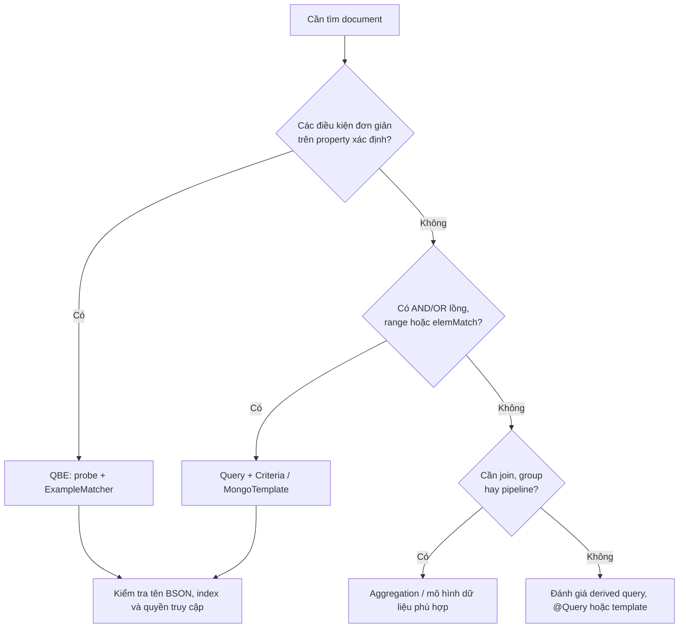

# Giới hạn nhóm điều kiện, array và document nhúng

## 1. Query by Example làm được gì và dừng ở đâu?

**Query by Example (QBE)** trong Spring Data MongoDB cho phép xây một truy vấn từ một **probe** (đối tượng entity có vài property được gán) và một **`ExampleMatcher`** (cách so khớp). Thay vì viết tên phương thức repository cho mọi bộ lọc, ứng dụng tạo đối tượng mẫu rồi gọi `findAll(Example.of(probe, matcher))`.

Ví dụ màn hình đơn hàng cần tìm các document có `status = "PAID"` và thuộc `tenantId = "SHOP-A"`. QBE diễn đạt thuận tiện khi đó là **các điều kiện bằng nhau, độc lập và có cấu trúc tương đối phẳng**. Nhưng khi câu hỏi trở thành “đơn của SHOP-A **và** (đã trả tiền **hoặc** số tiền lớn hơn 500.000)” hoặc “có **cùng một dòng hàng** vừa đúng SKU vừa đủ số lượng”, QBE không còn phù hợp để biểu diễn chính xác toàn bộ logic.

Ba giới hạn trọng tâm của bài:

1. **Nhóm điều kiện:** QBE có `matchingAll()` (AND tổng quát) và `matchingAny()` (OR tổng quát) nhưng không mô tả được ngoặc logic tùy ý như `A AND (B OR C)`.
2. **Array/collection/map:** QBE không hỗ trợ diễn đạt đầy đủ các phép khớp phần tử array, `$elemMatch`, `$all`, `$size` hay điều kiện trên map; không coi một probe có `List` là câu truy vấn mảng hợp lệ.
3. **Document nhúng:** có thể có trường hợp tìm theo property lồng nhau đơn giản với mapping phù hợp, nhưng QBE không thay thế biểu thức `$elemMatch` cho **array của document nhúng**, cũng không tự tạo `$lookup` để truy vấn collection được tham chiếu.

Trong phạm vi **SPRING_DATA_MONGODB**, ta sẽ dùng cả repository và `MongoTemplate`, quan sát tên property Java ↔ BSON, chuyển sang `Query`/`Criteria` khi cần nhóm, kiểm thử trên MongoDB thật và đánh giá index.

### Sơ đồ quyết định nhanh



| Tình huống | QBE phù hợp? | Gợi ý |
| --- | --- | --- |
| `tenantId = SHOP-A`, `status = PAID` | Có | `matchingAll()` |
| `customerName` chứa `"An"`, không phân biệt hoa/thường | Có, với matcher String | `withStringMatcher(CONTAINING)`, `withIgnoreCase(...)` |
| `status = PAID OR status = CREATED` | Không thuận tiện cho nhiều giá trị cùng field | `Criteria.where("status").in(...)` |
| `tenantId = SHOP-A AND (status = PAID OR totalMinor >= 500000)` | Không | `andOperator(...)` + `orOperator(...)` |
| `lines` có một phần tử `sku = BOOK-101` và `quantity >= 2` | Không | `elemMatch(...)` |
| Địa chỉ nhúng có `city = "Hà Nội"` | Có thể dùng property lồng ở trường hợp hỗ trợ; cần xác minh BSON | `Criteria.where("shippingAddress.city")` khi muốn tường minh |
| Tham chiếu sang customer ở collection khác để lọc theo tên | Không tự join | `$lookup` hoặc truy vấn/mô hình khác |

## 2. Dữ liệu xuyên suốt: đơn hàng, array dòng hàng và địa chỉ nhúng

Giả sử ứng dụng Spring Boot có `spring-boot-starter-data-mongodb` và database demo `qbe_limits_demo`. Collection `orders` lưu đơn hàng của nhiều cửa hàng:

```javascript
use qbe_limits_demo

db.orders.insertMany([
  {
    _id: "ORD-001",
    tenant_id: "SHOP-A",
    status: "PAID",
    customer_name: "An",
    total_minor: NumberLong("350000"),
    created_at: ISODate("2026-11-01T08:00:00Z"),
    shipping_address: { city: "Hà Nội", district: "Ba Đình" },
    tags: ["gift", "online"],
    lines: [
      { sku: "BOOK-101", quantity: 1 },
      { sku: "PEN-201", quantity: 3 }
    ],
    attributes: { channel: "web" }
  },
  {
    _id: "ORD-002",
    tenant_id: "SHOP-A",
    status: "CREATED",
    customer_name: "Bình",
    total_minor: NumberLong("650000"),
    created_at: ISODate("2026-11-02T08:00:00Z"),
    shipping_address: { city: "Hồ Chí Minh", district: "Quận 1" },
    tags: ["priority"],
    lines: [{ sku: "BOOK-101", quantity: 3 }],
    attributes: { channel: "mobile" }
  },
  {
    _id: "ORD-003",
    tenant_id: "SHOP-B",
    status: "PAID",
    customer_name: "Chi",
    total_minor: NumberLong("900000"),
    created_at: ISODate("2026-11-03T08:00:00Z"),
    shipping_address: { city: "Hà Nội", district: "Đống Đa" },
    tags: ["priority"],
    lines: [{ sku: "BOOK-101", quantity: 5 }],
    attributes: { channel: "web" }
  },
  {
    _id: "ORD-004",
    tenant_id: "SHOP-A",
    status: "PAID",
    customer_name: "An Bình",
    total_minor: NumberLong("700000"),
    created_at: ISODate("2026-11-04T08:00:00Z"),
    shipping_address: { city: "Hà Nội", district: "Cầu Giấy" },
    tags: ["priority"],
    lines: [{ sku: "BOOK-101", quantity: 2 }],
    attributes: { channel: "web" }
  }
])
```

Chỉ chạy `insertMany` trên **database demo trống**. Chạy lại với các `_id` trên sẽ gặp duplicate key. Cấu hình kết nối cục bộ minh họa:

```properties
spring.data.mongodb.uri=mongodb://localhost:27017/qbe_limits_demo
```

Trong các ví dụ, ID dạng `ORD-001` là **BSON String**. Entity dùng `@MongoId(FieldType.STRING)` để thống nhất kiểu định danh, không tự suy ra BSON ObjectId từ chuỗi.

### Entity `OrderDocument`

```java
package com.example.orders;

import java.time.Instant;
import java.util.List;
import java.util.Map;
import org.springframework.data.mongodb.core.mapping.Document;
import org.springframework.data.mongodb.core.mapping.Field;
import org.springframework.data.mongodb.core.mapping.FieldType;
import org.springframework.data.mongodb.core.mapping.MongoId;

@Document(collection = "orders")
public class OrderDocument {

    @MongoId(FieldType.STRING)
    private String id;

    @Field("tenant_id")
    private String tenantId;

    private String status;

    @Field("customer_name")
    private String customerName;

    @Field("total_minor")
    private Long totalMinor;

    @Field("created_at")
    private Instant createdAt;

    @Field("shipping_address")
    private ShippingAddress shippingAddress;

    private List<String> tags;
    private List<OrderLine> lines;
    private Map<String, String> attributes;

    public OrderDocument() {}

    public String getId() { return id; }
    public void setId(String id) { this.id = id; }

    public String getTenantId() { return tenantId; }
    public void setTenantId(String tenantId) { this.tenantId = tenantId; }

    public String getStatus() { return status; }
    public void setStatus(String status) { this.status = status; }

    public String getCustomerName() { return customerName; }
    public void setCustomerName(String customerName) {
        this.customerName = customerName;
    }

    public Long getTotalMinor() { return totalMinor; }
    public void setTotalMinor(Long totalMinor) {
        this.totalMinor = totalMinor;
    }

    public Instant getCreatedAt() { return createdAt; }
    public void setCreatedAt(Instant createdAt) {
        this.createdAt = createdAt;
    }

    public ShippingAddress getShippingAddress() {
        return shippingAddress;
    }
    public void setShippingAddress(ShippingAddress address) {
        this.shippingAddress = address;
    }

    public List<String> getTags() { return tags; }
    public void setTags(List<String> tags) { this.tags = tags; }

    public List<OrderLine> getLines() { return lines; }
    public void setLines(List<OrderLine> lines) { this.lines = lines; }

    public Map<String, String> getAttributes() { return attributes; }
    public void setAttributes(Map<String, String> attributes) {
        this.attributes = attributes;
    }

    public static class ShippingAddress {
        private String city;
        private String district;

        public ShippingAddress() {}
        public ShippingAddress(String city, String district) {
            this.city = city;
            this.district = district;
        }

        public String getCity() { return city; }
        public void setCity(String city) { this.city = city; }
        public String getDistrict() { return district; }
        public void setDistrict(String district) {
            this.district = district;
        }
    }

    public static class OrderLine {
        private String sku;
        private Integer quantity;

        public OrderLine() {}
        public OrderLine(String sku, Integer quantity) {
            this.sku = sku;
            this.quantity = quantity;
        }

        public String getSku() { return sku; }
        public void setSku(String sku) { this.sku = sku; }
        public Integer getQuantity() { return quantity; }
        public void setQuantity(Integer quantity) {
            this.quantity = quantity;
        }
    }
}
```

Entity dùng kiểu wrapper `Long`/`Integer` thay vì các primitive cho những property có thể bỏ qua. **Đây là quyết định quan trọng đối với QBE**: primitive mặc định như `0` hoặc `false` có thể bị coi là điều kiện có giá trị, dù người dùng chưa nhập filter. Collection và nested object cũng để `null` khi probe không muốn áp điều kiện tương ứng.

### Repository

```java
package com.example.orders;

import org.springframework.data.mongodb.repository.MongoRepository;

public interface OrderRepository
        extends MongoRepository<OrderDocument, String> {
}
```

`MongoRepository` hỗ trợ các thao tác QBE thông qua API repository thích hợp. Bài này dùng `findAll(Example)` để nhận những document khớp probe; khi cần truy vấn MongoDB cụ thể ngoài QBE, dùng `MongoTemplate`.

## 3. QBE cơ bản: probe và `ExampleMatcher`

Yêu cầu đầu tiên: tìm các đơn `PAID` của `SHOP-A`. Ta khởi tạo probe chỉ gán hai property:

```java
import org.springframework.data.domain.Example;
import org.springframework.data.domain.ExampleMatcher;

OrderDocument probe = new OrderDocument();
probe.setTenantId("SHOP-A");
probe.setStatus("PAID");

ExampleMatcher matcher = ExampleMatcher.matchingAll();
Example<OrderDocument> example = Example.of(probe, matcher);

Iterable<OrderDocument> orders = orderRepository.findAll(example);
```

Theo ý nghĩa, truy vấn cần tương ứng:

```javascript
db.orders.find({
  tenant_id: "SHOP-A",
  status: "PAID"
})
```

Với bộ dữ liệu mẫu, các ID khớp là `ORD-001` và `ORD-004`. **Không tự suy ra thứ tự** của kết quả khi chưa chỉ định sort. Để kiểm tra danh sách kết quả, nên so sánh tập ID thay vì vị trí phần tử.

### Các mặc định phải hiểu

| Quy tắc | Ý nghĩa thực tế |
| --- | --- |
| Probe property `null` | Mặc định bị bỏ qua, không tạo điều kiện |
| Property kiểu primitive | Luôn có giá trị Java mặc định; có thể vô tình tham gia filter |
| `matchingAll()` | Kết hợp những điều kiện của probe theo **AND** |
| `matchingAny()` | Kết hợp những điều kiện của probe theo **OR** |
| String matching mặc định | Thường là so khớp giá trị chính xác, có phân biệt hoa/thường trừ khi cấu hình |
| `withIgnorePaths(...)` | Bỏ qua property được nêu, kể cả nếu probe có giá trị |
| `withIgnoreCase(...)` | Cấu hình không phân biệt chữ hoa/thường cho String property được chọn |
| `withStringMatcher(CONTAINING)` | Chọn kiểu tìm String chứa chuỗi, **không phải full-text search** |

Đoạn code sau bỏ qua ID và thời điểm tạo, đồng thời tìm tên khách chứa chuỗi `"an"` không phân biệt hoa/thường:

```java
OrderDocument nameProbe = new OrderDocument();
nameProbe.setTenantId("SHOP-A");
nameProbe.setCustomerName("an");

ExampleMatcher nameMatcher = ExampleMatcher.matchingAll()
    .withIgnorePaths("id", "createdAt", "lines", "tags", "attributes")
    .withIgnoreCase("customerName")
    .withStringMatcher(
        ExampleMatcher.StringMatcher.CONTAINING);

Example<OrderDocument> byName =
    Example.of(nameProbe, nameMatcher);

Iterable<OrderDocument> result = orderRepository.findAll(byName);
```

**Lưu ý:** `withStringMatcher(CONTAINING)` áp dụng cho các String property được so khớp, không chỉ `customerName`; nó có thể khiến `tenantId` cũng được tìm theo kiểu “chứa” thay vì **bằng chính xác**. Với `tenantId` là ranh giới phân quyền, không nên dựa vào một matcher toàn cục như vậy. Các phần sau sẽ dùng điều kiện tenant tường minh bằng `Criteria` hoặc chọn matcher theo từng property.

## 4. Khác biệt lớn nhất: `matchingAll` và `matchingAny`

QBE có thể chuyển chế độ kết hợp mọi property từ AND sang OR:

```java
OrderDocument probe = new OrderDocument();
probe.setTenantId("SHOP-A");
probe.setStatus("PAID");

Example<OrderDocument> all = Example.of(
    probe, ExampleMatcher.matchingAll());

Example<OrderDocument> any = Example.of(
    probe, ExampleMatcher.matchingAny());
```

Ý nghĩa logic khác nhau:

```text
matchingAll:
    tenantId == "SHOP-A" AND status == "PAID"

matchingAny:
    tenantId == "SHOP-A" OR status == "PAID"
```

Với dữ liệu mẫu:

| Matcher | Những ID có thể khớp | Lý do |
| --- | --- | --- |
| `matchingAll` | `ORD-001`, `ORD-004` | Cả hai thuộc SHOP-A và đã thanh toán |
| `matchingAny` | `ORD-001`, `ORD-002`, `ORD-003`, `ORD-004` | SHOP-B/ORD-003 cũng có `status = PAID` |

**Cảnh báo bảo mật:** nếu một API nhiều tenant đưa `tenantId` đã xác thực vào probe rồi chuyển sang `matchingAny()` để “nới điều kiện tìm kiếm”, điều kiện tenant có thể trở thành **một nhánh OR**, cho phép đọc document của tenant khác khi chúng khớp một property còn lại.

Ngay cả với `matchingAll()`, QBE **không tự xác thực quyền truy cập**. Tenant ID phải được lấy từ ngữ cảnh đã xác thực và query thực tế phải được giới hạn đúng phạm vi. Không để người dùng chỉ định probe hay các field tuỳ ý mà không kiểm soát.

## 5. Giới hạn nhóm điều kiện: `A AND (B OR C)`

Một yêu cầu phổ biến là:

> Chỉ tìm đơn của SHOP-A và trong đó **status = PAID hoặc totalMinor từ 500.000 trở lên**.

Biểu thức mong muốn:

\[
\text{tenant} = A \;\land\;
\bigl(\text{status} = PAID \;\lor\; \text{totalMinor} \ge 500000\bigr)
\]

`matchingAll()` chỉ tạo AND giữa các property trong probe; nó không có nhánh OR bên trong. `matchingAny()` tạo OR trên toàn bộ property được xét và sẽ cho `tenantId` vào nhóm OR, không giữ được yêu cầu **tenant bắt buộc**.

Không thể sửa bằng cách đổi thứ tự setter trên probe, vì QBE không có cây ngoặc logic tùy ý. Dùng `Query` và `Criteria`:

```java
import java.util.List;
import org.springframework.data.mongodb.core.query.Criteria;
import org.springframework.data.mongodb.core.query.Query;

Criteria tenant = Criteria.where("tenantId").is("SHOP-A");

Criteria businessOptions = new Criteria().orOperator(
    Criteria.where("status").is("PAID"),
    Criteria.where("totalMinor").gte(500_000L)
);

Query query = Query.query(
    new Criteria().andOperator(tenant, businessOptions)
);

List<OrderDocument> found =
    mongoTemplate.find(query, OrderDocument.class);
```

MongoDB sẽ nhận điều kiện tương đương:

```javascript
db.orders.find({
  $and: [
    { tenant_id: "SHOP-A" },
    {
      $or: [
        { status: "PAID" },
        { total_minor: { $gte: NumberLong("500000") } }
      ]
    }
  ]
})
```

Với dữ liệu demo, `ORD-001`, `ORD-002` và `ORD-004` khớp; `ORD-003` bị loại vì thuộc `SHOP-B`, dù bản thân nó là đơn đã thanh toán và có giá trị cao.

### Có hai nhóm OR độc lập?

Giả sử quy tắc phức tạp hơn:

> SHOP-A và [(`PAID` với tiền từ 600.000) hoặc (`CREATED` và tên khách bắt đầu bằng `"B"`)].

Khi đó phải mô tả chính xác cây logic:

```java
Criteria paidHighValue = new Criteria().andOperator(
    Criteria.where("status").is("PAID"),
    Criteria.where("totalMinor").gte(600_000L)
);

Criteria createdForCustomerB = new Criteria().andOperator(
    Criteria.where("status").is("CREATED"),
    Criteria.where("customerName").regex("^B")
);

Criteria scoped = new Criteria().andOperator(
    Criteria.where("tenantId").is("SHOP-A"),
    new Criteria().orOperator(
        paidHighValue, createdForCustomerB)
);

List<OrderDocument> matching =
    mongoTemplate.find(Query.query(scoped), OrderDocument.class);
```

Với dữ liệu demo, kết quả là `ORD-002` và `ORD-004`. Việc dùng `regex("^B")` chỉ là ví dụ tìm tiền tố, không thay thế một giải pháp tìm kiếm toàn văn. Nếu tiền tố đến từ người dùng, cần giới hạn input và escape ký tự regex khi mục tiêu là khớp literal.

### Khi chỉ cần nhiều giá trị của cùng một field

Đối với điều kiện `status = PAID OR status = CREATED`, không nhất thiết phải viết `orOperator`:

```java
Query query = Query.query(
    Criteria.where("tenantId").is("SHOP-A")
        .and("status").in("PAID", "CREATED")
);
```

`$in` diễn đạt tập giá trị trên **một field**, rõ ràng và dễ kiểm soát hơn dựng hàng loạt nhánh OR. QBE không hỗ trợ trực tiếp kiểu “field có một trong nhiều giá trị” bằng cách nhét một `List` vào property String của probe.

### QBE không hỗ trợ so sánh theo khoảng

Một probe gán `totalMinor = 500000L` biểu diễn ý định so khớp **giá trị số cụ thể**, không phải “lớn hơn hoặc bằng”. QBE không có phương thức tương đương `gte`, `lt`, `between` cho field số hay thời gian:

```java
Query inRange = Query.query(
    Criteria.where("tenantId").is("SHOP-A")
        .and("totalMinor").gte(500_000L).lt(800_000L)
);
```

Với `createdAt`, các khoảng thời gian nên sử dụng `Instant` và thiết kế rõ biên inclusive/exclusive, ví dụ `gte(start).lt(endExclusive)`. `ExampleMatcher` không biến một ngày trong probe thành truy vấn khoảng.

## 6. Array của giá trị đơn: QBE không phải `$all`, `$size` hay `$in`

Entity `OrderDocument` có `List<String> tags`. Nhiều người mới học nghĩ rằng:

```java
OrderDocument probe = new OrderDocument();
probe.setTags(List.of("priority"));
Example<OrderDocument> example = Example.of(probe);
```

sẽ luôn tương đương với `{ tags: "priority" }` hoặc `{ tags: { $in: ["priority"] } }`. **Không nên dựa vào giả định đó.** QBE có giới hạn đối với matching collection/map; không có hợp đồng chung để diễn đạt đầy đủ các toán tử array chỉ bằng cách đặt List trong probe.

Hãy dùng `Criteria` khi câu hỏi thật sự liên quan đến phần tử array.

### Tìm array có chứa một giá trị

```java
Query priorityForTenant = Query.query(
    Criteria.where("tenantId").is("SHOP-A")
        .and("tags").is("priority")
);
```

Trong `mongosh`:

```javascript
db.orders.find({
  tenant_id: "SHOP-A",
  tags: "priority"
})
```

MongoDB có thể khớp `tags` là array chứa phần tử String `"priority"`. Với dữ liệu demo, `ORD-002` và `ORD-004` khớp.

### Array cần chứa tất cả nhãn

```java
Query allTags = Query.query(
    Criteria.where("tenantId").is("SHOP-A")
        .and("tags").all("gift", "online")
);
```

Tương đương:

```javascript
db.orders.find({
  tenant_id: "SHOP-A",
  tags: { $all: ["gift", "online"] }
})
```

`ORD-001` khớp vì có cả hai nhãn. `$all` không có nghĩa các phần tử phải theo thứ tự đó trong array.

### Điều kiện số phần tử

```java
Query twoTags = Query.query(
    Criteria.where("tenantId").is("SHOP-A")
        .and("tags").size(2)
);
```

Với dữ liệu demo, `ORD-001` có hai tag. Các phép `$size`, `$all`, `$elemMatch` có ý nghĩa riêng; không thể biểu đạt chúng bằng cách đổi `matchingAll()` thành `matchingAny()`.

## 7. Array các document nhúng: tại sao phải dùng `$elemMatch`?

Điểm dễ sai nhất là một document chứa nhiều phần tử object trong array `lines`:

```javascript
{
  _id: "ORD-001",
  lines: [
    { sku: "BOOK-101", quantity: 1 },
    { sku: "PEN-201", quantity: 3 }
  ]
}
```

Yêu cầu: “Trong **một dòng hàng**, `sku` phải là `BOOK-101` **và** `quantity >= 2`”.

### Sai ý định: hai điều kiện dot path độc lập

```javascript
db.orders.find({
  "lines.sku": "BOOK-101",
  "lines.quantity": { $gte: 2 }
})
```

Với `ORD-001`, biểu thức trên có thể vẫn khớp:

- `lines.sku = BOOK-101` khớp **phần tử thứ nhất**;
- `lines.quantity >= 2` khớp **phần tử thứ hai** (`PEN-201` có số lượng 3).

Vì các điều kiện không buộc phải đúng trên cùng một phần tử, query này không trả lời đúng câu hỏi nghiệp vụ.

### Đúng ý định: `$elemMatch`

```java
Criteria lineCondition = Criteria.where("sku").is("BOOK-101")
    .and("quantity").gte(2);

Query query = Query.query(
    Criteria.where("tenantId").is("SHOP-A")
        .and("lines").elemMatch(lineCondition)
);

List<OrderDocument> matching =
    mongoTemplate.find(query, OrderDocument.class);
```

MongoDB tương đương:

```javascript
db.orders.find({
  tenant_id: "SHOP-A",
  lines: {
    $elemMatch: {
      sku: "BOOK-101",
      quantity: { $gte: 2 }
    }
  }
})
```

Với dữ liệu mẫu, `ORD-002` và `ORD-004` khớp; `ORD-001` bị loại vì `BOOK-101` chỉ có quantity 1. `ORD-003` cũng có dòng phù hợp nhưng thuộc `SHOP-B` nên không được trả ra.

**Điểm cốt lõi:** `$elemMatch` tạo ràng buộc các điều kiện trên **cùng một phần tử array**. Một `OrderLine` bên trong probe QBE không tự biến thành `$elemMatch`, và `matchingAll()` không thay đổi quy tắc này.

### Điều kiện nhiều phần tử khác nhau

Nếu nghiệp vụ yêu cầu “có ít nhất một dòng BOOK-101 và ít nhất một dòng PEN-201” thì đó là một bài toán khác với “một dòng thỏa cả hai điều kiện”. Có thể dùng:

```javascript
db.orders.find({
  tenant_id: "SHOP-A",
  "lines.sku": { $all: ["BOOK-101", "PEN-201"] }
})
```

Truy vấn này phù hợp khi muốn kiểm tra **các giá trị SKU xuất hiện trong array**. `ORD-001` khớp, bất kể hai SKU thuộc hai phần tử khác nhau. Khi có nhiều điều kiện trên một dòng, dùng `$elemMatch`; khi cần toàn bộ giá trị xuất hiện, dùng cấu trúc array query tương ứng.

## 8. Document nhúng: property lồng khác với array object

Trong `OrderDocument`, `shippingAddress` là **một embedded object**, không phải `List` và cũng không phải document ở collection khác:

```javascript
shipping_address: {
  city: "Hà Nội",
  district: "Ba Đình"
}
```

Để hỏi “đơn của SHOP-A giao tới Hà Nội”, có thể viết truy vấn theo đường dẫn:

```java
Query inHanoi = Query.query(
    Criteria.where("tenantId").is("SHOP-A")
        .and("shippingAddress.city").is("Hà Nội")
);

List<OrderDocument> found =
    mongoTemplate.find(inHanoi, OrderDocument.class);
```

Khi có mapping metadata của entity, `shippingAddress.city` tương ứng `shipping_address.city`. Trong `mongosh`:

```javascript
db.orders.find({
  tenant_id: "SHOP-A",
  "shipping_address.city": "Hà Nội"
})
```

Kết quả demo là `ORD-001` và `ORD-004`. Điều kiện dot notation nhắm đúng field con `city`, **không đòi document địa chỉ có chính xác tất cả field theo đúng thứ tự**.

### Còn QBE với một object lồng thì sao?

Ta có thể thử xây một probe có object lồng:

```java
OrderDocument probe = new OrderDocument();
probe.setTenantId("SHOP-A");
probe.setShippingAddress(
    new OrderDocument.ShippingAddress("Hà Nội", null));

Example<OrderDocument> example = Example.of(
    probe,
    ExampleMatcher.matchingAll()
        .withIgnorePaths("shippingAddress.district")
);

Iterable<OrderDocument> results =
    orderRepository.findAll(example);
```

**Không nên mặc định rằng mọi cấu hình QBE/MongoDB đều tạo chính xác dot-path projection mong muốn từ một object lồng.** Cách mapping nested properties, cách xử lý `null`/object rỗng và khả năng tối ưu phụ thuộc vào mapping metadata và phiên bản. Hãy kiểm thử BSON/command thực tế; khi cần truy vấn rõ ràng trên `shipping_address.city` hoặc kết hợp với nhiều nhóm logic, `Criteria.where("shippingAddress.city")` là lựa chọn dễ kiểm soát hơn.

Một vấn đề khác là **so khớp document nhúng nguyên khối**:

```javascript
// So khớp toàn bộ subdocument BSON, không đồng nghĩa dot-path city.
db.orders.find({
  shipping_address: {
    city: "Hà Nội",
    district: "Ba Đình"
  }
})
```

Việc so sánh subdocument BSON nguyên khối có thể nhạy với **cấu trúc và thứ tự field**. Vì vậy, nếu chỉ cần `city`, hãy query theo **đường dẫn field con**, không dựng một object rồi mặc định đó là “partial object matching”.

### Array chứa embedded document không giống một embedded document

| Cấu trúc | Câu hỏi | Công cụ |
| --- | --- | --- |
| `shipping_address: { city, district }` | Địa chỉ có city = Hà Nội? | Dot path `shipping_address.city` |
| `lines: [{ sku, quantity }, ...]` | Có **cùng một phần tử** SKU X, quantity ≥ 2? | `$elemMatch` |
| `tags: ["gift", "online"]` | Có nhãn `gift`? | Equality trên array hoặc `$in` |
| `attributes: { channel: "web" }` | Map có key channel = web? | Dot path `attributes.channel` khi schema/key hợp lệ |
| `customer_id` tham chiếu collection khác | Tên customer = An? | Truy vấn nhiều bước hoặc `$lookup` |

## 9. Map và tên field động: vì sao QBE không phải JSON query builder?

Property `attributes` có kiểu `Map<String, String>` và được lưu trong BSON:

```javascript
attributes: { channel: "web" }
```

Muốn tìm đơn của SHOP-A có `attributes.channel = "web"`, có thể viết:

```java
Query webOrders = Query.query(
    Criteria.where("tenantId").is("SHOP-A")
        .and("attributes.channel").is("web")
);
```

Đây là truy vấn trực tiếp theo một **đường dẫn có ý nghĩa trong schema**. Không dùng:

```java
OrderDocument probe = new OrderDocument();
probe.setAttributes(Map.of("channel", "web"));
// Không được suy ra QBE sẽ biểu đạt chính xác query dot path.
```

QBE không hỗ trợ tổng quát các kiểu matching map. Hơn nữa, cho phép client tự gửi tên map key rồi nối vào một `Criteria.where("attributes." + userKey)` có thể gây lỗi do các ký tự đặc biệt, đường dẫn không hợp lệ, hoặc cho phép truy vấn những thuộc tính ngoài dự kiến. Hãy dùng allowlist key được phép, ví dụ chỉ `channel` và `source`.

Nếu nghiệp vụ yêu cầu tìm key bất kỳ trong map động, cần cân nhắc **schema của document, index, độ chọn lọc và rủi ro truy vấn** trước khi công khai API. Một map dùng để chứa hàng trăm thuộc tính tùy ý có thể không phù hợp để làm trục tìm kiếm chính cho ứng dụng.

### Trường `null` và field thiếu trong embedded object

Ba document sau không tương đương:

```javascript
{ shipping_address: { city: null } }
{ shipping_address: { district: "Ba Đình" } }
{ shipping_address: null }
```

QBE mặc định **bỏ qua property probe có giá trị null**. Vì vậy, probe `new ShippingAddress(null, "Ba Đình")` không tự có nghĩa “city bắt buộc là null”. Bật `withIncludeNullValues()` cũng cần kiểm tra ngữ nghĩa MongoDB: phép equality `field: null` có thể khớp cả field lưu `null` lẫn field không tồn tại.

Nếu nghiệp vụ phải phân biệt **field thiếu**, **field tồn tại nhưng null** và **field có một giá trị**, hãy thiết kế truy vấn MongoDB tường minh bằng `$exists`, `$type` hoặc các nhóm điều kiện tương ứng, rồi kiểm thử trên dữ liệu BSON thật. Không dùng một probe null để đại diện cho cả ba ý nghĩa.

## 10. Matching theo String: dùng matcher riêng cho từng property

Trong mục 3, việc gọi `withStringMatcher(CONTAINING)` toàn cục có thể vô tình biến điều kiện `tenantId` thành tìm kiếm dạng contains. Đó là một lỗi nguy hiểm khi tenant là ranh giới dữ liệu.

Một cách chặt chẽ hơn là chỉ định matcher theo **property**:

```java
OrderDocument probe = new OrderDocument();
probe.setTenantId("SHOP-A");
probe.setCustomerName("an");

ExampleMatcher matcher = ExampleMatcher.matchingAll()
    .withMatcher(
        "tenantId",
        ExampleMatcher.GenericPropertyMatchers.exact()
    )
    .withMatcher(
        "customerName",
        ExampleMatcher.GenericPropertyMatchers.contains().ignoreCase()
    );

Example<OrderDocument> example = Example.of(probe, matcher);

Iterable<OrderDocument> found =
    orderRepository.findAll(example);
```

Với dữ liệu mẫu, tên khách `"An"` và `"An Bình"` chứa `"an"` khi so khớp không phân biệt hoa/thường; những document được phép theo `tenantId` là `ORD-001` và `ORD-004`.

Tuy nhiên, ngay cả matcher chính xác ở tenant cũng không thay thế phân quyền. Ví dụ trên **chỉ đúng khi `"SHOP-A"` lấy từ ngữ cảnh đáng tin cậy**. Nếu chính caller tự đặt `tenantId` và không có kiểm tra quyền, QBE vẫn có thể lọc theo một tenant mà caller không được phép truy cập.

### Vì sao tìm String `CONTAINING` có thể chậm?

Ở MongoDB, khớp chuỗi kiểu contains/ignore case có thể được triển khai bằng regex hoặc cơ chế so khớp tương ứng của framework. Không được tự suy ra rằng một index B-tree bình thường trên `customer_name` sẽ tăng tốc mọi truy vấn “chứa chuỗi bất kỳ”. Truy vấn regex không có prefix cố định và xử lý case-insensitive thường khó tận dụng index đơn giản.

Khi cần tìm kiếm tên sản phẩm/khách hàng theo từ khóa tự nhiên, cân nhắc full-text search hoặc giải pháp search phù hợp thay vì sử dụng QBE contains trên hàng triệu document. Nếu chỉ tìm theo một ID hoặc enum, dùng so khớp exact là rõ ràng và thường hiệu quả hơn.

## 11. Thiết kế service: dùng QBE khi đơn giản, Criteria khi phức tạp

Một API thực tế nên **nhận bộ lọc có kiểu rõ ràng**, thay vì nhận nguyên một entity `OrderDocument` từ request rồi cho mọi property tham gia QBE. Entity có những field không được phép tìm kiếm, ví dụ `tenantId`, ID kỹ thuật hoặc các thuộc tính nội bộ.

Ta tách thành hai đường truy vấn:

- **Đường QBE:** tìm chính xác `status` và tên khách chứa chuỗi, với tenant luôn được áp dụng bằng AND.
- **Đường Criteria:** khi có giá trị tiền tối thiểu, thành phố, điều kiện trên dòng hàng hoặc nhóm OR, xây truy vấn MongoDB tường minh.

### Bộ lọc đầu vào

```java
package com.example.orders;

public record OrderSearchRequest(
    String status,
    String customerNameFragment,
    Long minTotalMinor,
    String shippingCity,
    String sku,
    Integer minQuantity,
    int limit
) {}
```

### Đường QBE cho điều kiện đơn giản

```java
package com.example.orders;

import java.util.List;
import java.util.stream.StreamSupport;
import org.springframework.data.domain.Example;
import org.springframework.data.domain.ExampleMatcher;
import org.springframework.stereotype.Service;

@Service
public class SimpleOrderSearch {

    private final OrderRepository orders;

    public SimpleOrderSearch(OrderRepository orders) {
        this.orders = orders;
    }

    public List<OrderDocument> findSimple(
            String authorizedTenantId,
            String status,
            String customerNameFragment) {

        if (authorizedTenantId == null
                || authorizedTenantId.isBlank()) {
            throw new IllegalArgumentException("Tenant không hợp lệ");
        }

        OrderDocument probe = new OrderDocument();
        probe.setTenantId(authorizedTenantId);

        if (status != null && !status.isBlank()) {
            if (!List.of("PAID", "CREATED", "CANCELLED")
                    .contains(status)) {
                throw new IllegalArgumentException(
                    "Status không được hỗ trợ");
            }
            probe.setStatus(status);
        }

        if (customerNameFragment != null
                && !customerNameFragment.isBlank()) {
            probe.setCustomerName(customerNameFragment);
        }

        ExampleMatcher matcher = ExampleMatcher.matchingAll()
            .withMatcher(
                "tenantId",
                ExampleMatcher.GenericPropertyMatchers.exact())
            .withMatcher(
                "status",
                ExampleMatcher.GenericPropertyMatchers.exact())
            .withMatcher(
                "customerName",
                ExampleMatcher.GenericPropertyMatchers
                    .contains().ignoreCase());

        Iterable<OrderDocument> result = orders.findAll(
            Example.of(probe, matcher));

        return StreamSupport.stream(result.spliterator(), false)
            .toList();
    }
}
```

Service này có thể phù hợp với **tập dữ liệu nhỏ và được kiểm soát**; nhưng nó chưa áp dụng `Pageable` hoặc giới hạn số kết quả. Trên dữ liệu lớn, không nên gọi `findAll(example)` rồi mới `stream().limit(20)`, vì nguồn kết quả có thể đã nạp nhiều document trước khi Java giới hạn. Nên dùng `findAll(example, Pageable)` hoặc một truy vấn có `limit` phía MongoDB khi API cần phân trang.

Thí dụ:

```java
import org.springframework.data.domain.Page;
import org.springframework.data.domain.PageRequest;
import org.springframework.data.domain.Sort;

Page<OrderDocument> page = orderRepository.findAll(
    example,
    PageRequest.of(
        0, 20,
        Sort.by(
            Sort.Order.desc("createdAt"),
            Sort.Order.desc("id")
        )
    )
);
```

Ở đây `example` là biến `Example<OrderDocument>` đã khởi tạo. `Page` có thể cần thêm thao tác count để cung cấp tổng kết quả; nếu không cần tổng số, cân nhắc API/kiểu trả về phù hợp trong phiên bản Spring Data đang sử dụng. Thứ tự có khóa phụ ID nhằm xác định vị trí khi nhiều document có cùng `createdAt`, nhưng **không tạo snapshot** giữa các trang khi có dữ liệu mới.

### Đường Criteria cho bộ lọc phức tạp

```java
package com.example.orders;

import java.util.ArrayList;
import java.util.List;
import org.springframework.data.domain.Sort;
import org.springframework.data.mongodb.core.MongoTemplate;
import org.springframework.data.mongodb.core.query.Criteria;
import org.springframework.data.mongodb.core.query.Query;
import org.springframework.stereotype.Service;

@Service
public class AdvancedOrderSearch {

    private final MongoTemplate template;

    public AdvancedOrderSearch(MongoTemplate template) {
        this.template = template;
    }

    public List<OrderDocument> find(
            String authorizedTenantId,
            OrderSearchRequest filter) {
        if (authorizedTenantId == null
                || authorizedTenantId.isBlank()
                || filter == null
                || filter.limit() < 1 || filter.limit() > 100) {
            throw new IllegalArgumentException("Bộ lọc không hợp lệ");
        }

        if (filter.minTotalMinor() != null
                && filter.minTotalMinor() < 0) {
            throw new IllegalArgumentException("Giá trị tiền âm");
        }
        if (filter.minQuantity() != null
                && (filter.minQuantity() < 1
                    || filter.sku() == null
                    || filter.sku().isBlank())) {
            throw new IllegalArgumentException(
                "Điều kiện dòng hàng không hợp lệ");
        }

        List<Criteria> conditions = new ArrayList<>();
        conditions.add(
            Criteria.where("tenantId").is(authorizedTenantId));

        if (filter.status() != null
                && !filter.status().isBlank()) {
            if (!List.of("PAID", "CREATED", "CANCELLED")
                    .contains(filter.status())) {
                throw new IllegalArgumentException(
                    "Status không được hỗ trợ");
            }
            conditions.add(
                Criteria.where("status").is(filter.status()));
        }

        if (filter.customerNameFragment() != null
                && !filter.customerNameFragment().isBlank()) {
            String literal = java.util.regex.Pattern.quote(
                filter.customerNameFragment());
            conditions.add(Criteria.where("customerName")
                .regex(literal, "i"));
        }

        if (filter.minTotalMinor() != null) {
            conditions.add(
                Criteria.where("totalMinor")
                    .gte(filter.minTotalMinor()));
        }

        if (filter.shippingCity() != null
                && !filter.shippingCity().isBlank()) {
            conditions.add(
                Criteria.where("shippingAddress.city")
                    .is(filter.shippingCity()));
        }

        if (filter.sku() != null && !filter.sku().isBlank()) {
            Criteria line = Criteria.where("sku")
                .is(filter.sku());
            if (filter.minQuantity() != null) {
                line.and("quantity").gte(filter.minQuantity());
            }
            conditions.add(
                Criteria.where("lines").elemMatch(line));
        }

        Criteria combined = new Criteria().andOperator(
            conditions.toArray(new Criteria[0]));

        Query query = Query.query(combined);
        query.with(Sort.by(
            Sort.Order.desc("createdAt"),
            Sort.Order.desc("id")
        ));
        query.limit(filter.limit());

        return template.find(query, OrderDocument.class);
    }
}
```

Điểm đáng chú ý:

1. `tenantId` luôn được đặt ở ngoài các điều kiện tùy chọn, không biến thành một nhánh OR.
2. `status` được kiểm tra bằng danh sách giá trị hợp lệ, không để client tự tạo toán tử.
3. `totalMinor` hỗ trợ so sánh `gte` mà QBE không diễn đạt được.
4. `shippingAddress.city` là đường dẫn property lồng được ánh xạ sang BSON.
5. `lines` dùng `elemMatch` để áp điều kiện lên cùng một phần tử.
6. Regex dùng `Pattern.quote` để hiểu input là **chuỗi literal**, tránh biến ký tự đặc biệt người dùng nhập thành biểu thức regex có ý nghĩa khác.
7. Sort và limit được gửi tới MongoDB, thay vì tải toàn bộ vào Java rồi mới cắt.

Ví dụ service chưa xử lý giới hạn chiều dài từng chuỗi, giới hạn tốc độ request và chiến lược full-text search. Những ràng buộc đó cần được bổ sung theo tải và chính sách dữ liệu thực tế. Đối với `$or` phức tạp, dùng cùng cách dựng `Criteria` nhưng thêm nhóm `orOperator` tường minh, không cố chuyển sang QBE.

## 12. Truy vấn repository và index: QBE không tự tối ưu MongoDB

Thay đổi từ `findByStatus(...)` sang `findAll(Example)` không tự tạo index hoặc khiến query nhanh hơn. MongoDB vẫn cần tìm các document thỏa filter; chi phí phụ thuộc vào **field BSON**, độ chọn lọc, số lượng document, sort và kích thước payload.

### Index ứng viên cho tìm kiếm theo tenant/trạng thái

Một API thường lọc theo `tenant_id` và `status`, sắp mới nhất trước. Index ứng viên:

```javascript
db.orders.createIndex(
  {
    tenant_id: 1,
    status: 1,
    created_at: -1,
    _id: -1
  },
  { name: "orders_tenant_status_created_id" }
)
```

Ở repository, điều kiện có thể được biểu diễn bằng probe `tenantId`/`status`; còn khi tạo index bằng `mongosh` phải dùng **tên field BSON** `tenant_id`, `created_at` và `_id`. Đặt index trên tên Java `createdAt` sẽ không giúp document thực lưu `created_at` như dự kiến.

### Index cho field nhúng

Nếu truy vấn theo thành phố giao hàng là mẫu truy cập quan trọng:

```javascript
db.orders.createIndex(
  { tenant_id: 1, "shipping_address.city": 1 },
  { name: "orders_tenant_city" }
)
```

Nếu thường tìm SKU nằm trong array `lines`:

```javascript
db.orders.createIndex(
  { tenant_id: 1, "lines.sku": 1 },
  { name: "orders_tenant_lines_sku" }
)
```

Index trên `lines.sku` là **multikey index** vì `lines` là array. Khi query còn có `quantity >= 2` trong `$elemMatch`, có thể cần đánh giá compound multikey index theo cấu trúc và quy tắc index bounds của MongoDB. Không tạo quá nhiều index theo từng field chỉ vì QBE hoặc Criteria có thể lọc chúng: index tốn bộ nhớ, lưu trữ và làm tăng công việc ghi.

### `explain("executionStats")` cho truy vấn tương đương

```javascript
db.orders.find({
  tenant_id: "SHOP-A",
  status: "PAID"
})
.sort({ created_at: -1, _id: -1 })
.limit(20)
.explain("executionStats")
```

| Chỉ số | Câu hỏi cần trả lời |
| --- | --- |
| `winningPlan` | Query planner chọn kế hoạch nào? |
| `IXSCAN`/`COLLSCAN` | Có dùng index hay phải quét collection? |
| `totalKeysExamined` | Đã duyệt bao nhiêu khóa index? |
| `totalDocsExamined` | Phải đọc bao nhiêu document? |
| `nReturned` | Đã trả bao nhiêu document sau filter/limit? |
| `SORT` | Có cần bước sort riêng không? |
| `executionTimeMillis` | Thời gian đo của lần thực thi này là bao nhiêu? |

Nếu QBE có matcher `CONTAINING`/ignore case, cần xem BSON query thật và đánh giá index trên các mẫu từ khóa đại diện. Đừng lấy `explain` của một truy vấn **exact equality** rồi suy diễn chi phí của một truy vấn **regex contains**. Hãy thu nhận lệnh thật từ command monitoring/log ở môi trường test khi cần xác nhận cách QBE sinh filter.

Một index tốt cho `tenant_id/status` không tự giải quyết việc một API đọc hàng triệu kết quả với `findAll(example)`. Luôn sử dụng filter đủ hẹp, `Pageable`/limit phù hợp và theo dõi độ trễ p95/p99 khi triển khai.

## 13. Kiểm thử tích hợp: chứng minh đúng ngữ nghĩa, không giả định

Vì QBE phụ thuộc **metadata mapping và behavior của phiên bản Spring Data**, nên các giới hạn của nó cần được kiểm thử trên **MongoDB thực**, không chỉ bằng mock repository. Dưới đây là ví dụ `@DataMongoTest` với BSON fixture được insert trực tiếp.

**Cảnh báo:** lệnh `deleteMany(new Document())` xóa mọi document trong collection đã kết nối. Chỉ dùng trên **database test cô lập**, tuyệt đối không dùng trên production hoặc database dùng chung.

```java
package com.example.orders;

import java.time.Instant;
import java.util.Date;
import java.util.List;
import org.bson.Document;
import org.junit.jupiter.api.BeforeEach;
import org.junit.jupiter.api.Test;
import org.springframework.beans.factory.annotation.Autowired;
import org.springframework.boot.test.autoconfigure.data.mongo.DataMongoTest;
import org.springframework.data.domain.Example;
import org.springframework.data.domain.ExampleMatcher;
import org.springframework.data.mongodb.core.MongoTemplate;
import org.springframework.data.mongodb.core.query.Criteria;
import org.springframework.data.mongodb.core.query.Query;

import static org.assertj.core.api.Assertions.assertThat;

@DataMongoTest
class OrderQueryByExampleTest {

    @Autowired
    OrderRepository orders;

    @Autowired
    MongoTemplate template;

    @BeforeEach
    void seedIsolatedTestDatabase() {
        // Không chạy trên database có dữ liệu thật.
        template.getCollection("orders")
            .deleteMany(new Document());

        Date at = Date.from(
            Instant.parse("2026-11-01T08:00:00Z"));

        template.getCollection("orders").insertMany(List.of(
            new Document("_id", "ORD-001")
                .append("tenant_id", "SHOP-A")
                .append("status", "PAID")
                .append("customer_name", "An")
                .append("total_minor", 350_000L)
                .append("created_at", at)
                .append("shipping_address",
                    new Document("city", "Hà Nội")
                        .append("district", "Ba Đình"))
                .append("tags", List.of("gift", "online"))
                .append("lines", List.of(
                    new Document("sku", "BOOK-101")
                        .append("quantity", 1),
                    new Document("sku", "PEN-201")
                        .append("quantity", 3)))
                .append("attributes",
                    new Document("channel", "web")),

            new Document("_id", "ORD-002")
                .append("tenant_id", "SHOP-A")
                .append("status", "CREATED")
                .append("customer_name", "Bình")
                .append("total_minor", 650_000L)
                .append("created_at", at)
                .append("shipping_address",
                    new Document("city", "Hồ Chí Minh"))
                .append("tags", List.of("priority"))
                .append("lines", List.of(
                    new Document("sku", "BOOK-101")
                        .append("quantity", 3))),

            new Document("_id", "ORD-003")
                .append("tenant_id", "SHOP-B")
                .append("status", "PAID")
                .append("customer_name", "Chi")
                .append("total_minor", 900_000L)
                .append("created_at", at)
                .append("shipping_address",
                    new Document("city", "Hà Nội"))
                .append("tags", List.of("priority"))
                .append("lines", List.of(
                    new Document("sku", "BOOK-101")
                        .append("quantity", 5))),

            new Document("_id", "ORD-004")
                .append("tenant_id", "SHOP-A")
                .append("status", "PAID")
                .append("customer_name", "An Bình")
                .append("total_minor", 700_000L)
                .append("created_at", at)
                .append("shipping_address",
                    new Document("city", "Hà Nội"))
                .append("tags", List.of("priority"))
                .append("lines", List.of(
                    new Document("sku", "BOOK-101")
                        .append("quantity", 2)))
        ));
    }

    @Test
    void matchingAllRequiresBothTenantAndStatus() {
        OrderDocument probe = new OrderDocument();
        probe.setTenantId("SHOP-A");
        probe.setStatus("PAID");

        Example<OrderDocument> example =
            Example.of(probe, ExampleMatcher.matchingAll());

        assertThat(orders.findAll(example))
            .extracting(OrderDocument::getId)
            .containsExactlyInAnyOrder("ORD-001", "ORD-004");
    }

    @Test
    void matchingAnyCanIncludeAnotherTenant() {
        OrderDocument probe = new OrderDocument();
        probe.setTenantId("SHOP-A");
        probe.setStatus("PAID");

        Example<OrderDocument> example =
            Example.of(probe, ExampleMatcher.matchingAny());

        // Minh họa vì sao không dùng matchingAny làm ranh giới tenant.
        assertThat(orders.findAll(example))
            .extracting(OrderDocument::getId)
            .contains("ORD-003");
    }

    @Test
    void elemMatchRequiresConditionsOnSameArrayElement() {
        Query query = Query.query(
            Criteria.where("tenantId").is("SHOP-A")
                .and("lines").elemMatch(
                    Criteria.where("sku").is("BOOK-101")
                        .and("quantity").gte(2))
        );

        assertThat(template.find(query, OrderDocument.class))
            .extracting(OrderDocument::getId)
            .containsExactlyInAnyOrder("ORD-002", "ORD-004");
    }

    @Test
    void nestedDotPathUsesMappedBsonName() {
        Query query = Query.query(
            Criteria.where("tenantId").is("SHOP-A")
                .and("shippingAddress.city").is("Hà Nội")
        );

        assertThat(template.find(query, OrderDocument.class))
            .extracting(OrderDocument::getId)
            .containsExactlyInAnyOrder("ORD-001", "ORD-004");
    }
}
```

Test trên **chứng minh logic tìm theo những điều kiện được nêu**, chứ không kết luận mọi nested QBE sẽ tạo dot path như ta mong muốn. Để kiểm chứng chính xác nested probe của mục 8, hãy thêm test cho nó và quan sát command MongoDB phát sinh ở **phiên bản dự án thật**. Nếu behavior không đáp ứng yêu cầu, chuyển sang `Criteria`.

Các test cần bổ sung khi triển khai:

- Property null và primitive mặc định: xác nhận probe chỉ dùng các field chủ đích.
- `withIncludeNullValues()`: phân biệt field thiếu/null bằng fixture.
- Nested probe có nhiều field: kiểm tra query trên `shipping_address.city` hay phép so khớp object.
- Array có hai phần tử khớp những điều kiện khác nhau: phải chứng minh `elemMatch` loại false positive.
- Map có key bị thiếu, có dấu chấm, hoặc bị coi là đường dẫn ngoài dự kiến.
- Query có matcher contains/ignore case và index trên dữ liệu lớn.
- Mọi bộ lọc nhiều tenant đều phải loại document tenant khác.

## 14. Reactive QBE và giới hạn vẫn giữ nguyên

Khi dùng `ReactiveMongoRepository`, các truy vấn QBE có thể trả luồng `Flux<OrderDocument>`:

```java
package com.example.orders;

import org.springframework.data.mongodb.repository.ReactiveMongoRepository;

public interface ReactiveOrderRepository
        extends ReactiveMongoRepository<OrderDocument, String> {
}
```

```java
import org.springframework.data.domain.Example;
import reactor.core.publisher.Flux;

OrderDocument probe = new OrderDocument();
probe.setTenantId("SHOP-A");
probe.setStatus("PAID");

Flux<OrderDocument> orders =
    reactiveOrderRepository.findAll(Example.of(probe));
```

Publisher được thực thi khi subscribe; dùng `Flux` không biến QBE thành bộ biểu thức `$elemMatch` hoặc nhóm AND/OR lồng. Đối với điều kiện MongoDB phức tạp trong ứng dụng reactive, dùng `ReactiveMongoTemplate.find(Query, Class)` với `Criteria` phù hợp.

Không dùng `findAll(example).collectList()` trên một tập kết quả không giới hạn chỉ vì reactive có thể kết hợp luồng. Cần áp dụng giới hạn hoặc truy vấn phân trang ở **MongoDB**, đồng thời giữ tenant filter và quy tắc phân quyền. Reactive cũng không sửa được một matcher OR có khả năng trả nhầm tenant.

## 15. Các lỗi thường gặp và cách chẩn đoán

| Triệu chứng | Nguyên nhân thường gặp | Hướng xử lý |
| --- | --- | --- |
| QBE không tìm thấy document dù `mongosh` thấy | Sai tên property, `@Field`/BSON mapping, kiểu `_id` hoặc matcher String | Kiểm tra entity, BSON thật, case-sensitive và query phát sinh |
| Probe trả ít kết quả hơn dự kiến | Primitive `0`/`false` vô tình thành điều kiện, nested object không null | Dùng wrapper nullable, khởi tạo probe chỉ với field cần lọc |
| Không lọc theo `null` như mong đợi | Probe null bị bỏ qua mặc định | Dùng query tường minh nếu cần phân biệt null/missing |
| QBE với `matchingAny()` trả đơn SHOP-B | Điều kiện tenant bị đưa vào OR cùng status | Không dùng OR tổng quát cho bộ lọc có scope; dùng `tenant AND (A OR B)` bằng Criteria |
| Không biểu diễn được `(A AND B) OR (C AND D)` | QBE không hỗ trợ ngoặc logic tùy ý | Dùng `andOperator`/`orOperator` |
| Gán `totalMinor = 500000` nhưng không lọc được giá lớn hơn | QBE exact match số, không phải `gte` | Dùng `Criteria.gte(...)` |
| Probe `tags = ["priority"]` cho kết quả khó hiểu | QBE không có hợp đồng matching collection như `$in`/`$all` | Viết `Criteria.where("tags").is(...)` hoặc `all(...)` |
| Query array trả đơn có SKU đúng nhưng quantity ở dòng khác | Điều kiện dot path độc lập khớp hai phần tử | Dùng `$elemMatch` |
| Nested probe không tương đương dot path mong muốn | Nested mapping và object matching không giống query field con | Kiểm tra command thực tế hoặc dùng `Criteria.where("shippingAddress.city")` |
| Tìm String contains rất chậm | Matcher dẫn đến pattern/regex khó tận dụng index | Dùng exact/prefix khi đúng nghiệp vụ, đánh giá search/index |
| API trả toàn bộ collection | Không có property nào được xét hoặc thiếu limit/page | Luôn có điều kiện scope, kiểm tra filter và phân trang |
| Dữ liệu trong map không được tìm đúng | QBE không hỗ trợ map matching tổng quát | Dùng dot path có kiểm soát, validate field/key |
| Đọc nhầm dữ liệu khách hàng của tenant khác | Tin rằng projection/QBE tự phân quyền | Áp scope từ ngữ cảnh xác thực, test trên nhiều tenant |
| Gọi `findOne(example)` gặp lỗi nhiều kết quả | Điều kiện không đủ duy nhất, nhiều document khớp | Dùng `findAll`/Page hoặc tăng độ chọn lọc; không giả định chỉ có một |
| Truy vấn đúng nhưng chậm với dữ liệu lớn | Thiếu index, matcher rộng, sort không được hỗ trợ hoặc payload lớn | Kiểm tra `explain` và metrics trên dữ liệu đại diện |

### Cần quan sát điều gì khi debug?

Không chỉ in probe bằng `toString()` rồi cho rằng MongoDB nhận đúng những điều kiện đó. Spring Data còn phải xử lý `ExampleMatcher`, metadata entity và converter. Khi cần kiểm tra:

1. Xác nhận URI MongoDB, database và collection thực tế.
2. Kiểm tra tên BSON (`tenant_id`, `shipping_address.city`, `lines`) và kiểu (`String`, BSON Date, Long).
3. Xem matcher `matchingAll`/`matchingAny`, String matcher và ignore paths.
4. Quan sát command MongoDB trong **môi trường test**, không bật log lộ dữ liệu nhạy cảm.
5. Dùng `mongosh` viết một query tương đương để kiểm tra logic.
6. Chạy `explain("executionStats")` với filter/sort thật để kiểm tra index, số document được đọc và latency.

## 16. Bài tập thực hành và đáp án

### Bài tập 1. AND và OR trong QBE

Probe có `tenantId = SHOP-A` và `status = PAID`. **Hỏi:** `matchingAll()` và `matchingAny()` khác nhau thế nào?

**Đáp án:** `matchingAll()` đòi cả hai field khớp, tương đương `tenant = A AND status = PAID`. `matchingAny()` cho phép một trong hai field khớp, tương đương `tenant = A OR status = PAID`; điều này có thể trả đơn tenant khác.

### Bài tập 2. Nhóm điều kiện

Yêu cầu `tenant = SHOP-A AND (status = PAID OR totalMinor >= 500000)`. **Hỏi:** có dùng một probe với `matchingAny()` không?

**Đáp án:** Không. QBE không tạo được cây ngoặc tùy ý. Dùng `new Criteria().andOperator(Criteria.where("tenantId").is("SHOP-A"), new Criteria().orOperator(...))`.

### Bài tập 3. Một giá trị hay khoảng giá trị?

Probe đặt `totalMinor = 500000L`. **Hỏi:** có tương đương `total_minor: { $gte: 500000 }` không?

**Đáp án:** Không. QBE áp điều kiện so khớp giá trị số được đưa vào probe; để đặt ngưỡng, dùng `Criteria.where("totalMinor").gte(500_000L)`.

### Bài tập 4. Hai điều kiện ở cùng dòng hàng

Document có `lines = [{sku:"A",quantity:1},{sku:"B",quantity:9}]`. **Hỏi:** query `"lines.sku" = "A"` và `"lines.quantity" >= 5` có thể khớp không?

**Đáp án:** Có thể, vì hai điều kiện có thể khớp trên hai phần tử khác nhau. Đúng ý định “cùng một dòng A có quantity ≥ 5” phải dùng `$elemMatch`.

### Bài tập 5. Map và array

Muốn tìm đơn có `tags` chứa cả `gift` và `online`, dùng `probe.setTags(List.of("gift","online"))` có đủ không?

**Đáp án:** Không nên dựa vào QBE để tạo `$all`. Dùng `Criteria.where("tags").all("gift", "online")` và kết hợp điều kiện tenant.

### Bài tập 6. Document nhúng

Document chứa `shipping_address: { city: "Hà Nội", district: "Ba Đình" }`. **Hỏi:** để lọc theo city mà không cần kiểm tra district, nên dùng gì?

**Đáp án:** Dùng đường dẫn field con `Criteria.where("shippingAddress.city").is("Hà Nội")` khi truy vấn qua entity; tương ứng BSON `"shipping_address.city"`. Đừng coi object equality nguyên khối là tương đương.

### Bài tập 7. Probe primitive

Entity có `private int quantity;`, còn probe mới tạo chưa gán quantity. **Hỏi:** vì sao QBE có thể thêm điều kiện không mong muốn?

**Đáp án:** Primitive có giá trị mặc định `0` chứ không phải null, nên có thể bị xem là property cần so khớp. Dùng `Integer` nullable cho bộ lọc tùy chọn hoặc `withIgnorePaths("quantity")`.

### Bài tập 8. Chọn giải pháp

Một API lọc theo `tenantId`, nhóm OR hai trạng thái, khoảng `createdAt`, `lines.elemMatch` và phân trang. **Hỏi:** nên dùng QBE hay `MongoTemplate`?

**Đáp án:** `MongoTemplate` kết hợp `Query`/`Criteria` phù hợp hơn vì có thể biểu diễn nhóm AND/OR, range, `elemMatch`, sort và limit rõ ràng. QBE chỉ thích hợp với các property đơn giản đã biết.

## 17. Checklist thiết kế truy vấn QBE an toàn

Trước khi dùng `Example` trong một API Spring Data MongoDB:

1. **Xác định câu hỏi nghiệp vụ.** Nếu chỉ là các so khớp đơn giản trên property, QBE đáng cân nhắc. Nếu có OR lồng/range/array, dùng Criteria.
2. **Khởi tạo probe có chủ đích.** Không dùng nguyên entity do client gửi; chỉ gán field được phép lọc và giữ field không có trong request là `null`.
3. **Tránh primitive mặc định** trong probe dành cho bộ lọc tùy chọn hoặc dùng `withIgnorePaths` rõ ràng.
4. **Kiểm soát `matchingAll`/`matchingAny`.** Scope tenant/permission không được biến thành một nhánh OR.
5. **Cấu hình matcher theo property.** Tránh dùng contains/ignore case toàn cục cho ID, tenant hoặc enum nếu không đúng nghiệp vụ.
6. **Đặt điều kiện array đúng ngữ nghĩa.** Chứa một giá trị, chứa tất cả, số phần tử và “cùng một phần tử” là bốn yêu cầu khác nhau.
7. **Phân biệt embedded object và reference.** QBE không tự join collection; nested field mapping phải được kiểm tra.
8. **Xác thực tên field map động.** Dùng allowlist, không chuyển đường dẫn do client cung cấp thành Criteria không kiểm soát.
9. **Xác minh BSON thực tế.** Đối chiếu `@Field`, tên `_id`, null/missing và kiểu dữ liệu; kiểm thử khi nâng cấp Spring Data.
10. **Giới hạn kết quả và theo dõi hiệu năng.** Dùng sort/page/limit phù hợp, index theo workload, phân tích `explain`.
11. **Kiểm thử trên nhiều tenant** và các document có array nhiều phần tử để phát hiện false positive.
12. **Giữ logic dễ đọc.** Một query phức tạp viết tường minh bằng Criteria thường tốt hơn ép vào probe rồi bổ sung nhiều ngoại lệ.

## 18. Kết luận

**Query by Example** là công cụ gọn trong Spring Data MongoDB khi ứng dụng chỉ cần so khớp một tập property của entity. `matchingAll()` và `matchingAny()` hữu ích nhưng chỉ cung cấp **AND/OR ở mức tổng quát**, không thể thay thế nhóm logic như `tenant AND (A OR B)`. Đặc biệt, QBE **không diễn đạt đầy đủ truy vấn array/map**, không tạo `$elemMatch` cho những điều kiện phải thỏa trên **cùng một phần tử**, và không tự join collection khác.

Với **document nhúng**, hãy phân biệt so khớp field con bằng dot path với so sánh một object BSON nguyên khối; kiểm tra behavior QBE của phiên bản đang dùng trước khi dựa vào nó. Khi bộ lọc liên quan range, nhóm Boolean lồng, array hoặc quyền truy cập nhiều tenant, **`Query` + `Criteria`** thường là lựa chọn dễ diễn đạt và kiểm thử chính xác hơn. Dù dùng QBE hay Criteria, tính đúng và hiệu năng vẫn cần được xác nhận bằng **dữ liệu BSON, index và kiểm thử MongoDB thực tế**.
