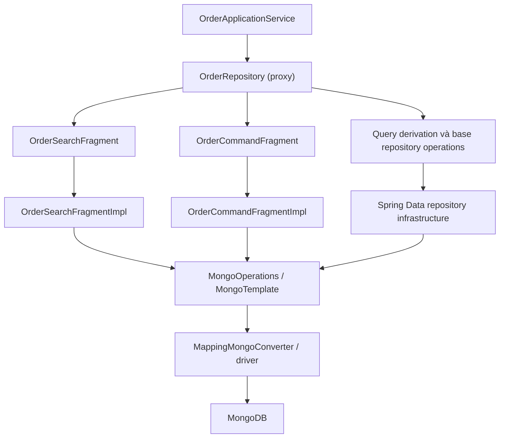

# Thiết kế repository fragment và lớp triển khai

## 1. Vấn đề cần giải quyết

Trong Spring Data MongoDB, `MongoRepository<OrderDocument, String>` có thể cung cấp nhiều thao tác CRUD, còn query derivation cho phép viết những phương thức như `findByTenantIdAndStatus(...)`. Điều này đủ cho nhiều trường hợp cơ bản. Tuy nhiên, một ứng dụng thực tế còn cần:

- Tìm kiếm đơn hàng theo **nhiều tiêu chí tùy chọn** mà không tạo hàng chục method name.
- Trả kết quả dạng `Slice` với sort và giới hạn an toàn.
- Chuyển trạng thái bằng **một atomic conditional update**, không cần tải entity rồi `save`.
- Dùng `MongoTemplate` để xây `Query`, `Update` hoặc aggregation dựa trên MongoDB.
- Đặt logic truy cập dữ liệu đặc thù ở một nơi, nhưng vẫn gọi thông qua **interface repository thống nhất**.

Một cách giải quyết được Spring Data hỗ trợ là **repository fragment**. Ta tách hành vi tùy biến thành một interface riêng, viết lớp implementation của interface đó và **ghép** fragment vào repository chính.

Bài thuộc chương **Repository mở rộng** của module **SPRING_DATA_MONGODB**. Phạm vi module là kết nối, ánh xạ document và thao tác MongoDB qua `MongoTemplate` hoặc repository; thiết kế query, aggregation, index, transaction, reactive access, kiểm thử và chẩn đoán hiệu năng dữ liệu. Vì vậy, ngoài cú pháp fragment, bài sẽ quan tâm đến cấu trúc mã, giới hạn trách nhiệm, transaction, tính nhất quán và khả năng kiểm thử.

Sau bài học, bạn có thể:

1. Giải thích repository được **compose từ các fragment** như thế nào.
2. Thiết kế `OrderSearchFragment` và `OrderSearchFragmentImpl` đúng quy ước.
3. Tách các command ghi có điều kiện thành fragment riêng mà không công khai toàn bộ CRUD.
4. Kiểm soát bean discovery, implementation postfix, trùng tên và xung đột method.
5. Phân biệt mô hình fragment hiện đại với kiểu `OrderRepositoryImpl` truyền thống.
6. Chọn fragment, default method, service hoặc custom base repository theo mục tiêu.
7. Viết integration test chứng minh fragment **được ghép thật**, mapping đúng BSON, query đúng tenant và update không ghi đè.

> Bài minh họa API Spring Data MongoDB imperative ở các phiên bản hiện đại. Cơ chế phát hiện implementation, thứ tự ưu tiên và một số overload có thể khác theo phiên bản Spring Data Commons/MongoDB; hãy xác minh với dependency thực tế của dự án.

## 2. Repository fragment là gì?

**Fragment** là một phần hợp đồng repository có implementation riêng. Repository cuối cùng kế thừa một hoặc nhiều interface fragment, còn Spring Data xây repository proxy bằng cách ghép các implementation tương ứng với phần CRUD/query infrastructure.

Ví dụ tối giản:

```java
public interface OrderSearchFragment {
    // Hành vi đọc MongoDB cần viết thủ công.
}

class OrderSearchFragmentImpl implements OrderSearchFragment {
    // Dùng MongoOperations/MongoTemplate.
}

public interface OrderRepository
        extends Repository<OrderDocument, String>,
                OrderSearchFragment {
    // Truy cập hành vi tùy biến qua cùng repository proxy.
}
```

Ba thành phần có vai trò khác nhau:

| Thành phần | Vai trò | Ai cung cấp implementation? |
| --- | --- | --- |
| `Repository<T, ID>` hoặc `MongoRepository<T, ID>` | Marker/base contract và khả năng của Spring Data | Infrastructure của Spring Data |
| `OrderSearchFragment` | Hợp đồng hành vi riêng | Nhóm phát triển ứng dụng |
| `OrderSearchFragmentImpl` | Code thực hiện hành vi đó | Nhóm phát triển ứng dụng |
| `OrderRepository` | API cuối cùng được inject vào service | Spring Data composition/proxy |

Spring Data **không yêu cầu tự viết một class implements toàn bộ `OrderRepository`**. Thay vào đó, nó tìm các fragment implementation thích hợp và gắn chúng vào proxy của repository.

### 2.1. Sơ đồ luồng gọi



Sơ đồ thể hiện ý tưởng composition, không mô tả một chuỗi lời gọi nội bộ bắt buộc ở mọi phiên bản. Điều quan trọng: **service dùng một repository interface**, còn phần phức tạp được tách thành những implementation có trách nhiệm rõ ràng.

### 2.2. Fragment khác một interface tiện ích bình thường ở điểm nào?

Java cho phép interface extends interface bất kỳ. Nhưng chỉ extends interface chưa bảo đảm Spring Data biết gọi logic ở đâu. Repository fragment cần một **implementation được Spring Data phát hiện hoặc đăng ký phù hợp**. Nếu không có implementation, bootstrap repository có thể thất bại hoặc framework hiểu nhầm method là derived query.

Không phải mọi bean implements một interface đều tự động trở thành fragment cho mọi repository. Quy ước tên, vị trí quét và cơ chế đăng ký của Spring Data vẫn phải đúng.

## 3. Chọn ranh giới cho fragment

Một fragment tốt thể hiện **một nhóm thao tác persistence có ý nghĩa**, không đơn thuần là nơi chứa tất cả code không nhét vừa vào repository interface.

| Fragment dự kiến | Trách nhiệm | Không nên ôm |
| --- | --- | --- |
| `OrderSearchFragment` | Tìm kiếm động, sort, projection/scroll | HTTP request parsing, phân quyền ở controller |
| `OrderCommandFragment` | Conditional update/atomic state transition | Gửi email hoặc gọi hệ thống vận chuyển |
| `OrderReportFragment` | Aggregation báo cáo dữ liệu | Tổng hợp business rule ở nhiều hệ thống |
| `OrderRepository` | Công khai API cần dùng, ghép các fragment | Tự triển khai lại toàn bộ MongoRepository |

Một fragment nên có:

1. **Tên theo năng lực**, ví dụ Search, Command, Report.
2. **Đầu vào rõ ràng**, bao gồm tenant, filter và giới hạn thích hợp.
3. **Kết quả đúng ngữ nghĩa**: danh sách, Slice, kết quả update hoặc DTO.
4. **Implementation stateless** để dùng an toàn như Spring singleton.
5. **Test riêng** cho BSON logic và test composition qua repository.

Khi logic chỉ gồm một predicate đơn giản, thêm fragment có thể là overengineering. Hãy sử dụng derived query hoặc `@Query` thay vì tạo implementation riêng cho mọi `findById`.

## 4. Cấu trúc dự án đề xuất

Một cách tổ chức dễ theo dõi:

```text
src/main/java/com/example/orders/persistence/
├── OrderDocument.java
├── OrderSearchFilter.java
├── OrderSearchFragment.java
├── OrderSearchFragmentImpl.java
├── OrderCommandFragment.java
├── OrderCommandFragmentImpl.java
└── OrderRepository.java

src/main/java/com/example/orders/application/
└── OrderApplicationService.java
```

Đây là **sơ đồ khái niệm**, không phải danh sách file mà worker tạo trong bước viết tài liệu này. Các ví dụ Java dưới đây có thể đặt trong package `com.example.orders.persistence`, mỗi public top-level type ở file riêng đúng quy tắc Java.

Giữ fragment interface và implementation ở package được quét bởi Spring Data repositories hoặc subpackage phù hợp. Đừng ngầm kỳ vọng Spring sẽ tìm thấy `OrderSearchFragmentImpl` nếu implementation bị đặt ngoài phạm vi quét mà không có đăng ký tường minh.

## 5. Domain và dữ liệu minh họa

### 5.1. Entity MongoDB

```java
package com.example.orders.persistence;

import java.time.Instant;
import org.springframework.data.annotation.Version;
import org.springframework.data.mongodb.core.mapping.Document;
import org.springframework.data.mongodb.core.mapping.FieldType;
import org.springframework.data.mongodb.core.mapping.MongoId;

@Document("orders")
public record OrderDocument(
    @MongoId(FieldType.STRING) String id,
    String tenantId,
    String status,
    String customerName,
    long totalAmountVnd,
    Instant createdAt,
    Instant updatedAt,
    @Version Long version
) {}
```

Trong ví dụ:

- Java property `id` tương ứng BSON `_id` và được giữ ở dạng String.
- `tenantId` là ranh giới dữ liệu giữa các khách hàng/đơn vị sử dụng.
- `status` có các giá trị minh họa `NEW`, `PAID`, `READY_TO_SHIP`, `SHIPPED`.
- `createdAt` phục vụ sắp xếp; `updatedAt` theo dõi thay đổi.
- `version` hỗ trợ optimistic locking khi được sử dụng đúng theo đường ghi.

### 5.2. Dataset thực hành

```javascript
db.orders.insertMany([
  {
    _id: "ord-101",
    tenantId: "tenant-a",
    status: "READY_TO_SHIP",
    customerName: "An",
    totalAmountVnd: NumberLong("150000"),
    createdAt: ISODate("2026-11-18T08:00:00Z"),
    updatedAt: ISODate("2026-11-18T08:00:00Z"),
    version: NumberLong("0")
  },
  {
    _id: "ord-102",
    tenantId: "tenant-a",
    status: "READY_TO_SHIP",
    customerName: "Bình",
    totalAmountVnd: NumberLong("250000"),
    createdAt: ISODate("2026-11-19T09:00:00Z"),
    updatedAt: ISODate("2026-11-19T09:00:00Z"),
    version: NumberLong("2")
  },
  {
    _id: "ord-103",
    tenantId: "tenant-a",
    status: "PAID",
    customerName: "Ân",
    totalAmountVnd: NumberLong("100000"),
    createdAt: ISODate("2026-11-19T09:00:00Z"),
    updatedAt: ISODate("2026-11-19T09:00:00Z"),
    version: NumberLong("1")
  },
  {
    _id: "ord-201",
    tenantId: "tenant-b",
    status: "READY_TO_SHIP",
    customerName: "An",
    totalAmountVnd: NumberLong("350000"),
    createdAt: ISODate("2026-11-20T07:00:00Z"),
    updatedAt: ISODate("2026-11-20T07:00:00Z"),
    version: NumberLong("0")
  }
]);
```

Chỉ chạy script trên **database thực hành** với collection/test fixture được kiểm soát. Dữ liệu tenant-b dùng để chứng minh filter không làm lộ hoặc sửa đơn của tenant khác. Hai document có cùng `createdAt` nhắc rằng danh sách cần khóa phá hòa `_id`.

## 6. Fragment thứ nhất: hợp đồng tìm kiếm động

### 6.1. DTO tham số truy vấn

Thay vì nhận một chuỗi JSON hoặc một map trường bất kỳ do client gửi, định nghĩa filter có cấu trúc:

```java
package com.example.orders.persistence;

import java.time.Instant;

public record OrderSearchFilter(
    String status,
    Long minTotalVnd,
    Instant createdFrom,
    Instant createdBefore
) {}
```

Các giá trị null trong DTO ở ví dụ mang nghĩa **không dùng tiêu chí đó**. Đây là chính sách của ứng dụng, không phải quy tắc mặc định của MongoDB. Khi xây production API, cần ràng buộc miền giá trị, định dạng thời gian và kiểu sort được phép.

### 6.2. Interface fragment

```java
package com.example.orders.persistence;

import org.springframework.data.domain.Pageable;
import org.springframework.data.domain.Slice;

public interface OrderSearchFragment {

    Slice<OrderDocument> search(
        String authenticatedTenantId,
        OrderSearchFilter filter,
        Pageable pageable
    );
}
```

Điểm cần lưu ý:

- Interface `OrderSearchFragment` **không cần extends `Repository`**.
- Nó không có annotation `@Query`, vì phần query sẽ được viết trong implementation.
- Đặt kiểu trả về `Slice` vì use case «Tải thêm» chỉ cần `hasNext`; không cần tổng số.
- Mọi thao tác đều nhận hoặc được cung cấp tenant đã xác thực.

**Không nên** cho caller tự truyền một `org.springframework.data.mongodb.core.query.Query` tùy ý vào fragment công khai. Khi đó tầng ứng dụng dễ vô tình bỏ filter tenant hoặc thêm sort quá tốn tài nguyên.

## 7. Lớp OrderSearchFragmentImpl

### 7.1. Triển khai bằng MongoOperations

Với postfix mặc định `Impl`, tên implementation theo convention là **`OrderSearchFragmentImpl`**, tức **tên fragment interface + Impl**, không phải tên repository cuối cùng + Impl.

```java
package com.example.orders.persistence;

import java.util.List;
import java.util.Objects;
import org.springframework.data.domain.Pageable;
import org.springframework.data.domain.Slice;
import org.springframework.data.domain.SliceImpl;
import org.springframework.data.domain.Sort;
import org.springframework.data.mongodb.core.MongoOperations;
import org.springframework.data.mongodb.core.query.Criteria;
import org.springframework.data.mongodb.core.query.Query;

public class OrderSearchFragmentImpl implements OrderSearchFragment {

    private static final int MAX_PAGE_SIZE = 100;
    private static final Sort QUEUE_SORT = Sort.by(
        Sort.Order.desc("createdAt"),
        Sort.Order.desc("id")
    );

    private final MongoOperations mongo;

    public OrderSearchFragmentImpl(MongoOperations mongo) {
        this.mongo = mongo;
    }

    @Override
    public Slice<OrderDocument> search(
        String tenantId,
        OrderSearchFilter filter,
        Pageable pageable
    ) {
        Objects.requireNonNull(filter, "filter");
        Objects.requireNonNull(pageable, "pageable");

        if (tenantId == null || tenantId.isBlank()) {
            throw new IllegalArgumentException("Missing tenant");
        }
        if (!pageable.isPaged()
                || pageable.getPageSize() > MAX_PAGE_SIZE
                || !QUEUE_SORT.equals(pageable.getSort())) {
            throw new IllegalArgumentException("Unsupported page/sort");
        }
        if (filter.minTotalVnd() != null
                && filter.minTotalVnd() < 0) {
            throw new IllegalArgumentException("Negative amount");
        }
        if (filter.createdFrom() != null
                && filter.createdBefore() != null
                && !filter.createdFrom()
                    .isBefore(filter.createdBefore())) {
            throw new IllegalArgumentException("Invalid date range");
        }

        Query query = Query.query(
            Criteria.where("tenantId").is(tenantId)
        );

        if (filter.status() != null) {
            query.addCriteria(
                Criteria.where("status").is(filter.status())
            );
        }
        if (filter.minTotalVnd() != null) {
            query.addCriteria(
                Criteria.where("totalAmountVnd")
                    .gte(filter.minTotalVnd())
            );
        }
        if (filter.createdFrom() != null
                || filter.createdBefore() != null) {
            Criteria date = Criteria.where("createdAt");
            if (filter.createdFrom() != null) {
                date.gte(filter.createdFrom());
            }
            if (filter.createdBefore() != null) {
                date.lt(filter.createdBefore());
            }
            query.addCriteria(date);
        }

        int pageSize = pageable.getPageSize();
        query.with(pageable);
        query.limit(pageSize + 1);

        List<OrderDocument> fetched =
            mongo.find(query, OrderDocument.class);

        boolean hasNext = fetched.size() > pageSize;
        List<OrderDocument> content = List.copyOf(
            fetched.subList(
                0, Math.min(pageSize, fetched.size())
            )
        );

        return new SliceImpl<>(content, pageable, hasNext);
    }
}
```

Lớp implementation dùng **constructor injection**, không tự tạo `MongoClient` hoặc `MongoTemplate` trên mỗi request. Các `Query` và `Criteria` đều được khởi tạo **bên trong method**, không giữ ở field dùng chung; đó là một thói quen quan trọng vì fragment implementation thường là singleton do Spring quản lý.

### 7.2. Vì sao lấy pageSize + 1?

Để tạo `Slice<T>`, ta có thể đọc thêm một document nhằm biết có trang kế tiếp:

```text
Page size = 2
Thực tế lấy tối đa 3 bản ghi từ MongoDB:

  [ord-102, ord-101, ord-...]
         └─ 2 kết quả được trả; phần thứ 3 để xác định hasNext

fetched.size() > 2  → hasNext = true
```

Đây là một cách triển khai **thủ công** tương ứng với contract Slice. Không phải mọi `List` tự có metadata phân trang; ta chủ động dùng `SliceImpl`.

Sau `query.with(pageable)`, `query.limit(pageSize + 1)` điều chỉnh giới hạn để đọc thêm phần tử. Nó vẫn giữ offset từ `Pageable`. Nếu offset rất sâu, query vẫn có thể chậm; cơ chế này **không tự trở thành keyset scrolling**.

### 7.3. Vì sao whitelist sort?

Method từ chối các sort khác `createdAt DESC, id DESC`. Đây là lựa chọn có chủ đích:

- Bảo đảm thứ tự ổn định với `id` làm khóa phá hòa.
- Tránh client chọn field không có index hoặc field nội bộ.
- Dễ thiết kế compound index tương ứng.
- Giữ logic phân trang nhất quán giữa các lần gọi.

Nếu sản phẩm thật cần nhiều sort, thay điều kiện bằng **allowlist** có chủ đích và index/benchmark phù hợp, không nhận mọi field path tự do.

## 8. Gọi fragment qua OrderRepository

Repository cuối cùng sẽ được ghép ở mục 11. Giả sử nó đã khai báo `OrderSearchFragment`; service có thể gọi:

```java
import org.springframework.data.domain.PageRequest;
import org.springframework.data.domain.Slice;
import org.springframework.data.domain.Sort;

PageRequest page = PageRequest.of(
    0, 2,
    Sort.by(
        Sort.Order.desc("createdAt"),
        Sort.Order.desc("id")
    )
);

OrderSearchFilter filter = new OrderSearchFilter(
    "READY_TO_SHIP",
    100000L,
    null,
    null
);

Slice<OrderDocument> result = repository.search(
    authenticatedTenantId, filter, page
);
```

`repository` ở đây là bean `OrderRepository` đã được inject, còn `authenticatedTenantId` phải đến từ identity/authorization context. Không hardcode tenant của người dùng trong code production.

Đối với fixture, tenant-a có các đơn `ord-101` và `ord-102` ở trạng thái READY_TO_SHIP, đủ điều kiện `minTotalVnd = 100000`. Trang đầu có tối đa 2 bản ghi. Nếu dữ liệu không thay đổi và không có đơn thứ ba phù hợp thì `hasNext()` là false.

### 8.1. Search fragment không nên tự đếm vô điều kiện

Vì contract trả `Slice`, không cần `mongo.count(...)` sau mọi lần gọi. Nếu UI cần tổng số hoặc số trang chính xác, hãy thiết kế riêng một `Page<T>` hoặc truy vấn đếm với filter tương ứng; đừng thay đổi ngầm semantics của fragment.

### 8.2. Không dùng kết quả tìm kiếm để ghi đè

Repository search đọc document; một object vừa đọc có thể trở nên stale ngay khi request khác cập nhật đơn. Nếu nghiệp vụ chỉ muốn đổi trạng thái, ưu tiên command có điều kiện ở phần tiếp theo thay vì sửa bản sao entity rồi `save` một cách thiếu kiểm soát.

## 9. Fragment thứ hai: command ghi có điều kiện

### 9.1. Hợp đồng nghiệp vụ

Một đơn chỉ được chuyển `READY_TO_SHIP → SHIPPED` khi:

1. Đúng `tenantId` và `_id`.
2. Trạng thái hiện tại đúng.
3. Version khớp kỳ vọng của caller.
4. Thay đổi status, thời điểm cập nhật và version được thực hiện trong **một MongoDB update**.

Interface fragment:

```java
package com.example.orders.persistence;

import java.time.Instant;

public interface OrderCommandFragment {

    boolean markShipped(
        String authenticatedTenantId,
        String orderId,
        long expectedVersion,
        Instant shippedAt
    );
}
```

Trả `boolean` thay vì trả entity, vì use case cần biết **có chuyển trạng thái thành công hay không**, không cần materialize document. Nếu API cần phân biệt lỗi vi phạm state với lỗi xung đột version, thiết kế result object có ý nghĩa nghiệp vụ hoặc một query chẩn đoán có authorization; đừng tiết lộ document ngoài tenant.

### 9.2. OrderCommandFragmentImpl

```java
package com.example.orders.persistence;

import java.time.Instant;
import java.util.Objects;
import com.mongodb.client.result.UpdateResult;
import org.springframework.data.mongodb.core.MongoOperations;
import org.springframework.data.mongodb.core.query.Criteria;
import org.springframework.data.mongodb.core.query.Query;
import org.springframework.data.mongodb.core.query.Update;

public class OrderCommandFragmentImpl
        implements OrderCommandFragment {

    private final MongoOperations mongo;

    public OrderCommandFragmentImpl(MongoOperations mongo) {
        this.mongo = mongo;
    }

    @Override
    public boolean markShipped(
        String tenantId,
        String orderId,
        long expectedVersion,
        Instant shippedAt
    ) {
        Objects.requireNonNull(shippedAt, "shippedAt");
        if (tenantId == null || tenantId.isBlank()
                || orderId == null || orderId.isBlank()
                || expectedVersion < 0) {
            throw new IllegalArgumentException("Invalid command");
        }

        Query query = Query.query(
            Criteria.where("id").is(orderId)
                .and("tenantId").is(tenantId)
                .and("status").is("READY_TO_SHIP")
                .and("version").is(expectedVersion)
        );

        Update update = new Update()
            .set("status", "SHIPPED")
            .set("updatedAt", shippedAt)
            .inc("version", 1);

        UpdateResult result = mongo.updateFirst(
            query, update, OrderDocument.class
        );

        return result.getModifiedCount() == 1;
    }
}
```

Ở đây, `Update` là class thuộc `org.springframework.data.mongodb.core.query`, không phải annotation `@Update` của repository.

Lệnh update chỉ tác động tối đa một document. MongoDB bảo đảm thao tác sửa **một document** có tính nguyên tử; điều kiện status và version nằm ngay trong filter, thay vì:

```text
findOne()
   ↓
kiểm tra status/version trong Java
   ↓
save(entity stale)
```

Với đoạn code này, version được **tăng tường minh**. Spring Data có thể có hành vi quản lý `@Version` riêng trên các đường update khác nhau; vì thế phải kiểm chứng rằng field version thực sự tăng **một lần** theo thiết kế và không ghép cơ chế increment thủ công với một đường auto-increment chưa được hiểu rõ.

### 9.3. Matched count và modified count

`UpdateResult.getMatchedCount()` phản ánh số document match query. `getModifiedCount()` phản ánh số document thực sự thay đổi. Ở ví dụ chuyển trạng thái, lệnh sửa status/version khi match nên `modifiedCount == 1` là tín hiệu thành công phù hợp.

Nếu `modifiedCount == 0`, không được kết luận ngay «ID không tồn tại»: nguyên nhân còn có thể là tenant sai, status đã đổi, version cũ hoặc lệnh không làm thay đổi dữ liệu. Service có thể trả một lỗi khái quát cho client và ghi metric nội bộ mà không tiết lộ quyền sở hữu của đơn.

### 9.4. Không tự bật upsert

Command này yêu cầu đơn **đã tồn tại**. Không dùng `mongo.upsert(...)` để chuyển trạng thái: nếu điều kiện status/version không khớp, upsert có thể cố tạo document thay vì trả thất bại. Chọn `updateFirst(...)` không upsert là phù hợp.

## 10. Fragment thứ ba (tùy chọn): aggregation báo cáo

Một fragment khác có thể cung cấp read model chuyên biệt, ví dụ tổng tiền theo trạng thái của một tenant:

```java
package com.example.orders.persistence;

import java.util.List;

public interface OrderReportFragment {
    List<StatusTotal> summarizeByStatus(String authenticatedTenantId);
}
```

Kiểu trả về nên là DTO công khai ở một file riêng `StatusTotal.java` để application service thuộc package khác có thể sử dụng:

```java
package com.example.orders.persistence;

public record StatusTotal(String status, long totalVnd) {}
```

Implementation:

```java
package com.example.orders.persistence;

import java.util.List;
import org.springframework.data.mongodb.core.MongoOperations;
import org.springframework.data.mongodb.core.aggregation.Aggregation;
import org.springframework.data.mongodb.core.query.Criteria;
import static org.springframework.data.mongodb.core.aggregation.Aggregation.*;

public class OrderReportFragmentImpl implements OrderReportFragment {
    private final MongoOperations mongo;

    public OrderReportFragmentImpl(MongoOperations mongo) {
        this.mongo = mongo;
    }

    @Override
    public List<StatusTotal> summarizeByStatus(String tenantId) {
        if (tenantId == null || tenantId.isBlank()) {
            throw new IllegalArgumentException("Missing tenant");
        }

        Aggregation aggregation = newAggregation(
            match(Criteria.where("tenantId").is(tenantId)),
            group("status")
                .sum("totalAmountVnd").as("totalVnd"),
            project("totalVnd")
                .and("_id").as("status")
        );

        return mongo.aggregate(
            aggregation, OrderDocument.class, StatusTotal.class
        ).getMappedResults();
    }
}
```

Fragment báo cáo này **không bắt buộc** để hoàn thành một repository. Nó minh họa cách mở rộng theo nhu cầu thay vì tạo một class `OrderRepositoryImpl` khổng lồ.

Với dữ liệu tiền cần độ chính xác tuyệt đối, xem xét kiểu BSON/Java thích hợp như Decimal128/BigDecimal thay vì mặc định mọi đơn vị tiền đều vừa `long`. Aggregation có thể cần index, bộ nhớ và quyền tenant rõ ràng; không xem nó như một getter chi phí bằng 0.

## 11. Ghép nhiều fragment vào một repository

### 11.1. Chỉ công khai những method thực sự cần

```java
package com.example.orders.persistence;

import java.util.Optional;
import org.springframework.data.repository.Repository;

public interface OrderRepository
        extends Repository<OrderDocument, String>,
                OrderSearchFragment,
                OrderCommandFragment,
                OrderReportFragment {

    Optional<OrderDocument> findByTenantIdAndId(
        String tenantId,
        String id
    );
}
```

Đây là **một repository interface**, nhưng hành vi đến từ nhiều nguồn:

| Method | Nơi cung cấp hành vi |
| --- | --- |
| `findByTenantIdAndId(...)` | Query derivation của Spring Data |
| `search(...)` | `OrderSearchFragmentImpl` |
| `markShipped(...)` | `OrderCommandFragmentImpl` |
| `summarizeByStatus(...)` | `OrderReportFragmentImpl` |

Khi application service inject `OrderRepository`, Spring Data tạo **repository proxy** tổng hợp. Không phải tự khởi tạo fragment rồi gọi lần lượt từ controller.

**Vì sao không extends `MongoRepository` trong ví dụ?** Để tránh tự công khai `save`, `deleteAll` và nhiều operation không cần cho use case. `Repository<T, ID>` là marker nên ta chọn rõ các phương thức muốn public. Nếu sản phẩm thực sự cần toàn bộ CRUD, extends `MongoRepository<T, ID>` vẫn hợp lệ; chọn theo yêu cầu nghiệp vụ.

### 11.2. Ghép fragment không làm mất khả năng dùng MongoTemplate

Trong implementation, các thao tác phức tạp vẫn dùng `MongoOperations`/`MongoTemplate`. Repository không cấm sử dụng template; nó chỉ tạo **API tổng hợp** để service không phải phụ thuộc trực tiếp vào nhiều chi tiết persistence.

### 11.3. Interface của fragment có thể được tái sử dụng

Một fragment như `AuditTrailFragment` có thể được nhiều repository kế thừa nếu contract đủ rõ. Tuy nhiên, implementation dùng entity-specific mapping, collection name hoặc business state cần được thiết kế kỹ. Tái sử dụng fragment bằng generic type mà không kiểm soát domain class có thể khiến code quá trừu tượng và khó kiểm thử.

## 12. Cơ chế Spring Data tìm lớp implementation

### 12.1. Quy ước postfix Impl

Với convention thông dụng:

```text
Fragment interface             Implementation được mong đợi
----------------------------------------------------------------
OrderSearchFragment       →    OrderSearchFragmentImpl
OrderCommandFragment      →    OrderCommandFragmentImpl
OrderReportFragment       →    OrderReportFragmentImpl
```

Spring Data dò tìm implementation theo quy ước **tên interface fragment + postfix** ở vùng package phù hợp với repository scan. Fragment implementation cần có constructor dependencies được Spring resolve, ví dụ `MongoOperations`.

Lớp implementation có thể là bean được phát hiện theo convention hoặc được đăng ký tường minh. Không nhất thiết phải có `@Repository` stereotype trên class fragment, vì đây không phải repository proxy độc lập. Tuy nhiên, khi wiring thủ công, bean name và scope cần được kiểm soát.

### 12.2. Những điều cần kiểm tra khi Spring không tìm thấy implementation

1. Tên có đúng `OrderSearchFragmentImpl` không? Kiểm tra chữ hoa/chữ thường.
2. Class có `implements OrderSearchFragment` không?
3. Interface fragment đã được `OrderRepository extends` chưa?
4. Implementation nằm trong phạm vi package scanning thích hợp chưa?
5. Có nhiều candidate bean cùng mục đích hoặc tên bị xung đột không?
6. Constructor dependency như `MongoOperations` có bean không, có nhiều template cùng type không?
7. Dự án có tùy biến `repositoryImplementationPostfix` khác `Impl` không?
8. Version Spring Data MongoDB đang dùng có cơ chế fragments theo cách dự kiến không?

Nếu Spring Data không bind method vào fragment mà cố phân tích như derived query, bootstrap có thể ném lỗi kiểu «không tìm thấy property phù hợp» hoặc thông báo query method. Đừng sửa tên method một cách ngẫu nhiên: trước tiên kiểm tra **wiring của fragment**.

### 12.3. Custom implementation postfix

Một số dự án cấu hình postfix khác:

```java
import org.springframework.context.annotation.Configuration;
import org.springframework.data.mongodb.repository.config.EnableMongoRepositories;

@Configuration
@EnableMongoRepositories(
    basePackages = "com.example.orders.persistence",
    repositoryImplementationPostfix = "Custom"
)
class RepositoryConfiguration {}
```

Khi dùng cấu hình này, class implementation theo convention sẽ có tên như `OrderSearchFragmentCustom`, không còn dùng mặc định `OrderSearchFragmentImpl`.

**Đây là một ví dụ cấu hình thay thế, không phải class cần thêm cùng với ví dụ Impl bên trên.** Tránh cấu hình `@EnableMongoRepositories` chồng lấn với auto-configuration repository của Boot mà chưa kiểm soát phạm vi quét.

## 13. Đăng ký bean thủ công và tên bean

Khi implementation cần constructor đặc biệt, nhiều template hoặc có tên không theo convention, có thể quản lý bằng cấu hình bean rõ ràng — tùy khả năng binding của phiên bản Spring Data:

```java
import org.springframework.context.annotation.Bean;
import org.springframework.context.annotation.Configuration;
import org.springframework.data.mongodb.core.MongoOperations;

@Configuration
class OrderFragmentConfiguration {

    @Bean("orderSearchFragmentImpl")
    OrderSearchFragment orderSearchFragment(
        MongoOperations orderMongoOperations
    ) {
        return new OrderSearchFragmentImpl(
            orderMongoOperations
        );
    }
}
```

Bean name trong ví dụ theo convention fragment name + postfix ở dạng decapitalized. Nếu Spring Data phát hiện nhiều implementation cùng loại, cơ chế chọn có thể dựa vào tên bean/convention và cấu hình repository. Phải kiểm tra tránh tạo thêm một bean tự động không mong muốn.

**Lưu ý khi nhiều MongoDB database:** Chỉ inject `MongoOperations` theo type khi trong context có một candidate rõ ràng. Nếu nhiều template, dùng `@Qualifier("orderMongoTemplate")` hoặc tên bean thống nhất với repository mapping. Không nên chọn database bằng giá trị người dùng gửi trong request.

### 13.1. Khi nào nên dùng @Component?

Có thể đánh dấu class implementation là Spring component:

```java
@org.springframework.stereotype.Component(
    "orderSearchFragmentImpl"
)
class OrderSearchFragmentImpl implements OrderSearchFragment {
    // Implementation như mục 7.
}
```

Đây chỉ là **biến thể wiring**; không đặt cả bean factory và `@Component` cùng tên nếu không có chủ đích, vì có thể tạo trùng bean hoặc ghi đè cấu hình. Với convention discovery hoạt động tốt, cấu hình mặc định thường đơn giản hơn.

## 14. Phân biệt fragment hiện đại và custom implementation kiểu cũ

Trước mô hình fragments, nhiều dự án mở rộng repository bằng một interface tùy biến và class tên **repository interface + Impl**:

```text
Legacy naming:
  OrderRepository
  OrderRepositoryImpl

Fragment-oriented naming:
  OrderRepository
    ├── OrderSearchFragment
    │     └── OrderSearchFragmentImpl
    └── OrderCommandFragment
          └── OrderCommandFragmentImpl
```

Kiểu `OrderRepositoryImpl` theo convention cũ có thể vẫn được framework nhận diện ở một số phiên bản vì lý do tương thích, nhưng cách mở rộng **theo fragment** thường là hướng nên ưu tiên.

### 14.1. Vấn đề khi dùng một class repository Impl khổng lồ

- Tìm kiếm, ghi, aggregation và batch process nằm chung một class.
- Khó tái sử dụng hoặc tách test cho từng nhóm logic.
- Method collision với base repository dễ gây hành vi khó đoán.
- Khi tách module hoặc chuyển stack reactive, các trách nhiệm bị dính chặt.
- Dễ lẫn `OrderRepositoryImpl` được phát hiện theo convention cũ với implementation mà team muốn tự đăng ký.

### 14.2. Hướng chuyển đổi

1. Liệt kê các method custom đang có trên repository cũ.
2. Nhóm thành fragment interface theo chức năng: Search, Command, Report.
3. Chuyển implementation vào `FragmentNameImpl` tương ứng.
4. Cho repository chính extends các fragment đó.
5. Kiểm tra bean discovery và xung đột method.
6. Viết integration tests trước/sau để bảo đảm query semantics không đổi.
7. Chỉ sau khi test pass mới gỡ class legacy, tránh để hai implementation cạnh tranh.

Không nên tự đổi tên tất cả class rồi tin rằng behavior sẽ giữ nguyên: repository fragments có quy tắc composition/priority cần được xác nhận với phiên bản hiện tại.

## 15. Xung đột method và thứ tự ưu tiên

Giả sử hai fragment có cùng chữ ký:

```java
interface FirstOrderFragment {
    void refresh(String id);
}

interface SecondOrderFragment {
    void refresh(String id);
}
```

Nếu repository extends cả hai, code có thể trở nên khó hiểu: `refresh(...)` phải được delegate vào implementation nào? Trong các phiên bản hiện đại, Spring Data có quy tắc ưu tiên fragments theo **thứ tự khai báo/composition**, và custom fragments thường ưu tiên hơn base implementation/repository aspects. Nhưng đây không phải cách tốt để thiết kế một public API.

**Khuyến nghị:** Mỗi hành vi có một chủ sở hữu rõ ràng. Đổi tên method theo business intent như `refreshSearchIndex(...)` và `refreshOrderCache(...)`, hoặc đưa phần phối hợp vào service thay vì dựa vào dispatch priority.

### 15.1. Override một phương thức của base repository

Custom fragment có thể được dùng để override một số hành vi của base repository trong những phiên bản hỗ trợ. Tuy nhiên, override `save(...)`, `deleteById(...)` hoặc các API CRUD cốt lõi có thể làm thay đổi contract mà caller khác đang tin cậy.

Trước khi override, hỏi:

- Có thật sự cần repository-wide behavior hay chỉ một command nghiệp vụ?
- Caller có thể vô tình bypass invariant qua method CRUD khác không?
- `saveAll(...)`, batch writes hoặc reactive API có cùng policy không?
- Callback, optimistic locking và transaction có bị đổi semantics không?

Trong đa số bài toán nghiệp vụ, dễ review hơn khi **không phơi bày CRUD nguy hiểm** và cung cấp method đặt tên như `markShipped(...)`.

## 16. Fragment và default method của interface

Java cho phép:

```java
public interface OrderLookupConvenience {
    java.util.Optional<OrderDocument>
    findByTenantIdAndId(String tenantId, String id);

    default boolean existsInTenant(
        String tenantId, String id
    ) {
        return findByTenantIdAndId(tenantId, id).isPresent();
    }
}
```

Một default method đơn giản có thể dùng lại method repository, nhưng nó không tự có `MongoOperations` được inject và không phải lúc nào cũng là cách tốt để xây query phức tạp.

| Lựa chọn | Thích hợp khi |
| --- | --- |
| Derived query | Bộ lọc đơn giản, ít thay đổi |
| `@Query`/`@Aggregation` | Truy vấn JSON/pipeline cố định và hỗ trợ đúng phiên bản |
| Default method | Logic phối hợp rất nhỏ từ những method đã có |
| Repository fragment | Query/command custom cần implementation, dependency và test riêng |
| Application service | Điều phối nhiều repository, quyền, API ngoài và nghiệp vụ |
| Custom repository base class | Chính sách hạ tầng dùng chung cho rất nhiều repository |

Đừng dùng fragment chỉ để chuyển một dòng `repository.findBy...` sang một class khác mà không thêm ý nghĩa về thiết kế.

## 17. Fragment và custom repository base class

Hai cách mở rộng Spring Data thường bị nhầm:

**Fragment:** Repo chủ động extends một interface hành vi, ví dụ `OrderCommandFragment`. Chỉ những repository muốn capability đó mới có nó.

**Custom base repository:** Thay đổi implementation chung cho nhiều repository trong một nhóm cấu hình, có thể cần `repositoryBaseClass` và lớp kế thừa base phù hợp. Đây là quyết định về **infrastructure policy** rộng hơn.

Ví dụ tình huống:

| Mục tiêu | Hướng tiếp cận |
| --- | --- |
| Một repository cần dynamic order search | Fragment |
| Nhiều repository cần chung một thuật toán domain-specific | Fragment tái sử dụng có type-safe contract |
| Tất cả repository cần hành vi base nhất quán | Cân nhắc custom base repository |
| Chỉ một service cần thao tác phức tạp một lần | MongoOperations trong persistence adapter/service phù hợp |

Nếu tạo một generic base interface kéo dài nhiều tầng, dùng `@NoRepositoryBean` cho các interface trung gian extends repository base mà **không muốn Spring Data instantiate như repository độc lập**:

```java
import org.springframework.data.repository.NoRepositoryBean;
import org.springframework.data.repository.Repository;

@NoRepositoryBean
interface TenantReadRepository<T, ID>
        extends Repository<T, ID> {
    // Các method shared có thể được định nghĩa theo contract phù hợp.
}
```

Không cần thêm `@NoRepositoryBean` vào mỗi fragment interface đơn giản không extends repository marker; việc dùng annotation tùy tiện không thay thế thiết kế package scanning đúng.

## 18. Transaction, lifecycle, auditing và version

### 18.1. Transaction ở ranh giới nghiệp vụ

Fragment là thành phần persistence; application service thường là nơi quyết định **ranh giới transaction** nếu một use case liên quan nhiều thao tác/collection.

```java
import org.springframework.stereotype.Service;
import org.springframework.transaction.annotation.Transactional;

@Service
public class ShippingApplicationService {
    private final OrderRepository repository;

    public ShippingApplicationService(OrderRepository repository) {
        this.repository = repository;
    }

    @Transactional
    public void shipOrder(
        String tenantId, String orderId,
        long expectedVersion
    ) {
        boolean changed = repository.markShipped(
            tenantId, orderId, expectedVersion,
            java.time.Instant.now()
        );
        if (!changed) {
            throw new IllegalStateException(
                "Order is unavailable or has changed"
            );
        }
    }
}
```

Đây là ví dụ mô tả boundary; riêng **một atomic update trên một document** thường không cần multi-document transaction. `@Transactional` chỉ có ý nghĩa khi transaction manager và MongoDB topology được cấu hình phù hợp. Nó không làm email/HTTP call bên ngoài tự trở thành một phần MongoDB transaction.

### 18.2. Callback và auditing

`mongo.updateFirst(...)` không phải `save(entity)`:

- Nó không nhất thiết dựng một entity Java hoàn chỉnh.
- Nó không bảo đảm chạy cùng entity callbacks như insert/save.
- `updatedAt` cần được gán rõ trong `Update` hoặc theo cơ chế auditing đã kiểm chứng.
- Validation của application vẫn cần chạy trước persistence.
- `@Version` phải được xử lý theo đúng API/version, không giả định mọi fragment update tự chống lost update.

Trong `OrderCommandFragmentImpl`, chúng ta chủ động đưa `version` vào filter và tăng giá trị bằng update. Khi project dùng `@Version`, kiểm thử rằng **không có sự tăng version gấp đôi** do lồng hai cơ chế; không viết thêm một lần `save(entity)` sau command thành công nếu không cần.

### 18.3. Thread safety

Spring thường dùng một fragment implementation như bean singleton. Vì vậy:

```java
// Không phù hợp: biến tenant trở thành state chia sẻ giữa requests.
class UnsafeOrderSearchFragmentImpl {
    private String currentTenantId;
}
```

Tenant, filter và pagination là **giá trị của từng lần gọi**, không phải mutable field dùng chung. Tạo `Query`/`Update` mới trong mỗi method. `MongoTemplate` và driver client được thiết kế để được chia sẻ sau khi cấu hình, không tạo lại theo request.

## 19. Bảo mật và giới hạn API

Một fragment không tự mang authentication. Các tham số như `tenantId` từ HTTP request có thể bị giả mạo. Service phải lấy tenant từ principal/session đã xác thực hoặc kiểm tra quyền đúng trước khi gọi repository.

### 19.1. Tránh những hợp đồng quá rộng

```java
// Không nên công khai kiểu API này cho use case thông thường.
interface DangerousFragment {
    void updateAny(
        String collectionName,
        String rawQueryJson,
        String rawUpdateJson
    );
}
```

Hợp đồng kiểu trên làm API persistence trở thành công cụ chỉnh sửa tùy ý. Ngay cả khi được đặt trong fragment, nó có thể cho phép cập nhật field nội bộ, thiếu tenant scope hoặc gửi operator nguy hiểm.

Thay bằng command rõ nghĩa:

```java
interface OrderCommandFragment {
    boolean markShipped(
        String tenantId,
        String orderId,
        long expectedVersion,
        java.time.Instant at
    );
}
```

### 19.2. Không phụ thuộc vào ID khó đoán

`findById(id)` không phải kiểm tra quyền. Query phải ràng buộc tenant hoặc owner khi nghiệp vụ yêu cầu. Dùng `findByTenantIdAndId(...)` cho read; dùng filter có ID + tenant + expected state/version cho write.

### 19.3. Projection và dữ liệu nhạy cảm

Nếu fragment chỉ phục vụ màn hình hàng đợi, cân nhắc trả DTO/projection vừa đủ thay vì entity đầy đủ với dữ liệu cá nhân. Khi aggregation/tìm kiếm nâng cao, tránh đưa tài liệu chưa được lọc vào log; sử dụng redaction và giới hạn query tracing.

## 20. Index và hiệu năng của fragment

Repository fragment **không làm query nhanh hơn một cách tự động**. Nó chỉ giúp tổ chức và thực thi truy vấn phù hợp. Tối ưu vẫn dựa trên filter, sort, projection, index và dữ liệu.

### 20.1. Index ứng viên cho màn hình hàng đợi

Với query:

```javascript
db.orders.find({
  tenantId: "tenant-a",
  status: "READY_TO_SHIP"
})
  .sort({ createdAt: -1, _id: -1 })
  .limit(20);
```

Một index ứng viên:

```javascript
db.orders.createIndex(
  { tenantId: 1, status: 1, createdAt: -1, _id: -1 },
  { name: "ix_orders_tenant_status_recent" }
);
```

Đây là ứng viên theo nguyên tắc equality/sort; nếu filter còn có `minTotalVnd` hoặc khoảng ngày, planner có thể chọn phương án khác. Không tạo một index cho mọi tổ hợp filter tùy chọn; đo trên workload đại diện.

### 20.2. Phân trang offset có giới hạn

Trong `OrderSearchFragmentImpl`, `Pageable` sử dụng offset, vì vậy trang rất sâu có thể phải skip nhiều document. `pageSize + 1` giúp biết `hasNext` nhưng không giải quyết chi phí offset.

Nếu hệ thống cần infinite scroll rất sâu, cân nhắc API `Window<T>`/`ScrollPosition` của phiên bản hỗ trợ hoặc triển khai keyset pagination:

```javascript
const lastCreatedAt = ISODate("2026-11-18T08:00:00Z");
const lastId = "ord-101";

db.orders.find({
  tenantId: "tenant-a",
  status: "READY_TO_SHIP",
  $or: [
    { createdAt: { $lt: lastCreatedAt } },
    { createdAt: lastCreatedAt, _id: { $lt: lastId } }
  ]
}).sort({ createdAt: -1, _id: -1 }).limit(20);
```

Cursor cần lưu đúng sort keys/BSON types. Keyset giảm một số vấn đề dịch offset, nhưng không tự bảo đảm snapshot khi dữ liệu thay đổi hoặc sort key bị sửa.

### 20.3. Chẩn đoán bằng explain

```javascript
db.orders.find({
  tenantId: "tenant-a",
  status: "READY_TO_SHIP"
})
  .sort({ createdAt: -1, _id: -1 })
  .limit(20)
  .explain("executionStats");
```

Quan sát `winningPlan`, `IXSCAN`/`COLLSCAN`, `totalKeysExamined`, `totalDocsExamined`, `nReturned` và stage SORT. Đừng dùng một integration test với bốn document làm bằng chứng index đã được tối ưu cho dữ liệu thật.

### 20.4. Chi phí khi ghép nhiều fragment

Composition bản thân thường không phải nút thắt của query MongoDB. Điều cần xem là **số round trip**, kích thước BSON, mapping, N+1 references, index scan, aggregation stages và transaction contention. Không tối ưu dispatch của repository proxy trước khi có profiling cho thấy đó là vấn đề.

## 21. Reactive repository fragments

Với ứng dụng reactive, sử dụng interface/implementation phù hợp với `ReactiveMongoOperations` và return `Mono<T>`/`Flux<T>`, không lấy fragment imperative rồi bọc bằng `Mono.just(...)`.

### 21.1. Ví dụ reactive fragment đọc

```java
import reactor.core.publisher.Flux;
import org.springframework.data.mongodb.core.ReactiveMongoOperations;
import org.springframework.data.mongodb.core.query.Criteria;
import org.springframework.data.mongodb.core.query.Query;

interface ReactiveOrderSearchFragment {
    Flux<OrderDocument> findRecent(String tenantId);
}

class ReactiveOrderSearchFragmentImpl
        implements ReactiveOrderSearchFragment {

    private final ReactiveMongoOperations mongo;

    ReactiveOrderSearchFragmentImpl(
        ReactiveMongoOperations mongo
    ) {
        this.mongo = mongo;
    }

    @Override
    public Flux<OrderDocument> findRecent(String tenantId) {
        Query query = Query.query(
            Criteria.where("tenantId").is(tenantId)
        );
        query.limit(20);
        return mongo.find(query, OrderDocument.class);
    }
}
```

Snippet mô tả ý tưởng; trong production phải thêm sort ổn định, validate tenant và cấu hình repository reactive tương ứng.

Repository có thể ghép fragment reactive:

```java
import org.springframework.data.mongodb.repository.ReactiveMongoRepository;

interface ReactiveOrderRepository
        extends ReactiveMongoRepository<OrderDocument, String>,
                ReactiveOrderSearchFragment {
}
```

Việc extends `ReactiveMongoRepository` ở đây công khai CRUD reactive đầy đủ; nếu yêu cầu giới hạn quyền public, thiết kế contract hẹp hơn theo khả năng của phiên bản.

### 21.2. Không trộn hai stack

| Imperative | Reactive |
| --- | --- |
| `MongoOperations` | `ReactiveMongoOperations` |
| `MongoTemplate` | `ReactiveMongoTemplate` |
| `List/Optional/Slice` | `Flux/Mono` và cơ chế phân trang tùy API |
| Đồng bộ/blocking | Reactive driver, subscribe/backpressure |
| `MongoTransactionManager` khi cần | Reactive transaction manager tương ứng |

Một `Flux<OrderDocument>` không tự chứa `hasNext`, total count hoặc keyset resume token. Nếu API cần scrolling hoặc pagination metadata, thiết kế riêng và kiểm tra khả năng phiên bản.

## 22. Kiểm thử fragment ở hai mức

Có **hai câu hỏi độc lập**:

1. **Implementation đúng không?** Query BSON, filter, sort và Update có tạo kết quả đúng không?
2. **Composition đúng không?** Gọi `orderRepository.search(...)` hoặc `markShipped(...)` có thực sự delegate vào fragment implementation dự kiến không?

Unit test cho implementation bằng mock `MongoOperations` có thể giúp kiểm tra validation và tương tác nhưng **không chứng minh** mapping BSON, index, version hay Spring Data discovery. Vì vậy cần integration test dùng MongoDB thật.

### 22.1. Ví dụ @DataMongoTest

Khung JUnit 5:

```java
import static org.junit.jupiter.api.Assertions.*;
import java.time.Instant;
import org.junit.jupiter.api.Test;
import org.springframework.beans.factory.annotation.Autowired;
import org.springframework.boot.test.autoconfigure.data.mongo.DataMongoTest;
import org.springframework.data.domain.PageRequest;
import org.springframework.data.domain.Sort;
import org.springframework.data.mongodb.core.MongoTemplate;

@DataMongoTest
class OrderRepositoryFragmentIntegrationTest {

    @Autowired OrderRepository repository;
    @Autowired MongoTemplate mongo;

    @Test
    void repositoryMustComposeSearchFragment() {
        // Fixture phải được tạo trong MongoDB test riêng.
        // Giả định đã seed dữ liệu mục 5.
        var page = PageRequest.of(
            0, 1,
            Sort.by(
                Sort.Order.desc("createdAt"),
                Sort.Order.desc("id")
            )
        );

        var result = repository.search(
            "tenant-a",
            new OrderSearchFilter(
                "READY_TO_SHIP", null, null, null
            ),
            page
        );

        assertEquals(1, result.getNumberOfElements());
        assertTrue(result.hasNext());
        assertEquals("tenant-a",
            result.getContent().get(0).tenantId());
    }
}
```

**Đây là khung minh họa**, không phải test class độc lập đã được chạy. Để sử dụng, dự án cần dependencies/test context, database test (chẳng hạn Testcontainers), fixture trước mỗi test và cleanup. Khi test slice, phải seed đủ ít nhất hai record phù hợp; nếu fixture bị thay đổi bởi test khác, `hasNext()` không còn đáng tin.

Một số cấu hình `@DataMongoTest` có thể không tự import mọi bean tự định nghĩa hoặc nhiều template tùy chỉnh. Nếu fragment chưa được phát hiện trong slice test, phải kiểm tra scan/config hoặc import các bean cần thiết, chứ không coi test này là bằng chứng `@DataMongoTest` luôn bao phủ toàn bộ ứng dụng.

### 22.2. Kiểm thử command có version

```java
@Test
void shippingRequiresExpectedStateAndVersion() {
    // Tạo record trong database test độc lập.
    Instant timestamp = Instant.parse(
        "2026-11-20T08:00:00Z"
    );

    OrderDocument inserted = mongo.insert(
        new OrderDocument(
            "test-ship-001",
            "tenant-a",
            "READY_TO_SHIP",
            "Khách A",
            150000L,
            timestamp,
            timestamp,
            null
        )
    );

    long version = inserted.version();

    boolean first = repository.markShipped(
        "tenant-a", inserted.id(), version,
        timestamp.plusSeconds(60)
    );
    boolean second = repository.markShipped(
        "tenant-a", inserted.id(), version,
        timestamp.plusSeconds(120)
    );

    assertTrue(first);
    assertFalse(second);
}
```

Method này là phần minh họa đặt **trong cùng test class** với các field `repository` và `mongo` đã inject. Trước khi chạy cần bảo đảm unique ID, cleanup và test context phù hợp; test phải kiểm tra document sau lần cập nhật đầu rằng status và version thay đổi đúng một lần.

### 22.3. Ma trận integration test

| Tình huống | Kỳ vọng |
| --- | --- |
| Repository bean khởi tạo | Không lỗi tìm fragment/custom implementation |
| `search` theo tenant-a | Không có đơn tenant-b |
| Filter trạng thái và amount | Trả đúng tập document |
| Date range nửa mở | Đúng `createdFrom <= createdAt < createdBefore` |
| Sort trùng createdAt | ID phá hòa ổn định |
| Page size vượt giới hạn | Bị từ chối |
| Page cuối chỉ còn ít bản ghi | `hasNext=false` |
| Command đúng status/version | Chỉ một document thay đổi |
| Command sai tenant | Không thay đổi document |
| Command với version stale | Không ghi đè, trả false |
| Retry cùng expected version | Lần sau thất bại theo contract |
| Aggregation theo tenant | Tổng/nhóm đúng, không lẫn tenant |
| Hai fragment có name collision | Phát hiện và giải quyết trước deploy |
| Mapping ID String | BSON `_id` là String, không ObjectId |
| Reactive fragment nếu dùng | Không gọi blocking và trả đúng Flux/Mono |

### 22.4. Test wiring không phải test hiệu năng

Một bài test chứng minh method `search(...)` được gọi thành công qua proxy không có nghĩa query đã có index tối ưu hoặc không có N+1 references. Cần đo `explain` và profiling trên dữ liệu đại diện sau khi tính đúng đắn được xác nhận.

## 23. Những lỗi thường gặp

| Triệu chứng | Nguyên nhân khả dĩ | Cách xử lý |
| --- | --- | --- |
| Repository bootstrap báo không tìm thấy property của method `search` | Fragment chưa được compose, Spring thử query derivation | Kiểm tra interface extends, class `FragmentImpl`, scan |
| Fragment implementation không được gọi | Tên Impl sai convention hoặc bean khác được chọn | Kiểm tra postfix, bean naming, package |
| Lỗi injection `MongoOperations` | Có nhiều template cùng type hoặc thiếu bean | Dùng `@Qualifier`/cấu hình rõ |
| `OrderRepositoryImpl` vô tình được phát hiện | Trùng convention custom implementation kiểu cũ | Chuyển sang fragment và loại bỏ conflict |
| Hai fragment có method cùng chữ ký | Dispatch priority khó đoán | Đổi tên, phân quyền sở hữu method |
| Extends `MongoRepository` rồi expose `deleteAll` | Public API quá rộng | Dùng `Repository<T,ID>` và method cần thiết |
| `search` chậm với trang sâu | Dùng offset/skip lớn | Cân nhắc keyset/Window API có hỗ trợ |
| `Slice.hasNext` sai | Không đọc pageSize+1 hoặc fixture/test sai | Thực thi cơ chế peek đúng |
| Search trả dữ liệu tenant khác | Query thiếu filter tenant | Ràng buộc ở fragment và security context |
| Sort không ổn định | Không thêm ID tie-break | Sort `createdAt DESC, id DESC` |
| Command sửa trạng thái không hợp lệ | Không có expected status trong filter | Conditional update |
| Version không thay đổi như dự kiến | Không hiểu `@Version` và Update behavior | Test BSON và version bump một lần |
| Gọi lại command tạo tác dụng phụ trùng | Thiếu idempotency/outbox | Tách side effect và checkpoint |
| Aggregation trả sai tiền | Dùng sai BSON numeric type hoặc mapping | Kiểm tra converter/DTO |
| `@DataMongoTest` không thấy bean custom | Test slice scan/import không đủ | Kiểm tra cấu hình thử nghiệm |
| Reactive fragment bị block | Trộn MongoTemplate vào reactive pipeline | Dùng ReactiveMongoOperations |

### 23.1. Quy trình chẩn đoán khi fragment không được ghép

```text
1. OrderRepository extends đúng OrderSearchFragment?
                       ↓
2. OrderSearchFragmentImpl implements đúng interface?
                       ↓
3. Tên class và configured postfix có khớp?
                       ↓
4. Implementation nằm trong phạm vi quét?
                       ↓
5. Constructor dependencies/bean names được resolve?
                       ↓
6. Có RepositoryImpl legacy hoặc duplicate fragment?
                       ↓
7. Integration test gọi method qua OrderRepository bean.
```

Đừng đổi sang tự gọi `new OrderSearchFragmentImpl(...)` từ service chỉ để né lỗi discovery; như vậy mất mục tiêu ghép fragment qua repository và có thể bỏ qua cấu hình lifecycle/transaction phù hợp.

## 24. Bài thực hành có lời giải

### Bài 1 — Ba thành phần tối thiểu

**Đề bài:** Muốn thêm `findExpensiveOrders(...)` bằng `MongoTemplate`, nhưng service chỉ inject `OrderRepository`. Cần những thành phần nào?

**Lời giải:** Tạo interface fragment như `OrderExpensiveSearchFragment` với method, class `OrderExpensiveSearchFragmentImpl implements ...` chứa code `MongoOperations`, rồi cho `OrderRepository extends OrderExpensiveSearchFragment`. Đảm bảo Spring Data tìm được implementation theo postfix/package.

### Bài 2 — Tên implementation đúng

**Đề bài:** Interface tên `OrderCommandFragment`, postfix mặc định là `Impl`. Class nên tên gì?

**Lời giải:** `OrderCommandFragmentImpl`. Không nhầm với `OrderRepositoryImpl` của convention cũ.

### Bài 3 — Repository API tối giản

**Đề bài:** Team chỉ cho phép tra cứu theo tenant/ID, tìm kiếm có giới hạn và command `markShipped`. Có cần extends `MongoRepository` không?

**Lời giải:** Không. Có thể:

```java
interface OrderRepository
    extends Repository<OrderDocument, String>,
            OrderSearchFragment,
            OrderCommandFragment {

    Optional<OrderDocument> findByTenantIdAndId(
        String tenantId, String id
    );
}
```

Snippet giả định đã import `Repository` và `Optional`. Việc chỉ khai báo API cần thiết giúp giảm nguy cơ caller sử dụng `deleteAll/saveAll` ngoài ý muốn.

### Bài 4 — Xử lý query động

**Đề bài:** UI cho phép lọc `status`, `minTotalVnd` và khoảng `createdAt`. Có nên tạo mọi tổ hợp derived query?

**Lời giải:** Với nhiều điều kiện tùy chọn, `OrderSearchFragmentImpl` sử dụng `Query`/`Criteria` thường dễ kiểm soát hơn. Luôn thêm tenant, validate filter, allowlist sort và giới hạn page size.

### Bài 5 — Vì sao Slice phải đọc thêm phần tử?

**Đề bài:** Page size 20, chỉ đọc đúng 20 kết quả vào List. Có xác định chắc còn trang kế tiếp không?

**Lời giải:** Không. Đúng 20 phần tử có thể là toàn bộ kết quả. Để tạo `Slice` thủ công, đọc tối đa 21 phần tử, trả 20 và đặt `hasNext` theo sự tồn tại của phần thứ 21.

### Bài 6 — State transition có điều kiện

**Đề bài:** Chỉ đổi đơn `READY_TO_SHIP` thành `SHIPPED` nếu đúng tenant, ID và version. Nên dùng `find → save` hay update có điều kiện?

**Lời giải:** Nên dùng `MongoOperations.updateFirst(...)` trong command fragment với filter có tenant, ID, status và version. Update trạng thái, `updatedAt` và version trong một lệnh. Kiểm tra modified count; không bật upsert.

### Bài 7 — Hai fragment trùng method

**Đề bài:** `OrderSearchFragment` và `OrderReportFragment` đều khai báo `List<OrderDocument> load(String)`. Có nên dựa vào thứ tự extends để quyết định implementation?

**Lời giải:** Không nên. Dù framework có quy tắc precedence, contract mơ hồ làm lỗi dễ xảy ra khi refactor. Đổi tên thành method rõ mục đích, chia lại ownership hoặc phối hợp ở service.

### Bài 8 — Fragment không được phát hiện

**Đề bài:** Startup báo `No property 'search' found for type 'OrderDocument'` sau khi thêm `search(...)`.

**Lời giải:** Kiểm tra `OrderRepository extends OrderSearchFragment`, tên `OrderSearchFragmentImpl`, package scan, cấu hình postfix, bean injection và duplicate candidates. Viết integration test khởi tạo repository proxy. Đừng vội xóa method search.

### Bài 9 — Phân biệt service và fragment

**Đề bài:** Một use case phải cập nhật đơn MongoDB, gọi API vận chuyển và gửi email. Có nên cho toàn bộ vào `OrderCommandFragmentImpl`?

**Lời giải:** Không. Fragment nên tập trung vào persistence command; application service điều phối workflow, transaction boundary và side effects. Nếu cần chắc chắn phát sự kiện sau commit, cân nhắc outbox/idempotency theo thiết kế.

### Bài 10 — Nhiều MongoTemplate

**Đề bài:** Ứng dụng có `customerMongoTemplate` và `orderMongoTemplate`. Constructor fragment nhận `MongoOperations` theo type bị ambiguous.

**Lời giải:** Chọn bean rõ ràng bằng `@Qualifier("orderMongoTemplate")` hoặc cấu hình bean fragment tường minh, đồng thời bảo đảm repository tương ứng dùng đúng database factory/template. Test đọc/ghi đúng collection/database.

### Bài 11 — Sử dụng reactive

**Đề bài:** Application dùng reactive stack. Có nên inject `MongoOperations` và bọc `List` vào `Flux.fromIterable(...)`?

**Lời giải:** Không nên nếu mục tiêu là non-blocking. Dùng `ReactiveMongoOperations`/`ReactiveMongoTemplate` và return `Flux<T>` hoặc `Mono<T>` đúng contract; test subscription và tài nguyên reactive.

### Bài 12 — Test fragment theo hai cấp

**Đề bài:** Unit test `OrderSearchFragmentImpl` có thể kiểm tra lọc tenant, nhưng liệu đã bảo đảm Spring Data gọi đúng implementation khi service inject `OrderRepository`?

**Lời giải:** Chưa. Cần integration test lấy bean `OrderRepository` từ Spring context và gọi method fragment, với MongoDB test để xác nhận BSON, query semantics và bean composition thực.

## 25. Checklist trước khi bàn giao

| Câu hỏi review | Cách chứng minh |
| --- | --- |
| Fragment interface thể hiện trách nhiệm rõ? | Search/Command/Report tách rời |
| Implementation đúng convention/postfix? | `FragmentNameImpl` và repository scanning |
| Repository chính đã extends fragment? | Kiểm tra chữ ký interface |
| Có method collision với fragment/base khác? | Compile/bootstrap test |
| Có bean ambiguity khi nhiều template? | Qualifier và integration test |
| Public API có quá rộng không? | `Repository<T,ID>` + method cần thiết |
| Fragment có stateless không? | Không giữ tenant/Query mutable ở field |
| Tenant đến từ nguồn xác thực? | Application service và authorization test |
| Search có filter/limit/sort ổn định? | Query test và sort tie-break |
| Slice.hasNext đúng? | Test pageSize+1, trang cuối |
| Query có index phù hợp? | `getIndexes()` và `explain("executionStats")` |
| Update có status/version predicate? | Conditional update và concurrency test |
| Có vô tình upsert khi chỉ được update? | Không bật upsert |
| Auditing/version có đúng? | Đọc BSON sau ghi và test callback behavior |
| Aggregation có mapping/precision đúng? | Test nhóm và numeric BSON |
| Reactive có dùng đúng driver/template? | Non-blocking integration test |
| Transaction boundary có phù hợp? | Test rollback nếu multi-doc invariants |
| Có tách side effect ngoài database không? | Service/outbox/idempotency policy |
| Có test qua repository proxy? | Context test xác nhận fragment composition |
| Có kế hoạch migration legacy Impl? | Test trước/sau, loại bỏ duplicate class |
| Có kiểm tra phiên bản Spring Data thực tế? | Dependency và bootstrap test |

### Ghi nhớ

1. **Repository fragment = interface hành vi + implementation riêng + repository chính extends fragment.** Spring Data ghép các phần này thành một repository proxy.
2. Theo convention thông thường, `OrderSearchFragment` đi cùng **`OrderSearchFragmentImpl`**. Đừng nhầm với kiểu `OrderRepositoryImpl` truyền thống.
3. Dùng `MongoOperations` trong implementation để viết truy vấn động, update có điều kiện và aggregation, nhưng giữ fragment **stateless** và có filter tenant rõ ràng.
4. **Chọn interface repository vừa đủ**: không cần công khai toàn bộ `MongoRepository` nếu use case chỉ cần một tập API hẹp.
5. Đừng dựa vào method collision hoặc thứ tự ưu tiên để làm cơ chế nghiệp vụ; mỗi method nên có **một implementation chủ sở hữu**.
6. Repository fragment **không tự cung cấp** authorization, transaction, index hoặc optimistic locking. Chúng phải được thiết kế và kiểm thử ở đúng tầng.
7. **Kiểm thử hai lớp:** logic implementation trên MongoDB thật và cơ chế composition bằng cách gọi method qua repository bean.
8. Chỉ khi đã xác minh mapping, kết quả và query plan, mới kết luận cách mở rộng repository phù hợp với hiệu năng và kiến trúc của dự án.
