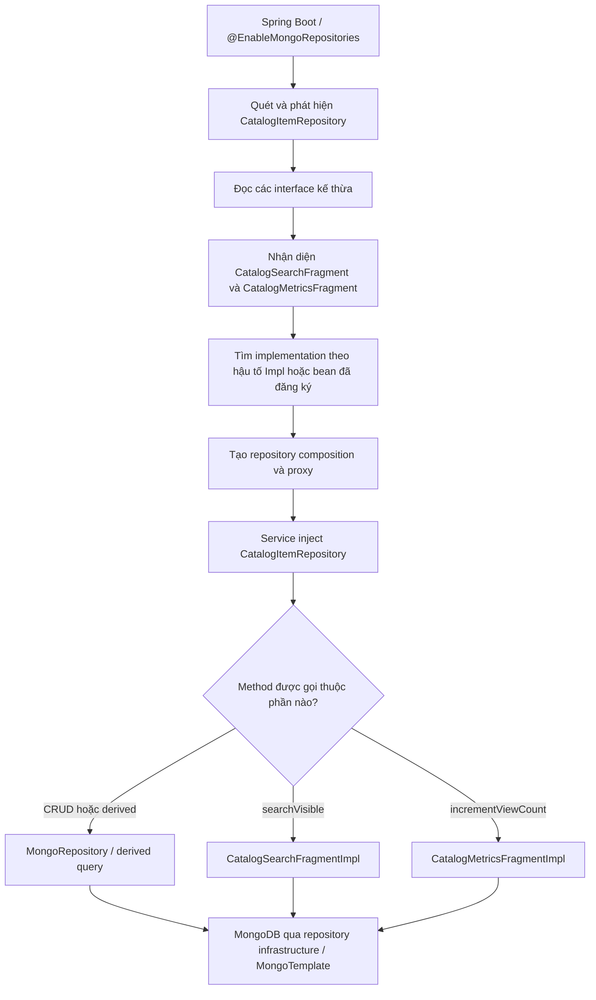
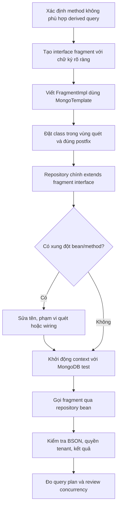

# Quy ước tên, quét triển khai và ghép fragment

Với **Spring Data MongoDB**, interface kế thừa `MongoRepository` đã có các thao tác như `save`, `findById`, `deleteById` và những truy vấn suy diễn từ tên method. Nhưng một yêu cầu có thể vượt khả năng diễn đạt của derived query: tìm kiếm nhiều điều kiện tùy chọn, chạy aggregation phức tạp, thao tác ghi có điều kiện hoặc xây một truy vấn cần `MongoTemplate`. Khi đó, không nhất thiết phải bỏ repository hoặc viết lại toàn bộ CRUD.

Spring Data cho phép **mở rộng repository bằng fragment** (*repository fragment*): bạn khai báo một interface chứa những method tùy biến, viết class triển khai tương ứng và cho repository chính **kế thừa interface fragment**. Spring Data phát hiện các class triển khai theo **quy ước tên và phạm vi quét**, rồi ghép chúng với phần repository cơ sở thành một đối tượng repository duy nhất cho ứng dụng sử dụng.

Ví dụ kiến trúc:

```text
CatalogItemRepository
  ├── MongoRepository<CatalogItem, ObjectId>  (CRUD và query cơ sở)
  ├── CatalogSearchFragment                  (tìm kiếm tùy biến)
  │     └── CatalogSearchFragmentImpl        (MongoTemplate)
  └── CatalogMetricsFragment                 (cập nhật chỉ số)
        └── CatalogMetricsFragmentImpl       (MongoTemplate)

Ứng dụng chỉ inject CatalogItemRepository.
```

Bài thuộc chương **Repository mở rộng** của module **SPRING_DATA_MONGODB**: sử dụng Spring Data MongoDB để kết nối, ánh xạ document, truy vấn qua repository hoặc `MongoTemplate`, kiểm thử và chẩn đoán hiệu năng. Trọng tâm là ba phần gắn chặt với nhau: **quy ước tên**, **cách Spring Data quét và nhận diện class triển khai**, và **cách nhiều fragment được ghép**.

Sau bài học, bạn có thể:

1. Phân biệt repository interface, fragment interface, implementation class và repository proxy.
2. Đặt tên đúng theo quy ước `<FragmentInterfaceName>Impl` và cấu hình hậu tố khi cần.
3. Tổ chức package để trình quét repository phát hiện class triển khai.
4. Ghép hai hoặc nhiều fragment vào cùng một repository mà không viết lại CRUD.
5. Inject `MongoTemplate` vào fragment để xây query động, update hoặc aggregation.
6. Nhận diện vấn đề khi có nhiều implementation trùng tên, trùng bean name hay trùng chữ ký method.
7. Phân biệt **mô hình fragment được khuyến nghị** với cách đặt tên triển khai legacy theo toàn bộ repository.
8. Kiểm thử một repository được ghép thật với MongoDB, dữ liệu nhiều tenant và cấu hình quét.

## 1. Vì sao cần repository fragment?

Giả sử một ứng dụng quản lý danh mục sản phẩm có entity `CatalogItem`. Nhu cầu cơ bản:

```java
interface CatalogItemRepository
        extends MongoRepository<CatalogItem, ObjectId> {

    Optional<CatalogItem> findByTenantIdAndSkuAndDeletedFalse(
        String tenantId, String sku);
}
```

Spring Data có thể triển khai method suy diễn trên mà không cần bạn tự viết class `CatalogItemRepositoryImpl`. Nhưng khi cần bộ lọc động như:

```text
tenantId  bắt buộc theo phiên đăng nhập
deleted   = false
status    = ACTIVE
name      chứa một chuỗi nguyên văn, tùy chọn
price     >= minPrice, tùy chọn
limit     trong khoảng 1–100
sort      price DESC, _id DESC
```

thì tên method chứa hàng loạt `And`, `Or`, `GreaterThan` có thể trở nên khó đọc, nhất là khi điều kiện tùy chọn. Một fragment tùy biến có thể dùng `Criteria`, `Query` và `MongoTemplate` để tạo query rõ ràng.

Bạn **không cần chọn giữa “repository” và “MongoTemplate”**: có thể sử dụng `MongoTemplate` bên trong implementation của fragment và giữ repository chính làm điểm truy cập thống nhất.

### 1.1. Các thành phần khác nhau ra sao?

| Thành phần | Ví dụ | Vai trò |
| --- | --- | --- |
| Repository chính | `CatalogItemRepository` | API dùng tại service; ghép CRUD và fragment |
| Repository cơ sở | `MongoRepository<CatalogItem, ObjectId>` | Các phương thức CRUD và tính năng Spring Data cung cấp |
| Fragment interface | `CatalogSearchFragment` | Hợp đồng method tùy biến |
| Fragment implementation | `CatalogSearchFragmentImpl` | Logic thực thi method fragment |
| Repository proxy | Bean do Spring Data tạo | Điều phối lời gọi tới phần triển khai phù hợp |
| MongoTemplate | `MongoTemplate` | Xây và thực thi truy vấn/ghi MongoDB trong fragment |

**Điểm dễ nhầm:** Spring Data **không yêu cầu** mỗi repository phải có một class cùng tên thêm `Impl`. Nó tự tạo repository proxy và base implementation. Bạn chỉ viết implementation cho những **fragment tùy biến** mà ứng dụng cần.

## 2. Quy ước đặt tên được Spring Data dùng để nhận diện

Quy ước mặc định cho mỗi fragment:

```text
Interface:       CatalogSearchFragment
Implementation:  CatalogSearchFragmentImpl

Interface:       CatalogMetricsFragment
Implementation:  CatalogMetricsFragmentImpl
```

Hậu tố mặc định là **`Impl`**. Nếu tên interface đổi, bạn cần kiểm tra tên implementation tương ứng. Chú ý:

- `CatalogSearchFragmentImpl` là implementation của **`CatalogSearchFragment`**, không phải `CatalogItemRepository`.
- Class triển khai phải thực sự `implements CatalogSearchFragment` và cung cấp các method cần thiết.
- Class phải được Spring Data tìm thấy trong **phạm vi package phù hợp** hoặc được đăng ký bean theo cách mà hạ tầng repository có thể sử dụng.
- Chỉ đặt tên đúng **chưa đủ** nếu repository chính không `extends CatalogSearchFragment`.

### 2.1. Cách viết fragment tối thiểu

```java
public interface CatalogSearchFragment {
    List<CatalogItem> searchVisible(
        String trustedTenantId,
        String keyword,
        BigDecimal minimumPrice,
        int limit);
}
```

Implementation:

```java
public class CatalogSearchFragmentImpl
        implements CatalogSearchFragment {

    private final MongoTemplate mongoTemplate;

    public CatalogSearchFragmentImpl(
            MongoTemplate mongoTemplate) {
        this.mongoTemplate = mongoTemplate;
    }

    @Override
    public List<CatalogItem> searchVisible(
            String tenantId,
            String keyword,
            BigDecimal minimumPrice,
            int limit) {
        // Xây Query/Criteria rồi gọi mongoTemplate.find(...).
        throw new UnsupportedOperationException(
            "Triển khai đầy đủ ở mục 4"
        );
    }
}
```

Repository chính ghép interface:

```java
public interface CatalogItemRepository
        extends MongoRepository<CatalogItem, ObjectId>,
                CatalogSearchFragment {

    Optional<CatalogItem> findByTenantIdAndSkuAndDeletedFalse(
        String tenantId, String sku);
}
```

Khi có bean `CatalogItemRepository`, method `searchVisible` sẽ được chuyển tới fragment implementation phù hợp. Method `findById` vẫn do hạ tầng repository cung cấp; method `findByTenantIdAndSkuAndDeletedFalse` vẫn có thể được suy diễn.

### 2.2. Cấu trúc package nên dùng

```text
com.example.catalog
  ├── CatalogApplication.java
  ├── domain
  │   └── CatalogItem.java
  └── repository
      ├── CatalogItemRepository.java
      ├── CatalogSearchFragment.java
      ├── CatalogSearchFragmentImpl.java
      ├── CatalogMetricsFragment.java
      └── CatalogMetricsFragmentImpl.java
```

Đặt repository và fragment implementation trong package `com.example.catalog.repository` giúp quy ước quét được minh bạch. Khi dùng cấu trúc phức tạp hơn, implementation có thể nằm trong package con thuộc phạm vi hạ tầng đang quét, nhưng cần kiểm chứng bằng integration test. **Đừng đặt class ở một module/package nằm ngoài phạm vi tìm kiếm rồi mặc định Spring Data sẽ tự phát hiện.**

### 2.3. Tên repository chính thêm `Impl`: cách legacy cần tránh nhầm

Trước đây có cách triển khai tùy biến theo **tên của repository chính**, chẳng hạn:

```text
CatalogItemRepository
CatalogItemRepositoryImpl
```

Cách nhận diện một implementation đơn tùy biến theo tên repository là kiểu **legacy**, dễ nhầm với implementation của repository cơ sở và khó mở rộng thành nhiều phần chức năng độc lập. Với Spring Data hiện đại, **ưu tiên fragment interface + implementation theo tên fragment**:

```text
CatalogSearchFragment + CatalogSearchFragmentImpl
CatalogMetricsFragment + CatalogMetricsFragmentImpl
```

Đặc biệt, không nên viết một class tên `CatalogItemRepositoryImpl` chỉ vì muốn thêm method của `CatalogSearchFragment`: class đó có thể bị cơ chế tương thích cũ nhận diện hoặc gây khó hiểu về trách nhiệm. Nếu đang bảo trì dự án cũ, cần xác định mô hình repository implementation hiện tại trước khi di chuyển sang fragment.

## 3. Quét repository và fragment implementation

### 3.1. Spring Boot tự cấu hình

Trong một ứng dụng Spring Boot được bố trí package hợp lý:

```java
package com.example.catalog;

import org.springframework.boot.SpringApplication;
import org.springframework.boot.autoconfigure.SpringBootApplication;

@SpringBootApplication
public class CatalogApplication {
    public static void main(String[] args) {
        SpringApplication.run(CatalogApplication.class, args);
    }
}
```

Spring Boot thường tự thiết lập repository scanning phù hợp khi có Spring Data MongoDB và cấu hình cần thiết. Với ví dụ này, `CatalogApplication` là package cha của `com.example.catalog.repository` nên phần repository ở bên dưới có thể được phát hiện qua auto-configuration thông thường.

Đừng hiểu rằng `@SpringBootApplication` tự biến **mọi** interface trong toàn classpath thành repository. Phạm vi quét phụ thuộc cấu hình Boot/Spring Data, package root và các điều kiện auto-configuration. Các dự án đa module có thể cần khai báo rõ.

### 3.2. Chỉ định repository base package khi cần

Nếu ứng dụng có nhiều vùng package hoặc cấu hình chủ động, có thể dùng:

```java
package com.example.catalog;

import com.example.catalog.repository.CatalogItemRepository;
import org.springframework.context.annotation.Configuration;
import org.springframework.data.mongodb.repository.config.EnableMongoRepositories;

@Configuration
@EnableMongoRepositories(
    basePackageClasses = CatalogItemRepository.class
)
public class CatalogRepositoryConfiguration {
}
```

`basePackageClasses` giúp chọn package chứa marker class/interface một cách ít phụ thuộc vào literal string hơn `basePackages = "..."`. Trong ví dụ, hạ tầng sẽ quét package chứa `CatalogItemRepository` để tìm repository interfaces; fragment implementations cần nằm trong vùng hạ tầng có thể tìm được.

Khi tự khai báo `@EnableMongoRepositories` trong Spring Boot, phải chú ý tránh cấu hình quét chồng nhau hoặc tạo bean repository hai lần. Chỉ thêm cấu hình chủ động nếu thiết kế module yêu cầu, không coi đây là annotation bắt buộc cho mọi dự án Boot.

### 3.3. Phân biệt repository scan với component scan

Hai khái niệm có liên quan nhưng **không đồng nhất**:

- **Repository scanning** phát hiện repository interfaces và khởi tạo repository proxies, đồng thời phối hợp tìm các fragment implementations phù hợp.
- **Component scanning** phát hiện các Spring components như `@Component`, `@Service`, `@Configuration` khi nằm trong vùng quét.

Một implementation fragment có thể được Spring Data nhận diện theo **quy ước tên** mà không cần phải thêm `@Repository` hay `@Component` chỉ để được ghép. Khi muốn tự đăng ký hoặc tùy biến bean lifecycle, phải hiểu cơ chế đặt tên và chọn bean của repository infrastructure.

Thêm `@Component` vào mọi fragment class không phải cách sửa phổ quát cho lỗi không ghép được fragment: nếu sai hậu tố, sai interface kế thừa, bị trùng bean hoặc sai package, annotation đó có thể không giải quyết đúng nguyên nhân.

### 3.4. Đổi hậu tố triển khai với `repositoryImplementationPostfix`

Spring Data MongoDB cho phép cấu hình hậu tố khác `Impl`:

```java
@Configuration
@EnableMongoRepositories(
    basePackageClasses = CatalogItemRepository.class,
    repositoryImplementationPostfix = "Custom"
)
public class CatalogRepositoryConfiguration {
}
```

Khi đó lớp triển khai theo quy ước của fragment `CatalogSearchFragment` sẽ là:

```java
public class CatalogSearchFragmentCustom
        implements CatalogSearchFragment {
    // Logic tùy biến.
}
```

Đây là **một phương án cấu hình thay thế** cho ví dụ dùng `Impl`, không phải yêu cầu tạo đồng thời cả `CatalogSearchFragmentImpl` lẫn `CatalogSearchFragmentCustom`. Hậu tố được đặt ở cấu hình repository, vì vậy cần review toàn bộ vùng quét trước khi đổi để tránh làm các fragment khác không còn được nhận diện.

### 3.5. Khi class có tên đúng nhưng vẫn không được phát hiện

Kiểm tra theo thứ tự:

1. Repository chính có `extends` đúng fragment interface không?
2. Implementation có tên `<FragmentInterfaceName>Impl` (hoặc hậu tố đã cấu hình) và `implements` đúng interface không?
3. Repository interface có thuộc vùng quét của Spring Data MongoDB không?
4. Implementation có nằm trong package được repository infrastructure tìm kiếm không?
5. Có một bean cùng tên hoặc class trùng tên trong package khác khiến lựa chọn bị mơ hồ không?
6. Constructor có phụ thuộc như `MongoTemplate` được Spring cung cấp không?
7. Method signature có khớp interface, bao gồm tham số generic và kiểu trả về không?

Kết quả không nên được xác nhận chỉ bằng việc IDE thấy class. Cần **khởi động application context hoặc test repository** để chắc chắn bean được ghép và lời gọi thực sự chạy vào đúng fragment.

## 4. Ví dụ hoàn chỉnh: fragment tìm kiếm với `MongoTemplate`

Phần này minh họa các lớp cần thiết trong một dự án Spring Boot có Spring Data MongoDB. Mỗi khối mã tương ứng **một file Java**; các package/import được trình bày để có thể chuyển thành bài tập độc lập. Ví dụ dùng collection `fragment_catalog_lab` cho môi trường thực hành.

### 4.1. Domain document: `CatalogItem`

```java
package com.example.catalog.domain;

import java.math.BigDecimal;
import org.bson.types.ObjectId;
import org.springframework.data.annotation.Id;
import org.springframework.data.mongodb.core.mapping.Document;
import org.springframework.data.mongodb.core.mapping.Field;
import org.springframework.data.mongodb.core.mapping.FieldType;

@Document(collection = "fragment_catalog_lab")
public class CatalogItem {
    @Id
    private ObjectId id;

    private String labRun;
    private String tenantId;
    private String sku;
    private String name;
    private String status;
    private boolean deleted;

    @Field(targetType = FieldType.DECIMAL128)
    private BigDecimal price;

    private long viewCount;

    protected CatalogItem() {}

    public CatalogItem(
            String labRun,
            String tenantId,
            String sku,
            String name,
            String status,
            boolean deleted,
            BigDecimal price) {
        this.labRun = labRun;
        this.tenantId = tenantId;
        this.sku = sku;
        this.name = name;
        this.status = status;
        this.deleted = deleted;
        this.price = price;
        this.viewCount = 0L;
    }

    public ObjectId getId() { return id; }
    public String getLabRun() { return labRun; }
    public String getTenantId() { return tenantId; }
    public String getSku() { return sku; }
    public String getName() { return name; }
    public String getStatus() { return status; }
    public boolean isDeleted() { return deleted; }
    public BigDecimal getPrice() { return price; }
    public long getViewCount() { return viewCount; }
}
```

`@Id ObjectId id` được ánh xạ sang BSON `_id`; `@Field(targetType = FieldType.DECIMAL128)` chỉ rõ cách lưu `BigDecimal price` để truy vấn so sánh số tiền không phải dựa trên chuỗi. Một document mẫu:

```javascript
{
  _id: ObjectId("665f1f2a4b6c7d8e9f001234"),
  labRun: "demo-001",
  tenantId: "T1",
  sku: "BK-001",
  name: "Java Fundamentals",
  status: "ACTIVE",
  deleted: false,
  price: NumberDecimal("120.00"),
  viewCount: NumberLong("0")
}
```

`labRun` là marker của bài thực hành, không phải thuộc tính bắt buộc của một sản phẩm thực. Với dữ liệu nhiều tenant, `tenantId` phải được xác minh từ session/token hoặc kiểm tra quyền ở server khi tạo và truy vấn; việc entity có field `tenantId` **không tự bảo đảm phân quyền**.

### 4.2. Fragment interface: `CatalogSearchFragment`

```java
package com.example.catalog.repository;

import com.example.catalog.domain.CatalogItem;
import java.math.BigDecimal;
import java.util.List;

public interface CatalogSearchFragment {
    List<CatalogItem> searchVisible(
        String trustedTenantId,
        String keyword,
        BigDecimal minimumPrice,
        int limit);
}
```

Interface không kế thừa `MongoRepository`, không cần chú thích `@Repository`, và không tự kết nối tới MongoDB. Nó là **hợp đồng một phần chức năng** sẽ được ghép vào repository chính.

### 4.3. Implementation: `CatalogSearchFragmentImpl`

```java
package com.example.catalog.repository;

import com.example.catalog.domain.CatalogItem;
import java.math.BigDecimal;
import java.util.List;
import java.util.regex.Pattern;
import org.springframework.data.domain.Sort;
import org.springframework.data.mongodb.core.MongoTemplate;
import org.springframework.data.mongodb.core.query.Criteria;
import org.springframework.data.mongodb.core.query.Query;

public class CatalogSearchFragmentImpl
        implements CatalogSearchFragment {

    private final MongoTemplate mongoTemplate;

    public CatalogSearchFragmentImpl(
            MongoTemplate mongoTemplate) {
        this.mongoTemplate = mongoTemplate;
    }

    @Override
    public List<CatalogItem> searchVisible(
            String trustedTenantId,
            String keyword,
            BigDecimal minimumPrice,
            int limit) {

        if (trustedTenantId == null || trustedTenantId.isBlank()) {
            throw new IllegalArgumentException("Thiếu tenant");
        }
        if (limit < 1 || limit > 100) {
            throw new IllegalArgumentException(
                "limit phải nằm trong [1, 100]"
            );
        }
        if (minimumPrice != null && minimumPrice.signum() < 0) {
            throw new IllegalArgumentException("Giá tối thiểu âm");
        }
        if (keyword != null && keyword.length() > 80) {
            throw new IllegalArgumentException("Từ khóa quá dài");
        }

        Criteria criteria = Criteria.where("tenantId")
            .is(trustedTenantId)
            .and("deleted").is(false)
            .and("status").is("ACTIVE");

        if (minimumPrice != null) {
            criteria.and("price").gte(minimumPrice);
        }

        if (keyword != null && !keyword.isBlank()) {
            Pattern literal = Pattern.compile(
                Pattern.quote(keyword.trim()),
                Pattern.CASE_INSENSITIVE
            );
            criteria.and("name").regex(literal);
        }

        Query query = Query.query(criteria)
            .with(Sort.by(
                Sort.Order.desc("price"),
                Sort.Order.desc("id")
            ))
            .limit(limit);

        return mongoTemplate.find(query, CatalogItem.class);
    }
}
```

Giải thích:

1. **Filter bắt buộc** `tenantId + deleted=false + status=ACTIVE` được code xác định.
2. **Filter tùy chọn** chỉ thêm điều kiện khi người gọi thực sự có `minimumPrice` hoặc `keyword`.
3. `Pattern.quote` biến từ khóa thành tìm kiếm **literal**, không cho chuỗi `.*` hoặc `C++` tự trở thành biểu thức regex điều khiển query.
4. `limit` nằm trong 1–100 để tránh trả về quá nhiều document trong một lần gọi.
5. `Sort` kết hợp `price` và `id` làm tie-breaker để các document trùng giá vẫn có thứ tự xác định. Trong query qua domain class, `id` ánh xạ sang BSON `_id`.
6. `MongoTemplate.find` dùng mapping của `CatalogItem`, bao gồm Decimal128 cho `price`.

Đây là một ví dụ về **fragment triển khai query động**, không có yêu cầu phải viết `CatalogItemRepositoryImpl`. Mọi điều kiện query đều có kiểu Java, tên field/toán tử do code định nghĩa; không parse raw JSON do client gửi thành filter.

**Giới hạn cần nhớ:** regex tìm chuỗi bất kỳ trong `name`, đặc biệt case-insensitive, có thể không tận dụng index B-tree hiệu quả. Với tìm kiếm văn bản quy mô lớn, cần xem xét search index/giải pháp tìm kiếm phù hợp và đo query plan. Ví dụ ưu tiên minh họa composition và an toàn đầu vào.

### 4.4. Repository chính dùng fragment

```java
package com.example.catalog.repository;

import com.example.catalog.domain.CatalogItem;
import java.util.Optional;
import org.bson.types.ObjectId;
import org.springframework.data.mongodb.repository.MongoRepository;

public interface CatalogItemRepository
        extends MongoRepository<CatalogItem, ObjectId>,
                CatalogSearchFragment {

    Optional<CatalogItem> findByTenantIdAndSkuAndDeletedFalse(
        String tenantId,
        String sku);
}
```

Sau khi Spring Data tạo bean repository, service có thể dùng **cùng một đối tượng** cho các chức năng:

```java
CatalogItem item = repository
    .findByTenantIdAndSkuAndDeletedFalse(
        trustedTenantId, "BK-001"
    )
    .orElseThrow();

List<CatalogItem> visible = repository.searchVisible(
    trustedTenantId,
    "Java",
    new BigDecimal("50.00"),
    20
);
```

Ở đây `repository` là bean `CatalogItemRepository` đã được inject, `trustedTenantId` đến từ ngữ cảnh server đáng tin cậy và đoạn mã được đặt trong method service phù hợp. **Method suy diễn** và **method fragment** cùng nằm trên interface public của repository, nhưng được thực thi bởi những thành phần khác nhau.

## 5. Ghép nhiều fragment trong một repository

Khi chức năng tăng lên, không nhất thiết mở rộng `CatalogSearchFragment` thành một interface chứa mọi thao tác. Hãy tách các phần có trách nhiệm riêng:

```text
CatalogSearchFragment   -> truy vấn/filter phức tạp
CatalogMetricsFragment  -> thao tác cập nhật chỉ số
CatalogItemRepository   -> API kết hợp cho service
```

### 5.1. Fragment thứ hai: `CatalogMetricsFragment`

```java
package com.example.catalog.repository;

import org.bson.types.ObjectId;

public interface CatalogMetricsFragment {
    boolean incrementViewCount(
        String trustedTenantId,
        ObjectId itemId);
}
```

Implementation tương ứng:

```java
package com.example.catalog.repository;

import com.example.catalog.domain.CatalogItem;
import com.mongodb.client.result.UpdateResult;
import org.bson.types.ObjectId;
import org.springframework.data.mongodb.core.MongoTemplate;
import org.springframework.data.mongodb.core.query.Criteria;
import org.springframework.data.mongodb.core.query.Query;
import org.springframework.data.mongodb.core.query.Update;

public class CatalogMetricsFragmentImpl
        implements CatalogMetricsFragment {

    private final MongoTemplate mongoTemplate;

    public CatalogMetricsFragmentImpl(
            MongoTemplate mongoTemplate) {
        this.mongoTemplate = mongoTemplate;
    }

    @Override
    public boolean incrementViewCount(
            String trustedTenantId,
            ObjectId itemId) {

        if (trustedTenantId == null || trustedTenantId.isBlank()
                || itemId == null) {
            throw new IllegalArgumentException("Thiếu ID/tenant");
        }

        Query query = Query.query(
            Criteria.where("id").is(itemId)
                .and("tenantId").is(trustedTenantId)
                .and("deleted").is(false)
                .and("status").is("ACTIVE")
        );

        Update update = new Update().inc("viewCount", 1);
        UpdateResult result = mongoTemplate.updateFirst(
            query, update, CatalogItem.class
        );
        return result.getModifiedCount() == 1;
    }
}
```

Filter có `id` duy nhất nên update nhiều nhất một document, đồng thời giới hạn tenant và trạng thái. `$inc` thực hiện tăng bộ đếm nguyên tử trên document phù hợp, nhưng nếu một **request nghiệp vụ mới** được gửi lại do client timeout, bộ đếm có thể tăng thêm một lần. Đối với số liệu cần *exactly once*, service cần idempotency key hoặc cơ chế chống xử lý trùng, không chỉ dựa vào `$inc`.

### 5.2. Repository ghép cả hai fragment

```java
package com.example.catalog.repository;

import com.example.catalog.domain.CatalogItem;
import java.util.Optional;
import org.bson.types.ObjectId;
import org.springframework.data.mongodb.repository.MongoRepository;

public interface CatalogItemRepository
        extends MongoRepository<CatalogItem, ObjectId>,
                CatalogSearchFragment,
                CatalogMetricsFragment {

    Optional<CatalogItem> findByTenantIdAndSkuAndDeletedFalse(
        String tenantId,
        String sku);
}
```

Khi ứng dụng inject `CatalogItemRepository`, một đối tượng repository sẽ cung cấp:

| Method | Nguồn triển khai |
| --- | --- |
| `save`, `findById`, `deleteById` | Repository cơ sở do Spring Data cung cấp |
| `findByTenantIdAndSkuAndDeletedFalse` | Cơ chế suy diễn truy vấn |
| `searchVisible` | `CatalogSearchFragmentImpl` |
| `incrementViewCount` | `CatalogMetricsFragmentImpl` |

Không cần viết một class thủ công `CatalogItemRepositoryImpl implements CatalogItemRepository` để điều phối chúng. **Repository composition** là trách nhiệm của Spring Data.

### 5.3. Thứ tự ghép và xung đột chữ ký method

Spring Data hỗ trợ nhiều fragment và có quy tắc ưu tiên khi các thành phần cung cấp method cùng chữ ký. Custom fragments có thể được ưu tiên so với phương thức cơ sở hoặc repository aspects trong một số tình huống; thứ tự khai báo fragment cũng có thể tham gia vào lựa chọn. Chính vì vậy, **không nên dựa vào tên method trùng để thiết kế nghiệp vụ một cách ngầm định**.

Ví dụ dễ gây nhầm:

```java
public interface FragmentA {
    long refresh(String tenantId);
}

public interface FragmentB {
    long refresh(String tenantId);
}

public interface CatalogItemRepository
        extends MongoRepository<CatalogItem, ObjectId>,
                FragmentA, FragmentB {
}
```

Hai fragment cùng định nghĩa `refresh(String)`. Ngay cả khi framework có quy tắc chọn implementation, người bảo trì rất khó xác định từ repository API chức năng nào thực sự chạy. Cách tốt hơn:

```java
public interface CatalogSearchFragment {
    List<CatalogItem> searchVisible(
        String trustedTenantId,
        String keyword,
        BigDecimal minimumPrice,
        int limit);
}

public interface CatalogMetricsFragment {
    boolean incrementViewCount(
        String trustedTenantId,
        ObjectId itemId);
}
```

Đây là **hai hợp đồng method khác nhau**, tương ứng các chữ ký đầy đủ ở mục 4 và 5; trong project thật đặt mỗi public interface ở một file Java riêng và thêm import cần thiết. Hãy giữ trách nhiệm không chồng lấn, đồng thời tránh vô tình **override** các method của `MongoRepository` như `save` hoặc `deleteById` khi không có một thiết kế chủ đích, kiểm thử đầy đủ và hiểu rõ thứ tự composition.

## 6. Bean name, nhiều implementation và đăng ký thủ công

Quy ước tên class giúp Spring Data tìm candidate, nhưng trong dự án lớn bạn có thể gặp **nhiều bean** hoặc **nhiều class trùng tên**. Chẳng hạn:

```text
com.example.catalog.repository.CatalogSearchFragmentImpl
com.example.legacy.CatalogSearchFragmentImpl
```

Nếu cả hai nằm trong vùng hạ tầng có thể phát hiện và có khả năng tham gia cùng fragment, việc tìm đúng một implementation có thể trở nên không rõ ràng. Không nên xem lựa chọn bean là một chi tiết ngẫu nhiên mà vẫn triển khai production.

### 6.1. Quy ước bean name và cách kiểm soát

Spring Data có thể sử dụng **tên bean** để phân giải candidate hoặc nhận một implementation đã được đăng ký thủ công. Theo quy ước thông dụng, bean name gắn với interface fragment `CatalogSearchFragment` và hậu tố `Impl` là dạng:

```text
catalogSearchFragmentImpl
```

Khi cấu hình tùy biến, hãy kiểm tra tài liệu/behavior của đúng phiên bản Spring Data MongoDB và để tên bean khớp kỳ vọng của repository infrastructure. Không nên chọn tùy tiện một bean name rồi giả định Spring Data sẽ dùng nó vì class có cùng interface.

Một ví dụ đăng ký thủ công (thay cho tự phát hiện class):

```java
package com.example.catalog;

import com.example.catalog.repository.CatalogSearchFragment;
import com.example.catalog.repository.CatalogSearchFragmentImpl;
import org.springframework.context.annotation.Bean;
import org.springframework.context.annotation.Configuration;
import org.springframework.data.mongodb.core.MongoTemplate;

@Configuration
public class CatalogFragmentWiringConfiguration {

    @Bean("catalogSearchFragmentImpl")
    public CatalogSearchFragment catalogSearchFragment(
            MongoTemplate mongoTemplate) {
        return new CatalogSearchFragmentImpl(mongoTemplate);
    }
}
```

Trong ví dụ này, implementation được tạo với `MongoTemplate` do Spring cung cấp. **Không** đồng thời đăng ký một bean khác cùng tên (ví dụ thêm `@Component("catalogSearchFragmentImpl")` trên class implementation), vì việc đăng ký trùng có thể gây lỗi hoặc phụ thuộc quy tắc override bean của ứng dụng.

Đăng ký thủ công hữu ích khi bạn cần constructor injection đặc biệt, quản lý vòng đời riêng hoặc kiểm soát chính xác implementation được dùng. Nhưng **đây không phải bước bắt buộc**: với layout và tên mặc định ở mục 2–5, hãy ưu tiên để Spring Data tự ghép khi mọi điều kiện được đáp ứng.

### 6.2. Khi có hai implementation cùng tên

Các hướng xử lý an toàn:

1. **Loại bỏ class không còn dùng** khỏi package được quét nếu nó là code legacy.
2. **Đổi tên và tách interface** nếu thực sự có hai trách nhiệm khác nhau.
3. **Giới hạn vùng quét** của repository configuration để không đưa vào những implementation không liên quan.
4. **Đặt tên bean rõ ràng** và kiểm thử candidate selection khi cần đăng ký thủ công.
5. **Kiểm thử hành vi** của method, không chỉ kiểm tra application context đã khởi động.

Không nên giải quyết xung đột bằng cách thêm `@Primary` đại trà rồi bỏ qua nguyên nhân. Việc fragment nào được repository infrastructure ghép không nên là một hành vi phụ khó kiểm chứng từ code review.

### 6.3. Constructor injection và dependency của fragment

Implementation có thể cần các bean như:

```java
public CatalogSearchFragmentImpl(
        MongoTemplate mongoTemplate,
        CatalogSearchPolicy searchPolicy) {
    // Lưu dependency đã được cung cấp.
}
```

`CatalogSearchPolicy` ở đây là một service giả định của ứng dụng, **không phải một API có sẵn của Spring Data**. Nó cần được Spring tạo/đăng ký thành bean trước khi hạ tầng dựng fragment. Nếu constructor không được thỏa mãn, lỗi có thể xuất hiện ngay lúc tạo application context thay vì khi gọi method.

Không dùng `new MongoTemplate(...)` một cách tùy tiện trong fragment nếu ứng dụng đã có `MongoTemplate` được cấu hình kết nối, converter, mapping và transaction/session phù hợp. Inject bean chung sẽ giúp fragment cùng sử dụng cấu hình dữ liệu của ứng dụng.

## 7. Dùng một fragment ở nhiều repository

Một lợi ích của kiến trúc fragment là **chia sẻ hành vi** giữa nhiều repository nếu method và kiểu dữ liệu cho phép. Ví dụ, cả `CatalogItemRepository` và một repository quản lý sản phẩm số có thể cần một bộ lọc hoặc thao tác chuyên biệt.

Tuy nhiên, chia sẻ không đồng nghĩa ép mọi fragment vào một interface quá tổng quát. Cần phân biệt hai cấp:

- **Fragment cụ thể theo domain**: `CatalogSearchFragment` dùng trực tiếp `CatalogItem`, `CatalogItem.class`, `price` và `status`. Nó phù hợp cho repository của CatalogItem.
- **Fragment tổng quát**: một interface generic có hợp đồng đủ rõ để dùng lại với nhiều entity. Implementation phải biết domain type, ID type, mapping và quy tắc query tương ứng.

### 7.1. Ví dụ interface generic (ý tưởng)

```java
public interface CountByTenantFragment {
    long countVisibleForTenant(String trustedTenantId);
}
```

Interface này không tham số hóa theo entity, nhưng nếu implementation cần trả về số lượng của **nhiều collection khác nhau**, không thể đơn giản hardcode `CatalogItem.class` rồi cho rằng fragment sử dụng được ở mọi repository. Cách triển khai generic đúng có thể yêu cầu metadata/domain type của repository, một factory hoặc một thiết kế fragment riêng.

Với bài toán vừa và nhỏ, hãy ưu tiên fragment cụ thể, dễ hiểu và dễ kiểm thử. Chỉ trừu tượng hóa khi nhiều repository thực sự có cùng bất biến nghiệp vụ và có chiến lược mapping rõ ràng.

### 7.2. Không nhầm intermediate repository interface với fragment

Một interface base chung có thể kế thừa `MongoRepository` để các repository khác dùng lại:

```java
import org.springframework.data.repository.NoRepositoryBean;
import org.springframework.data.mongodb.repository.MongoRepository;

@NoRepositoryBean
public interface SharedMongoRepository<T, ID>
        extends MongoRepository<T, ID> {
    // Hợp đồng dùng lại giữa repository, nếu cần.
}
```

`@NoRepositoryBean` giúp tránh hạ tầng cố tạo một repository bean cụ thể cho interface trung gian còn generic. Đây là một **vấn đề repository inheritance**, khác với fragment interface như `CatalogSearchFragment` (không cần kế thừa `MongoRepository` và không cần `@NoRepositoryBean` chỉ để khai báo method tùy biến).

Nếu dùng một **custom base repository implementation** cho toàn module, bạn sẽ can thiệp cơ chế base class của repository factory với phạm vi rộng hơn nhiều so với fragment. Hãy chọn fragment khi chỉ cần ghép thêm vài hành vi riêng lẻ cho một hay một số repository.

## 8. Luồng khởi tạo và điều phối một method fragment

Để hình dung những bước xảy ra khi ứng dụng khởi động:



Sơ đồ mô tả **mô hình khái niệm**; các class factory/proxy nội bộ, thứ tự callback và chi tiết tạo bean phụ thuộc phiên bản Spring Data. Điều quan trọng với người triển khai là hợp đồng: repository chính được Spring tạo, fragment implementations được ghép khi đúng tên/phạm vi/bean, và các lời gọi ứng dụng đi qua bean repository đã có.

### 8.1. Điều gì xảy ra nếu quên `extends CatalogSearchFragment`?

Ngay cả khi class `CatalogSearchFragmentImpl` tồn tại và `MongoTemplate` được inject thành công, nếu repository chính **không kế thừa** `CatalogSearchFragment` thì method `searchVisible` **không có trong API** của `CatalogItemRepository`. Service không thể gọi nó thông qua repository mà không thay đổi kiểu hoặc truy cập fragment trực tiếp.

### 8.2. Điều gì xảy ra nếu đặt sai tên implementation?

`CatalogSearchImpl` có thể là một class Java hợp lệ nhưng không khớp quy ước mặc định của fragment `CatalogSearchFragment`. Nếu repository yêu cầu method fragment mà hạ tầng không có implementation phù hợp, ứng dụng có thể báo lỗi lúc khởi tạo hoặc cố phân tích method như query tùy thuộc đường cấu hình.

**Không nên** đoán kết quả khi khởi động từ một tên class. Hãy đọc nguyên nhân trong exception của repository factory, sửa tên/phạm vi và xác minh bằng integration test.

### 8.3. Không đặt logic thay đổi dữ liệu trong constructor

Implementation của fragment thường được khởi tạo lúc application context bắt đầu. Không đặt lệnh xóa collection, tạo dữ liệu demo, bulk update hoặc chạy migration trong constructor chỉ vì nó có `MongoTemplate`. Các thao tác dữ liệu có side effect phải được tổ chức dưới cơ chế khởi tạo/migration riêng với quyền, môi trường và khả năng retry được kiểm soát.

## 9. Thực hành `mongosh`: chứng minh ý nghĩa truy vấn fragment

Việc ghép fragment xảy ra trong JVM, không có một lệnh `mongosh` riêng để "ghép fragment". Tuy vậy, bạn nên chạy **BSON query tương đương** nhằm xác nhận phương thức `searchVisible` nhắm đúng document; sau đó dùng integration test ở mục 10 để kiểm tra cơ chế ghép của Spring Data thực sự hoạt động.

**Chỉ sử dụng database thử nghiệm.** Các lệnh dưới đây tạo document với marker `labRun` và tenant ngẫu nhiên, rồi dọn đúng dữ liệu của lần thực hành.

### 9.1. Tạo bộ dữ liệu có nhiều tenant và trạng thái

```javascript
use spring_data_training

const lab = db.getCollection("fragment_catalog_lab");
const labRun = "extended-repository-002-" +
  new ObjectId().toHexString();
const tenant1 = labRun + "-T1";
const tenant2 = labRun + "-T2";

const inserted = lab.insertMany([
  {
    labRun: labRun, tenantId: tenant1, label: "A",
    sku: "BK-01", name: "Java Fundamentals",
    status: "ACTIVE", deleted: false,
    price: NumberDecimal("120.00"),
    viewCount: NumberLong("0")
  },
  {
    labRun: labRun, tenantId: tenant1, label: "B",
    sku: "BK-02", name: "Java Intro",
    status: "ACTIVE", deleted: false,
    price: NumberDecimal("40.00"),
    viewCount: NumberLong("0")
  },
  {
    labRun: labRun, tenantId: tenant1, label: "C",
    sku: "DB-01", name: "MongoDB Guide",
    status: "ACTIVE", deleted: false,
    price: NumberDecimal("150.00"),
    viewCount: NumberLong("0")
  },
  {
    labRun: labRun, tenantId: tenant1, label: "D",
    sku: "BK-03", name: "Java Draft",
    status: "DRAFT", deleted: false,
    price: NumberDecimal("180.00"),
    viewCount: NumberLong("0")
  },
  {
    labRun: labRun, tenantId: tenant1, label: "E",
    sku: "BK-04", name: "Java Obsolete",
    status: "ACTIVE", deleted: true,
    price: NumberDecimal("140.00"),
    viewCount: NumberLong("0")
  },
  {
    labRun: labRun, tenantId: tenant2, label: "F",
    sku: "BK-01", name: "Java Fundamentals",
    status: "ACTIVE", deleted: false,
    price: NumberDecimal("120.00"),
    viewCount: NumberLong("0")
  },
  {
    labRun: labRun, tenantId: tenant1, label: "G",
    sku: "BK-05", name: "Advanced Java",
    status: "ACTIVE", deleted: false,
    price: NumberDecimal("90.00"),
    viewCount: NumberLong("0")
  }
]);

printjson({
  labRun: labRun,
  tenant1: tenant1,
  tenant2: tenant2
});
print(lab.countDocuments({ labRun: labRun })); // Dự kiến: 7
```

Thực hiện các lệnh tiếp theo trong **cùng phiên shell**, vì các biến `lab`, `labRun`, `tenant1` và `tenant2` không được lưu giữa các phiên.

### 9.2. Truy vấn tương đương `searchVisible`

Với `keyword = "Java"`, `minimumPrice = 50.00` và `limit = 20`:

```javascript
const visible = lab.find(
  {
    labRun: labRun,
    tenantId: tenant1,
    status: "ACTIVE",
    deleted: false,
    price: { $gte: NumberDecimal("50.00") },
    name: { $regex: "Java", $options: "i" }
  },
  {
    _id: 1, label: 1,
    tenantId: 1, name: 1, price: 1
  }
)
.sort({ price: -1, _id: -1 })
.limit(20)
.toArray();

printjson(visible.map(d => d.label));
// Dự kiến: ["A", "G"] — A đắt hơn G.
```

B không đạt minimumPrice; C không chứa Java; D đang DRAFT; E đã xóa mềm; F thuộc tenant2. Tên `Java` trong ví dụ này là một chuỗi không chứa regex metacharacters. Khi query có đầu vào tùy ý từ người dùng, fragment Java dùng `Pattern.quote` để tránh biến nội dung thành regex operator; raw script ở trên chỉ minh họa với một keyword đã biết.

### 9.3. Cập nhật chỉ số tương đương fragment thứ hai

Lấy ID của document A:

```javascript
const itemA = lab.findOne({
  labRun: labRun,
  tenantId: tenant1,
  label: "A"
});

const increment = lab.updateOne(
  {
    _id: itemA._id,
    tenantId: tenant1,
    status: "ACTIVE",
    deleted: false
  },
  { $inc: { viewCount: NumberLong("1") } }
);

printjson({
  matched: increment.matchedCount,
  modified: increment.modifiedCount
});
// Dự kiến: 1, 1.

printjson(lab.findOne(
  { _id: itemA._id },
  { _id: 0, label: 1, viewCount: 1 }
));
// Dự kiến: A có viewCount = 1.
```

Đây là cùng ý tưởng với `CatalogMetricsFragmentImpl.incrementViewCount`. Do filter chứa `_id` duy nhất, chỉ một document được cập nhật.

### 9.4. Không được sửa document của tenant khác

```javascript
const itemF = lab.findOne({
  labRun: labRun,
  tenantId: tenant2,
  label: "F"
});

const blocked = lab.updateOne(
  {
    _id: itemF._id,
    tenantId: tenant1,
    status: "ACTIVE",
    deleted: false
  },
  { $inc: { viewCount: 1 } }
);

printjson({
  matched: blocked.matchedCount,
  modified: blocked.modifiedCount
});
// Dự kiến: 0, 0 — F vẫn thuộc tenant2.
```

Quyền tenant phải được xác định/kiểm tra **ở phía server**. Query có `tenantId` đúng tên field vẫn không an toàn nếu API nhận một tenant tùy ý từ request mà không xác minh quyền.

### 9.5. Cleanup chính xác theo marker

```javascript
const toRemove = lab.countDocuments({ labRun: labRun });
print("Số document của phiên sẽ dọn: " + toRemove);

const cleanup = lab.deleteMany({ labRun: labRun });
printjson({ deletedCount: cleanup.deletedCount });

print(lab.countDocuments({ labRun: labRun })); // 0
```

Không thay `{ labRun: labRun }` bằng `{}` hoặc dùng `drop()` nếu collection có thể chứa dữ liệu của người khác. Những document thực hành này không được tạo bằng Java entity nên có thể không chứa `_class`; điều đó không ảnh hưởng việc kiểm tra query raw.

## 10. Kiểm thử tích hợp: chứng minh repository thực sự ghép fragment

Tài liệu lý thuyết về naming convention chưa đủ. Một lỗi tên hậu tố, package scan hoặc bean wiring có thể khiến application context không tạo được repository, hoặc phương thức không được dispatch tới class dự kiến. Một **integration test** nên:

- Khởi động repository bean thật với cấu hình Spring Data MongoDB tương ứng.
- Chèn fixture của nhiều tenant, gồm cả document không đạt filter.
- Gọi `searchVisible` qua **`CatalogItemRepository`**, không gọi trực tiếp `new CatalogSearchFragmentImpl(...)`.
- Gọi `incrementViewCount` qua cùng repository rồi đọc BSON kiểm tra.
- Dọn đúng dữ liệu đã tạo ngay cả khi assertion thất bại.

### 10.1. JUnit 5 và `@DataMongoTest`

Ví dụ sau dùng MongoDB dành riêng cho test (local/test container). Cần điều chỉnh import/configuration theo phiên bản Spring Boot đang sử dụng. Các class `CatalogItem`, `CatalogSearchFragment`, `CatalogSearchFragmentImpl`, `CatalogMetricsFragment`, `CatalogMetricsFragmentImpl` và `CatalogItemRepository` là những class đã khai báo ở mục 4–5.

```java
package com.example.catalog.repository;

import static org.junit.jupiter.api.Assertions.*;
import static com.mongodb.client.model.Filters.eq;

import com.example.catalog.domain.CatalogItem;
import java.math.BigDecimal;
import java.util.List;
import java.util.Set;
import java.util.UUID;
import java.util.stream.Collectors;
import org.bson.Document;
import org.bson.types.ObjectId;
import org.junit.jupiter.api.Test;
import org.springframework.beans.factory.annotation.Autowired;
import org.springframework.boot.test.autoconfigure.data.mongo.DataMongoTest;
import org.springframework.data.mongodb.core.MongoTemplate;
import org.springframework.data.mongodb.core.query.Criteria;
import org.springframework.data.mongodb.core.query.Query;

@DataMongoTest
class CatalogFragmentCompositionTest {

    @Autowired
    CatalogItemRepository repository;

    @Autowired
    MongoTemplate template;

    private CatalogItem insert(
            String run, String tenant,
            String sku, String name,
            String status, boolean deleted,
            String price) {
        return repository.insert(new CatalogItem(
            run, tenant, sku, name, status,
            deleted, new BigDecimal(price)
        ));
    }

    private Document raw(CatalogItem item) {
        Document stored = template
            .getCollection("fragment_catalog_lab")
            .find(eq("_id", item.getId()))
            .first();
        assertNotNull(stored);
        return stored;
    }

    private void cleanup(String run) {
        template.remove(
            Query.query(Criteria.where("labRun").is(run)),
            CatalogItem.class
        );
    }

    @Test
    void fragmentsWorkThroughTheComposedRepository() {
        String run = UUID.randomUUID().toString();
        String t1 = run + "-T1";
        String t2 = run + "-T2";

        CatalogItem a = insert(
            run, t1, "BK-01", "Java Fundamentals",
            "ACTIVE", false, "120.00"
        );
        CatalogItem g = insert(
            run, t1, "BK-05", "Advanced Java",
            "ACTIVE", false, "90.00"
        );
        insert(
            run, t1, "BK-02", "Java Intro",
            "ACTIVE", false, "40.00"
        );
        insert(
            run, t1, "BK-03", "Java Draft",
            "DRAFT", false, "180.00"
        );
        insert(
            run, t1, "BK-04", "Java Old",
            "ACTIVE", true, "140.00"
        );
        CatalogItem otherTenant = insert(
            run, t2, "BK-01", "Java Fundamentals",
            "ACTIVE", false, "120.00"
        );

        try {
            List<CatalogItem> results = repository.searchVisible(
                t1, "Java", new BigDecimal("50.00"), 20
            );

            List<ObjectId> resultIds = results.stream()
                .map(CatalogItem::getId)
                .toList();

            assertEquals(List.of(a.getId(), g.getId()), resultIds);

            assertTrue(repository.incrementViewCount(
                t1, a.getId()
            ));
            assertFalse(repository.incrementViewCount(
                t1, otherTenant.getId()
            ));

            assertEquals(1L,
                ((Number) raw(a).get("viewCount")).longValue());
            assertEquals(0L,
                ((Number) raw(otherTenant).get("viewCount")).longValue());

            assertTrue(repository
                .findByTenantIdAndSkuAndDeletedFalse(t1, "BK-01")
                .isPresent());
        } finally {
            cleanup(run);
        }
    }
}
```

Test gọi **hai method fragment thông qua một repository bean**. Nếu fragment không được ghép đúng, application context hoặc lời gọi sẽ bộc lộ lỗi; nếu query của fragment sai, assertion về tập ID/thứ tự và tenant sẽ thất bại.

Trong ví dụ, giá A (120) lớn hơn G (90), nên sort `price DESC, id DESC` đặt A trước G. Không suy đoán thứ tự với các document bằng giá nếu chưa có tie-breaker. Test cũng chứng minh phương thức derived `findByTenantIdAndSkuAndDeletedFalse` còn hoạt động cùng các fragment.

**Tình trạng kiểm thử:** mã trong bài là ví dụ để người học triển khai, **chưa được chạy trong quá trình soạn**. Khi tích hợp vào dự án thật, cần chọn phiên bản Spring Boot/Spring Data MongoDB, cấu hình MongoDB test riêng và kiểm tra `@DataMongoTest` có quét đúng package repository/fragment ở module của bạn. Nếu test slice không nhập cấu hình quét tùy biến, hãy cung cấp test configuration/`@Import` phù hợp thay vì vô tình trỏ test vào MongoDB production.

### 10.2. Kiểm tra khả năng phát hiện implementation

Tạo một biến thể test có chủ đích để học cách chẩn đoán:

1. Đổi `CatalogSearchFragmentImpl` thành `CatalogSearchImplementation` nhưng giữ mặc định postfix `Impl`.
2. Khởi động test context; quan sát thông báo lỗi repository/fragment nếu Spring Data không còn nhận diện implementation.
3. Khôi phục đúng tên, chạy lại test.
4. Di chuyển implementation ra ngoài vùng quét, quan sát sự khác biệt rồi khôi phục.
5. Thử cấu hình `repositoryImplementationPostfix = "Custom"` và đổi class thành `CatalogSearchFragmentCustom` trên một nhánh thử nghiệm riêng.

Chỉ thực hiện các thí nghiệm này trong môi trường lab, không đổi cấu hình production để “thử xem” khi có nhiều repository khác đang dùng hậu tố chung.

## 11. Lỗi thường gặp khi đặt tên, quét và ghép fragment

| Triệu chứng | Nguyên nhân có thể | Cách xử lý |
| --- | --- | --- |
| Repository bean không khởi tạo được sau khi thêm custom method | Implementation fragment thiếu, sai tên, sai package hoặc không được ghép | Kiểm tra `extends Fragment`, tên `FragmentImpl`, vùng quét và thông báo startup |
| Framework cố phân tích method tùy biến như derived query | Method không được nhận diện thuộc fragment có implementation | Kiểm tra hợp đồng fragment và class implementation |
| Fragment class tồn tại nhưng service không thấy method | Repository chính quên `extends CatalogSearchFragment` | Thêm interface fragment vào repository chính |
| Đổi `Impl` thành `Custom` rồi fragment “biến mất” | Hậu tố repository implementation không khớp class name | Đồng bộ `repositoryImplementationPostfix` và tên class |
| Có hai class `CatalogSearchFragmentImpl` ở các package khác nhau | Candidate hoặc bean name mơ hồ | Giảm vùng quét, phân tách interface, định danh bean rõ ràng và test |
| Có lỗi bean trùng tên | Vừa khai báo `@Bean("catalogSearchFragmentImpl")` vừa đăng ký một bean `@Component` trùng tên | Chọn một cơ chế đăng ký |
| Lỗi constructor không có `MongoTemplate` | MongoDB auto-config không tạo template, sai qualifier hoặc test slice thiếu cấu hình | Kiểm tra Mongo configuration và dependency injection |
| MongoRepository hoạt động nhưng fragment quét ở module khác không có | Package repository được quét không chứa implementation theo điều kiện phát hiện | Đặt implementation trong vùng phù hợp hoặc wiring có kiểm soát |
| Có method cùng chữ ký ở hai fragment | Fragment conflict/dispatch không rõ với người đọc | Dùng method riêng biệt; không dựa vào thứ tự ghép ngầm định |
| Vô tình override `save` hoặc `deleteById` | Fragment khai báo trùng base API | Tránh trùng hoặc thiết kế override có chủ đích, test rất kỹ |
| Sau refactor `@Field`, query custom không trả kết quả | Fragment dùng tên field BSON không phù hợp | Dùng mapping qua domain class, kiểm tra raw BSON và query |
| Fragment query lọt dữ liệu tenant khác | Thiếu tenant trong filter hoặc nguồn tenant không đáng tin cậy | Đặt tenant bắt buộc từ ngữ cảnh xác thực, test dữ liệu T2 |
| Regex với `.*` trả quá nhiều document | Input bị dùng làm biểu thức regex thay vì literal | `Pattern.quote` và giới hạn từ khóa |
| Query chậm dù đã ghép đúng fragment | Không phải lỗi composition; có thể do thiếu index/regex/collection lớn | Đo `explain` và workload |
| `$inc` làm tăng viewCount hai lần | Request nghiệp vụ bị gửi lại | Idempotency ở service và chiến lược chống double count |
| Test slice không tạo được custom fragment | Test bootstrap/config package không giống runtime | Khớp package/config, bổ sung `@Import` khi cần và sử dụng database test riêng |
| Class generic trung gian bị Spring cố tạo repository | Thiếu `@NoRepositoryBean` trên base repository interface | Đánh dấu base interface phù hợp; phân biệt với fragment |
| Đặt implementation theo repository name thay vì fragment name | Lẫn mô hình legacy với fragment composition | Dùng `CatalogSearchFragmentImpl` theo interface fragment |

### 11.1. Chẩn đoán theo thứ tự thay vì sửa mò

Khi ứng dụng báo lỗi startup, tiếp cận theo quy trình:

1. **Ghi lại interface không tạo được bean**: tên đầy đủ của repository và package.
2. **Đọc method liên quan**: nó thuộc `MongoRepository`, derived query hay một fragment?
3. **Đối chiếu interface và implementation**: cùng method signature? Class `implements` đúng fragment?
4. **Đối chiếu postfix**: default `Impl` hay hậu tố đã thay?
5. **Đối chiếu package scan**: nơi Spring Data tìm repository và nơi triển khai fragment.
6. **Đối chiếu bean definitions**: có bean trùng tên, hai candidate hoặc một bean được đăng ký thủ công?
7. **Kiểm tra dependency injection**: `MongoTemplate`/constructor có được tạo không?
8. **Chạy test context và method thật**: chắc chắn dispatch đúng implementation, không chỉ build Java thành công.

Tránh giải pháp “thêm `@Component` khắp nơi” trước khi biết đó là lỗi quét class, lỗi tên hay lỗi phụ thuộc. Mỗi loại cần sửa ở đúng tầng.

### 11.2. Ghi log và lỗi có thể gặp

Tùy phiên bản Spring Data/Boot và cách repository được bootstrap, một lỗi có thể xuất hiện dưới dạng:

- `BeanCreationException` hoặc exception về repository factory.
- `PropertyReferenceException` nếu framework cố tạo derived query cho một method không thể phân tích.
- `NoSuchBeanDefinitionException` nếu một dependency không được đăng ký.
- Lỗi ambiguity khi có nhiều bean/candidate cùng tương thích.

Đây là **những dấu hiệu để điều tra**, không phải danh sách exception bắt buộc cho mọi lỗi fragment. Đọc **root cause** trong stack trace, không tự kết luận chỉ từ exception ở lớp ngoài.

Có thể bật log cấp DEBUG của các package repository/Spring Data trong **môi trường test** khi cần chẩn đoán quét và bootstrap. Không bật log chi tiết lan rộng ở production nếu có nguy cơ làm lộ dữ liệu truy vấn hoặc tăng tải không cần thiết.

## 12. Index và hiệu năng của truy vấn bên trong fragment

Việc phương thức chạy qua fragment **không làm MongoDB tự tối ưu thêm index**. Mọi lựa chọn index vẫn dựa trên filter, sort, projection và đặc điểm dữ liệu.

### 12.1. Index cho truy vấn `searchVisible`

Mẫu query bắt buộc:

```javascript
{
  tenantId: "T1",
  deleted: false,
  status: "ACTIVE",
  price: { $gte: NumberDecimal("50.00") }
}
```

với sort:

```javascript
{ price: -1, _id: -1 }
```

một **ứng viên** compound index để thử nghiệm:

```javascript
db.fragment_catalog_lab.createIndex(
  {
    tenantId: 1,
    deleted: 1,
    status: 1,
    price: -1,
    _id: -1
  },
  { name: "idx_tenant_visible_price_id" }
);
```

Các field equality (`tenantId`, `deleted`, `status`) đi trước cặp sort giúp index có khả năng phục vụ query phù hợp. Nhưng filter `price >= ...`, sort, tỉ lệ dữ liệu từng tenant và các điều kiện tùy chọn đều ảnh hưởng kế hoạch; hãy **đo**, không coi index này luôn là tốt nhất.

### 12.2. Vì sao regex tùy chọn cần được đánh giá riêng?

Fragment cho phép tìm `name` có chứa literal keyword, với regex **không cố định prefix**. Index B-tree trên `name` thường không thể hỗ trợ hiệu quả dạng tìm “chứa bất kỳ vị trí” với `Pattern.CASE_INSENSITIVE` như một bộ lọc prefix thuần.

Khi lượng dữ liệu lớn, ứng dụng nên cân nhắc:

- Giới hạn từ khóa và số document trả về.
- Search index hoặc dịch vụ tìm kiếm nếu yêu cầu full-text/search chuyên dụng.
- Tách endpoint tìm kiếm đơn giản theo prefix nếu phù hợp UX, rồi thiết kế index tương ứng.
- Đo latency, số document được xét và tài nguyên của từng workload.

Không thay `Pattern.quote` bằng regex do client gửi chỉ để có “tìm kiếm nâng cao”: làm như vậy thay đổi hợp đồng dữ liệu đầu vào và có thể tạo các biểu thức tốn tài nguyên.

### 12.3. Quan sát query plan bằng `explain`

```javascript
db.fragment_catalog_lab.find({
  tenantId: "TENANT_THUC_TE",
  status: "ACTIVE",
  deleted: false,
  price: { $gte: NumberDecimal("50.00") }
})
.sort({ price: -1, _id: -1 })
.limit(20)
.explain("executionStats");
```

Thay tenant bằng dữ liệu thật trên **database thử nghiệm**. Quan sát:

| Mục | Câu hỏi |
| --- | --- |
| `winningPlan` | Có `IXSCAN`, `COLLSCAN`, `SORT` hay stage liên quan nào không? |
| `totalKeysExamined` | Đã đọc bao nhiêu entry index? |
| `totalDocsExamined` | Bao nhiêu document cần xét? |
| `nReturned` | Kết quả có khớp logic filter và limit không? |
| `executionTimeMillis` | Độ trễ lần chạy, không phải bảo đảm hiệu năng lâu dài |

Bộ dữ liệu bảy document trong bài thực hành có thể khiến MongoDB chọn collection scan dù đã có index. Không suy ra hiệu năng của hàng triệu document từ một collection mẫu nhỏ.

### 12.4. Tối ưu cập nhật fragment

`incrementViewCount` chọn document theo `_id` duy nhất và tenant/status/deleted. Index mặc định trên `_id` có thể đủ hiệu quả cho thao tác định danh một document; không nên tạo một compound index mới cho **mọi** biến thể bộ lọc chỉ vì có thêm tenant trong query.

Tuy vậy, nếu workload thực có nhiều cập nhật vào cùng một document hot, xung đột ghi hoặc replication có thể trở thành nút thắt dù filter dùng index tốt. `$inc` giảm lost update trên một document nhưng không loại bỏ vấn đề tải cập nhật tập trung.

## 13. Transaction, vòng đời entity và nhất quán khi ghép fragment

Tách code thành fragment **không thay đổi đặc tính nhất quán của MongoDB**. Điều quan trọng vẫn là thao tác gì được thực hiện, trên bao nhiêu document và trong transaction/session nào.

### 13.1. Một document và nhiều document

- `MongoTemplate.updateFirst` với filter theo `_id` thường thay đổi tối đa một document, thao tác update đó nguyên tử trên document ấy.
- `MongoTemplate.updateMulti` tác động nhiều document; toàn bộ tập không tự động là một transaction nguyên tử.
- Nếu một method fragment chạy `find` rồi `update` thành hai thao tác khác nhau, có khoảng hở cho concurrency trừ khi bạn sử dụng điều kiện version/CAS hoặc cơ chế transaction phù hợp.

Do đó, không chọn fragment để “có transaction tốt hơn repository”. Transaction được quyết định ở service/transaction manager/session và hạ tầng MongoDB hỗ trợ.

### 13.2. Giao dịch khi service dùng nhiều method từ một repository

Một service có thể gọi `searchVisible` rồi `incrementViewCount` qua cùng repository. Điều này **không** làm hai lời gọi trở thành một transaction. Nếu nghiệp vụ yêu cầu nhiều ghi MongoDB cùng commit/rollback, cần xem xét `MongoTransactionManager` và `@Transactional` với deployment hỗ trợ (replica set/sharded cluster đúng cấu hình).

Gửi email hoặc phát message ngoài MongoDB cũng không tự thuộc transaction đó. Với side effect quan trọng, cân nhắc outbox/idempotency và quy trình retry thay vì dựa vào thứ tự lời gọi các fragment.

### 13.3. Entity callbacks và auditing

Fragment `CatalogMetricsFragmentImpl` dùng `MongoTemplate.updateFirst` với `$inc`, không gọi `repository.save(entity)`. Vì vậy, không được mặc định mọi **entity lifecycle callback** hoặc `@LastModifiedDate` sẽ chạy giống `save`.

Nếu cập nhật cần timestamp hoặc expected version, đưa chúng vào update/query theo hợp đồng và kiểm thử raw BSON. Việc chia code vào fragment không tự thêm optimistic locking hay auditing.

### 13.4. Concurrency và thread safety của implementation

Các fragment implementations thường được Spring quản lý như bean dùng chung. Tránh giữ **trạng thái của từng request** trong field instance, chẳng hạn:

```java
// KHÔNG NÊN: trạng thái tenant của request trong bean dùng chung.
private String currentTenant;
```

Giữ tenant, pagination cursor và bộ lọc ở **tham số method hoặc request context an toàn**. `MongoTemplate` được thiết kế để dùng qua dependency injection; builder `Query`/`Criteria` nên được tạo theo từng lần gọi, không lưu một object query mutable chung rồi chỉnh sửa giữa các thread.

## 14. Checklist khi thiết kế repository fragment

Trước khi đưa một fragment mới vào repository, hãy rà soát theo thứ tự:

1. **Hợp đồng rõ ràng**: fragment chứa những method thực sự cần tự triển khai hay chỉ lặp lại các method đã có của `MongoRepository`?
2. **Tên thống nhất**: `CatalogSearchFragment` đi với `CatalogSearchFragmentImpl` nếu hậu tố mặc định là `Impl`?
3. **Package phù hợp**: class implementation có nằm trong phạm vi hạ tầng repository có thể nhận diện không?
4. **Repository kế thừa**: interface chính đã `extends CatalogSearchFragment` chưa?
5. **Bean không xung đột**: có nhiều class/bean trùng tên hoặc cùng chữ ký method không?
6. **Hậu tố đã cấu hình**: `repositoryImplementationPostfix` có thay đổi trong module này không?
7. **Dependency injection**: `MongoTemplate` và các bean liên quan có sẵn, đúng qualifier/configuration không?
8. **Bảo mật**: tenant và quyền có được kiểm tra trước lời gọi repository và dùng trong mọi nhánh query không?
9. **Kiểu dữ liệu**: `@Field`, BSON Decimal128/ObjectId/Date và tên field raw có nhất quán không?
10. **Kết quả**: method cần `List`, `Page`, `UpdateResult` hay một entity? Chữ ký đã thể hiện đúng chưa?
11. **Concurrency**: thao tác đọc-sửa-ghi có bị race condition? Có cần CAS/version hoặc transaction?
12. **Hiệu năng**: index phục vụ filter/sort nào? Regex, skip hoặc một bulk update có gây tải lớn không?
13. **Kiểm thử**: có integration test khởi động repository được ghép thật và gọi tất cả method fragment không?
14. **Bảo trì**: có thể thêm fragment khác mà không phá tên, thứ tự ghép hoặc behavior hiện tại không?

### Đối chiếu nhanh: ba vấn đề hay bị trộn lẫn

| Câu hỏi | Nằm ở tầng nào? | Cách kiểm chứng |
| --- | --- | --- |
| Spring có tạo `CatalogItemRepository` không? | Repository scanning/bootstrap | Khởi động application context, inject bean |
| `searchVisible` được chuyển đến đúng class không? | Fragment discovery/composition | Gọi method qua repository, kiểm tra hiệu ứng thật |
| `searchVisible` trả đúng bản ghi và nhanh không? | MongoDB query/data/index | Fixture nhiều tenant, raw BSON, `explain` |

Một repository có thể được tạo đúng và dispatch đúng fragment, nhưng logic MongoDB bên trong vẫn sai. Ngược lại, `CatalogSearchFragmentImpl` có thể thực thi đúng khi gọi trực tiếp bằng `new`, nhưng repository chính lại không ghép được implementation vì sai tên hoặc package. Cần kiểm thử **cả hai tầng**.

## 15. Bài tập thực hành

**Bài 1 — Phân loại thành phần.** Cho sơ đồ gồm `CatalogItemRepository`, `MongoRepository`, `CatalogSearchFragment`, `CatalogSearchFragmentImpl` và `MongoTemplate`. Chỉ rõ đâu là interface do developer khai báo, đâu là hạ tầng Spring Data, và service nên inject bean nào.

**Bài 2 — Quy ước tên.** Interface `InventoryReportFragment` có một method `summarizeByTenant(...)`. Hãy đặt tên implementation theo hậu tố mặc định. Nếu `repositoryImplementationPostfix = "Custom"`, tên class mới là gì? Khi đổi hậu tố, những fragment khác cần được kiểm tra điều gì?

**Bài 3 — Package scan.** Một repository nằm trong `com.acme.catalog.repository`, implementation nằm trong `com.external.fragments`. Không thay mã nguồn của method, hãy đề xuất cách tổ chức package hoặc bean wiring để fragment được phát hiện. Nêu cách xác minh trong application context.

**Bài 4 — Một repository hai fragment.** Tạo `InventorySearchFragment` với `findLowStock(...)` và `InventoryMetricsFragment` với `increaseCounter(...)`. Cho `InventoryRepository` kế thừa `MongoRepository` cùng hai fragment. Viết lớp triển khai tương ứng, inject `MongoTemplate`.

**Bài 5 — Fragment và derived query.** Repository có method `findByTenantIdAndSkuAndDeletedFalse` và fragment `searchVisible`. Chỉ ra phần nào do query derivation thực hiện, phần nào do implementation tùy biến. Giải thích vì sao không cần viết `CatalogItemRepositoryImpl`.

**Bài 6 — Đăng ký bean thủ công.** Cấu hình `@Bean("catalogSearchFragmentImpl")` để tạo implementation có `MongoTemplate`. Giải thích vì sao không nên đồng thời đặt `@Component("catalogSearchFragmentImpl")` lên cùng class mà không kiểm soát đăng ký.

**Bài 7 — Bean ambiguity.** Có hai class tên `CatalogSearchFragmentImpl` trong hai package đều được phát hiện. Nêu ba cách sửa để chọn implementation có chủ đích và dễ kiểm thử, thay vì chọn bằng may rủi.

**Bài 8 — Xung đột chữ ký.** Hai fragment cùng khai báo `refresh(String tenantId)`. Phân tích rủi ro nếu ghép cả hai, kể cả khi framework có thứ tự ưu tiên. Đổi tên method hoặc tách trách nhiệm để loại bỏ sự mơ hồ.

**Bài 9 — Multi-tenant security.** Viết một custom fragment tìm catalog item bằng keyword và giá tối thiểu. Bộ lọc phải có `tenantId` lấy từ context server, `deleted=false`, `status=ACTIVE`. Tạo thêm một document của T2 có tên/giá khớp và chứng minh không xuất hiện.

**Bài 10 — Regex an toàn.** Client nhập `C++` hoặc `.*` để tìm tên sản phẩm nguyên văn. Viết `Pattern.quote(...)` trong fragment; giới hạn độ dài và giải thích vì sao regex không prefix cố định có thể làm truy vấn chậm.

**Bài 11 — Numeric mapping.** Entity dùng `@Field(targetType = FieldType.DECIMAL128)` cho `BigDecimal price`. Dùng `MongoTemplate` lọc `price >= 50.00` rồi kiểm tra raw BSON Decimal128. Nêu rủi ro nếu dữ liệu cũ lưu price như BSON String.

**Bài 12 — Index.** Với filter tenant/status/deleted, điều kiện giá tối thiểu và sort `price DESC, _id DESC`, đề xuất một compound index để thử. Dùng `explain("executionStats")` và nêu vì sao không thể kết luận hiệu năng từ dataset bảy document.

**Bài 13 — Integration test composition.** Sử dụng `@DataMongoTest` hoặc cấu hình MongoDB test tương đương. Chèn A, B, C... như mục 9; gọi `repository.searchVisible(...)`, `repository.incrementViewCount(...)` và method derived. Assert ID/thứ tự đúng và document T2 không bị sửa. Dọn dữ liệu bằng marker riêng.

**Bài 14 — Legacy migration.** Dự án có class `CatalogItemRepositoryImpl` cũ chứa phương thức tìm kiếm và tính metrics. Đề xuất chia thành `CatalogSearchFragment` và `CatalogMetricsFragment` cùng hai implementation đúng tên. Nêu cách tránh ghép nhầm với class legacy còn tồn tại trong vùng quét.

**Bài 15 — Base repository và fragment.** Tạo `SharedMongoRepository<T,ID>` kế thừa `MongoRepository` và giải thích vai trò `@NoRepositoryBean`. So sánh với `CatalogSearchFragment` không kế thừa MongoRepository; khi nào nên dùng mỗi cách?

**Bài 16 — Concurrency.** Một fragment đọc viewCount bằng `findById` rồi tăng trong Java và gọi `save`. Hai request đồng thời có thể làm mất lượt xem thế nào? Viết lại bằng `MongoTemplate.updateFirst` và `$inc`; giải thích giới hạn khi request nghiệp vụ bị gửi lại.

**Bài 17 — Transaction.** Service gọi `searchVisible` rồi ghi cập nhật ở hai collection thông qua hai fragment khác nhau. Phân tích việc ghép fragment có tự bảo đảm commit/rollback chung không. Đề xuất transaction/outbox/idempotency theo yêu cầu nhất quán.

### Gợi ý lời giải ngắn cho những điểm dễ nhầm

- **Bài 2:** `InventoryReportFragmentImpl` với mặc định `Impl`; `InventoryReportFragmentCustom` nếu đã cấu hình hậu tố `Custom`.
- **Bài 5:** Method `findBy...` suy diễn query; `searchVisible` chuyển tới fragment implementation. Không cần class triển khai toàn bộ repository chính.
- **Bài 6:** Một tên bean không nên đăng ký hai lần; dùng auto detection **hoặc** manual wiring được kiểm soát.
- **Bài 9:** Query phải chứa `tenantId` đúng nguồn, không chỉ có keyword/price.
- **Bài 13:** Phải gọi fragment qua **repository bean**, nếu chỉ gọi trực tiếp implementation thì chưa kiểm tra được composition.
- **Bài 15:** `@NoRepositoryBean` dùng cho base repository interface generic trung gian; fragment interface là hợp đồng method tùy biến riêng.

## 16. Tóm tắt quy trình triển khai



### Ghi nhớ

**Một repository mở rộng bằng fragment được tạo từ ba mảnh cốt lõi:** interface fragment, implementation class theo quy ước tên (mặc định `FragmentInterfaceImpl`), và repository chính kế thừa fragment interface. Spring Data MongoDB tìm implementation trong phạm vi quét hoặc qua bean wiring phù hợp, rồi **ghép các phần thành repository proxy** để service chỉ cần inject một interface.

Khi có nhiều chức năng, **ghép nhiều fragment thay vì viết một `RepositoryImpl` lớn**. Đừng nhầm việc class được tìm thấy với việc method được dispatch đúng; cũng đừng nhầm dispatch đúng với query đã an toàn và hiệu quả. Luôn kiểm tra package scan, hậu tố, bean name, method signature, giới hạn tenant, BSON mapping, test repository thật và query plan. Các quy ước này giúp mở rộng `MongoRepository` bằng `MongoTemplate` mà vẫn giữ trách nhiệm rõ ràng, dễ kiểm thử và dễ bảo trì.


