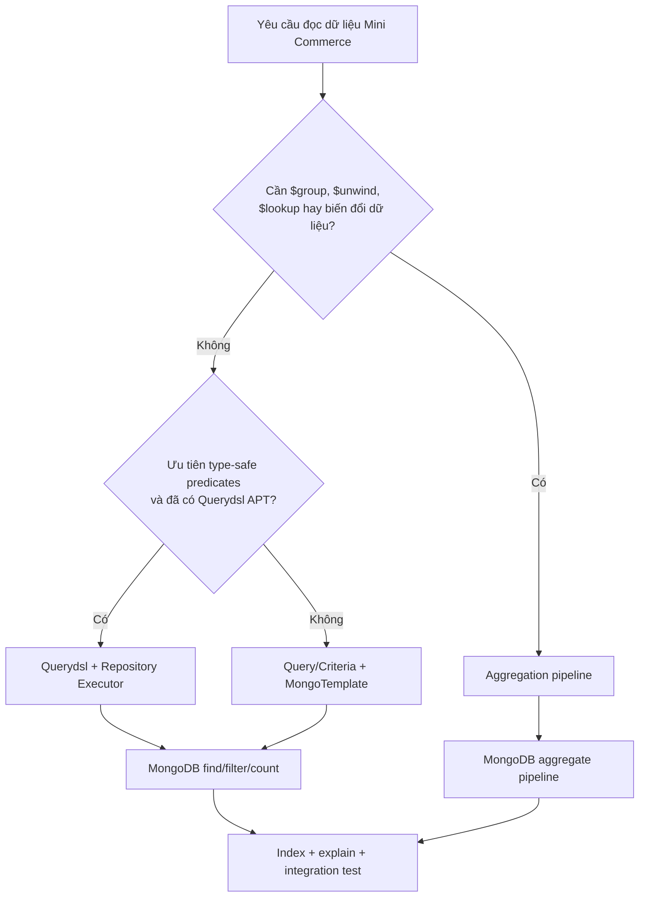
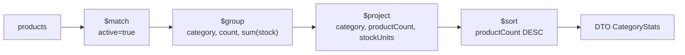
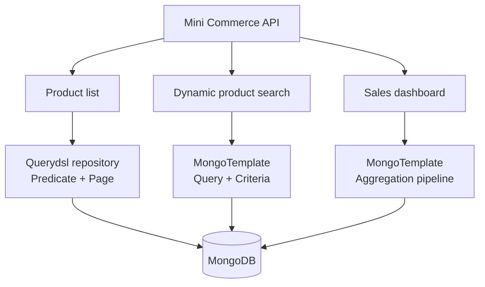

# Phân biệt Querydsl, Query/Criteria và pipeline aggregation

## 1. Bài toán cần giải quyết

Trong **Spring Data MongoDB**, một ứng dụng có nhiều cách diễn đạt yêu cầu đọc dữ liệu: tên phương thức repository, `@Query` JSON, **Querydsl**, `Query`/`Criteria` với `MongoTemplate`, hoặc **aggregation pipeline**. Các cách này không phải những “cấp độ nâng cấp” tuần tự; mỗi cách được thiết kế cho một nhóm nhu cầu khác nhau.

Ứng dụng **Mini Commerce** có `Product`, `Customer` và `Order`. Hãy xét ba yêu cầu:

1. **Danh sách sản phẩm:** tìm sản phẩm đang bán thuộc danh mục `phu-kien`, có giá trong khoảng từ 100.000 đến dưới 200.000 VND, sắp xếp giá tăng dần, phân trang.
2. **Báo cáo catalog:** mỗi danh mục có bao nhiêu sản phẩm đang bán và tổng số lượng tồn kho là bao nhiêu?
3. **Báo cáo đơn hàng:** mỗi SKU đã bán bao nhiêu chiếc trong các Order trạng thái `PAID`?

Yêu cầu thứ nhất chủ yếu là **lọc document rồi trả entity**; Querydsl hoặc Query/Criteria đều phù hợp. Hai yêu cầu còn lại cần **nhóm, biến đổi, tổng hợp** và đôi khi phải **tách mảng thành nhiều bản ghi**; aggregation pipeline mới là công cụ tự nhiên.

Bài thuộc chương **Repository mở rộng**, trong phạm vi `SPRING_DATA_MONGODB`: kết nối, ánh xạ BSON, query qua `MongoTemplate`/repository, aggregation, index, transaction, reactive, kiểm thử và chẩn đoán hiệu năng.

### Mục tiêu học tập

Sau bài này, bạn có thể:

- Phân biệt **Querydsl Predicate**, **Query/Criteria** và **Aggregation** theo khả năng, chi phí triển khai và kiểu kết quả.
- Cấu hình ý tưởng cho Querydsl, tạo `QProduct` và sử dụng `QuerydslPredicateExecutor`.
- Viết truy vấn động có điều kiện tùy chọn bằng `Criteria` và `MongoTemplate`.
- Tạo pipeline với `$match`, `$project`, `$unwind`, `$group`, `$sort` và `$limit`.
- Chuyển một yêu cầu lọc đơn giản giữa Querydsl và Criteria, nhưng **không** ép mọi yêu cầu tổng hợp vào Querydsl.
- Xử lý đúng tên Java property so với tên field BSON như `price → unit_price`.
- Thiết kế sort, pagination, index, giao dịch và truy vấn reactive phù hợp.
- Kiểm thử kết quả thực tế và kiểm tra `explain("executionStats")` trước khi kết luận hiệu năng.

**Điều kiện đầu vào:** Java 17+, Spring Boot với Spring Data MongoDB, biết `MongoRepository`, `@Document`, `@Id`, `@Field`, `Query` và BSON. Mã minh họa dùng API Java đồng bộ trừ khi ghi rõ là reactive.

## 2. Bảng quyết định: chọn công cụ theo câu hỏi

| Tiêu chí | Querydsl | Query/Criteria | Aggregation pipeline |
| --- | --- | --- | --- |
| Mục đích chính | **Predicate type-safe** cho tìm/lọc entity | **Filter động** và tùy chọn truy vấn MongoDB | **Biến đổi, nhóm, tính toán, kết hợp dữ liệu** |
| Cú pháp Java | `QProduct.product.price.goe(...)` | `Criteria.where("price").gte(...)` | `Aggregation.match(...)`, `group(...)`, `project(...)` |
| Truy vấn động theo tham số tùy chọn | Rất phù hợp với `BooleanBuilder` | Rất phù hợp với xây `Criteria`/`Query` | Có thể thêm/bớt pipeline stages |
| Kiểm tra field ở compile time | Mạnh với `Q` class đã sinh | Phần lớn field path là **String** | DSL có field paths/String và mapping context |
| Cần annotation processing | **Có**, để sinh các lớp `Q` | Không | Không |
| Repository integration | `QuerydslPredicateExecutor` | Repository fragment/custom + `MongoTemplate` | `@Aggregation` hoặc `MongoTemplate.aggregate(...)` |
| `$group`/`$unwind`/`$lookup` | Không phải vai trò chính | `find` thông thường không tạo các bước này | **Có** |
| Kết quả | Chủ yếu entity/projection và các phép `find/count/exists` | Entity/DTO, count, exists, cập nhật | Entity/DTO/báo cáo đã biến đổi |
| Pageable/Sort | Có qua repository executor | Có qua `Query`, `Pageable` | Có `$sort/$skip/$limit`, nhưng metadata trang phải thiết kế |
| Tổ chức index | Phụ thuộc filter BSON sinh ra | Phụ thuộc filter BSON sinh ra | Phụ thuộc từng stage và thứ tự pipeline |
| Đường reactive | `ReactiveQuerydslPredicateExecutor` | `ReactiveMongoTemplate` | `ReactiveMongoTemplate.aggregate(...)` |

**Không nên chọn công cụ chỉ vì “type-safe thì luôn nhanh hơn” hoặc “aggregation thì luôn mạnh hơn”.** MongoDB thực thi câu lệnh BSON cuối cùng; tốc độ chủ yếu phụ thuộc query shape, index, dữ liệu, payload và execution plan, không chỉ tên API Java.



### 2.1. Khi nào phương thức derived query hoặc @Query đã đủ?

Đừng tạo custom repository chỉ để thay thế:

```java
Page<Product> findByActiveTrueAndCategory(
    String category, Pageable pageable);
```

Nếu điều kiện cố định, repository method thường đủ rõ. Khi API có hàng chục tổ hợp điều kiện tùy chọn, một method name rất dài trở nên khó bảo trì; lúc đó cân nhắc Querydsl hoặc Criteria. Nếu filter cần toán tử BSON đặc biệt nhưng vẫn cố định, `@Query` JSON có binding là lựa chọn trung gian.

## 3. Mô hình Product–Customer–Order

### 3.1. Entity Product

```java
package com.example.minicommerce.domain;

import java.math.BigDecimal;
import java.util.List;

import org.springframework.data.annotation.Id;
import org.springframework.data.mongodb.core.mapping.Document;
import org.springframework.data.mongodb.core.mapping.Field;
import org.springframework.data.mongodb.core.mapping.FieldType;

@Document(collection = "products")
public class Product {
    @Id
    private String id;
    private String sku;
    private String name;
    private String category;
    private boolean active;
    private int stock;

    @Field(name = "unit_price", targetType = FieldType.DECIMAL128)
    private BigDecimal price;

    private List<String> tags;

    public Product() {}

    public String getId() { return id; }
    public void setId(String id) { this.id = id; }
    public String getSku() { return sku; }
    public void setSku(String sku) { this.sku = sku; }
    public String getName() { return name; }
    public void setName(String name) { this.name = name; }
    public String getCategory() { return category; }
    public void setCategory(String category) {
        this.category = category;
    }
    public boolean isActive() { return active; }
    public void setActive(boolean active) { this.active = active; }
    public int getStock() { return stock; }
    public void setStock(int stock) { this.stock = stock; }
    public BigDecimal getPrice() { return price; }
    public void setPrice(BigDecimal price) { this.price = price; }
    public List<String> getTags() { return tags; }
    public void setTags(List<String> tags) { this.tags = tags; }
}
```

Lưu ý:

- Java property `id` được lưu dưới tên BSON `_id`.
- Java property `price` được lưu thành BSON `unit_price` và kiểu **Decimal128**.
- `tags` là array chuỗi, nên các truy vấn theo phần tử có thể sử dụng multikey index.
- Dùng `BigDecimal` tạo từ chuỗi, không dùng phép tính tiền bằng `double`.

### 3.2. Entity Order cho bài toán thống kê

```java
package com.example.minicommerce.domain;

import java.math.BigDecimal;
import java.time.Instant;
import java.util.List;

import org.springframework.data.annotation.Id;
import org.springframework.data.mongodb.core.mapping.Document;
import org.springframework.data.mongodb.core.mapping.Field;
import org.springframework.data.mongodb.core.mapping.FieldType;

@Document(collection = "orders")
public class Order {
    @Id
    private String id;
    private String customerId;
    private String status;
    private Instant placedAt;

    @Field(targetType = FieldType.DECIMAL128)
    private BigDecimal totalAmount;

    private List<OrderLine> lines;

    public String getId() { return id; }
    public String getCustomerId() { return customerId; }
    public String getStatus() { return status; }
    public Instant getPlacedAt() { return placedAt; }
    public BigDecimal getTotalAmount() { return totalAmount; }
    public List<OrderLine> getLines() { return lines; }

    public static class OrderLine {
        private String sku;
        private int quantity;

        @Field(targetType = FieldType.DECIMAL128)
        private BigDecimal unitPrice;

        public String getSku() { return sku; }
        public int getQuantity() { return quantity; }
        public BigDecimal getUnitPrice() { return unitPrice; }
    }
}
```

Đây là ví dụ chỉ phục vụ truy vấn báo cáo. Trong ứng dụng thực tế có thể thêm constructor/setter cho entity, snapshot tên/giá, validation và liên kết `Customer`; không nên dùng một Order object thiếu field để `save` thay thế dữ liệu đang có.

### 3.3. Dữ liệu mẫu để so sánh kết quả

Trong `mongosh` trên database **thử nghiệm**:

```javascript
use mini_commerce

db.products.insertMany([
  {
    _id: "q-product-1",
    sku: "KBD-001",
    name: "Ban phim Mini",
    category: "phu-kien",
    active: true,
    stock: 8,
    unit_price: NumberDecimal("129900.00"),
    tags: ["office", "featured"]
  },
  {
    _id: "q-product-2",
    sku: "MOU-001",
    name: "Chuot Mini",
    category: "phu-kien",
    active: true,
    stock: 15,
    unit_price: NumberDecimal("179000.00"),
    tags: ["office"]
  },
  {
    _id: "q-product-3",
    sku: "OLD-001",
    name: "Keyboard Old",
    category: "phu-kien",
    active: false,
    stock: 4,
    unit_price: NumberDecimal("99000.00"),
    tags: ["clearance"]
  },
  {
    _id: "q-product-4",
    sku: "HOME-001",
    name: "Dèn ban",
    category: "gia-dung",
    active: true,
    stock: 12,
    unit_price: NumberDecimal("159000.00"),
    tags: ["featured"]
  }
]);

db.orders.insertMany([
  {
    _id: "q-order-A",
    customerId: "customer-001",
    status: "PAID",
    placedAt: ISODate("2026-11-19T09:00:00Z"),
    totalAmount: NumberDecimal("438800.00"),
    lines: [
      { sku: "KBD-001", quantity: 2,
        unitPrice: NumberDecimal("129900.00") },
      { sku: "MOU-001", quantity: 1,
        unitPrice: NumberDecimal("179000.00") }
    ]
  },
  {
    _id: "q-order-B",
    customerId: "customer-002",
    status: "PAID",
    placedAt: ISODate("2026-11-20T09:00:00Z"),
    totalAmount: NumberDecimal("129900.00"),
    lines: [
      { sku: "KBD-001", quantity: 1,
        unitPrice: NumberDecimal("129900.00") }
    ]
  },
  {
    _id: "q-order-C",
    customerId: "customer-001",
    status: "CANCELLED",
    placedAt: ISODate("2026-11-20T10:00:00Z"),
    totalAmount: NumberDecimal("179000.00"),
    lines: [
      { sku: "MOU-001", quantity: 1,
        unitPrice: NumberDecimal("179000.00") }
    ]
  }
]);
```

Chỉ insert một lần trên database test rỗng hoặc đã được cô lập theo ID. Lần chạy lại cùng `_id` sẽ lỗi duplicate key. Nếu collection còn document khác, các truy vấn không thêm filter ID có thể trả thêm kết quả; phần integration test bên dưới dùng một bộ ID riêng.

Kết quả mong đợi từ fixture:

| Câu hỏi | Kết quả |
| --- | --- |
| Active + `phu-kien` + 100.000 ≤ price < 200.000 | `q-product-1`, `q-product-2` |
| Active theo danh mục | `phu-kien`: 2 sản phẩm; `gia-dung`: 1 |
| Tổng stock active `phu-kien` | 8 + 15 = **23** |
| SKU đã bán trong đơn `PAID` | `KBD-001`: **3**; `MOU-001`: **1** |
| Tổng tiền đơn `PAID` từ `totalAmount` | **568.700** VND |

Không dùng dữ liệu giả này để đưa ra quyết định sản xuất. Các tên danh mục và SKU là ví dụ học tập.

## 4. Querydsl là gì trong Spring Data MongoDB?

**Querydsl** xây câu query bằng các **Java expression có kiểu** được sinh từ domain model. Thay vì viết `"price"` dưới dạng chuỗi, bạn dùng property được sinh trong `QProduct`:

```java
QProduct p = QProduct.product;

Predicate predicate = p.active.isTrue()
    .and(p.category.eq("phu-kien"))
    .and(p.price.goe(new BigDecimal("100000.00")))
    .and(p.price.lt(new BigDecimal("200000.00")));
```

Nếu rename `Product.price` thành `unitPrice`, code cũ dùng `p.price` không còn phù hợp với `QProduct` được sinh mới và IDE/compiler có thể giúp phát hiện. Với `Criteria.where("price")`, tên field là string nên compiler không phát hiện kiểu lỗi tương tự.

Tuy nhiên **Querydsl không phải SQL engine của MongoDB**. `QuerydslPredicateExecutor` diễn đạt predicate dùng cho truy vấn document; nó **không tự biến mọi SQL join/group/window expression thành MongoDB pipeline**.

### 4.1. Các Q-type từ annotation processing

`QProduct` **không phải** class đi kèm Spring Data MongoDB. Build cần có:

1. Querydsl core/modules phù hợp với phiên bản dự án.
2. Querydsl annotation processing hoặc `org.springframework.data.mongodb.repository.support.MongoAnnotationProcessor` được cấu hình.
3. Thư mục generated sources được build/IDE nhận diện.
4. `QProduct` được sinh lại khi entity đổi field/kiểu.

Tài liệu Spring Data MongoDB mô tả thiết lập `MongoAnnotationProcessor` vì Querydsl **không phải dependency bắt buộc** cho tất cả người dùng MongoDB. Nếu chỉ cần một vài filter đơn giản, việc thêm APT có thể là chi phí không cần thiết.

### 4.2. Lưu ý phiên bản và dự án Querydsl

Tài liệu Spring Data hiện tại ghi nhận Querydsl gốc đã chậm bảo trì và cộng đồng có nhánh duy trì **OpenFeign Querydsl** với groupId `io.github.openfeign.querydsl`; hỗ trợ nhánh này từ Spring Data là **best-effort**. Một số dự án cũ dùng `com.querydsl`.

Không trộn hai họ artifact/phiên bản tùy ý. Khi cấu hình Maven hoặc Gradle:

- Chọn **một** họ Querydsl tương thích với Spring Boot/Spring Data/Java/Jakarta đang dùng.
- Kiểm tra artifact `querydsl-mongodb`, `querydsl-apt` và `querydsl-core` thống nhất phiên bản.
- Bảo đảm annotation processor đúng phiên bản, classpath và generated sources.
- Kiểm tra xung đột transitive MongoDB driver; tài liệu có ví dụ loại driver cũ khỏi Querydsl dependency.
- Xác minh cách đăng ký `MongoAnnotationProcessor` theo compiler plugin/Gradle APT.
- Không sao chép cứng phiên bản dependency khi chưa kiểm tra BOM và dependency tree của **dự án thực tế**.

Đây là lý do phần dưới giả định **`QProduct` đã được tạo thành công**, thay vì giả vờ một khai báo dependency duy nhất luôn tương thích mọi Spring Data MongoDB 4.x/5.x.

### 4.3. Repository tích hợp Querydsl

```java
package com.example.minicommerce.repository;

import org.springframework.data.mongodb.repository.MongoRepository;
import org.springframework.data.querydsl.QuerydslPredicateExecutor;

import com.example.minicommerce.domain.Product;

public interface ProductRepository extends
        MongoRepository<Product, String>,
        QuerydslPredicateExecutor<Product> {

    // Có thể thêm derived query hoặc @Query ở đây.
}
```

Sau khi build sinh `QProduct`, gọi:

```java
import java.math.BigDecimal;
import org.springframework.data.domain.Page;
import org.springframework.data.domain.PageRequest;
import org.springframework.data.domain.Pageable;
import org.springframework.data.domain.Sort;
import com.querydsl.core.types.Predicate;

import com.example.minicommerce.domain.QProduct;

QProduct p = QProduct.product;

Predicate predicate = p.active.isTrue()
    .and(p.category.eq("phu-kien"))
    .and(p.price.goe(new BigDecimal("100000.00")))
    .and(p.price.lt(new BigDecimal("200000.00")));

Pageable page = PageRequest.of(
    0, 20,
    Sort.by(Sort.Order.asc("price"), Sort.Order.asc("id")));

Page<Product> result =
    productRepository.findAll(predicate, page);
```

Lưu ý `com.querydsl.core.types.Predicate` là namespace trong ví dụ sử dụng họ API Querydsl tương ứng; với dependency fork, kiểm tra package theo artifact đã chọn. `QProduct` thường nằm trong package cùng entity.

Kết quả trên fixture là `q-product-1` rồi `q-product-2` theo giá tăng dần. `PageRequest` có page index **bắt đầu từ 0** và `Page` có thể cần count query để tính tổng.

### 4.4. Predicate động với BooleanBuilder

Giả sử API search nhận `category`, `minPrice`, `maxPrice` và `skuPrefix` tùy chọn:

```java
import java.math.BigDecimal;

import com.querydsl.core.BooleanBuilder;
import com.querydsl.core.types.Predicate;

public Predicate buildProductPredicate(
        String category,
        BigDecimal minPrice,
        BigDecimal maxPrice,
        String skuPrefix) {

    QProduct p = QProduct.product;
    BooleanBuilder where = new BooleanBuilder(p.active.isTrue());

    if (category != null && !category.isBlank()) {
        where.and(p.category.eq(category));
    }

    if (minPrice != null) {
        where.and(p.price.goe(minPrice));
    }

    if (maxPrice != null) {
        where.and(p.price.lt(maxPrice));
    }

    if (skuPrefix != null && !skuPrefix.isBlank()) {
        where.and(p.sku.startsWith(skuPrefix));
    }

    return where;
}
```

Đây là một method trong service có import `QProduct` phù hợp. `BooleanBuilder` hữu ích vì mỗi điều kiện là một expression có kiểu. Cần validate `minPrice <= maxPrice`, độ dài `skuPrefix`, tenant và quyền truy cập trước khi thực hiện.

**Không coi `startsWith` hoặc `containsIgnoreCase` là phép tìm kiếm miễn phí.** Chúng có thể được chuyển thành regex hoặc filter BSON tương ứng; index prefix/collation và case sensitivity phải được kiểm tra theo query BSON cuối cùng.

### 4.5. Reactive Querydsl

Spring Data MongoDB cũng có `ReactiveQuerydslPredicateExecutor`:

```java
import org.springframework.data.mongodb.repository.ReactiveMongoRepository;
import org.springframework.data.querydsl.ReactiveQuerydslPredicateExecutor;

import com.example.minicommerce.domain.Product;

public interface ReactiveProductRepository extends
        ReactiveMongoRepository<Product, String>,
        ReactiveQuerydslPredicateExecutor<Product> {
}
```

```java
import reactor.core.publisher.Flux;

Flux<Product> products =
    reactiveProductRepository.findAll(
        QProduct.product.active.isTrue()
            .and(QProduct.product.category.eq("phu-kien")));
```

Reactive repository trả `Flux<Product>`/`Mono<Long>` cho những phép tương ứng, không biến kết quả thành `Page<Product>` theo kiểu đồng bộ. Theo tài liệu Spring Data MongoDB, Querydsl reactive **không hỗ trợ DBRef joins**. Querydsl không giải quyết bài toán `$lookup` giữa nhiều collection trong aggregation.

## 5. Query/Criteria: filter động không cần sinh QProduct

`MongoTemplate` cho phép viết filter từ `Query` và `Criteria`:

```java
import java.math.BigDecimal;
import java.util.List;

import org.springframework.data.domain.Sort;
import org.springframework.data.mongodb.core.query.Criteria;
import org.springframework.data.mongodb.core.query.Query;

Query query = Query.query(
    Criteria.where("active").is(true)
        .and("category").is("phu-kien")
        .and("price")
            .gte(new BigDecimal("100000.00"))
            .lt(new BigDecimal("200000.00")));

query.with(Sort.by(
    Sort.Order.asc("price"),
    Sort.Order.asc("id")));
query.limit(20);

List<Product> products =
    mongoTemplate.find(query, Product.class);
```

Về nghĩa, filter trên tương đương với Querydsl ở phần trước. Với entity `Product.class`, framework ánh xạ property `price` thành BSON `unit_price`. Khi dùng raw `mongosh`:

```javascript
db.products.find({
  active: true,
  category: "phu-kien",
  unit_price: {
    $gte: NumberDecimal("100000.00"),
    $lt: NumberDecimal("200000.00")
  }
})
.sort({ unit_price: 1, _id: 1 })
.limit(20);
```

**Quan trọng:** Querydsl và Criteria **đều phải được kiểm tra trên BSON thực tế**, đặc biệt khi `@Field`, `Decimal128`, converter tùy biến hoặc Java property nested path xuất hiện.

### 5.1. Xây Query động với điều kiện tùy chọn

```java
import java.math.BigDecimal;
import java.util.ArrayList;
import java.util.List;

import org.springframework.data.domain.Pageable;
import org.springframework.data.mongodb.core.query.Criteria;
import org.springframework.data.mongodb.core.query.Query;

public Query buildProductQuery(
        String category,
        BigDecimal minPrice,
        BigDecimal maxPrice,
        String skuPrefix,
        Pageable pageable) {

    List<Criteria> conditions = new ArrayList<>();
    conditions.add(Criteria.where("active").is(true));

    if (category != null && !category.isBlank()) {
        conditions.add(Criteria.where("category").is(category));
    }

    if (minPrice != null || maxPrice != null) {
        Criteria price = Criteria.where("price");
        if (minPrice != null) {
            price.gte(minPrice);
        }
        if (maxPrice != null) {
            price.lt(maxPrice);
        }
        conditions.add(price);
    }

    if (skuPrefix != null && !skuPrefix.isBlank()) {
        conditions.add(
            Criteria.where("sku").regex(
                "^" + java.util.regex.Pattern.quote(skuPrefix)));
    }

    Criteria root = new Criteria().andOperator(
        conditions.toArray(Criteria[]::new));

    return Query.query(root).with(pageable);
}
```

Trên đây là một method minh họa service, không phải toàn bộ class. `Pattern.quote` biến đầu vào prefix thành literal regex; cần thêm giới hạn độ dài/tập ký tự và kiểm tra `explain` vì cách escape có thể ảnh hưởng prefix index optimization.

Lợi ích của `Criteria` là không phụ thuộc Querydsl APT, hỗ trợ nhiều toán tử MongoDB trực tiếp và dễ dùng trong `MongoTemplate`. Đánh đổi: tên field `"price"`/`"category"` là string, dễ sai khi refactor nếu không có test.

### 5.2. Query có nhiều điều kiện và array $elemMatch

Một câu hỏi về Order: “Có một OrderLine cùng lúc mang SKU `KBD-001` và `quantity >= 2`”.

```java
Query matchingLine = Query.query(
    Criteria.where("lines").elemMatch(
        Criteria.where("sku").is("KBD-001")
            .and("quantity").gte(2)));

List<Order> orders =
    mongoTemplate.find(matchingLine, Order.class);
```

Nếu viết hai dotted predicates `"lines.sku"` và `"lines.quantity"` ở cùng cấp, MongoDB có thể khớp **hai phần tử khác nhau** của array. `$elemMatch` là cách yêu cầu các điều kiện phải đúng trên **cùng một phần tử**.

Một `Predicate` Querydsl có thể tiện cho nhiều property equality, nhưng khi cần những biểu thức BSON chi tiết như `$elemMatch`, `$expr`, collation, array filters hoặc geo operators, `Criteria`/`MongoTemplate` thường trực tiếp và dễ kiểm soát hơn.

### 5.3. Điều khiển projection, sort, collation và hint

`Query` mang các tùy chọn ngoài filter:

```java
Query options = Query.query(
    Criteria.where("active").is(true));

options.fields()
    .include("sku")
    .include("name")
    .include("price");

options.with(Sort.by(
    Sort.Order.asc("price"),
    Sort.Order.asc("id")));

options.limit(20);

List<Product> summary =
    mongoTemplate.find(options, Product.class);
```

Entity đọc qua **projection một phần** không phải document hoàn chỉnh để `save`; dùng DTO hoặc interface projection cho API read-only. Nếu ứng dụng yêu cầu collation, `Query.collation(...)` có thể khai báo quy tắc so sánh; raw BSON và index phải có collation phù hợp. `Query.withHint(...)` nên dành cho tình huống đã có plan/benchmark, tránh gắn hint tùy tiện.

### 5.4. Querydsl và Criteria có cùng giới hạn khi chỉ dùng find

`MongoTemplate.find(query, Product.class)` trả document `Product` khớp điều kiện. Nó không tự sinh một document tổng hợp “số sản phẩm theo category và tổng stock”. Muốn báo cáo này, cần một pipeline hoặc logic ứng dụng tự duyệt toàn bộ document.

Tính trên server bằng aggregation thường thích hợp hơn kéo hàng nghìn document qua mạng chỉ để cộng số liệu ở JVM.

## 6. Aggregation pipeline: biến đổi kết quả theo từng stage

MongoDB aggregation nhận một **danh sách stage có thứ tự**, mỗi stage nhận tập document từ stage trước và trả tập document cho stage sau.



Các stage phổ biến:

| Stage | Chức năng | Ví dụ Mini Commerce |
| --- | --- | --- |
| `$match` | Lọc document | `status = PAID` |
| `$project` | Chọn/tạo field, biểu thức tính | Chuẩn hóa tên output, tính thành tiền |
| `$unwind` | Tách phần tử array thành document trung gian | Mỗi `OrderLine` thành một dòng |
| `$group` | Nhóm, `$sum`/`$avg`/`$count` | Số sản phẩm mỗi category |
| `$sort` | Sắp xếp kết quả hiện tại | Category có nhiều sản phẩm nhất |
| `$skip`/`$limit` | Phân trang/giới hạn | Top 20 category |
| `$lookup` | Kết hợp document từ collection khác | Order cùng thông tin Customer |
| `$facet` | Nhiều nhánh pipeline trong một lệnh | Data page và tổng số nhóm |
| `$addFields`/`$set` | Bổ sung field tính toán | Tổng tiền theo quy tắc |

**Thứ tự stage thay đổi ý nghĩa và chi phí.** `$match` trên Order trước `$unwind` có thể giảm lượng dữ liệu phải tách. `$group` thường giảm nhiều document thành vài nhóm; `$sort` sau group sắp xếp **nhóm**, không phải các document gốc.

## 7. Báo cáo số sản phẩm và stock theo danh mục

### 7.1. Pipeline bằng mongosh

```javascript
db.products.aggregate([
  { $match: { active: true } },
  {
    $group: {
      _id: "$category",
      productCount: { $sum: 1 },
      stockUnits: { $sum: "$stock" }
    }
  },
  {
    $project: {
      _id: 0,
      category: "$_id",
      productCount: 1,
      stockUnits: 1
    }
  },
  { $sort: { productCount: -1, category: 1 } }
]);
```

Với các fixture:

```json
[
  {
    "category": "phu-kien",
    "productCount": 2,
    "stockUnits": 23
  },
  {
    "category": "gia-dung",
    "productCount": 1,
    "stockUnits": 12
  }
]
```

`$group` tính từ các document `Product` đang active, không phải số giá trị distinct. `stockUnits` là tổng số lượng tồn, không phải doanh thu hay số đơn.

### 7.2. Viết bằng Spring Data Aggregation DSL

```java
package com.example.minicommerce.service;

import java.util.List;

import org.springframework.data.domain.Sort;
import org.springframework.data.mongodb.core.MongoTemplate;
import org.springframework.data.mongodb.core.aggregation.Aggregation;
import org.springframework.data.mongodb.core.aggregation.AggregationResults;
import org.springframework.data.mongodb.core.query.Criteria;

import com.example.minicommerce.domain.Product;

public class CatalogReportService {
    private final MongoTemplate template;

    public CatalogReportService(MongoTemplate template) {
        this.template = template;
    }

    public List<CategoryStats> summarize() {
        Aggregation pipeline = Aggregation.newAggregation(
            Aggregation.match(
                Criteria.where("active").is(true)),
            Aggregation.group("category")
                .count().as("productCount")
                .sum("stock").as("stockUnits"),
            Aggregation.project("productCount", "stockUnits")
                .and("_id").as("category")
                .andExclude("_id"),
            Aggregation.sort(
                Sort.by(Sort.Order.desc("productCount"),
                        Sort.Order.asc("category")))
        );

        AggregationResults<CategoryStats> results =
            template.aggregate(
                pipeline, Product.class, CategoryStats.class);

        return results.getMappedResults();
    }

    public static class CategoryStats {
        private String category;
        private long productCount;
        private long stockUnits;

        public String getCategory() { return category; }
        public void setCategory(String value) { category = value; }
        public long getProductCount() { return productCount; }
        public void setProductCount(long value) { productCount = value; }
        public long getStockUnits() { return stockUnits; }
        public void setStockUnits(long value) { stockUnits = value; }
    }
}
```

`Aggregation.newAggregation(...)` xây pipeline. `MongoTemplate.aggregate(pipeline, Product.class, CategoryStats.class)` chọn collection theo `Product.class` và ánh xạ output sang DTO.

**Không nhầm tên của DTO với entity.** Sau `$group`, field `_id` là khóa nhóm; `$project` đổi nó thành `category`. `CategoryStats` không phải một `Product` để gọi `save`.

### 7.3. Vì sao Querydsl không phải lựa chọn tương đương?

Một predicate `QProduct.product.active.isTrue()` chỉ mô tả **Product nào được chọn**; nó không tạo ra các thao tác `$group` cộng stock và tạo document `CategoryStats`. Nếu cố giải bằng Querydsl repository rồi duyệt các Product trong Java để cộng, ứng dụng phải kéo nhiều dữ liệu, khó tận dụng server aggregation và tốn băng thông.

Đây là trường hợp điển hình để **chọn aggregation ngay từ đầu**.

## 8. Báo cáo dòng hàng: $unwind trước $group

Mini Commerce lưu `Order.lines` là array document. Yêu cầu: “Mỗi SKU đã bán bao nhiêu chiếc trong các Order trạng thái `PAID`?”

### 8.1. Pipeline đúng

```javascript
db.orders.aggregate([
  { $match: { status: "PAID" } },
  { $unwind: "$lines" },
  {
    $group: {
      _id: "$lines.sku",
      unitsSold: { $sum: "$lines.quantity" }
    }
  },
  {
    $project: {
      _id: 0,
      sku: "$_id",
      unitsSold: 1
    }
  },
  { $sort: { unitsSold: -1, sku: 1 } }
]);
```

Kết quả trên fixture:

```json
[
  { "sku": "KBD-001", "unitsSold": 3 },
  { "sku": "MOU-001", "unitsSold": 1 }
]
```

`q-order-C` bị loại vì `status = CANCELLED`. Với Order A, có hai dòng hàng độc lập; `$unwind` tạo một document trung gian cho mỗi dòng trước khi cộng theo SKU.

### 8.2. Pipeline bằng Spring Data

```java
import java.util.List;

import org.springframework.data.domain.Sort;
import org.springframework.data.mongodb.core.aggregation.Aggregation;
import org.springframework.data.mongodb.core.aggregation.AggregationResults;
import org.springframework.data.mongodb.core.query.Criteria;

Aggregation pipeline = Aggregation.newAggregation(
    Aggregation.match(Criteria.where("status").is("PAID")),
    Aggregation.unwind("lines"),
    Aggregation.group("lines.sku")
        .sum("lines.quantity").as("unitsSold"),
    Aggregation.project("unitsSold")
        .and("_id").as("sku")
        .andExclude("_id"),
    Aggregation.sort(
        Sort.by(Sort.Order.desc("unitsSold"),
                Sort.Order.asc("sku")))
);

AggregationResults<SkuSales> results =
    mongoTemplate.aggregate(pipeline, Order.class, SkuSales.class);

List<SkuSales> sales = results.getMappedResults();
```

DTO:

```java
public class SkuSales {
    private String sku;
    private long unitsSold;

    public String getSku() { return sku; }
    public void setSku(String sku) { this.sku = sku; }
    public long getUnitsSold() { return unitsSold; }
    public void setUnitsSold(long unitsSold) {
        this.unitsSold = unitsSold;
    }
}
```

Đoạn gọi trên nằm trong service có `MongoTemplate mongoTemplate` được inject và import `Order`, `SkuSales` đúng package. `SkuSales` là DTO đọc báo cáo, không phải entity root của `orders`.

### 8.3. Sai lầm hay gặp

```javascript
db.orders.find({
  "lines.sku": "KBD-001"
});
```

Đây chỉ là **filter Order chứa SKU**. Nó không trả số lượng đã bán. Nếu phía Java lấy `Order.totalAmount` của những đơn này và cộng, sẽ **bao gồm cả mặt hàng khác** trong những đơn có nhiều SKU. Muốn doanh thu theo SKU, dùng `$unwind`/`$match` rồi tính `quantity × unitPrice` trên **từng OrderLine**.

## 9. Tổng doanh thu: chú ý Decimal128 và trạng thái đơn

Một báo cáo đơn giản tổng tiền các Order đã thanh toán:

```javascript
db.orders.aggregate([
  { $match: { status: "PAID" } },
  {
    $group: {
      _id: null,
      paidRevenue: { $sum: "$totalAmount" },
      paidOrderCount: { $sum: 1 }
    }
  }
]);
```

Trên fixture, `paidRevenue = NumberDecimal("568700.00")` và `paidOrderCount = 2`. Điều này giả định `totalAmount` là **Decimal128**, được chốt chính xác khi tạo đơn. Nếu BSON bị trộn `String`/`Double`/`Decimal128`, `$sum` có thể không phản ánh chính xác kỳ vọng tài chính. Kiểm kê và chuẩn hóa dữ liệu trước khi đối soát.

Khi cần tính doanh thu theo từng SKU, có thể:

```javascript
db.orders.aggregate([
  { $match: { status: "PAID" } },
  { $unwind: "$lines" },
  {
    $group: {
      _id: "$lines.sku",
      unitsSold: { $sum: "$lines.quantity" },
      revenue: {
        $sum: {
          $multiply: [
            "$lines.unitPrice",
            "$lines.quantity"
          ]
        }
      }
    }
  },
  { $sort: { revenue: -1 } }
]);
```

`$multiply` với `Decimal128` và số nguyên tạo kết quả theo quy tắc số học BSON/Decimal128; nếu nghiệp vụ có thuế, chiết khấu, hoàn tiền hoặc hủy đơn, phải biểu diễn **đúng quy tắc kế toán**, không suy từ ví dụ đơn giản này.

## 10. Khi cần kết hợp Customer và Order: $lookup

Trong MongoDB, `Product`/`Customer`/`Order` thường được thiết kế bằng **embedded document hoặc reference**, không phải quan hệ SQL join tự động.

Nếu cần danh sách đơn `PAID` kèm thông tin Customer:

```javascript
db.orders.aggregate([
  { $match: { status: "PAID" } },
  {
    $lookup: {
      from: "customers",
      localField: "customerId",
      foreignField: "_id",
      as: "customer"
    }
  },
  { $unwind: "$customer" },
  {
    $project: {
      _id: 1,
      placedAt: 1,
      totalAmount: 1,
      "customer.fullName": 1
    }
  }
]);
```

`$lookup` tạo mảng kết quả `customer`. `$unwind` biến mảng thành một object cho từng document và theo mặc định có thể **loại** Order không tìm thấy Customer. Nếu cần giữ Order orphan, dùng `preserveNullAndEmptyArrays: true`.

**Tại sao Querydsl không thay $lookup?** `QuerydslPredicateExecutor` hỗ trợ predicate trên document của một repository, không biến các quan hệ tham chiếu thành join đa collection. Khi cần join-like query tại server, chọn aggregation `$lookup` (hoặc cân nhắc schema nhúng/snapshot), kiểm tra index `customers._id` và dữ liệu lớn.

Không xem `$lookup` như SQL join miễn phí: chú ý cardinality, kích thước document trung gian, điều kiện tenant và index ở collection liên kết. Truy vấn có dữ liệu cá nhân cần projection và kiểm soát quyền.

## 11. Querydsl, Criteria và aggregation có thể dùng chung trong một ứng dụng

Ba cách không loại trừ nhau:



Kiến trúc hợp lý có thể là:

- Repository chứa các finder cơ bản và `QuerydslPredicateExecutor` cho UI tìm kiếm type-safe.
- Một **repository fragment/service** xây `Query`/`Criteria` cho filter phức tạp, metadata, collation hoặc custom update.
- Một **reporting service** dùng `Aggregation`/`MongoTemplate.aggregate` trả DTO thống kê.
- Mỗi nhánh đều được kiểm thử BSON/index, không trộn kết quả báo cáo thành entity có thể `save`.

### 11.1. Repository fragment khi cần API riêng

Khi muốn đặt query động trong lớp repository thay vì ở service, dùng pattern custom repository fragment:

```java
public interface ProductSearchRepository {
    List<Product> search(ProductSearchFilter filter);
}
```

```java
public interface ProductRepository
        extends MongoRepository<Product, String>,
                QuerydslPredicateExecutor<Product>,
                ProductSearchRepository {
}
```

Một implementation `ProductSearchRepositoryImpl` có thể inject `MongoTemplate` và xây `Criteria`. `ProductSearchFilter` là DTO do dự án định nghĩa, không phải class có sẵn của Spring Data.

Ưu điểm: giữ hợp đồng repository rõ ràng; tránh sinh vô hạn các method `findBy…And…Or…`. Khi làm implementation thật, tuân theo convention repository fragment và cách đăng ký bean ở phiên bản Spring Data đang dùng.

### 11.2. @Aggregation trên repository

Spring Data MongoDB cũng cho phép khai báo một pipeline tĩnh bằng `@Aggregation` trên method repository:

```java
import java.util.List;
import org.springframework.data.mongodb.repository.Aggregation;

public interface OrderReportRepository
        extends MongoRepository<Order, String> {

    @Aggregation(pipeline = {
        "{ '$match': { 'status': ?0 } }",
        "{ '$unwind': '$lines' }",
        "{ '$group': { '_id': '$lines.sku', " +
            "'unitsSold': { '$sum': '$lines.quantity' } } }",
        "{ '$project': { '_id': 0, " +
            "'sku': '$_id', 'unitsSold': 1 } }"
    })
    List<SkuSales> countUnitsBySku(String status);
}
```

`@Aggregation` phù hợp với pipeline cố định, filter chỉ biến đổi theo tham số. Với pipeline ghép stage có điều kiện, nhiều phép tính hoặc cần test riêng từng stage, `MongoTemplate.aggregate(...)` có thể dễ bảo trì hơn.

**Không nhầm** `org.springframework.data.mongodb.repository.Aggregation` (annotation) với `org.springframework.data.mongodb.core.aggregation.Aggregation` (DSL class); hai API có tên giống nhưng vai trò khác nhau.

## 12. Mapping: Java property và BSON key

Trong `Product`:

```java
@Field(name = "unit_price", targetType = FieldType.DECIMAL128)
private BigDecimal price;
```

Ba biểu diễn cho cùng một filter:

```java
// Querydsl dùng property typed:
QProduct.product.price.goe(new BigDecimal("100000.00"));

// Criteria dùng tên Java property khi query gắn Product.class:
Criteria.where("price").gte(new BigDecimal("100000.00"));
```

```javascript
// Raw mongosh dùng BSON field thực tế:
{ unit_price: { $gte: NumberDecimal("100000.00") } }
```

Spring Data entity mapping thường giải quyết alias và conversion ở API Querydsl/Criteria hoặc typed aggregation khi cấu hình đúng. Nhưng có những trường hợp cần đặc biệt cẩn thận:

1. `MongoCollection<Document>` từ raw Java driver không biết `@Field` của Spring.
2. Aggregation stage `$project` có thể **đổi tên hoặc bỏ field**; những stage sau không thể tham chiếu một field đã bị bỏ theo tên cũ.
3. Trong các phiên bản Spring Data mới, typed aggregation không phải lúc nào cũng báo lỗi nếu tham chiếu property không tồn tại; có thể bật **strictMapping** để tăng kiểm tra khi cần.
4. Converter tùy biến cho tiền, enum hoặc `_id` ảnh hưởng filter và output mapping; cần readback BSON.
5. Querydsl generated `Q` classes phải đúng với domain hiện tại; Q class cũ có thể làm người viết tin rằng code type-safe nhưng đang dựa trên metadata lỗi thời.

**Tách hai lớp kiểm tra:** compiler giúp tránh nhiều lỗi type/property trong Querydsl; integration test mới xác minh BSON, mapping, dữ liệu và semantics trên MongoDB thật.

## 13. Phân trang và Sort: Page khác pipeline

### 13.1. Querydsl Page

```java
Pageable pageable = PageRequest.of(
    0, 20,
    Sort.by(Sort.Order.asc("price"),
            Sort.Order.asc("id")));

Page<Product> products =
    productRepository.findAll(predicate, pageable);
```

`Page` thường cần count để tính `totalElements`. Khi chỉ cần “xem thêm”, có thể dùng kiểu trả về hoặc chiến lược lấy theo lô không đòi tổng số trang.

### 13.2. Criteria Query

```java
Query query = Query.query(
    Criteria.where("active").is(true));

query.with(pageable);

List<Product> products =
    mongoTemplate.find(query, Product.class);
```

Nếu cần `PageImpl<Product>`, đếm tổng bằng **Query chỉ có filter**, không mang `skip/limit` từ data query, và cân nhắc chi phí count.

### 13.3. Aggregation pagination

```javascript
db.products.aggregate([
  { $match: { active: true } },
  { $sort: { unit_price: 1, _id: 1 } },
  { $skip: 20 },
  { $limit: 20 }
]);
```

Nếu sắp xếp sau `$group`, thứ tự dựa trên **các nhóm** chứ không phải `Product` gốc. Aggregation không mặc định tạo `Page<T>`/`totalPages`. Có thể dùng một count pipeline riêng hoặc `$facet` trả hai nhánh `data` và `totalCount` khi có yêu cầu, nhưng `$facet` không nhất thiết nhanh hơn mọi cách tách query; cần benchmark.

### 13.4. Sort ổn định và offset sâu

Khi nhiều sản phẩm có cùng giá, thêm khóa phụ duy nhất:

```javascript
{ unit_price: 1, _id: 1 }
```

Không sort hoặc chỉ sort theo giá không duy nhất có thể tạo thứ tự giữa các trang khó dự đoán. Với `skip` rất sâu, ngay cả index tốt vẫn có chi phí duyệt/bỏ qua nhiều bản ghi. Nếu người dùng duyệt liên tiếp nhiều trang, cân nhắc **keyset/cursor pagination** dựa trên `(unit_price, _id)` hoặc khóa sắp xếp ổn định khác.

## 14. Index và explain: đo BSON cuối cùng

Ba lớp API có thể tạo ra cùng một filter BSON nên việc tối ưu phải bắt đầu từ **truy vấn MongoDB thật**.

### 14.1. Index cho truy vấn sản phẩm

```javascript
db.products.createIndex({
  active: 1,
  category: 1,
  unit_price: 1,
  _id: 1
});
```

Truy vấn:

```javascript
db.products.find({
  active: true,
  category: "phu-kien",
  unit_price: {
    $gte: NumberDecimal("100000.00"),
    $lt: NumberDecimal("200000.00")
  }
})
.sort({ unit_price: 1, _id: 1 })
.limit(20)
.explain("executionStats");
```

Đây là **index đề xuất để thử**, không phải cấu hình bắt buộc. Trước khi triển khai, cần kiểm tra dữ liệu, những filter phổ biến, tỷ lệ active, sort và chi phí ghi. Index bổ sung làm tăng dung lượng/chi phí cập nhật.

### 14.2. Index cho aggregation

Với pipeline Order:

```javascript
db.orders.createIndex({
  status: 1,
  placedAt: -1
});
```

`$match: {status:"PAID"}` ở đầu pipeline có thể tận dụng index tùy tình huống. Tuy nhiên `$unwind` và `$group` trên mảng vẫn cần xử lý những dòng hàng khớp, không biến mọi phép tổng hợp thành index-only query.

Với `$lookup` theo `customerId → customers._id`, `_id` được MongoDB index mặc định; nếu dùng một foreignField khác, phải đánh giá index tương ứng.

### 14.3. Cách đọc executionStats

| Chỉ số | Ý nghĩa thực hành |
| --- | --- |
| `winningPlan` | Server chọn plan nào? `IXSCAN`, `COLLSCAN`, `FETCH`, `SORT`? |
| `totalKeysExamined` | Có phải duyệt rất nhiều index entries không? |
| `totalDocsExamined` | Số document thật phải kiểm tra |
| `nReturned` | Số bản ghi trả về sau truy vấn |
| `executionTimeMillis` | Thời gian của lần explain; cần đo thêm ở workload đại diện |
| Aggregation stage statistics | `$group`/`$sort` có đang tiêu thụ nhiều tài nguyên? |

**Không** so thời gian của Querydsl/Criteria/aggregation trên 4 fixture rồi rút ra kết luận. Cần dataset lớn, phân bố giá/category thực tế, cùng filter/sort, warm-up và quan sát server. Khi so sánh Querydsl với Criteria, cần đảm bảo filter **thật sự tương đương**.

## 15. Security, dữ liệu và khả năng bảo trì

### 15.1. Predicate type-safe không phải phân quyền

`QProduct.product.active.isTrue()` không tự lọc tenant hay quyền xem dữ liệu. Nếu ứng dụng có nhiều cửa hàng, mỗi query phải ràng buộc `tenantId` hoặc phạm vi quyền thích hợp.

Querydsl có khả năng tích hợp web như `@QuerydslPredicate`. Không tự động mở mọi property/domain predicate cho client mà không đặt **binding whitelist**, validate input, giới hạn page size và kiểm soát field được phép lọc. Type-safe không có nghĩa query nào từ người dùng cũng an toàn hoặc rẻ.

### 15.2. Criteria và JSON injection

`Criteria.where("name").is(userInput)` sử dụng giá trị như tham số, không cần nối chuỗi JSON. Với regex, nếu người dùng tìm chuỗi literal, dùng `Pattern.quote(...)` và giới hạn độ dài; nếu cho phép người dùng đưa pattern tùy ý, có rủi ro regex tốn CPU.

`@Query` JSON cũng hỗ trợ bind `?0`/`?1`; tránh nối nguyên request vào string BSON. Đối với aggregation tùy biến, không chấp nhận pipeline JSON tùy ý từ request nếu không có một lớp kiểm soát nghiêm ngặt.

### 15.3. Đừng dùng DTO aggregation để ghi ngược

Kết quả `CategoryStats` hay `SkuSales` không đại diện một `Product` hay `Order` nguyên vẹn. Gọi `save` trên entity bị projection/cắt field có thể làm mất dữ liệu. Tách DTO báo cáo khỏi command DTO và root entity.

### 15.4. Transaction và reactive

Truy vấn đọc bình thường không cần transaction nhiều document chỉ để kết hợp vài điều kiện. Khi thực hiện luồng tạo Order, giảm stock của nhiều Product và cập nhật Customer, transaction có thể cần thiết để giữ invariant; chọn `MongoTransactionManager`/reactive transaction manager và topology hỗ trợ.

Aggregation `$lookup` không phải transaction và không tự cung cấp khả năng rollback. Reactive driver/`ReactiveMongoTemplate` giúp I/O non-blocking, **không** làm một pipeline không index tự động nhanh hoặc ít bộ nhớ hơn.

## 16. Kiểm thử ba cách tiếp cận trên MongoDB thật

Test bằng mock repository không chứng minh `QProduct`/`Criteria`/pipeline được mapping đúng sang BSON hoặc toán tử chạy đúng trên database. Nên sử dụng **MongoDB thật hoặc Testcontainers**, database test riêng, fixture có ID duy nhất.

### 16.1. Integration test Querydsl và Criteria trả cùng tập Product

```java
package com.example.minicommerce;

import static org.junit.jupiter.api.Assertions.*;

import java.math.BigDecimal;
import java.util.List;
import java.util.Set;
import java.util.stream.Collectors;

import org.bson.Document;
import org.bson.types.Decimal128;
import org.junit.jupiter.api.Test;
import org.springframework.beans.factory.annotation.Autowired;
import org.springframework.boot.test.context.SpringBootTest;
import org.springframework.data.mongodb.core.MongoTemplate;
import org.springframework.data.mongodb.core.query.Criteria;
import org.springframework.data.mongodb.core.query.Query;

import com.example.minicommerce.domain.Product;
import com.example.minicommerce.domain.QProduct;
import com.example.minicommerce.repository.ProductRepository;

@SpringBootTest
class QueryApproachIntegrationTest {

    @Autowired MongoTemplate template;
    @Autowired ProductRepository repository;

    @Test
    void querydslAndCriteriaSelectSameProducts() {
        List<String> ids = List.of(
            "query-test-1",
            "query-test-2",
            "query-test-3");

        var raw = template.getCollection("products");
        Document onlyFixture =
            new Document("_id", new Document("$in", ids));

        raw.deleteMany(onlyFixture);
        try {
            raw.insertMany(List.of(
                product(ids.get(0), true, "phu-kien",
                    "129900.00"),
                product(ids.get(1), true, "phu-kien",
                    "179000.00"),
                product(ids.get(2), false, "phu-kien",
                    "159000.00")
            ));

            QProduct p = QProduct.product;
            var predicate = p.id.in(ids)
                .and(p.active.isTrue())
                .and(p.category.eq("phu-kien"))
                .and(p.price.goe(new BigDecimal("100000.00")))
                .and(p.price.lt(new BigDecimal("200000.00")));

            Set<String> querydslIds = toIds(
                repository.findAll(predicate));

            Query criteria = Query.query(
                Criteria.where("id").in(ids)
                    .and("active").is(true)
                    .and("category").is("phu-kien")
                    .and("price")
                        .gte(new BigDecimal("100000.00"))
                        .lt(new BigDecimal("200000.00")));

            Set<String> criteriaIds = toIds(
                template.find(criteria, Product.class));

            assertEquals(Set.of(ids.get(0), ids.get(1)),
                querydslIds);
            assertEquals(querydslIds, criteriaIds);
        } finally {
            raw.deleteMany(onlyFixture);
        }
    }

    private static Document product(
            String id, boolean active,
            String category, String price) {
        return new Document("_id", id)
            .append("sku", id)
            .append("name", "Test product")
            .append("active", active)
            .append("category", category)
            .append("stock", 5)
            .append("unit_price",
                new Decimal128(new BigDecimal(price)));
    }

    private static Set<String> toIds(
            Iterable<Product> products) {
        java.util.HashSet<String> ids =
            new java.util.HashSet<>();
        for (Product product : products) {
            ids.add(product.getId());
        }
        return ids;
    }
}
```

Test trên phụ thuộc cấu hình annotation processing **đã sinh `QProduct`** và repository mở rộng `QuerydslPredicateExecutor`. Nếu build chưa có Q class, test sẽ không biên dịch; đó là vấn đề thiết lập Querydsl chứ không chứng minh MongoDB query sai.

### 16.2. Test aggregation group và DTO

Một integration test riêng có thể insert ba Product fixture, rồi chạy pipeline chỉ trên ID test:

```java
import java.util.List;
import org.springframework.data.mongodb.core.aggregation.Aggregation;
import org.springframework.data.mongodb.core.query.Criteria;

Aggregation pipeline = Aggregation.newAggregation(
    Aggregation.match(
        Criteria.where("id").in(
            "query-test-1", "query-test-2", "query-test-3")),
    Aggregation.match(
        Criteria.where("active").is(true)),
    Aggregation.group("category")
        .count().as("productCount")
        .sum("stock").as("stockUnits"),
    Aggregation.project("productCount", "stockUnits")
        .and("_id").as("category")
        .andExclude("_id")
);

var results = template.aggregate(
    pipeline,
    Product.class,
    CatalogReportService.CategoryStats.class);

var groups = results.getMappedResults();
assertEquals(1, groups.size());
assertEquals("phu-kien", groups.get(0).getCategory());
assertEquals(2L, groups.get(0).getProductCount());
assertEquals(10L, groups.get(0).getStockUnits());
```

Đây là **thân test** cần đặt vào một phương thức `@Test` có fixture đã seed theo đúng ba ID và biến `template` được inject, có import `assertEquals` và `CatalogReportService`. Chỉ xóa dữ liệu thử nghiệm trong database test riêng.

### 16.3. Ma trận kiểm thử nên có

| Kịch bản | Kỳ vọng |
| --- | --- |
| Querydsl QProduct được sinh | Build nhận các property typed |
| Entity đổi tên `price` | Q class được tái sinh; code sử dụng tên cũ không biên dịch |
| Querydsl và Criteria cùng filter | Trả cùng tập Product |
| Giá Decimal128 | So sánh khoảng giá đúng BSON type |
| `@Field("unit_price")` | Property Java query đúng field BSON |
| Filter optional null | Không thêm điều kiện sai hoặc null equality ngoài ý định |
| Array `lines` cùng phần tử | `$elemMatch` trả đúng Order |
| Aggregation `$group` | Đúng số Product và tổng stock |
| Aggregation `$unwind` | Đúng số đơn vị bán theo SKU |
| Order `CANCELLED` | Không được tính vào thống kê `PAID` |
| Pipeline `$lookup` | Đúng khi Customer tồn tại/không tồn tại |
| Sort/pagination ổn định | Có tie-breaker, không lặp khi dữ liệu bất biến |
| Querydsl reactive | `Flux` trả đúng các document khi subscribe |
| Aggregation reactive | `Flux<DTO>` khớp số liệu đồng bộ |
| Query plan có index | `explain` xác nhận workload phù hợp |
| Tenant isolation | Filter không truy cập dữ liệu tenant khác |

## 17. Những lỗi thường gặp

| Dấu hiệu | Nguyên nhân | Hướng xử lý |
| --- | --- | --- |
| Không có `QProduct` | Chưa chạy annotation processor/IDE chưa nhận generated sources | Cấu hình APT, build lại, kiểm tra compiler |
| Lỗi version Querydsl khi khởi động | Trộn artifact gốc/fork, transitive driver hoặc Jakarta không tương thích | Chọn bộ phiên bản nhất quán, theo tài liệu chính thức |
| Querydsl chạy nhưng chậm | Predicate cuối vẫn là regex/range thiếu index | Xem BSON thật và `explain` |
| Rename entity không làm Criteria lỗi compile | Field path trong Criteria là string | Refactor có kiểm thử mapping và integration test |
| Querydsl không tính được tổng theo category | Predicate chỉ mô tả lọc document | Sử dụng aggregation `$group` |
| Tổng SKU sai | Match Order rồi cộng toàn bộ lines | `$unwind`/lọc đúng dòng hàng trước `$group` |
| `$project` làm mất field để group/sort | Stage trước đã bỏ/đổi tên field | Kiểm tra thứ tự stage và alias |
| DTO aggregation rỗng field | Tên output không khớp property DTO | `$project`/alias, kiểm tra raw BSON |
| `$lookup` làm mất Order không có Customer | `$unwind` loại array rỗng/missing | `preserveNullAndEmptyArrays` khi cần |
| Giá sort sai | Dữ liệu trộn String/Double/Decimal128 | Kiểm kê, migration, thống nhất `@Field` |
| Querydsl ignore-case không dùng index như kỳ vọng | Regex case-insensitive không giống collation equality | Phân biệt semantics, tối ưu đúng query |
| Aggregation quá chậm | `$match` muộn, `$unwind` mảng lớn, thiếu index | Tối ưu pipeline và đo explain |
| `$facet` báo cáo quá tốn tài nguyên | Nhiều nhánh phải xử lý nhiều document | Benchmark và cân nhắc tách query |
| `Page` có count chậm | Tổng trang cần đếm thêm | `Slice`/keyset hoặc query riêng khi phù hợp |
| Querydsl mở mọi field qua web | Không whitelist binding/thiếu auth | Bảo vệ tenant, whitelist property và giới hạn truy vấn |
| Stream/Flux làm nghẽn hệ thống | Không giới hạn kết quả hoặc block event-loop | Pagination/limits và non-blocking I/O |
| Dùng output aggregation để save | Output là DTO/projected, không phải full entity | Tách đọc/ghi và không replace document từ DTO |

## 18. Bài tập thực hành

**Bài tập 1 — Lọc sản phẩm theo ba cách.** Dùng fixture Mini Commerce. Viết Querydsl Predicate, Criteria Query và một aggregation chỉ có `$match/$sort/$limit` cho danh sách active `phu-kien` có giá từ 100.000 đến dưới 200.000. So sánh ID kết quả, sort và BSON thực tế.

**Bài tập 2 — Querydsl động.** Tạo `BooleanBuilder` với `category`/`minPrice`/`maxPrice`/`skuPrefix` tùy chọn. Bật annotation processing sinh `QProduct` và chứng minh compiler phát hiện property không còn tồn tại sau refactor.

**Bài tập 3 — Criteria động.** Viết cùng bộ filter bằng `List<Criteria>` và `andOperator(...)`. Thêm điều kiện tag, `$elemMatch` trên OrderLine và collation khi cần. Kiểm tra field alias `price → unit_price`.

**Bài tập 4 — Aggregation catalog.** Dùng `$match + $group + $project + $sort` lấy số Product và tổng stock theo category. Trả `CategoryStats`, không trả `Product`.

**Bài tập 5 — Báo cáo bán hàng.** Dùng Order `PAID`, `$unwind` lines và `$group` theo SKU, kiểm tra `KBD-001 = 3` và `MOU-001 = 1`. Mở rộng doanh thu `quantity × unitPrice` bằng Decimal128.

**Bài tập 6 — Lookup.** Tạo `Customer` tương ứng với `Order.customerId` rồi chạy `$lookup`. So sánh có/không có `preserveNullAndEmptyArrays` khi Order tham chiếu Customer không tồn tại.

**Bài tập 7 — Index.** Tạo compound index cho active/category/price/ID, dùng `explain("executionStats")` và so sánh hai câu query BSON tương đương do Querydsl/Criteria sinh. Không kết luận hiệu năng chỉ từ thời gian Java method.

**Bài tập 8 — Phân trang và bảo mật.** Giới hạn size/sort fields, kiểm tra quyền tenant, thêm tie-breaker ID. Khi tổng trang không cần thiết, so sánh cách dùng `Slice`/cursor thay vì `Page` sâu.

**Bài tập mở rộng — Reactive và repository fragment.** Dùng `ReactiveQuerydslPredicateExecutor` tìm Product, `ReactiveMongoTemplate.aggregate(...)` trả thống kê, xây fragment `ProductSearchRepository` cho Criteria, kiểm thử bằng `StepVerifier`.

### Câu hỏi tự kiểm tra

1. Querydsl hơn Criteria ở điểm nào và phải trả chi phí gì về annotation processing?
2. Tại sao Querydsl “type-safe” không có nghĩa query chạy nhanh hơn?
3. Khi nào derived query đơn giản còn tốt hơn việc triển khai Querydsl hoặc custom Criteria?
4. `QuerydslPredicateExecutor` và `ReactiveQuerydslPredicateExecutor` khác nhau về kiểu kết quả ra sao?
5. Vì sao `Query`/`Criteria` phù hợp với các MongoDB operators đặc biệt?
6. Khi nào cần aggregation `$group` thay vì chỉ `find`/`count`?
7. Vì sao `$unwind` cần thiết khi cộng số lượng theo `OrderLine.sku`?
8. `$lookup` khác gì với việc dựa vào Querydsl để “join”?
9. Sau `$project` đổi tên, stage phía sau dùng field nào?
10. `@Field("unit_price")` ảnh hưởng Querydsl, Criteria, aggregation và raw mongosh thế nào?
11. Vì sao `$facet` không mặc định là lựa chọn pagination tối ưu?
12. Muốn đo hiệu năng thật, cần so sánh gì trong `explain("executionStats")`?

**Kết quả mong đợi:** người học biết chọn **Querydsl** cho predicate type-safe khi build đã hỗ trợ generated Q types, **Query/Criteria** cho filter/tùy chọn MongoDB cần kiểm soát, và **aggregation** cho báo cáo/biến đổi/group/unwind/lookup. Đồng thời biết rằng các lớp Java đều là cách xây một phép toán BSON; correctness và performance cần được xác minh trên dữ liệu thực, mapping, index và execution plan.

## Tài liệu tham khảo

- [Spring Data MongoDB — Querydsl Extension](https://docs.spring.io/spring-data/mongodb/reference/repositories/core-extensions.html): `QuerydslPredicateExecutor`, `ReactiveQuerydslPredicateExecutor`, sinh Q types, hỗ trợ fork OpenFeign.
- [Spring Data MongoDB — Querying Documents](https://docs.spring.io/spring-data/mongodb/reference/mongodb/template-query-operations.html): `Query`, `Criteria`, filter, projection, sort, collation và reactive query.
- [Spring Data MongoDB — Aggregation Framework Support](https://docs.spring.io/spring-data/mongodb/reference/mongodb/aggregation-framework.html): `Aggregation`, `AggregationResults`, các stage và typed mapping.
- [Spring Data MongoDB — Repository Query Methods](https://docs.spring.io/spring-data/mongodb/reference/mongodb/repositories/query-methods.html): derived queries, JSON `@Query`, pagination và `@Aggregation`.
- [Spring Data MongoDB — Custom Repository Implementations](https://docs.spring.io/spring-data/commons/reference/repositories/custom-implementations.html): repository fragments và phần implementation tùy biến.
- [MongoDB Manual — Aggregation Pipeline](https://www.mongodb.com/docs/manual/core/aggregation-pipeline/): `$match`, `$group`, `$unwind`, `$project`, `$lookup` và thứ tự stage.
- [MongoDB Manual — Compound Indexes](https://www.mongodb.com/docs/manual/core/indexes/index-types/index-compound/): index theo filter/sort.
- [MongoDB Manual — Explain Results](https://www.mongodb.com/docs/manual/reference/explain-results/): `winningPlan`, `totalKeysExamined`, `totalDocsExamined` và `executionStats`.
