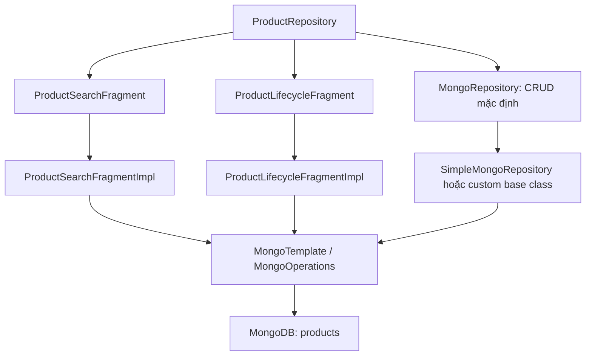

# Tái sử dụng fragment và tùy chỉnh repository cơ sở khi cần

## 1. Bài toán: khi một repository không còn đủ với CRUD và derived query

Trong ứng dụng quản lý danh mục, `ProductRepository` có thể bắt đầu rất đơn giản:

```java
import org.springframework.data.mongodb.repository.MongoRepository;

public interface ProductRepository
        extends MongoRepository<ProductDocument, String> {}
```

Spring Data MongoDB tạo implementation mặc định để gọi `save`, `findById`, `findAll`, `deleteById` và những query method có thể suy ra từ tên. Cách này đủ cho phần lớn thao tác CRUD.

Khi hệ thống phát triển, nảy sinh nhiều yêu cầu khác:

- Màn hình tìm kiếm sản phẩm cần các điều kiện **tùy chọn**, projection DTO, sort và giới hạn kết quả.
- Nhiều repository cùng cần thao tác đọc theo tenant hoặc chuẩn hóa một cách gọi tìm kiếm.
- Một số repository có nghiệp vụ đặc thù cần cập nhật nguyên tử bằng `MongoTemplate` thay vì `findById → sửa Java → save`.
- Toàn bộ repository của một module cần một **phương thức cơ sở thống nhất**, chẳng hạn `getRequiredById(id)` sẽ ném lỗi khi không thấy bản ghi.
- Nhóm kỹ thuật muốn kiểm soát việc mở rộng mà không viết lại `MongoRepository` hoặc can thiệp vào toàn bộ logic của Spring Data.

Có hai điểm mở rộng chính:

1. **Repository fragment:** một interface hành vi nhỏ, kèm một implementation độc lập, được Spring Data **ghép (compose)** vào repository cần sử dụng.
2. **Custom repository base class:** một implementation nền thay thế/bổ sung `SimpleMongoRepository` cho các repository trong phạm vi cấu hình `@EnableMongoRepositories`.

Đây là bài thuộc chương **Repository mở rộng** của module **SPRING_DATA_MONGODB**. Bên cạnh cú pháp Java, chúng ta sẽ liên hệ MongoDB thực tế, `MongoTemplate`, query/aggregation, index, transaction, reactive access, kiểm thử và chẩn đoán hiệu năng.

**Nguyên tắc thiết kế:** phần mở rộng cục bộ dùng **fragment**; hành vi nền áp dụng đồng loạt mới cân nhắc **base class tùy chỉnh**. Đừng dùng một base class toàn cục chỉ để giải quyết một truy vấn riêng của sản phẩm.

## 2. Ba mức mở rộng repository

| Cách | Tác động | Dùng khi | Rủi ro nếu lạm dụng |
| --- | --- | --- | --- |
| Derived query / `@Query` | Một method repository | Filter đơn giản, JSON query rõ ràng | Method nhiều biến thể, logic khó bảo trì |
| **Repository fragment** | Chỉ repository nào `extends` fragment | Query động, update riêng, API tái sử dụng | Trùng tên method hoặc implementation discovery sai |
| **Custom base repository** | Các repository trong scope cấu hình base class | API/hành vi nền nhất quán của nhiều repository | Ảnh hưởng rộng tới save/delete, transaction, mapping, callbacks |

Fragment có tính **composable**: một repository có thể kết hợp nhiều interface fragment. Implementation của fragment là một Spring bean được hệ thống repository composition phát hiện và gọi, không phải một repository độc lập cần `@EnableMongoRepositories` riêng.

Base repository lại gắn với factory tạo repository. Muốn thay đổi class nền, cần constructor tương thích và cấu hình `repositoryBaseClass`; không chỉ đặt một class tên `ProductRepositoryImpl` rồi kỳ vọng mọi repository tự đổi hành vi.

### 2.1. Sơ đồ tổng quan



Spring Data tạo một **repository proxy** đứng trước các phần implementation. Caller gọi method trên `ProductRepository`, proxy chuyển tới fragment hoặc base implementation phù hợp. Không cần tự tạo một class Java `implements ProductRepository` cho cả interface.

## 3. Tập dữ liệu và model dùng xuyên suốt bài

Giả sử mỗi sản phẩm thuộc một tenant, có danh mục, giá và trạng thái kích hoạt. Collection chứa các BSON field:

```javascript
db.products.insertMany([
  {
    _id: "p-101",
    tenant_id: "tenant-A",
    name: "Bàn phím cơ",
    category: "keyboard",
    price_cents: NumberLong("1850000"),
    active: true
  },
  {
    _id: "p-102",
    tenant_id: "tenant-A",
    name: "Chuột không dây",
    category: "mouse",
    price_cents: NumberLong("650000"),
    active: true
  },
  {
    _id: "p-103",
    tenant_id: "tenant-A",
    name: "Bàn phím cũ",
    category: "keyboard",
    price_cents: NumberLong("500000"),
    active: false
  },
  {
    _id: "p-104",
    tenant_id: "tenant-B",
    name: "Bàn phím khác tenant",
    category: "keyboard",
    price_cents: NumberLong("900000"),
    active: true
  }
]);
```

Đây là dữ liệu mô phỏng. Lệnh `insertMany` chỉ nên thực thi trên database thử nghiệm. Dữ liệu ghi trực tiếp bằng `mongosh` có thể không mang field type hint `_class` vốn được Spring Data ghi theo cấu hình mặc định.

### 3.1. Entity ánh xạ BSON

```java
import org.springframework.data.mongodb.core.mapping.Document;
import org.springframework.data.mongodb.core.mapping.Field;
import org.springframework.data.mongodb.core.mapping.FieldType;
import org.springframework.data.mongodb.core.mapping.MongoId;

@Document(collection = "products")
public record ProductDocument(
    @MongoId(FieldType.STRING)
    String id,

    @Field("tenant_id")
    String tenantId,

    String name,
    String category,

    @Field("price_cents")
    Long priceCents,

    boolean active
) {}
```

Các điểm cần để ý:

- `id` được ánh xạ sang `_id` dạng BSON string.
- Java property `tenantId` lưu dưới tên BSON `tenant_id`.
- Java property `priceCents` lưu thành `price_cents`; đây là đơn vị tiền nhỏ theo quy ước ví dụ, không phải đơn vị áp dụng cho mọi loại tiền.
- `active` là boolean ở model lưu trữ, không phải một biến tự động kiểm tra quyền truy cập.

Repository và `MongoTemplate` có metadata của `ProductDocument` sẽ ánh xạ các đường property như `tenantId`, `priceCents` thành BSON field tương ứng. Nếu gọi raw driver `getCollection("products")`, phải dùng tên BSON thật.

## 4. Fragment thứ nhất: interface mô tả hành vi tùy chỉnh

Giả sử endpoint quản trị cho phép tìm sản phẩm đang hoạt động, tùy chọn theo danh mục và khoảng giá. Repository thường không cần một method riêng cho mọi tổ hợp `category`, `minPrice`, `maxPrice`.

Định nghĩa DTO cho tiêu chí:

```java
public record ProductSearchFilter(
    String category,
    Long minPriceCents,
    Long maxPriceCents
) {}
```

Định nghĩa DTO chỉ đọc:

```java
public record ProductSummary(
    String id,
    String name,
    String category,
    Long priceCents
) {}
```

Fragment là một **interface Java bình thường**, không cần extends `Repository`:

```java
import java.util.List;

public interface ProductSearchFragment {

    List<ProductSummary> searchActive(
        String trustedTenantId,
        ProductSearchFilter filter,
        int requestedLimit
    );
}
```

Tên `ProductSearchFragment` mô tả năng lực rõ ràng. Khi muốn dùng năng lực này, repository chỉ cần `extends ProductSearchFragment`.

**Không** trả một `ProductDocument` tải thiếu dữ liệu nếu mục tiêu là danh sách chỉ đọc; `ProductSummary` thể hiện rõ hợp đồng. Cũng không nhận một chuỗi raw JSON filter từ HTTP rồi đưa thẳng vào MongoDB.

## 5. Fragment implementation: `ProductSearchFragmentImpl`

Quy ước phát hiện mặc định của Spring Data thường là **tên interface fragment + hậu tố `Impl`**. Do đó lớp triển khai của `ProductSearchFragment` đặt tên `ProductSearchFragmentImpl`.

```java
import java.util.List;
import java.util.Objects;

import org.springframework.data.domain.Sort;
import org.springframework.data.mongodb.core.MongoTemplate;
import org.springframework.data.mongodb.core.query.Criteria;
import org.springframework.data.mongodb.core.query.Query;
import org.springframework.stereotype.Component;

@Component
public class ProductSearchFragmentImpl
        implements ProductSearchFragment {

    private final MongoTemplate template;

    public ProductSearchFragmentImpl(MongoTemplate template) {
        this.template = Objects.requireNonNull(template);
    }

    @Override
    public List<ProductSummary> searchActive(
        String trustedTenantId,
        ProductSearchFilter filter,
        int requestedLimit
    ) {
        if (trustedTenantId == null
                || trustedTenantId.isBlank()) {
            throw new IllegalArgumentException(
                "Tenant bắt buộc"
            );
        }

        Objects.requireNonNull(filter, "filter");

        if (filter.minPriceCents() != null
                && filter.maxPriceCents() != null
                && filter.minPriceCents() > filter.maxPriceCents()) {
            throw new IllegalArgumentException(
                "Khoảng giá không hợp lệ"
            );
        }

        if (requestedLimit < 1 || requestedLimit > 100) {
            throw new IllegalArgumentException(
                "Giới hạn phải nằm trong 1..100"
            );
        }

        Criteria criteria = Criteria.where("tenantId")
            .is(trustedTenantId)
            .and("active").is(true);

        String category = filter.category();
        if (category != null && !category.isBlank()) {
            criteria.and("category").is(category.trim());
        }

        Query query = Query.query(criteria);

        if (filter.minPriceCents() != null
                || filter.maxPriceCents() != null) {
            Criteria price = Criteria.where("priceCents");

            if (filter.minPriceCents() != null) {
                price.gte(filter.minPriceCents());
            }
            if (filter.maxPriceCents() != null) {
                price.lte(filter.maxPriceCents());
            }

            query.addCriteria(price);
        }

        query.with(Sort.by(
            Sort.Order.asc("name"),
            Sort.Order.asc("id")
        ));
        query.limit(requestedLimit);

        return template.query(ProductDocument.class)
            .as(ProductSummary.class)
            .matching(query)
            .all();
    }
}
```

Đoạn code minh họa một **fluent query** trong `MongoTemplate`:

- `query(ProductDocument.class)` xác định **entity nguồn** và collection.
- `Criteria.where("tenantId")` được mapping sang `tenant_id` theo `@Field`.
- `priceCents` được mapping thành `price_cents`.
- `as(ProductSummary.class)` ánh xạ kết quả sang DTO thay vì entity đầy đủ.
- `matching(query)` áp dụng điều kiện, sort và limit.
- `all()` thực thi và trả `List<ProductSummary>`.

Projection DTO có thể cho framework tối ưu tập field đọc, nhưng **không cam kết mọi cấu hình đều chỉ đọc đúng bốn field BSON**. Với custom converter hoặc constructor mapping đặc thù, hãy kiểm tra command MongoDB được phát ra và kiểm thử kết quả BSON thật.

### 5.1. Vì sao dùng fragment thay vì code trong controller?

Một fragment tập trung logic truy cập dữ liệu của use case:

- Có thể kiểm thử độc lập với HTTP.
- Tái sử dụng được ở nhiều service và repository được ghép phù hợp.
- Kết hợp dữ liệu bằng `MongoTemplate` khi derived method quá dài.
- Giữ controller không phải biết tên collection, MongoDB `Criteria` hay quy tắc projection.

**Tenant phải đến từ danh tính đáng tin cậy**, chẳng hạn security context hoặc service đã xác thực. Đừng lấy `trustedTenantId` trực tiếp từ query parameter do khách hàng tự chọn rồi coi đó là phân quyền.

### 5.2. Null, giá và BSON type

Ví dụ sử dụng `Long` cho `priceCents` và filter dạng `gte/lte`. Nếu collection có dữ liệu cũ lưu giá dạng string/Decimal128 hoặc field thiếu, phép so sánh có thể cho kết quả khác mong đợi. Cần chuẩn hóa schema, validation và kiểm thử trên BSON thật.

Không dùng `Double` cho số tiền nếu ứng dụng yêu cầu số học tiền tệ chính xác; tùy loại tiền có thể lưu integer đơn vị nhỏ nhất hoặc BSON Decimal128 với `BigDecimal` và quy tắc scale.

## 6. Ghép fragment vào `ProductRepository`

Repository có thể mở rộng interface mặc định và fragment:

```java
import org.springframework.data.mongodb.repository.MongoRepository;

public interface ProductRepository
        extends MongoRepository<ProductDocument, String>,
                ProductSearchFragment {
}
```

Khi Spring Data khởi tạo repository, nó phát hiện implementation của `ProductSearchFragment` (mặc định hậu tố `Impl`) trong phạm vi cấu hình scan thích hợp và ghép vào proxy.

Caller có thể:

```java
List<ProductSummary> results = productRepository.searchActive(
    "tenant-A",
    new ProductSearchFilter("keyboard", 0L, 2000000L),
    20
);

for (ProductSummary item : results) {
    System.out.printf("%s: %s%n", item.id(), item.name());
}
```

Theo dữ liệu mẫu, `p-101` khớp; `p-103` không khớp vì không active; `p-104` không khớp vì tenant khác. Nếu có index và sort tương ứng, phép đọc có thể được tối ưu; kết quả chính xác phải được xác minh trên MongoDB thật.

**Không cần tạo `ProductRepositoryImpl implements ProductRepository`.** Điều đó dễ kéo bạn về mô hình một class tự cài đặt toàn bộ API repository, trái với cách Spring Data composition đang hỗ trợ.

### 6.1. Lưu ý naming và package

Một bố cục hợp lý:

```text
com.example.catalog.persistence
├── ProductDocument.java
├── ProductRepository.java
├── ProductSearchFragment.java
├── ProductSearchFragmentImpl.java
├── ProductSearchFilter.java
└── ProductSummary.java
```

Spring Data tìm custom fragment implementation trong phạm vi package và quy tắc đặt tên của repository infrastructure. Lớp implementation có thể được đăng ký như Spring bean, ví dụ có `@Component`, và nhận `MongoTemplate` qua constructor injection.

Nếu startup báo **thiếu implementation**, hãy kiểm tra:

1. Repository có thực sự `extends ProductSearchFragment`?
2. Tên lớp có đúng `ProductSearchFragmentImpl` và đúng hậu tố cấu hình?
3. Interface và implementation có nằm trong phạm vi scan phù hợp?
4. Constructor bean có dependency phù hợp?
5. Có một implementation hoặc bean trùng tên gây ambiguity không?
6. Có đặt repository fragment nhầm vào package bị loại bởi cấu hình scan không?

Không đổi tên ngẫu nhiên nhiều lớp cùng lúc. Xem log startup và cấu hình scan trước khi quyết định.

## 7. Fragment là đơn vị tái sử dụng, không phải class phụ thuộc một repository cụ thể

Khi muốn dùng `ProductSearchFragment` trong nhiều nơi của cùng aggregate `ProductDocument`, có thể ghép interface đó vào nhiều repository interface với những tập method mặc định khác nhau.

Ví dụ một repository chỉ phơi bày chức năng tìm kiếm cho một chương trình xuất dữ liệu nội bộ:

```java
import org.springframework.data.repository.Repository;

public interface ProductLookupRepository
        extends Repository<ProductDocument, String>,
                ProductSearchFragment {
}
```

Nó có thể sử dụng cùng `ProductSearchFragmentImpl`, nhưng không tự công khai toàn bộ API CRUD nếu không khai báo/extend các method tương ứng. Một service khác có thể inject `ProductLookupRepository` thay cho `ProductRepository` khi chỉ được phép dùng chức năng truy vấn.

**Lưu ý:** hai repository interface cùng domain type đều có thể tạo bean riêng và cùng sử dụng fragment. Khi inject theo interface cụ thể thường rõ ràng; nếu inject theo một interface chung mà cả hai cùng thỏa, cần qualifier hoặc cách tổ chức tránh ambiguity.

### 7.1. Reuse fragment cho nhiều domain type

Một fragment chung cho `ProductDocument` và `CustomerDocument` cần xử lý **domain type và collection** phù hợp. Nếu implementation hard-code `ProductDocument.class`, nó không thể tự động biến thành truy vấn trên `CustomerDocument` chỉ vì repository mới `extends` cùng interface.

Có thể thiết kế một fragment generic nhận class domain type **từ code nội bộ**:

```java
import java.util.List;

public interface TenantScopedReader<T> {
    List<T> findActiveForTenant(
        Class<T> domainType,
        String trustedTenantId,
        int limit
    );
}
```

Implementation chung:

```java
import java.util.List;
import org.springframework.data.mongodb.core.MongoTemplate;
import org.springframework.data.mongodb.core.query.Criteria;
import org.springframework.data.mongodb.core.query.Query;

public class TenantScopedReaderImpl<T>
        implements TenantScopedReader<T> {

    private final MongoTemplate template;

    public TenantScopedReaderImpl(MongoTemplate template) {
        this.template = template;
    }

    @Override
    public List<T> findActiveForTenant(
        Class<T> domainType,
        String trustedTenantId,
        int limit
    ) {
        if (trustedTenantId == null
                || trustedTenantId.isBlank()
                || limit < 1 || limit > 100) {
            throw new IllegalArgumentException(
                "Tham số truy vấn không hợp lệ"
            );
        }

        Query query = Query.query(
            Criteria.where("tenantId").is(trustedTenantId)
                .and("active").is(true)
        );
        query.limit(limit);

        return template.find(query, domainType);
    }
}
```

Với mẫu này, `ProductRepository` có thể thêm `TenantScopedReader<ProductDocument>`; một repository khác của `CustomerDocument` chỉ nên dùng khi schema của customer thực sự có những property `tenantId` và `active` tương thích.

**Đổi lại**, method cần được truyền `ProductDocument.class` hoặc `CustomerDocument.class` từ service đáng tin cậy. Không nhận `Class<?>`/collection name tùy ý từ HTTP client. Với domain bị yêu cầu rất khác nhau, tốt hơn dùng **một helper/service tái sử dụng nội bộ** rồi triển khai fragment riêng cho từng domain thay vì ép mọi schema vào một fragment generic.

### 7.2. Khi nào tách helper thay vì dùng chung fragment?

Một lớp `SearchQueryBuilder` hoặc `TenantCriteriaFactory` dùng chung có thể tạo `Criteria`, còn mỗi fragment chỉ quyết định domain type và DTO tương ứng. Cách này tránh một API fragment phải nhận `Class<T>` hoặc tên collection, đồng thời giữ hợp đồng riêng của từng aggregate.

Có thể reuse **implementation logic** mà không nhất thiết reuse **public repository interface**. Đây thường là cách tốt khi hai collection có index, field name hoặc chính sách quyền khác nhau.

## 8. Ghép nhiều fragment trong một repository

Giả sử sản phẩm còn cần thao tác điều chỉnh trạng thái:

```java
public interface ProductLifecycleFragment {

    boolean deactivate(
        String trustedTenantId,
        String productId
    );
}
```

Implementation có thể dùng `MongoTemplate.updateFirst` với điều kiện:

```java
import com.mongodb.client.result.UpdateResult;

import org.springframework.data.mongodb.core.MongoTemplate;
import org.springframework.data.mongodb.core.query.Criteria;
import org.springframework.data.mongodb.core.query.Query;
import org.springframework.data.mongodb.core.query.Update;
import org.springframework.stereotype.Component;

@Component
public class ProductLifecycleFragmentImpl
        implements ProductLifecycleFragment {

    private final MongoTemplate template;

    public ProductLifecycleFragmentImpl(MongoTemplate template) {
        this.template = template;
    }

    @Override
    public boolean deactivate(
        String trustedTenantId,
        String productId
    ) {
        Query query = Query.query(
            Criteria.where("id").is(productId)
                .and("tenantId").is(trustedTenantId)
                .and("active").is(true)
        );

        Update update = new Update()
            .set("active", false);

        UpdateResult result = template.updateFirst(
            query, update, ProductDocument.class
        );

        return result.getModifiedCount() == 1;
    }
}
```

Lúc này repository có thể ghép:

```java
public interface ProductRepository
        extends MongoRepository<ProductDocument, String>,
                ProductSearchFragment,
                ProductLifecycleFragment {
}
```

`ProductLifecycleFragmentImpl` chỉ thay `active` bằng `$set`, không cần load nguyên entity rồi `save`. MongoDB thực hiện một update trên một document nguyên tử theo filter; việc thay đổi trạng thái nhiều document hay phát sự kiện ngoài MongoDB không nằm trong một atomic update đó.

### 8.1. Method conflict và thứ tự ưu tiên

Trong cơ chế repository composition, custom fragments thường có ưu tiên cao hơn implementation nền và repository aspects. Khi nhiều fragment cung cấp cùng một method signature, **thứ tự khai báo fragments** có thể ảnh hưởng phần implementation được chọn. Vì vậy:

- Ưu tiên **method name không trùng** giữa các fragment.
- Không dùng thứ tự extends như cơ chế “business override” khó nhận thấy.
- Tránh một fragment định nghĩa lại `save`/`delete` mặc định nếu không có hợp đồng và test rất rõ.
- Với hành vi thực sự dùng chung toàn module, cân nhắc base repository thay vì ghép nhiều fragment có method override trùng nhau.
- Viết test dispatch để chứng minh Spring Data chọn đúng implementation theo phiên bản đang dùng.

Đừng coi thứ tự phương thức Java source hay thứ tự các class xuất hiện trong package là quy tắc lựa chọn fragment.

## 9. Đường mở rộng cũ: `ProductRepositoryImpl` theo tên repository

Một số dự án cũ có class:

```java
public class ProductRepositoryImpl {
    // Các method bổ sung được nhận diện theo tên ProductRepository + Impl.
}
```

Đây là mẫu **single custom implementation** theo tên repository, được giữ để tương thích với code cũ nhưng **không phải lựa chọn ưu tiên** cho code mới. Nó có thể gây nhầm lẫn với fragment implementation và làm việc tái sử dụng khó hơn.

Nên dùng:

```text
ProductSearchFragment          → ProductSearchFragmentImpl
ProductLifecycleFragment       → ProductLifecycleFragmentImpl
ProductRepository              → extends các fragment cần dùng
```

Thay vì:

```text
ProductRepository              → ProductRepositoryImpl (chứa mọi method custom)
```

Khi migration, cần kiểm tra mọi method, bean name, qualifier và transaction đã được gắn ở implementation cũ trước khi đổi tên. Không xóa class cũ ngay nếu các repository khác vẫn phụ thuộc vào nó.

### 9.1. Hậu tố implementation có thể tùy chỉnh

Nếu dự án cấu hình hậu tố khác `Impl`:

```java
import org.springframework.context.annotation.Configuration;
import org.springframework.data.mongodb.repository.config.EnableMongoRepositories;

@Configuration
@EnableMongoRepositories(
    basePackages = "com.example.catalog.persistence",
    repositoryImplementationPostfix = "Custom"
)
public class MongoRepositoryConfiguration {}
```

Khi đó `ProductSearchFragmentCustom` là tên convention tương ứng. **Không dùng đồng thời cả `ProductSearchFragmentImpl` và `ProductSearchFragmentCustom` mà không hiểu cấu hình**, vì có thể tạo ambiguity. Nếu class được đăng ký bean tường minh, bean naming cũng ảnh hưởng việc Spring Data gắn implementation vào fragment.

Cần kiểm tra Javadoc version và cấu hình scan trong dự án. Nhiều ứng dụng Spring Boot không phải tự thêm `@EnableMongoRepositories` nếu auto-configuration đã tìm thấy repositories đúng chỗ.

## 10. Custom repository base: bài toán khác hẳn fragment

Giả sử trong một module có 15 repository và code thường xuyên viết:

```java
ProductDocument product = repository.findById(id)
    .orElseThrow(
        () -> new java.util.NoSuchElementException(
            "Không tìm thấy bản ghi: " + id
        )
    );
```

Nhóm muốn mọi repository có chung method `getRequiredById(id)` trả entity hoặc ném lỗi. Một fragment cho 15 repository cũng có thể đáp ứng nhưng phải ghép nhiều lần và xử lý generic domain type. **Custom base repository** là một lựa chọn khi mong muốn API mới thuộc về hợp đồng repository nền cho cả module.

Để minh họa, chúng ta định nghĩa:

1. **Base repository interface** chứa method mới.
2. **Base repository implementation** mở rộng `SimpleMongoRepository`.
3. **Cấu hình repository factory** dùng `repositoryBaseClass`.

Đây là thay đổi có phạm vi rộng hơn một fragment: cần review kỹ, đặc biệt khi thay đổi `save`, `delete`, callbacks hoặc optimistic locking.

## 11. Base interface với `@NoRepositoryBean`

```java
import org.springframework.data.repository.NoRepositoryBean;
import org.springframework.data.mongodb.repository.MongoRepository;

@NoRepositoryBean
public interface RequiredFindRepository<T, ID>
        extends MongoRepository<T, ID> {

    T getRequiredById(ID id);
}
```

`@NoRepositoryBean` là điểm quan trọng: interface này chỉ là **base contract generic**, không phải repository của một entity cụ thể. Annotation ngăn Spring Data cố tạo một repository bean riêng cho `RequiredFindRepository<T,ID>` khi scan interfaces.

Method `getRequiredById(ID id)` không phải derived query mà framework có thể suy ra từ một property; chúng ta **tự cung cấp implementation** trong custom base class.

Nếu chỉ cần tiện ích Java thuần như:

```java
default T getRequiredById(ID id) {
    return findById(id).orElseThrow();
}
```

có thể viết `default method` trực tiếp trên interface mở rộng, **không cần thay base class**. Tuy nhiên một số team muốn behavior nền có thể được instrument, chuẩn hóa hoặc kết hợp với logic implementation chung; khi đó base class có vai trò. Luôn chọn mức mở rộng **đơn giản nhất đủ đáp ứng**.

## 12. Base implementation kế thừa `SimpleMongoRepository`

Một implementation mẫu:

```java
import java.util.NoSuchElementException;

import org.springframework.data.mongodb.core.MongoOperations;
import org.springframework.data.mongodb.repository.query.MongoEntityInformation;
import org.springframework.data.mongodb.repository.support.SimpleMongoRepository;

public class RequiredFindMongoRepository<T, ID>
        extends SimpleMongoRepository<T, ID>
        implements RequiredFindRepository<T, ID> {

    public RequiredFindMongoRepository(
        MongoEntityInformation<T, ID> entityInformation,
        MongoOperations mongoOperations
    ) {
        super(entityInformation, mongoOperations);
    }

    @Override
    public T getRequiredById(ID id) {
        return findById(id).orElseThrow(
            () -> new NoSuchElementException(
                "Không tìm thấy entity có ID: " + id
            )
        );
    }
}
```

Các điểm kỹ thuật:

- `SimpleMongoRepository<T, ID>` là implementation nền thông dụng của Spring Data MongoDB.
- Constructor cần nhận **`MongoEntityInformation<T,ID>`** và **`MongoOperations`** theo hợp đồng factory của phiên bản sử dụng, rồi truyền cho `super(...)`.
- Method mới dùng `findById` để tận dụng mapping và hoạt động MongoDB có sẵn.
- Class không cần `@Repository` riêng để được Spring Data chọn làm base class qua `@EnableMongoRepositories`.
- Không tạo `new RequiredFindMongoRepository(...)` bằng tay trong service; repository proxy/factory chịu trách nhiệm khởi tạo và ghép.

Ví dụ xử lý ngoại lệ mang tính minh họa. Trong API công khai, không nên tự động đưa ID hoặc dữ liệu nhạy cảm vào thông báo lỗi HTTP. Service/controller cần ánh xạ exception sang mã và thông báo phù hợp.

### 12.1. Đừng dùng inheritance chỉ để đổi thông báo lỗi

Nếu yêu cầu duy nhất là “trả 404 khi không tìm thấy sản phẩm”, một service method có `findById(...).orElseThrow(...)` đã rất đủ. Thay base repository toàn cục cho một yêu cầu nhỏ khiến thiết kế cồng kềnh và tăng chi phí kiểm thử/migration.

Base class thích hợp khi **nhiều repository** có một API/hành vi thống nhất thực sự đáng chia sẻ.

## 13. Đăng ký base class bằng `@EnableMongoRepositories`

```java
import org.springframework.context.annotation.Configuration;
import org.springframework.data.mongodb.repository.config.EnableMongoRepositories;

@Configuration
@EnableMongoRepositories(
    basePackages = "com.example.catalog.persistence",
    repositoryBaseClass = RequiredFindMongoRepository.class
)
public class CatalogMongoRepositoriesConfig {}
```

Sau đó một repository dùng base interface:

```java
public interface ProductRepository
        extends RequiredFindRepository<ProductDocument, String>,
                ProductSearchFragment,
                ProductLifecycleFragment {
}
```

Caller:

```java
ProductDocument product = productRepository
    .getRequiredById("p-101");

List<ProductSummary> summaries = productRepository
    .searchActive(
        "tenant-A",
        new ProductSearchFilter("keyboard", null, null),
        20
    );
```

Ở đây `getRequiredById` được cung cấp bởi **custom base**, còn `searchActive` đến từ **fragment**. Repository vẫn có các CRUD method thông thường do `SimpleMongoRepository` kế thừa.

### 13.1. Phạm vi cấu hình rất quan trọng

`repositoryBaseClass` áp dụng cho những repository thuộc phạm vi `@EnableMongoRepositories` đó. Nếu module có nhiều nhóm repository với cấu hình khác nhau, cần xác định rõ:

- Package nào thuộc scanner nào?
- Có vô tình scan cùng repository interface hai lần không?
- Có cấu hình Spring Boot tự động + `@EnableMongoRepositories` chồng nhau không?
- Có repository thuộc MongoDB và JPA cùng package gây nhầm store không?
- Những repository ngoài scope có base class khác hay không?

Đừng coi một cấu hình bean nằm bất kỳ đâu trong ứng dụng là tự áp dụng cho mọi repository trên toàn hệ thống. Phải test context startup và thực tế method được dispatch.

### 13.2. Phần base implementation không thay thế repository factory tùy chỉnh

Cấu hình `repositoryBaseClass` đủ cho nhiều nhu cầu. Nếu cần thay đổi **toàn bộ quá trình tạo proxy/repository**, chẳng hạn tùy biến metadata hoặc factory behavior, có thể phải mở rộng `MongoRepositoryFactoryBean`/`MongoRepositoryFactory` theo API của phiên bản.

Đó là mức can thiệp sâu hơn và có chi phí tương thích cao. Không bắt đầu từ custom factory nếu chỉ cần thêm một method.

## 14. Chọn default method, fragment hay custom base class?

Bảng quyết định thực dụng:

| Nhu cầu | Lựa chọn ưu tiên |
| --- | --- |
| Chuyển một `Optional<T>` thành exception đơn giản | Service hoặc interface `default method` |
| Một query tùy chọn/aggregation chỉ dành cho sản phẩm | **ProductSearchFragment** |
| Cập nhật một trạng thái riêng với `$set` có điều kiện | **ProductLifecycleFragment** |
| Chia sẻ một khả năng giữa vài repository cùng schema | Fragment reusable hoặc helper dùng chung |
| Logic query giống nhau nhưng schema từng domain khác | Helper/builder chung, fragment riêng từng domain |
| Một API nền thống nhất cho toàn bộ repository module | Base interface + **custom base class**, nếu default method không đủ |
| Muốn tự định nghĩa cách tạo proxy và repository factory | Custom factory (cuối cùng, khi thật sự cần) |
| Chỉ muốn giữ validation/authorization nghiệp vụ | Service/domain policy; không nhất thiết repository extension |
| Muốn thay mọi `delete` thành soft delete | Cần thiết kế toàn cục rất cẩn thận, không chỉ override một method |

**Không thay base class chỉ để che khuất những method nguy hiểm.** Ví dụ override `deleteById` và mong toàn hệ thống không còn physical delete là thiếu sót: các đường `delete` khác, batch, template, raw driver hoặc custom query vẫn có thể xóa. Nếu cần soft-delete policy, phải quản lý toàn bộ write path, filter đọc, index, retention và kiểm thử.

## 15. Override method mặc định: quyền năng đi kèm rủi ro

Một custom base class có thể override method như `save(S entity)` hoặc `deleteById(ID id)`. Nhưng cần phân biệt:

- `save` có semantics **insert hoặc update** tùy ID/metadata và cách mapping.
- `MongoRepository.saveAll(...)` có thể có đường thực thi riêng; không nên mặc định mọi method đều đi qua override `save` đúng như mong đợi.
- `MongoTemplate.updateFirst(...)`, `bulkOps(...)` và raw MongoDB Driver không đi qua repository base method `save`.
- Callback, auditing và `@Version` có hợp đồng theo Spring Data MongoDB; tự cài đặt raw replacement có thể bỏ qua chúng.
- Những repository fragment có method trùng có thể có độ ưu tiên cao hơn base implementation.
- Khi ứng dụng dùng reactive, base class imperative **không áp dụng** cho `ReactiveMongoRepository`.

Một ví dụ tối giản về hook trước khi lưu (chỉ minh họa, không thay thế domain validation):

```java
public interface ValidatedBeforeSave {
    void validateForPersistence();
}
```

```java
public class ValidatingMongoRepository<T, ID>
        extends SimpleMongoRepository<T, ID> {

    public ValidatingMongoRepository(
        MongoEntityInformation<T, ID> info,
        MongoOperations operations
    ) {
        super(info, operations);
    }

    @Override
    public <S extends T> S save(S entity) {
        if (entity instanceof ValidatedBeforeSave validatable) {
            validatable.validateForPersistence();
        }
        return super.save(entity);
    }
}
```

Nếu dùng lớp này trong dự án thật, thêm imports tương tự mục 12 và cấu hình `repositoryBaseClass=ValidatingMongoRepository.class`. Nó **chỉ** kiểm tra những entity implements `ValidatedBeforeSave` khi đi qua đường `save` được override; không được quảng bá là chính sách validation không thể vượt qua.

Nên dùng Bean Validation/domain service hoặc MongoDB schema validation cho các bất biến cần áp dụng trên nhiều write path. Repository base không phải tường lửa dữ liệu.

## 16. Fragment không tự tạo transaction

Một fragment có thể gọi nhiều thao tác MongoDB:

```java
public void reserveAndRecord(
    String productId,
    long quantity
) {
    // 1. Kiểm tra và trừ tồn kho.
    // 2. Ghi một document Reservation.
}
```

Nếu hai thao tác ghi vào **hai document hoặc hai collection**, chúng không tự cùng commit chỉ vì method nằm trong một fragment hay repository.

Trường hợp chỉ sửa **một document** bằng `updateFirst` với filter và `$inc`/`$set`, MongoDB bảo đảm tính nguyên tử ở cấp document. Nếu nghiệp vụ cần cập nhật nhiều document cùng commit/rollback, cần cân nhắc MongoDB transaction trên deployment hỗ trợ.

### 16.1. Đặt transaction ở ranh giới service

Một ví dụ cấu hình transaction manager:

```java
import org.springframework.context.annotation.Bean;
import org.springframework.context.annotation.Configuration;
import org.springframework.data.mongodb.MongoDatabaseFactory;
import org.springframework.data.mongodb.MongoTransactionManager;

@Configuration
public class MongoTransactionConfig {

    @Bean
    public MongoTransactionManager mongoTransactionManager(
        MongoDatabaseFactory factory
    ) {
        return new MongoTransactionManager(factory);
    }
}
```

Service điều phối:

```java
import org.springframework.stereotype.Service;
import org.springframework.transaction.annotation.Transactional;

@Service
public class CatalogWorkflowService {

    private final ProductRepository products;

    public CatalogWorkflowService(ProductRepository products) {
        this.products = products;
    }

    @Transactional(
        transactionManager = "mongoTransactionManager"
    )
    public void deactivateAndWriteAudit(
        String trustedTenantId,
        String productId
    ) {
        boolean changed = products.deactivate(
            trustedTenantId, productId
        );
        if (!changed) {
            throw new IllegalStateException(
                "Không thể chuyển trạng thái sản phẩm"
            );
        }

        // Ghi audit trong cùng MongoDB transaction bằng
        // repository/template cùng session/transaction context.
    }
}
```

Code là khung minh họa: bước ghi audit cần implementation thực tế và cấu hình transaction đúng. `@Transactional` có hiệu lực khi method được gọi qua Spring proxy; self-invocation trong cùng instance có thể không đi qua proxy. Một transaction MongoDB không bao phủ email, HTTP hay broker bên ngoài MongoDB.

**Tránh** mở transaction dài chỉ để duyệt hàng triệu kết quả. Dùng checkpoint/idempotency cho batch workflows.

### 16.2. Fragment và repository exception translation

Nếu implementation gọi `MongoTemplate` qua Spring Data, các exception MongoDB thường được Spring dịch sang hierarchy `DataAccessException` ở đường thích hợp. Nếu fragment gọi raw `MongoCollection`, có thể nhận exception driver khác và bỏ qua một số quy ước converter/transaction context.

Không nuốt exception để trả `true`/`false` vô điều kiện. Với update có điều kiện, cần phân biệt không tìm thấy, trạng thái không hợp lệ, permission không khớp và lỗi mạng có kết quả chưa rõ.

## 17. Fragment trong reactive repository

Với Spring WebFlux, một fragment nên sử dụng **ReactiveMongoTemplate** và trả `Mono`/`Flux`, không gọi repository/template blocking bên trong reactive pipeline.

Định nghĩa interface riêng:

```java
import reactor.core.publisher.Flux;

public interface ReactiveProductSearchFragment {

    Flux<ProductSummary> searchActiveReactive(
        String trustedTenantId,
        String category,
        int limit
    );
}
```

Implementation:

```java
import org.springframework.data.domain.Sort;
import org.springframework.data.mongodb.core.ReactiveMongoTemplate;
import org.springframework.data.mongodb.core.query.Criteria;
import org.springframework.data.mongodb.core.query.Query;

import reactor.core.publisher.Flux;

public class ReactiveProductSearchFragmentImpl
        implements ReactiveProductSearchFragment {

    private final ReactiveMongoTemplate template;

    public ReactiveProductSearchFragmentImpl(
        ReactiveMongoTemplate template
    ) {
        this.template = template;
    }

    @Override
    public Flux<ProductSummary> searchActiveReactive(
        String trustedTenantId,
        String category,
        int limit
    ) {
        if (trustedTenantId == null
                || trustedTenantId.isBlank()
                || limit < 1 || limit > 100) {
            return Flux.error(
                new IllegalArgumentException(
                    "Tham số truy vấn không hợp lệ"
                )
            );
        }

        Criteria criteria = Criteria.where("tenantId")
            .is(trustedTenantId)
            .and("active").is(true);

        if (category != null && !category.isBlank()) {
            criteria.and("category").is(category.trim());
        }

        Query query = Query.query(criteria)
            .with(
                Sort.by(
                    Sort.Order.asc("name"),
                    Sort.Order.asc("id")
                )
            );
        query.limit(limit);

        return template.query(ProductDocument.class)
            .as(ProductSummary.class)
            .matching(query)
            .all();
    }
}
```

Repository reactive:

```java
import org.springframework.data.mongodb.repository.ReactiveMongoRepository;

public interface ReactiveProductRepository
        extends ReactiveMongoRepository<ProductDocument, String>,
                ReactiveProductSearchFragment {
}
```

Việc phát hiện implementation cũng cần naming/scan phù hợp với cấu hình reactive repository. Thay vì dùng `@EnableMongoRepositories`, reactive thường được cấu hình bằng `@EnableReactiveMongoRepositories` khi cần cấu hình tường minh.

**Lưu ý:** một custom base class kế thừa `SimpleMongoRepository` không áp dụng cho reactive; thế giới reactive có implementation và constructor riêng của `SimpleReactiveMongoRepository` theo từng phiên bản. Không gộp base class imperative/reactive thành một class.

### 17.1. Backpressure và transaction reactive

`Flux<ProductSummary>` không đồng nghĩa truy vấn có index tốt hay tự giới hạn kết quả; ở ví dụ đã có `limit`. Tránh `block()` trong event loop và tránh `collectList()` không giới hạn.

Nếu một workflow reactive cần transaction đa document, cần `ReactiveMongoTransactionManager` và context reactive đúng cách, chẳng hạn `TransactionalOperator`. `MongoTransactionManager` imperative không thay thế được.

## 18. Repository fragment và Aggregation

Khi truy vấn chỉ cần equality/regex đơn giản, derived query hoặc `@Query` có thể đủ. Fragment hữu ích nếu phải **tạo aggregation động** theo nhiều input, rồi ánh xạ kết quả sang DTO.

Ví dụ pipeline MongoDB tính số sản phẩm đang hoạt động theo category trong một tenant:

```javascript
db.products.aggregate([
  {
    $match: {
      tenant_id: "tenant-A",
      active: true
    }
  },
  {
    $group: {
      _id: "$category",
      productCount: { $sum: 1 }
    }
  },
  { $sort: { productCount: -1, _id: 1 } }
]);
```

Fragment có thể dùng:

```java
import java.util.List;

import org.springframework.data.mongodb.core.MongoTemplate;
import org.springframework.data.mongodb.core.aggregation.Aggregation;
import org.springframework.data.mongodb.core.query.Criteria;

public record CategoryCount(
    String id,
    long productCount
) {}

public List<CategoryCount> countByCategory(
    MongoTemplate template,
    String trustedTenantId
) {
    Aggregation aggregation = Aggregation.newAggregation(
        Aggregation.match(
            Criteria.where("tenantId").is(trustedTenantId)
                .and("active").is(true)
        ),
        Aggregation.group("category")
            .count().as("productCount"),
        Aggregation.sort(
            org.springframework.data.domain.Sort.by(
                org.springframework.data.domain.Sort.Order
                    .desc("productCount"),
                org.springframework.data.domain.Sort.Order
                    .asc("_id")
            )
        )
    );

    return template.aggregate(
        aggregation,
        ProductDocument.class,
        CategoryCount.class
    ).getMappedResults();
}
```

Đoạn này minh họa method helper có thể được chuyển vào fragment report; cần khai báo interface tương ứng nếu muốn method xuất hiện trên repository. `ProductDocument.class` giúp Spring Data biết input collection và mapping `tenantId` → `tenant_id`.

**Kiểm tra shape kết quả:** `$group` tạo `_id` là category; record `CategoryCount(String id, ...)` sử dụng tên `id` như một lựa chọn mapping, nhưng nếu API muốn `category` thì thêm `$project`/alias phù hợp và integration test. Một fragment aggregation **không nhất thiết** phải trả entity đầy đủ.

## 19. Index và hiệu năng: fragment không làm query tự nhanh hơn

Từ ví dụ `searchActive`, filter có:

```text
tenantId = ...
active = true
category = ... (tùy chọn)
priceCents >= min (tùy chọn)
priceCents <= max (tùy chọn)
sort name ASC, id ASC
limit <= 100
```

Một index có thể hữu ích cho trường hợp lọc category và sort theo tên:

```javascript
db.products.createIndex({
  tenant_id: 1,
  active: 1,
  category: 1,
  name: 1,
  _id: 1
});
```

Với filter có khoảng `price_cents` và sort `name`, một index khác có thể phù hợp; không có index duy nhất tối ưu mọi tổ hợp. Chọn index theo **mẫu truy vấn thực tế** và số đo `explain`.

Ví dụ:

```javascript
db.products.find({
  tenant_id: "tenant-A",
  active: true,
  category: "keyboard"
})
.sort({ name: 1, _id: 1 })
.limit(20)
.explain("executionStats");
```

Quan sát:

| Chỉ số | Ý nghĩa |
| --- | --- |
| `IXSCAN`, `COLLSCAN` | Có dùng index không? |
| `totalKeysExamined` | Đã duyệt bao nhiêu index entry? |
| `totalDocsExamined` | Đã đọc bao nhiêu document gốc? |
| Sort stage | Query có sort ngoài index không? |
| `nReturned` | Có giới hạn số kết quả không? |
| Dung lượng BSON | DTO projection có giảm dữ liệu nhận thật không? |
| p95/p99 latency | Mức đáp ứng dưới tải thực tế |

Việc “đưa query vào fragment” chỉ giúp **tổ chức code**. Nó không tạo index, cache, transaction hoặc cơ chế chống N+1. Phải tự thiết kế/query/index theo nghiệp vụ.

### 19.1. N+1 trong fragment

Một fragment danh sách có thể gọi `template.find(...)` lấy 20 sản phẩm, rồi trong vòng lặp gọi repository khác 20 lần để tải thông tin tồn kho hoặc nhà cung cấp. Đây là N+1 query dù method chỉ có một entry point.

Khi cần dữ liệu liên quan, cân nhắc batch query bằng `$in`, precomputed snapshot, aggregation `$lookup` hoặc thiết kế document phù hợp. Không mặc định fragment tự giải quyết tham chiếu ID.

## 20. Kiểm thử tích hợp fragment và repository base

Mock unit test hữu ích để kiểm tra validation/query-building, nhưng **không chứng minh** repository factory đã ghép đúng fragment, mapping `@Field` đúng hay base class đã được chọn. Nên có integration test dùng MongoDB thật, ví dụ Testcontainers với `@DataMongoTest` trong môi trường Spring Boot.

### 20.1. Test fragment được dispatch qua repository proxy

Ví dụ test repository được cấu hình scan cùng `ProductSearchFragmentImpl`, MongoDB test được cô lập:

```java
import static org.assertj.core.api.Assertions.assertThat;

import java.util.List;

import org.junit.jupiter.api.Test;
import org.springframework.beans.factory.annotation.Autowired;
import org.springframework.boot.test.autoconfigure.data.mongo.DataMongoTest;
import org.springframework.data.mongodb.core.MongoTemplate;

@DataMongoTest
class ProductSearchFragmentIntegrationTest {

    @Autowired ProductRepository products;

    @Autowired MongoTemplate template;

    @Test
    void repositoryDelegatesToFragmentAndKeepsTenantFilter() {
        template.insert(new ProductDocument(
            "frag-01", "tenant-A",
            "Bàn phím A", "keyboard", 100000L, true
        ));
        template.insert(new ProductDocument(
            "frag-02", "tenant-A",
            "Bàn phím tạm ngưng", "keyboard",
            80000L, false
        ));
        template.insert(new ProductDocument(
            "frag-03", "tenant-B",
            "Bàn phím B", "keyboard",
            90000L, true
        ));

        List<ProductSummary> results = products.searchActive(
            "tenant-A",
            new ProductSearchFilter(
                "keyboard", 50000L, 150000L
            ),
            10
        );

        assertThat(results)
            .extracting(ProductSummary::id)
            .containsExactly("frag-01");
    }
}
```

Kiểm thử này chứng minh Spring Data đã dispatch qua fragment implementation **nếu ứng dụng test context đã quét và đăng ký đúng fragment**. Khi test slice không tự nhận `@Component` theo phạm vi cấu hình, cần bổ sung `@Import(ProductSearchFragmentImpl.class)` hoặc tổ chức test repository config đúng cách; tránh lặp/đăng ký hai bean cùng tên.

Mẫu test chưa được chạy tại bước soạn bài này. Với ID cố định, phải dọn dữ liệu test hoặc dùng database/collection cô lập trước khi chạy lại.

### 20.2. Test custom base repository

Nếu dự án dùng `RequiredFindRepository` và `RequiredFindMongoRepository`:

```java
import static org.assertj.core.api.Assertions.assertThat;
import static org.assertj.core.api.Assertions.assertThatThrownBy;

import java.util.NoSuchElementException;

import org.junit.jupiter.api.Test;

@Test
void customBaseMethodWorks() {
    ProductDocument saved = products.save(
        new ProductDocument(
            "base-01", "tenant-A", "Chuột",
            "mouse", 50000L, true
        )
    );

    assertThat(products.getRequiredById(saved.id()).id())
        .isEqualTo(saved.id());

    assertThatThrownBy(
        () -> products.getRequiredById("does-not-exist")
    ).isInstanceOf(NoSuchElementException.class);
}
```

Đây là **method test minh họa đặt trong test class có field `products`**, không phải file Java độc lập. Để chạy, `ProductRepository` phải extends `RequiredFindRepository` và context phải áp dụng `@EnableMongoRepositories(repositoryBaseClass=RequiredFindMongoRepository.class)`. Nếu thiếu cấu hình, test có thể fail ngay khi khởi tạo repository vì method mới không có implementation.

### 20.3. Những trường hợp cần test

| Tình huống | Kỳ vọng |
| --- | --- |
| Repository extends fragment | Proxy gọi đúng `FragmentImpl` |
| Fragment implementation thiếu bean/sai tên | Startup hoặc method dispatch lỗi, được phát hiện sớm |
| Hai fragment có method trùng | Kết quả được kiểm soát theo thứ tự/thiết kế, không mơ hồ |
| `tenantId` và `@Field` | BSON query dùng đúng `tenant_id` |
| Search category, khoảng giá | Ánh xạ đúng filter và DTO |
| Input giới hạn 0 hoặc 10.000 | Service từ chối, không gửi query rộng |
| Product inactive hoặc tenant khác | Không được trả |
| Custom base `getRequiredById` | Trả entity khi có, ném lỗi khi thiếu |
| Base class scope | Các repository mong muốn dùng base mới, nhóm khác không bị thay ngoài ý muốn |
| Concurrent `deactivate` | Một update có điều kiện đạt modifiedCount phù hợp |
| Transaction nhiều document | Commit/rollback đúng trên replica set test nếu triển khai |
| Reactive fragment | Publisher không block và dispatch đúng |
| Migration từ repository-name Impl cũ | Không còn ambiguity/override ngầm |

## 21. Khi nào cần override base behavior thay vì ghép fragment?

Một số nhu cầu thật sự **xuyên suốt** nhiều repository:

- Chuẩn hóa API `getRequiredById` hoặc thao tác đọc nền có hợp đồng chung.
- Tích hợp instrumentation ở đường repository base cụ thể.
- Cung cấp method nền có thể tái sử dụng ở nhiều aggregate mà một default method không đáp ứng.
- Điều chỉnh một số hành vi lưu trữ đã được kiểm chứng của toàn module.

Nhưng vẫn cần phân tích các câu hỏi:

1. Phạm vi module nào thật sự dùng base class mới?
2. Các repository ngoài phạm vi có nên giữ hành vi mặc định không?
3. Method mới có thể được diễn đạt bằng một `default method`/service helper đơn giản hơn không?
4. Có nguy cơ thay đổi semantics `save`, `delete`, optimistic locking, mapping callbacks không?
5. Repository fragment nào có thể cung cấp method trùng và ưu tiên trước base?
6. Bulk writes, `MongoTemplate` và raw driver có thể bỏ qua policy mới không?
7. Team có đủ integration test trên MongoDB, nhiều repository và phiên bản Spring Data đang dùng không?
8. Có phải áp dụng đồng thời cho repository reactive không — và nếu có, cần implementation riêng?

Không có quy tắc “càng nhiều custom base càng tốt”. Dấu hiệu thiết kế đúng là phần mở rộng **có phạm vi nhỏ nhất thỏa nhu cầu**, API rõ ràng, không bất ngờ thay đổi behavior của repository khác.

## 22. Các lỗi thường gặp

**“Muốn thêm một method thì phải tạo `ProductRepositoryImpl implements ProductRepository`.”** Không. Với Spring Data, tạo **fragment interface + implementation** rồi `extends` fragment thường là cách hiện đại hơn.

**“`ProductSearchFragmentImpl` nằm bất cứ đâu cũng sẽ được phát hiện.”** Không chắc. Naming, package scan và bean registration quyết định việc composition thành công.

**“`@Component` một mình bảo đảm repository tự có method đó.”** Không. Repository phải khai báo fragment interface hoặc được cấu hình composition tương ứng.

**“Có method `save` cùng tên trong fragment thì không ảnh hưởng CRUD.”** Có thể ảnh hưởng dispatch vì custom fragments có ưu tiên cao; method override phải được review/test.

**“Dùng chung fragment cho mọi entity mà không cần biết domain type.”** Không đúng nếu implementation hard-code collection/entity. Với generic fragment phải thiết kế runtime domain type an toàn hoặc dùng helper dùng chung.

**“`@NoRepositoryBean` trên base interface là tùy ý.”** Rất quan trọng khi generic interface extends `MongoRepository`; thiếu annotation có thể khiến scanner tìm cách tạo repository không có domain type cụ thể.

**“Đặt `repositoryBaseClass` cho một config là mọi repository trong app đều đổi.”** Không. Nó chỉ tác động tới repositories trong scope của cấu hình đó.

**“Custom base class cần constructor rỗng.”** Không. Factory thường đòi hỏi constructor phù hợp `MongoEntityInformation` và `MongoOperations` cho loại base tương ứng.

**“Override `save` ở base có nghĩa raw `MongoTemplate.updateFirst` cũng đi qua validation ấy.”** Không. Các đường ghi độc lập không tự qua repository base.

**“Fragment thực thi hai update nghĩa là chúng cùng transaction.”** Không. Cần manager/session/transaction đúng khi ghi nhiều document.

**“Fragment repository reactive có thể gọi `MongoTemplate` rồi `Mono.just(result)`.”** Cách này vẫn block thread; phải dùng `ReactiveMongoTemplate`.

**“Có DTO result thì MongoDB chắc chắn trả đúng bốn field.”** Không mặc định. Quan sát command và đo dữ liệu nhận khi yêu cầu tối ưu thật sự.

**“Fragment tự tối ưu index.”** Không. Index thuộc về schema và query plan, cần thiết kế theo filter/sort thực tế.

## 23. Checklist triển khai trong dự án thật

| Kiểm tra | Câu hỏi cần trả lời |
| --- | --- |
| Nhu cầu | Derived query, fragment hay base class là mức mở rộng ít rủi ro nhất? |
| Naming | Đúng `FragmentNameImpl` hoặc postfix được cấu hình? |
| Package scan | Fragment implementation trong scope và được đăng ký Spring bean? |
| Repository composition | Repository `extends` đúng các fragment cần dùng? |
| Method conflict | Không có signature trùng ngoài ý muốn, đã test dispatch? |
| Reuse | Fragment hard-code domain type hay generic có kiểm soát? |
| Base interface | Có `@NoRepositoryBean` và generic type rõ ràng? |
| Base constructor | Tương thích `MongoEntityInformation`/`MongoOperations` của version? |
| Base configuration | `@EnableMongoRepositories(repositoryBaseClass=...)` đúng scope, không scan trùng? |
| Model mapping | `@Field`, ID String/ObjectId, converter và DTO được test? |
| Authorization | Tenant ID từ nguồn đáng tin và luôn nằm trong filter? |
| Query cost | Sort/limit/projection/index phù hợp, đã đo `explain`? |
| Update | Dùng update có điều kiện/atomic khi cần, tránh read-modify-save? |
| Transaction | Multi-document có transaction đúng context, không mặc định mọi fragment transactional? |
| Reactive | Dùng reactive fragment riêng, không block event loop? |
| Test | Có integration test cho fragment + base class + MongoDB thật? |
| Version upgrade | Đối chiếu factory constructor, repository composition, repository scan và callbacks? |

## 24. Tài liệu tham khảo và giới hạn phiên bản

Repository fragments và custom base class là các cơ chế Spring Data repository infrastructure; phần mapping MongoDB sử dụng `MongoTemplate`/`MongoOperations`. Cần đối chiếu tài liệu theo **phiên bản dependencies đang được build**, không chỉ bản mới nhất của Javadoc.

- [Spring Data MongoDB — Custom Repository Implementations](https://docs.spring.io/spring-data/mongodb/reference/repositories/custom-implementations.html)
- [Spring Data Commons — Custom Repository Implementations](https://docs.spring.io/spring-data/commons/reference/repositories/custom-implementations.html)
- [Spring Data MongoDB — MongoRepositories](https://docs.spring.io/spring-data/mongodb/reference/mongodb/repositories/repositories.html)
- [Spring Data MongoDB — EnableMongoRepositories Javadoc](https://docs.spring.io/spring-data/mongodb/reference/api/java/org/springframework/data/mongodb/repository/config/EnableMongoRepositories.html)
- [Spring Data MongoDB — SimpleMongoRepository Javadoc](https://docs.spring.io/spring-data/mongodb/reference/api/java/org/springframework/data/mongodb/repository/support/SimpleMongoRepository.html)
- [Spring Data MongoDB — MongoTemplate Fluent API](https://docs.spring.io/spring-data/mongodb/reference/mongodb/template-query-operations.html)
- [MongoDB Manual — Query Documents](https://www.mongodb.com/docs/manual/tutorial/query-documents/)
- [MongoDB Manual — Explain Results](https://www.mongodb.com/docs/manual/reference/explain-results/)

**Kết luận:** Trong Spring Data MongoDB, **repository fragment** cho phép xây những năng lực truy vấn/cập nhật riêng dưới dạng **interface + `...Impl`** và ghép chúng vào repository cần dùng, có thể tái sử dụng implementation một cách có kiểm soát. **Custom repository base class** mở rộng `SimpleMongoRepository` và được đăng ký bằng `@EnableMongoRepositories(repositoryBaseClass=...)` khi thật sự cần hành vi nền chung cho nhiều repository. Hãy ưu tiên mức tùy biến nhỏ nhất, tránh method conflict, kiểm soát mapping/tenant/transaction, phân biệt imperative với reactive và kiểm thử repository proxy trên MongoDB thật trước khi áp dụng rộng.

