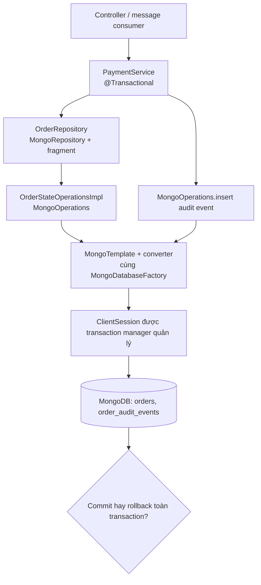
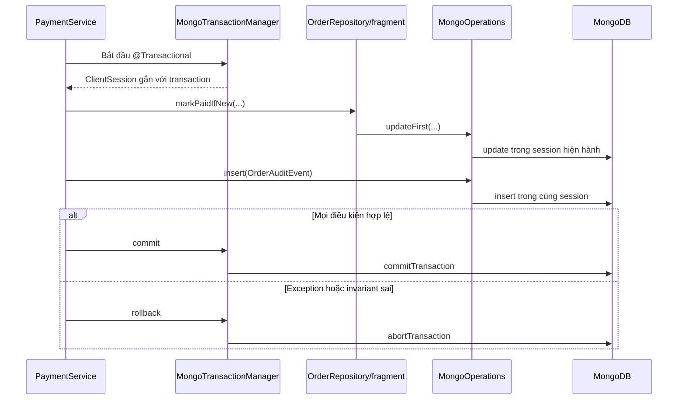

# Giữ thống nhất mapping, session và ranh giới giao dịch

Trong **Spring Data MongoDB**, mở rộng repository giúp đưa những truy vấn hoặc thao tác ghi không thể diễn đạt gọn bằng phương thức suy diễn vào một thành phần riêng. Ví dụ, `MongoRepository<Order, ObjectId>` có thể cung cấp CRUD thông thường, còn một **repository fragment** viết bằng `MongoOperations` hỗ trợ lọc động, cập nhật có điều kiện hoặc truy vấn phức tạp. Tuy nhiên, việc “repository mở rộng chạy được” chưa có nghĩa nó **hành xử nhất quán** với phần còn lại của ứng dụng.

Có ba thứ phải giữ thống nhất:

1. **Mapping:** repository chính, fragment, và `MongoTemplate` cần cùng hiểu entity, tên collection, kiểu BSON, `@Field`, `@Id`, converters và callbacks.
2. **Session:** các thao tác được kỳ vọng ở trong cùng một phiên MongoDB phải thực sự dùng **cùng `ClientSession` đang được quản lý**; mở `MongoClient` mới hoặc chuyển sang native driver tùy tiện có thể làm mất ngữ cảnh.
3. **Ranh giới giao dịch:** một nghiệp vụ liên quan nhiều thao tác phải xác định rõ **ai mở transaction, ở đâu commit/rollback, thao tác nào tham gia**, và các điều kiện nào là bất biến nghiệp vụ.

Bài thuộc chương **Repository mở rộng** của module **SPRING_DATA_MONGODB**. Ta sẽ xây một ví dụ từ `MongoRepository`, custom fragment, `MongoOperations` đến `@Transactional` và kiểm thử rollback. Nội dung cũng liên hệ repository với `MongoTemplate`, native Java Driver, optimistic locking, access reactive và chẩn đoán MongoDB.

## 1. Tình huống: xác nhận đơn hàng và ghi audit

Giả sử hệ thống có collection `orders` và `order_audit_events`. Một lần xác nhận thanh toán phải:

- Xác định đúng đơn thuộc tenant hiện hành.
- Chỉ chuyển trạng thái từ `NEW` sang `PAID`.
- Ghi một bản ghi audit tương ứng.
- Nếu ghi audit thất bại, nghiệp vụ yêu cầu **không để đơn chuyển sang PAID một mình**.
- Nếu dữ liệu thay đổi đồng thời, không âm thầm ghi đè trạng thái mới.

Các document ví dụ:

```javascript
// orders
{
  _id: ObjectId("674000000000000000000801"),
  tenant_id: "T1",
  status: "NEW",
  total_cents: NumberLong("350000"),
  version: NumberLong("0")
}

// order_audit_events
{
  _id: ObjectId("674000000000000000000901"),
  tenant_id: "T1",
  order_id: ObjectId("674000000000000000000801"),
  event_key: "payment-123",
  event_type: "ORDER_PAID",
  occurred_at: ISODate("2026-11-20T02:00:00Z")
}
```

Việc chuyển trạng thái chỉ một document có thể làm bằng update nguyên tử. Nhưng yêu cầu **cùng commit/rollback với audit** trải qua hai collection, do đó nếu nghiệp vụ bắt buộc tính nguyên tử, cần **MongoDB transaction thực sự** trên topology hỗ trợ.



**Luồng đúng:** tầng service sở hữu ranh giới nghiệp vụ; repository và fragment cùng tham gia transaction qua Spring Data MongoDB; mapping vẫn nhất quán. **Luồng sai:** fragment tự tạo một MongoClient riêng và tự ghi ngay ngoài transaction mà service nghĩ đang kiểm soát.

## 2. Entity và metadata mapping được dùng chung

Một entity đơn hàng tối thiểu:

```java
import org.bson.types.ObjectId;
import org.springframework.data.annotation.Id;
import org.springframework.data.annotation.Version;
import org.springframework.data.mongodb.core.mapping.Document;
import org.springframework.data.mongodb.core.mapping.Field;

@Document(collection = "orders")
public class Order {
    @Id
    private ObjectId id;

    @Field("tenant_id")
    private String tenantId;

    private String status;

    @Field("total_cents")
    private long totalCents;

    @Version
    private Long version;

    public Order() {}

    public Order(
            ObjectId id, String tenantId,
            String status, long totalCents) {
        this.id = id;
        this.tenantId = tenantId;
        this.status = status;
        this.totalCents = totalCents;
    }

    public ObjectId getId() { return id; }
    public String getTenantId() { return tenantId; }
    public String getStatus() { return status; }
    public long getTotalCents() { return totalCents; }
    public Long getVersion() { return version; }

    public void changeStatus(String value) {
        status = value;
    }
}
```

Audit event nằm ở collection khác:

```java
import java.time.Instant;
import org.bson.types.ObjectId;
import org.springframework.data.annotation.Id;
import org.springframework.data.mongodb.core.mapping.Document;
import org.springframework.data.mongodb.core.mapping.Field;

@Document(collection = "order_audit_events")
public class OrderAuditEvent {
    @Id
    private ObjectId id;

    @Field("tenant_id")
    private String tenantId;

    @Field("order_id")
    private ObjectId orderId;

    @Field("event_key")
    private String eventKey;

    @Field("event_type")
    private String eventType;

    @Field("occurred_at")
    private Instant occurredAt;

    public OrderAuditEvent() {}

    public OrderAuditEvent(
            ObjectId id,
            String tenantId,
            ObjectId orderId,
            String eventKey,
            String eventType,
            Instant occurredAt) {
        this.id = id;
        this.tenantId = tenantId;
        this.orderId = orderId;
        this.eventKey = eventKey;
        this.eventType = eventType;
        this.occurredAt = occurredAt;
    }

    public ObjectId getId() { return id; }
    public String getTenantId() { return tenantId; }
    public ObjectId getOrderId() { return orderId; }
    public String getEventKey() { return eventKey; }
    public String getEventType() { return eventType; }
    public Instant getOccurredAt() { return occurredAt; }
}
```

Khi gọi API Spring Data với `Order.class`, các tên Java có ý nghĩa:

| Property Java | Field BSON | Ý nghĩa |
| --- | --- | --- |
| `id` | `_id` | ID ObjectId của đơn |
| `tenantId` | `tenant_id` | Ranh giới dữ liệu đa tenant |
| `status` | `status` | Trạng thái đơn |
| `totalCents` | `total_cents` | Giá trị tiền theo đơn vị nhỏ nhất |
| `version` | `version` | Dùng cho optimistic locking theo quy ước Spring Data |
| `OrderAuditEvent.orderId` | `order_id` | ID đơn được ghi audit |

**Mapping metadata là hợp đồng chung.** Fragment không nên tự đoán tên BSON hoặc kiểu ID dựa trên tên cột ở API HTTP. Cùng một property `tenantId` phải được ánh xạ về `tenant_id` theo `@Field`; cùng một `ObjectId` không nên lúc lưu kiểu ObjectId, lúc lưu chuỗi hex BSON String.

## 3. Vì sao custom repository nên ưu tiên MongoOperations?

Repository mở rộng thường được dùng khi các derived methods kiểu `findByTenantIdAndStatus(...)` trở nên dài hoặc khi cần các thao tác có điều kiện.

**Lựa chọn ưu tiên cho một fragment làm việc với entity Spring Data** là inject `MongoOperations` hoặc `MongoTemplate` do Spring quản lý. Điều đó đem lại:

- Cùng **`MongoMappingContext` / `MappingMongoConverter`** với repository tiêu chuẩn nếu cấu hình đúng.
- Cùng quy tắc `@Document`, `@Field`, `@Id` và custom conversions.
- Khả năng tham gia **thread-bound transaction/ClientSession** do `MongoTransactionManager` quản lý.
- Hệ sinh thái query `Criteria`, `Query`, `Update`, auditing/exception translation trong phạm vi các thao tác hỗ trợ.

```java
import org.springframework.data.mongodb.core.MongoOperations;
import org.springframework.stereotype.Repository;

@Repository
public class SomeFragmentHelper {
    private final MongoOperations operations;

    public SomeFragmentHelper(MongoOperations operations) {
        this.operations = operations;
    }
}
```

Ví dụ trên chỉ thể hiện dependency. Trong fragment thực tế, thường **không cần** tạo bean MongoClient bên trong hay dùng `new MongoTemplate(...)` riêng nếu ứng dụng đã cấu hình sẵn một template phù hợp.

**Lưu ý:** Spring Data không bảo đảm **mọi API** từ `MongoOperations` đều có callbacks/version semantics giống `repository.save`. Mapping và transaction context được dùng chung khi cùng hạ tầng, nhưng cách đọc/ghi cụ thể vẫn quyết định callback, auditing, optimistic locking và số lần truy vấn.

## 4. Dựng repository fragment đúng cách

Một fragment gồm **interface mô tả chức năng**, **implementation**, và repository chính **kế thừa interface fragment**.

### 4.1. Interface fragment

```java
import java.util.List;
import org.bson.types.ObjectId;

public interface OrderStateOperations {
    List<Order> findPending(
        String tenantId, long minimumTotalCents, int limit
    );

    boolean markPaidIfNew(ObjectId id, String tenantId);
}
```

Interface không cần kế thừa `MongoRepository`. Nó chỉ định nghĩa những hành vi custom mà ứng dụng muốn dùng. `markPaidIfNew` là **một thao tác update một document có điều kiện**, không phải toàn bộ nghiệp vụ thanh toán.

### 4.2. Implementation của fragment

Theo quy ước đặt tên của repository fragment, implementation có hậu tố `Impl`:

```java
import java.util.List;
import com.mongodb.client.result.UpdateResult;
import org.bson.types.ObjectId;
import org.springframework.data.domain.Sort;
import org.springframework.data.mongodb.core.MongoOperations;
import org.springframework.data.mongodb.core.query.Criteria;
import org.springframework.data.mongodb.core.query.Query;
import org.springframework.data.mongodb.core.query.Update;

public class OrderStateOperationsImpl implements OrderStateOperations {
    private final MongoOperations operations;

    public OrderStateOperationsImpl(MongoOperations operations) {
        this.operations = operations;
    }

    @Override
    public List<Order> findPending(
            String tenantId, long minimumTotalCents, int limit) {

        if (tenantId == null || tenantId.isBlank()) {
            throw new IllegalArgumentException("Thiếu tenant");
        }
        if (minimumTotalCents < 0 || limit < 1 || limit > 100) {
            throw new IllegalArgumentException("Điều kiện không hợp lệ");
        }

        Query query = Query.query(
            Criteria.where("tenantId").is(tenantId)
                .and("status").is("NEW")
                .and("totalCents").gte(minimumTotalCents)
        ).with(Sort.by(Sort.Order.asc("id")))
         .limit(limit);

        return operations.find(query, Order.class);
    }

    @Override
    public boolean markPaidIfNew(ObjectId id, String tenantId) {
        if (id == null || tenantId == null || tenantId.isBlank()) {
            throw new IllegalArgumentException("Thiếu ID hoặc tenant");
        }

        Query target = Query.query(
            Criteria.where("id").is(id)
                .and("tenantId").is(tenantId)
                .and("status").is("NEW")
        );

        Update changes = new Update().set("status", "PAID");

        UpdateResult result =
            operations.updateFirst(target, changes, Order.class);

        return result.getMatchedCount() == 1;
    }
}
```

Phân tích:

- `Criteria.where("tenantId")`, `where("totalCents")` và `where("id")` sử dụng **tên property Java**, được mapping lần lượt về `tenant_id`, `total_cents`, `_id`.
- `operations.find(query, Order.class)` trả entity `Order` do converter dựng, thay vì raw `Document`.
- `updateFirst` chỉ thay `status` trên document khớp; nó không tự thay thế toàn bộ document như đường `save`.
- `status = "NEW"` giúp thực hiện *conditional state transition*. Nếu có request khác đã chuyển status, điều kiện có thể không còn khớp.
- Kết quả `matchedCount == 0` **không tự là exception**: caller phải quyết định đó là 404, 409, từ chối quyền, hay idempotent replay.

**Lưu ý về `@Version`:** Spring Data MongoDB có thể tự tăng version trên một số thao tác update nếu update chưa chỉ rõ trường này, nhưng điều đó **không đồng nghĩa** `markPaidIfNew` đã kiểm tra **phiên bản mà một caller cũ từng đọc**. Trong ví dụ, điều kiện trạng thái `NEW` là guard chính. Nếu nghiệp vụ yêu cầu expected version, phải đưa nó vào filter và thiết kế chính sách cập nhật version nhất quán; không tăng version hai lần nếu framework cũng quản lý.

### 4.3. Repository chính ghép fragment

```java
import org.bson.types.ObjectId;
import org.springframework.data.mongodb.repository.MongoRepository;

public interface OrderRepository
        extends MongoRepository<Order, ObjectId>, OrderStateOperations {

    long countByTenantIdAndStatus(String tenantId, String status);
}
```

Spring Data có thể ghép implementation `OrderStateOperationsImpl` vào repository khi nó được tìm thấy theo quy ước fragment/postfix và phạm vi scanning tương ứng. Nếu dự án thay đổi postfix, package scanning hoặc định nghĩa fragment bean tường minh, hãy xác minh cấu hình repository composition của chính dự án.

**Không tạo một subclass của `SimpleMongoRepository` chỉ để thêm hai method trên** nếu một fragment đủ dùng; cách này thường làm tăng sự phụ thuộc vào implementation nội bộ và có thể ảnh hưởng khả năng nâng phiên bản.

## 5. Mapping phải nhất quán giữa repository, fragment và MongoTemplate

Với model trên, câu lệnh:

```java
Query query = Query.query(
    Criteria.where("tenantId").is("T1")
        .and("totalCents").gte(100_000L)
);
List<Order> orders = operations.find(query, Order.class);
```

có ý nghĩa tương đương với filter BSON:

```javascript
db.orders.find({
  tenant_id: "T1",
  total_cents: { $gte: NumberLong("100000") }
});
```

**Chỉ tương đương khi:**

1. `Order.class` dùng đúng `@Document("orders")` và các `@Field`.
2. `MongoOperations` chạy với đúng converter, custom conversions và database factory.
3. BSON field thực sự có kiểu tương thích với dữ liệu Java, ví dụ `total_cents` là số và `_id` là BSON ObjectId.
4. Không có discriminator/type alias hoặc chính sách mapping tùy biến làm thay đổi nghĩa truy vấn mà người viết code chưa kiểm tra.

### Đổi sang raw MongoCollection sẽ khác gì?

```java
import org.bson.Document;

// Đây là API native driver, không tự dùng mapping metadata entity.
var collection = mongoTemplate.getCollection("orders");

var raw = collection.find(
    new Document("tenant_id", "T1")
).first();
```

Truy vấn native trên đọc raw `Document`. Nó **không tự lấy `@Field("tenant_id")`** từ `Order` để biến chuỗi `"tenantId"` thành `"tenant_id"`, và không tự áp dụng mọi Spring converter/callback.

Nếu viết:

```java
// Sai tên field đối với BSON schema trong ví dụ:
collection.find(new Document("tenantId", "T1"));
```

thì query có thể trả rỗng dù repository `findByTenantId("T1")` hoạt động. Đây là lỗi **mapping bị phân đôi**, không phải MongoDB query engine không nhất quán.

Dùng raw driver khi có lý do đủ rõ: thao tác đặc biệt chưa có trong Spring Data, truy cập loại BSON không được mapping thuận tiện, hay cần một API của driver. Khi đó phải chủ động xử lý **tên BSON**, kiểu dữ liệu, converter cần thiết, session và error handling.

### Custom converters và callback

Nếu entity chứa money object, ID tùy biến, encrypted field hoặc `@ReadingConverter`/`@WritingConverter`, `MongoTemplate` với converter chung giúp giữ hành vi gần với repository. Nhưng callback tùy thuộc **loại thao tác**: `save` có vòng đời khác `updateFirst`; native driver, bulk writes và aggregation có thể bỏ qua một số entity callbacks.

Không đánh đồng “dùng cùng mapping” với “mọi đường ghi đều phát ra cùng events”. Với dữ liệu kiểm toán, bảo mật và validation quan trọng, nên đặt invariant ở đúng tầng và kiểm thử **đường ghi thực tế**, không chỉ một test cho `repository.save`.

## 6. Session là gì và vì sao phải dùng cùng session?

MongoDB **`ClientSession`** mang trạng thái liên quan đến transaction và các thiết lập như causal consistency trong phạm vi hỗ trợ. Một session được gắn với một MongoDB client/deployment; các thao tác có tham gia cùng transaction phải được gửi **trong đúng session/transaction ấy**.

Trong Spring Data MongoDB đồng bộ:

- `MongoTransactionManager` quản lý transaction và gắn `ClientSession` vào **execution context/thread** thông qua Spring transaction infrastructure và `MongoDatabaseFactory`.
- Những thao tác `MongoTemplate`/`MongoOperations` được cấu hình để tham gia cùng factory và transaction manager có thể tự dùng session đang gắn mà service không cần truyền `ClientSession` vào từng lệnh.
- Repository tiêu chuẩn và fragment dùng cùng Spring Data infrastructure sẽ thuận lợi tham gia một ranh giới giao dịch.

**Đơn giản hóa đúng:** fragment chỉ nhận một `MongoOperations` do Spring inject; service mở transaction; repository, fragment và template đều làm việc trên hạ tầng đó.



Điểm quan trọng là **cùng factory/session**, không phải “cùng một chuỗi Java method gọi liên tiếp”. Hai template khác factory hoặc một native client khác được tạo thủ công có thể không nhìn thấy/session-bound giống nhau.

## 7. Cấu hình MongoTransactionManager

Để dùng transaction qua Spring trong ứng dụng synchronous MongoDB, cần transaction manager đúng loại, database factory tương ứng và topology MongoDB hỗ trợ.

```java
import org.springframework.context.annotation.Bean;
import org.springframework.context.annotation.Configuration;
import org.springframework.data.mongodb.MongoDatabaseFactory;
import org.springframework.data.mongodb.MongoTransactionManager;

@Configuration
public class MongoTransactionConfiguration {

    @Bean
    public MongoTransactionManager mongoTransactionManager(
            MongoDatabaseFactory factory) {
        return new MongoTransactionManager(factory);
    }
}
```

Trên phiên bản Spring Boot/Spring Data cụ thể, việc auto-configure transaction manager có thể khác nhau. **Kiểm tra bean thực tế**: chỉ thêm `@Transactional` vào service mà chưa có transaction manager phù hợp không tự tạo MongoDB multi-document transaction.

Các điều kiện thực tế:

| Yếu tố | Yêu cầu/kiểm tra |
| --- | --- |
| MongoDB topology | Replica set hoặc sharded cluster hỗ trợ transaction; standalone MongoDB không đủ |
| `MongoDatabaseFactory` | Transaction manager và template/repository phải dùng hạ tầng tương thích |
| `MongoClient` | Không tự khởi tạo client thứ hai cho fragment nếu muốn chia sẻ session |
| `@Transactional` | Áp vào entrypoint được gọi qua Spring proxy, có transaction manager đúng |
| Lệnh ghi | Các thao tác cần commit/rollback phải thực sự tham gia session |
| Exception | Runtime exception thường gây rollback mặc định; checked exception cần policy riêng nếu muốn rollback |
| Read/write concern | Lựa chọn hợp lý theo consistency requirement và topology, kiểm thử commit/rollback |
| Collection/index | Chuẩn bị schema/index từ trước khi cần, tránh các thao tác DDL không hỗ trợ trong transaction ở topology/phiên bản cụ thể |

Không nên mặc định một MongoDB standalone chạy cho unit test sẽ hỗ trợ transaction. Với integration test cần rollback đa collection, **Testcontainers MongoDB replica set** hoặc replica set test thật là lựa chọn phù hợp.

## 8. Đặt transaction boundary ở tầng service, không xé lẻ trong fragment

Một service triển khai nghiệp vụ:

```java
import java.time.Instant;
import org.bson.types.ObjectId;
import org.springframework.data.mongodb.core.MongoOperations;
import org.springframework.stereotype.Service;
import org.springframework.transaction.annotation.Transactional;

@Service
public class PaymentService {
    private final OrderRepository orders;
    private final MongoOperations operations;

    public PaymentService(
            OrderRepository orders, MongoOperations operations) {
        this.orders = orders;
        this.operations = operations;
    }

    @Transactional(transactionManager = "mongoTransactionManager")
    public void confirmPayment(
            ObjectId orderId,
            String authorizedTenant,
            String paymentEventKey,
            ObjectId auditId) {

        if (authorizedTenant == null || authorizedTenant.isBlank()) {
            throw new IllegalArgumentException("Thiếu tenant");
        }
        if (paymentEventKey == null || paymentEventKey.isBlank()) {
            throw new IllegalArgumentException("Thiếu mã sự kiện");
        }

        boolean changed =
            orders.markPaidIfNew(orderId, authorizedTenant);

        if (!changed) {
            // Nghiệp vụ không cho ghi audit nếu order không còn NEW.
            throw new IllegalStateException(
                "Đơn không tồn tại, sai tenant hoặc đã đổi trạng thái"
            );
        }

        operations.insert(new OrderAuditEvent(
            auditId,
            authorizedTenant,
            orderId,
            paymentEventKey,
            "ORDER_PAID",
            Instant.now()
        ));
    }
}
```

Với **cấu hình transaction đúng**, hai câu lệnh update và insert có thể nằm trong một MongoDB transaction. Nếu insert audit lỗi duplicate key, exception runtime lan ra ngoài method `confirmPayment(...)` và transaction được rollback; trạng thái order trở lại như trước transaction.

**Ranh giới ở service** phù hợp vì nó bao trùm **ý định nghiệp vụ** gồm hai repository/collection. Nếu chỉ đặt `@Transactional` trên riêng fragment `markPaidIfNew`, transaction đó có thể kết thúc **trước** khi audit được insert, không đáp ứng invariant cả hai cùng commit.

### Vì sao đổi state có điều kiện?

Giả sử cùng một order nhận hai request confirm song song. Cả hai có thể bắt đầu khi trạng thái ban đầu là `NEW`. Điều kiện:

```javascript
{
  _id: orderId,
  tenant_id: authorizedTenant,
  status: "NEW"
}
```

là guard trạng thái. Khi một transaction đã commit chuyển `NEW → PAID`, request khác không được giả định sẽ tiếp tục đổi trạng thái như cũ. Trong transaction MongoDB, các concurrent writes còn có thể sinh write conflict/transaction abort cần được xử lý theo hợp đồng retry.

**Lưu ý về idempotency:** implementation minh họa cố ý **ném lỗi** nếu order không còn `NEW`. Với API thanh toán thật, retry sau một lần đã commit thành công phải được nhận diện theo `paymentEventKey` (và tenant/order) để phân biệt **replay hợp lệ** với **thanh toán mới hoặc trạng thái không hợp lệ**. Không sửa ví dụ thành “nếu đã PAID thì tạo thêm audit mới”.

## 9. @Transactional là Spring proxy: self-invocation và thread khác

Một lỗi phổ biến là gọi method có `@Transactional` **từ method khác trong cùng một instance**, khiến lời gọi không đi qua proxy trong cấu hình Spring AOP mặc định:

```java
@Service
class PaymentFacade {
    public void handlePayment() {
        confirmInsideThisClass(); // Có thể bỏ qua transactional proxy.
    }

    @Transactional
    public void confirmInsideThisClass() {
        // Không được tự tin rằng transaction đã mở ở đây.
    }
}
```

Trong mô hình proxy-based phổ biến của Spring, **self-invocation** không kích hoạt interceptor. Giải pháp đơn giản: đặt method giao dịch trên một bean service riêng, rồi gọi **qua bean được Spring quản lý**, như `PaymentService` ở mục trước.

Các ranh giới khác cần chú ý:

- `@Async`, `CompletableFuture.supplyAsync` hoặc tạo thread thủ công: transaction đồng bộ **không tự truyền sang thread mới**.
- Tạo `MongoClient` hoặc `MongoTemplate` bên ngoài Spring context: không bảo đảm cùng factory/session.
- Dùng hai transaction manager khác loại (MongoDB và RDBMS): một `@Transactional` chỉ chọn **một manager** theo cấu hình; không tự tạo distributed transaction hai database.
- Method `private` hoặc một method không được intercept theo cấu hình proxy: có thể không kích hoạt transaction như tưởng.
- Bắt exception rồi **nuốt lỗi** trong service: Spring có thể commit vì method trả về bình thường, trừ khi transaction được đánh dấu rollback-only hoặc policy phù hợp.

### Rollback không chỉ dựa vào exception class

Mặc định Spring thường rollback với `RuntimeException` và `Error`. Nếu nghiệp vụ dùng **checked exception**, có thể cần:

```java
@Transactional(
    transactionManager = "mongoTransactionManager",
    rollbackFor = Exception.class
)
public void confirmAndNotify() throws Exception {
    // Code minh họa ranh giới; thao tác external notification
    // không tự rollback cùng MongoDB.
}
```

Đừng biến mọi lỗi thành checked exception rồi giả định rollback luôn xảy ra. Ngược lại, không được coi email/S3/Kafka/bên thứ ba đã gửi trong transaction MongoDB là một phần được rollback nếu database abort. Khi cần phối hợp hệ thống ngoài, cân nhắc outbox và idempotent consumer.

## 10. Khi trộn native MongoDB Driver: session có thể bị bỏ sót

Đây là điểm đặc biệt quan trọng trong một repository fragment.

**Đường an toàn, cùng Spring Data:**

```java
mongoOperations.updateFirst(
    target,
    new Update().set("status", "PAID"),
    Order.class
);
```

**Đường rủi ro nếu không quản lý session:**

```java
import static com.mongodb.client.model.Filters.eq;
import static com.mongodb.client.model.Updates.set;

// Trong một @Transactional service, đừng mặc định lệnh native này
// sẽ được gắn vào ClientSession của Spring transaction.
mongoTemplate.getCollection("orders")
    .updateOne(
        eq("_id", orderId),
        set("status", "PAID")
    );
```

Lệnh native ở trên dùng Java Driver API trực tiếp, không nhận một `ClientSession` trong signature. **Không được kết luận nó chắc chắn tham gia Spring-managed transaction** chỉ vì `mongoTemplate` được dùng để lấy collection. Việc truy cập native collection, command hoặc driver request cần kiểm tra cơ chế session binding theo phiên bản và đường API; cách ít rủi ro nhất là dùng `MongoOperations` khi đã có API tương đương.

Nếu bắt buộc dùng native driver, cần truyền **đúng `ClientSession`**:

```java
import com.mongodb.client.ClientSession;
import com.mongodb.client.MongoCollection;
import org.bson.Document;

void markPaidNative(
        ClientSession session,
        MongoCollection<Document> orders,
        ObjectId orderId,
        String tenantId) {

    orders.updateOne(
        session,
        new Document("_id", orderId)
            .append("tenant_id", tenantId),
        new Document("$set", new Document("status", "PAID"))
    );
}
```

Đoạn này chỉ minh họa **signature driver nhận session**. Caller phải có `ClientSession` hợp lệ, đang gắn đúng transaction (nếu yêu cầu) và được tạo từ **MongoClient phù hợp** với `MongoCollection`. Không được dùng session lấy từ client A để thao tác trên collection của client B.

**Một nguy cơ khác:** `MongoCollection<Document>` dùng tên BSON và native documents; không tự mapping `@Field`, `@Id`, custom converters hoặc callbacks của Spring Data. Đúng session nhưng sai mapping vẫn có thể gây lỗi dữ liệu.

## 11. Quản lý ClientSession thủ công khác với @Transactional

Đôi khi một ứng dụng cần dùng `ClientSession` một cách tường minh để điều khiển các tùy chọn hoặc tích hợp thao tác driver đặc biệt. `MongoTemplate` có API `withSession(...)` để tạo phiên bản thao tác gắn với session trong phạm vi phiên bản hỗ trợ.

Minh họa ở mức cấu trúc:

```java
import com.mongodb.client.ClientSession;
import com.mongodb.client.MongoClient;
import org.springframework.data.mongodb.core.MongoOperations;
import org.springframework.data.mongodb.core.MongoTemplate;

void workInManualSession(
        MongoClient client,
        MongoTemplate template,
        OrderAuditEvent event) {

    try (ClientSession session = client.startSession()) {
        session.startTransaction();

        try {
            MongoOperations sessionOps = template.withSession(session);

            // Tất cả các Spring Data operation cần tham gia
            // session này phải gọi qua sessionOps.
            sessionOps.insert(event);

            session.commitTransaction();
        } catch (RuntimeException ex) {
            session.abortTransaction();
            throw ex;
        }
    }
}
```

Đây là ví dụ **đơn giản** về vòng đời session: mở, bắt đầu transaction, gửi thao tác có session, commit hoặc abort, rồi đóng. Trong sản phẩm thực tế cần xử lý thêm transaction options, error labels, retry commit và những trường hợp commit result không chắc chắn.

**Không trộn hai cơ chế một cách vô thức.** Nếu đã dùng `MongoTransactionManager` và `@Transactional`, hãy để Spring quản lý session thay vì tự mở session mới trong fragment; phiên mới có thể không nằm trong transaction hiện hành. Ngược lại, khi tự quản lý session, mọi thao tác cần thuộc giao dịch phải dùng **session-scoped operations hoặc driver method nhận session**.

Nếu `MongoTemplate` và `MongoClient` không thuộc cùng hạ tầng MongoDB deployment, cách làm thủ công cũng không đúng. Kết nối nhiều clusters khác nhau **không được biến thành một transaction phân tán** bằng cách truyền cùng một biến `ClientSession`.

## 12. Cùng session có đồng nghĩa cùng transaction không?

**Không.** Một `ClientSession` có thể dùng cho các hoạt động không mở transaction, ví dụ causal consistency theo cấu hình. Cùng session giúp giữ ngữ cảnh phiên, nhưng **transaction phải được bắt đầu và hoàn tất rõ ràng** (thủ công hoặc qua transaction manager).

| Tình huống | Cùng session? | Có transaction nguyên tử đa document? |
| --- | --- | --- |
| Repository và fragment cùng `MongoOperations`, không có `@Transactional` | Có thể dùng hạ tầng cùng client nhưng không có transaction đang mở | **Không** |
| `@Transactional` với MongoTransactionManager đúng, Spring Data operations tham gia | **Có** theo transaction manager | **Có**, khi server/topology và thao tác hỗ trợ |
| Tự mở `ClientSession` nhưng không `startTransaction()` | Có session | **Không** |
| Tự mở session và `startTransaction()`; mọi thao tác đều dùng session ấy | **Có** | **Có**, theo giới hạn MongoDB |
| Một thao tác trong transaction + thao tác native ngoài session | **Không bảo đảm** | Không thể coi cả hai cùng commit/rollback |
| Hai MongoTemplate dùng database factories/clients độc lập | Không tự chia sẻ session | Không tự có một giao dịch chung |

MongoDB cho phép transaction trải trên nhiều collection và, trong điều kiện topology hỗ trợ, nhiều database **trong cùng deployment**. Nhưng phải nhớ **giới hạn topology, server version, deployment configuration và session binding**; không phải vì cả hai URI cùng trỏ tới localhost mà chắc chắn thuộc một transaction.

## 13. @Version và optimistic locking không thay thế transaction

Một entity có `@Version` giúp ngăn ghi đè bằng dữ liệu cũ trong các đường API hỗ trợ optimistic locking.

Ví dụ:

```java
Order order = repository.findById(orderId).orElseThrow();

// Sau khi đọc, một request khác có thể thay đổi document.
order.changeStatus("PAID");

// Đường save có thể kiểm tra version được kỳ vọng:
repository.save(order);
```

Nếu document đã đổi version so với lúc đọc, Spring Data có thể ném `OptimisticLockingFailureException` khi dùng write concern có xác nhận. Cần test theo version và loại thao tác đang dùng.

**Nhưng `@Version` không bao trùm hai collection**: việc order save thành công không làm một audit insert sau đó tự rollback nếu không có transaction.

### Partial update với version: không tự suy đoán

Một fragment dùng `MongoOperations.updateFirst(...)` theo status mà **không chứa expected version trong filter**:

```java
Query filter = Query.query(
    Criteria.where("id").is(orderId)
        .and("tenantId").is(tenantId)
        .and("status").is("NEW")
);

Update update = new Update().set("status", "PAID");
```

Filter này bảo vệ **state transition từ NEW**, nhưng không trực tiếp kiểm tra version mà một reader từng quan sát. Một số update API của Spring Data có thể tự tăng trường version; tự tăng **không tương đương** so sánh expected version.

Nếu cần CAS theo version:

```java
long expectedVersion = 3L;

Query guarded = Query.query(
    Criteria.where("id").is(orderId)
        .and("tenantId").is(tenantId)
        .and("version").is(expectedVersion)
        .and("status").is("NEW")
);

// Khi dùng @Version, xác định rõ hạ tầng nào tăng version.
Update guardedChanges = new Update().set("status", "PAID");

UpdateResult r = operations.updateFirst(
    guarded, guardedChanges, Order.class
);

if (r.getMatchedCount() == 0) {
    throw new IllegalStateException(
        "Order không tồn tại hoặc bị thay đổi đồng thời"
    );
}
```

Khi dùng `@Version`, đừng thêm một lần `inc("version", 1)` nếu framework đã tự tăng. Ngược lại, với native driver hoặc bulk API không hỗ trợ version handling, **phải tự thiết kế cơ chế version đúng** nếu nghiệp vụ cần.

**Ghi nhớ:** optimistic locking giải quyết **lost update ở một document**, transaction giải quyết **tính nguyên tử của một nhóm thao tác**, còn idempotency giải quyết **request được xử lý lại**. Ba vấn đề có liên quan nhưng không thay thế lẫn nhau.

## 14. Repository fragment và BulkOperations: giới hạn callback/version

Đường ghi bulk có thể bỏ qua những cơ chế entity-level mà bạn quen với `save`:

```java
import org.springframework.data.mongodb.core.BulkOperations;

var result = mongoTemplate.bulkOps(
        BulkOperations.BulkMode.ORDERED,
        Order.class)
    .updateOne(
        Query.query(Criteria.where("tenantId").is(tenantId)
                            .and("status").is("NEW")),
        new Update().set("status", "REVIEW"))
    .execute();
```

`BulkOperations` cổ điển gom nhiều writes lên một collection. **Không được giả định mỗi operation có đầy đủ optimistic locking, lifecycle callbacks và individual entity auditing giống `MongoRepository.save`**. Với bulk, đặc biệt khó áp dụng một kết quả tổng hợp để nhận diện chính xác document nào vi phạm version expectation nếu không thiết kế rõ.

Một bulk có thể **tham gia transaction đang mở** khi cùng MongoDB infrastructure và session; nhưng nó **không tự mở transaction** chỉ vì có nhiều operations. Ordered/unordered quyết định cách xử lý thứ tự và lỗi trong batch, không tự bảo đảm commit/rollback chung.

Ở các dự án dùng MongoDB Server/Driver/Spring Data mới có multi-collection bulk, những nguyên tắc tương tự vẫn áp dụng: session và transaction phải được kiểm tra độc lập với API bulk.

## 15. Reactive repository dùng một mô hình session khác

Khi ứng dụng dùng **ReactiveMongoRepository** và **ReactiveMongoTemplate**, transaction không được truyền theo thread-bound context như đường đồng bộ. Reactor mang ngữ cảnh transaction trong **Reactor Context**, vì một publisher có thể chạy qua nhiều thread.

Một service reactive minh họa:

```java
import java.time.Instant;
import org.bson.types.ObjectId;
import org.springframework.data.mongodb.core.ReactiveMongoTemplate;
import org.springframework.data.mongodb.core.query.Criteria;
import org.springframework.data.mongodb.core.query.Query;
import org.springframework.data.mongodb.core.query.Update;
import org.springframework.stereotype.Service;
import org.springframework.transaction.annotation.Transactional;
import reactor.core.publisher.Mono;

@Service
public class ReactivePaymentService {
    private final ReactiveMongoTemplate template;

    public ReactivePaymentService(ReactiveMongoTemplate template) {
        this.template = template;
    }

    @Transactional(
        transactionManager = "reactiveMongoTransactionManager"
    )
    public Mono<Void> confirmPayment(
            ObjectId orderId,
            String tenantId,
            ObjectId auditId,
            String eventKey) {

        Query target = Query.query(
            Criteria.where("id").is(orderId)
                .and("tenantId").is(tenantId)
                .and("status").is("NEW")
        );

        return template.updateFirst(
                target,
                new Update().set("status", "PAID"),
                Order.class
            )
            .flatMap(result -> {
                if (result.getMatchedCount() != 1) {
                    return Mono.error(new IllegalStateException(
                        "Order không còn NEW"
                    ));
                }

                OrderAuditEvent event = new OrderAuditEvent(
                    auditId, tenantId, orderId,
                    eventKey, "ORDER_PAID", Instant.now()
                );
                return template.insert(event);
            })
            .then();
    }
}
```

Để code trên thật sự có transaction:

- Cấu hình `ReactiveMongoTransactionManager` với reactive database factory tương ứng.
- Các lệnh phải nằm **cùng reactive chain**, không tự `subscribe()` trong fragment hoặc callback.
- Không dùng `block()` trên WebFlux event loop, hoặc gọi lệnh synchronous `MongoTemplate` bên trong transaction reactive rồi mong nó tự tham gia.
- Trả `Mono` cho caller/framework để có subscription và xử lý lỗi đúng.
- Xác nhận MongoDB topology hỗ trợ transaction.

Ví dụ bean transaction manager:

```java
import org.springframework.context.annotation.Bean;
import org.springframework.context.annotation.Configuration;
import org.springframework.data.mongodb.ReactiveMongoDatabaseFactory;
import org.springframework.data.mongodb.ReactiveMongoTransactionManager;

@Configuration
class ReactiveMongoTxConfiguration {
    @Bean
    ReactiveMongoTransactionManager reactiveMongoTransactionManager(
            ReactiveMongoDatabaseFactory factory) {
        return new ReactiveMongoTransactionManager(factory);
    }
}
```

**Phân biệt:** cùng một thuật ngữ `@Transactional` nhưng sync transaction thường gắn session với thread, còn reactive transaction gắn qua Reactor Context. Không trộn hai driver rồi cho rằng transaction truyền qua được chỉ vì cùng database.

## 16. Nhiều MongoTemplate hoặc nhiều MongoClient: phải định tuyến rõ

Một ứng dụng có thể kết nối nhiều database, ví dụ:

- Template A: `orderMongoTemplate` dùng database `shop`.
- Template B: `analyticsMongoTemplate` dùng database `analytics`.
- Một client thứ ba được tạo thủ công cho batch jobs.

Nếu fragment inject nhầm `analyticsMongoTemplate`, query `Order.class` có thể chạy trên **collection orders trong database analytics** và trả rỗng hoặc ghi sai đích.

Khi có nhiều bean cùng kiểu `MongoOperations`, dùng `@Qualifier`:

```java
import org.springframework.beans.factory.annotation.Qualifier;
import org.springframework.data.mongodb.core.MongoOperations;

public class OrderStateOperationsImpl implements OrderStateOperations {
    private final MongoOperations operations;

    public OrderStateOperationsImpl(
            @Qualifier("orderMongoTemplate") MongoOperations operations) {
        this.operations = operations;
    }

    // Các method khác tương tự mục 4.
}
```

**Đoạn trên minh họa một constructor thay thế**; không đặt đồng thời hai class implementation cùng tên trong dự án. Nếu có nhiều MongoDatabaseFactory và transaction manager, cần định danh manager đúng ở service, tránh chỉ dùng tên mặc định rồi thực tế mở transaction trên database không liên quan.

Có thể có trường hợp nhiều database **trong cùng MongoDB deployment** dùng chung session/transaction nếu thiết kế factory/client đúng. Nhưng không tự suy ra tính tương thích chỉ từ việc có nhiều template. **Hai cluster độc lập** không được tự biến thành một MongoDB transaction phân tán.

## 17. Idempotency, unique index và kết quả ghi

Trong bài toán xác nhận thanh toán, một request có thể được gửi lại vì lỗi mạng hoặc client timeout. Transaction bảo đảm commit/rollback nhóm MongoDB writes khi được cấu hình đúng, nhưng **không bảo đảm toàn bộ API idempotent**.

Thêm unique index cho audit key trong phạm vi tenant:

```javascript
db.order_audit_events.createIndex(
  { tenant_id: 1, event_key: 1 },
  { unique: true, name: "unique_tenant_event_key" }
);
```

Index này giúp một `eventKey` không được ghi hai lần trong cùng tenant. Tuy nhiên:

- Duplicate key khi retry không tự cho biết lần trước đã commit **toàn bộ** nghiệp vụ hay mới dừng giữa chừng theo một phiên bản code cũ.
- Nên kiểm tra audit theo `tenant + eventKey` và order status để **đối soát**.
- Khi một request retry sau commit thành công, `markPaidIfNew` có thể trả false vì order đã `PAID`; cần xử lý replay theo business key thay vì coi luôn là lỗi mới.
- Không phát event ngoài MongoDB ngay trong một transaction rồi tin rằng event sẽ được rollback khi MongoDB abort.

Nếu cần publish sự kiện sau commit ra message broker, một **outbox document** trong cùng MongoDB transaction rồi worker gửi có idempotent consumer thường dễ kiểm soát hơn gọi broker trực tiếp giữa các lệnh database.

## 18. Index và hiệu năng của fragment không kém quan trọng

Mapping và transaction đúng nhưng query kém index vẫn có thể tạo ra bottleneck.

Ví dụ `findPending(...)` lọc:

```javascript
{
  tenant_id: "T1",
  status: "NEW",
  total_cents: { $gte: NumberLong("100000") }
}
```

Có thể cân nhắc compound index:

```javascript
db.orders.createIndex(
  { tenant_id: 1, status: 1, total_cents: 1, _id: 1 },
  { name: "orders_tenant_status_total" }
);
```

Index trên theo ý tưởng **equality fields trước range field**, nhưng còn phải đối chiếu với sort thực tế. Với một query sort theo `_id` trong khi có range `total_cents`, index này **không bảo đảm bỏ được mọi sort stage**. Đừng nói “đã có compound index nên query chắc chắn không sort”: hãy đo bằng `explain`.

```javascript
db.orders.find({
  tenant_id: "T1",
  status: "NEW",
  total_cents: { $gte: NumberLong("100000") }
})
.sort({ _id: 1 })
.limit(20)
.explain("executionStats");
```

Quan sát `winningPlan`, `totalKeysExamined`, `totalDocsExamined`, `nReturned`, stage `SORT` và chỉ số latency dưới workload thật. Với query update theo `_id` và tenant/status, unique index `_id` thường là điểm bắt đầu tốt; chưa chắc cần một compound index khác chỉ vì filter có thêm tenant.

**Một transaction dài sẽ giữ tài nguyên lâu hơn** và dễ gặp xung đột/abort khi nhiều writer cập nhật cùng document. Không quét hàng triệu records hoặc gọi API mạng chậm bên ngoài trong transaction nếu có thể chia nghiệp vụ phù hợp.

## 19. Kiểm thử integration: mapping và rollback phải được chứng minh

Mock `OrderRepository` hay `MongoOperations` chỉ cho biết Java code có gọi method nào. Nó **không chứng minh**:

- `tenantId` được chuyển thành `tenant_id`.
- `@Id ObjectId` được truy vấn đúng BSON type.
- `OrderStateOperationsImpl` được ghép vào `OrderRepository`.
- `PaymentService` được gọi qua proxy có transaction.
- Hai writes thuộc **cùng session** và rollback chung trên MongoDB.
- Native driver có tham gia session hay không.

Muốn kiểm chứng, hãy dùng MongoDB **replica set dành riêng cho integration test**, ví dụ Testcontainers cấu hình replica set, và Spring context chứa MongoTransactionManager + repository fragments.

### 19.1. Test mapping và fragment composition

```java
import static org.assertj.core.api.Assertions.assertThat;

import java.util.List;
import org.bson.types.ObjectId;
import org.junit.jupiter.api.Test;
import org.springframework.beans.factory.annotation.Autowired;
import org.springframework.boot.test.context.SpringBootTest;
import org.springframework.data.mongodb.core.MongoTemplate;

@SpringBootTest
class OrderFragmentMappingTest {
    @Autowired MongoTemplate template;
    @Autowired OrderRepository orders;

    @Test
    void fragmentUsesSameFieldMappingAsRepository() {
        String tenant = "test-" + new ObjectId().toHexString();
        Order order = new Order(
            new ObjectId(), tenant, "NEW", 350_000L
        );

        template.insert(order);

        List<Order> found = orders.findPending(
            tenant, 300_000L, 10
        );

        assertThat(found)
            .extracting(Order::getId)
            .containsExactly(order.getId());
    }
}
```

Test này tạo entity bằng Spring Data, sau đó truy vấn qua fragment. Nó xác minh fragment được ghép vào repository và filter mapping `tenantId`/`totalCents` hoạt động. Nếu muốn kiểm tra độc lập sâu hơn, dùng native driver đọc raw BSON và đối chiếu các field `tenant_id`, `total_cents` và `_id`.

### 19.2. Test rollback khi audit insert bị duplicate key

Dựng tình huống có sẵn `OrderAuditEvent` với `_id` trùng với event dự định insert. Khi service chuyển order sang `PAID` rồi insert audit thất bại, transaction phải rollback:

```java
import static org.assertj.core.api.Assertions.assertThat;
import static org.assertj.core.api.Assertions.assertThatThrownBy;

import java.time.Instant;
import org.bson.types.ObjectId;
import org.junit.jupiter.api.Test;
import org.springframework.beans.factory.annotation.Autowired;
import org.springframework.boot.test.context.SpringBootTest;
import org.springframework.data.mongodb.core.MongoTemplate;

@SpringBootTest
class PaymentTransactionIntegrationTest {
    @Autowired MongoTemplate template;
    @Autowired PaymentService payments;

    @Test
    void failedAuditInsertRollsBackOrderStatus() {
        String tenant = "test-" + new ObjectId().toHexString();
        ObjectId orderId = new ObjectId();
        ObjectId duplicateAuditId = new ObjectId();

        template.insert(new Order(
            orderId, tenant, "NEW", 350_000L
        ));

        template.insert(new OrderAuditEvent(
            duplicateAuditId, tenant, orderId,
            "existing-event", "PREEXISTING",
            Instant.now()
        ));

        assertThatThrownBy(() -> payments.confirmPayment(
            orderId,
            tenant,
            "payment-123",
            duplicateAuditId
        )).isInstanceOf(RuntimeException.class);

        Order after = template.findById(orderId, Order.class);

        assertThat(after).isNotNull();
        assertThat(after.getStatus()).isEqualTo("NEW");
    }
}
```

Test có chủ đích gây duplicate key. **Không chạy trên production**; dùng database test cô lập. Trước khi chạy, phải chắc chắn:

1. MongoDB test là **replica set** hỗ trợ transaction.
2. Spring context có **MongoTransactionManager** đúng factory và service `@Transactional` được gọi qua proxy.
3. Repository fragment và `MongoTemplate` là cùng MongoDB infrastructure.
4. Test method **không vô tình tạo ranh giới transaction bên ngoài** khiến hành vi quan sát khác lúc production.
5. Unique index `_id` hoạt động và lỗi được truyền ra service.

Test cũng nên có nhánh **thành công**: order đổi `NEW → PAID` và audit được insert **cùng commit**. Test nhánh **matched = 0** (order sai status/tenant) phải không ghi audit; test **replay payment key** phải tuân thủ chính sách idempotency đã định.

### 19.3. Test phát hiện native call ngoài session

Tạo một test riêng để thực hiện native update **không có ClientSession** từ trong một transaction rồi cố ý rollback. Nếu update native vẫn còn sau rollback, đó là bằng chứng **đường native đang vượt ra ngoài ranh giới session**. Test này **có thể làm thay đổi dữ liệu ngoài transaction**, vì vậy chỉ chạy trên database test hoàn toàn cô lập, không chạy trên collection dùng chung.

Đừng dựa vào một test chỉ mock `getCollection()` và coi như đã xác minh transaction: cần quan sát BSON thực sự sau commit/abort.

## 20. Những lỗi phổ biến và cách tránh

| Lỗi | Triệu chứng/hậu quả | Cách xử lý |
| --- | --- | --- |
| Fragment tự tạo `MongoClient` mới | Thao tác không tham gia session/transaction đang mở | Inject `MongoOperations` do Spring quản lý |
| Dùng tên Java property trong native `Document` | Query trả rỗng hoặc ghi field sai tên | Dùng tên BSON thực trong native, hoặc dùng Spring Data mapping |
| Fragment inject nhầm template của database khác | Đọc/ghi nhầm collection trong database khác | `@Qualifier`, cấu hình factory/manager rõ ràng |
| Chỉ đánh dấu fragment `@Transactional` | Audit ngoài fragment không cùng transaction | Đặt boundary tại service bao trùm nghiệp vụ |
| Spring self-invocation gọi method transaction | Interceptor không chạy theo proxy mặc định | Gọi qua bean Spring khác hoặc thiết kế lại service |
| `@Async`/thread thủ công trong transaction sync | Mất thread-bound transaction | Giữ thao tác trong cùng call context hoặc thiết kế workflow riêng |
| Native driver không truyền `ClientSession` | Có thể ghi ngoài transaction | Dùng MongoOperations hoặc driver overload nhận đúng session |
| Tự mở session trong `@Transactional` | Hai session/transaction không đồng nhất | Chọn **một** cơ chế quản lý session có chủ đích |
| Cho rằng session đồng nghĩa transaction | Không rollback đa document | Phải `startTransaction`/commit/abort hoặc có transaction manager |
| Cho rằng `@Version` tự bảo vệ mọi `updateFirst` | Lost update/stale write có thể không bị chặn | Đưa expected version/status vào filter và test đường ghi |
| Bulk update giống entity save | Bỏ sót auditing/callback/optimistic behavior | Kiểm tra API cụ thể, thiết kế invariant riêng |
| Bắt exception rồi return bình thường | Transaction có thể commit phần đã ghi | Propagate exception hoặc đánh dấu rollback-only |
| Repo sync lẫn reactive trong một transaction | Không cùng context/session | Không trộn; dùng đúng transaction manager và reactive chain |
| Count/matched = 0 rồi vẫn ghi audit | Có audit dù order không chuyển trạng thái | Kiểm tra kết quả và abort nghiệp vụ |
| Không chuẩn bị replica set trong test | Lỗi transaction unsupported | Dùng MongoDB replica set/sharded test phù hợp |
| Tin transaction rollback cả email/broker | External side effect không được rollback | Outbox và idempotent processing |

## 21. Checklist thiết kế trước khi triển khai fragment

Trước khi tạo một repository mở rộng, hãy trả lời:

1. **Phạm vi:** logic này là một truy vấn/ghi của **một collection**, hay là một **nghiệp vụ nhiều collection**?
2. **API:** có thể dùng `Criteria`/`Query`/`Update` qua `MongoOperations` không, hay thật sự cần native driver?
3. **Mapping:** entity type, collection, `@Id`, `@Field` và custom converters có được dùng thống nhất không?
4. **Session:** template/repository dùng factory và client nào; thao tác nào phải tham gia cùng session?
5. **Transaction:** service nào mở giao dịch; có MongoTransactionManager và topology hỗ trợ không?
6. **Rollback:** khi update matched=0, insert audit lỗi hoặc read concern/write concern không phù hợp thì xử lý ra sao?
7. **Concurrency:** `@Version`, expected status/version, unique index và idempotency key có bảo vệ đúng invariant không?
8. **Không đồng bộ:** luồng dùng sync Spring transaction hay Reactor Context; có phá context bởi thread mới hoặc `subscribe()` riêng không?
9. **Hiệu năng:** index có phù hợp filter/sort; transaction có quá dài; có cần batch/outbox không?
10. **Kiểm thử:** có test raw BSON cho mapping và test replica set cho commit/rollback không?

Nếu không cần tính nguyên tử đa document, một **update có điều kiện trên một document** có thể đơn giản và hiệu quả hơn việc mở transaction. Nếu cần hai collection commit cùng nhau, **đừng dùng hai lần `save` liên tiếp rồi hy vọng nhất quán**.

## 22. Câu hỏi tự kiểm tra

**1.** Vì sao nên inject `MongoOperations` vào custom repository fragment?  
**Đáp án:** để dùng chung mapping, converter, database factory và cơ chế Spring-managed transaction/session với repository chính khi cùng cấu hình.

**2.** `Criteria.where("tenantId")` trong fragment ánh xạ sang field MongoDB nào?  
**Đáp án:** `tenant_id` theo `@Field("tenant_id")` của `Order` khi query với `Order.class`.

**3.** Lệnh `MongoCollection<Document>.updateOne(...)` không nhận `ClientSession` có chắc tham gia `@Transactional` không?  
**Đáp án:** không nên giả định. Hãy dùng `MongoOperations` hoặc truyền đúng session qua driver API được hỗ trợ.

**4.** Có một `ClientSession` nhưng chưa bắt đầu transaction, hai writes có rollback chung không?  
**Đáp án:** không. Session và transaction là hai khái niệm khác nhau.

**5.** Vì sao ranh giới `@Transactional` đặt ở service thay vì chỉ đặt ở fragment?  
**Đáp án:** service bao trùm cả cập nhật order và insert audit; fragment chỉ thực hiện một phần của nghiệp vụ.

**6.** `@Version` có thay thế transaction nhiều collection không?  
**Đáp án:** không. Nó chủ yếu hỗ trợ phát hiện stale write của một entity trên các đường API tương ứng.

**7.** `matchedCount=0` ở `markPaidIfNew` có tự ném exception và abort transaction không?  
**Đáp án:** không. Caller phải kiểm tra và quyết định ném exception hoặc xử lý nghiệp vụ phù hợp.

**8.** Cùng database URI nhưng hai MongoClient độc lập có tự dùng chung transaction không?  
**Đáp án:** không nên giả định. Session gắn với client và transaction infrastructure phù hợp, không chỉ một chuỗi URI giống nhau.

**9.** Spring synchronous transaction có tự đi vào `CompletableFuture` hay `@Async` không?  
**Đáp án:** không; thread-bound transaction không tự truyền qua thread khác.

**10.** Trong WebFlux, điều gì gắn các thao tác reactive vào một transaction?  
**Đáp án:** `ReactiveMongoTransactionManager` và Reactor Context trong cùng publisher chain, với MongoDB topology hỗ trợ.

## 23. Bài thực hành và tài liệu tham khảo

**Bài thực hành:**

1. Tạo entity `Order` và `OrderAuditEvent` theo bài trong database MongoDB test.
2. Tạo `OrderStateOperations` và `OrderStateOperationsImpl`, ghép vào `OrderRepository`.
3. Chèn một order mới, gọi `findPending(...)` và đối chiếu BSON `tenant_id`, `total_cents` bằng raw query.
4. Tạo `PaymentService.confirmPayment(...)` với MongoTransactionManager và MongoDB test replica set.
5. Viết test cập nhật thành công: `status=PAID` và audit được tạo cùng transaction.
6. Viết test gây duplicate key ở audit, bảo đảm status order rollback về `NEW`.
7. Thử `markPaidIfNew` với status không phải `NEW`; xác nhận không thêm audit mới.
8. Cố tình dùng native driver không truyền session trong **database test riêng** để thấy rủi ro của đường ghi ngoài transaction.
9. So sánh optimistic locking qua `repository.save` với conditional update bằng `expectedVersion`.
10. Thử một service reactive nếu dự án có reactive driver: kiểm tra transaction context không bị mất khi kết hợp các publisher.
11. Kiểm tra `explain("executionStats")` cho query fragment và đo chi phí transaction dưới dữ liệu thực tế.

**Tài liệu chính thức để kiểm tra API theo phiên bản:**

- [Spring Data — Custom Repository Implementations](https://docs.spring.io/spring-data/commons/reference/repositories/custom-implementations.html).
- [Spring Data MongoDB — Transactions](https://docs.spring.io/spring-data/mongodb/reference/mongodb/client-session-transactions.html).
- [Spring Data MongoDB — Template API và mapping](https://docs.spring.io/spring-data/mongodb/reference/mongodb/template-api.html).
- [Spring Data MongoDB — Saving, Updating and Removing Documents](https://docs.spring.io/spring-data/mongodb/reference/mongodb/template-crud-operations.html).
- [MongoDB Manual — Transactions](https://www.mongodb.com/docs/manual/core/transactions/).
- [MongoDB Java Driver — Client Sessions](https://www.mongodb.com/docs/drivers/java/sync/current/crud/transactions/).

**Kết luận:** một **repository mở rộng** tốt không chỉ thêm method cho `MongoRepository`, mà còn giữ **mapping nhất quán, session thống nhất và transaction boundary đúng nghiệp vụ**. Hãy dùng `MongoOperations` do Spring quản lý trong fragment, đặt `@Transactional` ở service khi nhiều thao tác cần cùng commit/rollback, và chỉ dùng native driver khi nắm rõ tên BSON, converter và cách truyền `ClientSession`. `@Version`, unique index, idempotency và transaction giải quyết những nhóm rủi ro khác nhau; không có yếu tố nào đơn lẻ thay thế toàn bộ phần còn lại. Chứng minh thiết kế bằng integration test trên MongoDB hỗ trợ transaction, thay vì chỉ nhìn annotation hoặc tên API.

