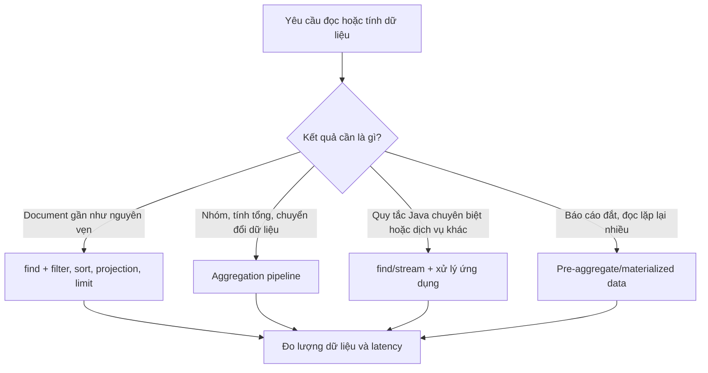
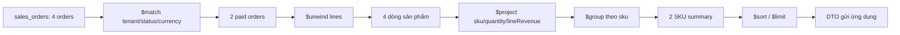

# Khi nào dùng aggregation thay cho find và xử lý tại ứng dụng?

## 1. Câu hỏi thiết kế: dữ liệu nên được tính ở đâu?

Trong **Spring Data MongoDB**, `MongoTemplate.find(...)` và các phương thức repository thông thường rất phù hợp để **lấy những document thỏa điều kiện**. Sau khi lấy được document, ứng dụng Java có thể lọc, chuyển đổi, cộng dồn, nhóm và sắp xếp kết quả. Nhưng nếu truy vấn trả hàng trăm nghìn đơn hàng chỉ để cuối cùng hiển thị **20 dòng doanh thu theo sản phẩm**, việc tải tất cả document về ứng dụng có thể lãng phí mạng, bộ nhớ và CPU Java.

MongoDB cung cấp **aggregation pipeline**: các stage như `$match`, `$unwind`, `$project`, `$group`, `$sort` và `$limit` xử lý dữ liệu **ngay trên MongoDB server**, rồi chỉ chuyển kết quả tổng hợp về ứng dụng.

Ví dụ hệ thống bán hàng cần báo cáo:

> Trong tenant đang đăng nhập, với các đơn đã thanh toán bằng VND, tổng số lượng và doanh thu theo từng SKU là bao nhiêu? Trả tối đa 20 SKU có doanh thu lớn nhất.

Ta có thể chọn:

1. Dùng `find` lấy các đơn đã thanh toán về Java; vòng lặp duyệt `lines` rồi tính doanh thu.
2. Dùng aggregation với `$match` → `$unwind` → `$project` → `$group` → `$sort` → `$limit`.
3. Nếu báo cáo được đọc hàng nghìn lần nhưng cập nhật ít, xây **bảng tổng hợp lưu sẵn/materialized view** được duy trì bằng workflow riêng.

Không có lựa chọn nào luôn thắng. Quyết định phụ thuộc **kích thước dữ liệu, số document cần trả, độ phức tạp nghiệp vụ, chỉ mục, tài nguyên MongoDB, tài nguyên ứng dụng, độ mới dữ liệu và yêu cầu vận hành**.

Đây là bài mở đầu của chương **Aggregation cơ bản** thuộc module **SPRING_DATA_MONGODB**: kết nối, ánh xạ document và làm việc qua `MongoTemplate` hoặc repository, với trọng tâm là chọn đúng chiến lược truy vấn, kiểm thử và đánh giá hiệu năng.

## 2. Phân biệt find, aggregation và xử lý phía ứng dụng



| Tiêu chí | `find` + Java | Aggregation trên MongoDB |
| --- | --- | --- |
| Mục tiêu tự nhiên | Đọc document, xử lý nghiệp vụ trên entity | Biến đổi tập document thành báo cáo/nhóm/kết quả mới |
| Dữ liệu qua mạng | Có thể lớn nếu lấy nhiều document gốc | Thường nhỏ hơn nếu pipeline thu gọn kết quả |
| CPU xử lý | Chủ yếu ở ứng dụng cho phần tính toán | Chủ yếu ở MongoDB server cho các stage |
| Bộ nhớ | Ứng dụng phải quản lý lượng document nhận | Pipeline có thể cần bộ nhớ server, nhất là stage gom nhóm/sort |
| Ánh xạ object | Đọc entity/DTO qua converter | Ánh xạ output của pipeline sang DTO khác schema gốc |
| Index | Dùng được cho filter/sort phù hợp | Các stage đầu như `$match`, đôi khi `$sort` có thể dùng index |
| Tính linh hoạt | Dễ dùng thư viện Java và gọi dịch vụ ngoài | Chỉ dùng các toán tử/stage mà MongoDB hỗ trợ |
| Độ dễ kiểm thử | Unit test business logic Java thuận tiện | Cần test pipeline với dữ liệu BSON thực tế |
| Rủi ro | N+1 queries, tải quá nhiều, tốn heap | Pipeline phức tạp, memory/CPU ở DB, biểu thức BSON khó debug |

**Hai điều cần nhớ:** aggregation **không đồng nghĩa nhanh hơn mọi `find`**; và xử lý ở ứng dụng **không nhất thiết sai** nếu tập dữ liệu nhỏ, đã bị lọc chặt, hoặc logic cần thực hiện bằng Java.

## 3. Chuẩn bị mô hình đơn hàng và số liệu kỳ vọng

### 3.1. Entity Java

Mỗi đơn hàng chứa mảng `lines`. Tiền được lưu dưới dạng **số nguyên VND** để minh họa phép nhân/cộng không phụ thuộc số thực nhị phân. Trong hệ thống đa tiền tệ, phải tách đồng tiền và quy tắc quy đổi trước khi cộng doanh thu.

```java
package example.sales;

public record SalesLine(
    String sku,
    int quantity,
    long unitPriceVnd
) {}
```

```java
package example.sales;

import java.time.Instant;
import java.util.List;
import org.springframework.data.mongodb.core.mapping.Document;
import org.springframework.data.mongodb.core.mapping.FieldType;
import org.springframework.data.mongodb.core.mapping.MongoId;

@Document(collection = "sales_orders")
public record SalesOrder(
    @MongoId(FieldType.STRING) String id,
    String tenantId,
    String status,
    String currency,
    Instant createdAt,
    List<SalesLine> lines
) {}
```

`@MongoId(FieldType.STRING)` thể hiện `_id` được lưu thành BSON String, giúp test rõ ràng. `SalesLine` là một object con trong array `lines`; khi dùng `$unwind`, một đơn có hai line tạo **hai document trung gian**, không thay đổi document gốc.

### 3.2. Fixture có hai đơn đã thanh toán, một đơn chờ và một tenant khác

```javascript
db.sales_orders.insertMany([
  {
    _id: "order-101", tenantId: "shop-01",
    status: "PAID", currency: "VND",
    createdAt: ISODate("2026-11-19T10:00:00Z"),
    lines: [
      { sku: "A", quantity: NumberInt("2"), unitPriceVnd: NumberLong("1000") },
      { sku: "B", quantity: NumberInt("1"), unitPriceVnd: NumberLong("2000") }
    ]
  },
  {
    _id: "order-102", tenantId: "shop-01",
    status: "PAID", currency: "VND",
    createdAt: ISODate("2026-11-20T09:00:00Z"),
    lines: [
      { sku: "A", quantity: NumberInt("1"), unitPriceVnd: NumberLong("1500") },
      { sku: "B", quantity: NumberInt("3"), unitPriceVnd: NumberLong("2000") }
    ]
  },
  {
    _id: "order-103", tenantId: "shop-01",
    status: "PENDING", currency: "VND",
    createdAt: ISODate("2026-11-20T10:00:00Z"),
    lines: [
      { sku: "A", quantity: NumberInt("5"), unitPriceVnd: NumberLong("1000") }
    ]
  },
  {
    _id: "order-201", tenantId: "shop-02",
    status: "PAID", currency: "VND",
    createdAt: ISODate("2026-11-20T11:00:00Z"),
    lines: [
      { sku: "A", quantity: NumberInt("9"), unitPriceVnd: NumberLong("1000") }
    ]
  }
]);
```

Chỉ **order-101 và order-102** thuộc `shop-01`, có `status=PAID` và `currency=VND`. Doanh thu trên một line là:

\[
\text{lineRevenueVnd}=\text{quantity}\times\text{unitPriceVnd}.
\]

Kết quả kỳ vọng:

| SKU | Số lượng bán | Doanh thu VND | Phép tính |
| --- | ---: | ---: | --- |
| B | 4 | 8.000 | `1 × 2.000 + 3 × 2.000` |
| A | 3 | 3.500 | `2 × 1.000 + 1 × 1.500` |

Đơn `PENDING` và đơn của `shop-02` không được tính. Khi viết hệ thống đa tenant, **tenantId phải được xác định từ danh tính/phân quyền phía server** thay vì lấy một giá trị client tùy ý để làm bằng chứng truy cập.

## 4. Phương án A: find và tính toán trong Java

### 4.1. Query chỉ lấy đơn hàng phù hợp

```java
import org.springframework.data.mongodb.core.query.Criteria;
import org.springframework.data.mongodb.core.query.Query;

Query query = Query.query(
    Criteria.where("tenantId").is("shop-01")
        .and("status").is("PAID")
        .and("currency").is("VND")
);
```

`find` thực thi phần **lọc document** trên server:

```java
List<SalesOrder> orders =
    mongoTemplate.find(query, SalesOrder.class);
```

Sau đó ứng dụng lặp qua từng `lines`, cộng số lượng và doanh thu. Đây là code dễ hiểu và có thể đúng hoàn toàn về mặt nghiệp vụ.

### 4.2. Code Java cộng dồn

Định nghĩa DTO trả báo cáo:

```java
package example.sales;

public record SkuRevenue(
    String sku,
    long totalQuantity,
    long revenueVnd
) {}
```

Ví dụ hàm tính từ dữ liệu đã tải:

```java
import java.util.ArrayList;
import java.util.Comparator;
import java.util.HashMap;
import java.util.List;
import java.util.Map;

public List<SkuRevenue> calculateInJava(
        List<SalesOrder> orders) {

    Map<String, long[]> bySku = new HashMap<>();

    for (SalesOrder order : orders) {
        if (order.lines() == null) {
            continue;
        }
        for (SalesLine line : order.lines()) {
            long[] total = bySku.computeIfAbsent(
                line.sku(), ignored -> new long[2]
            );

            total[0] += line.quantity();
            total[1] += (long) line.quantity()
                * line.unitPriceVnd();
        }
    }

    List<SkuRevenue> summaries = new ArrayList<>();
    bySku.forEach((sku, total) ->
        summaries.add(new SkuRevenue(
            sku, total[0], total[1]
        ))
    );

    summaries.sort(
        Comparator.comparingLong(SkuRevenue::revenueVnd)
            .reversed()
            .thenComparing(SkuRevenue::sku)
    );
    return summaries;
}
```

Hàm trên giả định dữ liệu đã được **lọc đúng tenant/status/currency** ở query trước đó và `quantity`, `unitPriceVnd` hợp lệ. Nó không tự thực hiện authorization, không chống tràn `long` và không thay thế validation dữ liệu nguồn.

### 4.3. Khi nào cách này đủ tốt?

- Một lần tìm chỉ trả vài chục hoặc vài trăm document nhỏ.
- Ứng dụng cần **đọc nguyên document** để thực hiện nhiều quy tắc nghiệp vụ khác.
- Phép tính cần một thư viện Java đặc thù mà MongoDB không cung cấp.
- Nguồn dữ liệu gồm MongoDB và các nguồn bên ngoài không thể dễ dàng đưa vào một pipeline.
- Khối lượng đọc đủ nhỏ và dễ kiểm soát bằng projection, pagination hoặc streaming.

Nên cân nhắc **field projection** để giảm payload nếu chỉ cần `lines` và một số field, nhưng đừng coi entity đã nạp một phần là entity an toàn để `save` lại.

### 4.4. Rủi ro khi tập kết quả lớn

Nếu `find` trả hàng trăm nghìn đơn hàng, ứng dụng phải nhận và ánh xạ tất cả document đó trước khi tạo hai dòng kết quả. Hậu quả có thể là:

- Lưu lượng mạng cao và serialization/deserialization tốn chi phí.
- Heap lớn, GC tăng, thời gian đáp ứng chậm.
- Những document lớn chứa field không liên quan cũng có thể bị đọc.
- Một số request báo cáo đồng thời gây tải lên nhiều application instances.

Có thể dùng `MongoTemplate.stream(...)` hoặc driver cursor để tránh giữ toàn bộ document trong `List`, nhưng **streaming chỉ giảm nhu cầu lưu đồng thời ở ứng dụng; nó không tự giảm số document hoặc byte phải chuyển qua mạng**.

## 5. Phương án B: đưa phép nhóm/tính tổng xuống MongoDB

Aggregation pipeline nhận một luồng document, biến đổi qua các stage và trả kết quả cuối. Với ví dụ doanh thu theo SKU:



### 5.1. Pipeline hoàn chỉnh trong mongosh

```javascript
db.sales_orders.aggregate([
  {
    $match: {
      tenantId: "shop-01",
      status: "PAID",
      currency: "VND"
    }
  },
  { $unwind: "$lines" },
  {
    $project: {
      _id: 0,
      sku: "$lines.sku",
      quantity: "$lines.quantity",
      lineRevenueVnd: {
        $multiply: [
          "$lines.quantity",
          "$lines.unitPriceVnd"
        ]
      }
    }
  },
  {
    $group: {
      _id: "$sku",
      totalQuantity: { $sum: "$quantity" },
      revenueVnd: { $sum: "$lineRevenueVnd" }
    }
  },
  {
    $project: {
      _id: 0,
      sku: "$_id",
      totalQuantity: 1,
      revenueVnd: 1
    }
  },
  { $sort: { revenueVnd: -1, sku: 1 } },
  { $limit: 20 }
]);
```

Kết quả tương đương:

```javascript
[
  { sku: "B", totalQuantity: 4, revenueVnd: NumberLong("8000") },
  { sku: "A", totalQuantity: 3, revenueVnd: NumberLong("3500") }
]
```

Tùy toán tử và kiểu số đầu vào, biểu diễn số BSON trong kết quả có thể là Int32/Int64 hoặc kiểu số khác; `NumberLong(...)` ở đây thể hiện kiểu số mục tiêu trong ví dụ, không phải cam kết rằng mọi cấu hình sẽ luôn trả Long. Test cần kiểm tra phép tính và kiểu dữ liệu thực tế.

### 5.2. Vai trò của từng stage

| Stage | Thao tác | Ý nghĩa với ví dụ |
| --- | --- | --- |
| `$match` | Lọc document | Loại tenant khác, đơn chưa thanh toán, currency khác |
| `$unwind` | Tách array thành nhiều dòng | Mỗi line được xử lý như một document trung gian |
| `$project` | Chọn/tạo field | Tính `quantity × unitPriceVnd` |
| `$group` | Gộp theo khóa | Cộng lượng bán và doanh thu của cùng SKU |
| `$project` sau group | Đặt lại tên output | Chuyển `_id` của group thành `sku` |
| `$sort` | Sắp xếp kết quả tổng hợp | Doanh thu cao trước, SKU phá hòa |
| `$limit` | Giới hạn output | Chỉ trả tối đa 20 SKU |

Trên bộ dữ liệu nhỏ, kết quả không nhất thiết chạy nhanh hơn Java. Giá trị của aggregation càng rõ khi **số document đầu vào lớn hơn nhiều so với số dòng kết quả cuối**.

## 6. Triển khai bằng Spring Data Aggregation DSL

### 6.1. Định nghĩa service

Spring Data MongoDB có DSL `Aggregation` và các operation tương ứng với pipeline stages. Đoạn sau dùng `MongoTemplate.aggregate(...)` và ánh xạ kết quả sang record `SkuRevenue`.

```java
package example.sales;

import java.util.List;
import org.springframework.data.domain.Sort;
import org.springframework.data.mongodb.core.MongoTemplate;
import org.springframework.data.mongodb.core.aggregation.Aggregation;
import org.springframework.data.mongodb.core.aggregation.AggregationResults;
import org.springframework.data.mongodb.core.aggregation.ArithmeticOperators;
import org.springframework.data.mongodb.core.query.Criteria;
import org.springframework.stereotype.Service;

@Service
public class SalesAggregationService {

    private final MongoTemplate template;

    public SalesAggregationService(MongoTemplate template) {
        this.template = template;
    }

    public List<SkuRevenue> revenueBySku(
            String authorizedTenantId,
            int topN) {

        if (authorizedTenantId == null ||
                authorizedTenantId.isBlank()) {
            throw new IllegalArgumentException(
                "tenantId không hợp lệ"
            );
        }
        if (topN < 1 || topN > 100) {
            throw new IllegalArgumentException(
                "topN phải từ 1 đến 100"
            );
        }

        Aggregation pipeline = Aggregation.newAggregation(
            Aggregation.match(
                Criteria.where("tenantId").is(authorizedTenantId)
                    .and("status").is("PAID")
                    .and("currency").is("VND")
            ),

            Aggregation.unwind("lines"),

            Aggregation.project()
                .and("lines.sku").as("sku")
                .and("lines.quantity").as("quantity")
                .and(
                    ArithmeticOperators.Multiply
                        .valueOf("lines.quantity")
                        .multiplyBy("lines.unitPriceVnd")
                ).as("lineRevenueVnd"),

            Aggregation.group("sku")
                .sum("quantity").as("totalQuantity")
                .sum("lineRevenueVnd").as("revenueVnd"),

            Aggregation.project()
                .and("_id").as("sku")
                .and("totalQuantity").as("totalQuantity")
                .and("revenueVnd").as("revenueVnd")
                .andExclude("_id"),

            Aggregation.sort(
                Sort.by(
                    Sort.Order.desc("revenueVnd"),
                    Sort.Order.asc("sku")
                )
            ),
            Aggregation.limit(topN)
        );

        AggregationResults<SkuRevenue> results =
            template.aggregate(
                pipeline,
                SalesOrder.class,
                SkuRevenue.class
            );
        return results.getMappedResults();
    }
}
```

Giải thích các điểm dễ sai:

1. `SalesOrder.class` cho Spring Data biết **kiểu đầu vào và mapping** của collection `sales_orders`.
2. `SkuRevenue.class` là kiểu **kết quả tổng hợp**, khác hẳn schema đơn hàng gốc; không `save` DTO này như một `SalesOrder`.
3. `Aggregation.group("sku")` tạo khóa `_id` trong document trung gian. Stage project kế tiếp đổi `_id` thành field `sku` mà DTO mong đợi.
4. `ArithmeticOperators.Multiply` tạo biểu thức BSON `$multiply`; phải bảo đảm giá trị nguồn là số và giới hạn số nằm trong miền hợp lệ.
5. `topN` được validate trước khi dùng `limit`; tenant được truyền từ nguồn đã xác thực, không từ tham số client chưa được kiểm soát.

API DSL cụ thể và mapping ở một dự án có custom converter hoặc Spring Data version khác có thể cần điều chỉnh. Hãy kiểm thử BSON thực tế và output DTO; không đánh đồng ví dụ cú pháp với việc đã chạy build.

### 6.2. Tại sao không trả entity SalesOrder?

Aggregation ở đây trả các document dạng:

```javascript
{ sku: "A", totalQuantity: 3, revenueVnd: 3500 }
```

Chúng không có `tenantId`, `status`, `createdAt`, `lines` hay `_id` của order. Ép vào `SalesOrder` sẽ tạo một object thiếu trường, làm mờ hợp đồng dữ liệu và dễ gây lỗi khi downstream coi đó là entity đầy đủ. **DTO báo cáo là một read model riêng**.

## 7. Khi nào find + projection là phương án tốt hơn?

Nhiều yêu cầu nghe như “tổng hợp” nhưng thực chất chỉ là tìm và trình bày một danh sách.

### 7.1. Chỉ lấy đơn đã thanh toán gần đây

```java
import org.springframework.data.domain.Sort;
import org.springframework.data.mongodb.core.query.Criteria;
import org.springframework.data.mongodb.core.query.Query;

Query query = Query.query(
    Criteria.where("tenantId").is(authorizedTenantId)
        .and("status").is("PAID")
);

query.with(Sort.by(
    Sort.Order.desc("createdAt"),
    Sort.Order.desc("id")
));
query.limit(20);

List<SalesOrder> latest =
    template.find(query, SalesOrder.class);
```

Đây là một truy vấn `find` tự nhiên: điều kiện, sort và giới hạn có thể được MongoDB giải quyết trực tiếp. Không có `$group`, tính toán tập hợp hay kết quả đổi schema. Viết aggregation chỉ để làm `$match` + `$sort` + `$limit` có thể là không cần thiết.

### 7.2. Chỉ cần vài trường của document

```java
Query query = Query.query(
    Criteria.where("tenantId").is(authorizedTenantId)
        .and("status").is("PAID")
);
query.fields()
    .include("status")
    .include("createdAt");
query.limit(20);

List<SalesOrder> summaries =
    template.find(query, SalesOrder.class);
```

Ví dụ này minh họa **field projection ở find**. Các `SalesOrder` nhận được chỉ có một phần dữ liệu; đừng coi đó là entity đầy đủ và gọi `save` để thay document. Trong ứng dụng, nên chọn DTO/projection type cho màn hình danh sách nếu có thể.

**Nguyên tắc thực dụng:** nếu filter/sort/projection/limit đã diễn đạt đủ nhu cầu, bắt đầu từ `find`. Chỉ chuyển sang aggregation khi cần **biến đổi dữ liệu**, **gom nhóm**, **tính toán xuyên document** hoặc giảm đáng kể lượng thông tin phải mang về Java.

## 8. Không phải phép tính nào cũng cần $group

Trước khi xây một pipeline phức tạp, kiểm tra xem các API đơn giản có trả lời được câu hỏi hay không.

| Câu hỏi | Cách phù hợp để bắt đầu |
| --- | --- |
| Có đơn PAID nào của tenant không? | `exists` / `existsBy...` |
| Tổng số đơn PAID là bao nhiêu? | `count` / `countBy...` |
| Lấy 20 đơn mới nhất | `find` + sort + limit |
| Các SKU khác nhau xuất hiện trong tập document là gì? | `distinct` / `findDistinct` khi đáp ứng nhu cầu |
| Doanh thu theo từng SKU | Aggregation với `$unwind` và `$group` |
| Tổng doanh thu theo từng ngày | Aggregation nhóm theo ngày + timezone |
| Top SKU theo tổng doanh thu | Aggregation + sort + limit |
| Kết hợp nhiều collection bằng khóa tham chiếu | Có thể dùng `$lookup` hoặc chiến lược nhiều query; đo và kiểm tra quyền truy cập |

### 8.1. Đếm document khác với đếm phần tử array

```javascript
db.sales_orders.countDocuments({
  tenantId: "shop-01",
  status: "PAID"
});
// 2 document đơn hàng.
```

Nhưng sau `$unwind: "$lines"`, hai đơn PAID trong fixture tạo **4 dòng trung gian**. Nếu dùng `$group` + `$sum: 1` sau unwind, bạn đang **đếm dòng sản phẩm**, không phải đếm đơn hàng.

Muốn đếm **số đơn hàng khác nhau** trên một nhóm SKU, có thể cần giữ `_id` gốc và dùng `$addToSet` theo order ID rồi `$size`, hoặc thiết kế pipeline phù hợp. Điều này tốn thêm tài nguyên, cần cân nhắc cardinality.

### 8.2. distinct khác tần suất xuất hiện

`distinct("lines.sku")` có thể cho biết danh sách SKU, nhưng **không cho số lượng bán hoặc doanh thu**. Khi cần đếm/tính tổng theo từng giá trị, `$group` phù hợp hơn.

## 9. Thứ tự các stage ảnh hưởng số document trung gian

### 9.1. Đặt $match sớm khi điều kiện không phụ thuộc tính toán sau

Không hiệu quả về ý tưởng:

```javascript
[
  { $unwind: "$lines" },
  { $group: { _id: "$lines.sku", units: { $sum: "$lines.quantity" } } },
  { $match: { "_id": "A" } }
]
```

Pipeline này phải xử lý nhiều dòng trước khi chỉ giữ SKU-A. Tùy phép biến đổi, MongoDB optimizer có thể di chuyển một số điều kiện lọc hợp lệ, nhưng **đừng dựa vào optimizer để sửa mọi thiết kế không chọn lọc**.

Với điều kiện tenant/status/currency có sẵn trên order, đặt `$match` **trước** `$unwind`. Điều kiện phụ thuộc `lineRevenueVnd` phải đặt **sau** stage đã tạo field này.

### 9.2. Sắp xếp trước và sau group có ý nghĩa khác nhau

```javascript
// Sắp xếp đơn hàng trước group:
{ $sort: { createdAt: -1 } }

// Sắp xếp kết quả đã group:
{ $sort: { revenueVnd: -1, sku: 1 } }
```

Một stage `$group` **không bảo đảm giữ nguyên thứ tự đầu vào**. Nếu mục tiêu là top SKU theo doanh thu, `$sort` phải nằm sau khi doanh thu đã được tính. `$limit: 20` trước `$group` sẽ chỉ tổng hợp 20 document/line đầu tiên, thay đổi **nghĩa của báo cáo**.

### 9.3. Project sớm hay muộn?

Một `$project` có thể giảm số field trong document trung gian hoặc tạo field tính toán. Tuy nhiên, MongoDB cũng có thể tối ưu những field được sử dụng giữa các stage. Thêm `$project` sớm **không mặc nhiên làm pipeline nhanh**; điều quan trọng là tránh đưa dữ liệu lớn qua các stage đắt khi không cần.

Trong pipeline ví dụ, `$project` nằm sau `$unwind` để tạo `lineRevenueVnd` từ mỗi line rồi đưa vào `$group`.

## 10. $unwind: array rỗng, null và số dòng có thể bị nhân

`$unwind: "$lines"` tạo một document trung gian cho từng phần tử của array. Với mảng rỗng, null hoặc thiếu field, dạng unwind mặc định có thể **bỏ document đó khỏi output**.

```javascript
// Document không có line:
{
  _id: "order-empty",
  tenantId: "shop-01",
  status: "PAID",
  currency: "VND",
  lines: []
}
```

Nếu báo cáo **doanh thu theo SKU**, việc bỏ đơn không có line có thể đúng. Nếu báo cáo **số đơn PAID**, bỏ đơn này là sai. Phải chọn chiến lược theo ý nghĩa metric.

Nếu thực sự cần giữ document không có phần tử:

```javascript
{
  $unwind: {
    path: "$lines",
    preserveNullAndEmptyArrays: true
  }
}
```

Nhưng lúc đó các stage tiếp theo phải xử lý `lines` null/missing cẩn thận; không được cộng nhầm một nhóm SKU null hoặc tính `$multiply` khi dữ liệu không đủ. Đặc biệt, một mảng cực lớn có thể làm **bùng nổ số document trung gian**, khiến `$group` hoặc `$sort` tiêu tốn nhiều tài nguyên hơn dự kiến.

### 10.1. Nhân rồi sum khác sum rồi nhân

Giá các dòng SKU-A trong fixture khác nhau: 1.000 và 1.500 VND.

Đúng:

\[
\operatorname{revenue}(A)=
(2\times 1000)+(1\times 1500)=3500.
\]

Không được dùng một giá đơn vị tùy ý sau group rồi nhân với tổng quantity 3. Nếu giá thay đổi theo thời điểm, ưu đãi hoặc chiết khấu, phải xác định doanh thu **trên từng dòng** trước khi cộng nhóm.

## 11. Kiểu BSON và độ chính xác của số liệu

### 11.1. MongoDB không tự sửa dữ liệu sai kiểu

Nếu một document legacy có:

```javascript
{
  lines: [
    { sku: "A", quantity: "2", unitPriceVnd: "1000" }
  ]
}
```

thì `quantity` và `unitPriceVnd` là **String**, không phải numeric BSON. `$multiply` hoặc `$sum` có thể gặp hành vi khác mong đợi hoặc lỗi với đầu vào không hợp lệ. Không nên kết luận pipeline đúng chỉ vì chạy được trên các fixture mới.

Có thể kiểm tra kiểu dữ liệu:

```javascript
db.sales_orders.aggregate([
  { $unwind: "$lines" },
  {
    $group: {
      _id: {
        quantityType: { $type: "$lines.quantity" },
        priceType: { $type: "$lines.unitPriceVnd" }
      },
      count: { $sum: 1 }
    }
  }
]);
```

Kiểm tra raw BSON, schema validation và migration khi cần. Tránh dùng `$toLong`, `$toDecimal` một cách mù quáng nếu dữ liệu bẩn có thể gây lỗi conversion hoặc bị thay đổi ngữ nghĩa.

### 11.2. Số nguyên VND và tràn số

Ví dụ dùng `long` để mô tả giá và doanh thu, phù hợp khi sản phẩm chỉ giao dịch VND nguyên và miền số nằm trong giới hạn. Tuy nhiên, tích `quantity × unitPriceVnd` và phép cộng nhiều dòng có thể **vượt phạm vi** của kiểu số nếu hệ thống xử lý lượng dữ liệu rất lớn.

Trong hệ thống nhiều đồng tiền có phần thập phân, hãy chọn mô hình tiền nhất quán như integer minor units hoặc `Decimal128`, quy tắc quy đổi và rounding cụ thể. Không cộng doanh thu của các currency khác nhau thành một con số chỉ vì chúng đều là numeric BSON.

### 11.3. $sum và missing/null

Các accumulator như `$sum` có quy tắc xử lý giá trị non-numeric/missing. Dựa vào việc một stage “không báo lỗi” để kết luận mọi line đã được tính là không an toàn: dữ liệu không hợp lệ có thể bị bỏ qua hoặc cho kết quả không đúng kỳ vọng.

Với báo cáo tài chính/kiểm toán, hãy thêm validation, đếm số line hợp lệ và bất thường, hoặc đưa những bản ghi lỗi sang luồng đối soát riêng.

## 12. Hiệu năng: chuyển chi phí từ Java sang MongoDB

### 12.1. Khi aggregation tạo lợi thế

Xét một workload giả định:

```text
1.000.000 đơn hàng / tháng
2 line mỗi đơn trung bình
50.000 SKU khác nhau
UI chỉ lấy top 20 SKU theo doanh thu
```

Với `find` + Java, ứng dụng có thể phải nhận hàng triệu document/line để xuất 20 dòng. Với aggregation, MongoDB vẫn phải xử lý dữ liệu phù hợp nhưng chỉ **gửi khoảng 20 document kết quả cuối** về ứng dụng.

Lợi ích thường là giảm payload mạng và giảm object mapping/heap phía Java. **Tổng lượng phép tính không biến mất**: nó được thực hiện ở server, có thể cạnh tranh tài nguyên với truy vấn ghi/đọc khác.

### 12.2. Blocking stages và bộ nhớ server

Những stage như `$group` hoặc `$sort` thường phải tích lũy trạng thái trước khi xuất kết quả. Khi số nhóm lớn hoặc số dòng trung gian nhiều, chúng có thể gây áp lực bộ nhớ, sử dụng đĩa tạm nếu được hỗ trợ/cấu hình, hoặc lỗi vì vượt giới hạn tài nguyên.

MongoDB có cơ chế `allowDiskUse` cho một số aggregation cần đĩa tạm khi vượt ngưỡng bộ nhớ, phụ thuộc phiên bản/cấu hình. **Bật allowDiskUse không làm pipeline nhanh hơn mặc nhiên**; disk spill có thể tăng latency. Hãy đo và xem liệu có thể lọc sớm, giảm cardinality, thay index hoặc tạo báo cáo lưu sẵn.

### 12.3. Index nào giúp pipeline?

Với stage đầu:

```javascript
{
  $match: {
    tenantId: "shop-01",
    status: "PAID",
    currency: "VND"
  }
}
```

index ứng viên:

```javascript
db.sales_orders.createIndex(
  { tenantId: 1, status: 1, currency: 1 },
  { name: "by_tenant_status_currency" }
);
```

Ba trường equality ở đầu giúp giới hạn document đi vào pipeline khi workload phù hợp. Nếu thường lọc thêm khoảng `createdAt`, có thể đánh giá index có trường thời gian theo sau; thứ tự và selectivity phải dựa trên truy vấn thực tế.

**Index không tự tăng tốc mọi stage:** sau khi `$unwind` và `$group` sinh giá trị doanh thu mới, sort theo `revenueVnd` tổng hợp thường không thể dùng trực tiếp một index của document gốc giống như `find().sort({createdAt:-1})`.

### 12.4. Quan sát explain thay vì phỏng đoán

```javascript
db.sales_orders.explain("executionStats").aggregate([
  {
    $match: {
      tenantId: "shop-01",
      status: "PAID",
      currency: "VND"
    }
  },
  { $unwind: "$lines" },
  {
    $group: {
      _id: "$lines.sku",
      totalQuantity: { $sum: "$lines.quantity" }
    }
  },
  { $sort: { totalQuantity: -1, _id: 1 } },
  { $limit: 20 }
]);
```

Ví dụ `explain` này cố ý rút gọn metric về tổng số lượng, không phải truy vấn doanh thu hoàn chỉnh. Các chỉ số hữu ích gồm index scan/collection scan, số document examined, stage cardinality, thời gian, memory/spill khi server/phiên bản cung cấp.

So sánh với `find` cần cùng dữ liệu, cùng filter, cùng yêu cầu output và cùng write/read load. Đừng lấy một pipeline trả 20 SKU so với một `find` không `limit` rồi kết luận bất kỳ aggregation nào cũng vượt trội.

## 13. Truy vấn theo thời gian và nhóm theo ngày

Báo cáo thường yêu cầu doanh thu theo ngày hoặc tháng. Ở đây, **thời gian kinh doanh** có thể theo múi giờ Việt Nam, không mặc định theo UTC.

Ví dụ ý tưởng trong mongosh:

```javascript
db.sales_orders.aggregate([
  {
    $match: {
      tenantId: "shop-01",
      status: "PAID",
      currency: "VND"
    }
  },
  {
    $group: {
      _id: {
        $dateToString: {
          format: "%Y-%m-%d",
          date: "$createdAt",
          timezone: "Asia/Ho_Chi_Minh"
        }
      },
      orderCount: { $sum: 1 }
    }
  },
  { $sort: { _id: 1 } }
]);
```

Pipeline này **đếm đơn hàng theo ngày**, không tính doanh thu theo SKU. Nó minh họa việc aggregation biểu diễn phép gom nhóm theo giá trị **được tính** từ một field.

Để tính doanh thu theo ngày, cần thêm logic tính line revenue; để tính theo **ngày thanh toán**, schema phải có `paidAt` (không dùng `createdAt` thay thế khi hai thời điểm khác nhau). Đây là quyết định nghiệp vụ, không phải kỹ thuật pipeline tự đoán được.

Với khoảng ngày người dùng nhập, ưu tiên lọc bằng `[from, toExclusive)` theo `Instant` đã quy đổi timezone. Tạo các khoảng nhất quán giúp giảm lượng dữ liệu đầu vào trước khi group.

## 14. Repository @Aggregation khi pipeline cố định

Không phải mọi truy vấn tổng hợp đều cần lớp service tự dựng DSL. Spring Data MongoDB hỗ trợ `@Aggregation` ở repository cho pipeline cố định với tham số bind:

```java
package example.sales;

import java.util.List;
import org.springframework.data.mongodb.repository.Aggregation;
import org.springframework.data.mongodb.repository.MongoRepository;

public interface SalesOrderRepository
        extends MongoRepository<SalesOrder, String> {

    @Aggregation(pipeline = {
        "{ '$match': { 'tenantId': ?0, " +
            "'status': 'PAID', 'currency': 'VND' } }",
        "{ '$unwind': '$lines' }",
        "{ '$group': { '_id': '$lines.sku', " +
            "'totalQuantity': { '$sum': '$lines.quantity' } } }",
        "{ '$project': { '_id': 0, 'sku': '$_id', " +
            "'totalQuantity': 1 } }",
        "{ '$sort': { 'sku': 1 } }"
    })
    List<SkuUnits> unitsBySku(String authorizedTenantId);
}
```

`SkuUnits` là DTO riêng:

```java
package example.sales;

public record SkuUnits(
    String sku,
    long totalQuantity
) {}
```

**Ví dụ repository tính số lượng chứ không tính doanh thu**, vì mục đích minh họa binding và mapping của `@Aggregation`. Nó có thể phù hợp cho báo cáo cố định được gọi nhiều lần; với nhiều filter tùy chọn và stage động, DSL hoặc custom repository dễ đọc và kiểm soát hơn.

Lưu ý tên import: `org.springframework.data.mongodb.repository.Aggregation` là **annotation**, còn `org.springframework.data.mongodb.core.aggregation.Aggregation` là **DSL class**. Chúng khác nhau.

Đối số `tenantId` phải được kiểm soát bởi service/authorization. Bind `?0` không tự tạo điều kiện phân quyền.

## 15. Reactive aggregation: cùng pipeline, khác cách tiêu thụ

Trong hệ thống WebFlux, `ReactiveMongoTemplate.aggregate(...)` trả `Flux<T>`, giúp xử lý các kết quả khi có demand thay vì bắt buộc nhận toàn bộ `List`:

```java
import org.springframework.data.mongodb.core.ReactiveMongoTemplate;
import org.springframework.data.mongodb.core.aggregation.Aggregation;
import reactor.core.publisher.Flux;

Flux<SkuRevenue> report = reactiveMongoTemplate.aggregate(
    pipeline,
    SalesOrder.class,
    SkuRevenue.class
);
```

Ví dụ trên giả định biến `pipeline` đã được xây như ở phần 6, còn `reactiveMongoTemplate` được inject từ Spring context. Pipeline và mapping output không khác về ý nghĩa.

**Reactive không làm `$group` trở thành non-blocking ở phía MongoDB server.** Server vẫn phải thực hiện stage, có thể cần tích lũy các nhóm trước khi phát kết quả. `Flux` giúp quản lý I/O ứng dụng, không loại bỏ chi phí CPU/RAM server hoặc tự thêm index.

Một sai lầm khác:

```java
Mono<List<SkuRevenue>> all =
    reactiveMongoTemplate.aggregate(
        pipeline, SalesOrder.class, SkuRevenue.class
    ).collectList();
```

`collectList()` giữ tất cả kết quả được phát ở ứng dụng. Với top 20 thì ổn; với báo cáo hàng triệu nhóm, nó có thể gây áp lực heap. Khi output lớn, cần giới hạn, phân trang/streaming và chính sách tài nguyên phù hợp.

## 16. Nhất quán dữ liệu: một pipeline không phải giao dịch ghi

Một aggregation thông thường là một **lệnh đọc**, nhưng điều đó không mặc nhiên khiến mọi document được đọc từ collection đang có ghi đồng thời trở thành một snapshot bất biến cho mọi phiên bản/topology và read concern.

Ví dụ trong lúc báo cáo đang chạy, một đơn `PENDING` có thể chuyển thành `PAID`. Kết quả nhìn thấy phụ thuộc thời điểm, cơ chế đọc và chính sách nhất quán của MongoDB. Nếu nghiệp vụ cần báo cáo tài chính có điểm chốt dữ liệu, phải xác định:

- Mốc thời gian và trạng thái chốt báo cáo;
- Có sử dụng transaction/snapshot read hoặc báo cáo định kỳ lưu sẵn hay không;
- Cách xử lý cập nhật đến trễ hoặc hủy/hoàn tiền;
- Phiên bản dữ liệu, read concern và read preference;
- Cách đối soát kết quả với sự kiện nguồn.

Tương tự, stage ghi như `$merge` hoặc `$out` có thể tạo/cập nhật dữ liệu khác. **Chúng không phải đặc tính mặc định của mọi pipeline**, và khi sử dụng phải có quyền ghi, chiến lược idempotency và cơ chế kiểm soát làm mới báo cáo.

### 16.1. Materialized summary khi báo cáo bị gọi liên tục

Nếu báo cáo theo SKU trên vài năm dữ liệu được gọi rất thường xuyên, tính lại từ đầu mỗi request có thể quá tốn CPU MongoDB. Một phương án là lưu bảng tổng hợp theo (`tenantId`, `sku`, `ngày`) rồi cập nhật theo sự kiện nghiệp vụ hoặc job.

Đổi lại, dữ liệu tổng hợp lưu sẵn có thể **trễ** so với nguồn. Cần chiến lược:

1. Khóa định danh duy nhất cho mỗi nhóm tổng hợp.
2. Tránh xử lý lặp sự kiện, đặc biệt khi cộng doanh thu bằng `$inc`.
3. Xử lý đơn hủy, hoàn tiền, chỉnh sửa giá và dữ liệu đến muộn.
4. Có job đối soát/rebuild toàn bộ hoặc theo khoảng thời gian.
5. Công bố rõ latency và thời điểm dữ liệu được cập nhật.

Aggregation đọc trực tiếp và materialized view là hai lựa chọn về **độ mới so với chi phí tính toán**, không đơn thuần là tối ưu syntax.

## 17. Kiểm thử tích hợp: so sánh Java và pipeline

Một kiểm thử hữu ích phải xác nhận **cùng input, cùng filter và cùng metric** giữa hai cách xử lý. Dùng dữ liệu mà SKU lặp lại qua các order, giá đơn vị khác nhau, có order chưa thanh toán và có tenant khác.

### 17.1. Test với Spring Data MongoDB

Ví dụ JUnit 5 + Spring Boot Mongo test slice (cần MongoDB test được cấu hình):

```java
package example.sales;

import static org.junit.jupiter.api.Assertions.*;

import java.time.Instant;
import java.util.List;
import java.util.UUID;
import org.junit.jupiter.api.Test;
import org.springframework.beans.factory.annotation.Autowired;
import org.springframework.boot.test.autoconfigure.data.mongo.DataMongoTest;
import org.springframework.context.annotation.Import;
import org.springframework.data.mongodb.core.MongoTemplate;

@DataMongoTest
@Import(SalesAggregationService.class)
class SalesAggregationTest {

    @Autowired
    MongoTemplate template;

    @Autowired
    SalesAggregationService service;

    @Test
    void groupsRevenueBySkuWithCorrectTenantAndStatus() {
        String suffix = UUID.randomUUID().toString();
        String tenant = "shop-" + suffix;
        Instant time =
            Instant.parse("2026-11-20T09:00:00Z");

        template.insertAll(List.of(
            new SalesOrder(
                "paid-a-" + suffix, tenant, "PAID", "VND", time,
                List.of(
                    new SalesLine("A", 2, 1000L),
                    new SalesLine("B", 1, 2000L)
                )
            ),
            new SalesOrder(
                "paid-b-" + suffix, tenant, "PAID", "VND", time,
                List.of(
                    new SalesLine("A", 1, 1500L),
                    new SalesLine("B", 3, 2000L)
                )
            ),
            new SalesOrder(
                "pending-" + suffix, tenant, "PENDING", "VND", time,
                List.of(new SalesLine("A", 5, 1000L))
            ),
            new SalesOrder(
                "other-" + suffix, "other-" + suffix,
                "PAID", "VND", time,
                List.of(new SalesLine("A", 9, 1000L))
            )
        ));

        List<SkuRevenue> actual =
            service.revenueBySku(tenant, 20);

        assertEquals(
            List.of(
                new SkuRevenue("B", 4L, 8000L),
                new SkuRevenue("A", 3L, 3500L)
            ),
            actual
        );
    }

    @Test
    void emptyTenantHasNoReportRows() {
        String tenant = "unused-" + UUID.randomUUID();
        assertTrue(service.revenueBySku(tenant, 20).isEmpty());
    }
}
```

Test này kiểm tra `$match` loại đúng đơn chưa thanh toán và tenant khác, `$unwind` tạo đúng line, `$multiply` tính giá dòng, `$group` cộng theo SKU và `$sort` trả thứ tự doanh thu.

**Điều kiện chạy test:** `@DataMongoTest` chỉ chuẩn bị Spring context chuyên MongoDB; nó không bảo đảm một MongoDB server luôn được khởi chạy. Dùng instance test riêng hoặc Testcontainers tương thích với phiên bản Spring Boot của dự án. Bài ở giai đoạn soạn tài liệu chưa thực thi build/test thực tế.

### 17.2. Test để bắt lỗi nhân sai sau khi group

Đừng chỉ dùng các line cùng một `unitPriceVnd`. Trong fixture, SKU-A có giá **1.000** và **1.500**, nên công thức sai kiểu `(sum quantity) × (một giá đơn vị)` sẽ bị lộ. Kết quả đúng là 3.500 VND.

Thêm các ca sau khi mở rộng bài:

| Ca | Điều cần kiểm tra |
| --- | --- |
| Hai line cùng SKU trong một order | Tổng quantity/revenue đúng, không mặc định line unique |
| `lines=[]` | Không đóng góp doanh thu nhưng vẫn được đếm nếu metric là số đơn |
| Missing/null quantity | Có validation hoặc cách xử lý rõ ràng, không âm thầm làm sai số |
| `unitPriceVnd` là String trong document legacy | Phát hiện dữ liệu sai kiểu |
| Đơn ở tenant khác | Không bị tính vào báo cáo |
| Currency khác VND | Không cộng chung khi không có quy đổi |
| Đơn hoàn tiền/đã hủy | Được loại hoặc xử lý theo định nghĩa doanh thu |
| `topN=1` | Trả đúng SKU doanh thu lớn nhất |
| Hai SKU cùng revenue | Dùng khóa phụ `sku` để thứ tự ổn định |
| Tập dữ liệu lớn | Kiểm tra tài nguyên pipeline, index và disk spill |

### 17.3. Kiểm tra hai cách xử lý cho cùng metric

Để so sánh chính xác:

1. Dùng `find` tải **chỉ những order cùng tenant/status/currency**.
2. Chạy hàm `calculateInJava` từ phần 4.
3. Chạy `SalesAggregationService.revenueBySku` với `topN` đủ lớn để không bỏ nhóm nào.
4. So sánh danh sách `SkuRevenue` sau khi chuẩn hóa cùng thứ tự.
5. Chạy cả hai trên các ca biên: mảng rỗng, cùng SKU, giá thay đổi, date boundary và dữ liệu sai kiểu.

Khi hai bên khác nhau, kiểm tra trước tiên: **filter có tương đương không, có thay đổi schema/rounding không, và một bên có đang đếm line còn bên kia đếm order không?**

## 18. Những sai lầm thường gặp

| Triệu chứng | Nguyên nhân có thể | Cách xử lý |
| --- | --- | --- |
| Báo cáo Java tốn RAM | `find` nạp quá nhiều document rồi group ở ứng dụng | Dùng aggregation hoặc streaming/projection nếu phù hợp |
| Aggregation chậm dù trả ít dòng | `$unwind` tạo quá nhiều row, `$group` cardinality lớn | Lọc sớm, kiểm tra schema, explain và tài nguyên DB |
| Doanh thu bị tăng | Đơn PENDING, tenant khác hoặc currency khác lọt vào | `$match` chính xác từ đầu |
| Tổng số lượng đúng nhưng doanh thu sai | Nhân giá sau khi group, không nhân trên từng line | Tính line revenue trước `$group` |
| Báo cáo mất đơn không có line | `$unwind` mặc định bỏ array rỗng | Xác định metric, preserve empty nếu cần |
| Đếm order bị nhân lên | `$unwind` biến một order thành nhiều line | Đếm distinct order hoặc group trước theo mục tiêu |
| DTO thiếu dữ liệu/field null | Projection output không khớp field của DTO | `$project` lại tên field và test mapping |
| `$sort`/`$limit` cho top kết quả sai | Đặt limit trước group hoặc sort sai stage | Group và tính metric trước khi sort/limit |
| Giá tiền không chính xác | Double/kiểu BSON pha trộn hoặc currency khác | Thống nhất đơn vị, Decimal128/minor units và validation |
| Query Java và pipeline trả khác nhau | Null/missing, filter, thời gian hoặc phép cộng khác | Đối chiếu query BSON và fixture |
| Index không giúp sort tổng hợp | Sort theo field được tạo sau group | Đo explain, không giả định index document gốc giải quyết |
| Cùng một báo cáo bị gọi lặp rất tốn DB | Tính lại toàn bộ dữ liệu mỗi request | Cân nhắc summary lưu sẵn và cơ chế refresh |
| Reactive pipeline vẫn ngốn DB | `$group` là phép xử lý phía server | Tối ưu stage/index, không chỉ đổi sang `Flux` |
| Lộ dữ liệu tenant khác | Thiếu filter bắt buộc hoặc lấy tenant từ client | Ràng buộc tenant từ security context phía server |

### Quy trình chẩn đoán

1. Viết rõ **metric**: đếm đơn, đếm line, tổng quantity hay doanh thu sau giảm giá/hoàn tiền?
2. Xác nhận bộ lọc tenant, trạng thái, currency và khoảng thời gian.
3. Kiểm tra dữ liệu thô: BSON types, array rỗng, null/missing, giá và số lượng.
4. Chạy từng stage trên fixture nhỏ, quan sát số document trung gian sau `$unwind` và `$group`.
5. Kiểm tra cấu trúc DTO sau `$project`, nhất là field `_id` của group.
6. Đối chiếu kết quả với một implementation Java đơn giản đúng cùng metric.
7. Dùng `explain("executionStats")`, profiler và metrics để xem index, scan, bộ nhớ/spill.
8. Chỉ sau khi có số liệu mới quyết định giữ `find`, đổi aggregation hay lưu pre-aggregate.

## 19. Bài tập thực hành

### Bài 1 — So sánh hai phương án

Từ fixture phần 3, triển khai `find` + vòng lặp Java và aggregation. So sánh hai danh sách `SkuRevenue`, đo số document tải về và số row kết quả cuối. Giải thích tại sao với bốn order thử, aggregation chưa chắc nhanh hơn.

### Bài 2 — Thứ tự stage

Chạy pipeline với `$match` trước `$unwind`, rồi thử chuyển `$match` sau `$unwind`. Quan sát số document trung gian. Tiếp theo cố ý đặt `$limit: 1` trước `$group` và giải thích tại sao kết quả doanh thu không còn đúng.

### Bài 3 — Mảng rỗng và missing field

Thêm một order PAID có `lines: []` và một order thiếu `lines`. Tạo hai báo cáo: tổng số order PAID và tổng doanh thu theo SKU. Xem `$unwind` mặc định và `preserveNullAndEmptyArrays` ảnh hưởng thế nào đến từng metric.

### Bài 4 — Doanh thu theo ngày địa phương

Nhóm đơn PAID theo ngày `Asia/Ho_Chi_Minh`, dùng `$dateToString` hoặc toán tử ngày phù hợp. Đối chiếu mốc UTC với ngày địa phương. Nếu cần ngày thanh toán, bổ sung `paidAt` thay vì tái sử dụng `createdAt`.

### Bài 5 — Index và hiệu năng

Tạo dữ liệu thử đủ lớn, đề xuất index trên `tenantId`, `status`, `currency` và `createdAt` khi có range. Chạy `explain`, đo số document examined trước/sau index. Quan sát rằng index hỗ trợ lọc đầu pipeline nhưng không tự index hóa `revenueVnd` đã group.

### Bài 6 — Materialized report

Thiết kế collection `daily_sku_revenue` với khóa (`tenantId`, `day`, `sku`). Mô tả cách cập nhật khi có order PAID, hủy đơn hoặc hoàn tiền, cơ chế chống xử lý sự kiện hai lần và lịch đối soát. Nêu lý do khi nào bảng lưu sẵn tốt hơn chạy aggregation từ đầu.

### Câu hỏi tự kiểm tra

- Khi nào `find` + projection + sort + limit đủ đáp ứng yêu cầu?
- Aggregation thường giảm chi phí nào và chuyển chi phí nào sang MongoDB server?
- Vì sao `$match` thường nên đứng sớm trước `$unwind`?
- `$group` có bảo đảm giữ thứ tự document đầu vào không?
- Tại sao muốn top SKU phải `$sort` và `$limit` **sau** khi tính doanh thu?
- `countDocuments` khác đếm các line sau unwind như thế nào?
- Vì sao cùng SKU có hai giá khác nhau phải tính line revenue trước group?
- `$unwind` mặc định xử lý array rỗng/thiếu thế nào?
- Một `Flux` từ reactive aggregation có tự loại bỏ áp lực bộ nhớ MongoDB không?
- Vì sao một lệnh aggregation không mặc nhiên tương đương báo cáo snapshot kế toán?
- Khi nào cần materialized summary hoặc staging dataset thay vì truy vấn tổng hợp lại mỗi lần?

## Ghi nhớ

Trong **Spring Data MongoDB**, hãy **dùng `find`** khi mục tiêu chủ yếu là lấy document bằng filter/sort/projection/limit, nhất là khi tập dữ liệu nhỏ hoặc cần xử lý nghiệp vụ Java. Hãy **cân nhắc aggregation** khi cần tính toán và gom nhóm nhiều document, xử lý array, tạo metric/tổng hợp hoặc chỉ trả một tập kết quả nhỏ từ lượng input lớn. Pipeline `$match → $unwind → $project → $group → $sort → $limit` là ví dụ điển hình, nhưng hiệu năng phụ thuộc index, cardinality, dữ liệu BSON và tài nguyên MongoDB server. Với báo cáo đắt nhưng được đọc liên tục, cân nhắc **lưu kết quả tổng hợp** cùng cơ chế refresh và đối soát. Luôn kiểm thử metric bằng fixture có ca biên, bảo vệ tenant và đo `explain` trước khi quyết định kiến trúc.

## Tài liệu tham khảo

- [Spring Data MongoDB Reference — Aggregation Framework Support](https://docs.spring.io/spring-data/mongodb/reference/mongodb/aggregation-framework.html)
- [Spring Data MongoDB Reference — Querying Documents](https://docs.spring.io/spring-data/mongodb/reference/mongodb/template-query-operations.html)
- [Spring Data MongoDB API — Aggregation](https://docs.spring.io/spring-data/mongodb/docs/current/api/org/springframework/data/mongodb/core/aggregation/Aggregation.html)
- [MongoDB Manual — Aggregation Operations](https://www.mongodb.com/docs/manual/aggregation/)
- [MongoDB Manual — Aggregation Pipeline Optimization](https://www.mongodb.com/docs/manual/core/aggregation-pipeline-optimization/)
- [MongoDB Manual — Aggregation Pipeline Limits](https://www.mongodb.com/docs/manual/core/aggregation-pipeline-limits/)
