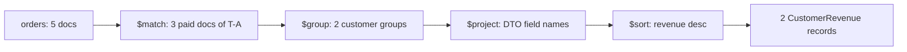
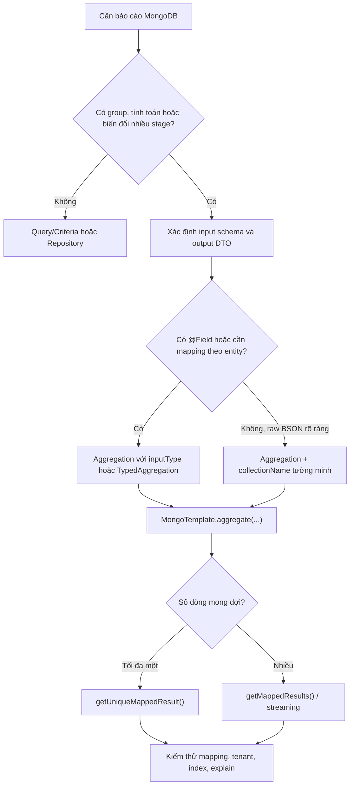

# Aggregation, TypedAggregation và AggregationResults trong Spring Data MongoDB

## 1. Từ truy vấn document đến pipeline xử lý dữ liệu

Với **Spring Data MongoDB**, ứng dụng Java có thể đọc document bằng repository, thao tác linh hoạt với `MongoTemplate` và xây các báo cáo bằng **MongoDB Aggregation Framework**. Khác với một truy vấn `find` lấy các document phù hợp điều kiện, aggregation cho phép **đưa document qua nhiều bước xử lý liên tiếp**, ví dụ: lọc đơn hàng, gom theo khách hàng, tính doanh thu, đổi tên trường và sắp xếp kết quả.

Chủ đề thuộc chương **Aggregation cơ bản** này phân biệt rõ ba đối tượng của Spring Data:

1. **`Aggregation`:** mô tả pipeline gồm các `AggregationOperation` như `match`, `group`, `project`, `sort` và `limit`.
2. **`TypedAggregation<T>`:** một pipeline có **domain type đầu vào**; Spring Data có thể dựa vào mapping metadata của `T` để chuyển property Java thành tên trường BSON.
3. **`AggregationResults<O>`:** kết quả sau khi `MongoTemplate` thực thi pipeline, gồm những object đã được map sang **kiểu đầu ra** `O` và thông tin raw result để kiểm tra khi cần.

Nhớ công thức:

```text
Document trong collection
    ↓ $match
Document đã lọc
    ↓ $group
Document theo từng nhóm, có _id là khóa nhóm
    ↓ $project
Document kết quả mang alias theo hợp đồng DTO
    ↓ $sort
Kết quả được sắp xếp
    ↓ MongoTemplate.aggregate(...)
AggregationResults<ReportDto>
    ↓ getMappedResults()
List<ReportDto>
```

Ba khái niệm trên **không phải ba cách viết khác nhau của cùng một thứ**:

| Thành phần | Được tạo khi nào? | Giải quyết câu hỏi gì? |
|---|---|---|
| `Aggregation` | Khi xây pipeline Java | *Chạy những stage nào, theo thứ tự nào?* |
| `TypedAggregation<Order>` | Khi gắn pipeline với kiểu document nguồn | *Các property trong stage thuộc model đầu vào nào?* |
| `AggregationResults<CustomerRevenue>` | Sau khi gọi `MongoTemplate.aggregate(...)` | *BSON đầu ra đã map sang kiểu Java nào, có bao nhiêu kết quả?* |

**Mục tiêu:** tự tạo một pipeline, hiểu lúc nào nên dùng typed aggregation, gọi đúng overload của `MongoTemplate.aggregate`, đọc `AggregationResults` một cách an toàn và xác minh query/result thực trên MongoDB.

## 2. Bộ dữ liệu mẫu và bài toán báo cáo

### 2.1. Collection orders

Trong database test, tạo năm đơn hàng:

```javascript
db.orders.insertMany([
  {
    _id: "O-101", tenant_id: "T-A", customer_id: "C-01",
    status: "PAID", total_cents: NumberLong(15000),
    created_at: ISODate("2026-01-05T10:00:00Z")
  },
  {
    _id: "O-102", tenant_id: "T-A", customer_id: "C-01",
    status: "PAID", total_cents: NumberLong(7000),
    created_at: ISODate("2026-01-08T10:00:00Z")
  },
  {
    _id: "O-103", tenant_id: "T-A", customer_id: "C-02",
    status: "PAID", total_cents: NumberLong(9000),
    created_at: ISODate("2026-01-11T10:00:00Z")
  },
  {
    _id: "O-104", tenant_id: "T-A", customer_id: "C-02",
    status: "NEW", total_cents: NumberLong(5000),
    created_at: ISODate("2026-01-13T10:00:00Z")
  },
  {
    _id: "O-201", tenant_id: "T-B", customer_id: "C-01",
    status: "PAID", total_cents: NumberLong(100000),
    created_at: ISODate("2026-01-09T10:00:00Z")
  }
]);
```

Quy ước: `total_cents` là giá trị nguyên theo **đơn vị nhỏ nhất** của tiền. Ta cố tình đưa vào đơn `O-201` thuộc tenant `T-B` và đơn `O-104` có status `NEW` để phát hiện những pipeline thiếu bước lọc.

Yêu cầu: **tổng hợp đơn đã thanh toán của tenant T-A theo khách hàng**, trả về:

| customerId | orderCount | revenueCents |
|---|---:|---:|
| C-01 | 2 | 22000 |
| C-02 | 1 | 9000 |

Tổng cộng có **3 đơn PAID** và **31000 cents** thuộc T-A. Không cộng 5000 cents của đơn NEW hay 100000 cents của tenant khác.

### 2.2. Entity tương ứng trong Spring Data

Ví dụ dùng Java 17+, Spring Data MongoDB và Spring Boot; các class đặt trong file Java phù hợp:

```java
import java.time.Instant;
import org.springframework.data.annotation.Id;
import org.springframework.data.mongodb.core.mapping.Document;
import org.springframework.data.mongodb.core.mapping.Field;

@Document(collection = "orders")
public class PurchaseOrder {
    @Id
    private String id;

    @Field("tenant_id")
    private String tenantId;

    @Field("customer_id")
    private String customerId;

    private String status;

    @Field("total_cents")
    private long totalCents;

    @Field("created_at")
    private Instant createdAt;

    protected PurchaseOrder() {}

    public PurchaseOrder(String id, String tenantId, String customerId,
            String status, long totalCents, Instant createdAt) {
        this.id = id;
        this.tenantId = tenantId;
        this.customerId = customerId;
        this.status = status;
        this.totalCents = totalCents;
        this.createdAt = createdAt;
    }

    public String getId() { return id; }
    public String getTenantId() { return tenantId; }
    public String getCustomerId() { return customerId; }
    public String getStatus() { return status; }
    public long getTotalCents() { return totalCents; }
    public Instant getCreatedAt() { return createdAt; }
}
```

Các tên trong **domain Java** khác tên BSON:

| Java property | BSON field | Vì sao? |
|---|---|---|
| `id` | `_id` | `@Id` |
| `tenantId` | `tenant_id` | `@Field("tenant_id")` |
| `customerId` | `customer_id` | `@Field("customer_id")` |
| `totalCents` | `total_cents` | `@Field("total_cents")` |
| `createdAt` | `created_at` | `@Field("created_at")` |
| `status` | `status` | Cùng tên |

Phân biệt tên Java và BSON là chìa khóa để hiểu tác dụng của `TypedAggregation`.

### 2.3. DTO báo cáo, không phải entity nguồn

Kết quả không còn là một đơn hàng, mà là tổng hợp theo từng khách hàng:

```java
public record CustomerRevenue(
    String customerId,
    long orderCount,
    long revenueCents
) {}
```

`CustomerRevenue` không cần `@Document`, vì đây là **đối tượng đầu ra của aggregation**. Nhiệm vụ của pipeline là trả các field đúng tên và kiểu để Spring Data map vào constructor/record.

## 3. Viết pipeline thuần MongoDB trước khi chuyển sang Java

Một cách tránh sai logic là viết và kiểm tra pipeline trong `mongosh` trước:

```javascript
db.orders.aggregate([
  { $match: { tenant_id: "T-A", status: "PAID" } },
  {
    $group: {
      _id: "$customer_id",
      orderCount: { $sum: 1 },
      revenueCents: { $sum: "$total_cents" }
    }
  },
  {
    $project: {
      _id: 0,
      customerId: "$_id",
      orderCount: 1,
      revenueCents: 1
    }
  },
  { $sort: { revenueCents: -1, customerId: 1 } }
]);
```

### 3.1. Ý nghĩa từng stage

| Stage | Dữ liệu vào | Dữ liệu ra / tác dụng |
|---|---|---|
| `$match` | 5 order | 3 order của T-A có status PAID |
| `$group` | 3 order | 2 nhóm theo `customer_id`; `_id` giờ là **khóa nhóm** |
| `$project` | 2 nhóm | Đưa khóa nhóm sang `customerId`, bỏ `_id`, giữ các số tổng hợp |
| `$sort` | 2 dòng báo cáo | Sắp theo doanh thu giảm dần, customerId tăng dần |

`$group` không bảo đảm thứ tự kết quả. Nếu endpoint yêu cầu thứ tự, **đặt `$sort` tường minh**. Đừng suy thứ tự từ ID, vị trí document gốc hay thứ tự insert.

### 3.2. Kết quả BSON mong đợi

```javascript
[
  { customerId: "C-01", orderCount: 2, revenueCents: NumberLong(22000) },
  { customerId: "C-02", orderCount: 1, revenueCents: NumberLong(9000) }
]
```

Đây là hình dạng minh họa; kiểu BSON cụ thể của một toán tử tổng hợp phụ thuộc kiểu input và quy tắc tích lũy/promote số của MongoDB. Khi map sang `long`, cần bảo đảm giá trị nằm trong phạm vi hỗ trợ và dữ liệu đầu vào thống nhất đơn vị.

### 3.3. Stage nối với nhau, không chạy độc lập



Mỗi stage nhận **output của stage trước**, không phải lúc nào cũng nhìn thấy mọi trường của collection gốc. Sau `$group`, nếu không giữ một field trong accumulator hoặc khóa nhóm, field đó không còn sẵn để tham chiếu theo cách cũ.

## 4. Aggregation: xây pipeline bằng Spring Data DSL

`Aggregation` là một đối tượng mô tả pipeline, được tạo từ các `AggregationOperation`. Những factory method tĩnh trong `Aggregation` làm code gần với MongoDB stages:

```java
import org.springframework.data.domain.Sort;
import org.springframework.data.mongodb.core.aggregation.Aggregation;
import org.springframework.data.mongodb.core.aggregation.AggregationResults;
import org.springframework.data.mongodb.core.query.Criteria;

Aggregation pipeline = Aggregation.newAggregation(
    Aggregation.match(
        Criteria.where("tenantId").is("T-A")
            .and("status").is("PAID")),
    Aggregation.group("customerId")
        .count().as("orderCount")
        .sum("totalCents").as("revenueCents"),
    Aggregation.project("orderCount", "revenueCents")
        .and("_id").as("customerId")
        .andExclude("_id"),
    Aggregation.sort(
        Sort.by(
            Sort.Order.desc("revenueCents"),
            Sort.Order.asc("customerId")))
);

AggregationResults<CustomerRevenue> result =
    mongoTemplate.aggregate(
        pipeline, PurchaseOrder.class, CustomerRevenue.class);
```

Ví dụ giả định `mongoTemplate` là bean `MongoTemplate` đã inject trong service. Lời gọi `aggregate(pipeline, PurchaseOrder.class, CustomerRevenue.class)` cho Spring Data biết:

- `PurchaseOrder.class` là **input type** để chọn collection từ `@Document` và dùng metadata mapping.
- `CustomerRevenue.class` là **output type** để materialize document kết quả.
- `pipeline` định nghĩa thao tác; **tạo Aggregation không tự chạy query**. Query chỉ được gửi khi gọi `MongoTemplate.aggregate(...)`.

### 4.1. Đọc Spring DSL đối chiếu mongosh

| Spring Data DSL | MongoDB stage | Mục đích |
|---|---|---|
| `Aggregation.match(Criteria...)` | `$match` | Lọc document |
| `Aggregation.group("customerId")` | `$group` với khóa nhóm | Gom theo customer |
| `.count().as("orderCount")` | `$sum: 1` | Đếm số order |
| `.sum("totalCents").as("revenueCents")` | `$sum: "$total_cents"` | Cộng tổng tiền |
| `Aggregation.project(...).and("_id").as("customerId")` | `$project` | Đặt alias/giữ field |
| `Aggregation.sort(...)` | `$sort` | Sắp kết quả |

Trong code `Aggregation.group("customerId")`, **`customerId` là Java property** khi có input mapping context phù hợp; MongoDB cần nhìn thấy `customer_id`. Không viết lẫn lộn tên vật lý BSON với tên Java trong cùng DSL mà chưa biết API đang áp dụng context nào.

### 4.2. Dùng @Document hoặc tên collection cụ thể?

Lời gọi:

```java
mongoTemplate.aggregate(
    pipeline,
    PurchaseOrder.class,
    CustomerRevenue.class
);
```

dùng `@Document(collection = "orders")` của `PurchaseOrder` làm tên collection mặc định. Một số overload khác nhận tên collection dạng String để chạy pipeline trên collection được chọn:

```java
mongoTemplate.aggregate(
    pipeline,
    "orders",
    CustomerRevenue.class
);
```

**Hai overload không mặc nhiên tương đương về mapping.** Overload chỉ nhận tên collection mà không mang input type có thể không biết `tenantId` cần đổi thành `tenant_id`. Để vừa override collection vừa giữ mapping entity, hãy sử dụng `TypedAggregation` ở mục tiếp theo, hoặc xây stage với **tên BSON thực tế**.

## 5. TypedAggregation<T>: khai báo kiểu document đầu vào

`TypedAggregation<T>` là một dạng `Aggregation` có **kiểu đầu vào `T` được khai báo tường minh** ngay khi tạo pipeline:

```java
import org.springframework.data.mongodb.core.aggregation.TypedAggregation;

TypedAggregation<PurchaseOrder> typedPipeline =
    Aggregation.newAggregation(
        PurchaseOrder.class,
        Aggregation.match(
            Criteria.where("tenantId").is("T-A")
                .and("status").is("PAID")),
        Aggregation.group("customerId")
            .count().as("orderCount")
            .sum("totalCents").as("revenueCents"),
        Aggregation.project("orderCount", "revenueCents")
            .and("_id").as("customerId")
            .andExclude("_id"),
        Aggregation.sort(
            Sort.by(
                Sort.Order.desc("revenueCents"),
                Sort.Order.asc("customerId")))
    );
```

Khác với `Aggregation.newAggregation(stage1, stage2, ...)`, factory ở đây nhận **`PurchaseOrder.class` làm tham số đầu tiên**. Spring Data dùng metadata entity để diễn giải các đường dẫn field, kể cả `@Field` và định danh.

### 5.1. Dùng typed aggregation với collection tường minh

```java
AggregationResults<CustomerRevenue> results =
    mongoTemplate.aggregate(
        typedPipeline,
        "orders",
        CustomerRevenue.class);
```

Lời gọi trên dùng **input type từ `TypedAggregation<PurchaseOrder>`** và **collectionName từ tham số String**. Điều này hữu ích khi cùng BSON schema được lưu vào `orders`, `orders_archive` hoặc một collection staging, nhưng phải xác minh các collection thực sự tương thích với `PurchaseOrder`.

`TypedAggregation` không đổi database, không cấp thêm quyền, không tự kiểm tra tenant authorization và cũng không bảo đảm collection override có cùng index/validator.

### 5.2. Typed không có nghĩa output bắt buộc là PurchaseOrder

Đây là lỗi hiểu rất thường gặp:

```text
TypedAggregation<PurchaseOrder>
       ↓ thực thi pipeline
AggregationResults<CustomerRevenue>
```

`PurchaseOrder` là **input domain type**; `CustomerRevenue` là **output projection/DTO**. `$group` có thể biến rất nhiều document nguồn thành một vài dòng báo cáo, vì vậy output không nhất thiết có cấu trúc giống entity gốc.

### 5.3. Mapping của input type và các stage tùy biến

Typed aggregation cho phép Spring Data ánh xạ các property đã biết. Nhưng một stage xây thẳng bằng raw `org.bson.Document` không nhất thiết đi qua cùng logic đổi tên property như DSL typed:

```java
import org.bson.Document;
import org.springframework.data.mongodb.core.aggregation.AggregationOperation;

AggregationOperation rawMatch = context ->
    new Document("$match",
        new Document("tenant_id", "T-A")
            .append("status", "PAID"));
```

Vì stage này tự viết BSON, nó dùng **`tenant_id` vật lý**, không dùng `tenantId` của entity. Ngược lại, trong `Aggregation.match(Criteria.where("tenantId")...)`, tên property Java được mapping theo input context.

**Quy tắc:** biết stage nào chạy qua Spring Data mapping và stage nào trả BSON raw, đặc biệt khi entity có `@Field`, embedded documents, custom converters hoặc đổi tên property trong quá trình refactor.

## 6. Các overload của MongoTemplate.aggregate: chọn cho đúng

`MongoTemplate` là API **đồng bộ** thực thi pipeline. Tùy overload, nó cần thông tin về collection, input type và output type.

| Cách gọi | Nguồn collection | Input mapping | Kiểu kết quả |
|---|---|---|---|
| `aggregate(aggregation, PurchaseOrder.class, CustomerRevenue.class)` | `@Document` trên `PurchaseOrder` | Domain type từ tham số `PurchaseOrder.class` | `CustomerRevenue` |
| `aggregate(aggregation, "orders", CustomerRevenue.class)` | Tên String tường minh | Không tự giả định `PurchaseOrder` là nguồn | `CustomerRevenue` |
| `aggregate(typedAggregation, "orders", CustomerRevenue.class)` | Tên String tường minh | Domain type trong `TypedAggregation<PurchaseOrder>` | `CustomerRevenue` |
| `aggregate(typedAggregation, CustomerRevenue.class)` | Metadata của typed input | Domain type trong typed aggregation | `CustomerRevenue` |

Những overload có chữ ký và hành vi cụ thể theo phiên bản Spring Data MongoDB; hãy đối chiếu `MongoOperations`/`MongoTemplate` trong dependency đang chạy. Bảng thể hiện nguyên tắc phân biệt input/collection/output, không phải danh sách toàn bộ overload.

### 6.1. Chọn overload dựa trên bài toán

Với báo cáo thông thường trong collection đã khai báo:

```java
AggregationResults<CustomerRevenue> result =
    mongoTemplate.aggregate(
        pipeline,
        PurchaseOrder.class,
        CustomerRevenue.class
    );
```

Với một collection archive có **cùng schema BSON**:

```java
AggregationResults<CustomerRevenue> result =
    mongoTemplate.aggregate(
        typedPipeline,
        "orders_archive",
        CustomerRevenue.class
    );
```

Với pipeline tự viết bằng **tên BSON vật lý** trên collection tường minh:

```java
Aggregation bsonPipeline = Aggregation.newAggregation(
    Aggregation.match(
        Criteria.where("tenant_id").is("T-A")
            .and("status").is("PAID")),
    Aggregation.group("customer_id")
        .count().as("orderCount")
        .sum("total_cents").as("revenueCents"),
    Aggregation.project("orderCount", "revenueCents")
        .and("_id").as("customerId")
        .andExclude("_id")
);

var result = mongoTemplate.aggregate(
    bsonPipeline, "orders", CustomerRevenue.class);
```

Trong ví dụ cuối, ta cố tình dùng tên `tenant_id`, `customer_id` và `total_cents` khi không chỉ định input domain type. Tuy nhiên một pipeline sử dụng nhiều phép tính, array, nested property hoặc tùy chỉnh converter thường dễ bảo trì hơn khi có mapping context tường minh.

### 6.2. Collection name và database là hai quyết định khác nhau

Chỉ truyền `"orders_archive"` vào `aggregate` **không chuyển database**. Database được lựa chọn thông qua `MongoDatabaseFactory`/`MongoTemplate` và cấu hình kết nối hiện tại. Khi báo cáo cần dữ liệu từ nhiều database, cần một kiến trúc routing/factory được kiểm soát; không đưa chuỗi dạng `"dbName.collection"` vào tham số collection và kỳ vọng nó tự chuyển database.

Các collection khác nhau không tự chia sẻ index. Dùng `TypedAggregation<PurchaseOrder>` để đọc `orders_archive` vẫn cần xác minh collection archive có schema, quyền, index và data lifecycle phù hợp.

### 6.3. Aggregate không biến collection nguồn thành output collection

`MongoTemplate.aggregate(...)` trả kết quả cho ứng dụng; các stage `$match`, `$group`, `$project`, `$sort` trong bài này **không ghi lại document gốc**. MongoDB có stage ghi như `$merge` và `$out` trong các pipeline chuyên biệt, nhưng đây là tác vụ có ảnh hưởng dữ liệu và đòi hỏi xử lý quyền, transaction, retention riêng.

Không dùng một DTO báo cáo do aggregation sinh ra để gọi `mongoTemplate.save(dto)` như thể đó là đơn hàng nguồn: DTO không có cùng identity, schema và semantics với `PurchaseOrder`.

## 7. AggregationResults<O>: đọc kết quả như thế nào?

Sau khi chạy pipeline, `MongoTemplate.aggregate(...)` trả `AggregationResults<O>`. Đối tượng này là **wrapper của kết quả**, không phải một stream chưa thực thi hay một `Page` tự động.

### 7.1. getMappedResults: nhiều dòng kết quả

```java
AggregationResults<CustomerRevenue> results =
    mongoTemplate.aggregate(
        pipeline, PurchaseOrder.class, CustomerRevenue.class);

java.util.List<CustomerRevenue> rows =
    results.getMappedResults();

for (CustomerRevenue row : rows) {
    System.out.println(
        row.customerId() + ": " +
        row.orderCount() + " orders, " +
        row.revenueCents() + " cents");
}
```

Trong dữ liệu mẫu, danh sách có hai phần tử: `C-01` và `C-02`. `getMappedResults()` cho kết quả đã được ánh xạ từ BSON sang Java, theo `CustomerRevenue.class`. Nó không tự đóng gói thành `Page`, không cung cấp tổng số trang và không áp dụng giới hạn nếu pipeline chưa có `$limit`.

Khi không có document nào khớp `$match`, pipeline theo `$group` như ví dụ thường trả **danh sách rỗng**, không phải một phần tử có `orderCount = 0`.

### 7.2. getUniqueMappedResult: khi biết pipeline có tối đa một dòng

Nếu muốn báo cáo **tổng tất cả order PAID của T-A** (không group theo customer), dùng một `$group` chung:

```java
public record TenantRevenueSummary(
    long orderCount,
    long revenueCents
) {}
```

```java
Aggregation summaryPipeline = Aggregation.newAggregation(
    Aggregation.match(
        Criteria.where("tenantId").is("T-A")
            .and("status").is("PAID")),
    Aggregation.group()
        .count().as("orderCount")
        .sum("totalCents").as("revenueCents"),
    Aggregation.project("orderCount", "revenueCents")
        .andExclude("_id")
);

AggregationResults<TenantRevenueSummary> summaryResults =
    mongoTemplate.aggregate(
        summaryPipeline,
        PurchaseOrder.class,
        TenantRevenueSummary.class);

TenantRevenueSummary summary =
    summaryResults.getUniqueMappedResult();
```

Kết quả dự kiến: `orderCount = 3`, `revenueCents = 31000`.

`getUniqueMappedResult()` là API phù hợp khi **pipeline được thiết kế trả tối đa một kết quả**:

- Có **một** kết quả: trả object đó.
- Có **không** kết quả: có thể trả `null`.
- Có **nhiều** kết quả: ném lỗi vì vi phạm kỳ vọng duy nhất, không tự chọn dòng đầu tiên.

Không gọi `getUniqueMappedResult()` trên pipeline `$group` theo customer mà không giới hạn kết quả và kỳ vọng Spring tự tổng hợp các nhóm thành một dòng.

### 7.3. Không đánh đồng getUniqueMappedResult với “lấy dòng đầu tiên”

Nếu nhiệm vụ thực sự là tìm **một khách hàng có doanh thu cao nhất**, hãy định nghĩa:

```java
Aggregation topCustomerPipeline = Aggregation.newAggregation(
    Aggregation.match(
        Criteria.where("tenantId").is("T-A")
            .and("status").is("PAID")),
    Aggregation.group("customerId")
        .sum("totalCents").as("revenueCents"),
    Aggregation.project("revenueCents")
        .and("_id").as("customerId")
        .andExclude("_id"),
    Aggregation.sort(
        Sort.by(
            Sort.Order.desc("revenueCents"),
            Sort.Order.asc("customerId"))),
    Aggregation.limit(1)
);
```

Sau `$limit: 1`, có thể dùng `getUniqueMappedResult()` với DTO đầu ra tương ứng chỉ gồm `customerId` và `revenueCents`. **Không** map pipeline này vào `CustomerRevenue` nếu DTO có thêm `orderCount` mà pipeline không trả; khi thay đổi projection, cần cập nhật hợp đồng DTO cho khớp.

Ví dụ DTO tương ứng:

```java
public record TopCustomerRevenue(
    String customerId,
    long revenueCents
) {}
```

### 7.4. getRawResults: kiểm tra dữ liệu thô

```java
org.bson.Document raw = results.getRawResults();

// Chỉ nên dùng để debug có kiểm soát trong môi trường test.
System.out.println(raw.toJson());
```

`getRawResults()` cung cấp **raw BSON representation** của kết quả do driver/Spring Data trả về, hữu ích để tìm hiểu khác biệt giữa output từ MongoDB và DTO Java. **Không hardcode** một đường dẫn như `raw.get("result")` rồi giả định cấu trúc metadata, cursor hoặc field kết quả luôn giống nhau giữa mọi phiên bản driver/server.

Nếu chỉ muốn xem các document đầu ra sau mapping mà không cần thông tin command metadata, `getMappedResults()` là API rõ ràng hơn. Để đối chiếu **field BSON trước khi map**, có thể tạm thực thi pipeline với `org.bson.Document.class` làm output type trong một integration test.

### 7.5. Tạm trả Document để kiểm tra alias

```java
AggregationResults<org.bson.Document> docs =
    mongoTemplate.aggregate(
        pipeline,
        PurchaseOrder.class,
        org.bson.Document.class);

for (org.bson.Document document : docs.getMappedResults()) {
    System.out.println(document.toJson());
}
```

Cách này giúp kiểm tra tên `customerId`, `orderCount`, `revenueCents` có đúng như hợp đồng DTO hay không. Không đưa raw document chứa thông tin cá nhân vào log production. Với performance debugging, log nên dùng metadata đã được giảm thiểu/sanitize.

## 8. Mapping kết quả sang DTO và các lỗi kiểu dữ liệu

### 8.1. MongoDB không tự biết tên constructor Java

Mỗi dòng báo cáo MongoDB ở mục 3 có hình dạng:

```javascript
{
  customerId: "C-01",
  orderCount: 2,
  revenueCents: NumberLong(22000)
}
```

Nếu Java record định nghĩa:

```java
public record CustomerRevenue(
    String customerId,
    long orderCount,
    long revenueCents
) {}
```

thì tên output `customerId`, `orderCount` và `revenueCents` phải phù hợp constructor/properties mà Spring Data sử dụng. Nếu pipeline trả `"_id": "C-01"` mà không alias sang `customerId`, không nên mặc định constructor parameter `customerId` tự nhận khóa nhóm `_id`.

Một lỗi phổ biến:

```javascript
// Sau $group, _id chính là customer ID.
{
  _id: "C-01",
  orderCount: 2,
  revenueCents: NumberLong(22000)
}
```

Nếu DTO không có mapping từ `_id` đến `customerId`, object Java có thể bị thiếu giá trị hoặc mapping không như dự định. Dùng `$project` đặt alias tường minh sẽ dễ kiểm thử hơn.

### 8.2. Số lượng và số tiền: chọn kiểu đúng

`$sum: 1` tạo kết quả đếm; `$sum: "$total_cents"` tính tổng các giá trị số của field. Loại BSON của số tổng hợp phụ thuộc dữ liệu nguồn, khả năng tràn và quy tắc số của MongoDB.

| Dữ liệu | Kiểu Java gợi ý | Cần xác minh |
|---|---|---|
| Số order tích lũy | `long` | Có luôn là số và không null? |
| Tổng cents từ BSON Int64 | `long` | Có nguy cơ tràn khi tổng rất lớn không? |
| Tỷ lệ/giá trị trung bình | `BigDecimal`/`Decimal128` hoặc `double` theo hợp đồng | Độ chính xác và quy tắc làm tròn |
| Field có thể missing/null | `Long` hoặc kiểu nullable phù hợp | Phân biệt thiếu dữ liệu với số 0 |
| Khóa nhóm có thể là ObjectId | `ObjectId`/`String` theo schema | Converter có chuyển chính xác không? |

Đối với tiền, nên lưu giá trị nguyên nhỏ nhất hoặc Decimal128 tùy nghiệp vụ, thay vì tính tiền bằng `double` rồi kỳ vọng không có sai số. Với phép `$avg`, cần quyết định rõ kiểu trả về và format hiển thị.

### 8.3. DTO không phải entity để ghi ngược

`CustomerRevenue` không đại diện cho document trong `orders`: một dòng của nó có thể tổng hợp từ nhiều đơn. Không gọi `mongoTemplate.save(customerRevenue)` để thay đổi dữ liệu nguồn.

Khi cần cập nhật đơn hàng, hãy cập nhật `PurchaseOrder` cụ thể bằng API CRUD/update. Khi cần lưu báo cáo vật lý, đó là một thiết kế materialized report riêng, với collection, identity, lịch chạy, quyền và cách đồng bộ riêng.

### 8.4. Project sớm không được làm mất field cần tính

Ví dụ pipeline lỗi logic:

```javascript
[
  { $project: { customer_id: 1 } },
  {
    $group: {
      _id: "$customer_id",
      revenueCents: { $sum: "$total_cents" }
    }
  }
]
```

`$project` đã bỏ `total_cents` trước khi `$group` cần dùng nó. MongoDB không tự tìm lại field bị loại từ document gốc ở stage sau. Nếu cần tối ưu lượng field, giữ những field thật sự sẽ được sử dụng:

```javascript
{ $project: { customer_id: 1, total_cents: 1 } }
```

Thường có thể đặt `$match` lọc trước, rồi để optimizer xử lý việc chọn field cần thiết; đừng thêm những projection thủ công chỉ vì nghĩ mọi stage `$project` đều giúp query nhanh hơn.

## 9. Các AggregationOperation cơ bản và thứ tự thực hiện

### 9.1. $match: lọc document

```java
Aggregation.match(
    Criteria.where("tenantId").is("T-A")
        .and("status").is("PAID")
)
```

Đây là `MatchOperation`. Khi thực thi cùng `PurchaseOrder.class`, Spring Data biết `tenantId` ánh xạ tới BSON `tenant_id`. Đặt `$match` phù hợp gần đầu pipeline giúp giảm document phải đi qua các stage đắt tiền và cho database cơ hội sử dụng index.

Trong hệ thống thật, `tenantId` phải đến từ **security context đã xác thực**, không dùng nguyên giá trị khách hàng tự gửi để quyết định họ có quyền xem tenant nào.

### 9.2. $group: gom nhóm và tính toán

```java
Aggregation.group("customerId")
    .count().as("orderCount")
    .sum("totalCents").as("revenueCents")
```

Trong MongoDB, `$group` tạo một document trên mỗi giá trị khóa nhóm. Khóa được đặt ở field `_id`. Các accumulator như `$sum`, `$avg`, `$min`, `$max` hoặc `$push` biến nhiều document nguồn thành một giá trị nhóm.

Một group **không có khóa**:

```java
Aggregation.group()
    .count().as("orderCount")
    .sum("totalCents").as("revenueCents")
```

trả kết quả tổng theo toàn bộ tập input. Nếu `$match` trước đó không để lại document nào, pipeline group có thể trả **không có dòng kết quả**, thay vì tự tạo summary 0. Khi API cần giá trị 0 cho tập rỗng, đó là một quy tắc mapping/default riêng cần xử lý sau hoặc bằng pipeline thích hợp.

### 9.3. $project: chọn field và đặt alias

```java
Aggregation.project("orderCount", "revenueCents")
    .and("_id").as("customerId")
    .andExclude("_id")
```

Stage này chọn hai accumulator và đổi `_id` từ group thành `customerId`. Cần lưu ý:

- `_id` sau `$group` là **group key**, không còn là ID của order ban đầu.
- `customerId` là field alias **mới trong result**, không phải field vật lý `customer_id` trong orders.
- Những field không được đưa qua `$project` sẽ không sẵn có ở stage tiếp theo.
- MongoDB thường giữ `_id` mặc định nếu không loại trừ; `andExclude("_id")` tránh để field này xuất hiện ngoài hợp đồng DTO.

### 9.4. $sort, $limit, $skip

```java
Aggregation.sort(
    Sort.by(
        Sort.Order.desc("revenueCents"),
        Sort.Order.asc("customerId"))
)
```

Sort ở đây chạy **sau `$project`**, vì vậy dùng alias đã có trong output. Sau `$sort`, thêm `$limit` để trả tối đa N nhóm:

```java
Aggregation.limit(10)
```

Nếu cần trang sau:

```java
Aggregation.skip(10L);
Aggregation.limit(10L);
```

Hai dòng cuối minh họa **hai stage riêng**; khi đưa vào `newAggregation(...)` phải đặt `skip` trước `limit` theo mục đích offset pagination. `skip` lớn có thể tốn tài nguyên, và tập kết quả thay đổi liên tục có thể khiến các trang bị trùng hoặc bỏ sót.

### 9.5. Vì sao thứ tự stage ảnh hưởng ý nghĩa kết quả?

So sánh hai pipeline:

```javascript
// A: Giới hạn 2 order đầu vào rồi mới group.
[
  { $match: { tenant_id: "T-A", status: "PAID" } },
  { $sort: { created_at: 1 } },
  { $limit: 2 },
  { $group: {
      _id: "$customer_id",
      revenueCents: { $sum: "$total_cents" }
  }}
]

// B: Group toàn bộ order hợp lệ rồi lấy top 2 khách hàng.
[
  { $match: { tenant_id: "T-A", status: "PAID" } },
  { $group: {
      _id: "$customer_id",
      revenueCents: { $sum: "$total_cents" }
  }},
  { $sort: { revenueCents: -1 } },
  { $limit: 2 }
]
```

Pipeline A tính tổng chỉ từ **hai order sớm nhất**, còn pipeline B tính từ **toàn bộ order hợp lệ**, sau đó chọn hai nhóm đầu. Cả hai đều hợp lệ về cú pháp nhưng có ý nghĩa khác nhau. Đừng thêm `$limit` quá sớm chỉ để giảm chi phí nếu báo cáo cần tổng trên toàn bộ dữ liệu.

### 9.6. Các stage ngoài phạm vi tối thiểu

Aggregation Framework còn có `$unwind`, `$lookup`, `$addFields`/`$set`, `$bucket`, `$facet`, `$count`, `$replaceRoot` và nhiều biểu thức chuyên biệt. Mỗi loại có API/DSL tương ứng trong Spring Data theo phiên bản.

- `$unwind` tách mỗi phần tử của array thành một document đầu ra, có thể tăng số document trung gian.
- `$lookup` kết hợp dữ liệu từ collection khác; cần xét index, quyền, kích thước trung gian và schema.
- `$facet` tính nhiều nhánh pipeline trên cùng tập input, hữu ích cho phân trang cộng số liệu nhưng có giới hạn bộ nhớ/kích thước.
- `$count` đếm document đầu vào tại **vị trí stage đó** trong pipeline, không đồng nghĩa `count` của collection gốc.

Bài tập cơ bản nên thành thạo `match → group → project → sort` trước khi mở rộng thêm những stage khó hơn.

## 10. Typed aggregation, tên field, alias và kiểm tra mapping

### 10.1. Java property và BSON field phải nhất quán

Ví dụ entity:

```java
@Field("customer_id")
private String customerId;

@Field("total_cents")
private long totalCents;
```

Trong typed DSL:

```java
Aggregation.group("customerId")
    .sum("totalCents").as("revenueCents")
```

Về logic, MongoDB cần nhận:

```javascript
{
  $group: {
    _id: "$customer_id",
    revenueCents: { $sum: "$total_cents" }
  }
}
```

Nếu vô tình dùng `"customer_id"` trong một DSL đang chờ Java property path, hành vi có thể lệch mapping hoặc phụ thuộc relaxed field reference handling. Trong code mới, chọn một quy tắc:

1. **Typed DSL:** tham chiếu property Java ở các stage mà Spring Data mapping hỗ trợ.
2. **Raw BSON stages:** tham chiếu tên field vật lý BSON.
3. **Sau khi tạo alias:** tham chiếu tên output của stage trước; không coi đó là property source nữa.

### 10.2. TypedAggregation không tự xác minh mọi field trong mọi phiên bản

Một số phiên bản Spring Data MongoDB có chế độ kiểm tra mapping chặt hơn đối với field references (ví dụ **strict mapping** thông qua aggregation options). Ở các phiên bản khác hoặc cấu hình mặc định nới lỏng, một property path không tồn tại trong domain type có thể **không phát sinh lỗi ngay khi tạo pipeline**.

Vì vậy, **typed không đồng nghĩa compile-time type safety tuyệt đối**. Một chuỗi `"totalCent"` gõ sai có thể chỉ lộ ra ở runtime khi query chạy hoặc trả số liệu sai. Cần kết hợp:

- Unit test cấu trúc pipeline nếu dự án có cơ chế kiểm tra.
- Integration test với document BSON thật.
- Quan sát pipeline được gửi và raw output.
- Cấu hình strict field mapping phù hợp với phiên bản framework khi có ích.

### 10.3. Không trộn alias của cùng stage như biến tạm

Giả sử muốn tính `grossCents` rồi tính `netCents`:

```javascript
// Không nên kỳ vọng grossCents trong cùng $project
// tham chiếu đến giá trị mới được tính ngay trước đó.
{
  $project: {
    grossCents: { $add: ["$subtotal_cents", "$shipping_cents"] },
    netCents: { $subtract: ["$grossCents", "$discount_cents"] }
  }
}
```

`"$grossCents"` bên trong một stage `$project` không phải một “biến Java” tự động nhận giá trị của sibling field vừa định nghĩa. Để dùng kết quả trung gian, đặt nó ở **stage trước**:

```javascript
[
  {
    $set: {
      grossCents: { $add: ["$subtotal_cents", "$shipping_cents"] }
    }
  },
  {
    $project: {
      grossCents: 1,
      netCents: {
        $subtract: [
          "$grossCents",
          { $ifNull: ["$discount_cents", NumberLong(0)] }
        ]
      }
    }
  }
]
```

Trong bài chính, ta chỉ group trên `totalCents` đã lưu, nên không cần `$set`. Ví dụ này minh họa quy tắc **output một stage là input của stage kế tiếp**.

### 10.4. Thử xem raw pipeline khi nghi ngờ mapping

Khi kết quả Java bị null hoặc MongoDB báo field không tồn tại, hãy kiểm tra ở các tầng:

```text
PurchaseOrder.customerId
        ↓ @Field
orders.customer_id
        ↓ $group
_id = customer ID
        ↓ $project alias
customerId (output BSON)
        ↓ Spring conversion
CustomerRevenue.customerId()
```

Nếu sai ở tầng input, xem `@Field` và typed aggregation. Nếu sai ở tầng alias, xem `$project`. Nếu raw BSON đúng nhưng DTO sai, xem constructor/property type và custom converters. **Đừng sửa tất cả các tầng cùng lúc**, vì sẽ khó xác định nguyên nhân.

## 11. Bộ lọc bắt buộc, điều kiện động và bảo mật

### 11.1. Tenant filter không phải tùy chọn

Với ví dụ đa tenant, pipeline phải được giới hạn theo `tenantId` từ nguồn tin cậy:

```java
import org.springframework.data.mongodb.core.query.Criteria;

public Aggregation buildRevenuePipeline(
        String authenticatedTenantId,
        String requestedStatus) {

    if (authenticatedTenantId == null
            || authenticatedTenantId.isBlank()) {
        throw new IllegalArgumentException("Missing tenant context");
    }
    if (!"PAID".equals(requestedStatus)) {
        throw new IllegalArgumentException("Unsupported status");
    }

    return Aggregation.newAggregation(
        Aggregation.match(
            Criteria.where("tenantId")
                .is(authenticatedTenantId)
                .and("status").is("PAID")),
        Aggregation.group("customerId")
            .count().as("orderCount")
            .sum("totalCents").as("revenueCents"),
        Aggregation.project("orderCount", "revenueCents")
            .and("_id").as("customerId")
            .andExclude("_id"),
        Aggregation.sort(
            Sort.by(Sort.Order.desc("revenueCents"),
                Sort.Order.asc("customerId")))
    );
}
```

Đây là ví dụ **factory method trong một service**, với các import `Aggregation` và `Sort` như mục 4. `authenticatedTenantId` phải được lấy từ session/token đã xác minh hoặc context phân quyền; không lấy nguyên tham số `tenantId` mà client tự tuyên bố.

Nếu sản phẩm cho phép nhiều trạng thái, hãy kiểm tra danh sách enum/allowlist và xây `Criteria` tường minh. Không để client gửi tùy ý toàn bộ mảng stages hoặc raw BSON query trực tiếp tới `MongoTemplate.aggregate(...)`.

### 11.2. Không để quyền tenant bị bỏ qua trong OR

Ví dụ sai:

```javascript
{
  $or: [
    { tenant_id: "T-A" },
    { status: "PAID" }
  ]
}
```

Điều kiện này cho phép lấy mọi đơn PAID của các tenant khác. Cấu trúc đúng:

```javascript
{
  $and: [
    { tenant_id: "T-A" },
    { $or: [{ status: "PAID" }, { status: "NEW" }] }
  ]
}
```

Tầng security quyết định tập dữ liệu được phép truy cập; aggregation chỉ là cơ chế tính toán trong tập đó. Nếu đã lộ dữ liệu từ stage `$lookup` hoặc `$facet` bổ sung, cần kiểm tra lại điều kiện quyền trên **mọi nguồn dữ liệu được truy cập**, không mặc định một `$match` trên collection chính bao trùm mọi collection phụ.

### 11.3. Validation và ngân sách tài nguyên

Nếu client chọn `groupBy`, `sortBy` hay số dòng trả về, chỉ cho phép các khóa được liệt kê phía server:

| Tham số public | Chính sách gợi ý |
|---|---|
| `groupBy` | Chỉ `customer`, `status` nếu nghiệp vụ hỗ trợ; map sang Java property cố định |
| `status` | Enum/allowlist, ví dụ `PAID` |
| `sortBy` | Chỉ output alias được phép như `revenueCents`, `customerId` |
| `direction` | `asc` hoặc `desc` |
| `limit` | Giá trị nguyên dương, giới hạn tối đa theo SLA |
| `timeRange` | Khoảng thời gian hợp lệ, quy định timezone và cận bao gồm/loại trừ |

**Không ghép trực tiếp** một property path hay toán tử do client gửi vào stage `$group`/`$project`. Một API “aggregation tự do” có thể gây truy cập thông tin nội bộ và truy vấn tiêu tốn quá nhiều tài nguyên dù input được parse JSON thành công.

## 12. Phân trang và đếm kết quả tổng hợp

### 12.1. AggregationResults không phải Page

`AggregationResults<CustomerRevenue>` trả danh sách các dòng báo cáo đã map. Nó **không tự biết tổng số nhóm** để tạo `Page<CustomerRevenue>` như một repository paging query.

Nếu API cần trang 20 khách hàng có doanh thu cao nhất, pipeline phải:

1. Lọc đủ các order được phép.
2. Group toàn bộ dữ liệu cần tính.
3. Sắp xếp nhóm bằng thứ tự ổn định.
4. **Chỉ sau đó** áp dụng `$skip` và `$limit` cho số nhóm muốn trả.

```java
int pageIndex = 0;
int pageSize = 20;

if (pageIndex < 0 || pageSize < 1 || pageSize > 100) {
    throw new IllegalArgumentException("Invalid page parameters");
}

long offset = (long) pageIndex * pageSize;

Aggregation pagedPipeline = Aggregation.newAggregation(
    Aggregation.match(
        Criteria.where("tenantId").is("T-A")
            .and("status").is("PAID")),
    Aggregation.group("customerId")
        .count().as("orderCount")
        .sum("totalCents").as("revenueCents"),
    Aggregation.project("orderCount", "revenueCents")
        .and("_id").as("customerId")
        .andExclude("_id"),
    Aggregation.sort(
        Sort.by(
            Sort.Order.desc("revenueCents"),
            Sort.Order.asc("customerId"))),
    Aggregation.skip(offset),
    Aggregation.limit(pageSize)
);

var rows = mongoTemplate.aggregate(
    pagedPipeline,
    PurchaseOrder.class,
    CustomerRevenue.class
).getMappedResults();
```

Thêm `customerId` làm tie-breaker để thứ tự ổn định hơn khi hai nhóm có `revenueCents` bằng nhau. Với dataset liên tục được cập nhật, offset paging vẫn có thể gây trùng/bỏ sót giữa những lần gọi; cần thiết kế snapshot/read consistency hoặc pagination khác khi nghiệp vụ yêu cầu.

### 12.2. Đếm số nhóm khác với đếm số order

Trong dữ liệu T-A đã thanh toán:

```text
Số order:       3
Số customer:    2
```

Để đếm số dòng sau khi `$group`:

```java
public record GroupCount(long totalGroups) {}
```

```java
Aggregation countGroups = Aggregation.newAggregation(
    Aggregation.match(
        Criteria.where("tenantId").is("T-A")
            .and("status").is("PAID")),
    Aggregation.group("customerId"),
    Aggregation.count().as("totalGroups")
);

GroupCount count = mongoTemplate.aggregate(
    countGroups,
    PurchaseOrder.class,
    GroupCount.class
).getUniqueMappedResult();

long totalGroups = count == null ? 0L : count.totalGroups();
```

`Aggregation.count()` sau `group("customerId")` đếm **số nhóm**, không phải số order. Nếu đặt `count` trước `group`, ý nghĩa kết quả đã khác. Khi pipeline không có nhóm nào sau filter, `getUniqueMappedResult()` có thể null; đoạn code xử lý bằng 0 theo hợp đồng của API.

Nếu ứng dụng tạo hai pipeline riêng cho content và count, chúng có thể nhìn thấy dữ liệu ở **hai thời điểm khác nhau** khi nguồn đang thay đổi. `$facet` có thể tạo cả data và count trong cùng một pipeline cho một số nhu cầu, nhưng có chi phí và giới hạn riêng; không nên mặc định nó luôn nhanh hơn hai query được index hỗ trợ.

### 12.3. Không đặt limit trước group để “tăng tốc” một cách sai nghĩa

Một page 20 kết quả **nhóm** không đồng nghĩa một `$limit: 20` cho **order đầu vào**. Nếu giới hạn order trước `$group`, `revenueCents` chỉ là tổng cục bộ trên 20 order đó, không phải doanh thu của tất cả khách hàng trong khoảng báo cáo.

Khi báo cáo quá nặng, cân nhắc index/filter thời gian, pre-aggregation theo ngày, materialized view hoặc kiến trúc báo cáo chuyên biệt, thay vì thay đổi ngữ nghĩa dữ liệu một cách âm thầm.

## 13. AggregationOptions, streaming và reactive execution

### 13.1. Tùy chọn thực thi pipeline

MongoDB aggregation có thể cần tùy chọn phù hợp với workload như `allowDiskUse`, collation, batch size, comment, giới hạn thời gian và cách thực thi. Spring Data MongoDB cung cấp `AggregationOptions` cho những tùy chọn được phiên bản thư viện hỗ trợ.

Ví dụ ý tưởng cấu hình cho một pipeline báo cáo lớn:

```java
import org.springframework.data.mongodb.core.aggregation.AggregationOptions;

AggregationOptions options = AggregationOptions.builder()
    .allowDiskUse(true)
    .build();

Aggregation configured = Aggregation.newAggregation(
    Aggregation.match(
        Criteria.where("tenantId").is("T-A")
            .and("status").is("PAID")),
    Aggregation.group("customerId")
        .sum("totalCents").as("revenueCents")
).withOptions(options);
```

`allowDiskUse(true)` cho phép server sử dụng tài nguyên đĩa trong những giai đoạn aggregation có hỗ trợ khi bộ nhớ không đủ, tùy phiên bản MongoDB và chính sách của deployment. Nó **không** loại bỏ giới hạn BSON 16 MiB cho một document và không biến pipeline không có index thành pipeline hiệu quả.

Tùy chọn **strict mapping**, collation và các thiết lập khác có API cụ thể tùy phiên bản Spring Data. Trước khi dùng trong production, đối chiếu `AggregationOptions` Javadoc của version đang chạy và kiểm tra MongoDB Server thực tế.

### 13.2. Khi kết quả quá lớn để nhận tất cả vào một List

`getMappedResults()` cung cấp danh sách đã materialize. Nếu aggregation trả hàng trăm nghìn dòng, cần cân nhắc bộ nhớ JVM, network và thời gian xử lý. Với Spring Data MongoDB đồng bộ, có API **aggregateStream** ở những phiên bản hỗ trợ:

```java
import org.springframework.data.util.CloseableIterator;

try (CloseableIterator<CustomerRevenue> cursor =
        mongoTemplate.aggregateStream(
            pipeline,
            PurchaseOrder.class,
            CustomerRevenue.class)) {

    while (cursor.hasNext()) {
        CustomerRevenue row = cursor.next();
        // Xử lý từng dòng; không gom tất cả lại thành List.
    }
}
```

Đóng cursor là điều cần thiết để giải phóng tài nguyên. Streaming không có nghĩa server không cần bộ nhớ/đĩa cho `$group`/`$sort` trước khi có dòng đầu tiên, cũng không tự giải quyết bottleneck của pipeline.

Nếu xuất file báo cáo, hãy kết hợp streaming với cách ghi kết quả theo từng dòng/chunk. Không lưu tất cả kết quả vào một collection Java chỉ để cuối cùng ghi ra file một lần.

### 13.3. ReactiveMongoTemplate trả Flux thay vì AggregationResults

Với truy cập reactive, mô hình pipeline vẫn tương tự nhưng cách nhận kết quả khác:

```java
import reactor.core.publisher.Flux;
import org.springframework.data.mongodb.core.ReactiveMongoTemplate;

Flux<CustomerRevenue> report = reactiveMongoTemplate.aggregate(
    pipeline,
    PurchaseOrder.class,
    CustomerRevenue.class
);

// Compose tiếp bằng Reactor, không gọi block() trên event loop.
```

`reactiveMongoTemplate` là bean reactive đã được cấu hình; `ReactiveMongoTemplate.aggregate(...)` thông thường trả `Flux<CustomerRevenue>`, **không phải `AggregationResults<CustomerRevenue>` đồng bộ**. Reactor cho phép xử lý bất đồng bộ/backpressure ở tầng subscriber, nhưng không xóa chi phí `$group` hoặc `$sort` trên server.

Không trộn transaction manager đồng bộ và reactive một cách tùy tiện; nếu pipeline tham gia reactive transaction, cần dùng cơ chế `ReactiveMongoTransactionManager`/Reactor Context và kiểm thử topology MongoDB phù hợp.

## 14. Index, explain và chẩn đoán hiệu năng

### 14.1. Match càng sớm càng có cơ hội dùng index

Với workload lọc theo tenant, status và đôi khi khoảng thời gian, cân nhắc index theo truy vấn phổ biến:

```javascript
db.orders.createIndex(
  { tenant_id: 1, status: 1, created_at: -1 },
  { name: "ix_orders_tenant_status_created" }
);
```

Đây là **index ứng viên để benchmark**, không phải công thức tối ưu cho mọi pipeline. Nếu chỉ group theo customer, một index khác có `customer_id` trong khóa có thể hữu ích cho một số workload, nhưng còn phụ thuộc selectivity, sort, kích thước collection và query planner.

Khi có điều kiện `createdAt` theo một khoảng, nên đặt cùng `$match` đầu pipeline:

```java
Aggregation.match(
    Criteria.where("tenantId").is("T-A")
        .and("status").is("PAID")
        .and("createdAt")
            .gte(java.time.Instant.parse("2026-01-01T00:00:00Z"))
            .lt(java.time.Instant.parse("2026-02-01T00:00:00Z"))
)
```

Khoảng nửa mở `[from, until)` giúp tránh phải suy ra “thời điểm cuối ngày” với độ chính xác không rõ. Với input ngày địa phương, ứng dụng cần thống nhất timezone trước khi chuyển sang `Instant`.

### 14.2. Explain aggregation trong mongosh

```javascript
db.orders.explain("executionStats").aggregate([
  { $match: { tenant_id: "T-A", status: "PAID" } },
  {
    $group: {
      _id: "$customer_id",
      orderCount: { $sum: 1 },
      revenueCents: { $sum: "$total_cents" }
    }
  },
  { $sort: { revenueCents: -1 } }
]);
```

Các dấu hiệu:

| Khái niệm | Cách sử dụng |
|---|---|
| `IXSCAN` | Có index scan; cần xem mức độ rộng, không kết luận chỉ từ tên stage |
| `COLLSCAN` | Quét collection; có thể hợp lý nếu dữ liệu rất nhỏ |
| `totalKeysExamined` | Số index keys được xem xét |
| `totalDocsExamined` | Số document được xem xét |
| `nReturned` | Số dòng ở tầng/kết quả tương ứng, không luôn bằng số order gốc |
| `$group` / `$sort` | Xem áp lực bộ nhớ/đĩa, số nhóm và chi phí xử lý |
| `executionTimeMillis` | Một phép đo thời gian; cần nhiều lượt đo và tải tương tự thực tế |

Không khẳng định `IXSCAN` chắc chắn xuất hiện với dataset chỉ có năm document. Query planner có thể chọn `COLLSCAN` vì rẻ hơn. Để tối ưu đúng, cần dữ liệu có quy mô và phân bố gần production, xem các phép đo latency và tài nguyên trong nhiều lượt.

### 14.3. Sort theo computed revenue không tự hưởng index đầu vào

`revenueCents` được tạo bằng `$sum` **sau `$group`**. Một index trên `total_cents` không tự nhiên trở thành index đã được sắp theo tổng tiền mỗi khách hàng. MongoDB thường phải tính nhóm trước khi sắp xếp nhóm.

Nếu báo cáo doanh thu theo khách hàng được gọi rất thường xuyên trên hàng trăm triệu order, cân nhắc dữ liệu tổng hợp định kỳ hoặc báo cáo được materialize; phải quyết định cập nhật gần thời gian thực, backfill và xử lý trễ dữ liệu. Đây là trade-off giữa độ mới của báo cáo và chi phí query.

### 14.4. Rủi ro của stage/biểu thức nặng

- `$group` số lượng khóa rất lớn có thể tốn bộ nhớ; `allowDiskUse` chỉ là một biện pháp vận hành có điều kiện.
- `$sort` sau group trên field computed cần sắp xếp tập nhóm, có thể không được index hỗ trợ.
- `$lookup` sang collection khác có thể tăng chi phí và mở rộng phạm vi quyền truy cập.
- `$unwind` một array dài có thể nhân số document trung gian.
- `$facet`, `$bucket` và các accumulator tạo array lớn có thể chạm các giới hạn riêng của server.
- Một document đầu ra quá lớn vẫn có thể vượt giới hạn BSON dù source document nhỏ.

Không giải quyết mọi aggregation chậm bằng việc tăng connection pool, memory JVM hay timeout. Trước hết kiểm tra **lọc đầu vào, index, cardinality của group, stage ordering, loại dữ liệu và số nhóm đầu ra**.

## 15. Kiểm thử tích hợp từ BSON đến AggregationResults

### 15.1. Những hợp đồng cần chứng minh

Một integration test đúng cần kiểm tra **nhiều tầng**, không chỉ gọi một method giả lập:

1. BSON nguồn có field `tenant_id`, `customer_id`, `total_cents` đúng kiểu.
2. `Aggregation` được chạy với đúng **input mapping context** và collection.
3. `$match` chỉ nhận order PAID của T-A.
4. `$group` tạo đúng số nhóm và tổng doanh thu.
5. `$project` tạo alias để map vào `CustomerRevenue`.
6. `AggregationResults.getMappedResults()` trả dữ liệu và thứ tự đúng khi có `$sort`.
7. `getUniqueMappedResult()` chỉ được dùng khi có tối đa một dòng, xử lý được trường hợp không có dòng.
8. `TypedAggregation` với tên collection tường minh cho ra cùng kết quả khi schema tương thích.

Mock `MongoTemplate.aggregate(...)` có thể kiểm tra service đã gọi API nhưng **không thể chứng minh** MongoDB thật thực thi grouping, mapping hoặc sort đúng. Vì vậy cần MongoDB integration test, chẳng hạn Testcontainers hoặc database test được cô lập.

### 15.2. JUnit 5 + AssertJ và dữ liệu test

Ví dụ dùng Spring Boot test, MongoDB thực và dữ liệu tách biệt. Những import/cấu hình Testcontainers hay MongoDB connection thuộc setup của dự án:

```java
import java.time.Instant;
import java.util.Date;
import java.util.List;

import org.bson.Document;
import org.junit.jupiter.api.BeforeEach;
import org.junit.jupiter.api.Test;
import org.springframework.beans.factory.annotation.Autowired;
import org.springframework.boot.test.autoconfigure.data.mongo.DataMongoTest;
import org.springframework.data.domain.Sort;
import org.springframework.data.mongodb.core.MongoTemplate;
import org.springframework.data.mongodb.core.aggregation.Aggregation;
import org.springframework.data.mongodb.core.aggregation.AggregationResults;
import org.springframework.data.mongodb.core.aggregation.TypedAggregation;
import org.springframework.data.mongodb.core.query.Criteria;

import static org.assertj.core.api.Assertions.assertThat;

@DataMongoTest
class BasicAggregationIntegrationTest {
    @Autowired
    MongoTemplate template;

    @BeforeEach
    void seed() {
        // CHỈ thực hiện trên database test đã được cô lập.
        template.getCollection("orders").deleteMany(new Document());
        template.getCollection("orders").insertMany(List.of(
            order("O-101", "T-A", "C-01", "PAID", 15000L,
                "2026-01-05T10:00:00Z"),
            order("O-102", "T-A", "C-01", "PAID", 7000L,
                "2026-01-08T10:00:00Z"),
            order("O-103", "T-A", "C-02", "PAID", 9000L,
                "2026-01-11T10:00:00Z"),
            order("O-104", "T-A", "C-02", "NEW", 5000L,
                "2026-01-13T10:00:00Z"),
            order("O-201", "T-B", "C-01", "PAID", 100000L,
                "2026-01-09T10:00:00Z")
        ));
    }

    private static Document order(
            String id, String tenant, String customer, String status,
            long amount, String at) {
        return new Document("_id", id)
            .append("tenant_id", tenant)
            .append("customer_id", customer)
            .append("status", status)
            .append("total_cents", amount)
            .append("created_at", Date.from(Instant.parse(at)));
    }

    private static Aggregation revenuePipeline() {
        return Aggregation.newAggregation(
            Aggregation.match(
                Criteria.where("tenantId").is("T-A")
                    .and("status").is("PAID")),
            Aggregation.group("customerId")
                .count().as("orderCount")
                .sum("totalCents").as("revenueCents"),
            Aggregation.project("orderCount", "revenueCents")
                .and("_id").as("customerId")
                .andExclude("_id"),
            Aggregation.sort(
                Sort.by(
                    Sort.Order.desc("revenueCents"),
                    Sort.Order.asc("customerId")))
        );
    }

    @Test
    void aggregatesWithInputTypeAndMapsToDto() {
        AggregationResults<CustomerRevenue> results =
            template.aggregate(
                revenuePipeline(),
                PurchaseOrder.class,
                CustomerRevenue.class);

        var rows = results.getMappedResults();
        assertThat(rows).hasSize(2);
        assertThat(rows)
            .extracting(CustomerRevenue::customerId)
            .containsExactly("C-01", "C-02");
        assertThat(rows)
            .extracting(CustomerRevenue::orderCount)
            .containsExactly(2L, 1L);
        assertThat(rows)
            .extracting(CustomerRevenue::revenueCents)
            .containsExactly(22000L, 9000L);
    }

    @Test
    void typedAggregationKeepsEntityMappingWithCollectionName() {
        TypedAggregation<PurchaseOrder> typed =
            Aggregation.newAggregation(
                PurchaseOrder.class,
                Aggregation.match(
                    Criteria.where("tenantId").is("T-A")
                        .and("status").is("PAID")),
                Aggregation.group("customerId")
                    .count().as("orderCount")
                    .sum("totalCents").as("revenueCents"),
                Aggregation.project("orderCount", "revenueCents")
                    .and("_id").as("customerId")
                    .andExclude("_id"),
                Aggregation.sort(
                    Sort.by(
                        Sort.Order.desc("revenueCents"),
                        Sort.Order.asc("customerId")))
            );

        var rows = template.aggregate(
            typed, "orders", CustomerRevenue.class)
            .getMappedResults();

        assertThat(rows)
            .extracting(CustomerRevenue::revenueCents)
            .containsExactly(22000L, 9000L);
    }

    @Test
    void rawDocumentsShowAliasesBeforeDtoMapping() {
        var documents = template.aggregate(
            revenuePipeline(),
            PurchaseOrder.class,
            Document.class
        ).getMappedResults();

        assertThat(documents).hasSize(2);
        assertThat(documents.get(0).getString("customerId"))
            .isEqualTo("C-01");
        assertThat(documents.get(0).containsKey("_id")).isFalse();
        assertThat(documents.get(0).containsKey("revenueCents"))
            .isTrue();
    }

    @Test
    void singleSummaryHasUniqueMappedResult() {
        Aggregation summary = Aggregation.newAggregation(
            Aggregation.match(
                Criteria.where("tenantId").is("T-A")
                    .and("status").is("PAID")),
            Aggregation.group()
                .count().as("orderCount")
                .sum("totalCents").as("revenueCents"),
            Aggregation.project("orderCount", "revenueCents")
                .andExclude("_id")
        );

        TenantRevenueSummary row = template.aggregate(
            summary,
            PurchaseOrder.class,
            TenantRevenueSummary.class
        ).getUniqueMappedResult();

        assertThat(row).isNotNull();
        assertThat(row.orderCount()).isEqualTo(3L);
        assertThat(row.revenueCents()).isEqualTo(31000L);
    }

    @Test
    void emptyGroupCanReturnNoUniqueResult() {
        Aggregation noData = Aggregation.newAggregation(
            Aggregation.match(
                Criteria.where("tenantId").is("T-UNKNOWN")),
            Aggregation.group()
                .count().as("orderCount"),
            Aggregation.project("orderCount")
                .andExclude("_id")
        );

        var row = template.aggregate(
            noData, PurchaseOrder.class, TenantRevenueSummary.class)
            .getUniqueMappedResult();

        assertThat(row).isNull();
    }
}
```

Ví dụ giả định `PurchaseOrder`, `CustomerRevenue` và `TenantRevenueSummary` là các class/record đã khai báo trong các mục trước. `@DataMongoTest` và cách cấu hình connection/Testcontainers có thể khác theo phiên bản Spring Boot. Nếu dùng phiên bản mới có thay đổi package, cập nhật dependency và import tương ứng.

**Không chạy `deleteMany(new Document())` trong database dùng chung hoặc production.** Ở môi trường test thực tế, nên sử dụng database ngẫu nhiên/cô lập, cleanup theo namespace test và kiểm tra quyền truy cập.

### 15.3. Kiểm thử untyped aggregation với tên BSON vật lý

Đường typed có thể hoạt động trong khi overload chỉ truyền tên collection trả rỗng do dùng tên property Java. Để xác minh đường BSON tường minh:

```java
Aggregation rawFields = Aggregation.newAggregation(
    Aggregation.match(
        Criteria.where("tenant_id").is("T-A")
            .and("status").is("PAID")),
    Aggregation.group("customer_id")
        .count().as("orderCount")
        .sum("total_cents").as("revenueCents"),
    Aggregation.project("orderCount", "revenueCents")
        .and("_id").as("customerId")
        .andExclude("_id")
);

var rows = template.aggregate(
    rawFields, "orders", CustomerRevenue.class)
    .getMappedResults();

assertThat(rows)
    .extracting(CustomerRevenue::revenueCents)
    .containsExactlyInAnyOrder(22000L, 9000L);
```

Đoạn này là một phần của class test trước, với `template` và AssertJ đã có. Kỳ vọng giống pipeline typed vì điều kiện và tham chiếu dùng field BSON thực. Nếu có metadata đặc biệt, custom converters hoặc raw stages phức tạp, kiểm tra lệnh thực tế thay vì giả định hai pipeline luôn tương đương.

### 15.4. Bộ ca biên nên bổ sung

| Trường hợp | Điều cần xác minh |
|---|---|
| Không có order PAID | `getMappedResults()` rỗng; summary có thể null |
| Một customer có nhiều order | `$sum` và `count` cộng đúng |
| Có order tenant khác | Tổng và số order của tenant hiện tại không bị lẫn |
| Một order status NEW | Không được cộng vào báo cáo PAID |
| Đổi tên `@Field` | Typed mapping hoạt động, raw BSON stage cần cập nhật |
| DTO thiếu alias `customerId` | Test phát hiện kết quả ánh xạ sai |
| `$group` theo nhiều field | Khóa `_id` thành embedded object, projection phải tương thích |
| `$sort` có nhiều giá trị bằng nhau | Có tie-breaker ổn định |
| Group trên field missing/null | Chính sách nhóm null/missing được xác định |
| Số tiền vượt miền `long` | Xác minh overflow/precision hoặc chuyển schema phù hợp |
| Aggregation trả rất nhiều nhóm | Giới hạn, stream và đo bộ nhớ |
| Chạy trên archive collection | Mapping và index của collection override được xác minh |

### 15.5. Kiểm tra hợp đồng dữ liệu, không chỉ số lượng dòng

Một test chỉ viết `assertThat(rows).hasSize(2)` **chưa đủ**. Pipeline quên tenant filter cũng có thể tình cờ trả hai customer, nhưng doanh thu `C-01` sẽ tăng thêm `100000` cents từ T-B.

Kiểm tra đồng thời:

- Tập khóa nhóm.
- Số phần tử mỗi nhóm.
- Tổng số tiền của từng nhóm.
- Alias DTO và kiểu dữ liệu.
- Kết quả khi thiếu data.
- Tính ổn định của thứ tự, khi hợp đồng API yêu cầu sort.

Không chỉ dựa trên fixture nhỏ để kết luận hiệu năng, vì MongoDB có thể chọn kế hoạch rất khác khi collection tăng kích thước.

## 16. Chẩn đoán các lỗi thường gặp

| Triệu chứng | Nguyên nhân có thể | Cách kiểm tra / sửa |
|---|---|---|
| `aggregate(...)` trả danh sách rỗng dù collection có data | Sai tên collection, dùng property Java trong pipeline không có input mapping, điều kiện tenant/status sai | Xem overload `aggregate`, mapping `@Field` và query BSON thực |
| `revenueCents` toàn 0 | `$sum` tham chiếu field không tồn tại hoặc field sai kiểu | Kiểm tra `total_cents`, kiểu số, raw `$group` |
| DTO có `customerId = null` | `$group` để khóa ở `_id` nhưng chưa alias | Thêm `$project customerId: "$_id"` |
| `getUniqueMappedResult()` lỗi nhiều kết quả | Pipeline trả nhiều nhóm | Dùng `getMappedResults()` hoặc cấu trúc pipeline bảo đảm tối đa một dòng |
| `getUniqueMappedResult()` trả null | Không còn input sau `$match`/`$group` | Quy định default của báo cáo rỗng và test |
| Báo cáo T-A tính cả order T-B | Thiếu filter tenant, hoặc OR bao trùm sai | Bọc tất cả filter tùy chọn trong AND bắt buộc theo tenant |
| `@Field("customer_id")` không được áp dụng | Raw `Document` stage hoặc overload không có input type | Dùng typed DSL hoặc tên BSON vật lý |
| Sort theo `customer_id` sau projection không như mong đợi | Đã alias thành `customerId` | Sort theo output alias của stage trước |
| `$project` làm tổng bằng 0/sai | Bỏ field cần tính trước `$group` | Giữ field đến khi đã tính xong |
| `$limit` khiến doanh thu quá nhỏ | Giới hạn order trước khi group | Chỉ giới hạn **nhóm đầu ra** nếu muốn top N customers |
| `AggregationResults` không có total pages | Không phải `Page` | Viết count-groups riêng hoặc thiết kế `$facet` |
| Pipeline trả BSON đúng nhưng record map lỗi | Tên alias/kiểu constructor không khớp | Tạm trả `Document.class`, kiểm tra raw output |
| Query chậm dù thêm index | Sort theo computed sum, group cardinality cao, index không chọn lọc | `explain`, lọc sớm, materialized report nếu phù hợp |
| Tăng `allowDiskUse` mà vẫn gặp lỗi | Không phải mọi giới hạn là memory sort/group; có thể là BSON, timeout hoặc quyền | Phân biệt loại lỗi, kiểm tra limits/server version |
| Test chạy xanh nhưng production sai | Fixture không phản ánh dữ liệu lớn, null, legacy schema, tenant hoặc version | Bổ sung edge cases và benchmark trên phân bố dữ liệu thật |

### 16.1. Quy trình điều tra sáu bước

1. **Đúng database và collection?** So sánh `@Document(collection = ...)`, tham số `collectionName`, `MongoDatabaseFactory` và quyền truy cập.
2. **Đúng tên field đầu vào?** Xem `@Field`, `@Id`, typed/untyped overload và raw stage.
3. **Đúng điều kiện lọc?** Kiểm tra tenant, status, khoảng thời gian, giá trị null/missing, định dạng số và timezone.
4. **Đúng thứ tự stage?** Kiểm tra field nào đã bị loại sau project/group, vị trí sort/skip/limit và alias cuối.
5. **Đúng output DTO?** Tạm đọc `org.bson.Document.class`, đối chiếu constructor parameters, alias và kiểu BSON.
6. **Đúng chi phí server?** Dùng `explain("executionStats")` trên pipeline tương đương, quan sát index scan, group cardinality, sort và lượng dữ liệu truyền.

Không sửa ngay `CustomerRevenue` khi gốc lỗi là query BSON, và cũng không sửa `@Field` trên entity nếu gốc lỗi là `$project` không tạo alias. Chia đường đi thành từng tầng giúp xác định nguyên nhân nhanh hơn.

### 16.2. Aggregate vs find vs repository @Aggregation

Ngoài DSL trong `MongoTemplate`, Spring Data MongoDB có thể hỗ trợ khai báo pipeline bằng annotation repository `@Aggregation`. Chúng phục vụ nhu cầu tương tự nhưng cách tổ chức khác nhau:

| Cơ chế | Điểm mạnh | Khi nào cân nhắc |
|---|---|---|
| `MongoTemplate.find(Query, Entity.class)` | Đọc document theo filter, có projection cơ bản | Không cần group hoặc biến đổi phức tạp |
| `MongoTemplate.aggregate(Aggregation, ...)` | Cấu trúc stages tường minh, dễ dùng DSL/build động | Báo cáo, group, alias, công thức, nhiều stage |
| `TypedAggregation<T>` | Gắn input type, rõ mapping `@Field` | Domain model có property khác tên BSON, collection override |
| Repository `@Aggregation` | Khai báo pipeline tĩnh gần method repository | Báo cáo ngắn, pipeline ít thay đổi |
| Raw BSON `AggregationOperation` | Kiểm soát lệnh MongoDB chi tiết | Stage/biểu thức DSL chưa biểu diễn thuận tiện |
| `ReactiveMongoTemplate.aggregate` | Kết quả dạng reactive stream | Ứng dụng reactive từ đầu đến cuối |

Chọn theo độ rõ ràng và khả năng kiểm thử. Đừng đổi một truy vấn `find` đơn giản sang aggregation chỉ vì DSL có nhiều stage hơn; ngược lại, đừng cố ghép dữ liệu trong Java khi server có thể group/filter hiệu quả với một pipeline được thiết kế đúng.

## 17. Bài thực hành tổng hợp

**Bối cảnh:** xây endpoint “doanh thu đã thanh toán theo khách hàng” cho người quản trị của một tenant trong ứng dụng Spring Data MongoDB.

### 17.1. Phần A — Thiết kế và chạy pipeline MongoDB

1. Tạo collection `orders` với năm document ở mục 2 trong database test.
2. Viết `$match` theo `tenant_id = T-A` và `status = PAID`.
3. Thêm `$group` theo `customer_id`, tính số đơn bằng `$sum: 1` và doanh thu bằng `$sum: "$total_cents"`.
4. Thêm `$project` alias `_id` thành `customerId`, giữ `orderCount` và `revenueCents`.
5. Sort theo `revenueCents` giảm dần và `customerId` tăng dần. Xác nhận `C-01 = 22000` và `C-02 = 9000`.
6. Thử bỏ `$match` tenant và status, ghi lại vì sao tổng sai. Khôi phục filter đúng trước khi tiếp tục.

### 17.2. Phần B — Chuyển sang Aggregation DSL

1. Tạo `PurchaseOrder` với `@Field("tenant_id")`, `@Field("customer_id")` và `@Field("total_cents")`.
2. Xây `Aggregation.newAggregation(match, group, project, sort)` bằng các **property Java** tương ứng.
3. Gọi `mongoTemplate.aggregate(pipeline, PurchaseOrder.class, CustomerRevenue.class)`.
4. Đọc `getMappedResults()` và assert đúng khóa nhóm, số đơn, doanh thu.
5. Tạm đổi output type thành `Document.class` để kiểm tra tên field trong BSON kết quả.
6. Khai báo `TypedAggregation<PurchaseOrder>` bằng `Aggregation.newAggregation(PurchaseOrder.class, ...)`; gọi `aggregate(typedPipeline, "orders", CustomerRevenue.class)` và so sánh.

### 17.3. Phần C — AggregationResults và tình huống một dòng

1. Xây pipeline `$match → $group() → $project` không nhóm theo customer.
2. Đọc `getUniqueMappedResult()` vào `TenantRevenueSummary`, xác nhận `3 đơn/31000 cents`.
3. Thử một tenant không có đơn, xác định hành vi null/empty và quy tắc trả kết quả của API.
4. Thử gọi `getUniqueMappedResult()` trên pipeline đang trả hai nhóm để hiểu vì sao nó không phải “lấy phần tử đầu tiên”.
5. Quan sát `getRawResults()` trong môi trường test; tránh phụ thuộc cấu trúc metadata nội bộ giữa các phiên bản.

### 17.4. Phần D — Phân trang, index và bảo mật

1. Thêm `$skip` và `$limit` **sau group và sort** để phân trang theo khách hàng, không theo order.
2. Tạo một pipeline riêng `match → group → count` để đếm số nhóm; phân biệt với số order.
3. Thử index `{ tenant_id: 1, status: 1, created_at: -1 }` và so sánh `explain("executionStats")` cho các filter có/không có khoảng thời gian.
4. Thử sort theo `revenueCents` và giải thích vì sao index trên field nguồn không tự index tổng doanh thu.
5. Đảm bảo tenant ID được lấy từ security context, không được thay bởi query parameter.
6. Thêm test cho order `NEW`, tenant `T-B`, document thiếu `total_cents`/sai kiểu và một customer có nhiều order.
7. Đánh giá ranh giới dùng `AggregationResults.getMappedResults()` trên tập rất lớn so với `aggregateStream(...)` hoặc reactive `Flux`.

### 17.5. Tiêu chí hoàn thành

Học viên đạt yêu cầu khi có thể:

- Phân biệt chính xác **`Aggregation`**, **`TypedAggregation<T>`**, **`AggregationResults<O>`**.
- Tự xây pipeline `match → group → project → sort` và giải thích output sau từng stage.
- Chọn đúng overload `MongoTemplate.aggregate(...)` để có mapping đầu vào và collection phù hợp.
- Không nhầm `_id` group key với `_id` document nguồn; tạo alias DTO tường minh.
- Dùng `getMappedResults()` cho nhiều dòng và `getUniqueMappedResult()` chỉ cho tối đa một dòng.
- Đối chiếu BSON raw khi mapping/kiểu Java không đúng.
- Giới hạn quyền tenant, phân trang và kiểm tra hiệu năng bằng index/`explain`.
- Có integration test xác minh giá trị doanh thu, không chỉ số lượng nhóm.

## 18. Bảng ghi nhớ nhanh

| Khái niệm / API | Cách hiểu đúng |
|---|---|
| `Aggregation.newAggregation(...)` | Tạo mô tả pipeline, chưa thực thi |
| `Aggregation.match(Criteria...)` | Lọc document đầu vào |
| `Aggregation.group("customerId")` | Gom theo Java property khi có input mapping |
| `Aggregation.project(...)` | Chọn trường, đặt alias kết quả |
| `Aggregation.sort(...)` | Sắp output tại vị trí stage đó |
| `Aggregation.skip/limit(...)` | Phân trang tại thời điểm stage được áp dụng |
| `TypedAggregation<PurchaseOrder>` | Gắn kiểu document nguồn để mapping các property phù hợp |
| `aggregate(pipeline, PurchaseOrder.class, CustomerRevenue.class)` | Input type + output DTO; collection từ entity |
| `aggregate(typedPipeline, "orders", CustomerRevenue.class)` | Input mapping từ typed pipeline; collection tường minh |
| `aggregate(pipeline, "orders", CustomerRevenue.class)` | Collection tường minh, không tự suy ra `PurchaseOrder` từ DTO |
| `AggregationResults<CustomerRevenue>` | Kết quả đã thực thi, có mapped results và raw result |
| `getMappedResults()` | Danh sách tất cả dòng được map |
| `getUniqueMappedResult()` | Một dòng hoặc null; nhiều dòng là lỗi kỳ vọng |
| `getRawResults()` | Thông tin BSON thô phục vụ debug, cấu trúc cần kiểm tra theo version |
| `_id` sau `$group` | Khóa nhóm, không nhất thiết là ID document nguồn |
| `@Field` | Ánh xạ tên Java property ↔ BSON field |
| `Document.class` làm output type | Hữu ích khi muốn xem raw output của pipeline |
| `AggregationOptions` | Điều chỉnh tùy chọn thực thi theo API/version |
| `aggregateStream(...)` | Đọc tuần tự kết quả đồng bộ khi dữ liệu lớn |
| `ReactiveMongoTemplate.aggregate(...)` | Trả `Flux<O>`, không phải `AggregationResults<O>` |

### Sơ đồ quyết định



**Kết luận:** `Aggregation` mô tả **các bước biến đổi dữ liệu**, `TypedAggregation<T>` bổ sung **ngữ cảnh kiểu document đầu vào**, còn `AggregationResults<O>` thể hiện **kết quả đã được MongoDB xử lý và Spring Data ánh xạ**. Chọn đúng input mapping, đặt alias output rõ ràng và kiểm thử từng bước giúp ứng dụng viết báo cáo có ý nghĩa, đúng dữ liệu và dễ chẩn đoán hơn.

**Tài liệu tham khảo:** [Spring Data MongoDB — Aggregation Framework Support](https://docs.spring.io/spring-data/mongodb/reference/mongodb/aggregation-framework.html), [Spring Data MongoDB — Aggregation API Javadoc](https://docs.spring.io/spring-data/mongodb/docs/current/api/org/springframework/data/mongodb/core/aggregation/Aggregation.html), [Spring Data MongoDB — AggregationResults API](https://docs.spring.io/spring-data/mongodb/docs/current/api/org/springframework/data/mongodb/core/aggregation/AggregationResults.html), [MongoDB — Aggregation Pipeline](https://www.mongodb.com/docs/manual/core/aggregation-pipeline/), [MongoDB — $group](https://www.mongodb.com/docs/manual/reference/operator/aggregation/group/), [MongoDB — Explain](https://www.mongodb.com/docs/manual/reference/command/explain/). Khi triển khai, đối chiếu overload, mapping semantics, numeric conversion, options và streaming/reactive API với phiên bản Spring Data MongoDB và MongoDB Server trong dự án.
