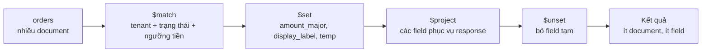

# $match, $project, $set và $unset

## 1. Aggregation pipeline và vai trò của bốn stage

Trong **Spring Data MongoDB**, `Aggregation` kết hợp nhiều **stage** để MongoDB xử lý dữ liệu theo từng bước. Mỗi stage nhận luồng document từ stage trước, rồi **lọc, biến đổi hoặc chuyển tiếp** document đến stage sau. `MongoTemplate.aggregate(...)` và `ReactiveMongoTemplate.aggregate(...)` giúp chạy pipeline từ Java thay vì chỉ viết trực tiếp trong `mongosh`.

Bốn stage cơ bản của bài:

| Stage | Ý nghĩa | Ảnh hưởng đến luồng kết quả |
| --- | --- | --- |
| `$match` | Giữ những document thỏa điều kiện lọc | **Giảm số document**, không tự tạo field |
| `$project` | Chọn, bỏ, đổi tên hoặc tính các field đầu ra | **Thay đổi hình dạng** mỗi document |
| `$set` | Thêm/ghi đè field dựa trên giá trị hoặc biểu thức | Giữ các field cũ trừ khi chủ động ghi đè |
| `$unset` | Bỏ một hoặc nhiều field trong document đang đi qua pipeline | Loại field khỏi **kết quả trung gian** |

Ví dụ câu hỏi nghiệp vụ: “Với **SHOP-A**, lấy các đơn đã thanh toán, giá trị từ 400.000 đơn vị nhỏ nhất, tính lại giá trị hiển thị và trả về một bản tóm tắt **không chứa email khách hàng hoặc ghi chú nội bộ**.”



**Điểm quan trọng nhất:** các stage trong aggregation chỉ xây dựng **kết quả truy vấn**, không tự sửa các document lưu trong collection. `$set` và `$unset` trong **aggregation pipeline** không đồng nghĩa với lệnh `db.collection.updateOne(..., {$set: ...})` hoặc `Update.set(...)` trong Spring Data MongoDB.

### Phân biệt truy vấn thường và aggregation

Truy vấn find có thể lọc, chọn field và sort:

```javascript
db.orders.find(
  { tenant_id: "SHOP-A", status: "PAID" },
  { _id: 1, status: 1, amount_minor: 1 }
)
```

Khi cần nhiều bước biến đổi hoặc một field tính toán phụ thuộc field khác, pipeline thường dễ đọc hơn:

```javascript
db.orders.aggregate([
  { $match: { tenant_id: "SHOP-A", status: "PAID" } },
  { $set: { amount_major: { $divide: ["$amount_minor", 100] } } },
  { $project: { _id: 1, amount_major: 1, status: 1 } }
])
```

`$divide` là **aggregation expression** được dùng bên trong `$set`. Dấu `"$amount_minor"` nghĩa là **tham chiếu giá trị của field** trong document đang xử lý; không phải chuỗi literal.

## 2. Dữ liệu mẫu nhất quán cho cả bài

Giả sử hệ thống đa tenant lưu đơn hàng trong collection `orders` của database `aggregation_stage_demo`. Các tên field vật lý trong MongoDB dùng `snake_case`, còn Java entity có thể dùng `camelCase` với `@Field`.

| Ý nghĩa | Tên BSON | Kiểu minh họa |
| --- | --- | --- |
| ID đơn hàng | `_id` | BSON String |
| Tenant | `tenant_id` | String |
| Trạng thái | `status` | String |
| Số tiền theo đơn vị nhỏ nhất | `amount_minor` | Int64 |
| Thời gian tạo | `created_at` | BSON Date |
| Thông tin khách | `customer` | Embedded document |
| Ghi chú nội bộ | `internal_note` | String |
| Dòng hàng | `lines` | Array of embedded documents |

### Nạp dữ liệu bằng `mongosh`

Chỉ thực hành trên **database thử nghiệm trống**, không thực thi lệnh nạp/xóa tùy tiện trên production:

```javascript
use aggregation_stage_demo

db.orders.insertMany([
  {
    _id: "ORD-001",
    tenant_id: "SHOP-A",
    status: "PAID",
    amount_minor: NumberLong("450000"),
    created_at: ISODate("2026-11-10T08:00:00Z"),
    customer: { name: "An", email: "an@example.test" },
    internal_note: "Đối soát nội bộ",
    lines: [
      { sku: "BOOK-101", quantity: 2, unit_minor: NumberLong("150000") },
      { sku: "PEN-201", quantity: 1, unit_minor: NumberLong("150000") }
    ]
  },
  {
    _id: "ORD-002",
    tenant_id: "SHOP-A",
    status: "CREATED",
    amount_minor: NumberLong("900000"),
    created_at: ISODate("2026-11-11T08:00:00Z"),
    customer: { name: "Bình", email: "binh@example.test" },
    internal_note: "Chờ thanh toán",
    lines: [
      { sku: "BOOK-202", quantity: 3, unit_minor: NumberLong("300000") }
    ]
  },
  {
    _id: "ORD-003",
    tenant_id: "SHOP-A",
    status: "PAID",
    amount_minor: NumberLong("900000"),
    created_at: ISODate("2026-11-12T08:00:00Z"),
    customer: { name: "Chi", email: "chi@example.test" },
    internal_note: "Khách VIP",
    lines: [
      { sku: "BOOK-303", quantity: 3, unit_minor: NumberLong("300000") }
    ]
  },
  {
    _id: "ORD-004",
    tenant_id: "SHOP-B",
    status: "PAID",
    amount_minor: NumberLong("750000"),
    created_at: ISODate("2026-11-13T08:00:00Z"),
    customer: { name: "Dũng", email: "dung@example.test" },
    internal_note: "Tenant khác",
    lines: [
      { sku: "BOOK-404", quantity: 5, unit_minor: NumberLong("150000") }
    ]
  },
  {
    _id: "ORD-005",
    tenant_id: "SHOP-A",
    status: "PAID",
    amount_minor: NumberLong("350000"),
    created_at: ISODate("2026-11-14T08:00:00Z"),
    customer: { name: "Em", email: "em@example.test" },
    internal_note: "Đơn dưới ngưỡng",
    lines: [
      { sku: "BOOK-505", quantity: 1, unit_minor: NumberLong("350000") }
    ]
  }
])
```

Nếu chạy lại khi các `_id` đã tồn tại, MongoDB có thể báo lỗi duplicate key. Các giá trị email sử dụng domain `example.test` làm dữ liệu giả.

Một URI minh họa cho dự án Spring Boot (không kèm credential thật):

```properties
spring.data.mongodb.uri=mongodb://localhost:27017/aggregation_stage_demo
```

Kiểm tra document mẫu:

```javascript
db.orders.findOne({ _id: "ORD-001" })
```

### Kết quả mong đợi ở từng giai đoạn

Với điều kiện `tenant_id = SHOP-A`, `status = PAID` và `amount_minor >= 400000`:

| ID | Có khớp `$match`? | Lý do |
| --- | --- | --- |
| `ORD-001` | Có | SHOP-A, PAID, 450.000 |
| `ORD-002` | Không | Chưa thanh toán |
| `ORD-003` | Có | SHOP-A, PAID, 900.000 |
| `ORD-004` | Không | Thuộc SHOP-B |
| `ORD-005` | Không | Chỉ 350.000 |

Do đó pipeline chỉ còn **2 document** sau `$match`. Các phép biến đổi tiếp theo sẽ cho `amount_major` tương ứng **4500** và **9000**. Ở đây `major/minor` chỉ là quy ước minh họa tỷ lệ 100; với ứng dụng tài chính thật phải xác định đơn vị và tiền tệ rõ ràng, không tự mặc định mọi đồng tiền đều có tỷ lệ này.

## 3. `$match`: lọc sớm và giữ ranh giới tenant

`$match` nhận một biểu thức truy vấn MongoDB, giống cấu trúc filter của `find`. Nó **không** chọn field hoặc tự tính số tiền; nó chỉ quyết định document nào đi tiếp.

```javascript
db.orders.aggregate([
  {
    $match: {
      tenant_id: "SHOP-A",
      status: "PAID",
      amount_minor: { $gte: NumberLong("400000") }
    }
  }
])
```

Trong một stage, nhiều điều kiện trên các field khác nhau được kết hợp **AND** theo ngữ nghĩa filter. Hai document khớp là `ORD-001` và `ORD-003`. Không nên suy ra thứ tự của kết quả nếu không có `$sort`.

### Một stage `$match` với logic phức tạp

Muốn lọc `tenant = SHOP-A` và trong đó `status = PAID` **hoặc** giá trị từ 800.000 trở lên:

```javascript
{
  $match: {
    $and: [
      { tenant_id: "SHOP-A" },
      {
        $or: [
          { status: "PAID" },
          { amount_minor: { $gte: NumberLong("800000") } }
        ]
      }
    ]
  }
}
```

**Không đặt điều kiện tenant vào cùng nhóm OR** nếu đó là ranh giới phân quyền. Nếu viết `tenant = SHOP-A OR status = PAID`, document của SHOP-B cũng có thể khớp. Điều kiện tenant phải được tạo từ ngữ cảnh đã xác thực và phân quyền, không chỉ dựa trên chuỗi client truyền vào.

### `$match` với field tính ở stage trước

`$match` cũng có thể lọc theo một field vừa được tạo:

```javascript
db.orders.aggregate([
  { $set: { is_large: { $gte: ["$amount_minor", 500000] } } },
  { $match: { is_large: true } }
])
```

Nhưng nếu chỉ cần lọc trực tiếp theo `amount_minor`, nên dùng `$match: { amount_minor: { $gte: ... } }` **trước** bước tính toán, để MongoDB có cơ hội dùng index và giảm số document cần xử lý. Khi điều kiện thật sự phụ thuộc một giá trị tính mới, thứ tự `$set` rồi `$match` mới có ý nghĩa.

### `$match` không giải quyết mọi thao tác

- `$match` không gom nhóm, đếm theo danh mục hay join collection khác; cần `$group`/`$lookup` khi nghiệp vụ yêu cầu.
- `$match` không bảo đảm truy vấn dùng index: còn tùy vị trí stage, điều kiện, index và tối ưu hóa của MongoDB.
- `$match` không đổi dữ liệu lưu trữ.
- `$match` không tự áp phân quyền; ứng dụng phải xác định filter đúng.

## 4. `$project`: chỉ trả field cần thiết và tính field mới

`$project` kiểm soát **hình dạng mỗi document đầu ra**. Nó có thể:

1. **Include** field muốn giữ.
2. **Exclude** field không muốn hiển thị.
3. **Đổi tên** field bằng biểu thức tham chiếu field gốc.
4. **Tính toán** field đầu ra bằng aggregation expression.
5. **Tạo cấu trúc nested** mới phục vụ DTO/API.

### Chỉ giữ ID, trạng thái và số tiền

```javascript
db.orders.aggregate([
  { $match: { tenant_id: "SHOP-A", status: "PAID" } },
  {
    $project: {
      _id: 1,
      status: 1,
      amount_minor: 1
    }
  }
])
```

`1` ở đây là lệnh **include field**, không phải giá trị số cần đưa vào tài liệu. Nếu muốn đặt một field bằng số 1 theo đúng nghĩa số literal, dùng `$literal` hoặc một biểu thức phù hợp.

### Mặc định của `_id`

Nếu `$project` không đề cập `_id`, MongoDB thường vẫn **giữ `_id`**. Khi response không cần ID, phải loại tường minh:

```javascript
{
  $project: {
    _id: 0,
    status: 1,
    amount_minor: 1
  }
}
```

### Không trộn include và exclude tùy ý

Đây là dạng cấu hình không hợp lệ/không đúng quy tắc projection thông thường:

```javascript
// Không dùng: vừa include status vừa exclude internal_note.
{
  $project: {
    status: 1,
    internal_note: 0
  }
}
```

Ngoại lệ quen thuộc là `_id`: có thể viết `_id: 0` cùng các field include. Ngoài ra, MongoDB có những trường hợp biểu thức loại field có điều kiện (`$$REMOVE`) nhưng đó là cơ chế khác; đừng xem include/exclude hỗn hợp là mặc định hợp lệ.

Khi chỉ muốn **bỏ** một số field mà **giữ nguyên các field còn lại**, `$unset` thường dễ đọc hơn một `$project` liệt kê tất cả field.

## 5. `$project` nâng cao: đổi tên, tính toán và cấu trúc lồng

### Đổi tên và tính field mới

Một phép chiếu có thể tạo field `orderId`, `total` và `customerName` theo tên response:

```javascript
db.orders.aggregate([
  { $match: { tenant_id: "SHOP-A" } },
  {
    $project: {
      _id: 0,
      orderId: "$_id",
      customerName: "$customer.name",
      total: { $divide: ["$amount_minor", 100] }
    }
  }
])
```

Giá trị `"$_id"` và `"$customer.name"` là **field path expression**. MongoDB đọc field từ document nguồn, rồi gán giá trị vào tên field mới ở kết quả. `$project` không tự đổi tên field đã lưu trong collection.

### Tạo embedded object mới

Đôi khi response cần cấu trúc JSON rõ ràng hơn:

```javascript
{
  $project: {
    _id: 0,
    order: {
      id: "$_id",
      status: "$status"
    },
    buyer: {
      name: "$customer.name"
    },
    amountMajor: {
      $divide: ["$amount_minor", 100]
    }
  }
}
```

Kết quả minh họa:

```javascript
{
  order: {
    id: "ORD-001",
    status: "PAID"
  },
  buyer: {
    name: "An"
  },
  amountMajor: 4500
}
```

Trong `$project`, biểu thức tính toán được đánh giá cho **từng document** đầu vào; nó không tự tính tổng nhiều đơn. Muốn tổng doanh thu của các đơn trong một tenant, cần `$group` hoặc một stage tổng hợp thích hợp.

### Thiếu field hoặc null: dùng `$ifNull`

Với dữ liệu thực tế, `customer.name` có thể không tồn tại. Đừng mặc định các phép ghép chuỗi đều nhận được String hợp lệ:

```javascript
{
  $project: {
    _id: 1,
    safeCustomerName: {
      $ifNull: ["$customer.name", "Khách chưa có tên"]
    }
  }
}
```

`$ifNull` dùng giá trị dự phòng khi biểu thức được xem là null/missing theo ngữ nghĩa MongoDB. Khi tạo nhãn hiển thị bằng `$concat`, nên xử lý các field có thể null trước; nếu không, kết quả nhãn có thể trở thành null ngoài ý định.

### Literal hay field path?

Xem hai biểu thức:

```javascript
{
  $project: {
    sourceValue: "$status",
    literalValue: { $literal: "$status" }
  }
}
```

- `sourceValue` nhận giá trị từ field `status`, ví dụ `"PAID"`.
- `literalValue` nhận đúng chuỗi `"$status"`.

Tương tự, trong `$project`, `1`/`0` thường mang ý nghĩa include/exclude nên nếu muốn giá trị số nguyên thật, hãy dùng `$literal` để tránh nhập nhằng.

### Cảnh báo trùng đường dẫn

Một projection định nghĩa cùng lúc cả field cha và field con có thể bị MongoDB từ chối do **path collision**:

```javascript
// Ví dụ lỗi: chọn customer rồi cũng định nghĩa customer.name.
{
  $project: {
    customer: 1,
    "customer.name": 1
  }
}
```

Thay vào đó, chọn một cách rõ ràng: giữ toàn bộ `customer` hoặc chỉ giữ những field con cần thiết (ví dụ `"customer.name": 1`). Không dựa vào thứ tự các property trong object JavaScript để giải quyết trùng đường dẫn.

## 6. `$set`: thêm field mà không mất những field khác

`$set` trong aggregation pipeline là **alias của `$addFields`**. Stage này tạo hoặc gán lại giá trị field cho các document đang đi qua pipeline.

```javascript
db.orders.aggregate([
  { $match: { _id: "ORD-001" } },
  {
    $set: {
      amount_major: {
        $divide: ["$amount_minor", 100]
      },
      display_label: {
        $concat: ["$customer.name", " / ", "$status"]
      }
    }
  }
])
```

Kết quả vẫn có các field gốc như `tenant_id`, `amount_minor`, `customer`, `internal_note` và `lines`, **đồng thời** có thêm:

```javascript
{
  amount_major: 4500,
  display_label: "An / PAID"
}
```

Hai field minh họa ở trên chỉ là phần **được thêm**; `$set` không tự loại các field khác.

### Ghi đè field trong luồng

`$set` có thể thay giá trị của field vốn đã tồn tại:

```javascript
{
  $set: {
    status: { $toLower: "$status" }
  }
}
```

Sau stage này, field `status` trong **document trung gian** có thể thành `"paid"` thay vì `"PAID"`. Nhưng giá trị lưu trong collection `orders` vẫn giữ nguyên, vì `aggregate(...)` chỉ đọc và biến đổi dữ liệu. Nếu các stage sau còn lọc `status = "PAID"`, chúng sẽ **không khớp** với giá trị lowercase vừa được tính. Thứ tự stage có ý nghĩa ngữ nghĩa, không chỉ hiệu năng.

### Thêm field vào subdocument

`$set` hỗ trợ đường dẫn lồng, ví dụ:

```javascript
{
  $set: {
    "customer.display_name": {
      $ifNull: ["$customer.name", "Khách hàng"]
    }
  }
}
```

Đây là thay đổi của **subdocument trong pipeline result**, không phải một lệnh cập nhật `customer.display_name` trong database.

### `$set` có phải lúc nào cũng tốt hơn `$project`?

Không. Nếu mục tiêu là một DTO chỉ có vài field, `$project` giúp chỉ rõ **allowlist đầu ra**. Nếu cần giữ phần lớn document và chỉ bổ sung một vài giá trị để stage tiếp theo sử dụng, `$set` dễ đọc hơn. Có thể kết hợp:

```javascript
db.orders.aggregate([
  { $match: { status: "PAID" } },
  { $set: { amount_major: { $divide: ["$amount_minor", 100] } } },
  { $project: { _id: 1, amount_major: 1 } }
])
```

**Không thêm một `$set` không cần thiết** khi `$project` có thể trực tiếp tính field đầu ra; chọn cấu trúc ít stage nhưng vẫn rõ ràng. MongoDB có thể tối ưu một số biến đổi, nhưng không bảo đảm mọi biểu thức tùy ý đều được tối ưu giống nhau.

## 7. `$unset`: xóa field khỏi tài liệu trung gian

Trong aggregation, `$unset` là alias cho dạng `$project` **loại trừ field**. Có thể dùng một chuỗi field hoặc array tên field:

```javascript
// Bỏ một field.
{ $unset: "internal_note" }

// Bỏ nhiều field.
{ $unset: ["internal_note", "customer.email"] }
```

`$unset` không xóa dữ liệu trong collection. Nó chỉ bỏ những field này khỏi các document tiếp tục đi qua pipeline. Khi gọi lại `db.orders.findOne(...)`, `internal_note` và email vẫn còn nguyên nếu chưa có **lệnh update** riêng.

### Loại bỏ field con nhưng giữ field cha

```javascript
db.orders.aggregate([
  { $match: { _id: "ORD-001" } },
  { $unset: "customer.email" },
  {
    $project: {
      _id: 1,
      customer: 1
    }
  }
])
```

Kết quả:

```javascript
{
  _id: "ORD-001",
  customer: {
    name: "An"
  }
}
```

Nếu `$unset` đặt trước `$project`, field đã bị loại không còn để các stage sau dùng. Ví dụ, bỏ `customer.name` rồi mới tính `display_label` bằng `$concat` từ tên sẽ không cho kết quả như mong đợi.

### Dùng `$unset` để bỏ field tạm

`$set` có thể tạo trường trung gian giúp kiểm tra hoặc tính toán:

```javascript
db.orders.aggregate([
  {
    $set: {
      scratch: { $gte: ["$amount_minor", 400000] }
    }
  },
  { $match: { scratch: true } },
  { $unset: "scratch" }
])
```

Field `scratch` tồn tại giữa các stage nhưng không còn trong kết quả cuối. Trong trường hợp này, có thể viết `$match` trực tiếp trên `amount_minor` gọn và dễ dùng index hơn, nếu không thật sự cần scratch cho biến đổi khác.

### Có thể dùng `$unset` làm bảo vệ dữ liệu nhạy cảm không?

`$unset` có thể loại email hoặc ghi chú khỏi **kết quả trả về**, nhưng không tự tạo chính sách phân quyền hay bảo đảm mọi đường truy vấn khác đều che cùng field. Với API công khai, nên ưu tiên `$project` dạng **chỉ cho phép các field cụ thể** ở stage cuối hoặc ánh xạ sang DTO chặt chẽ.

Đặc biệt, việc giữ `customer: 1` rồi quên `$unset: "customer.email"` có thể làm lộ email trong JSON response. Không chỉ dựa vào thứ tự các stage mà bỏ qua việc kiểm thử chính xác những field được trả ra.

## 8. Ghép đủ bốn stage: một pipeline có đầu ra xác định

Pipeline sau cố ý dùng cả `$match`, `$set`, `$project` và `$unset` để minh họa dòng dữ liệu:

```javascript
db.orders.aggregate([
  // 1. Chọn đúng tenant, trạng thái và ngưỡng tiền.
  {
    $match: {
      tenant_id: "SHOP-A",
      status: "PAID",
      amount_minor: { $gte: NumberLong("400000") }
    }
  },

  // 2. Thêm giá trị tính toán và field tạm.
  {
    $set: {
      amount_major: { $divide: ["$amount_minor", 100] },
      display_label: {
        $concat: [
          { $ifNull: ["$customer.name", "Khách chưa có tên"] },
          " / ",
          "$status"
        ]
      },
      scratch_flag: "REMOVE_ME"
    }
  },

  // 3. Định hình tài liệu; cố ý giữ email để minh họa unset.
  {
    $project: {
      _id: 1,
      customer: {
        name: "$customer.name",
        email: "$customer.email"
      },
      amount_major: 1,
      display_label: 1,
      scratch_flag: 1
    }
  },

  // 4. Bỏ field tạm và email khỏi kết quả cuối.
  { $unset: ["scratch_flag", "customer.email"] }
])
```

**Kết quả mong đợi** (thứ tự giữa hai document không được bảo đảm nếu không thêm `$sort`):

```javascript
{
  _id: "ORD-001",
  customer: { name: "An" },
  amount_major: 4500,
  display_label: "An / PAID"
}
{
  _id: "ORD-003",
  customer: { name: "Chi" },
  amount_major: 9000,
  display_label: "Chi / PAID"
}
```

### Phân tích sau từng stage

| Stage | Số document còn lại | Field thay đổi |
| --- | ---: | --- |
| Nguồn `orders` | 5 | Mọi field BSON có trong document |
| `$match` | 2 | Chưa thay hình dạng document |
| `$set` | 2 | Thêm `amount_major`, `display_label`, `scratch_flag` |
| `$project` | 2 | Chỉ giữ `_id`, `customer`, `amount_major`, `display_label`, `scratch_flag` |
| `$unset` | 2 | Bỏ `scratch_flag` và `customer.email` |

Vì `$set` và `$project` đều có thể tính field, hoàn toàn có thể viết một pipeline **ngắn hơn** cho production:

```javascript
db.orders.aggregate([
  {
    $match: {
      tenant_id: "SHOP-A",
      status: "PAID",
      amount_minor: { $gte: NumberLong("400000") }
    }
  },
  {
    $project: {
      _id: 1,
      customer: { name: "$customer.name" },
      amount_major: { $divide: ["$amount_minor", 100] },
      display_label: {
        $concat: [
          { $ifNull: ["$customer.name", "Khách chưa có tên"] },
          " / ",
          "$status"
        ]
      }
    }
  }
])
```

**Ưu tiên pipeline ngắn, rõ nghĩa và chỉ trả các field được phép** nếu API không thực sự cần field tạm. Bản bốn stage ở trên là bài tập so sánh hành vi, không phải yêu cầu mọi API phải dùng đủ cả bốn stage.

## 9. Chạy aggregation với `MongoTemplate` và Java DSL

Với Spring Boot có dependency `spring-boot-starter-data-mongodb`, Spring Data MongoDB hỗ trợ builder `Aggregation` và `AggregationOperation`. Thực hành bắt đầu bằng entity có metadata để ánh xạ các property Java sang field BSON.

### Entity nguồn `OrderDocument`

```java
package com.example.orders;

import org.springframework.data.mongodb.core.mapping.Document;
import org.springframework.data.mongodb.core.mapping.Field;
import org.springframework.data.mongodb.core.mapping.FieldType;
import org.springframework.data.mongodb.core.mapping.MongoId;

@Document(collection = "orders")
public class OrderDocument {

    @MongoId(FieldType.STRING)
    private String id;

    @Field("tenant_id")
    private String tenantId;

    private String status;

    @Field("amount_minor")
    private Long amountMinor;

    private Customer customer;

    protected OrderDocument() {}

    public String getId() { return id; }
    public String getTenantId() { return tenantId; }
    public String getStatus() { return status; }
    public Long getAmountMinor() { return amountMinor; }
    public Customer getCustomer() { return customer; }

    public static class Customer {
        private String name;
        private String email;

        protected Customer() {}

        public String getName() { return name; }
        public String getEmail() { return email; }
    }
}
```

Entity ở đây chỉ khai báo những field cần sử dụng trong ví dụ. Document MongoDB có thể còn `created_at`, `internal_note` và `lines`; không phải cứ thiếu property Java là những field đó bị xóa khỏi MongoDB khi **đọc aggregation**.

### Ví dụ đơn giản chỉ dùng DSL

```java
import java.util.List;
import org.bson.Document;
import org.springframework.data.mongodb.core.aggregation.Aggregation;
import org.springframework.data.mongodb.core.aggregation.AggregationResults;
import org.springframework.data.mongodb.core.query.Criteria;

Aggregation aggregation = Aggregation.newAggregation(
    Aggregation.match(
        Criteria.where("tenantId").is("SHOP-A")
            .and("status").is("PAID")
    ),
    Aggregation.project("status")
        .andExclude("_id")
);

AggregationResults<Document> results =
    mongoTemplate.aggregate(
        aggregation, OrderDocument.class, Document.class);

List<Document> documents = results.getMappedResults();
```

Trong `Aggregation.match`, `tenantId` là **property Java** và sẽ được ánh xạ thành `tenant_id` khi Spring Data dùng metadata `OrderDocument`. Với `Aggregation.project("status")`, đầu ra chỉ giữ `status`; `andExclude("_id")` bỏ ID.

`mongoTemplate.aggregate(aggregation, OrderDocument.class, Document.class)` lấy collection theo metadata entity nguồn và trả kết quả dạng `org.bson.Document`. Nếu cần response Java cụ thể, có thể ánh xạ sang DTO/record thích hợp sau khi xác định chính xác schema đầu ra.

### Khi nào dùng DSL, khi nào dùng raw stage?

Spring Data có DSL chuyên dụng cho `match`, `project`, thêm field và các phép biến đổi khác. Nhưng khi học trực tiếp cú pháp MongoDB hoặc cần một stage chưa được DSL của phiên bản đang dùng biểu diễn thuận tiện, có thể cung cấp **`AggregationOperation` tự tạo** để trả về BSON `Document`.

Điều này hữu ích để minh họa chính xác `$set` và `$unset`, đồng thời tránh phụ thuộc vào tên builder thay đổi giữa các phiên bản thư viện.

## 10. Java đầy đủ: `Aggregation.match` kết hợp stage BSON tường minh

Đoạn dưới đây thực hiện pipeline bốn stage của mục 8. Nó cố tình phối hợp:

- `Aggregation.match(...)` với **property Java** và mapping metadata của entity.
- Các `AggregationOperation` tự tạo với **field BSON vật lý**, ví dụ `amount_minor` và `customer.name`.
- Kết quả kiểu `Document` để dễ đọc đúng hình dạng BSON đầu ra.

```java
package com.example.orders;

import java.util.List;
import org.bson.Document;
import org.springframework.data.mongodb.core.MongoTemplate;
import org.springframework.data.mongodb.core.aggregation.Aggregation;
import org.springframework.data.mongodb.core.aggregation.AggregationOperation;
import org.springframework.data.mongodb.core.aggregation.AggregationResults;
import org.springframework.data.mongodb.core.query.Criteria;
import org.springframework.stereotype.Service;

@Service
public class OrderSummaryAggregationService {

    private final MongoTemplate template;

    public OrderSummaryAggregationService(MongoTemplate template) {
        this.template = template;
    }

    public List<Document> summarizePaidOrders(
            String authorizedTenantId, long minAmountMinor) {

        if (authorizedTenantId == null
                || authorizedTenantId.isBlank()
                || minAmountMinor < 0) {
            throw new IllegalArgumentException(
                "Bộ lọc đơn hàng không hợp lệ");
        }

        AggregationOperation setStage = context -> new Document(
            "$set",
            new Document("amount_major",
                new Document("$divide", List.of(
                    "$amount_minor", 100
                )))
                .append(
                    "display_label",
                    new Document("$concat", List.of(
                        new Document("$ifNull", List.of(
                            "$customer.name",
                            "Khách chưa có tên"
                        )),
                        " / ",
                        "$status"
                    ))
                )
                .append("scratch_flag", "REMOVE_ME")
        );

        AggregationOperation projectStage = context -> new Document(
            "$project",
            new Document("_id", 1)
                .append(
                    "customer",
                    new Document("name", "$customer.name")
                        .append("email", "$customer.email")
                )
                .append("amount_major", 1)
                .append("display_label", 1)
                .append("scratch_flag", 1)
        );

        AggregationOperation unsetStage = context -> new Document(
            "$unset",
            List.of("scratch_flag", "customer.email")
        );

        Aggregation pipeline = Aggregation.newAggregation(
            Aggregation.match(
                Criteria.where("tenantId").is(authorizedTenantId)
                    .and("status").is("PAID")
                    .and("amountMinor").gte(minAmountMinor)
            ),
            setStage,
            projectStage,
            unsetStage
        );

        AggregationResults<Document> result = template.aggregate(
            pipeline, OrderDocument.class, Document.class);

        return result.getMappedResults();
    }
}
```

Gọi service:

```java
List<Document> summaries =
    orderSummaryAggregationService.summarizePaidOrders(
        "SHOP-A", 400_000L);

for (Document summary : summaries) {
    System.out.println(summary.toJson());
}
```

Trong ví dụ có hai kết quả `ORD-001` và `ORD-003` như mục 8, nhưng **không dựa vào thứ tự phần tử** nếu chưa có sort.

### Vì sao không dùng lẫn tên Java và BSON tùy ý?

Với Java DSL có metadata entity:

```java
Criteria.where("tenantId").is("SHOP-A")
    .and("amountMinor").gte(400_000L);
```

Framework có thể mapping thành:

```javascript
{
  tenant_id: "SHOP-A",
  amount_minor: { $gte: NumberLong("400000") }
}
```

Nhưng trong custom `AggregationOperation` ở ví dụ trên, ta tự xây `new Document("$set", ...)` với `"$amount_minor"`. Những raw stage kiểu này cần được viết theo **tên BSON vật lý**; chúng không được xử lý ánh xạ property theo cách ta đang thể hiện ở `Aggregation.match(Criteria...)`.

**Quy tắc thực hành:** với DSL, dùng tên property Java và kiểm tra metadata; với BSON thô, sử dụng tên BSON đã được xác nhận trên collection. Nếu custom converter hoặc cơ chế mapping khác tham gia, kiểm tra command cuối trong test thay vì chỉ dựa vào cách viết source.

### Một DTO đầu ra thay cho `Document`

Khi chuẩn hóa response API, có thể định nghĩa một DTO:

```java
package com.example.orders;

public record OrderSummaryDto(
    String id,
    String customerName,
    double amountMajor,
    String displayLabel
) {}
```

DTO này **không trùng** tên field của pipeline hiện tại (`_id`, `customer.name`, `amount_major`, `display_label`). Vì vậy, đừng giả định Spring Data tự tạo đúng `OrderSummaryDto` từ kết quả của pipeline này nếu chưa bổ sung mapping/alias hoặc một mapper tường minh.

Ví dụ mapper sau có thể đọc `Document` rồi tạo record:

```java
public static OrderSummaryDto toDto(Document source) {
    Document customer = source.get("customer", Document.class);
    Number amount = (Number) source.get("amount_major");

    return new OrderSummaryDto(
        source.getString("_id"),
        customer == null ? null : customer.getString("name"),
        amount == null ? 0.0 : amount.doubleValue(),
        source.getString("display_label")
    );
}
```

Hàm này minh họa cách chuyển đổi kiểu; trong hệ thống tài chính **không dùng `double` làm biểu diễn giá tiền chính xác** nếu nghiệp vụ đòi hỏi độ chính xác thập phân. Nên thống nhất đơn vị, `BigDecimal`/Decimal128 hoặc giữ `long` theo đơn vị nhỏ nhất khi phù hợp, và kiểm thử phép chia/làm tròn.

## 11. Thứ tự stage quyết định những field còn sử dụng được

Một pipeline không phải tập hợp các stage có thể đổi chỗ tùy ý. Ví dụ:

```javascript
db.orders.aggregate([
  { $project: { status: 1 } },
  { $match: { amount_minor: { $gte: NumberLong("400000") } } }
])
```

Đoạn này đã bỏ `amount_minor` ở stage `$project`. Stage `$match` sau đó **không còn field đó** trên document trung gian để lọc như dự định. Đặt `$match` trên field gốc trước khi cắt field:

```javascript
db.orders.aggregate([
  { $match: { amount_minor: { $gte: NumberLong("400000") } } },
  { $project: { status: 1 } }
])
```

### Chọn vị trí `$match` theo field phụ thuộc

| Loại điều kiện | Vị trí hợp lý | Lý do |
| --- | --- | --- |
| So sánh field gốc `status`, `tenant_id` | Thường đặt trước `$set`/`$project` | Giảm document sớm, cơ hội dùng index |
| So sánh field `amount_major` được tính ở `$set` | Sau stage tạo `amount_major` | Giá trị chưa tồn tại trước đó |
| Lọc theo field đã bị `$unset` | Trước `$unset`, hoặc đổi thiết kế | Không thể lọc đúng bằng field đã bỏ |
| Lọc theo field được đổi tên bằng `$project` | Sau khi đổi tên hoặc lọc ở tên gốc trước đó | Tên field đầu vào/đầu ra khác nhau |

MongoDB có bộ tối ưu pipeline có thể di chuyển/tách một số `$match` khi phép biến đổi độc lập và việc dịch chuyển **giữ nguyên ngữ nghĩa**. Không nên lập trình dựa trên giả định mọi stage đều được đẩy lên đầu, đặc biệt khi `$match` phụ thuộc field tính toán hoặc khi có các stage ảnh hưởng thứ tự/giới hạn.

### `$project` sớm có luôn nhanh hơn không?

Không nhất thiết. `$project` sớm có thể giảm payload trung gian, nhưng cũng có thể cắt field mà stage sau cần. MongoDB có thể tự tối ưu phụ thuộc field cho một số pipeline. Trong nhiều trường hợp, ưu tiên **`$match` sớm trên các field gốc, giữ các field cần dùng, rồi `$project` đầu ra rõ ràng**. Chỉ kết luận tốt hơn sau khi kiểm tra `explain` và dữ liệu thực tế.

### `$set` và `$unset` không thay đổi dữ liệu lưu trữ

Nên tự kiểm chứng sau pipeline:

```javascript
db.orders.findOne(
  { _id: "ORD-001" },
  { customer: 1, internal_note: 1, amount_major: 1 }
)
```

Trường `customer.email` và `internal_note` vẫn được lưu trong document gốc; `amount_major` không tự xuất hiện trong collection chỉ vì một lần aggregation tính nó. Muốn cập nhật document thật, phải dùng thao tác ghi có kiểm soát (ví dụ `updateOne` với update operators), hoặc pipeline ghi đặc biệt với `$merge`/`$out` khi thật sự được phép, không phải các stage đọc trong bài này.

## 12. Array, embedded document và các phép biến đổi có điều kiện

Một đơn hàng có field `lines` là array của embedded document:

```javascript
lines: [
  { sku: "BOOK-101", quantity: 2, unit_minor: NumberLong("150000") },
  { sku: "PEN-201", quantity: 1, unit_minor: NumberLong("150000") }
]
```

### `$match` trên phần tử array

Muốn tìm đơn có **một dòng hàng** vừa đúng SKU vừa có quantity ít nhất 2, phải dùng `$elemMatch` trong filter:

```javascript
db.orders.aggregate([
  {
    $match: {
      tenant_id: "SHOP-A",
      lines: {
        $elemMatch: {
          sku: "BOOK-101",
          quantity: { $gte: 2 }
        }
      }
    }
  }
])
```

`$elemMatch` bảo đảm nhiều điều kiện cùng đúng trên **một phần tử** của array. Nếu chỉ viết `"lines.sku": "BOOK-101"` và `"lines.quantity": { $gte: 2 }` riêng lẻ, chúng có thể khớp **hai phần tử khác nhau** trong cùng document.

### `$set` với `$map` để tính field từ array

Nếu muốn kết quả có danh sách SKU thay vì toàn bộ dòng hàng, có thể tạo `sku_list`:

```javascript
db.orders.aggregate([
  { $match: { _id: "ORD-001" } },
  {
    $set: {
      sku_list: {
        $map: {
          input: "$lines",
          as: "line",
          in: "$$line.sku"
        }
      }
    }
  },
  {
    $project: {
      _id: 1,
      sku_list: 1
    }
  }
])
```

Kết quả:

```javascript
{
  _id: "ORD-001",
  sku_list: ["BOOK-101", "PEN-201"]
}
```

Trong `$map`, `$$line` là biến đại diện cho từng phần tử của array. **`"$lines"`** là tham chiếu tới field nguồn; **`"$$line.sku"`** là tham chiếu tới property của phần tử hiện tại. Khi `lines` có thể null/missing hoặc không phải array, cần kiểm tra hành vi của `$map` và dùng `$ifNull`/chuẩn hóa schema cho phù hợp.

### `$project` có thể biến đổi array nhưng không tự lọc phần tử

`$project: { lines: 1 }` chỉ giữ nguyên array `lines` trong kết quả, **không chọn** những phần tử có quantity lớn. Nếu cần tạo array con có điều kiện, dùng `$filter`:

```javascript
{
  $project: {
    _id: 1,
    expensive_lines: {
      $filter: {
        input: "$lines",
        as: "line",
        cond: { $gte: ["$$line.unit_minor", 200000] }
      }
    }
  }
}
```

`$filter` trả array những phần tử thỏa điều kiện; trong dữ liệu ORD-001, không có line có `unit_minor >= 200000` nên `expensive_lines` là array rỗng. Đây là **biến đổi kết quả**, không xóa dòng hàng khỏi document được lưu.

### Dot path và so khớp toàn bộ subdocument

`$match: { "customer.name": "An" }` tìm theo một field lồng. Còn `$match: { customer: { name: "An" } }` là một phép so sánh **subdocument** có ngữ nghĩa khác, có thể nhạy với cấu trúc/field còn thiếu/thứ tự BSON. Khi chỉ quan tâm tới tên, nên dùng dot path.

## 13. Index và `explain`: hiệu năng phụ thuộc vị trí `$match`

Aggregation pipeline vẫn hoạt động trên MongoDB và chịu chi phí I/O, index, CPU và bộ nhớ như các truy vấn khác. Việc viết bốn stage không tự tạo index hay làm database nhanh hơn.

### Compound index ứng viên

Với workload lọc thường xuyên theo `tenant_id`, `status` và `amount_minor >= ngưỡng`, có thể thử:

```javascript
db.orders.createIndex(
  {
    tenant_id: 1,
    status: 1,
    amount_minor: 1
  },
  { name: "orders_tenant_status_amount" }
)
```

Hai field đầu là điều kiện **bằng**, còn `amount_minor` là điều kiện **khoảng**. Đây là một ứng viên cần được kiểm chứng trên dữ liệu thật; không phải công thức áp dụng cho mọi truy vấn aggregation. Nếu API còn cần sort theo `created_at`, phải xem xét thứ tự index, hướng sort và điều kiện range khi tối ưu, thay vì thêm ngẫu nhiên các index.

### Đọc query plan của pipeline

```javascript
db.orders.explain("executionStats").aggregate([
  {
    $match: {
      tenant_id: "SHOP-A",
      status: "PAID",
      amount_minor: { $gte: NumberLong("400000") }
    }
  },
  {
    $project: {
      _id: 1,
      status: 1,
      amount_minor: 1
    }
  }
])
```

Khi xem explain, các stage và cấu trúc kế hoạch phụ thuộc phiên bản MongoDB và execution engine. Tập trung vào:

| Chỉ dấu | Cần trả lời |
| --- | --- |
| `winningPlan` hoặc thông tin plan tương đương | Chọn index nào, hình dạng đường quét ra sao? |
| `IXSCAN` / `COLLSCAN` | Có sử dụng index hay quét collection? |
| `totalKeysExamined` | Đã duyệt bao nhiêu khóa? |
| `totalDocsExamined` | Đã đọc bao nhiêu document? |
| `nReturned` | Đã trả bao nhiêu kết quả? |
| `executionTimeMillis` | Thời gian đo của lần thực thi này, có ổn định qua nhiều lần không? |
| Các stage `PROJECTION` / `FETCH` khi hiện diện | Có cần đọc document đầy đủ để lấy các field cần thiết? |

Với collection chỉ có năm document mẫu, `COLLSCAN` có thể là một lựa chọn bình thường của query planner; không kết luận thiếu index là vấn đề từ dữ liệu quá nhỏ. Hãy đo trên dữ liệu có phân bố, khối lượng và tải đại diện.

### `$project` ít field không luôn là covered query

Một pipeline chỉ trả `_id`, `status` và `amount_minor` có thể giảm payload trả về, nhưng để **covered query**, index phải cung cấp đủ những field cần cho filter và kết quả theo điều kiện MongoDB. Ví dụ index ứng viên ở trên chưa chứa `_id` một cách tường minh trong key; đừng khẳng định nó bảo đảm không cần đọc document chỉ vì đã có `IXSCAN`.

Thêm field vào index làm index lớn hơn và tăng chi phí insert/update/delete. Cần so sánh lợi ích đọc với chi phí ghi và giới hạn bộ nhớ thay vì tạo index bao phủ tất cả DTO.

### `$set` tính toán có dùng index không?

Nếu lọc trực tiếp `amount_minor >= 400000`, MongoDB có thể tận dụng index phù hợp. Nhưng nếu tính `amount_major` ở `$set` rồi lọc trường mới này, không thể mặc định database dùng index của `amount_minor` theo cùng cách. Query planner có thể tối ưu một số biểu thức, nhưng phải kiểm tra pipeline thực tế.

Thứ tự thực hành thường dễ tối ưu:

```javascript
[
  { $match: { tenant_id: "SHOP-A", status: "PAID" } },
  { $set: { amount_major: { $divide: ["$amount_minor", 100] } } },
  { $project: { _id: 1, amount_major: 1 } }
]
```

Nếu chỉ cần document có `amount_minor >= 400000`, thêm điều kiện đó ngay trong `$match` đầu thay vì lọc lại ở `amount_major` về sau.

### Đừng kỳ vọng explain đo toàn bộ response Java

`explain("executionStats")` giúp chẩn đoán phần thực thi MongoDB. Nó không đo đầy đủ thời gian network, conversion BSON → Java, serialization JSON, tải CPU của service và độ trễ client. Khi đánh giá API, cần đo thêm p95/p99 từ ứng dụng, kích thước kết quả và tốc độ phát response.

## 14. Bảo vệ field nhạy cảm và kiểm soát kết quả API

Aggregation giúp tạo một **read model** từ collection có chứa nhiều field, nhưng nó không thay thế authentication/authorization. Có hai nhiệm vụ độc lập:

1. **Document nào được phép đọc?** Áp điều kiện tenant, trạng thái và quyền ở `$match`.
2. **Field nào được phép trả?** Sử dụng `$project` allowlist hoặc DTO/mapper bảo đảm không rò rỉ field.

Ví dụ response tối giản:

```javascript
db.orders.aggregate([
  { $match: { tenant_id: "SHOP-A", status: "PAID" } },
  {
    $project: {
      _id: 1,
      customerName: "$customer.name",
      amountMinor: "$amount_minor"
    }
  }
])
```

Kết quả không có `customer.email`, `internal_note`, `lines` hoặc `tenant_id`. Mẫu này giúp dễ đánh giá những field **được phép xuất hiện** hơn là trả hầu hết document rồi viết nhiều câu `$unset` để xóa từng field nhạy cảm.

### Các nguyên tắc an toàn

- Không cho caller nhập cả một mảng stage JSON rồi thực thi nếu không có cơ chế kiểm soát nghiêm ngặt; pipeline tùy ý có thể đọc field ngoài phạm vi, chạy truy vấn đắt hoặc kích hoạt stage không phù hợp.
- Dùng tenant ID **được xác thực**, không chỉ tin vào query string.
- Cấm hoặc kiểm tra nghiêm ngặt field path do client cung cấp; không ghép field name tùy ý vào `$project` hoặc `$unset`.
- Kết quả `Document` là object linh hoạt: khi trả trực tiếp cho API, có nguy cơ xuất hiện field ngoài mong đợi nếu pipeline bị sửa. Dùng DTO/mapper chặt chẽ tại ranh giới bên ngoài.
- Không ghi log toàn bộ document chứa email, ghi chú thanh toán hoặc thông tin khách trong quá trình debug.
- Kiểm thử các field **không được phép** xuất hiện, không chỉ kiểm tra các field cần có.

### Phân biệt `$unset` đọc với `Update.unset`

```java
// Aggregation stage đọc: field chỉ bị bỏ khỏi kết quả pipeline.
AggregationOperation unsetStage = context ->
    new Document("$unset", "internal_note");

// Update operator ghi: xóa field khỏi document được lưu
// khi thực thi một thao tác update phù hợp.
org.springframework.data.mongodb.core.query.Update update =
    new org.springframework.data.mongodb.core.query.Update()
        .unset("internalNote");
```

Ở ví dụ update, `internalNote` là property Java giả định tồn tại và có mapping sang `internal_note` trong entity của thao tác ghi. **Đoạn update chưa thực thi lệnh nào**; phải gọi một API ghi như `MongoTemplate.updateFirst` thì database mới thay đổi. Đừng dùng chung khái niệm “unset” mà bỏ qua ngữ cảnh đọc/ghi.

## 15. Kiểm thử tích hợp trên MongoDB thật

Kiểm thử aggregation cần xác minh cả **danh sách document**, **hình dạng kết quả** và **dữ liệu gốc không bị sửa**. Một mock `MongoTemplate` có thể kiểm tra Java đã gọi API nào, nhưng không chứng minh MongoDB thực hiểu đúng `$project`, `$set` hoặc `$unset`.

Với Spring Boot 3.x, có thể sử dụng `@DataMongoTest` và một MongoDB test cô lập (ví dụ Testcontainers). Đoạn minh họa dưới dùng `MongoTemplate` đã được inject và gọi service ở mục 10.

**Cảnh báo:** `deleteMany(new Document())` xóa **mọi document** trong collection của database đang kết nối. Chỉ dùng trên database test tách biệt; tuyệt đối không dùng trên production hoặc môi trường chung.

```java
package com.example.orders;

import java.util.Date;
import java.time.Instant;
import java.util.List;
import org.bson.Document;
import org.junit.jupiter.api.BeforeEach;
import org.junit.jupiter.api.Test;
import org.springframework.beans.factory.annotation.Autowired;
import org.springframework.boot.test.autoconfigure.data.mongo.DataMongoTest;
import org.springframework.data.mongodb.core.MongoTemplate;

import static org.assertj.core.api.Assertions.assertThat;

@DataMongoTest
class BasicAggregationStagesTest {

    @Autowired
    MongoTemplate template;

    OrderSummaryAggregationService service;

    @BeforeEach
    void seedOnlyIsolatedTestDatabase() {
        template.getCollection("orders")
            .deleteMany(new Document());

        Date created = Date.from(
            Instant.parse("2026-11-10T08:00:00Z"));

        template.getCollection("orders").insertMany(List.of(
            new Document("_id", "ORD-001")
                .append("tenant_id", "SHOP-A")
                .append("status", "PAID")
                .append("amount_minor", 450_000L)
                .append("created_at", created)
                .append("customer", new Document("name", "An")
                    .append("email", "an@example.test"))
                .append("internal_note", "Nội bộ"),

            new Document("_id", "ORD-002")
                .append("tenant_id", "SHOP-A")
                .append("status", "CREATED")
                .append("amount_minor", 900_000L)
                .append("created_at", created)
                .append("customer", new Document("name", "Bình")
                    .append("email", "binh@example.test")),

            new Document("_id", "ORD-003")
                .append("tenant_id", "SHOP-A")
                .append("status", "PAID")
                .append("amount_minor", 900_000L)
                .append("created_at", created)
                .append("customer", new Document("name", "Chi")
                    .append("email", "chi@example.test")),

            new Document("_id", "ORD-004")
                .append("tenant_id", "SHOP-B")
                .append("status", "PAID")
                .append("amount_minor", 750_000L)
                .append("created_at", created)
                .append("customer", new Document("name", "Dũng")
                    .append("email", "dung@example.test")),

            new Document("_id", "ORD-005")
                .append("tenant_id", "SHOP-A")
                .append("status", "PAID")
                .append("amount_minor", 350_000L)
                .append("created_at", created)
                .append("customer", new Document("name", "Em")
                    .append("email", "em@example.test"))
        ));

        service = new OrderSummaryAggregationService(template);
    }

    @Test
    void matchKeepsOnlyPaidTenantOrdersAboveThreshold() {
        List<Document> results = service.summarizePaidOrders(
            "SHOP-A", 400_000L);

        assertThat(results)
            .extracting(d -> d.getString("_id"))
            .containsExactlyInAnyOrder("ORD-001", "ORD-003");
    }

    @Test
    void projectAndUnsetDoNotExposeEmailOrScratchField() {
        List<Document> results = service.summarizePaidOrders(
            "SHOP-A", 400_000L);

        for (Document row : results) {
            assertThat(row).doesNotContainKeys(
                "scratch_flag",
                "internal_note",
                "tenant_id",
                "amount_minor"
            );

            Document customer = row.get("customer", Document.class);
            assertThat(customer).isNotNull();
            assertThat(customer).containsKey("name");
            assertThat(customer).doesNotContainKey("email");
        }
    }

    @Test
    void setComputesValuesAndDoesNotPersistThem() {
        List<Document> results = service.summarizePaidOrders(
            "SHOP-A", 400_000L);

        Document first = results.stream()
            .filter(d -> "ORD-001".equals(d.getString("_id")))
            .findFirst()
            .orElseThrow();

        Number amount = (Number) first.get("amount_major");
        assertThat(amount.doubleValue()).isEqualTo(4500.0);
        assertThat(first.getString("display_label"))
            .isEqualTo("An / PAID");

        Document stored = template.getCollection("orders")
            .find(new Document("_id", "ORD-001"))
            .first();

        assertThat(stored).isNotNull();
        assertThat(stored).doesNotContainKey("amount_major");
        assertThat(stored).containsKey("internal_note");
        assertThat(stored.get("customer", Document.class))
            .containsKey("email");
    }
}
```

### Vì sao cần kiểm thử cả điều kiện phủ định?

Chỉ assert “đã có `customer.name`” chưa đủ cho một response công khai. Một thay đổi code vô tình chuyển `$project: { customer: 1 }` có thể đưa email trở lại output. Test cần xác nhận `email` và `internal_note` **không xuất hiện** trong kết quả, bên cạnh việc xác nhận các field hợp lệ.

### Những ca kiểm thử bổ sung

1. `customer.name` thiếu/null: `$ifNull` tạo nhãn dự phòng đúng.
2. `amount_minor` thiếu hoặc sai BSON type: xác định hành vi (loại, báo lỗi hay chuẩn hóa dữ liệu).
3. Ngưỡng bằng đúng `400000`: `$gte` phải bao gồm document tại biên.
4. Đơn của tenant khác nhưng trạng thái/tiền đều khớp: tuyệt đối không rò ra kết quả.
5. Thay `@Field("amount_minor")`: kiểm chứng mapping của `Aggregation.match` và raw `Document`.
6. Pipeline không có `$sort`: test không phụ thuộc thứ tự mặc định.
7. `$project` có path collision: server phải từ chối thay vì âm thầm đoán kết quả.
8. Nested document/array: xác nhận `$map` và `$elemMatch` đúng trên dữ liệu có nhiều phần tử.
9. Dữ liệu lớn: kiểm tra `explain`, số document duyệt và chi phí mapping result.

## 16. Reactive aggregation dùng cùng các stage

Với ứng dụng **reactive**, `ReactiveMongoTemplate` cũng có API `aggregate(...)`, trả kết quả dạng `Flux<T>` thay vì `AggregationResults<T>` đồng bộ.

```java
import java.util.List;
import org.bson.Document;
import org.springframework.data.mongodb.core.ReactiveMongoTemplate;
import org.springframework.data.mongodb.core.aggregation.Aggregation;
import org.springframework.data.mongodb.core.aggregation.AggregationOperation;
import org.springframework.data.mongodb.core.query.Criteria;
import reactor.core.publisher.Flux;

AggregationOperation setStage = context -> new Document(
    "$set",
    new Document("amount_major",
        new Document("$divide", List.of("$amount_minor", 100))
    )
);

AggregationOperation projectStage = context -> new Document(
    "$project",
    new Document("_id", 1)
        .append("amount_major", 1)
);

Aggregation pipeline = Aggregation.newAggregation(
    Aggregation.match(
        Criteria.where("tenantId").is("SHOP-A")
            .and("status").is("PAID")
    ),
    setStage,
    projectStage
);

Flux<Document> result = reactiveMongoTemplate.aggregate(
    pipeline,
    OrderDocument.class,
    Document.class
);
```

Snippet này thuộc một component đã inject `ReactiveMongoTemplate` và có dependency reactive MongoDB phù hợp. Nó minh họa cách dùng **cùng nguyên lý pipeline** trong reactive access; nếu cần `$unset`, thêm một `AggregationOperation` tương tự trước stage cuối hoặc ở cuối pipeline.

**Lưu ý vận hành:**

- `Flux` thường thực hiện truy vấn khi được subscribe; đừng gọi `block()` trên thread request reactive.
- Reactive không tự làm một `$match` thiếu index trở nên nhanh hơn.
- Tránh `collectList()` cho một pipeline có thể trả hàng triệu document; dùng `$limit`/bộ lọc thích hợp khi nghiệp vụ có giới hạn.
- Không chia sẻ object cấu hình mutable giữa nhiều request rồi sửa stage tùy ý. Dựng pipeline từ đầu vào đã xác thực.
- Backpressure điều tiết tiêu thụ dữ liệu trong luồng, **không thay thế** điều kiện tenant, index hay giới hạn chi phí truy vấn MongoDB.

## 17. Chẩn đoán những lỗi thường gặp

| Hiện tượng | Nguyên nhân khả dĩ | Cách khắc phục |
| --- | --- | --- |
| `$match` không tìm thấy kết quả | Nhầm property Java và tên BSON, sai database hoặc sai kiểu giá trị | Đối chiếu `@Field`, `_id`, BSON `$type` và collection |
| `$match` trả đơn tenant khác | Tenant đặt trong nhóm OR hoặc lấy từ request không được xác thực | Giữ tenant ở nhánh AND và kiểm tra quyền |
| `$project` không còn field mà stage sau cần | Cắt field quá sớm | Dời `$match`/`$set` cần field gốc lên trước |
| `$project` báo path collision | Đưa cả field cha và field con vào projection không hợp lệ | Chỉ chọn một cách biểu diễn field |
| `$project` báo lỗi vì include/exclude pha trộn | Viết `status: 1` và `internal_note: 0` cùng lúc | Dùng allowlist include hoặc `$unset` riêng; xử lý `_id` theo ngoại lệ |
| `_id` vẫn hiện trong response | `$project` mặc định giữ `_id` | Đặt `_id: 0` khi không cần |
| Giá trị `$concat` thành null | Input có field null/missing | Dùng `$ifNull` hoặc chuẩn hóa document |
| `$set` không thấy trong document lưu | Dùng aggregation đọc, không phải update | Phân biệt pipeline stage và update operator |
| `$unset` không xóa email trong collection | Chỉ xóa khỏi pipeline result | Dùng update thật nếu nghiệp vụ cho phép thay đổi dữ liệu |
| Field nhạy cảm xuất hiện trở lại | `$project`/DTO không giới hạn field cuối hoặc thiếu `$unset` | Test cả điều kiện không tồn tại field trong output |
| Raw `Document` không khớp `@Field` | Tên field BSON tự viết sai | Sử dụng tên BSON thực và kiểm tra lệnh gửi tới MongoDB |
| `$match` sau `$set` chậm | Lọc theo field tính toán, khó dùng index | Nếu tương đương về ngữ nghĩa, lọc ở field gốc trước |
| `$match` trên array khớp nhầm nhiều phần tử | Dot path độc lập thay vì cùng phần tử | Dùng `$elemMatch` |
| Aggregation chậm dù output có ít field | Filter không chọn lọc, không dùng index, stage tốn CPU | Dùng `explain` và đo dữ liệu/tải đại diện |
| DTO mapping bị thiếu field | Alias trong pipeline khác tên property/constructor DTO | Kiểm tra schema output, dùng mapper hoặc định nghĩa alias rõ |
| Kết quả thay đổi thứ tự giữa các lần gọi | Không có `$sort` | Thêm sort với khóa phụ duy nhất khi cần thứ tự xác định |

## 18. Bài tập tự luyện

### Bài tập 1. Phân biệt chức năng

**Câu hỏi:** Một pipeline cần chọn đơn `PAID`, tính field `amount_major` rồi chỉ trả `_id` và `amount_major`. Các stage nên dùng là gì?

**Đáp án:** `$match` để lọc, `$set` hoặc biểu thức trong `$project` để tính `amount_major`, và `$project` để chọn field đầu ra. Có thể chỉ dùng `$match` + `$project` nếu `$project` tự thực hiện phép chia.

### Bài tập 2. Giá trị `_id`

```javascript
{ $project: { status: 1 } }
```

**Câu hỏi:** `_id` còn không?

**Đáp án:** Có, `_id` được giữ theo mặc định trong `$project`. Đặt `_id: 0` để bỏ.

### Bài tập 3. Include và exclude

```javascript
{ $project: { status: 1, internal_note: 0 } }
```

**Câu hỏi:** Vì sao không nên dùng?

**Đáp án:** Đây là cách trộn include/exclude không phù hợp quy tắc thông thường của `$project` (ngoại lệ quen thuộc là `_id`). Hãy chỉ include field được phép hoặc dùng một stage `$unset` riêng.

### Bài tập 4. `$set` đọc hay ghi?

```javascript
db.orders.aggregate([
  { $set: { display_label: "READY" } }
])
```

**Câu hỏi:** Document trong collection có thêm field `display_label` không?

**Đáp án:** Không. Stage trong pipeline đọc chỉ thay đổi document kết quả. Muốn ghi phải thực hiện thao tác update hoặc pipeline ghi phù hợp.

### Bài tập 5. Thứ tự stage

```javascript
[
  { $project: { status: 1 } },
  { $match: { amount_minor: { $gte: 400000 } } }
]
```

**Câu hỏi:** Điều gì sai?

**Đáp án:** `amount_minor` bị loại ở `$project` trước khi `$match` cần dùng. Nên lọc bằng `$match` trước hoặc giữ field đó cho tới khi hoàn thành điều kiện.

### Bài tập 6. Field lồng

**Câu hỏi:** Muốn trả tên khách nhưng không trả email và ghi chú, chọn cách nào?

**Đáp án:** Dùng `$project: { _id: 1, customerName: "$customer.name" }` và không include email/`internal_note`. Đây là allowlist field đầu ra.

### Bài tập 7. Array và `$elemMatch`

**Câu hỏi:** Đơn có dòng BOOK-101 quantity 1 và dòng PEN-201 quantity 3. Truy vấn “có một dòng BOOK-101 quantity ≥ 2” có được phép khớp không?

**Đáp án:** Không. Dùng `$elemMatch` để buộc cả SKU và quantity đúng trên **cùng một phần tử**.

### Bài tập 8. Property Java và BSON

Entity dùng `@Field("amount_minor") Long amountMinor`. **Câu hỏi:** Khi gọi `Aggregation.match(Criteria.where(...))` viết tên nào? Khi tự viết `new Document("$set", ...)` tham chiếu field nào?

**Đáp án:** DSL dùng property Java `"amountMinor"` với metadata entity; BSON thô dùng tham chiếu vật lý `"$amount_minor"`. Nên quan sát truy vấn phát sinh để xác minh.

### Bài tập 9. Kết quả không có thứ tự

**Câu hỏi:** Một pipeline `$match → $project` trả hai đơn. Có được khẳng định `ORD-001` luôn trước `ORD-003`?

**Đáp án:** Không. Nếu API cần thứ tự xác định, thêm `$sort` theo các khóa có ngữ nghĩa nghiệp vụ, kèm khóa phụ duy nhất khi cần phân trang ổn định.

## 19. Checklist thiết kế pipeline

1. **Xác định đầu ra:** cần document nào, những field nào và các giá trị tính toán gì?
2. **Lọc đúng phạm vi:** dùng `$match` theo tenant/quyền, status và các điều kiện nghiệp vụ.
3. **Ưu tiên lọc trên field gốc:** đặt điều kiện có thể dùng index trước bước tính toán khi đúng ngữ nghĩa.
4. **Chọn `$set` cho bổ sung/ghi đè field trung gian**, không lẫn với thao tác update database.
5. **Chọn `$project` cho allowlist đầu ra**, alias và biểu thức tính toán; kiểm tra `_id` và path collision.
6. **Chọn `$unset` khi cần loại field** nhưng vẫn giữ những field khác; không coi đây là quyền truy cập.
7. **Kiểm tra phụ thuộc stage:** field chưa được tạo hoặc đã bị loại không thể dùng như mong đợi ở stage sau.
8. **Nhất quán Java/BSON:** `@Field`, kiểu BSON, raw stage và result DTO phải khớp nhau.
9. **Kiểm soát null/missing và array:** dùng `$ifNull`, `$map`, `$filter`, `$elemMatch` đúng ngữ nghĩa.
10. **Không tự tin vào thứ tự mặc định:** nếu cần danh sách sắp xếp, dùng `$sort`.
11. **Giới hạn dữ liệu và kiểm tra index:** quan sát `explain("executionStats")`, p95/p99, kết quả và kích thước payload.
12. **Kiểm thử field nhạy cảm không xuất hiện** và không chỉ kiểm thử giá trị đúng.
13. **Tách truy vấn và ghi:** aggregation đọc không tự cập nhật collection.
14. **Dùng `MongoTemplate` hoặc reactive template phù hợp**, tránh giả định query không giới hạn là an toàn chỉ vì code trả danh sách/luồng.

## 20. Kết luận

Trong **Spring Data MongoDB**, `$match`, `$project`, `$set` và `$unset` là bốn công cụ nền tảng để **lọc document và định hình kết quả aggregation**. `$match` giảm tập dữ liệu theo điều kiện, `$set` thêm hoặc ghi đè giá trị trong luồng, `$project` chọn/tính/đổi tên field đầu ra, còn `$unset` loại field không cần thiết khỏi document trung gian. **Thứ tự stage quan trọng** vì mỗi stage chỉ nhìn thấy những field còn tồn tại từ stage trước.

Với ứng dụng thật, hãy đưa điều kiện tenant/quyền vào filter, ưu tiên project theo allowlist, sử dụng metadata mapping đúng với BSON, xác minh output trên MongoDB thật và đo `explain` với index phù hợp. Các stage này **không tự sửa dữ liệu lưu trữ**; khi cần ghi, đó là một nghiệp vụ riêng với yêu cầu nguyên tử, idempotency và kiểm thử tương ứng.
