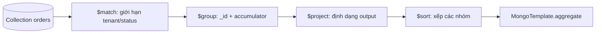

# $group, các accumulator và khóa nhóm

> **Chương:** Aggregation cơ bản  
> **Module:** `SPRING_DATA_MONGODB` — dùng Spring Data MongoDB để kết nối, ánh xạ document và thao tác MongoDB qua `MongoTemplate` hoặc repository. Bài học đi sâu vào `$group`, **khóa nhóm `_id`**, các **accumulator** và cách thiết kế báo cáo dữ liệu bằng Aggregation API. Những quyết định này liên quan tới truy vấn, index, transaction, reactive access, kiểm thử và chẩn đoán hiệu năng.

## 1. Vấn đề: tính báo cáo mà không tải hàng triệu document về JVM

Giả sử một hệ thống đơn hàng cần trả lời: tenant A có bao nhiêu đơn `PAID`, doanh thu mỗi trạng thái là bao nhiêu, tháng nào bán nhiều nhất, và sản phẩm nào được mua nhiều nhất?

Cách làm thiếu hiệu quả là tải toàn bộ collection bằng `mongoTemplate.findAll(Order.class)`, sau đó dùng Java Stream để `groupingBy`, `sum` và `average`. Khi dữ liệu lớn, ứng dụng phải nhận quá nhiều BSON, ánh xạ hàng triệu object, có nguy cơ đầy heap và tạo tải network không cần thiết.

MongoDB aggregation pipeline xử lý dữ liệu ở server:



`$group` tập hợp các document có cùng **giá trị khóa nhóm**, tính ra một document kết quả cho mỗi nhóm. Đây thường là **blocking stage**: server có thể phải duyệt rất nhiều document và giữ trạng thái tổng hợp trước khi tạo output. Số dòng kết quả ít không đồng nghĩa truy vấn luôn rẻ.

**Mục tiêu sau bài học:** đọc và viết đúng `_id` trong group, phân biệt các accumulator, hiểu vì sao `$sort`/`$unwind` làm thay đổi kết quả, chuyển pipeline sang Spring Data, và biết khi nào cần tối ưu index/bộ nhớ.

## 2. Bộ dữ liệu mẫu và kết quả tính tay

Chạy trên **database thử nghiệm cô lập**. Lệnh `drop()` sau đây xóa collection hiện tại; không thực hiện trên production:

```javascript
db.orders.drop();

db.orders.insertMany([
  {
    _id: "A-001", tenantId: "TENANT-A", status: "PAID",
    amount: NumberDecimal("120.00"),
    createdAt: ISODate("2026-11-01T01:00:00Z"),
    lines: [
      { sku: "BOOK-01", quantity: 2, unitPrice: NumberDecimal("50.00") },
      { sku: "PEN-02", quantity: 1, unitPrice: NumberDecimal("20.00") }
    ]
  },
  {
    _id: "A-002", tenantId: "TENANT-A", status: "PAID",
    amount: NumberDecimal("80.00"),
    createdAt: ISODate("2026-11-03T02:00:00Z"),
    lines: [
      { sku: "BOOK-01", quantity: 1, unitPrice: NumberDecimal("80.00") }
    ]
  },
  {
    _id: "A-003", tenantId: "TENANT-A", status: "PENDING",
    amount: NumberDecimal("40.00"),
    createdAt: ISODate("2026-11-04T03:00:00Z"),
    lines: []
  },
  {
    _id: "A-004", tenantId: "TENANT-A", status: "PAID",
    amount: NumberDecimal("100.00"),
    createdAt: ISODate("2026-10-31T18:30:00Z"),
    lines: [
      { sku: "PEN-02", quantity: 5, unitPrice: NumberDecimal("20.00") }
    ]
  },
  {
    _id: "B-001", tenantId: "TENANT-B", status: "PAID",
    amount: NumberDecimal("300.00"),
    createdAt: ISODate("2026-11-02T05:00:00Z"),
    lines: []
  },
  {
    _id: "B-002", tenantId: "TENANT-B", status: "PENDING",
    amount: NumberDecimal("75.00"),
    createdAt: ISODate("2026-11-04T06:00:00Z"),
    lines: []
  }
]);
```

| Đơn | Tenant | Status | Amount | Thời điểm UTC |
| --- | --- | --- | ---: | --- |
| A-001 | TENANT-A | PAID | 120.00 | 01/11, 01:00 |
| A-002 | TENANT-A | PAID | 80.00 | 03/11, 02:00 |
| A-003 | TENANT-A | PENDING | 40.00 | 04/11, 03:00 |
| A-004 | TENANT-A | PAID | 100.00 | **31/10, 18:30** |
| B-001 | TENANT-B | PAID | 300.00 | 02/11, 05:00 |
| B-002 | TENANT-B | PENDING | 75.00 | 04/11, 06:00 |

Tập này có 6 đơn: **tenant A có 3 đơn PAID** với tổng `120 + 80 + 100 = 300` và trung bình `100`; tenant A còn một đơn PENDING với amount `40`.

Đơn `A-004` tạo vào **01/11 lúc 01:30 theo Asia/Ho_Chi_Minh**, mặc dù timestamp UTC thuộc tháng 10. Đây là ca kiểm thử quan trọng khi nhóm theo tháng.

## 3. Cấu trúc của một stage $group

Một `$group` gồm khóa `_id` và một hay nhiều field accumulator:

```javascript
{
  $group: {
    _id: "$status",
    orderCount: { $sum: 1 },
    grossAmount: { $sum: "$amount" }
  }
}
```

**`_id` của kết quả group không phải nhất thiết là `_id` của document nguồn.** Ở đây `_id` là trạng thái, ví dụ `"PAID"`. Nếu muốn giữ ID của từng đơn, phải chủ động đưa vào một accumulator, nhưng không nên thu gom tất cả ID cho báo cáo chỉ cần số lượng.

### 3.1. Nhóm theo trạng thái

```javascript
db.orders.aggregate([
  { $match: { tenantId: "TENANT-A" } },
  {
    $group: {
      _id: "$status",
      orderCount: { $sum: 1 }
    }
  },
  { $sort: { _id: 1 } }
]);
```

Kết quả mang ý nghĩa:

```javascript
{ _id: "PAID", orderCount: 3 }
{ _id: "PENDING", orderCount: 1 }
```

`$match` giữ lại 4 đơn thuộc TENANT-A. `$group` đưa document vào hai nhóm `PAID` và `PENDING`. Mỗi document đóng góp **1** vào `$sum: 1`. `$sort` sau cùng chỉ sắp xếp **các dòng nhóm**.

**Không dựa vào thứ tự output của `$group`** nếu không có stage `$sort` sau group.

### 3.2. $sum: 1 và $count: hai ngữ cảnh khác nhau

```javascript
orderCount: { $sum: 1 }
```

Là một accumulator rất thông dụng: cộng `1` cho **mỗi document đi vào nhóm**. Nó không đếm một property và không biết “đơn hàng” là gì nếu `$unwind` trước đó đã biến mỗi document thành một dòng sản phẩm.

MongoDB 5.0+ còn có accumulator `$count` trong group:

```javascript
db.orders.aggregate([
  { $group: { _id: "$status", orderCount: { $count: {} } } }
]);
```

Đừng nhầm với **stage `$count`** ở cấp pipeline, chỉ đếm tổng document đi qua:

```javascript
db.orders.aggregate([
  { $match: { tenantId: "TENANT-A", status: "PAID" } },
  { $count: "orderCount" }
]);
// Kết quả: { orderCount: 3 }
```

Với nhu cầu tương thích nhiều phiên bản, `$sum: 1` trong `$group` thường dễ sử dụng hơn.

## 4. Khóa nhóm _id: đơn, kép, null và biểu thức

### 4.1. Một field

```javascript
db.orders.aggregate([
  { $group: { _id: "$tenantId", orders: { $sum: 1 } } },
  { $sort: { _id: 1 } }
]);
// TENANT-A: 4; TENANT-B: 2
```

### 4.2. Khóa ghép nhiều field

Muốn nhóm theo **cặp (tenant, status)**:

```javascript
db.orders.aggregate([
  {
    $group: {
      _id: {
        tenant: "$tenantId",
        state: "$status"
      },
      orders: { $sum: 1 },
      total: { $sum: "$amount" }
    }
  },
  { $sort: { "_id.tenant": 1, "_id.state": 1 } }
]);
```

Kết quả:

```javascript
{ _id: { tenant: "TENANT-A", state: "PAID" }, orders: 3, total: NumberDecimal("300.00") }
{ _id: { tenant: "TENANT-A", state: "PENDING" }, orders: 1, total: NumberDecimal("40.00") }
{ _id: { tenant: "TENANT-B", state: "PAID" }, orders: 1, total: NumberDecimal("300.00") }
{ _id: { tenant: "TENANT-B", state: "PENDING" }, orders: 1, total: NumberDecimal("75.00") }
```

Khóa nhóm là **embedded document**; ở những stage sau phải dùng `"_id.tenant"`/`"_id.state"` thay vì tự giả định những field đó còn nằm ở root. Khi ánh xạ Java DTO, phải thống nhất tên và cấu trúc khóa.

### 4.3. Nhóm toàn tập: _id: null

```javascript
db.orders.aggregate([
  { $match: { tenantId: "TENANT-A", status: "PAID" } },
  {
    $group: {
      _id: null,
      orders: { $sum: 1 },
      total: { $sum: "$amount" },
      average: { $avg: "$amount" }
    }
  }
]);
```

Kết quả:

```javascript
{ _id: null, orders: 3, total: NumberDecimal("300.00"), average: NumberDecimal("100.00") }
```

`_id: null` nghĩa là **mọi document đầu vào được đưa vào cùng một nhóm**. Nó không có nghĩa document gốc có `_id = null`. Bắt buộc filter tenant trước group nếu người gọi chỉ có quyền xem một tenant; nếu không, tổng có thể gộp dữ liệu của khách hàng khác.

### 4.4. Khóa nhóm là biểu thức

```javascript
db.orders.aggregate([
  {
    $group: {
      _id: { $toUpper: "$status" },
      orders: { $sum: 1 }
    }
  }
]);
```

Biểu thức có thể chuẩn hóa `"paid"` và `"PAID"` thành cùng một khóa. Khi field missing/null hoặc có kiểu dữ liệu ngoài dự kiến, cần xây quy tắc xử lý hợp lệ, không dựa vào dữ liệu “trông có vẻ đúng”.

### 4.5. Missing khác null khi kiểm kê schema

Khi group trực tiếp theo field `_id: "$customerSegment"`, các document missing hoặc explicit null thường cùng rơi vào nhóm `null`. Nếu muốn **thống kê loại dữ liệu**, dùng `$type` dạng **aggregation expression**:

```javascript
db.orders.aggregate([
  {
    $group: {
      _id: { $type: "$customerSegment" },
      orders: { $sum: 1 }
    }
  }
]);
```

`$type` có thể trả `"missing"`, `"null"` hoặc `"string"`. Đây là **nhóm theo BSON type**, không phải nhóm theo giá trị customer segment; ứng dụng chỉ nên sử dụng khi mục tiêu là kiểm tra schema hoặc xử lý migration.

## 5. Accumulator $sum và $avg

```javascript
db.orders.aggregate([
  { $match: { tenantId: "TENANT-A" } },
  {
    $group: {
      _id: "$status",
      orderCount: { $sum: 1 },
      totalAmount: { $sum: "$amount" },
      avgAmount: { $avg: "$amount" }
    }
  },
  { $sort: { _id: 1 } }
]);
```

| Status | orderCount | totalAmount | avgAmount |
| --- | ---: | ---: | ---: |
| PAID | 3 | 300.00 | 100.00 |
| PENDING | 1 | 40.00 | 40.00 |

### 5.1. $sum và $avg khi gặp missing/null/sai kiểu

Giả sử một nhóm có ba document:

```javascript
{ status: "PAID", amount: NumberDecimal("100.00") }
{ status: "PAID", amount: null }
{ status: "PAID" } // thiếu amount
```

`$sum: "$amount"` cho tổng 100.00; `$avg: "$amount"` tính trung bình trên **các giá trị numeric hợp lệ**, tức 100.00 trong ví dụ này, **không phải 100/3**. Nếu hoàn toàn không có numeric input, `$avg` trả null. Không mặc định missing/null có ý nghĩa nghiệp vụ là số 0.

Đếm riêng document có amount numeric:

```javascript
db.orders.aggregate([
  {
    $group: {
      _id: "$status",
      allOrders: { $sum: 1 },
      numericOrders: {
        $sum: { $cond: [{ $isNumber: "$amount" }, 1, 0] }
      },
      revenue: { $sum: "$amount" },
      average: { $avg: "$amount" }
    }
  }
]);
```

`$isNumber` không tự chuyển chuỗi `"100"` thành số. Nếu dữ liệu legacy lẫn String/Double/Decimal128, cần thống nhất cách lưu và migration trước khi dùng báo cáo tài chính.

### 5.2. Tiền nên được lưu theo Decimal128

```javascript
{ amount: NumberDecimal("120.00") }
```

Với Spring Data:

```java
import java.math.BigDecimal;
import org.springframework.data.mongodb.core.mapping.Field;
import org.springframework.data.mongodb.core.mapping.FieldType;

// Bên trong entity:
@Field(targetType = FieldType.DECIMAL128)
private BigDecimal amount;
```

`Decimal128` giúp tính số thập phân với độ chính xác thích hợp hơn số `double` cho nhiều bài toán tiền tệ. Tuy nhiên vẫn cần quy tắc precision/scale/làm tròn, không xem Decimal128 là giải pháp tự động cho dữ liệu đầu vào sai kiểu.

## 6. $min/$max so với $first/$last

### 6.1. Tìm cực trị bằng $min và $max

```javascript
db.orders.aggregate([
  { $match: { tenantId: "TENANT-A", status: "PAID" } },
  {
    $group: {
      _id: null,
      minAmount: { $min: "$amount" },
      maxAmount: { $max: "$amount" },
      oldestTime: { $min: "$createdAt" },
      newestTime: { $max: "$createdAt" }
    }
  }
]);
```

Trong nhóm PAID tenant A, `minAmount = 80`, `maxAmount = 120`, `oldestTime` là `2026-10-31T18:30:00Z` của A-004.

### 6.2. $first/$last cần thứ tự đầu vào

```javascript
db.orders.aggregate([
  { $match: { tenantId: "TENANT-A" } },
  { $sort: { createdAt: -1, _id: -1 } },
  {
    $group: {
      _id: "$status",
      newestOrderId: { $first: "$_id" },
      oldestOrderId: { $last: "$_id" }
    }
  },
  { $sort: { _id: 1 } }
]);
```

`$sort` **trước** group làm các document đi vào accumulator theo thứ tự thời gian mới đến cũ. Nhóm PAID có `newestOrderId = "A-002"`, `oldestOrderId = "A-004"`. Nhóm PENDING chỉ có A-003 nên cả hai ID đều là A-003.

| Vị trí sort | Tác dụng |
| --- | --- |
| Trước `$group` | Quyết định **thứ tự document trong mỗi group**, quan trọng với `$first`, `$last` và `$push`. |
| Sau `$group` | Sắp xếp **các dòng nhóm kết quả**. |

Sort sau group **không** thể sửa lại giá trị `$first` đã tính trước đó.

**Không nhầm `$min("$amount")` với `$first("$amount")`**: min là giá trị nhỏ nhất; first là giá trị của document đầu tiên **theo thứ tự đầu vào**. Nếu muốn ID của đơn có amount cao nhất, sort theo amount rồi dùng first, hoặc dùng accumulator top theo phiên bản hỗ trợ.

## 7. $push và $addToSet: lưu danh sách hay tập giá trị?

```javascript
db.orders.aggregate([
  { $match: { tenantId: "TENANT-A" } },
  { $sort: { createdAt: 1, _id: 1 } },
  {
    $group: {
      _id: "$status",
      orderIds: { $push: "$_id" },
      tenantSet: { $addToSet: "$tenantId" }
    }
  }
]);
```

- **`$push`** đưa giá trị của từng document vào array, **có thể trùng**; muốn thứ tự array có nghĩa, sort document đầu vào trước group.
- **`$addToSet`** chỉ giữ **giá trị phân biệt** theo quy tắc so sánh BSON và **không bảo đảm thứ tự các phần tử của array**.

Không xây mảng `allIds:{$push:"$_id"}` cho hàng triệu document nếu chỉ cần count. Array đầu ra rất lớn có thể khiến group tốn memory và vượt **giới hạn 16 MiB của một BSON document kết quả**. `allowDiskUse` không khắc phục được việc **một output document quá lớn**.

### 7.1. Đếm distinct không cần lưu mọi ID trong array

Một cách dễ nghĩ là `$addToSet` các mã khách rồi `$size`, nhưng mảng distinct có thể lớn. Nếu cardinality rất cao, cân nhắc hai tầng `$group`:

```javascript
db.orders.aggregate([
  {
    $group: {
      _id: { tenant: "$tenantId", state: "$status" }
    }
  },
  {
    $group: {
      _id: "$_id.tenant",
      distinctStatusCount: { $sum: 1 }
    }
  }
]);
```

`$group` đầu tạo mỗi cặp `(tenant,status)` đúng một lần; `$group` sau đếm số trạng thái distinct của tenant. Cách này tránh một mảng distinct rất lớn trong output, nhưng vẫn phải duy trì đủ trạng thái nhóm ở server, nên vẫn cần đo hiệu năng.

## 8. Nhóm theo tháng: khóa được tính bằng biểu thức có timezone

Nếu báo cáo doanh thu tháng của Việt Nam, cần xác định múi giờ nghiệp vụ. Timestamp `2026-10-31T18:30:00Z` có **tháng UTC là 10** nhưng thuộc **tháng 11** ở múi giờ `Asia/Ho_Chi_Minh` (UTC+07:00).

### 8.1. $dateTrunc theo tháng địa phương

MongoDB 5.0+ hỗ trợ `$dateTrunc`:

```javascript
db.orders.aggregate([
  { $match: { tenantId: "TENANT-A", status: "PAID" } },
  {
    $group: {
      _id: {
        month: {
          $dateTrunc: {
            date: "$createdAt",
            unit: "month",
            timezone: "Asia/Ho_Chi_Minh"
          }
        }
      },
      orders: { $sum: 1 },
      revenue: { $sum: "$amount" }
    }
  },
  { $sort: { "_id.month": 1 } }
]);
```

**Kết quả nghiệp vụ:** tất cả ba đơn `PAID` của tenant A (`A-001`, `A-002`, `A-004`) thuộc **tháng 11 theo giờ Việt Nam**. Nhóm tháng này có `orders=3` và `revenue=300.00`.

`$dateTrunc` trả **BSON Date** biểu diễn thời điểm bắt đầu bucket theo timezone đã chọn. Khi in ra ISO UTC, giá trị đó có thể mang timestamp UTC ở **cuối ngày 31/10**, vì đầu tháng địa phương tương ứng với một thời điểm UTC ngày trước. Không suy báo cáo “sai tháng” chỉ từ ngày UTC hiển thị.

### 8.2. Kết hợp tenant và tháng

```javascript
db.orders.aggregate([
  {
    $group: {
      _id: {
        tenant: "$tenantId",
        month: {
          $dateTrunc: {
            date: "$createdAt",
            unit: "month",
            timezone: "Asia/Ho_Chi_Minh"
          }
        }
      },
      orders: { $sum: 1 },
      revenue: { $sum: "$amount" }
    }
  },
  { $sort: { "_id.tenant": 1, "_id.month": 1 } }
]);
```

Nếu API chỉ cho tenant A, phải thêm `$match tenantId` ở trước `$group`. Pipeline gộp tất cả tenant như trên chỉ phù hợp cho báo cáo hệ thống có phân quyền rõ ràng.

### 8.3. Khi server chưa hỗ trợ $dateTrunc

Với phiên bản MongoDB cũ, có thể cân nhắc `$dateToString`/các date operators với `timezone` để tạo khóa `"YYYY-MM"`, hoặc chuẩn hóa kỳ báo cáo tại tầng ingestion. Hãy đối chiếu version thực tế; không copy pipeline dùng `$dateTrunc` vào một server chưa có operator này.

Nếu vừa lọc theo tháng vừa group theo tháng địa phương, mốc `from`/`to` trong `$match createdAt` cũng phải được tính **tương ứng với timezone đó**. Lọc từ `2026-11-01T00:00:00Z` rồi nhóm theo giờ Việt Nam sẽ bỏ sót một phần ngày 01/11 địa phương.

## 9. $unwind trước $group: từ đơn hàng thành dòng hàng

Ở bộ dữ liệu, mỗi `Order` có mảng `lines`. Trước `$unwind`, `$sum:1` đếm **đơn hàng**; sau `$unwind`, mỗi phần tử `lines` trở thành **một document đầu vào** cho stage kế tiếp.

### 9.1. Tổng hợp theo SKU

```javascript
db.orders.aggregate([
  { $match: { tenantId: "TENANT-A", status: "PAID" } },
  { $unwind: "$lines" },
  {
    $group: {
      _id: "$lines.sku",
      lineCount: { $sum: 1 },
      unitsSold: { $sum: "$lines.quantity" },
      revenue: {
        $sum: {
          $multiply: ["$lines.quantity", "$lines.unitPrice"]
        }
      }
    }
  },
  { $sort: { _id: 1 } }
]);
```

Kết quả có thể kiểm tra bằng tay:

| SKU | lineCount | unitsSold | revenue |
| --- | ---: | ---: | ---: |
| BOOK-01 | 2 | 3 | 180.00 |
| PEN-02 | 2 | 6 | 120.00 |

`A-001` có hai line, `A-002` có một line, `A-004` có một line. Sau unwind có **4 line**, dù ban đầu có **3 đơn PAID**.

Đừng gọi `lineCount` là `orderCount` nếu một đơn có thể chứa nhiều line. `unitsSold` là tổng số lượng item, còn `revenue` ở đây được tính bằng `quantity × unitPrice` ở từng line. Nếu amount đơn có chiết khấu/vận chuyển/thuế, tổng theo line không nhất thiết bằng tổng doanh thu của order; phải định nghĩa KPI đúng với hợp đồng kế toán.

### 9.2. Đếm số đơn duy nhất có một SKU

Nếu cùng một SKU xuất hiện hai lần trong một đơn, `lineCount` sẽ đếm hai line. Để tính **số đơn phân biệt theo SKU**, group hai tầng:

```javascript
db.orders.aggregate([
  { $match: { tenantId: "TENANT-A", status: "PAID" } },
  { $unwind: "$lines" },
  {
    $group: {
      _id: { sku: "$lines.sku", orderId: "$_id" }
    }
  },
  {
    $group: {
      _id: "$_id.sku",
      distinctOrderCount: { $sum: 1 }
    }
  },
  { $sort: { _id: 1 } }
]);
```

`$group` đầu tiên loại những cặp trùng `(sku, orderId)`. `$group` thứ hai đếm số cặp phân biệt theo SKU, không phải số lần SKU xuất hiện trong array.

### 9.3. Array rỗng, null hoặc không có field

`$unwind: "$lines"` mặc định **loại khỏi pipeline** những document có `lines` rỗng, null hoặc missing. Nếu cần giữ những đơn không có line để báo cáo, dùng:

```javascript
{
  $unwind: {
    path: "$lines",
    preserveNullAndEmptyArrays: true
  }
}
```

Khi bật tùy chọn này, phải xử lý `lines.sku` null/missing trước khi nhóm; nếu không, có thể sinh nhóm `_id:null` rồi trình bày nhầm thành “SKU chưa xác định”. Hãy quyết định rõ đối tượng cần đếm là **đơn**, **line** hay **unit**.

## 10. Nhiều $group liên tiếp và phạm vi field sau mỗi stage

Một pipeline có thể group theo tenant rồi group toàn bộ các tenant:

```javascript
db.orders.aggregate([
  { $match: { status: "PAID" } },
  {
    $group: {
      _id: "$tenantId",
      tenantOrders: { $sum: 1 },
      tenantRevenue: { $sum: "$amount" }
    }
  },
  {
    $group: {
      _id: null,
      totalPaidOrders: { $sum: "$tenantOrders" },
      totalRevenue: { $sum: "$tenantRevenue" },
      tenantCount: { $sum: 1 }
    }
  }
]);
```

Kết quả trên cả hai tenant trong bộ dữ liệu mẫu:

```javascript
{
  _id: null,
  totalPaidOrders: 4,
  totalRevenue: NumberDecimal("600.00"),
  tenantCount: 2
}
```

**Stage `$group` thứ hai không còn nhìn thấy `amount` của document nguồn**. Nó chỉ nhận output của stage trước: `_id`, `tenantOrders` và `tenantRevenue`. Vì vậy:

```javascript
// SAI ở stage thứ hai: field amount không tồn tại tại thời điểm này.
{ $group: { _id: null, total: { $sum: "$amount" } } }
```

Phải dùng `"$tenantRevenue"` mới đúng. Đây là nguồn lỗi phổ biến khi một pipeline dài được xây từ các stage rời nhau.

### 10.1. $sortByCount là lối viết tắt để đếm phân bố

```javascript
db.orders.aggregate([
  { $match: { tenantId: "TENANT-A" } },
  { $sortByCount: "$status" }
]);
```

Về ý nghĩa, gần tương đương `$group` theo `status` với `count:{$sum:1}`, rồi `$sort:{count:-1}`. Nếu hai nhóm cùng count thì thứ tự tie-breaker không được quy định từ lệnh sort theo count đơn độc.

`$sortByCount` thích hợp khi chỉ muốn **tần suất**, không phù hợp bằng `$group` đầy đủ nếu cần tổng tiền, giá trị min/max hoặc nhiều accumulator.

### 10.2. $skip/$limit trước group khác sau group

```javascript
db.orders.aggregate([
  { $match: { tenantId: "TENANT-A" } },
  { $group: { _id: "$status", orders: { $sum: 1 } } },
  { $sort: { orders: -1, _id: 1 } },
  { $skip: 0 },
  { $limit: 10 }
]);
```

Pipeline trên trả **tối đa 10 nhóm** sau khi tính trên toàn bộ document phù hợp. Nếu chuyển `$limit:10` **lên trước `$group`**, pipeline chỉ tính báo cáo từ **10 document nguồn** và có thể cho tổng sai. Khi phân trang kết quả nhóm, đặt `$sort/$skip/$limit` ở đúng vị trí **sau group**.

## 11. Spring Data MongoDB: model Java cho aggregation

Ví dụ Java 17+:

```java
package demo.orders;

import java.math.BigDecimal;
import java.time.Instant;
import java.util.List;
import org.springframework.data.annotation.Id;
import org.springframework.data.mongodb.core.mapping.Document;
import org.springframework.data.mongodb.core.mapping.Field;
import org.springframework.data.mongodb.core.mapping.FieldType;

@Document(collection = "orders")
public record Order(
    @Id String id,
    String tenantId,
    String status,
    @Field(targetType = FieldType.DECIMAL128) BigDecimal amount,
    Instant createdAt,
    List<OrderLine> lines
) {}

record OrderLine(
    String sku,
    int quantity,
    @Field(targetType = FieldType.DECIMAL128) BigDecimal unitPrice
) {}
```

`Order` là một public record. `OrderLine` package-private có thể nằm cùng file nguồn trong ví dụ; trong ứng dụng lớn có thể đặt nó trong file riêng. `@Field(targetType = DECIMAL128)` giúp ghi các giá trị `BigDecimal` dưới dạng BSON Decimal128, thay vì phụ thuộc quy ước mặc định khác.

Nếu source document của hệ thống dùng `@Field("total_amount")` thay vì `amount`, Spring Data Aggregation API có thể áp dụng metadata mapping khi biết **input type**. Trong `mongosh` hoặc Java Driver thô, phải viết **đúng tên BSON** của collection.

## 12. MongoTemplate.aggregate với $match, $group và $sort

### 12.1. Nhóm theo status trong Spring Data

```java
import static org.springframework.data.mongodb.core.aggregation.Aggregation.*;

import org.bson.Document;
import org.springframework.data.domain.Sort;
import org.springframework.data.mongodb.core.aggregation.Aggregation;
import org.springframework.data.mongodb.core.aggregation.AggregationResults;
import org.springframework.data.mongodb.core.query.Criteria;

Aggregation aggregation = newAggregation(
    match(Criteria.where("tenantId").is("TENANT-A")
        .and("status").is("PAID")),
    group("status")
        .count().as("orderCount")
        .sum("amount").as("totalAmount")
        .avg("amount").as("averageAmount")
        .min("amount").as("minAmount")
        .max("amount").as("maxAmount"),
    sort(Sort.Direction.ASC, "_id")
);

AggregationResults<Document> results =
    mongoTemplate.aggregate(aggregation, Order.class, Document.class);

for (Document row : results.getMappedResults()) {
    String status = row.getString("_id");
    Number count = (Number) row.get("orderCount");
    Object total = row.get("totalAmount");
    // Đây là BSON output của group; kiểm tra type của total trước khi ép kiểu.
}
```

`mongoTemplate` là bean `MongoTemplate` đã inject; mã trên là phần trong service/test, không phải file Java độc lập. Cách hoạt động:

1. `Order.class` cho biết **collection orders** và các thông tin mapping field.
2. `match(Criteria...)` tạo bộ lọc `$match`.
3. `group("status")` tạo `_id:"$status"`, `count/sum/avg/min/max` tương ứng các accumulator MongoDB.
4. `sort(...,"_id")` xếp output theo khóa nhóm.
5. `Document.class` giúp đọc raw output trước khi quyết định DTO.

**Đừng nhầm `count().as(...)` của group với `MongoTemplate.count(Query,...)`.** Một cái là accumulator trong pipeline đang xây; cái kia là thao tác đếm theo query riêng.

### 12.2. Output DTO bằng $project sau group

Sau `$group`, field `status` nguồn không còn ở root output. Nếu muốn DTO có `status` thay vì `_id`, thêm `$project`:

```javascript
db.orders.aggregate([
  { $match: { tenantId: "TENANT-A", status: "PAID" } },
  {
    $group: {
      _id: "$status",
      orderCount: { $sum: 1 },
      totalAmount: { $sum: "$amount" }
    }
  },
  {
    $project: {
      _id: 0,
      status: "$_id",
      orderCount: 1,
      totalAmount: 1
    }
  }
]);
```

Spring Data:

```java
Aggregation summary = newAggregation(
    match(Criteria.where("tenantId").is("TENANT-A")
        .and("status").is("PAID")),
    group("status")
        .count().as("orderCount")
        .sum("amount").as("totalAmount"),
    project("orderCount", "totalAmount")
        .and("_id").as("status")
        .andExclude("_id")
);

List<StatusSummary> rows = mongoTemplate
    .aggregate(summary, Order.class, StatusSummary.class)
    .getMappedResults();
```

DTO riêng:

```java
package demo.orders;

import java.math.BigDecimal;

public record StatusSummary(
    String status,
    long orderCount,
    BigDecimal totalAmount
) {}
```

Đặt record `StatusSummary` trong file Java riêng với tên phù hợp. Spring Data ánh xạ các alias `status`, `orderCount`, `totalAmount` vào DTO. Phải kiểm tra kết quả thực tế với `Decimal128` và mapping version đang chạy, không coi một DTO có constructor khác field names là tự động được điền đúng.

### 12.3. Khóa composite trong Aggregation.group

```java
Aggregation byTenantAndStatus = newAggregation(
    group("tenantId", "status")
        .count().as("orders")
        .sum("amount").as("revenue"),
    sort(Sort.Direction.ASC, "_id.tenantId", "_id.status")
);

List<Document> grouped = mongoTemplate
    .aggregate(byTenantAndStatus, Order.class, Document.class)
    .getMappedResults();
```

Output có `_id` dạng embedded document với `tenantId` và `status`. Nếu cần DTO:

```java
public record GroupKey(String tenantId, String status) {}

public record TenantStatusTotals(
    GroupKey id,
    long orders,
    BigDecimal revenue
) {}
```

Hai public record trên phải nằm ở **hai file Java riêng** hoặc chuyển một record thành nested/package-private. Đây là minh họa về cấu trúc mapping, chưa phải đoạn khẳng định mọi alias ID đều map thành công trong mọi phiên bản; hãy kiểm tra output `Document` trước rồi viết integration test cho DTO.

### 12.4. Nhóm toàn bộ bằng group()

```java
Aggregation totals = newAggregation(
    match(Criteria.where("tenantId").is("TENANT-A")),
    group()
        .count().as("orders")
        .sum("amount").as("grossAmount")
);
```

`group()` không có field khóa tương ứng với `_id:null`. Không dùng `group("id")` hay `group("_id")` nếu muốn tổng toàn tập: làm thế thường tạo **một nhóm trên mỗi document**, khác yêu cầu.

### 12.5. Spring Data unwind rồi group SKU

```java
Aggregation bySku = newAggregation(
    match(Criteria.where("tenantId").is("TENANT-A")
        .and("status").is("PAID")),
    unwind("lines"),
    group("lines.sku")
        .count().as("lineCount")
        .sum("lines.quantity").as("unitsSold"),
    sort(Sort.Direction.ASC, "_id")
);

List<Document> skuRows = mongoTemplate
    .aggregate(bySku, Order.class, Document.class)
    .getMappedResults();
```

Ở đây `unwind("lines")` biến từng phần tử array thành một document trong pipeline. `group("lines.sku")` đếm **dòng hàng theo SKU**; `sum("lines.quantity")` cộng số unit. Muốn doanh thu `quantity × unitPrice`, có thể dùng `ArithmeticOperators.Multiply` hoặc biểu thức aggregation thích hợp theo phiên bản; tránh giả định `sum("lines.unitPrice")` đã tính cả quantity.

### 12.6. Repository @Aggregation cho báo cáo cố định

Nếu pipeline tĩnh, có thể khai báo trực tiếp trên một repository method với annotation `org.springframework.data.mongodb.repository.Aggregation`:

```java
package demo.orders;

import java.math.BigDecimal;
import java.util.List;
import org.springframework.data.mongodb.repository.MongoRepository;
import org.springframework.data.mongodb.repository.Aggregation;

public interface OrderReportRepository
        extends MongoRepository<Order, String> {

    @Aggregation(pipeline = {
        "{ '$match': { 'tenantId': ?0, 'status': 'PAID' } }",
        "{ '$group': { '_id': '$status', " +
          "'orders': { '$sum': 1 }, 'revenue': { '$sum': '$amount' } } }",
        "{ '$project': { '_id': 0, 'status': '$_id', " +
          "'orders': 1, 'revenue': 1 } }"
    })
    List<PaidStatusTotal> paidTotalsForTenant(String tenantId);
}

record PaidStatusTotal(
    String status, long orders, BigDecimal revenue
) {}
```

Ví dụ trên giữ `PaidStatusTotal` ở package-private scope; nếu khai báo `public record` thì đặt trong file Java riêng. `?0` được Spring Data bind từ tham số `tenantId`. Vì pipeline luôn có `status='PAID'`, kết quả mỗi tenant có tối đa một dòng group status trong trường hợp dữ liệu thông thường.

**Không nhầm hai lớp cùng tên `Aggregation`:** `repository.Aggregation` là annotation cho method; `core.aggregation.Aggregation` là class builder dùng với `MongoTemplate`. Nếu cần điều kiện động, tùy chọn stage phức tạp, explain hoặc kiểm soát option, `MongoTemplate`/`ReactiveMongoTemplate` thường dễ bảo trì hơn một annotation JSON rất dài.

## 13. Kết quả rỗng, numeric types và mapping thực tế

### 13.1. Khi $match không có document nào

```javascript
db.orders.aggregate([
  { $match: { tenantId: "TENANT-UNKNOWN" } },
  { $group: { _id: null, grossAmount: { $sum: "$amount" } } }
]);
// Không có nhóm: kết quả thường là [].
```

Không được giả định luôn có output `{_id:null,grossAmount:0}`. Với Spring Data:

```java
Document one = mongoTemplate
    .aggregate(totals, Order.class, Document.class)
    .getUniqueMappedResult();

if (one == null) {
    // Chưa có document nào đi vào $group:
    // trả giá trị 0 theo hợp đồng API nếu nghiệp vụ yêu cầu.
}
```

Ở snippet này `totals` là một aggregation tương ứng với bộ lọc đang được kiểm tra; nếu giữ `totals` của mục 12.4 thì phải đổi tenant sang tenant không tồn tại để tạo trường hợp rỗng. Không gọi `get(0)` khi output list có thể rỗng.

### 13.2. Tổng Decimal128 trong BSON

Nếu các giá trị `amount` đều là Decimal128, accumulator `$sum` thường trả Decimal128. Với `org.bson.Document`:

```java
Object rawTotal = row.get("totalAmount");

if (rawTotal instanceof org.bson.types.Decimal128 decimal) {
    java.math.BigDecimal precise = decimal.bigDecimalValue();
    // Dùng precise cho tính toán tiếp hoặc mapping DTO.
} else if (rawTotal instanceof Number number) {
    // Chỉ dùng khi schema cho phép numeric type này.
    java.math.BigDecimal converted =
        new java.math.BigDecimal(number.toString());
}
```

`row` là biến của vòng lặp ở ví dụ trước; đoạn này cũng cần xử lý `null` hoặc kiểu BSON khác nếu có dữ liệu legacy. Không ép mọi số về `Integer`, vì tổng có thể vượt phạm vi int và kiểu Decimal128 không phải Integer.

### 13.3. Stage sau group chỉ thấy field mới

Nếu `$group` tạo `{_id,orders,revenue}`, stage `$sort` hoặc `$project` sau đó chỉ có thể tham chiếu các field này; không dùng tiếp `"$amount"` trừ khi group đã đưa nó vào output. Dùng alias **nhất quán** giữa pipeline và DTO.

## 14. Tối ưu $group: match sớm, index đúng và quan sát memory

### 14.1. Vì sao cần $match trước $group?

`$group` phải xử lý những document đi vào stage này. Nếu ứng dụng chỉ muốn báo cáo đơn `PAID` thuộc tenant A, lọc theo tenant và status **trước khi group** thường giúp giảm lượng dữ liệu cần tổng hợp:

```javascript
db.orders.aggregate([
  {
    $match: {
      tenantId: "TENANT-A",
      status: "PAID"
    }
  },
  {
    $group: {
      _id: "$status",
      orders: { $sum: 1 },
      revenue: { $sum: "$amount" }
    }
  }
]);
```

Không được dời bừa một filter sau `$group` nếu nó áp dụng lên **field của document gốc** không còn trong output. Chỉ có thể chuyển đổi pipeline khi bảo đảm semantics tương đương. MongoDB có optimizer cho một số trường hợp, nhưng thiết kế rõ ý định vẫn giúp dễ hiểu, dễ test và dễ chẩn đoán.

### 14.2. Index ứng viên

Với báo cáo thường lọc theo `tenantId`, `status` và khoảng `createdAt`:

```javascript
db.orders.createIndex({
  tenantId: 1,
  status: 1,
  createdAt: 1
});
```

Một index như vậy có thể hỗ trợ phần **`$match`**. Nếu có `$sort` trước `$group` để sử dụng `$first`/`$last`, hãy kiểm tra index có hỗ trợ đúng thứ tự sort và filter không.

**Có index không có nghĩa MongoDB bỏ qua việc tính accumulator**. `$sum` phải xét lượng dữ liệu cần cộng, còn `$push`/`$addToSet` có thể duy trì state lớn trong lúc tổng hợp. Index mẫu chỉ là **ứng viên để đo**, không phải khuyến nghị tạo vô điều kiện.

### 14.3. Explain cho aggregation

```javascript
db.orders.explain("executionStats").aggregate([
  { $match: { tenantId: "TENANT-A", status: "PAID" } },
  {
    $group: {
      _id: "$status",
      orders: { $sum: 1 },
      revenue: { $sum: "$amount" }
    }
  }
]);
```

Quan sát những trường có sẵn theo phiên bản MongoDB: `winningPlan`, `IXSCAN`/`COLLSCAN`, `totalKeysExamined`, `totalDocsExamined`, số record trả về, thời gian và thông tin spill của aggregation stages. Không chỉ nhìn một con số thời gian của `explain` rồi coi nó đại diện mọi tải đồng thời.

### 14.4. Cardinality của khóa nhóm và chi phí bộ nhớ

| Khóa nhóm | Số nhóm dự kiến | Rủi ro chính |
| --- | --- | --- |
| `status` | Thường vài nhóm | Mỗi nhóm có accumulator array lớn nếu dùng `$push`. |
| `tenantId + status` | Số tenant × số trạng thái | Tăng số nhóm theo quy mô tenant. |
| `customerId` | Có thể hàng triệu | Nhiều group state và output lớn. |
| `_id` của mỗi document | Gần bằng số document | Group không giảm cardinality. |
| `month` | Vài chục/vài trăm kỳ | Dễ quản lý hơn nếu filter thời gian hợp lý. |

Một output chỉ có 1 group nhưng chứa 1 triệu ID trong `$push` **có thể tệ hơn** hàng nghìn dòng nhóm nhỏ. Trước khi chạy production, ước tính số document đầu vào, số khóa distinct, state mỗi accumulator và kích thước output.

### 14.5. Disk spill và allowDiskUse

MongoDB có cơ chế giới hạn memory của các stage aggregation nhất định. Tùy phiên bản, cấu hình server và stage, MongoDB có thể spill ra disk hoặc báo lỗi nếu cần vượt ngưỡng memory.

Với `mongosh`:

```javascript
db.orders.aggregate(
  [
    { $match: { tenantId: "TENANT-A" } },
    {
      $group: {
        _id: "$status",
        orders: { $sum: 1 },
        revenue: { $sum: "$amount" }
      }
    }
  ],
  { allowDiskUse: true }
);
```

Với Spring Data:

```java
import org.springframework.data.mongodb.core.aggregation.AggregationOptions;

Aggregation pipeline = newAggregation(
    match(Criteria.where("tenantId").is("TENANT-A")),
    group("status").count().as("orders")
);

Aggregation withDisk = pipeline.withOptions(
    AggregationOptions.builder().allowDiskUse(true).build()
);
```

`allowDiskUse(true)` chỉ **cho phép** những stage hỗ trợ sử dụng disk tạm khi cần, không làm aggregation rẻ hơn và không loại bỏ giới hạn **16 MiB của một BSON document**. Với MongoDB 6.0+, cấu hình `allowDiskUseByDefault` có thể ảnh hưởng hành vi mặc định; hãy xác minh topology và phiên bản thực tế.

## 15. Các accumulator mở rộng và sự khác biệt phiên bản

Ngoài bộ thường dùng, MongoDB còn có accumulator cho thống kê và chọn top:

| Accumulator | Ý nghĩa | Điểm cần lưu ý |
| --- | --- | --- |
| `$stdDevPop` | Độ lệch chuẩn tổng thể | Cần biết thống kê population và kiểu số. |
| `$stdDevSamp` | Độ lệch chuẩn mẫu | Khác `$stdDevPop` khi số lượng nhỏ. |
| `$top`/`$bottom` | Chọn phần tử đầu/cuối theo `sortBy` bên trong accumulator | MongoDB 5.2+; kiểm tra hỗ trợ API. |
| `$topN`/`$bottomN` | Chọn N phần tử theo thứ tự riêng | Có thể tạo output array lớn. |
| `$firstN`/`$lastN` | Giữ N phần tử đầu/cuối theo thứ tự đầu vào | Muốn kết quả có nghĩa cần sort trước group. |
| `$maxN`/`$minN` | Lấy N giá trị cực trị | Không tự trả ID của document chứa cực trị. |
| `$median` | Trung vị ước tính trong các phiên bản hỗ trợ | MongoDB 7.0+; không có trong mọi server. |

Ví dụ `$top` chọn **đơn mới nhất theo từng status** trong các phiên bản hỗ trợ:

```javascript
db.orders.aggregate([
  { $match: { tenantId: "TENANT-A" } },
  {
    $group: {
      _id: "$status",
      newestOrder: {
        $top: {
          sortBy: { createdAt: -1, _id: -1 },
          output: { id: "$_id", createdAt: "$createdAt" }
        }
      }
    }
  }
]);
```

`$top` có **`sortBy` bên trong accumulator**, khác với `$first` dựa trên thứ tự document đi vào group. Khi dự án dùng Spring Data hoặc MongoDB cũ, có thể chọn giải pháp `$sort` + `$group` + `$first` tương thích hơn, thay vì sao chép API không có trong version.

## 16. Reactive aggregation: Flux không làm group nhẹ hơn trên server

Với `ReactiveMongoTemplate`, pipeline gần giống bản imperative:

```java
import org.bson.Document;
import org.springframework.data.mongodb.core.aggregation.Aggregation;
import org.springframework.data.mongodb.core.query.Criteria;
import reactor.core.publisher.Flux;

Aggregation agg = newAggregation(
    match(Criteria.where("tenantId").is("TENANT-A")),
    group("status")
        .count().as("orders")
        .sum("amount").as("revenue")
);

Flux<Document> resultFlux =
    reactiveMongoTemplate.aggregate(agg, Order.class, Document.class);
```

`reactiveMongoTemplate` là bean được inject; phần code trên chạy trong service/test đã import các static builders của `Aggregation`. `Flux` chỉ mô tả pipeline cho tới khi được subscribe.

Reactive backpressure điều phối cách subscriber nhận **output của aggregation**, nhưng **không làm `$group` không phải giữ trạng thái ở server**. Nếu query nhóm theo hàng triệu ID, output có thể lớn dù phía reactive nhận từng phần.

Chỉ gom kết quả khi biết số nhóm có giới hạn:

```java
import java.util.List;
import reactor.core.publisher.Mono;

Mono<List<Document>> summaries = resultFlux.collectList();
```

Với group có cardinality lớn, tránh `collectList()` không giới hạn; xử lý bằng `Flux`/stream có kiểm soát, giới hạn downstream concurrency và quan sát heap. Không gọi `block()` trên event loop để chờ báo cáo.

## 17. Transaction, quyền truy cập và tính nhất quán báo cáo

### 17.1. Group không tự tạo snapshot nhất quán với query khác

Aggregation tính toán từ dữ liệu database theo read concern và thời điểm truy vấn; nó không tự mở transaction hay cố định snapshot cho **các request khác nhau**. Nếu đơn hàng được tạo/hủy trong lúc dashboard gọi nhiều endpoint, tổng tiền và số đơn ở hai API có thể được quan sát ở các thời điểm khác nhau.

Nếu nghiệp vụ yêu cầu báo cáo kế toán/kiểm toán trên một snapshot xác định, cần thiết kế read concern, transaction/snapshot hoặc nguồn dữ liệu bất biến theo topology MongoDB hỗ trợ. Đây là một lựa chọn kiến trúc có chi phí; không dùng transaction dài cho mọi dashboard nếu yêu cầu không cần.

### 17.2. Quyền tenant phải được áp dụng trước group

```javascript
// ĐÚNG: tổng hợp chỉ dữ liệu TENANT-A.
[
  { $match: { tenantId: "TENANT-A", status: "PAID" } },
  { $group: { _id: null, revenue: { $sum: "$amount" } } }
]
```

`tenantId` phải đến từ principal/security context được xác minh, không tin chuỗi user nhập tùy ý. Một pipeline `$group {_id:null}` thiếu `$match` tenant có thể làm lộ doanh thu của **toàn bộ hệ thống**, ngay cả khi output chỉ có một dòng.

### 17.3. Aggregate đúng theo dữ liệu nhưng nghiệp vụ vẫn có thể sai

`$sum:1` đếm số document. Nếu cùng một đơn nghiệp vụ được ghi hai lần vì thiếu idempotency hoặc unique index, pipeline vẫn đếm hai document — đúng theo BSON nhưng sai theo KPI “số đơn duy nhất”. Cần chuẩn hóa dữ liệu, khóa nghiệp vụ, chính sách duplicate và kiểm thử theo định nghĩa KPI.

## 18. Integration test: tính tay, seed BSON thật, đối chiếu Java

### 18.1. Test cần dữ liệu phân biệt

Với sáu document ở mục 2, có thể kiểm tra:

- Nhóm theo tenant/status tạo **4 nhóm**.
- Tenant A có `PAID=3`, `PENDING=1`.
- Tenant A PAID có `sum=300`, `avg=100`, `min=80`, `max=120`.
- Đơn A-004 vào **tháng 11 theo Asia/Ho_Chi_Minh** dù UTC tháng 10.
- Sau unwind, BOOK-01 có **2 line, 3 unit, doanh thu dòng 180**.
- PENDING tenant B không được tính vào PAID tenant A.

Nếu chỉ seed toàn đơn cùng một status với cùng amount, test rất khó phát hiện nhầm filter và accumulator.

### 18.2. Test JUnit 5 với MongoTemplate

Đoạn dưới là một **lớp integration test** cho Spring Boot có `@DataMongoTest` và MongoDB test độc lập (có thể là Testcontainers), không chạy `deleteMany` trên production:

```java
package demo.orders;

import static org.assertj.core.api.Assertions.assertThat;
import static org.springframework.data.mongodb.core.aggregation.Aggregation.*;

import java.math.BigDecimal;
import java.time.Instant;
import java.util.Date;
import java.util.List;
import org.bson.Document;
import org.bson.types.Decimal128;
import org.junit.jupiter.api.BeforeEach;
import org.junit.jupiter.api.Test;
import org.springframework.beans.factory.annotation.Autowired;
import org.springframework.boot.test.autoconfigure.data.mongo.DataMongoTest;
import org.springframework.data.mongodb.core.MongoTemplate;
import org.springframework.data.mongodb.core.aggregation.Aggregation;
import org.springframework.data.mongodb.core.query.Criteria;

@DataMongoTest
class OrderGroupingTest {
    @Autowired MongoTemplate mongoTemplate;

    private Document order(String id, String tenant, String status,
                           String amount, String createdAt) {
        return new Document("_id", id)
            .append("tenantId", tenant)
            .append("status", status)
            .append("amount",
                new Decimal128(new BigDecimal(amount)))
            .append("createdAt",
                Date.from(Instant.parse(createdAt)));
    }

    @BeforeEach
    void seed() {
        // Database TEST cô lập: không gọi trên collection đang dùng thật.
        mongoTemplate.getCollection("orders")
            .deleteMany(new Document());
        mongoTemplate.getCollection("orders").insertMany(List.of(
            order("A-001", "TENANT-A", "PAID", "120.00",
                  "2026-11-01T01:00:00Z"),
            order("A-002", "TENANT-A", "PAID", "80.00",
                  "2026-11-03T02:00:00Z"),
            order("A-003", "TENANT-A", "PENDING", "40.00",
                  "2026-11-04T03:00:00Z"),
            order("A-004", "TENANT-A", "PAID", "100.00",
                  "2026-10-31T18:30:00Z"),
            order("B-001", "TENANT-B", "PAID", "300.00",
                  "2026-11-02T05:00:00Z")
        ));
    }

    @Test
    void totalsForPaidOrdersInTenantA() {
        Aggregation pipeline = newAggregation(
            match(Criteria.where("tenantId").is("TENANT-A")
                .and("status").is("PAID")),
            group()
                .count().as("orders")
                .sum("amount").as("total")
                .avg("amount").as("average")
        );

        Document row = mongoTemplate
            .aggregate(pipeline, "orders", Document.class)
            .getUniqueMappedResult();

        assertThat(row).isNotNull();
        assertThat(((Number) row.get("orders")).longValue())
            .isEqualTo(3L);
        assertThat(((Decimal128) row.get("total")).bigDecimalValue())
            .isEqualByComparingTo(new BigDecimal("300.00"));
        assertThat(((Decimal128) row.get("average")).bigDecimalValue())
            .isEqualByComparingTo(new BigDecimal("100.00"));
    }

    @Test
    void noInputProducesNoGroup() {
        Aggregation pipeline = newAggregation(
            match(Criteria.where("tenantId").is("UNKNOWN")),
            group().count().as("orders")
        );

        Document row = mongoTemplate
            .aggregate(pipeline, "orders", Document.class)
            .getUniqueMappedResult();

        assertThat(row).isNull();
    }
}
```

Đây là ví dụ để học cú pháp và cách assert. `@DataMongoTest` **không tự bảo đảm có MongoDB server chạy sẵn**; test cần cấu hình kết nối riêng. Package annotation Spring Boot có thể khác giữa các dòng phiên bản, vì vậy đối chiếu dependency thực tế trước khi compile. Với các accumulator kiểu Decimal128, test ép kiểu dựa vào seed đồng nhất; dữ liệu production lẫn kiểu số cần chính sách conversion khác.

### 18.3. Case mở rộng nên có

| Test | Mong đợi |
| --- | --- |
| Composite key | Đúng bốn nhóm và tên `_id.tenant`/`_id.state`. |
| Group với `_id:null` | Một dòng nếu có đầu vào; không có dòng nếu match rỗng. |
| `$avg` với null/missing | Mẫu số chỉ có numeric input. |
| `$min`/`$max` | Phát hiện amount nhỏ/lớn nhất. |
| `$first` không có sort | Không được kiểm thử bằng giả định thứ tự tự nhiên. |
| `$first` có sort + ID | Chọn đúng đơn mới nhất trong mỗi nhóm. |
| `$push`/`$addToSet` | Khác nhau về trùng lặp; không assert thứ tự của addToSet. |
| `$unwind` | Số line và số order khác nhau. |
| `$dateTrunc` | A-004 thuộc tháng 11 theo timezone Việt Nam. |
| Chuỗi `"120"` trong field amount | Không tự được coi là Decimal128. |
| Thiếu filter tenant | Test xác định nguy cơ rò rỉ và yêu cầu cố định tenant. |
| Index/explain | Quan sát query plan và memory trên dữ liệu đại diện. |

## 19. Lỗi thường gặp và cách chẩn đoán

| Triệu chứng | Nguyên nhân | Cách xử lý |
| --- | --- | --- |
| Mỗi đơn thành một nhóm | Dùng `_id:"$_id"` thay vì khóa nghiệp vụ. | Nhóm theo status, tenant, month hoặc composite key. |
| `status` mất khỏi output | Group chỉ giữ `_id` và các accumulator. | `$project` để chuyển `$_id` thành field status. |
| Tổng của tenant A chứa dữ liệu tenant B | Thiếu `$match tenantId`. | Áp dụng quyền truy cập trước group. |
| `$first` chọn đơn không mới nhất | Thiếu `$sort` trước group. | Sort theo createdAt và ID rồi mới group. |
| Các nhóm xuất hiện không đúng thứ tự | Group không cam kết thứ tự output. | Thêm `$sort` sau group. |
| `$avg` không bằng `total/orderCount` | Có field amount missing/null/sai kiểu. | Đếm giá trị numeric và xác định chính sách missing. |
| Doanh thu sang tháng khác | Nhóm tháng theo UTC thay vì local timezone. | Dùng timezone rõ và test ranh giới tháng. |
| Count sau unwind lớn hơn số đơn | Mỗi phần tử array đã thành một document. | Phân biệt lineCount và distinctOrderCount. |
| Bị vượt BSON 16 MiB | `$push` gom quá nhiều item vào một group. | Không lưu mọi ID; stream hoặc thay thiết kế. |
| `$addToSet` không theo thứ tự mong muốn | Set không bảo đảm thứ tự. | Sort output nếu cần. |
| Stage sau group không thấy `amount` | Field đã bị loại khỏi output của group trước. | Tham chiếu alias accumulator từ group trước. |
| Group chậm dù có index | Nhiều nhóm, nhiều dữ liệu hợp lệ, accumulator nặng. | Kiểm tra `$match`, cardinality, explain và spill. |
| DTO Java thiếu field hoặc sai kiểu | Mapping output group/Decimal128 khác DTO. | Kiểm tra `Document` raw rồi project/convert chính xác. |
| API báo 0 nhưng aggregation rỗng | `$group` không có input nên không tạo nhóm. | Xử lý fallback có chủ đích tại service. |

**Checklist debug:** (1) kiểm tra dữ liệu raw và kiểu BSON; (2) xác định đơn vị input là **order hay line**; (3) kiểm tra `$match` và tenant; (4) viết khóa `_id`; (5) xem loại accumulator; (6) xác định `$sort` trước/sau group; (7) đọc output BSON; (8) đối chiếu DTO Java; (9) đo explain, memory và disk spill.

## 20. Bài thực hành: dashboard doanh thu và thống kê SKU

**Bối cảnh:** xây API báo cáo doanh thu cho tenant A và hệ thống tổng hợp. Thực hành trên MongoDB test, dùng bộ sáu document ở mục 2.

1. Seed sáu đơn với BSON Decimal128, ISODate và mảng `lines`. Tính tay số đơn theo tenant/status.
2. Viết `$match` theo tenant A + `$group` theo status + `$sum:1`. Kiểm tra PAID=3 và PENDING=1.
3. Thêm `$sum:"$amount"`, `$avg`, `$min` và `$max`; xác nhận total PAID=300, avg=100, min=80, max=120.
4. Viết khóa ghép `{tenant:"$tenantId",state:"$status"}`; xác nhận cả bốn nhóm của hai tenant.
5. Viết `_id:null` cho tổng doanh thu tenant A; so sánh với báo cáo toàn hệ thống, phân tích rủi ro phân quyền.
6. Sort theo `createdAt DESC, _id DESC` trước group rồi dùng `$first/$last` lấy ID đơn mới nhất/cũ nhất.
7. Dùng `$push` ID và `$addToSet` trạng thái; giải thích khác biệt trùng lặp, thứ tự và giới hạn output BSON.
8. Dùng `$dateTrunc` với `Asia/Ho_Chi_Minh` và kiểm tra A-004 thuộc **tháng 11**.
9. Dùng `$unwind` để group theo SKU, kiểm tra BOOK-01 units=3 và PEN-02 units=6; viết thêm group hai tầng để đếm đơn phân biệt.
10. Dùng hai stage `$group` để tổng hợp per-tenant rồi tính tổng hệ thống; không trộn quyền truy cập với API tenant thường.
11. Chuyển pipeline `$match/$group/$sort` sang Spring Data `Aggregation.newAggregation` và đọc kết quả `Document`.
12. Thêm `$project` sau group để ánh xạ sang DTO `StatusSummary`; kiểm tra Decimal128 sang BigDecimal.
13. Viết test trường hợp `$match` không có dữ liệu: `getUniqueMappedResult()` là `null`.
14. Tạo index ứng viên `tenantId + status + createdAt` và chạy `explain("executionStats")` trên dữ liệu thử đại diện.
15. Thử nhóm theo khóa có cardinality cao, đánh giá memory và `allowDiskUse`; không thực hiện thử nghiệm nặng trên production.
16. Viết phiên bản `ReactiveMongoTemplate.aggregate`, trả `Flux<Document>` và chỉ collect khi số nhóm có giới hạn.

### Câu hỏi tự kiểm tra

- `_id` trong output của `$group` khác `_id` document nguồn như thế nào?
- `$sum:1` đếm order hay line nếu đặt sau `$unwind`?
- `$count` accumulator khác `$count` stage ở đâu?
- Khi nào dùng `_id:null` và rủi ro trong môi trường multi-tenant là gì?
- Khóa composite theo tenant và status được viết ra sao?
- `$avg` xử lý numeric, null, missing và String như thế nào?
- `$min/$max` khác `$first/$last` ở điểm nào?
- Tại sao thứ tự `$sort` trước và sau group có tác dụng khác nhau?
- `$push` và `$addToSet` khác nhau ở trùng lặp và thứ tự?
- Làm sao đếm số đơn có SKU X mà không đếm lặp các line cùng SKU?
- Vì sao tháng theo UTC khác tháng theo `Asia/Ho_Chi_Minh`?
- Stage sau group còn truy cập `amount` gốc nếu không được accumulate không?
- Vì sao `allowDiskUse` không giải quyết output BSON vượt 16 MiB?
- Vì sao phản hồi `Flux` không tự giảm memory của group bên trong server?

## 21. Ghi nhớ và tài liệu đối chiếu

- **`$group` gom document theo khóa `_id`**, rồi tính accumulator cho mỗi nhóm. Khóa có thể là field, document ghép, biểu thức hoặc `null` để nhóm toàn bộ.
- **`$sum:1` đếm document đi vào nhóm**; `$sum:"$amount"` cộng các giá trị numeric; `$avg` không mặc định coi missing/null là số 0.
- **`$min/$max` lấy cực trị**, còn `$first/$last` phụ thuộc thứ tự document, thường cần `$sort` trước group.
- **`$push` giữ dữ liệu có thể trùng**; `$addToSet` loại trùng nhưng không bảo đảm thứ tự, và cả hai có thể gây memory/output lớn.
- **`$unwind` thay đổi đơn vị đếm** từ order sang line; số line, số unit và số đơn phân biệt không tương đương.
- **`$dateTrunc` và timezone nghiệp vụ** giúp tránh gán sai kỳ báo cáo khi timestamp lưu UTC.
- **Sau group, field nguồn không tự còn trong output**: dùng alias accumulator, `_id` hoặc `$project` phù hợp cho các stage sau.
- **`MongoTemplate.aggregate` và `ReactiveMongoTemplate.aggregate`** chạy pipeline từ Spring Data; kiểm tra type BSON/DTO thay vì ép kiểu theo suy đoán.
- **`$match` sớm, index phù hợp và kiểm soát cardinality** quan trọng hơn việc bật `allowDiskUse` một cách máy móc.
- **Dữ liệu multi-tenant phải được giới hạn quyền trước group**; aggregation không thay thế transaction, validation hay chính sách consistency.

Nguồn chính thức để đối chiếu theo phiên bản MongoDB/Spring Data:

- [MongoDB — $group stage](https://www.mongodb.com/docs/manual/reference/operator/aggregation/group/)
- [MongoDB — $sum accumulator](https://www.mongodb.com/docs/manual/reference/operator/aggregation/sum/)
- [MongoDB — $avg accumulator](https://www.mongodb.com/docs/manual/reference/operator/aggregation/avg/)
- [MongoDB — $first accumulator](https://www.mongodb.com/docs/manual/reference/operator/aggregation/first/)
- [MongoDB — $last accumulator](https://www.mongodb.com/docs/manual/reference/operator/aggregation/last/)
- [MongoDB — $push accumulator](https://www.mongodb.com/docs/manual/reference/operator/aggregation/push/)
- [MongoDB — $addToSet accumulator](https://www.mongodb.com/docs/manual/reference/operator/aggregation/addToSet/)
- [MongoDB — $unwind stage](https://www.mongodb.com/docs/manual/reference/operator/aggregation/unwind/)
- [MongoDB — $dateTrunc](https://www.mongodb.com/docs/manual/reference/operator/aggregation/dateTrunc/)
- [MongoDB — Aggregation Pipeline Limits](https://www.mongodb.com/docs/manual/core/aggregation-pipeline-limits/)
- [Spring Data MongoDB — Aggregation Framework Support](https://docs.spring.io/spring-data/mongodb/reference/mongodb/aggregation-framework.html)
- [Spring Data MongoDB — Aggregation API](https://docs.spring.io/spring-data/mongodb/reference/api/java/org/springframework/data/mongodb/core/aggregation/Aggregation.html)
