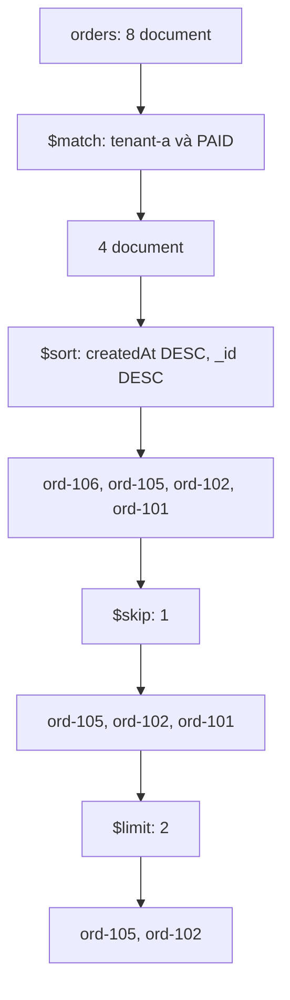

# $sort, $skip, $limit và $count

## 1. Vấn đề: sắp xếp, phân trang và đếm trong aggregation

Một màn hình quản lý đơn hàng cần hiển thị 20 đơn đã thanh toán mới nhất của một tenant. Giao diện đôi khi chỉ cần nút **Tải thêm**, nhưng màn hình quản trị khác lại cần dòng «Có 1.234 đơn» và «Trang 3/62». Một báo cáo còn có thể cần đếm số bản ghi sau khi nhóm dữ liệu, không chỉ đếm document ban đầu.

MongoDB aggregation pipeline giải quyết các trường hợp này bằng những stage cơ bản:

- **`$sort`:** sắp xếp tập document hiện có trong pipeline.
- **`$skip`:** bỏ qua một số document ở đầu luồng hiện tại.
- **`$limit`:** giới hạn số document đi tiếp.
- **`$count`:** đếm số document **đi đến vị trí stage đếm** và phát ra kết quả tổng hợp.

Chúng thường đi cùng `$match`, `$project`, `$group` và đôi khi `$facet`. Sai một chút về **thứ tự stage** có thể khiến kết quả sai, tổng số khác dự kiến hoặc query tốn tài nguyên hơn nhiều.

Bài thuộc chương **Aggregation cơ bản** trong module **SPRING_DATA_MONGODB**. Ngoài hiểu BSON pipeline, bài còn áp dụng Spring Data MongoDB để kết nối, ánh xạ document và thao tác bằng `MongoTemplate`/`MongoOperations` hoặc repository; đồng thời liên hệ tới thiết kế truy vấn, index, reactive access, transaction, kiểm thử và chẩn đoán hiệu năng.

Sau bài học, bạn sẽ:

1. Viết được pipeline `$match → $sort → $skip → $limit` và giải thích kết quả.
2. Phân biệt `$count` đếm **toàn bộ tập đã lọc** với đếm **phần đã phân trang**.
3. Xử lý đúng khi `$count` không trả document nào.
4. Dùng Spring Data Aggregation DSL để xây pipeline có giới hạn, kiểu trả về rõ ràng.
5. Chọn giữa hai truy vấn (page + count) và một pipeline `$facet`.
6. Thiết kế sort ổn định, index phù hợp và giới hạn offset sâu.
7. Viết kiểm thử tích hợp đủ dữ liệu để phát hiện lỗi stage order, trùng sort key và concurrency.

> Các ví dụ dùng cú pháp mongosh và Java 17+ với Spring Data MongoDB theo API hiện đại. Một số tối ưu query planner, memory limit, reactive hoặc transaction khác nhau theo MongoDB server và Spring Data version. Luôn kiểm tra trên phiên bản dự án thật.

## 2. Dữ liệu mẫu và kỳ vọng kết quả

### 2.1. Tạo collection thực hành

Giả sử collection `orders` lưu:

```javascript
db.orders.insertMany([
  {
    _id: "ord-101",
    tenantId: "tenant-a",
    status: "PAID",
    amount_vnd: NumberLong("100000"),
    createdAt: ISODate("2026-11-18T08:00:00Z")
  },
  {
    _id: "ord-102",
    tenantId: "tenant-a",
    status: "PAID",
    amount_vnd: NumberLong("200000"),
    createdAt: ISODate("2026-11-18T08:00:00Z")
  },
  {
    _id: "ord-103",
    tenantId: "tenant-a",
    status: "READY_TO_SHIP",
    amount_vnd: NumberLong("180000"),
    createdAt: ISODate("2026-11-19T09:00:00Z")
  },
  {
    _id: "ord-104",
    tenantId: "tenant-a",
    status: "READY_TO_SHIP",
    amount_vnd: NumberLong("80000"),
    createdAt: ISODate("2026-11-20T01:00:00Z")
  },
  {
    _id: "ord-105",
    tenantId: "tenant-a",
    status: "PAID",
    amount_vnd: NumberLong("300000"),
    createdAt: ISODate("2026-11-20T02:00:00Z")
  },
  {
    _id: "ord-106",
    tenantId: "tenant-a",
    status: "PAID",
    amount_vnd: NumberLong("50000"),
    createdAt: ISODate("2026-11-20T03:00:00Z")
  },
  {
    _id: "ord-107",
    tenantId: "tenant-a",
    status: "CANCELLED",
    amount_vnd: NumberLong("20000"),
    createdAt: ISODate("2026-11-20T04:00:00Z")
  },
  {
    _id: "ord-201",
    tenantId: "tenant-b",
    status: "PAID",
    amount_vnd: NumberLong("900000"),
    createdAt: ISODate("2026-11-20T05:00:00Z")
  }
]);
```

Chỉ chạy trên collection/database **thử nghiệm** đã kiểm tra trước, không dùng trực tiếp trên production. Dữ liệu được cố ý thiết kế có:

- Bốn đơn `PAID` của `tenant-a`: `ord-101`, `ord-102`, `ord-105`, `ord-106`.
- Hai đơn có cùng `createdAt`: `ord-101` và `ord-102`.
- Một đơn `PAID` của tenant khác: `ord-201`, **phải được loại bỏ** khi tìm dữ liệu tenant-a.
- Các trạng thái khác để kiểm tra hiệu lực của `$match`.

### 2.2. Thứ tự đích

Khi lọc `tenant-a`, `PAID`, rồi sắp xếp **`createdAt DESC, _id DESC`**, thứ tự mong muốn là:

```text
Vị trí 0: ord-106   2026-11-20 03:00Z
Vị trí 1: ord-105   2026-11-20 02:00Z
Vị trí 2: ord-102   2026-11-18 08:00Z
Vị trí 3: ord-101   2026-11-18 08:00Z
```

Hai đơn cuối có cùng timestamp nhưng khác `_id`, nên dùng `_id DESC` làm **tie-breaker**. Nếu chỉ sort theo `createdAt`, MongoDB không bảo đảm thứ tự cố định giữa những bản ghi có cùng giá trị khóa.

Với `skip = 1`, `limit = 2`, kỳ vọng nhận **`ord-105` rồi `ord-102`**. Tổng số đơn phù hợp bộ lọc là **4**.

## 3. Pipeline là chuỗi biến đổi có thứ tự

Aggregation được gọi bằng:

```javascript
db.orders.aggregate([
  { $match: { tenantId: "tenant-a", status: "PAID" } },
  { $sort: { createdAt: -1, _id: -1 } },
  { $skip: 1 },
  { $limit: 2 }
]);
```

Hãy đọc từ trên xuống:



Mỗi stage nhìn thấy kết quả **của những stage trước**. `$count` nếu xuất hiện sau `$limit` chỉ đếm phần đã giới hạn; nếu xuất hiện ngay sau `$match`, nó đếm toàn bộ kết quả đã lọc.

### 3.1. $match nên đặt ở đâu?

Thông thường, đưa các điều kiện chọn document có thể áp dụng sớm lên đầu pipeline giúp giảm tập dữ liệu và có cơ hội dùng index. Tuy nhiên, nếu filter phụ thuộc field **được tạo bởi `$project`, `$addFields` hoặc `$group`**, nó phải chạy sau stage tạo field ấy hoặc phụ thuộc khả năng tối ưu hoán đổi stage của server.

Không cố đưa mọi `$match` lên đầu pipeline nếu ý nghĩa của filter chỉ tồn tại sau một bước tính toán.

## 4. $sort: sắp xếp luồng document

### 4.1. Cú pháp

```javascript
{ $sort: { createdAt: -1, _id: -1 } }
```

Giá trị `1` biểu diễn **tăng dần**; `-1` biểu diễn **giảm dần**. Khi có nhiều khóa, MongoDB ưu tiên so sánh khóa trước, rồi đến khóa sau nếu bằng nhau.

Ví dụ:

```javascript
db.orders.aggregate([
  { $match: { tenantId: "tenant-a" } },
  { $sort: { status: 1, createdAt: -1, _id: -1 } }
]);
```

Kết quả được nhóm về thứ tự theo `status` (theo quy tắc so sánh), rồi sắp xếp mới trước trong mỗi status. Thứ tự chữ có thể chịu ảnh hưởng **collation** nếu được thiết lập.

### 4.2. Vì sao cần khóa phá hòa duy nhất?

`$sort` **không phải phép sắp xếp ổn định đối với các khóa trùng nhau**. Nếu có nhiều document cùng `createdAt`, thứ tự giữa chúng có thể thay đổi qua các lần chạy hoặc khi kế hoạch truy vấn khác nhau.

```javascript
// Chưa đủ ổn định khi createdAt có thể trùng.
{ $sort: { createdAt: -1 } }

// Thêm _id duy nhất làm khóa cuối.
{ $sort: { createdAt: -1, _id: -1 } }
```

Trên collection mẫu, `ord-102` đứng trước `ord-101` khi `createdAt` bằng nhau. Với phân trang theo offset hoặc cursor, thêm khóa phá hòa giúp giảm lỗi **lặp hoặc mất bản ghi do thứ tự không xác định** khi dữ liệu không đổi.

Đây không phải cam kết snapshot nếu document đang bị insert, delete hoặc cập nhật sort key đồng thời.

### 4.3. Sort theo field nhúng

Nếu document có:

```javascript
{
  customer: { profile: { display_name: "An" } }
}
```

có thể sort:

```javascript
{ $sort: { "customer.profile.display_name": 1, _id: 1 } }
```

Đường dẫn trên phải khớp cấu trúc BSON **thực tế**. Nếu Java entity dùng `@Field` để đổi tên, truy vấn trong mongosh vẫn phải dùng tên BSON lưu trong database.

### 4.4. Null, missing và kiểu dữ liệu

Nếu `createdAt` bị thiếu, chứa null hoặc trộn BSON Date với String, thứ tự sort có thể không trùng trực giác «mới nhất». Không dùng `$sort` để che dữ liệu sai kiểu. Với field bắt buộc cho phân trang, thiết kế validation/migration để dữ liệu có kiểu nhất quán và không null.

### 4.5. Sort không tự tạo index

`$sort` mô tả logic mong muốn. Việc MongoDB sử dụng index hay phải sắp xếp trong bộ nhớ phụ thuộc **hình dạng pipeline**, filter, index, collation và query planner.

## 5. $skip: bỏ qua N document đầu trong luồng hiện tại

### 5.1. Cú pháp và ví dụ

```javascript
db.orders.aggregate([
  { $match: { tenantId: "tenant-a", status: "PAID" } },
  { $sort: { createdAt: -1, _id: -1 } },
  { $skip: 1 }
]);
```

Sau `$sort`, bỏ qua `ord-106`; còn `ord-105`, `ord-102` và `ord-101`. `$skip` cần một số nguyên không âm; với `0` thì không bỏ bản ghi nào.

```javascript
{ $skip: 0 }
{ $skip: 25 }
```

`$skip` không tự biết «trang» hay «kích thước trang» là gì. Nó chỉ biết số document cần bỏ qua sau các stage phía trước.

### 5.2. Chỉ dùng skip sau khi xác định thứ tự

```javascript
// Không phù hợp nếu yêu cầu "bỏ qua đơn mới nhất".
db.orders.aggregate([
  { $match: { tenantId: "tenant-a", status: "PAID" } },
  { $skip: 1 },
  { $sort: { createdAt: -1, _id: -1 } }
]);
```

Pipeline trên **bỏ một document trước khi sort**, không đảm bảo đó là document mới nhất. Nếu yêu cầu phân trang theo thời gian, đặt sort **trước** skip.

### 5.3. Skip không đồng nghĩa «tìm trực tiếp tới vị trí N»

Với offset rất lớn như `$skip: 100000`, server có thể vẫn phải duyệt qua rất nhiều kết quả trước khi trả phần trang cần lấy. Có index không có nghĩa nhảy tới vị trí thứ 100001 với chi phí hằng số. Đây là hạn chế cơ bản của **offset pagination**.

Nếu UI chỉ cuộn tuần tự rất sâu, cân nhắc keyset scrolling; nếu cần nhảy trực tiếp tới trang N, offset vẫn có ưu điểm về semantics và độ đơn giản.

## 6. $limit: giới hạn số document đi tiếp

### 6.1. Cú pháp

```javascript
db.orders.aggregate([
  { $match: { tenantId: "tenant-a", status: "PAID" } },
  { $sort: { createdAt: -1, _id: -1 } },
  { $limit: 2 }
]);
```

Kết quả là `ord-106` và `ord-105`. `$limit` dùng số nguyên dương; không dùng `$limit: 0` để biểu diễn «không trả dữ liệu». Nếu muốn không có phần tử, xử lý contract ở ứng dụng hoặc chọn filter không khớp phù hợp.

### 6.2. Limit ở đâu thì giới hạn ở đó

```javascript
// Top 2 trên toàn bộ tập PAID của tenant-a.
[
  { $match: { tenantId: "tenant-a", status: "PAID" } },
  { $sort: { createdAt: -1, _id: -1 } },
  { $limit: 2 }
]
```

Khác với:

```javascript
// Lấy 2 document trước, rồi mới sort 2 document đó.
[
  { $match: { tenantId: "tenant-a", status: "PAID" } },
  { $limit: 2 },
  { $sort: { createdAt: -1, _id: -1 } }
]
```

Pipeline thứ hai **không đảm bảo trả hai đơn mới nhất**. Nó chỉ sort tập con đã bị giới hạn trước đó.

### 6.3. Limit để giảm chi phí downstream

Một `$limit` đặt đúng chỗ có thể giảm số document phải đi qua các stage về sau. Nhưng nếu đặt trước `$group` hoặc `$count`, nó cũng **thay đổi ý nghĩa thống kê**:

```javascript
// Đếm tối đa 2 document thay vì toàn bộ tập PAID.
[
  { $match: { tenantId: "tenant-a", status: "PAID" } },
  { $limit: 2 },
  { $count: "total" }
]
```

Kết quả của pipeline trên là `total = 2`, dù tổng số đơn PAID trong fixture là 4. Phải xác định rõ muốn **count toàn bộ filter** hay **count của tập đã limit**.

## 7. $count: đếm document tại vị trí stage

### 7.1. Cú pháp đúng

```javascript
db.orders.aggregate([
  { $match: { tenantId: "tenant-a", status: "PAID" } },
  { $count: "total" }
]);
```

Kết quả kỳ vọng:

```javascript
[{ total: 4 }]
```

`"$count"` nhận **tên field output**. Ví dụ `{ $count: "total" }` tạo document kết quả có field `total`. Nó không phải cú pháp `{ $count: true }` hay `{ $count: 1 }`.

### 7.2. $count đếm cái gì?

`$count` đếm **số document đang đi qua pipeline vào đúng stage đó**. Nó không tự biết số document gốc trong collection.

| Pipeline | Ý nghĩa | Kết quả fixture |
| --- | --- | --- |
| `$match → $count` | Tổng bản ghi sau filter | `4` |
| `$match → $sort → $count` | Tổng sau filter, nhưng sort thường không cần thiết | `4` |
| `$match → $skip(1) → $count` | Số bản ghi còn lại sau skip | `3` |
| `$match → $limit(2) → $count` | Số bản ghi trong tập đã limit | `2` |
| `$match → $sort → $skip(1) → $limit(2) → $count` | Số bản ghi của trang hiện tại | `2` |
| `$match → $group(status) → $count` | Số **nhóm** còn lại, không phải số đơn gốc | Phụ thuộc tập nhóm |

### 7.3. Khi tập đầu vào rỗng

Điểm rất quan trọng:

```javascript
db.orders.aggregate([
  { $match: { tenantId: "tenant-a", status: "UNKNOWN" } },
  { $count: "total" }
]);
```

Nếu không có document nào đi vào `$count`, MongoDB **không phát ra document `{ total: 0 }`**. Kết quả thường là **mảng rỗng**:

```javascript
[]
```

Service phải hiểu sự khác nhau giữa «không có result document» và «result document với total bằng 0». Khi mapping sang DTO, có thể nhận `null`/empty publisher, rồi chủ động chuyển thành 0 theo contract API.

### 7.4. $count tương tự group để đếm

Về mục đích thống kê số document, có thể nghĩ `$count` gần với:

```javascript
[
  { $group: { _id: null, total: { $sum: 1 } } },
  { $project: { _id: 0, total: 1 } }
]
```

Đây là phép diễn đạt **tương đương về ý định** với `$count: "total"` trên tập đầu vào không rỗng, không có nghĩa planner luôn thực thi như nhau. Cả hai cách thường không sinh một nhóm rỗng cho tập đầu vào không có document.

### 7.5. $count khác countDocuments và estimatedDocumentCount

| API | Đặc điểm |
| --- | --- |
| `{ $count: "total" }` | Pipeline stage đếm những document đã qua các stage trước |
| `db.orders.countDocuments(filter)` | Lệnh/helper đếm document theo filter; không tự thực thi toàn pipeline của bạn |
| `db.orders.estimatedDocumentCount()` | Ước lượng tổng số document collection dựa metadata; không dùng cho filter tenant/status |
| `MongoOperations.count(query, type)` | API Spring Data đếm theo query |

Không lấy estimated collection count để hiển thị «số đơn PAID của tenant-a» — nó không có thông tin filter đó.

## 8. Thứ tự stage quyết định ngữ nghĩa

Giả sử user muốn **trang thứ hai** (đánh số từ 0 là trang 1), page size 2, của các đơn PAID tenant-a, đồng thời hiển thị tổng số.

**Đường nội dung**:

```javascript
[
  { $match: { tenantId: "tenant-a", status: "PAID" } },
  { $sort: { createdAt: -1, _id: -1 } },
  { $skip: 2 },
  { $limit: 2 }
]
```

Kỳ vọng: `ord-102` và `ord-101`.

**Đường tổng số**:

```javascript
[
  { $match: { tenantId: "tenant-a", status: "PAID" } },
  { $count: "total" }
]
```

Kỳ vọng: `total = 4`.

Không nối thêm `$count` sau `$limit` rồi dùng số đó làm tổng toàn bộ:

```javascript
// Sai nếu total cần phản ánh tất cả đơn phù hợp.
[
  { $match: { tenantId: "tenant-a", status: "PAID" } },
  { $sort: { createdAt: -1, _id: -1 } },
  { $skip: 2 },
  { $limit: 2 },
  { $count: "total" }
]
```

Pipeline này trả số lượng **trong trang**, là 2 — không phải 4.

### 8.1. Bảng thiết kế theo câu hỏi

| Câu hỏi nghiệp vụ | Pipeline |
| --- | --- |
| 10 đơn mới nhất của tenant? | `$match → $sort → $limit` |
| Trang số 3, mỗi trang 20 đơn? | `$match → $sort → $skip(60) → $limit(20)` nếu page index bắt đầu từ 0 |
| Có bao nhiêu đơn PAID? | `$match → $count` |
| Trang này có bao nhiêu document? | `$match → $sort → $skip → $limit → $count` |
| Tổng số sau filter và nội dung trang trong một kết quả? | `$match → $facet{items, metadata}` |
| Top 5 nhóm SKU có doanh thu cao nhất? | `$match → $unwind → $group → $sort → $limit` |

## 9. Tính offset từ pageIndex và pageSize

Với **trang đánh số từ 0**:

```text
offset = pageIndex × pageSize
```

Ví dụ:

| pageIndex | pageSize | $skip | $limit |
| --- | --- | --- | --- |
| 0 | 20 | 0 | 20 |
| 1 | 20 | 20 | 20 |
| 2 | 20 | 40 | 20 |
| 5 | 10 | 50 | 10 |

### 9.1. Không tin input số trang

Ở service Java:

```java
public static long checkedOffset(int pageIndex, int pageSize) {
    if (pageIndex < 0 || pageSize < 1 || pageSize > 100) {
        throw new IllegalArgumentException("Invalid pagination");
    }

    long offset = Math.multiplyExact(
        (long) pageIndex, (long) pageSize
    );
    if (offset > 10_000L) {
        throw new IllegalArgumentException(
            "Deep offset is not supported by this API"
        );
    }
    return offset;
}
```

Giới hạn `pageSize <= 100` và `offset <= 10000` là **chính sách ví dụ của ứng dụng**, không phải giới hạn cố định của MongoDB. Dùng `long` và kiểm tra overflow giúp tránh biến offset thành một giá trị sai do tính toán số nguyên.

### 9.2. Phân trang nên trả metadata gì?

Khi API chỉ cần «Tải thêm», bạn có thể lấy `pageSize + 1` kết quả để tính `hasNext` mà **không cần count toàn bộ**. Khi UI thực sự cần `totalElements` và `totalPages`, hãy chấp nhận chi phí count hoặc thiết kế khác. Không đếm toàn bộ theo thói quen nếu caller không sử dụng.

## 10. Lấy nội dung trang và tổng số bằng hai pipeline

Một cách dễ hiểu và dễ tối ưu là chạy **hai aggregation pipeline độc lập** với cùng filter.

### 10.1. Pipeline nội dung

```javascript
db.orders.aggregate([
  { $match: { tenantId: "tenant-a", status: "PAID" } },
  { $sort: { createdAt: -1, _id: -1 } },
  { $skip: 1 },
  { $limit: 2 },
  { $project: {
      _id: 1,
      status: 1,
      amount_vnd: 1,
      createdAt: 1
  }}
]);
```

Trả `ord-105` và `ord-102` theo thứ tự.

### 10.2. Pipeline count

```javascript
db.orders.aggregate([
  { $match: { tenantId: "tenant-a", status: "PAID" } },
  { $count: "total" }
]);
```

Trả một result document với `total = 4`.

Ưu điểm: đường nội dung có thể được tối ưu với index hỗ trợ sort/limit; đường count không cần sort hay projection dư. Nhược điểm: **hai lệnh truy vấn**, phát sinh round trip và có thể nhìn thấy dữ liệu khác nhau nếu có ghi đồng thời giữa hai lần đọc.

### 10.3. Vì sao không thêm sort trước count?

Để đếm tập đã lọc, thứ tự thường không quan trọng:

```javascript
// Không cần thiết trong đa số trường hợp đếm tổng PAID.
[
  { $match: { tenantId: "tenant-a", status: "PAID" } },
  { $sort: { createdAt: -1, _id: -1 } },
  { $count: "total" }
]
```

Optimizer có thể loại hoặc biến đổi một số stage không cần thiết, nhưng code vẫn nên diễn đạt ý định đơn giản: `$match → $count`.

## 11. Dùng $facet để lấy trang và tổng số trong một pipeline

Nếu API cần cả nội dung trang lẫn số lượng toàn bộ trong **một aggregation command**, `$facet` là một lựa chọn.

### 11.1. Cấu trúc $facet

```javascript
db.orders.aggregate([
  {
    $match: {
      tenantId: "tenant-a",
      status: "PAID"
    }
  },
  {
    $facet: {
      items: [
        { $sort: { createdAt: -1, _id: -1 } },
        { $skip: 1 },
        { $limit: 2 },
        { $project: {
            _id: 1,
            status: 1,
            amount_vnd: 1,
            createdAt: 1
        }}
      ],
      metadata: [
        { $count: "total" }
      ]
    }
  }
]);
```

Kết quả có hình dạng:

```javascript
[
  {
    items: [
      { _id: "ord-105", status: "PAID", amount_vnd: NumberLong("300000"),
        createdAt: ISODate("2026-11-20T02:00:00Z") },
      { _id: "ord-102", status: "PAID", amount_vnd: NumberLong("200000"),
        createdAt: ISODate("2026-11-18T08:00:00Z") }
    ],
    metadata: [{ total: 4 }]
  }
]
```

Tại sao total bằng 4? Vì nhánh `metadata` chạy `$count` trên **toàn bộ tập đã qua `$match`**, không chịu `$skip`/`$limit` ở nhánh `items`.

### 11.2. Xử lý total=0 cho facet

Với filter không có document, nhánh count trả mảng `metadata: []`. Nếu API cần một con số `0` rõ ràng, có thể bổ sung `$project`:

```javascript
db.orders.aggregate([
  { $match: { tenantId: "tenant-a", status: "UNKNOWN" } },
  {
    $facet: {
      items: [
        { $sort: { createdAt: -1, _id: -1 } },
        { $skip: 0 },
        { $limit: 10 }
      ],
      metadata: [{ $count: "total" }]
    }
  },
  {
    $project: {
      items: 1,
      total: {
        $ifNull: [
          { $arrayElemAt: ["$metadata.total", 0] },
          0
        ]
      }
    }
  }
]);
```

Kết quả mong muốn khi không có đơn phù hợp:

```javascript
[{ items: [], total: 0 }]
```

`$arrayElemAt` lấy phần tử đầu tiên của mảng total được sinh từ nhánh metadata; `$ifNull` đặt fallback 0 nếu giá trị đó không tồn tại/null.

### 11.3. $facet không phải luôn nhanh hơn hai query

`$facet` có lợi khi muốn một cấu trúc kết quả thống nhất và tính page/total cùng một pipeline. Nhưng:

- Nó phải xử lý các nhánh trên dữ liệu đi vào facet, có chi phí bộ nhớ riêng.
- Nhánh sort **bên trong facet** không nhất thiết tận dụng index sort như một đường sort độc lập trước facet.
- Một `$facet` đứng đầu pipeline có thể khiến việc dùng index khó khăn hơn; đưa `$match` có thể dùng index lên trước.
- Facet có giới hạn tài nguyên và kích thước document kết quả, đặc biệt với page quá lớn.
- Một aggregation command không tự đồng nghĩa với **snapshot isolation mạnh** dưới ghi đồng thời.

Hãy benchmark **hai pipeline riêng** và **một facet** trên dữ liệu đại diện, đặc biệt khi kết quả lọc có hàng triệu document. Tránh mặc định một round trip là tổng chi phí thấp nhất.

## 12. Model Java và MongoDB field mapping

Spring Data MongoDB hỗ trợ aggregation dựa trên domain type, dùng metadata ánh xạ property Java và BSON.

```java
package com.example.orders.persistence;

import java.time.Instant;
import org.springframework.data.mongodb.core.mapping.Document;
import org.springframework.data.mongodb.core.mapping.Field;
import org.springframework.data.mongodb.core.mapping.FieldType;
import org.springframework.data.mongodb.core.mapping.MongoId;

@Document(collection = "orders")
public record OrderDocument(
    @MongoId(FieldType.STRING) String id,
    String tenantId,
    String status,
    @Field("amount_vnd") long amountVnd,
    Instant createdAt
) {}
```

| Property Java | BSON field |
| --- | --- |
| `id` | `_id` |
| `tenantId` | `tenantId` |
| `status` | `status` |
| `amountVnd` | `amount_vnd` |
| `createdAt` | `createdAt` |

Khi gọi `MongoOperations.aggregate(pipeline, OrderDocument.class, ...)`, Spring Data có metadata đầu vào để ánh xạ các trường. Khi viết pipeline **trực tiếp trong mongosh**, luôn dùng tên BSON vật lý như `_id` và `amount_vnd`.

Khi một stage `$project`/`$group` đã thay đổi schema trung gian, các tên trường ở stage phía sau phải dựa trên **output của stage trước**, không phải mặc định dựa trên entity ban đầu. Với alias phức tạp, nên kiểm tra BSON command và result mapping trong integration test.

## 13. Spring Data Aggregation DSL: sort, skip, limit

### 13.1. Khai báo bằng Java API

```java
import java.util.List;
import org.springframework.data.domain.Sort;
import org.springframework.data.mongodb.core.MongoOperations;
import org.springframework.data.mongodb.core.aggregation.Aggregation;
import org.springframework.data.mongodb.core.query.Criteria;
import static org.springframework.data.mongodb.core.aggregation.Aggregation.*;

public final class OrderAggregationGateway {
    private final MongoOperations mongo;

    public OrderAggregationGateway(MongoOperations mongo) {
        this.mongo = mongo;
    }

    public List<OrderDocument> paidPage(
        String authenticatedTenantId, long offset, long pageSize
    ) {
        if (authenticatedTenantId == null
                || authenticatedTenantId.isBlank()
                || offset < 0 || offset > 10_000
                || pageSize < 1 || pageSize > 100) {
            throw new IllegalArgumentException("Invalid query");
        }

        Aggregation pipeline = newAggregation(
            match(Criteria.where("tenantId")
                .is(authenticatedTenantId)
                .and("status").is("PAID")),
            sort(Sort.by(
                Sort.Order.desc("createdAt"),
                Sort.Order.desc("id")
            )),
            skip(offset),
            limit(pageSize)
        );

        return mongo.aggregate(
            pipeline,
            OrderDocument.class,
            OrderDocument.class
        ).getMappedResults();
    }
}
```

Giải thích:

1. `match(...)` thêm `$match`.
2. `sort(Sort.by(...))` thêm `$sort` với hướng giảm dần.
3. `skip(offset)` thêm `$skip`.
4. `limit(pageSize)` thêm `$limit`.
5. `mongo.aggregate(...)` thực thi và ánh xạ kết quả về `OrderDocument`.

Giới hạn offset/page size trong ví dụ là **business policy**, không phải giới hạn MongoDB chung. `authenticatedTenantId` phải có nguồn xác thực. Không đặt tên collection từ input người dùng không tin cậy.

### 13.2. Gọi gateway

```java
List<OrderDocument> page = gateway.paidPage(
    "tenant-a", 1L, 2L
);

for (OrderDocument order : page) {
    System.out.println(order.id());
}
// Fixture mong đợi: ord-105, rồi ord-102.
```

Ở đây `gateway` là instance `OrderAggregationGateway` được application service quản lý, không phải class sẽ tự tồn tại nếu chỉ sao chép đoạn code này vào một file riêng.

### 13.3. Phân biệt skip/limit của aggregation với Query

Spring Data cũng có:

```java
// Query API (find), không phải aggregation pipeline.
org.springframework.data.mongodb.core.query.Query query =
    org.springframework.data.mongodb.core.query.Query.query(
        Criteria.where("tenantId").is("tenant-a")
    );
query.skip(1L);
query.limit(2);
```

Khi dùng `Query` và `mongo.find(...)`, offset/limit là các thuộc tính của lệnh find. Trong aggregation, chúng là **những stage** `skip(...)`/`limit(...)` có thứ tự trong pipeline. Hai cách có thể đáp ứng nhu cầu gần nhau nhưng không tương đương với mọi pipeline nhiều stage.

## 14. Spring Data Aggregation DSL: count và kết quả rỗng

### 14.1. DTO cho tổng số

```java
public record CountResult(long total) {}
```

Trong dự án Java thực, nếu là public type, đặt nó trong `CountResult.java`. Nếu muốn nhóm DTO trong class khác, điều chỉnh visibility theo package.

### 14.2. Gọi count().as("total")

```java
import org.springframework.data.mongodb.core.aggregation.Aggregation;
import org.springframework.data.mongodb.core.aggregation.AggregationResults;
import org.springframework.data.mongodb.core.query.Criteria;
import static org.springframework.data.mongodb.core.aggregation.Aggregation.*;

Aggregation countPipeline = newAggregation(
    match(Criteria.where("tenantId").is("tenant-a")
        .and("status").is("PAID")),
    count().as("total")
);

AggregationResults<CountResult> result =
    mongo.aggregate(
        countPipeline,
        OrderDocument.class,
        CountResult.class
    );

CountResult row = result.getUniqueMappedResult();
long total = row == null ? 0L : row.total();
```

Lệnh `mongo.aggregate(...)` giả định bean `MongoOperations`/`MongoTemplate` có sẵn. Khi không có document đầu vào cho `$count`, `getUniqueMappedResult()` có thể là null; code xử lý trường hợp đó thành 0.

### 14.3. Không dùng count sau limit nếu UI cần tổng số

```java
// Đếm các bản ghi CÒN LẠI SAU KHI GIỚI HẠN.
Aggregation countOnlyPage = newAggregation(
    match(Criteria.where("tenantId").is("tenant-a")),
    limit(2L),
    count().as("total")
);
```

Đây chỉ đúng nếu use case thực sự muốn biết số document trong tập con. Đừng dùng kết quả của pipeline này làm tổng số đơn của tenant.

### 14.4. Có thể dùng MongoOperations.count(...)

Khi mục tiêu chỉ là đếm theo một filter đơn giản, `mongo.count(query, OrderDocument.class)` thường gọn hơn một aggregation riêng. Dùng `$count` trong aggregation khi cần đếm **sau một chuỗi biến đổi** như `$unwind`, `$group` hoặc trong một nhánh `$facet`.

## 15. $facet bằng Spring Data MongoDB

### 15.1. Ghép hai nhánh bằng facet(...)

Trong các phiên bản Spring Data hỗ trợ `FacetOperation`:

```java
import org.bson.Document;
import org.springframework.data.domain.Sort;
import org.springframework.data.mongodb.core.aggregation.Aggregation;
import org.springframework.data.mongodb.core.query.Criteria;
import static org.springframework.data.mongodb.core.aggregation.Aggregation.*;

Aggregation pagedWithTotal = newAggregation(
    match(Criteria.where("tenantId").is("tenant-a")
        .and("status").is("PAID")),
    facet(
        sort(Sort.by(
            Sort.Order.desc("createdAt"),
            Sort.Order.desc("id")
        )),
        skip(1L),
        limit(2L)
    ).as("items")
     .and(count().as("total")).as("metadata")
);

Document response = mongo.aggregate(
    pagedWithTotal,
    OrderDocument.class,
    Document.class
).getUniqueMappedResult();
```

`facet(...).as("items")` xác định nhánh nội dung; `.and(count().as("total")).as("metadata")` xác định nhánh count. Đây là một ví dụ sử dụng **Spring Data DSL**, còn pipeline JSON tương đương nằm ở mục 11.

### 15.2. Đọc total trong Document

```java
import java.util.List;
import org.bson.Document;

if (response == null) {
    throw new IllegalStateException("Missing facet response");
}

List<Document> items =
    response.getList("items", Document.class);
List<Document> metadata =
    response.getList("metadata", Document.class);

long total = metadata.isEmpty()
    ? 0L
    : ((Number) metadata.get(0).get("total")).longValue();
```

Ví dụ dùng `Document` để minh họa shape output. Trong production, nên tạo DTO theo contract API và kiểm tra mapping cho nested arrays. `$facet` có thể trả một document chứa hai mảng ngay cả khi không có kết quả đầu vào; khi đó `metadata` rỗng và total được chuyển về 0.

### 15.3. Đừng quên giới hạn kích thước kết quả

Một facet trả toàn bộ hàng trăm nghìn document trong nhánh `items` có thể chạm giới hạn bộ nhớ hoặc BSON document size. Luôn giới hạn page size trước khi đưa mảng kết quả ra client. Các giới hạn tài nguyên của `$facet` khác với tùy chọn spill của một số stage như `$sort`; **không** nghĩ rằng `allowDiskUse` sẽ giải quyết mọi facet quá lớn.

## 16. $count trước và sau $group: đếm bản ghi hay đếm nhóm?

Giả sử cần «có bao nhiêu trạng thái đơn hàng được sử dụng trong tenant-a?» thay vì «có bao nhiêu đơn?».

```javascript
db.orders.aggregate([
  { $match: { tenantId: "tenant-a" } },
  { $group: { _id: "$status" } },
  { $count: "numberOfStatuses" }
]);
```

Trong fixture của tenant-a có ba status `PAID`, `READY_TO_SHIP`, `CANCELLED`. Vì `$group` tạo **một document cho mỗi trạng thái**, `$count` phía sau trả:

```javascript
[{ numberOfStatuses: 3 }]
```

Nếu đặt `$count` ngay sau `$match`, kết quả là 7 vì tenant-a có 7 đơn. Đây là ví dụ điển hình cho việc **vị trí count quyết định loại đối tượng được đếm**.

### 16.1. Top nhóm theo số đơn

```javascript
db.orders.aggregate([
  { $match: { tenantId: "tenant-a" } },
  {
    $group: {
      _id: "$status",
      numberOfOrders: { $sum: 1 }
    }
  },
  { $sort: { numberOfOrders: -1, _id: 1 } },
  { $limit: 2 }
]);
```

Trong fixture: PAID có 4 đơn, READY_TO_SHIP có 2, CANCELLED có 1. Top 2 nhóm là PAID và READY_TO_SHIP.

Nếu nối `{ $count: "groups" }` sau `$limit: 2`, bạn sẽ nhận **2 nhóm được chọn**, không phải tổng số nhóm trong tập đầu vào và cũng không phải tổng số đơn.

### 16.2. Sort sau group

`$group` không bảo đảm thứ tự output. Khi UI muốn bảng nhóm xếp theo tổng giảm dần, **phải có một `$sort` sau `$group`**. Sort document trước group không tự làm thứ tự kết quả group trở nên xác định.

## 17. $unwind và $count: cùng một đơn có thể tạo nhiều document

Giả sử document chứa `items`:

```javascript
{
  _id: "ord-301",
  tenantId: "tenant-a",
  items: [
    { sku: "BOOK-A", quantity: 1 },
    { sku: "BOOK-B", quantity: 2 }
  ]
}
```

Pipeline:

```javascript
db.orders.aggregate([
  { $match: { _id: "ord-301", tenantId: "tenant-a" } },
  { $unwind: "$items" },
  { $count: "total" }
]);
```

nếu document minh họa đã được insert vào database test, sẽ đếm **2 dòng hàng**, không phải 1 đơn, vì `$unwind` biến một document có hai phần tử thành hai pipeline documents.

Ngược lại:

```javascript
db.orders.aggregate([
  { $match: { _id: "ord-301", tenantId: "tenant-a" } },
  { $count: "total" }
]);
```

sẽ đếm 1 document gốc. Luôn đặt câu hỏi: **đơn vị đếm là đơn, dòng hàng, nhóm hay kết quả đã lọc?**

## 18. Index cho $match và $sort

### 18.1. Index ứng viên

Với query thường dùng:

```javascript
db.orders.aggregate([
  { $match: { tenantId: "tenant-a", status: "PAID" } },
  { $sort: { createdAt: -1, _id: -1 } },
  { $skip: 1 },
  { $limit: 2 }
]);
```

Một compound index ứng viên:

```javascript
db.orders.createIndex(
  {
    tenantId: 1,
    status: 1,
    createdAt: -1,
    _id: -1
  },
  { name: "ix_orders_tenant_status_recent" }
);
```

Các khóa `tenantId` và `status` hỗ trợ equality filter, hai khóa sau hỗ trợ sort. Đây là ứng viên theo access pattern, **không phải yêu cầu tạo index mặc định cho mọi collection**.

Nếu filter còn có điều kiện khoảng trên `createdAt`, `amount_vnd` hoặc field khác, phải xem lại thứ tự key và selectivity. Index tăng chi phí ghi, chiếm dung lượng và có thể làm chậm các update field được index.

### 18.2. Index thường bị mất lợi ích khi pipeline biến đổi dữ liệu trước sort

So sánh:

```javascript
// Nhiều trường hợp có thể dùng index cho match/sort.
[
  { $match: { tenantId: "tenant-a", status: "PAID" } },
  { $sort: { createdAt: -1, _id: -1 } },
  { $limit: 20 }
]
```

với:

```javascript
// Sort sau một group; thường không thể dùng index đơn giản
// trên createdAt gốc để sắp xếp trường tổng nhóm đã tính.
[
  { $match: { tenantId: "tenant-a" } },
  {
    $group: {
      _id: "$status",
      totalAmount: { $sum: "$amount_vnd" }
    }
  },
  { $sort: { totalAmount: -1 } }
]
```

Không thể tự mặc định index trên trường gốc sẽ tối ưu sort theo giá trị tổng hợp mới tạo. Cần xem `explain` để xác định query plan thật.

### 18.3. Explain aggregation

```javascript
db.orders.explain("executionStats").aggregate([
  { $match: { tenantId: "tenant-a", status: "PAID" } },
  { $sort: { createdAt: -1, _id: -1 } },
  { $skip: 1 },
  { $limit: 2 }
]);
```

Kiểm tra `winningPlan` hoặc thông tin plan tương ứng với phiên bản server, `IXSCAN`/`COLLSCAN`, số keys/docs examined, có sort stage phải dùng bộ nhớ hay không và số kết quả trả ra.

Pipeline được tối ưu có thể không hiển thị các stage đúng như thứ tự logic ban đầu; MongoDB optimizer có quyền biến đổi những stage giữ nguyên ngữ nghĩa. Đừng coi sự khác nhau giữa plan và JSON đầu vào là một lỗi.

## 19. Tối ưu $sort, $skip và $limit

### 19.1. Top-K optimization

Với:

```javascript
[
  { $sort: { createdAt: -1, _id: -1 } },
  { $limit: 20 }
]
```

MongoDB có thể tối ưu việc sort bằng cách chỉ duy trì những ứng viên tốt nhất cần cho giới hạn, thay vì materialize đầy đủ mọi document theo cùng một cách. Việc tối ưu phụ thuộc stage ở giữa, query planner, index và phiên bản server.

Nếu `$sort` và `$limit` có stage thay đổi số document ở giữa, khả năng coalesce có thể khác. Tránh phát biểu «mọi `$sort + $limit` đều dùng O(20) bộ nhớ»; cần xem plan và workload.

### 19.2. Với skip, giới hạn nội bộ có thể lớn hơn page size

```javascript
[
  { $sort: { createdAt: -1, _id: -1 } },
  { $skip: 1000 },
  { $limit: 20 }
]
```

Một số tối ưu có thể chuyển bài toán sang dạng «xác định top 1020 rồi bỏ 1000», vì kết quả logic cần những phần tử ở vị trí 1000 đến 1019. Vì vậy, **skip sâu vẫn tốn tài nguyên**, dù page size cuối chỉ là 20.

### 19.3. Sort và bộ nhớ/disk

`$sort` có thể là **blocking stage**: khi không thể dùng index và phải sort một tập lớn, MongoDB cần giữ dữ liệu trung gian trước khi phát kết quả. Giới hạn bộ nhớ và cơ chế spill ra disk phụ thuộc MongoDB server version/configuration và tùy chọn `allowDiskUse`.

Một ví dụ:

```javascript
db.orders.aggregate(
  [
    { $match: { tenantId: "tenant-a" } },
    { $sort: { amount_vnd: -1, _id: 1 } },
    { $limit: 100 }
  ],
  { allowDiskUse: true }
);
```

`allowDiskUse: true` **không phải cách chữa mọi truy vấn chậm**, cũng không thay thế index tốt. Có thể tăng I/O disk và độ trễ; trong một số phiên bản server, spill tự động còn chịu cấu hình khác. Hãy ưu tiên kiểm tra index và stage order trước.

### 19.4. $facet có giới hạn bộ nhớ riêng

Không mặc định `allowDiskUse` làm một facet không giới hạn trở nên an toàn. Facet có giới hạn bộ nhớ và BSON document output; nhánh `items` luôn phải có `$limit` theo hợp đồng API. Nếu cần export nhiều bản ghi, dùng streaming hoặc đọc theo batch thay vì gom toàn bộ vào một facet result.

## 20. Offset sâu, keyset và dữ liệu thay đổi

### 20.1. Offset pagination có thể lặp hoặc bỏ sót

Giả sử client đọc trang đầu:

```text
ord-106, ord-105
```

Trước khi client gọi trang hai (skip 2), một đơn mới có timestamp lớn hơn `ord-106` được thêm vào đầu danh sách. Vị trí các đơn cũ có thể bị dịch, khiến trang tiếp theo chứa lại `ord-105` hoặc bỏ qua một đơn.

Thêm `_id` làm tie-breaker giải quyết **khóa sort trùng**, nhưng **không cố định snapshot** giữa hai request.

### 20.2. Keyset scrolling cho danh sách cuộn sâu

Với sort giảm theo `createdAt` và `_id`, giả sử trang trước kết thúc tại:

```text
createdAt = 2026-11-20T02:00:00Z
_id = "ord-105"
```

Có thể tiếp tục:

```javascript
const lastCreatedAt = ISODate("2026-11-20T02:00:00Z");
const lastId = "ord-105";

db.orders.aggregate([
  {
    $match: {
      tenantId: "tenant-a",
      status: "PAID",
      $or: [
        { createdAt: { $lt: lastCreatedAt } },
        {
          createdAt: lastCreatedAt,
          _id: { $lt: lastId }
        }
      ]
    }
  },
  { $sort: { createdAt: -1, _id: -1 } },
  { $limit: 2 }
]);
```

Trên fixture, kết quả tiếp theo là `ord-102` rồi `ord-101`. Không cần `$skip: 2`; cursor dựa trên khóa cuối đã đọc.

**Điều kiện:** Sort ổn định, giá trị cursor có kiểu BSON chính xác, index hỗ trợ và các field khóa không null/không thay đổi trong quá trình cuộn. Keyset giảm một số vấn đề dịch offset nhưng vẫn không phải snapshot khi dữ liệu thay đổi.

### 20.3. Spring Data Window và ScrollPosition

Ở những phiên bản Spring Data MongoDB có Scroll API, có thể dùng `Window<T>` và `ScrollPosition` cho một số use case keyset/offset scrolling. Nhưng đây không phải kiểu trả về mặc định của `mongo.aggregate(...)` và không phải mọi phiên bản hỗ trợ cùng overload.

Khi bài toán là báo cáo tổng hợp hoặc pipeline nhiều stage, có thể cần **tự thiết kế keyset filter** theo output của stage phù hợp, thay vì áp dụng nguyên máy móc một API repository scrolling.

## 21. Collation, kiểu BSON và tính đúng đắn của sort

### 21.1. Sort theo tên tiếng Việt

Nếu cần sort `customerName` theo quy tắc ngôn ngữ, có thể cấu hình collation:

```javascript
db.orders.aggregate(
  [
    { $match: { tenantId: "tenant-a" } },
    { $sort: { customerName: 1, _id: 1 } },
    { $limit: 20 }
  ],
  {
    collation: { locale: "vi", strength: 2 }
  }
);
```

Ví dụ này chỉ áp dụng nếu collection thật có field `customerName`; fixture hiện tại không có field đó. Collation có thể ảnh hưởng cách so sánh String, và **index cần collation tương thích** nếu muốn hỗ trợ query/sort hiệu quả. Đừng giả định index tạo với collation mặc định luôn hỗ trợ cách sort tiếng Việt.

### 21.2. Sort số không giống sort chuỗi

`amount_vnd` trong fixture được lưu bằng `NumberLong`. Nếu dữ liệu legacy lại lưu:

```javascript
{ amount_vnd: "100000" }
```

thì MongoDB so sánh theo thứ tự kiểu BSON, không thể coi đây là một số tương đương với NumberLong. Đừng sort/limit tiền bằng field trộn String và numeric rồi kết luận top đơn có giá trị lớn nhất chính xác. Cần chuẩn hóa BSON type và schema validation.

### 21.3. Field missing/null

Khi sort theo `createdAt` mà một số document thiếu field, những record đó vẫn có thể nằm trong kết quả theo quy tắc BSON sorting. Với danh sách yêu cầu «mới nhất», cân nhắc schema rule bắt buộc timestamp, hoặc filter có điều kiện loại những bản ghi không đủ dữ liệu.

Không dùng `$exists` một cách thiếu suy nghĩ nếu việc loại record không hợp lệ có thể che vấn đề migration; thống kê và sửa dữ liệu nguồn khi có thể.

## 22. Bảo mật, transaction và dữ liệu đồng thời

### 22.1. Tenant filter là bắt buộc khi nghiệp vụ yêu cầu

Một pipeline phân trang thiếu `tenantId` có thể trả đơn của nhiều tenant. Repository hoặc `MongoTemplate` không tự xác thực giá trị tenant. Service phải lấy tenant từ authentication context được tin cậy.

```javascript
// Rủi ro nếu API chỉ cho người dùng tenant-a xem dữ liệu của họ:
[
  { $match: { status: "PAID" } },
  { $sort: { createdAt: -1, _id: -1 } },
  { $limit: 20 }
]
```

Thay bằng filter `tenantId` và trạng thái cùng lúc. Ngay cả nhánh count trong `$facet` cũng phải có cùng phạm vi dữ liệu.

### 22.2. Query và count không nhất thiết là một snapshot

Nếu gọi pipeline trang rồi pipeline count bằng **hai lệnh khác nhau**, dữ liệu có thể được insert/delete giữa hai lần gọi. Vì vậy nội dung trang và `total` đôi khi không khớp tuyệt đối tại một thời điểm.

`$facet` thực hiện hai nhánh trong một aggregation pipeline, giúp tổ chức cùng đầu vào sau `$match`, nhưng **không mặc định bảo đảm snapshot isolation mạnh** dưới mọi read concern/topology và ghi đồng thời. Nếu cần báo cáo theo một ảnh chụp nhất quán nghiêm ngặt, phải thiết kế read concern/transaction hoặc cơ chế snapshot phù hợp và kiểm thử trên MongoDB topology thực tế.

### 22.3. Transaction cho báo cáo có cần không?

Nhiều use case UI chỉ yêu cầu dữ liệu «gần thời gian thực», chấp nhận count thay đổi nhẹ. Đừng mở transaction dài và tiêu tốn tài nguyên chỉ để có một nút «Trang tiếp». Khi yêu cầu đối soát tài chính hoặc snapshot cố định, hãy xác định mức nhất quán trong kiến trúc chứ không coi một annotation `@Transactional` là lời giải tự động.

### 22.4. Không để người dùng chọn pipeline tùy ý

Không nhận từ client một mảng aggregation stages rồi chuyển trực tiếp tới `mongo.aggregate(...)`. Các stage như `$lookup`, `$unwind` hoặc sort/limit không kiểm soát có thể gây rò rỉ dữ liệu hoặc tải tài nguyên. Xây pipeline từ các filter/sort được whitelist và giới hạn page size, offset.

## 23. ReactiveMongoOperations và cách đọc dữ liệu

Trong Spring Data MongoDB reactive, dùng `ReactiveMongoOperations`/`ReactiveMongoTemplate` với `Flux<T>` thay vì bọc lời gọi blocking bằng `Flux.just(...)`.

### 23.1. Reactive aggregate trả Flux

```java
import reactor.core.publisher.Flux;
import org.springframework.data.mongodb.core.ReactiveMongoOperations;
import org.springframework.data.mongodb.core.aggregation.Aggregation;

public class ReactiveOrderQuery {
    private final ReactiveMongoOperations mongo;

    public ReactiveOrderQuery(ReactiveMongoOperations mongo) {
        this.mongo = mongo;
    }

    public Flux<OrderDocument> readPage(Aggregation pipeline) {
        return mongo.aggregate(
            pipeline, OrderDocument.class, OrderDocument.class
        );
    }
}
```

`Flux<OrderDocument>` là luồng kết quả bất đồng bộ; nó không tự có tổng số trang, `hasNext` hay cursor resume token.

### 23.2. Reactive count có thể trả empty Flux

```java
import reactor.core.publisher.Mono;

Mono<Long> count = mongo.aggregate(
    countPipeline,
    OrderDocument.class,
    CountResult.class
)
.next()
.map(CountResult::total)
.defaultIfEmpty(0L);
```

Snippet giả định `mongo` là bean `ReactiveMongoOperations` và `countPipeline` đã được dựng như mục 14.2. `defaultIfEmpty(0L)` xử lý đúng semantics của `$count` trên tập rỗng.

Đừng gọi `block()` tùy tiện trong ứng dụng non-blocking. Nếu kết hợp một Flux page và một Mono count, cần xác định rõ hai subscribe/truy vấn có thể nhìn thấy trạng thái khác nhau khi có ghi đồng thời.

## 24. Kiểm thử thực tế: đừng chỉ kiểm số lượng

### 24.1. Ma trận kiểm thử

| Test case | Kỳ vọng từ fixture |
| --- | --- |
| Lọc PAID tenant-a | 4 document |
| Sort `createdAt DESC, _id DESC` | `106, 105, 102, 101` |
| Skip 1, limit 2 | `105, 102` |
| Skip 4, limit 2 | Trang rỗng |
| Limit 2 trước sort | Không được coi là top 2 toàn bộ |
| `$match → $count` | `{ total: 4 }` |
| `$match → $limit(2) → $count` | `{ total: 2 }` |
| `$match → $skip(1) → $count` | `{ total: 3 }` |
| Lọc status UNKNOWN rồi count | Không có result document, không phải `{total:0}` |
| Facet page + metadata | `items=[105,102]`, `metadata.total=4` |
| Facet filter rỗng + fallback | `items=[]`, `total=0` |
| Count sau group status | 3 nhóm cho tenant-a |
| Giữ tenant scope | Không trả `ord-201` |
| Timestamp bằng nhau | `ord-102` trước `ord-101` |
| Offset quá sâu hoặc size quá lớn | Bị validation từ chối theo policy |
| Index/collation | Kế hoạch query được quan sát, không giả định |

### 24.2. Khung integration test cho MongoTemplate

Đoạn sau giả định dự án đã có MongoDB test database, seed tám document ở mục 2 và inject `MongoOperations`. Đây là **khung assertion** dành cho JUnit 5:

```java
import static org.junit.jupiter.api.Assertions.*;
import java.util.List;
import org.junit.jupiter.api.Test;
import org.springframework.data.domain.Sort;
import org.springframework.data.mongodb.core.MongoOperations;
import org.springframework.data.mongodb.core.aggregation.Aggregation;
import org.springframework.data.mongodb.core.query.Criteria;
import static org.springframework.data.mongodb.core.aggregation.Aggregation.*;

class AggregationPaginationIntegrationTest {
    MongoOperations mongo; // Inject từ test context.

    @Test
    void sortsAndPaginatesInStableOrder() {
        Aggregation pipeline = newAggregation(
            match(Criteria.where("tenantId").is("tenant-a")
                .and("status").is("PAID")),
            sort(Sort.by(
                Sort.Order.desc("createdAt"),
                Sort.Order.desc("id")
            )),
            skip(1L),
            limit(2L)
        );

        List<OrderDocument> items =
            mongo.aggregate(
                pipeline,
                OrderDocument.class,
                OrderDocument.class
            ).getMappedResults();

        assertEquals(2, items.size());
        assertEquals("ord-105", items.get(0).id());
        assertEquals("ord-102", items.get(1).id());
        assertTrue(items.stream()
            .allMatch(o -> o.tenantId().equals("tenant-a")));
    }
}
```

Đoạn code này không phải class có thể chạy ngay mà thiếu test context: cần dependency, injection, fixture và cleanup. Tên ID mong đợi giả định collection chưa bị sửa bởi các ví dụ update/insert khác.

### 24.3. Test $count trên tập rỗng

```java
@Test
void countReturnsNoDocumentWhenNothingMatches() {
    Aggregation pipeline = newAggregation(
        match(Criteria.where("tenantId").is("tenant-a")
            .and("status").is("UNKNOWN")),
        count().as("total")
    );

    CountResult row = mongo.aggregate(
        pipeline,
        OrderDocument.class,
        CountResult.class
    ).getUniqueMappedResult();

    assertNull(row);
}
```

Đặt method này trong cùng test class đã có `mongo` và imports tương ứng. Test này giúp phát hiện bug «truy cập total của document không tồn tại» ở service.

### 24.4. Test $facet và empty metadata

Sau một facet với `status: UNKNOWN`, test rằng kết quả có `items=[]`, `metadata=[]`; nếu pipeline có bước fallback, test `total=0`. Khi filter có kết quả, test metadata là **4**, không phải số item trong trang.

### 24.5. Kiểm tra plan, không chỉ kết quả

Integration test về kết quả có thể pass trên collection nhỏ ngay cả khi MongoDB dùng `COLLSCAN` và blocking sort. Khi module được triển khai với tập lớn, cần benchmark với index/data thực tế, `explain("executionStats")` và theo dõi latency/memory/spill.

## 25. Các lỗi thường gặp

| Triệu chứng | Nguyên nhân có thể | Hướng xử lý |
| --- | --- | --- |
| Hai trang có document lặp dù dữ liệu không đổi | Sort thiếu khóa phá hòa | Thêm `_id` vào `$sort` |
| Trang chứa kết quả không mới nhất | `$limit` hoặc `$skip` đặt trước `$sort` | Dùng `$match → $sort → $skip → $limit` |
| Total luôn bằng page size | `$count` đặt sau `$limit` | Count trước pagination hoặc nhánh facet riêng |
| Filter rỗng gây NullPointerException | `$count` không phát result document | Xử lý `null`/empty thành 0 |
| Skip sâu chậm | Offset phải bỏ qua nhiều kết quả | Giới hạn offset hoặc chuyển keyset |
| $sort dùng nhiều bộ nhớ | Thiếu index hoặc sắp xếp tập quá lớn | Index phù hợp, match sớm, limit, đo plan |
| $facet chậm dù một round trip | Branch sort/count phải xử lý nhiều document | Benchmark với hai pipeline riêng |
| $facet trả document quá lớn | Nhánh items thiếu limit | Giới hạn page và projection |
| Sort theo tên không đúng tiếng Việt | Collation chưa được cấu hình | Dùng collation phù hợp và index tương thích |
| Sort theo tiền sai | Field numeric bị lưu xen String | Chuẩn hóa kiểu BSON |
| Count sau $group sai mục tiêu | Đang đếm số nhóm thay vì số đơn | Đặt count đúng vị trí hoặc group.sum |
| Sort sau $group không có | Cho rằng group tự giữ thứ tự | Thêm $sort sau group |
| Kết quả lẫn tenant | $match thiếu tenant filter | Thêm tenant từ security context |
| Mapping id trong Java không đúng | Dùng property Java/BSON lẫn lộn | Kiểm tra MongoId và aggregation mapping |
| Page và total đôi lúc không khớp | Hai truy vấn và ghi đồng thời | Chấp nhận eventual view hoặc thiết kế consistency |
| $limit: 0 báo lỗi | Limit phải là số dương | Validation/short circuit trong app |
| Pipeline reactive trả empty count | Không xử lý Flux rỗng | `next().defaultIfEmpty(0L)` |
| Thêm index không giúp sort | Index không khớp filter/sort/collation, stage biến đổi dữ liệu | Phân tích plan, điều chỉnh index |

### 25.1. Quy trình chẩn đoán

```text
1. Xác nhận $match đúng tenant/status và BSON type.
                     ↓
2. Xác nhận thứ tự $sort có khóa phá hòa _id.
                     ↓
3. Tính offset từ pageIndex × pageSize, kiểm tra overflow.
                     ↓
4. Xem $skip và $limit có đặt SAU sort không.
                     ↓
5. Xác định $count đếm toàn filter, trong trang hay nhóm.
                     ↓
6. Kiểm tra empty result của $count và $facet.
                     ↓
7. Đọc explain và index, so sánh workload.
                     ↓
8. Test dữ liệu thay đổi đồng thời và giới hạn API.
```

Không bỏ qua các bước về **đúng ngữ nghĩa** chỉ để cải thiện một con số latency.

## 26. Bài thực hành có lời giải

### Bài 1 — Trang đầu có hai đơn PAID

**Đề bài:** Lấy hai đơn PAID mới nhất của tenant-a.

**Lời giải:**

```javascript
db.orders.aggregate([
  { $match: { tenantId: "tenant-a", status: "PAID" } },
  { $sort: { createdAt: -1, _id: -1 } },
  { $skip: 0 },
  { $limit: 2 }
]);
```

Kỳ vọng `ord-106` rồi `ord-105`. `$skip: 0` có thể bỏ đi nhưng giữ để minh họa công thức trang đầu.

### Bài 2 — Trang thứ hai

**Đề bài:** Với page size 2 và page index bắt đầu từ 0, lấy trang index 1.

**Lời giải:**

```javascript
db.orders.aggregate([
  { $match: { tenantId: "tenant-a", status: "PAID" } },
  { $sort: { createdAt: -1, _id: -1 } },
  { $skip: 2 },
  { $limit: 2 }
]);
```

Kỳ vọng `ord-102` rồi `ord-101`.

### Bài 3 — Vì sao sort cần _id?

**Đề bài:** Hai đơn `ord-101` và `ord-102` có `createdAt` bằng nhau. Có thể chỉ sort `createdAt DESC` không?

**Lời giải:** Không nên nếu muốn phân trang ổn định. Thêm `_id DESC` để có thứ tự đầy đủ, xác định được vị trí giữa hai document có cùng thời điểm.

### Bài 4 — Đếm tổng hay đếm trang?

**Đề bài:** Pipeline `$match(PAID) → $sort → $skip(1) → $limit(2) → $count("total")` sẽ trả total bao nhiêu trên fixture? Đó có phải toàn bộ đơn PAID không?

**Lời giải:** Trả `2`, vì count được đặt sau pagination. Tổng số đơn PAID tenant-a là `4`. Nếu UI cần total toàn bộ, dùng pipeline count riêng chỉ có `$match → $count` hoặc một nhánh count trong `$facet`.

### Bài 5 — Tập rỗng

**Đề bài:** `$match` không tìm được document nào, rồi tới `$count: "total"`. Client có thể đọc `getUniqueMappedResult().total()` không?

**Lời giải:** Không an toàn vì `$count` không tạo document kết quả khi đầu vào rỗng. Kiểm tra null hoặc empty publisher; trả 0 theo contract dịch vụ.

### Bài 6 — Viết bằng Spring Data DSL

**Đề bài:** Dùng `MongoOperations`, lấy hai đơn PAID tenant-a sau khi bỏ qua một bản ghi đã sort.

**Lời giải:**

```java
Aggregation pipeline = newAggregation(
    match(Criteria.where("tenantId").is("tenant-a")
        .and("status").is("PAID")),
    sort(Sort.by(
        Sort.Order.desc("createdAt"),
        Sort.Order.desc("id")
    )),
    skip(1L),
    limit(2L)
);

List<OrderDocument> page = mongo.aggregate(
    pipeline, OrderDocument.class, OrderDocument.class
).getMappedResults();
```

Snippet giả định imports và bean `mongo` như mục 13. Không dùng `Query.skip(...)` để thay một stage `$skip` trong `Aggregation`.

### Bài 7 — Facet lấy page + total

**Đề bài:** UI cần nội dung sau skip/limit và tổng số bản ghi đã lọc trong cùng một kết quả.

**Lời giải:** Dùng:

```javascript
[
  { $match: { tenantId: "tenant-a", status: "PAID" } },
  {
    $facet: {
      items: [
        { $sort: { createdAt: -1, _id: -1 } },
        { $skip: 1 },
        { $limit: 2 }
      ],
      metadata: [{ $count: "total" }]
    }
  }
]
```

`items` có 2 document; `metadata.total` bằng 4. Xử lý trường hợp metadata rỗng riêng.

### Bài 8 — Count sau group

**Đề bài:** Pipeline match tenant-a, group theo status rồi count. Kết quả là số đơn hay số trạng thái?

**Lời giải:** Là **số nhóm trạng thái** sau `$group`, trên fixture bằng 3. Muốn đếm đơn thì đặt `$count` trước `$group` (hoặc dùng `$sum: 1` trong từng group nếu muốn đếm đơn của mỗi trạng thái).

### Bài 9 — Sort và limit đặt sai chỗ

**Đề bài:** Developer viết `$match → $limit(10) → $sort(createdAt DESC)` rồi gọi đây là «10 đơn mới nhất». Có đúng không?

**Lời giải:** Không. Limit trước sort có thể chọn 10 document không phải mới nhất, rồi chỉ sắp xếp chúng. Đặt `$sort` trước `$limit`.

### Bài 10 — Tối ưu trang sâu

**Đề bài:** User cuộn tới offset 100.000; API lấy page size 20 rất chậm dù có index. Có thể khẳng định index bị lỗi không?

**Lời giải:** Không. Offset pagination vẫn phải xử lý rất nhiều vị trí trước trang cần lấy. Nếu use case chỉ cuộn tiếp, cân nhắc keyset dựa trên `(createdAt, _id)`, index phù hợp và cursor; nếu cần nhảy tới trang tùy ý, đánh giá giới hạn offset/caching và UX.

### Bài 11 — Sort theo tiếng Việt

**Đề bài:** Một collection lưu tên khách bằng String tiếng Việt. Có thể giả định sort tăng dần mặc định tương ứng thứ tự ngôn ngữ mong muốn không?

**Lời giải:** Không. Xác định collation đúng yêu cầu và cấu hình index cùng collation nếu muốn hỗ trợ sort hiệu quả. Test dữ liệu có dấu; tránh dựa vào thứ tự byte hay collation mặc định.

### Bài 12 — Bảo vệ dữ liệu tenant

**Đề bài:** Một aggregation báo cáo được truyền `tenantId` từ query parameter của client mà không xác thực. Chỉ cần `$match` theo giá trị đó đã an toàn chưa?

**Lời giải:** Chưa. Phải lấy tenant hoặc xác thực quyền truy cập từ security context. Áp cùng phạm vi tenant vào page, count và facet; không cho người dùng tự yêu cầu tenant khác.

## 27. Checklist trước khi dùng ở production

| Câu hỏi review | Cách xác minh |
| --- | --- |
| Pipeline đếm document nào? | Mô tả đơn vị đếm tại vị trí `$count` |
| Có lọc tenant/owner đúng không? | `$match` từ context đã xác thực |
| Sort có thứ tự xác định không? | Thêm `_id` làm tie-breaker |
| Sort theo field BSON đúng không? | Mapping Java/`@Field` và BSON thực |
| Có dùng collation phù hợp không? | Test ký tự có dấu và index cùng collation |
| Skip/limit có đúng thứ tự không? | `$match → $sort → $skip → $limit` |
| Offset có được tính an toàn không? | pageIndex/size validation, long multiplication |
| Có giới hạn page size và deep offset không? | Policy API được kiểm thử |
| Page có cần total count không? | Chỉ count khi UI cần |
| Count trước hay sau pagination? | Tách branch đúng ý định |
| Count trên empty input được xử lý chưa? | null/empty → 0 |
| Facet có giới hạn output không? | Limit và projection trong nhánh items |
| Facet có tốt hơn hai query trên workload thật? | Benchmark/metrics, không đoán |
| Sort có được index hỗ trợ không? | `getIndexes()`, `explain("executionStats")` |
| Có stage group/unwind làm đổi đơn vị đếm? | Test expected intermediate results |
| Dữ liệu kiểu date/numeric có nhất quán không? | BSON validation/migration |
| Dữ liệu thay đổi giữa các trang thì sao? | Test concurrency, UX/consistency policy |
| Reactive count có empty fallback không? | Test `defaultIfEmpty(0L)` |
| Spring Data/driver/server version có hỗ trợ API? | Dependency và integration test |
| Có tránh pipeline tùy ý từ client? | Whitelist field/stage/sort |

### Ghi nhớ

1. **`$sort` sắp xếp**, **`$skip` bỏ qua**, **`$limit` giới hạn** và **`$count` đếm document đi đến chính stage đó**.
2. Với phân trang theo offset, thứ tự chuẩn thường là **`$match → $sort → $skip → $limit`**; thêm `_id` vào sort để phá hòa.
3. **`$count` sau `$limit` đếm phần đã limit**, không phải tổng số bản ghi đã lọc. Muốn total toàn bộ, count ở nhánh/truy vấn riêng hoặc dùng `$facet`.
4. **`$count` với tập đầu vào rỗng không phát document `{total:0}`**; code cần xử lý empty result.
5. **`$facet` gói page + count trong một aggregation**, nhưng có chi phí và giới hạn tài nguyên; không mặc định nhanh hơn hai truy vấn đã dùng index tốt.
6. **Sort và index** quyết định hiệu năng; `$skip` rất sâu vẫn tốn công ngay cả khi trang chỉ lấy 20 bản ghi.
7. **Field mapping, tenant filter, BSON types, concurrency và integration test** là điều kiện cần để pipeline đúng và an toàn trước khi tối ưu.
