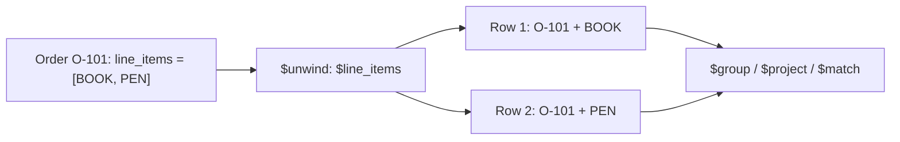

# $unwind và xử lý array hoặc giá trị rỗng

Trong MongoDB, một đơn hàng thường có nhiều dòng sản phẩm, một bài viết có nhiều thẻ, một khóa học có nhiều bài học. Khi cần tính **doanh thu theo SKU**, tìm **từng phần tử** sau khi tách mảng, hoặc kết hợp dữ liệu qua `$lookup`, bạn sẽ gặp aggregation stage **`$unwind`**. Stage này chuyển một document chứa array thành **nhiều document trong luồng xử lý**, mỗi document tương ứng với một phần tử.

Điểm dễ sai nhất không phải cú pháp `$unwind` mà là **giá trị rỗng**: mảng `[]`, BSON `null`, field không tồn tại và giá trị **không phải array** có hành vi khác nhau. Chỉ cần quên `preserveNullAndEmptyArrays`, báo cáo có thể làm biến mất toàn bộ đơn hàng chưa có dòng hàng. Ngược lại, bật tùy chọn này nhưng dùng `$group.count()` thiếu suy xét có thể **đếm một dòng giả** cho mỗi đơn hàng rỗng.

Bài thuộc chương **Aggregation cơ bản** của module `SPRING_DATA_MONGODB`, sử dụng Spring Data MongoDB để kết nối, ánh xạ document và thao tác MongoDB bằng `MongoTemplate`/repository; đồng thời liên hệ truy vấn, index, transaction, reactive access, kiểm thử và chẩn đoán hiệu năng dữ liệu.

> **Ghi nhớ:** `$unwind` biến đổi **luồng kết quả aggregation**, **không tự sửa dữ liệu được lưu** trong collection. Tùy chọn `preserveNullAndEmptyArrays` quyết định có giữ những document không có phần tử hay không; nó **không tạo một phần tử array thật**. Hãy thiết kế các stage `$match`, `$group`, `$project` phía sau phù hợp với sự khác biệt đó.

## 1. Mục tiêu học tập

Sau bài này, bạn có thể:

1. Mô tả `$unwind` thay đổi **số lượng** và **hình dạng** document trong pipeline như thế nào.
2. Viết hai dạng cú pháp `{ $unwind: "$field" }` và `{ $unwind: { path: "$field", ... } }`.
3. Phân biệt array có phần tử, `[]`, `null`, field missing và giá trị scalar/object không phải array.
4. Dùng `preserveNullAndEmptyArrays: true` để giữ document rỗng và `includeArrayIndex` để theo dõi vị trí phần tử.
5. Tạo pipeline với `Aggregation.unwind(...)` hoặc `UnwindOperation.newUnwind()` trong Spring Data MongoDB.
6. Áp dụng typed aggregation với `@Field` và ánh xạ kết quả sang DTO thay vì ép phần tử đã unwind trở lại entity chứa `List`.
7. Kết hợp `$match`, `$group`, `$sum`, `$project`, `$addFields` để tính toán đúng sau unwind.
8. Phân biệt **đếm document đầu vào**, **đếm phần tử array** và **đếm dòng pipeline**.
9. Xử lý null/missing bằng `$ifNull` và kiểm tra kiểu bằng `$isArray` trước khi dùng `$size`.
10. Phân tích `$unwind` sau `$lookup`, multiple/nested arrays và nguy cơ nhân số dòng.
11. Thiết kế integration test, đọc `explain`, đánh giá index và nhận biết ranh giới nguyên tử/nhất quán.
12. Chọn `$filter`/`$map` thay vì `$unwind` khi chỉ cần biến đổi mảng mà không muốn tăng số dòng.

## 2. $unwind làm gì trong aggregation pipeline?

Xét document đầu vào:

```javascript
{
  _id: "O-101",
  state: "PAID",
  line_items: [
    { sku: "BOOK", quantity: 2 },
    { sku: "PEN",  quantity: 3 }
  ]
}
```

Một stage:

```javascript
{ $unwind: "$line_items" }
```

tạo **hai document trong pipeline**:

```javascript
{ _id: "O-101", state: "PAID",
  line_items: { sku: "BOOK", quantity: 2 } }

{ _id: "O-101", state: "PAID",
  line_items: { sku: "PEN", quantity: 3 } }
```

Những field khác như `_id`, `state` được giữ trên từng dòng kết quả; riêng `line_items` đổi từ array thành **một phần tử** của mảng. Cùng `_id` xuất hiện nhiều lần trong pipeline **không phải trùng khóa dữ liệu lưu**, vì đây chỉ là các document trung gian, không được insert trở lại collection.

Nếu input có N dòng hàng, `$unwind` mặc định tạo **N output rows**. Nếu N=0 hoặc field null/missing, mặc định tạo **0 rows**; phần này sẽ được giải thích bằng dữ liệu đối chiếu.

Sơ đồ:



### 2.1. Khi nào cần unwind?

- Tính tổng số lượng bán theo từng `sku` có trong mảng `line_items`.
- Phân tích từng review trong `reviews[]`, sau đó nhóm theo rating.
- Kết hợp `$lookup` rồi xử lý từng document trong mảng kết quả join.
- Tách phần tử để filter, sort hoặc chuyển sang một DTO “mỗi dòng một record”.
- Xử lý array nested nhiều cấp theo tuần tự `$unwind`.

### 2.2. Khi nào không cần?

- Chỉ muốn biết **có phần tử thỏa điều kiện**: có thể dùng `$elemMatch`.
- Muốn giữ document cha và **lọc các phần tử trong mảng**: có thể dùng `$filter`.
- Chỉ muốn số phần tử: `$size` trên array hợp lệ thường trực tiếp hơn.
- Muốn biến đổi từng phần tử nhưng vẫn giữ nguyên array: `$map`.

Không thêm `$unwind` mặc định cho mọi query chứa array; mỗi stage có tác động lên cardinality và chi phí pipeline.

## 3. Dataset xuyên suốt: đủ năm trạng thái của trường array

Tạo một collection test `training_orders` với sáu document. Dữ liệu cố ý bao gồm một document **sai kiểu legacy** để phân biệt scalar với array.

```javascript
db.training_orders.insertMany([
  {
    _id: "O-A",
    tenant_id: "tenant-a",
    state: "PAID",
    line_items: [
      { sku: "BOOK", quantity: 2, unit_price_cents: NumberLong("1000") },
      { sku: "PEN", quantity: 3, unit_price_cents: NumberLong("200") }
    ]
  },
  {
    _id: "O-B",
    tenant_id: "tenant-a",
    state: "PAID",
    line_items: []
  },
  {
    _id: "O-C",
    tenant_id: "tenant-a",
    state: "PAID",
    line_items: null
  },
  {
    _id: "O-D",
    tenant_id: "tenant-a",
    state: "PAID"
    // Cố ý không có field line_items
  },
  {
    _id: "O-E",
    tenant_id: "tenant-a",
    state: "PAID",
    line_items: [
      { sku: "BOOK", quantity: 1, unit_price_cents: NumberLong("1000") }
    ]
  },
  {
    _id: "O-F",
    tenant_id: "tenant-a",
    state: "PAID",
    line_items: {
      sku: "BOOK", quantity: 1, unit_price_cents: NumberLong("1000")
    }
    // Dữ liệu legacy sai schema: object thay vì array
  }
]);
```

**Bảng input:**

| Document | `line_items` | Phân loại | Số phần tử hợp lệ nếu schema bắt buộc array |
| --- | --- | --- | ---: |
| `O-A` | `[BOOK, PEN]` | Array có 2 phần tử | 2 |
| `O-B` | `[]` | Array rỗng | 0 |
| `O-C` | `null` | Null | 0 |
| `O-D` | Không có field | Missing | 0 |
| `O-E` | `[BOOK]` | Array có 1 phần tử | 1 |
| `O-F` | Một object `{sku:"BOOK",…}` | **Non-array** | Không hợp lệ theo schema; MongoDB unwind vẫn có xử lý |

Năm trạng thái cốt lõi cần phân biệt: array có giá trị, mảng rỗng, null, missing và giá trị non-array (kể cả scalar string/object). `O-F` được đưa vào để **giải thích hành vi máy chủ**, không phải khuyến khích để dữ liệu sản xuất trộn schema.

**Không chạy script này trên production.** Nếu chạy lặp lại trong test database, các `_id` cố định sẽ gây duplicate key; hãy làm sạch riêng database test hoặc dùng mã tenant/ID ngẫu nhiên trong integration test.

## 4. Cú pháp $unwind: dạng field path và dạng document

### 4.1. Dạng ngắn: field path

```javascript
db.training_orders.aggregate([
  { $match: { tenant_id: "tenant-a", state: "PAID" } },
  { $unwind: "$line_items" }
]);
```

Dạng ngắn tương đương với dạng document chỉ có path:

```javascript
{ $unwind: { path: "$line_items" } }
```

Trong BSON aggregation, giá trị `path` **phải có tiền tố `$`** khi chỉ field reference, ví dụ `"$line_items"`. Đừng nhầm với field name literal dùng trong `$match` là `"line_items"`.

### 4.2. Dạng mở rộng: options

```javascript
{
  $unwind: {
    path: "$line_items",
    includeArrayIndex: "lineIndex",
    preserveNullAndEmptyArrays: true
  }
}
```

| Option | Kiểu | Ý nghĩa |
| --- | --- | --- |
| `path` | String field path | Array hoặc giá trị được unwind |
| `includeArrayIndex` | String field name | Tạo field chứa **vị trí phần tử** của array |
| `preserveNullAndEmptyArrays` | Boolean | Giữ document có path là `null`/missing/`[]` |

`preserveNullAndEmptyArrays` mặc định **false**. `includeArrayIndex` là tùy chọn: nếu không khai báo, không có field index mới.

## 5. Hành vi mặc định: mảng rỗng, null và missing bị loại

Chạy:

```javascript
db.training_orders.aggregate([
  { $match: { tenant_id: "tenant-a" } },
  { $unwind: "$line_items" },
  { $project: { _id: 1, "line_items.sku": 1 } }
]);
```

Kết quả logic trên dataset:

| `_id` | Giá trị sau unwind | Số dòng |
| --- | --- | ---: |
| `O-A` | BOOK, PEN | 2 |
| `O-B` | Không có dòng | 0 |
| `O-C` | Không có dòng | 0 |
| `O-D` | Không có dòng | 0 |
| `O-E` | BOOK | 1 |
| `O-F` | BOOK từ object non-array | 1 |
| **Tổng** | | **4** |

`O-F` quan trọng: khi `path` không phải array **nhưng có giá trị không null, không missing và không phải array rỗng**, MongoDB **coi đó như một phần tử duy nhất**, cho ra một dòng. Một object chứa `sku` hợp lệ vẫn có thể len vào báo cáo dù sai schema.

### 5.1. $unwind không phải bộ kiểm tra schema

Nếu ứng dụng quy định `line_items` bắt buộc là array, việc `$unwind` chấp nhận một object đơn lẻ **không biến dữ liệu đó thành hợp lệ**. Bạn cần JSON Schema validation, kiểm thử migration hoặc filter bằng `$isArray` khi phân tích dữ liệu lịch sử.

### 5.2. Document biến mất có nghĩa gì?

`O-B`, `O-C`, `O-D` bị loại **khỏi luồng của pipeline** từ stage unwind trở đi. Các document nguồn **không bị xóa** khỏi collection.

Một query aggregation có thể cố ý loại các đơn không có dòng hàng để tính doanh thu theo SKU. Nhưng nếu nghiệp vụ là **“hiển thị mọi đơn, kể cả đơn chưa có dòng”**, hành vi mặc định là sai.

## 6. preserveNullAndEmptyArrays: giữ document không có phần tử

Bật tùy chọn:

```javascript
db.training_orders.aggregate([
  { $match: { tenant_id: "tenant-a" } },
  {
    $unwind: {
      path: "$line_items",
      preserveNullAndEmptyArrays: true
    }
  },
  { $project: { _id: 1, line_items: 1 } }
]);
```

Kết quả theo từng document:

| Document | Số dòng khi mặc định | Số dòng khi `preserve=true` | Hình dạng path trong output |
| --- | ---: | ---: | --- |
| `O-A`: 2 phần tử | 2 | 2 | Mỗi dòng có object BOOK/PEN |
| `O-B`: `[]` | 0 | 1 | Field `line_items` **bị bỏ khỏi** output |
| `O-C`: `null` | 0 | 1 | `line_items: null` được giữ |
| `O-D`: missing | 0 | 1 | Field `line_items` **vẫn thiếu** |
| `O-E`: 1 phần tử | 1 | 1 | Object BOOK |
| `O-F`: object đơn | 1 | 1 | Object gốc giữ nguyên |
| **Tổng** | **4** | **7** | |

Dễ nhầm: `preserveNullAndEmptyArrays=true` **không chuyển `[]` thành `[null]`**, cũng không tạo một line item null trong database. Nó chỉ tạo **một dòng đại diện document cha**, trong đó path có thể bị thiếu hoặc null.

### 6.1. Đếm document trước và sau unwind không còn giống nhau

Trước unwind có **6 orders**, sau unwind mặc định có **4 rows**, sau unwind preserve=true có **7 rows**. Vì vậy:

- `count input documents` = 6.
- `count unwind rows default` = 4.
- `count unwind rows preserve=true` = 7.
- `count valid array elements` nếu loại O-F sai kiểu = **3** (2 của O-A và 1 của O-E).

Một câu `$group: {_id:null, rows: {$sum:1}}` sau unwind **không tự đếm số orders**, và khi preserve=true cũng **không tự đếm số line items thật**.

## 7. includeArrayIndex: lấy vị trí ban đầu của phần tử

```javascript
db.training_orders.aggregate([
  { $match: { tenant_id: "tenant-a" } },
  {
    $unwind: {
      path: "$line_items",
      includeArrayIndex: "lineIndex",
      preserveNullAndEmptyArrays: true
    }
  },
  {
    $project: {
      _id: 1,
      lineIndex: 1,
      line_items: 1
    }
  }
]);
```

Đối chiếu:

| Document | Dòng | `lineIndex` |
| --- | --- | --- |
| `O-A` | BOOK | 0 |
| `O-A` | PEN | 1 |
| `O-E` | BOOK | 0 |
| `O-F` | Object non-array | `null` |
| `O-B` | Array rỗng được giữ | `null`/giá trị không hiện diện tùy hình dạng kết quả |
| `O-C` | Null được giữ | `null`/giá trị không hiện diện tùy hình dạng kết quả |
| `O-D` | Missing được giữ | `null`/giá trị không hiện diện tùy hình dạng kết quả |

MongoDB dùng **index bắt đầu từ 0**. Với phần tử array, index là số nguyên kiểu BSON có thể được hiển thị như `Long(0)` trong `mongosh`. Với đầu vào non-array, MongoDB biểu diễn `includeArrayIndex` là `null`, không phải index 0 của một mảng thật.

Với document preserve do null/missing/[], không nên coi `lineIndex` là index của phần tử hợp lệ; projection và mapping có thể khiến field null bị bỏ khỏi DTO. Dùng kiểu Java nullable như `Long` thay vì `long` nếu cần nhận những row này.

### 7.1. Không dùng index làm định danh bất biến

`lineIndex=1` là vị trí **trong mảng ở thời điểm aggregation đọc**, không phải business ID. Một thao tác `$push`, `$pull`, `$sort` hoặc thay đổi thứ tự array có thể khiến phần tử khác xuất hiện ở index ấy sau này.

Nếu API cần cập nhật chính xác một dòng sản phẩm, nên có `lineId`/`sku` kèm bất biến domain thích hợp, không dùng index trả từ báo cáo như khóa ghi duy nhất.

## 8. Chuẩn hóa null/missing trước unwind với $ifNull

Đôi khi thay vì giữ orders rỗng, bạn muốn bảo đảm `line_items` luôn là array trước khi xử lý.

```javascript
db.training_orders.aggregate([
  {
    $set: {
      line_items: { $ifNull: ["$line_items", []] }
    }
  },
  { $unwind: "$line_items" }
]);
```

`$ifNull` thay `null` và field missing bằng `[]`. Nhưng **vì `$unwind` mặc định loại `[]`**, những order này **vẫn không có output row**. `$ifNull` **không tương đương** với `preserveNullAndEmptyArrays:true`.

Bảng:

| Input | Sau `$ifNull: […, []]` | `$unwind` mặc định |
| --- | --- | --- |
| `[]` | `[]` | 0 row |
| `null` | `[]` | 0 row |
| Missing | `[]` | 0 row |
| `[BOOK,PEN]` | Giữ array | 2 rows |
| Object non-array | **Giữ object** | 1 row |

**Bẫy:** `$ifNull` chỉ xử lý **null và missing**, không biến object/string non-null thành array. Nếu dữ liệu lịch sử có non-array, cần `$isArray`.

## 9. $isArray và $cond: phân biệt array hợp lệ với scalar

Khi schema yêu cầu đúng array, có thể chuẩn hóa:

```javascript
db.training_orders.aggregate([
  {
    $set: {
      line_items: {
        $cond: [
          { $isArray: "$line_items" },
          "$line_items",
          []
        ]
      }
    }
  },
  { $unwind: "$line_items" }
]);
```

Sau stage `$set`:

- O-A/O-E vẫn giữ array.
- O-B vẫn là `[]`.
- O-C/O-D chuyển thành `[]`.
- O-F (object non-array) chuyển thành `[]`.

Khi unwind mặc định, chỉ còn **3 dòng hàng của hai order hợp lệ**.

Trong pipeline trên, `$isArray` kiểm tra kiểu BSON. Nó không tự sửa tài liệu nguồn, vì `$set` ở đây là **aggregation stage** (alias của `$addFields`), không phải một `updateOne`.

### 9.1. Đừng áp $size trực tiếp lên non-array

Sai hoặc không an toàn trên dữ liệu hỗn hợp:

```javascript
{
  $project: {
    itemCount: { $size: "$line_items" }
  }
}
```

`$size` yêu cầu biểu thức cho ra array. Nếu field null, missing hoặc object, phép tính có thể báo lỗi.

An toàn:

```javascript
db.training_orders.aggregate([
  {
    $project: {
      itemCount: {
        $cond: [
          { $isArray: "$line_items" },
          { $size: "$line_items" },
          0
        ]
      }
    }
  }
]);
```

Kết quả itemCount theo order: O-A=2, O-B=0, O-C=0, O-D=0, O-E=1, O-F=0. Đây là phép **đếm array elements không cần unwind**.

### 9.2. Phân biệt null business value với lỗi schema

Việc đổi object sai kiểu thành `[]` là **chính sách phân tích**, không phải luôn đúng nghiệp vụ. Nếu document O-F đại diện một dòng hàng hợp lệ theo schema cũ, chọn migration từ object sang array một phần tử sẽ giữ dữ liệu hơn là bỏ qua.

Trước khi chuẩn hóa, quyết định rõ: **fail fast**, **bỏ document sai kiểu**, **migrate**, hay **diễn giải non-array như một phần tử**. Viết test đúng với lựa chọn đó.

## 10. Kết hợp $match trước và sau $unwind

Muốn lấy **chỉ dòng BOOK của tenant-a**:

```javascript
db.training_orders.aggregate([
  { $match: { tenant_id: "tenant-a" } },
  { $unwind: "$line_items" },
  { $match: { "line_items.sku": "BOOK" } },
  {
    $project: {
      _id: 1,
      sku: "$line_items.sku",
      quantity: "$line_items.quantity"
    }
  }
]);
```

Dòng PEN của O-A bị loại **sau** khi unwind. Những order không có dòng cũng bị loại bởi unwind mặc định.

### 10.1. Match trước và match sau không hoán đổi máy móc

```javascript
db.training_orders.aggregate([
  { $match: { "line_items.sku": "BOOK" } },
  { $unwind: "$line_items" }
]);
```

`$match` ở trước unwind chỉ xác định **document có ít nhất một BOOK**. Nhưng sau unwind, document đó có thể phát **cả BOOK lẫn PEN**. Nếu mục tiêu là **chỉ các BOOK rows**, vẫn cần `$match` sau unwind.

Để giảm số document đầu vào, có thể đặt `$match` chọn lọc ở trước **và** lặp điều kiện theo phần tử ở sau khi đúng semantics:

```javascript
db.training_orders.aggregate([
  {
    $match: {
      tenant_id: "tenant-a",
      "line_items.sku": "BOOK"
    }
  },
  { $unwind: "$line_items" },
  { $match: { "line_items.sku": "BOOK" } }
]);
```

Điều kiện trước có thể khai thác index phù hợp; điều kiện sau đảm bảo giữ đúng **phần tử**.

### 10.2. Match sau preserve có thể xóa ngay những row được giữ

```javascript
[
  {
    $unwind: {
      path: "$line_items",
      preserveNullAndEmptyArrays: true
    }
  },
  { $match: { "line_items.sku": "BOOK" } }
]
```

Stage `$match` thứ hai sẽ loại O-B/O-C/O-D vì không có `line_items.sku`. Như vậy pipeline **không còn giữ orders rỗng**, dù stage unwind bật preserve.

Muốn giữ cả orders rỗng **và** chỉ những item BOOK, phải viết điều kiện rõ: chẳng hạn branch trong `$facet` hoặc tính một cờ “đây là row hợp lệ” trước khi filter; với `$lookup` left join cũng cần tránh vô tình biến thành inner join.

## 11. $group sau unwind: đếm row khác đếm order

### 11.1. Đếm dòng sau unwind mặc định

```javascript
db.training_orders.aggregate([
  { $match: { tenant_id: "tenant-a" } },
  { $unwind: "$line_items" },
  {
    $group: {
      _id: "$state",
      rowCount: { $sum: 1 }
    }
  }
]);
```

Với dataset sáu order và một O-F sai schema, kết quả cho `PAID`: `rowCount=4`.

### 11.2. Khi preserve=true thì $sum:1 đếm “dòng đại diện”

```javascript
db.training_orders.aggregate([
  { $match: { tenant_id: "tenant-a" } },
  {
    $unwind: {
      path: "$line_items",
      preserveNullAndEmptyArrays: true
    }
  },
  {
    $group: {
      _id: "$state",
      rowCount: { $sum: 1 }
    }
  }
]);
```

Kết quả là `rowCount=7`, **không** phải 6 orders và cũng không phải 3 phần tử array hợp lệ.

### 11.3. Đếm số orders thực

Nếu mục tiêu chỉ là **đếm order**, đừng unwind:

```javascript
db.training_orders.aggregate([
  { $match: { tenant_id: "tenant-a" } },
  { $group: { _id: "$state", orderCount: { $sum: 1 } } }
]);
```

Kết quả `orderCount=6`. Nếu đã unwind vì những bước tính khác, có thể nhóm theo order ID trước để loại trùng, rồi nhóm theo state; nhưng cách đó có chi phí và phải bảo đảm ID của order được bảo toàn.

### 11.4. Đếm số phần tử array hợp lệ

Với dữ liệu hỗn hợp và chính sách chỉ đếm array thật, không unwind:

```javascript
db.training_orders.aggregate([
  { $match: { tenant_id: "tenant-a" } },
  {
    $project: {
      state: 1,
      itemCount: {
        $cond: [
          { $isArray: "$line_items" },
          { $size: "$line_items" },
          0
        ]
      }
    }
  },
  {
    $group: {
      _id: "$state",
      validArrayItems: { $sum: "$itemCount" }
    }
  }
]);
```

Kết quả `validArrayItems=3`, loại O-F sai kiểu. Ba khái niệm **6 input orders / 7 preserved rows / 3 valid array items** phải được dùng đúng theo yêu cầu báo cáo.

## 12. Tính tổng số lượng và doanh thu theo SKU

Nếu dữ liệu **đã được bảo đảm đúng schema** (mỗi `line_items` là array, mỗi dòng có quantity và unit price hợp lệ), một báo cáo cơ bản:

```javascript
db.training_orders.aggregate([
  { $match: { tenant_id: "tenant-a", state: "PAID" } },
  { $unwind: "$line_items" },
  {
    $group: {
      _id: "$line_items.sku",
      totalQuantity: { $sum: "$line_items.quantity" },
      revenueCents: {
        $sum: {
          $multiply: [
            "$line_items.quantity",
            "$line_items.unit_price_cents"
          ]
        }
      }
    }
  },
  { $sort: { _id: 1 } }
]);
```

Trên dữ liệu **O-A và O-E hợp lệ**, kết quả:

| SKU | Lượng bán | Doanh thu (cent) |
| --- | ---: | ---: |
| BOOK | 3 | 3.000 |
| PEN | 3 | 600 |

Nếu **không xử lý O-F sai schema**, MongoDB unwind vẫn coi object O-F như một phần tử, nên BOOK bị cộng thêm quantity 1 và revenue 1.000. Vì vậy báo cáo sau chỉ đúng nếu có invariant schema hoặc filter/migration rõ ràng.

Một cách loại non-array trước unwind:

```javascript
db.training_orders.aggregate([
  {
    $match: {
      tenant_id: "tenant-a",
      state: "PAID",
      $expr: { $isArray: "$line_items" }
    }
  },
  { $unwind: "$line_items" },
  {
    $group: {
      _id: "$line_items.sku",
      totalQuantity: { $sum: "$line_items.quantity" },
      revenueCents: {
        $sum: {
          $multiply: [
            "$line_items.quantity", "$line_items.unit_price_cents"
          ]
        }
      }
    }
  },
  { $sort: { _id: 1 } }
]);
```

### 12.1. Kiểu tiền tệ và số lượng

Ví dụ dùng `NumberLong` cho đơn giá và số cent nguyên để tránh lỗi số thực trong mục tiêu bài học. Trong hệ thống tiền tệ thực, có thể dùng BSON `Decimal128` tương ứng `BigDecimal` với cấu hình Spring Data phù hợp; cần kiểm thử tràn số, precision, currency và rounding.

### 12.2. Nếu quantity hoặc price bị null/missing?

Đừng lặng lẽ kết luận doanh thu 0 hoặc bỏ qua mà không có chính sách. `$sum` và `$multiply` có semantics với giá trị không phải số/null; thiết kế cần validation dữ liệu đầu vào, hoặc xử lý minh bạch bằng `$ifNull`/`$cond`, đồng thời theo dõi số dòng bị lỗi trong báo cáo.

## 13. Spring Data MongoDB: Aggregation.unwind và UnwindOperation

Spring Data MongoDB hỗ trợ `$unwind` bằng các factory method thuộc `Aggregation` và builder `UnwindOperation`. Khi dùng **typed aggregation**, bạn có thể tham chiếu property Java rồi nhờ metadata `@Field` ánh xạ sang BSON tương ứng.

### 13.1. Mô hình Java có @Field alias

```java
package dev.learning.aggregation;

import java.util.List;
import org.springframework.data.annotation.Id;
import org.springframework.data.mongodb.core.mapping.Document;
import org.springframework.data.mongodb.core.mapping.Field;

@Document("training_orders")
public record TrainingOrder(
    @Id String id,
    @Field("tenant_id") String tenantId,
    String state,
    @Field("line_items") List<OrderLine> items) {
}

public record OrderLine(
    String sku,
    int quantity,
    @Field("unit_price_cents") long unitPriceCents) {
}
```

**Mỗi `public record` đặt trong một tệp Java riêng.** Trong Java tên collection field là `items`, nhưng BSON thực là `line_items`. Property `tenantId` được lưu thành `tenant_id`.

Ở API typed, hãy viết property Java:

```java
import org.springframework.data.mongodb.core.aggregation.Aggregation;
import org.springframework.data.mongodb.core.aggregation.TypedAggregation;
import org.springframework.data.mongodb.core.query.Criteria;

TypedAggregation<TrainingOrder> pipeline =
    Aggregation.newAggregation(
        TrainingOrder.class,
        Aggregation.match(
            Criteria.where("tenantId").is("tenant-a")),
        Aggregation.unwind("items")
    );
```

Ý định BSON sau mapping tương đương:

```javascript
[
  { $match: { tenant_id: "tenant-a" } },
  { $unwind: "$line_items" }
]
```

Khi kiểm tra tên field thực, sử dụng **CommandListener**, profiler hoặc dữ liệu BSON thật. Không chỉ nhìn `toString()` của `Query`/pipeline trước mapping để khẳng định toàn bộ lệnh đã gửi xuống driver.

### 13.2. Các overload phổ biến

```java
// Dạng ngắn: mặc định bỏ null / missing / []:
var simple = Aggregation.unwind("items");

// Có preserve, không yêu cầu index:
var keepEmpty = Aggregation.unwind("items", true);

// Có index, mặc định không preserve:
var withIndex = Aggregation.unwind("items", "itemIndex");

// Có index và giữ document rỗng:
var both = Aggregation.unwind("items", "itemIndex", true);
```

Đây là **bốn phương án riêng**, không phải bốn stage cần đặt nối tiếp cho cùng một array. Nếu unwind `items` hai lần liên tiếp, stage thứ nhất đã đổi array thành một phần tử; stage thứ hai có thể tạo kết quả khác với ý định và làm pipeline khó hiểu.

### 13.3. Builder UnwindOperation

```java
import org.springframework.data.mongodb.core.aggregation.UnwindOperation;

UnwindOperation operation =
    UnwindOperation.newUnwind()
        .path("items")
        .arrayIndex("itemIndex")
        .preserveNullAndEmptyArrays();
```

Builder cũng có nhánh `noArrayIndex()` và `skipNullAndEmptyArrays()` khi cần cấu hình ngược. Lựa chọn builder hoặc `Aggregation.unwind(...)` phụ thuộc mức rõ ràng của code; hai cách đều tạo `UnwindOperation`.

### 13.4. Chạy aggregation trả BSON Document

```java
import java.util.List;
import org.bson.Document;
import org.springframework.data.mongodb.core.MongoTemplate;
import org.springframework.data.mongodb.core.aggregation.Aggregation;
import org.springframework.data.mongodb.core.aggregation.TypedAggregation;
import org.springframework.data.mongodb.core.query.Criteria;

TypedAggregation<TrainingOrder> aggregation =
    Aggregation.newAggregation(
        TrainingOrder.class,
        Aggregation.match(
            Criteria.where("tenantId").is(authorizedTenant)),
        Aggregation.unwind("items", "itemIndex", true)
    );

List<Document> rows = mongoTemplate.aggregate(
        aggregation, "training_orders", Document.class
    ).getMappedResults();
```

`authorizedTenant` phải đến từ **nguồn xác thực của server**, không lấy từ một request parameter chưa kiểm soát. Với `Document.class`, kết quả chứa tên field BSON như `line_items`, còn `itemIndex` là field mới do stage tạo.

Lưu ý: một dòng sau unwind chứa **một OrderLine object**, không còn là `List<OrderLine>`. Nếu ép output quay lại `TrainingOrder.class` với `items: List<OrderLine>`, quá trình mapping có thể lỗi hoặc trả shape không như mong muốn. Khi đọc kết quả sau unwind, nên dùng **DTO/output type riêng**.

## 14. Dùng projection DTO sau unwind

Một API báo cáo có thể chỉ cần ID đơn hàng, SKU, số lượng và index:

```java
package dev.learning.aggregation;

public record OrderLineView(
    String orderId,
    String sku,
    Integer quantity,
    Long itemIndex) {
}
```

Đặt `Long` thay vì `long` cho `itemIndex` vì các dòng được preserve từ null/missing/[] hoặc scalar non-array không có index mảng thực.

Pipeline:

```java
import org.springframework.data.mongodb.core.aggregation.Aggregation;
import org.springframework.data.mongodb.core.aggregation.TypedAggregation;
import org.springframework.data.mongodb.core.query.Criteria;

TypedAggregation<TrainingOrder> pipeline =
    Aggregation.newAggregation(
        TrainingOrder.class,
        Aggregation.match(
            Criteria.where("tenantId").is(authorizedTenant)),
        Aggregation.unwind("items", "itemIndex", true),
        Aggregation.project()
            .and("_id").as("orderId")
            .and("items.sku").as("sku")
            .and("items.quantity").as("quantity")
            .and("itemIndex").as("itemIndex")
    );

List<OrderLineView> views = mongoTemplate.aggregate(
    pipeline, "training_orders", OrderLineView.class
).getMappedResults();
```

Các path `items.sku` và `items.quantity` là property từ entity đầu vào, và Spring Data có thể áp dụng mapping tương ứng trong typed pipeline. Ở kết quả, `orderId`, `sku`, `quantity`, `itemIndex` là **alias của shape đầu ra**.

**Cần kiểm thử với bản Spring Data đang dùng:** sau `$project`/`$group`, alias và ngữ cảnh mapping có thể khác property của source type. Raw stage `Aggregation.stage(String)` hoặc `org.bson.Document` thường dùng **tên BSON thực** thay vì property Java. Không giả định mọi biểu thức raw đều được Spring Data đổi tên.

### 14.1. Hàng preserve trong DTO

O-B/O-C/O-D không có line item thật, nhưng preserve=true vẫn tạo row. Trong `OrderLineView`, `sku`/`quantity`/`itemIndex` có thể null. Nếu dùng `int quantity` thay cho `Integer`, null có thể thành giá trị mặc định hoặc khiến mapping không tương thích tùy cách dựng object. **Chọn wrapper nullable** khi output thực có missing/null.

Nếu API chỉ trả **dòng hàng thực**, dùng `preserve=false` và filter/schema phù hợp. Nếu API trả **một dòng ngay cả khi order rỗng**, dùng preserve=true và thiết kế DTO thể hiện `hasItem` hoặc `itemPresent` rõ ràng.

## 15. Group trong Spring Data sau unwind

Với dữ liệu có array hợp lệ, ta nhóm theo SKU:

```java
import org.springframework.data.mongodb.core.aggregation.Aggregation;
import org.springframework.data.mongodb.core.aggregation.TypedAggregation;
import org.springframework.data.mongodb.core.query.Criteria;

public record QuantityBySku(String sku, long totalQuantity) {}

TypedAggregation<TrainingOrder> pipeline =
    Aggregation.newAggregation(
        TrainingOrder.class,
        Aggregation.match(
            Criteria.where("tenantId").is(authorizedTenant)
                .and("state").is("PAID")),
        Aggregation.unwind("items"),
        Aggregation.group("items.sku")
            .sum("items.quantity").as("totalQuantity"),
        Aggregation.project("totalQuantity")
            .and("_id").as("sku"),
        Aggregation.sort(
            org.springframework.data.domain.Sort.Direction.ASC, "sku")
    );

List<QuantityBySku> quantities = mongoTemplate.aggregate(
    pipeline, "training_orders", QuantityBySku.class
).getMappedResults();
```

`QuantityBySku` là **một record Java riêng**. Chỉ chạy trên dataset thỏa schema array hoặc thêm stage kiểm tra `$isArray` để loại dữ liệu legacy kiểu O-F, nếu nghiệp vụ yêu cầu.

Những lỗi thường gặp ở group:

- Gọi `group("state").count().as("orderCount")` **sau unwind** rồi gọi đó là tổng số orders; nó thực ra đếm rows.
- Bật preserve=true và đếm một hàng rỗng thành một item.
- Nhóm theo `items.sku` sau khi đã project mất field này.
- Dùng alias `itemIndex` làm field có sẵn trước unwind.
- Dùng `Long` cho kết quả tiền cents mà không cân nhắc overflow, decimal representation và validation.

## 16. Nested arrays: unwind tuần tự và nguy cơ tăng số dòng

Một khóa học có nhiều section, mỗi section có nhiều lesson:

```javascript
{
  _id: "COURSE-01",
  sections: [
    {
      code: "backend",
      lessons: [
        { key: "mongo-101" },
        { key: "spring-201" }
      ]
    },
    {
      code: "frontend",
      lessons: []
    }
  ]
}
```

Chạy hai stage:

```javascript
db.courses.aggregate([
  { $unwind: "$sections" },
  { $unwind: "$sections.lessons" }
]);
```

Kết quả có **hai dòng backend**; section frontend với `lessons:[]` bị loại ở stage thứ hai.

Nếu muốn giữ cả section không có lesson:

```javascript
db.courses.aggregate([
  { $unwind: "$sections" },
  {
    $unwind: {
      path: "$sections.lessons",
      preserveNullAndEmptyArrays: true
    }
  }
]);
```

Khi ấy có **ba rows**: backend/mongo-101, backend/spring-201 và một row đại diện frontend không có lesson. Nếu tiếp tục `$group.count()` rồi gọi đó là “số lesson”, row frontend tạo **đếm dư một**.

### 16.1. Hai mảng độc lập có thể tạo tích Descartes

Document:

```javascript
{
  _id: "D-1",
  tags: ["java", "mongo"],
  channels: ["web", "mobile", "email"]
}
```

Pipeline:

```javascript
[
  { $unwind: "$tags" },
  { $unwind: "$channels" }
]
```

Tạo **2 × 3 = 6 rows**, mỗi tag kết hợp với từng channel. Với N phần tử ở một mảng và M ở mảng độc lập còn lại, số dòng có thể là N×M.

Không nhầm với nested array `sections[].lessons[]`, nơi mỗi lesson thuộc một section: sau unwind hai cấp, số dòng thông thường là **tổng số lesson của từng section**, có điều chỉnh bởi preserve. Khi dữ liệu lớn, cần tính toán cardinality trước khi thêm nhiều unwind.

### 16.2. Thứ tự unwind ảnh hưởng điều kiện và mapping

Sau `$unwind:"$sections"`, `sections` không còn là array mà là object của một section. Sau `$unwind:"$sections.lessons"`, `sections.lessons` không còn là array mà là object của một lesson.

Nên dùng DTO theo **shape mới** ở output. Các phép `$match` phía sau có thể lọc trực tiếp theo `"sections.lessons.key"` của lesson đã được tách; không nhầm với việc filter nhiều phần tử trước unwind bằng dot notation.

## 17. $lookup + $unwind: inner join và left outer join

`$lookup` trả kết quả vào một **array**. Với từng đơn hàng có `customer_id`, ví dụ:

```javascript
db.training_orders.aggregate([
  {
    $lookup: {
      from: "customers",
      localField: "customer_id",
      foreignField: "_id",
      as: "customer"
    }
  },
  { $unwind: "$customer" }
]);
```

Nếu không có customer tương ứng, `$lookup` tạo `customer:[]`. `$unwind` mặc định **loại order không có match**, nên pipeline hoạt động gần giống **inner join** ở output.

Để giữ cả order chưa ghép được khách hàng:

```javascript
db.training_orders.aggregate([
  {
    $lookup: {
      from: "customers",
      localField: "customer_id",
      foreignField: "_id",
      as: "customer"
    }
  },
  {
    $unwind: {
      path: "$customer",
      preserveNullAndEmptyArrays: true
    }
  }
]);
```

Giờ vẫn có row cho order không match, tương tự **left outer join**. Nhưng cẩn thận:

```javascript
[
  { $lookup: { from: "customers",
      localField: "customer_id",
      foreignField: "_id",
      as: "customer" } },
  { $unwind: { path: "$customer",
      preserveNullAndEmptyArrays: true } },
  { $match: { "customer.level": "VIP" } }
]
```

`$match` cuối sẽ lại loại order không match hoặc không có field `customer.level`. Nếu nghiệp vụ thực sự muốn giữ order không có customer nhưng chỉ nhận customer VIP khi có, cần điều kiện/group/pipeline join tương ứng, không chỉ bật preserve.

MongoDB có thể tối ưu `$lookup` + `$unwind` + `$match` liền kề thành kế hoạch ghép trong explain. Đọc explain thay vì coi các stage hiển thị tách biệt là bằng chứng chắc chắn về chi phí thực.

## 18. $facet: tính song song số order và số item

Khi một response cần **tổng số orders** và **số dòng hàng sau unwind**, có thể dùng `$facet` để chia luồng thành các nhánh, tránh nhầm cardinality:

```javascript
db.training_orders.aggregate([
  { $match: { tenant_id: "tenant-a" } },
  {
    $facet: {
      orders: [
        { $count: "totalOrders" }
      ],
      linesAfterUnwind: [
        { $unwind: "$line_items" },
        { $count: "totalRows" }
      ]
    }
  }
]);
```

Với dataset ví dụ:

```javascript
[
  {
    orders: [{ totalOrders: 6 }],
    linesAfterUnwind: [{ totalRows: 4 }]
  }
]
```

Ở đây `totalRows=4` **bao gồm** một row từ O-F non-array. Nếu cần đếm **array elements hợp lệ**, dùng nhánh có `$expr/$isArray` trước unwind hoặc tính `$size` cho từng order rồi `$group`.

`$facet` có giới hạn về tài nguyên và kích thước kết quả riêng; không nên tạo những nhánh trả hàng triệu document ra một response. Ví dụ này chỉ trả hai đối tượng số đếm nhỏ.

## 19. $filter và $map: giữ nguyên document cha thay vì unwind

Nếu chỉ muốn hiển thị các line BOOK trong từng order mà **không muốn nhân số dòng**, dùng `$filter`:

```javascript
db.training_orders.aggregate([
  { $match: { tenant_id: "tenant-a" } },
  {
    $project: {
      _id: 1,
      bookItems: {
        $filter: {
          input: {
            $cond: [
              { $isArray: "$line_items" },
              "$line_items",
              []
            ]
          },
          as: "line",
          cond: { $eq: ["$$line.sku", "BOOK"] }
        }
      }
    }
  }
]);
```

Mỗi order tạo **một output document** với `bookItems[]`, kể cả khi list rỗng. Đây là lựa chọn phù hợp với API “một order + các item đạt điều kiện”.

`$map` cho phép biến đổi mỗi phần tử thành một shape khác trong array; `$reduce` cho phép tích lũy. Khi chỉ cần projection mảng hoặc tính aggregate trên một document, những operator này có thể tránh việc tạo nhiều intermediate rows.

### 19.1. Quy tắc lựa chọn

| Mục tiêu | Cách thường hợp lý |
| --- | --- |
| Một row cho mỗi line item | `$unwind` |
| Một document cha, kèm array đã lọc | `$filter` |
| Một document cha, kèm array chuyển đổi | `$map` |
| Đếm số phần tử của array | `$size` sau kiểm tra kiểu |
| Tổng hợp trên nhiều order theo SKU | `$unwind` + `$group` |
| Join rồi giữ cả cha không match | `$lookup` + `$unwind preserve=true` |
| Biết chỉ có item nào thỏa điều kiện hay không | `$elemMatch`/`$match` |

## 20. Hiệu năng và thiết kế pipeline

### 20.1. Lọc sớm khi có thể

`$unwind` có thể **tăng số dòng** trước những stage đắt tiền như `$sort` hoặc `$group`. Thông thường, đặt `$match` chọn lọc dựa trên field cha **trước unwind** giúp giảm lượng dữ liệu phải xử lý.

Ví dụ:

```javascript
db.training_orders.aggregate([
  { $match: { tenant_id: "tenant-a", state: "PAID" } },
  { $unwind: "$line_items" },
  { $match: { "line_items.sku": "BOOK" } },
  {
    $group: {
      _id: "$line_items.sku",
      quantity: { $sum: "$line_items.quantity" }
    }
  }
]);
```

Chọn index ứng viên cho filter cha:

```javascript
db.training_orders.createIndex(
  { tenant_id: 1, state: 1 },
  { name: "tenant_state" }
);
```

Nếu thường xuyên tìm order có một SKU nào đó, có thể nghiên cứu multikey index:

```javascript
db.training_orders.createIndex(
  { tenant_id: 1, "line_items.sku": 1 },
  { name: "tenant_item_sku" }
);
```

Index phải khớp **tên BSON** và shape query thực. Đừng giả định một index sẽ tự được dùng bởi mọi `$match` đặt **sau unwind**; hãy kiểm tra explain và cân nhắc thêm một pre-filter chọn lọc mà không làm sai nghĩa kết quả.

### 20.2. Quan sát explain

Với `mongosh`:

```javascript
db.training_orders.explain("executionStats").aggregate([
  { $match: { tenant_id: "tenant-a", state: "PAID" } },
  { $unwind: "$line_items" },
  { $group: {
      _id: "$line_items.sku",
      quantity: { $sum: "$line_items.quantity" }
  }}
]);
```

Quan sát theo phiên bản server:

- `winningPlan`, `IXSCAN`/`COLLSCAN` cho các stage đọc dữ liệu.
- `totalKeysExamined` và `totalDocsExamined` ở nguồn truy vấn.
- Số document đầu vào và đầu ra của `$unwind`, `$group`.
- Có stage `$sort` riêng và memory spill hay không.
- Thời gian chạy, dữ liệu đọc, độ lớn intermediate result.
- Trường hợp optimizer gộp `$lookup` + `$unwind` + `$match` trong explain.

Trường dữ liệu cụ thể trong explain thay đổi theo phiên bản MongoDB và execution engine, nên không giả định mọi output đều có cùng JSON path.

### 20.3. allowDiskUse không giải quyết explosion

Một số stage blocking như `$sort`/`$group` có thể cần bộ nhớ lớn và tùy trường hợp dùng disk spill. `allowDiskUse` có thể hỗ trợ giới hạn bộ nhớ cho những stage nhất định, **không làm giảm số dòng nhân lên do unwind** hoặc thay thế index. Cách giảm chi phí thực là lọc sớm, giảm field, tránh unwind không cần thiết và chọn mô hình dữ liệu phù hợp.

### 20.4. Không dựa vào thứ tự output ngầm định

`includeArrayIndex` phản ánh vị trí phần tử ban đầu. Nếu API yêu cầu thứ tự xác định, hãy dùng `$sort` rõ ràng theo khóa cha + `itemIndex`. Không coi việc một pipeline đơn giản hiện trả các phần tử theo thứ tự mảng là hợp đồng sort ổn định sau khi thêm `$group`, `$lookup`, `$facet` hoặc chạy trên cụm phân tán.

## 21. Kiểm thử tích hợp: mặc định, preserve và scalar

Một bộ test tốt phải gồm **array có giá trị, [], null, missing và non-array**; chỉ test mảng hai phần tử thì không phát hiện lỗi cardinality.

Dùng `@SpringBootTest` và MongoDB **test riêng**. Dữ liệu có tenant/ID ngẫu nhiên; không dùng `deleteAll()` trên collection có nguy cơ trỏ đến production.

### 21.1. Fixture dùng typed entity và raw Document cho trường hợp legacy

```java
package dev.learning.aggregation;

import static org.assertj.core.api.Assertions.assertThat;

import java.util.List;
import java.util.UUID;
import org.bson.Document;
import org.junit.jupiter.api.Test;
import org.springframework.beans.factory.annotation.Autowired;
import org.springframework.boot.test.context.SpringBootTest;
import org.springframework.data.mongodb.core.MongoTemplate;
import org.springframework.data.mongodb.core.aggregation.Aggregation;
import org.springframework.data.mongodb.core.aggregation.TypedAggregation;
import org.springframework.data.mongodb.core.query.Criteria;

@SpringBootTest
class UnwindIntegrationTest {

    @Autowired MongoTemplate template;

    private String seed() {
        String suffix = UUID.randomUUID().toString();
        String tenant = "tenant-a-" + suffix;

        template.insert(new TrainingOrder(
            "O-A-" + suffix, tenant, "PAID",
            List.of(
                new OrderLine("BOOK", 2, 1000L),
                new OrderLine("PEN", 3, 200L)
            )));

        template.insert(new TrainingOrder(
            "O-B-" + suffix, tenant, "PAID", List.of()));

        // Dữ liệu raw để phân biệt BSON null với field missing:
        template.getCollection("training_orders")
            .insertOne(new Document("_id", "O-C-" + suffix)
                .append("tenant_id", tenant)
                .append("state", "PAID")
                .append("line_items", null));

        template.getCollection("training_orders")
            .insertOne(new Document("_id", "O-D-" + suffix)
                .append("tenant_id", tenant)
                .append("state", "PAID"));

        template.insert(new TrainingOrder(
            "O-E-" + suffix, tenant, "PAID",
            List.of(new OrderLine("BOOK", 1, 1000L))));

        // Sai schema có chủ đích: object thay vì array:
        template.getCollection("training_orders")
            .insertOne(new Document("_id", "O-F-" + suffix)
                .append("tenant_id", tenant)
                .append("state", "PAID")
                .append("line_items",
                    new Document("sku", "BOOK")
                        .append("quantity", 1)
                        .append("unit_price_cents", 1000L)));

        return tenant;
    }

    private List<Document> unwindRows(
            String tenant, boolean preserve) {

        TypedAggregation<TrainingOrder> aggregation =
            Aggregation.newAggregation(
                TrainingOrder.class,
                Aggregation.match(
                    Criteria.where("tenantId").is(tenant)),
                Aggregation.unwind("items", "itemIndex", preserve)
            );

        return template.aggregate(
            aggregation, "training_orders", Document.class
        ).getMappedResults();
    }

    @Test
    void defaultSkipsEmptyNullMissingButKeepsNonArray() {
        String tenant = seed();

        List<Document> rows = unwindRows(tenant, false);

        assertThat(rows).hasSize(4);
        assertThat(rows.stream()
            .filter(d -> d.getString("_id").startsWith("O-A-"))
            .count()).isEqualTo(2L);
        assertThat(rows.stream()
            .filter(d -> d.getString("_id").startsWith("O-F-"))
            .count()).isEqualTo(1L);
    }

    @Test
    void preserveKeepsOneRowForEveryEmptyInput() {
        String tenant = seed();

        List<Document> rows = unwindRows(tenant, true);

        assertThat(rows).hasSize(7);
        assertThat(rows.stream()
            .filter(d -> d.getString("_id").startsWith("O-B-"))
            .count()).isEqualTo(1L);
        assertThat(rows.stream()
            .filter(d -> d.getString("_id").startsWith("O-C-"))
            .count()).isEqualTo(1L);
        assertThat(rows.stream()
            .filter(d -> d.getString("_id").startsWith("O-D-"))
            .count()).isEqualTo(1L);
    }
}
```

**Lưu ý:** code trên là một class test và hai record domain độc lập như mục 13. Các raw documents O-C/O-D/O-F cố ý không có Spring Data `_class`: typed aggregation trong ví dụ chỉ dùng filter `tenantId` được map và không mặc định tìm theo `_class` như một typed QBE; hãy quan sát query thực nếu dự án cấu hình mapping/aggregation tùy biến.

### 21.2. Kiểm tra index và sự khác biệt với non-array

Thêm test vào cùng class:

```java
@Test
void arrayIndicesStartAtZeroAndScalarHasNoIndex() {
    String tenant = seed();
    List<Document> rows = unwindRows(tenant, true);

    List<Document> two = rows.stream()
        .filter(d -> d.getString("_id").startsWith("O-A-"))
        .toList();

    assertThat(two).hasSize(2);
    assertThat(two.stream()
        .map(d -> ((Number) d.get("itemIndex")).longValue()))
        .containsExactlyInAnyOrder(0L, 1L);

    Document scalar = rows.stream()
        .filter(d -> d.getString("_id").startsWith("O-F-"))
        .findFirst().orElseThrow();

    assertThat(scalar.get("itemIndex")).isNull();
}
```

Mục tiêu của test: xác nhận `includeArrayIndex` có giá trị 0/1 cho array, null cho object non-array. Nếu dùng projection/DTO, field index null có thể không được ghi vào object hoặc bị serializer bỏ, nên kiểm tra raw `Document` giúp phân biệt tốt hơn.

### 21.3. Test raw $size trước unwind

```java
@Test
void sizeOnlyCountsActualArrays() {
    String tenant = seed();

    var aggregation = Aggregation.newAggregation(
        Aggregation.match(Criteria.where("tenant_id").is(tenant)),
        Aggregation.stage("""
        {
          "$project": {
            "itemCount": {
              "$cond": [
                { "$isArray": "$line_items" },
                { "$size": "$line_items" },
                0
              ]
            }
          }
        }
        """)
    );

    List<Document> counts = template.aggregate(
        aggregation, "training_orders", Document.class
    ).getMappedResults();

    assertThat(counts).hasSize(6);
    assertThat(counts.stream()
        .mapToInt(d -> ((Number) d.get("itemCount")).intValue())
        .sum()).isEqualTo(3);
}
```

Đây là một **pipeline raw** có chủ đích để kiểm tra `$isArray`/`$size`. Java text block yêu cầu Java 15+ (thực hành với Spring Boot mới thường dùng Java 17+). Nếu project đang dùng Spring Data không có `Aggregation.stage(String)`, có thể dùng `AggregationOperation` custom với BSON `Document`, hoặc thực hiện test bằng `mongosh`; không ép compile cùng API mọi phiên bản.

### 21.4. Kiểm thử bổ sung

| Trường hợp | Kỳ vọng |
| --- | --- |
| Array 0 phần tử | 0 row mặc định, 1 row nếu preserve |
| BSON null | 0/1 row tùy preserve; field null khi giữ |
| Missing field | 0/1 row tùy preserve; field vẫn missing |
| Non-array object/string | 1 row nếu không null; arrayIndex null |
| Array có null element | Mỗi phần tử kể cả null chiếm một vị trí |
| Array nhiều phần tử | Một row mỗi element; index 0..N-1 |
| `$match` sau unwind | Có thể loại một số element hoặc row preserve |
| `$group.count()` sau preserve | Đếm pipeline rows, có thể dư so với item count |
| `$size` trên non-array không guard | Có thể lỗi; dùng `$isArray` |
| Có hai mảng độc lập | Hai unwind có thể tạo N×M rows |
| `$lookup` không khớp | Unwind mặc định loại cha, preserve giữ cha |
| Mapping `@Field` | Typed field `items` phải nhắm `line_items` trong BSON |
| Security scope | Không được trả row tenant khác |

## 22. Reactive aggregation và xử lý kết quả lớn

`ReactiveMongoTemplate` có API `aggregate(...)` trả `Flux<T>`:

```java
import org.bson.Document;
import reactor.core.publisher.Flux;
import org.springframework.data.mongodb.core.aggregation.Aggregation;

Flux<Document> lines = reactiveMongoTemplate.aggregate(
    aggregation, "training_orders", Document.class
);
```

`aggregation` ở đây là pipeline typed đã xây ở mục 13. Với nhiều dòng hàng:

- `Flux` giúp tiêu thụ bất đồng bộ và hỗ trợ backpressure, **không làm mất tác động tăng số dòng của `$unwind`**.
- Không gọi `collectList()` cho toàn bộ hàng triệu rows nếu mục đích là xử lý dần.
- Không gọi `block()` tùy tiện trên event loop.
- Hủy subscription/cancel phải được xử lý đúng khi client ngắt kết nối.
- Đặt giới hạn phân quyền tenant, maxTime/timeout và response size phù hợp.
- `$unwind` vẫn là read aggregation; không tự mở transaction hoặc tự bảo đảm snapshot giữa nhiều lần gọi độc lập.

Với một job export dài, có thể cân nhắc stream từ driver/aggregation cursor, chunking hoặc tạo read model bằng pipeline thích hợp, thay vì trả toàn bộ rows vào một HTTP response.

## 23. Atomicity, tính nhất quán và dữ liệu thay đổi

`$unwind` không sửa collection, nhưng kết quả phản ánh dữ liệu đọc trong quá trình aggregation theo read concern và consistency model đang dùng.

- Nếu ứng dụng đọc `count` ở một request và chạy báo cáo `$unwind` ở request khác, dữ liệu có thể đã thay đổi.
- Một order với array dài có thể bị cập nhật bởi các request khác giữa những lần đọc riêng biệt.
- Một aggregation nhiều stage **không tự đồng nghĩa với transaction nhiều document**.
- Nếu báo cáo cần dữ liệu nhất quán “as of”, đánh giá snapshot read/transaction hoặc materialized report thích hợp với MongoDB topology và workload.
- Không giữ transaction nhiều document rất lâu chỉ để xử lý một output stream khổng lồ nếu chưa đánh giá chi phí và giới hạn môi trường.

Với quy trình ghi, dùng `Update`/`findAndModify`/repository theo nhu cầu, kiểm soát optimistic locking/idempotency. `$unwind` chỉ là công cụ **đọc và phân tích** trong aggregation.

## 24. Sai lầm thường gặp

| Sai lầm | Triệu chứng | Cách khắc phục |
| --- | --- | --- |
| Dùng `$unwind:"$items"` rồi mong giữ đơn rỗng | Đơn có `[]`/null/missing biến mất | `preserveNullAndEmptyArrays:true` |
| Bật preserve rồi xem mỗi output row là một item thật | Đếm item bị dư | Đếm trước unwind bằng `$size` hoặc filter item thực |
| Gọi `$size` trên missing/scalar | Aggregation báo lỗi | Guard bằng `$isArray` |
| Nghĩ `$ifNull` sửa cả non-array object | Dữ liệu legacy vẫn lọt vào | Dùng `$isArray`/migration |
| Coi object scalar là array lỗi và nghĩ $unwind tự loại | Báo cáo có dòng bất ngờ | Validate schema hoặc prefilter |
| Ánh xạ row sau unwind vào entity có `List` | Mapping sai/exception | DTO output riêng |
| `$match` SKU chỉ ở trước unwind | Trả thêm SKU khác trong order khớp | Match phần tử sau unwind |
| `$match` SKU sau preserve | Orders rỗng biến mất | Thiết kế lại logic giữ cha |
| Group count sau unwind = số order | Count tăng khi một order có nhiều item | Group trước unwind hoặc đếm distinct order |
| Hai unwind trên mảng độc lập | Số dòng N×M | Cân nhắc `$filter`/`$map` hoặc đổi pipeline |
| `includeArrayIndex` được dùng như business ID | Cập nhật nhầm khi array đổi thứ tự | Lưu item ID bất biến |
| Raw aggregation stage dùng tên Java `items` | Không tìm thấy BSON `line_items` | Dùng tên BSON thực hoặc typed builders |
| Quên tenant match | Lộ dữ liệu tenant khác | Match theo tenant server-authenticated |
| Index theo field Java ở mongosh | Query BSON không dùng index kỳ vọng | Tạo index trên tên BSON |
| Dùng `allowDiskUse` chữa row explosion | Pipeline vẫn chậm/nặng | Lọc sớm, giảm số unwind và field |
| Coi aggregation đã publish/read snapshot tuyệt đối | Report giữa các request không nhất quán | Định nghĩa read concern/snapshot phù hợp |

## 25. Bài tập thực hành

**Bài 1 — Đếm output mặc định.** Với sáu order O-A…O-F ở mục 3, chạy `$unwind:"$line_items"`. Bao nhiêu rows? Giải thích vì sao O-F vẫn tạo một row. **Đáp án:** 4 rows.

**Bài 2 — Giữ giá trị rỗng.** Bật `preserveNullAndEmptyArrays:true`. Dự đoán số rows và shape của O-B/O-C/O-D. **Đáp án:** 7 rows; []/missing không giữ field path, null giữ null.

**Bài 3 — Array index.** Thêm `includeArrayIndex:"lineIndex"`. Dự đoán index của BOOK/PEN trong O-A, và của object scalar O-F. **Gợi ý:** 0/1 và null.

**Bài 4 — Guard $size.** Viết pipeline đếm số phần tử array thật trong mỗi order, trả 0 cho null/missing/scalar. **Gợi ý:** `$cond: [{$isArray:"$line_items"},{$size:"$line_items"},0]`.

**Bài 5 — Match trước/sau.** Tìm các dòng BOOK. So sánh `$match` điều kiện SKU đặt trước unwind với đặt sau. Vì sao O-A có thể trả thêm PEN nếu chỉ match trước?

**Bài 6 — Đếm order và item.** Dùng `$facet` với hai nhánh; nhánh một đếm 6 orders, nhánh hai unwind mặc định đếm 4 rows. Thiết kế nhánh thứ ba đếm **3 array elements hợp lệ**.

**Bài 7 — Typed Spring Data.** Định nghĩa `@Field("line_items") List<OrderLine> items`. Dùng `Aggregation.unwind("items","itemIndex",true)` và kiểm tra lệnh raw dùng `"$line_items"`.

**Bài 8 — DTO sau unwind.** Viết record `OrderLineView(String orderId,String sku,Integer quantity,Long itemIndex)`. Vì sao `Long`/`Integer` hữu ích khi preserve=true?

**Bài 9 — Group doanh thu.** Nhóm theo SKU, tính quantity và quantity×unitPrice. Đảm bảo O-F sai schema không bị tính nếu chính sách là chỉ nhận array.

**Bài 10 — Nested arrays.** Với sections backend có 2 lessons và frontend 0 lessons, so sánh 2 lần unwind mặc định với lần thứ hai preserve=true. **Đáp án:** 2 vs 3 rows.

**Bài 11 — Lookup.** Ghép customer rồi unwind với và không có preserve. Giải thích vì sao một `$match` theo customer.level sau preserve có thể biến left-join thành inner-join ở output.

**Bài 12 — Performance.** Lấy `explain("executionStats")` cho pipeline có tenant match trước unwind và pipeline unwind toàn collection trước; quan sát input cardinality, index scan và memory của group/sort.

## 26. Checklist phát hành và tài liệu chính thức

- [ ] Xác định cần một row **mỗi phần tử** hay một row **mỗi document cha**.
- [ ] Biết rõ dữ liệu có array, [], null, missing hay non-array.
- [ ] Mặc định `$unwind` **loại null/missing/[]**, nhưng **giữ scalar non-null**.
- [ ] Chỉ bật `preserveNullAndEmptyArrays` nếu nghiệp vụ cần giữ row đại diện.
- [ ] Không đếm preserved row như item thật; tách itemCount và orderCount.
- [ ] Khi cần index, dùng `includeArrayIndex` và DTO `Long` nullable.
- [ ] Không dùng arrayIndex làm định danh cập nhật bất biến.
- [ ] Guard `$size` bằng `$isArray` trên dữ liệu không đảm bảo schema.
- [ ] `$ifNull` xử lý null/missing, không tự xử lý object/string non-array.
- [ ] Nếu match theo item, nhớ phân biệt pre-unwind document match và post-unwind row match.
- [ ] Với multiple/nested arrays, dự tính cardinality trước khi unwind.
- [ ] Kiểm tra typed field mapping qua `@Field`, raw stages dùng tên BSON thật.
- [ ] Ánh xạ kết quả sau unwind sang DTO riêng thay vì entity chứa List.
- [ ] Đảm bảo tenant authorization được đưa vào pipeline trước xử lý.
- [ ] Thiết kế index và đo explain trên dữ liệu đại diện.
- [ ] Test cases null, missing, [], non-array, index, nested arrays, `$lookup`, `$group`.
- [ ] Cân nhắc `$filter`/`$map` nếu mục tiêu là giữ array trong document cha.
- [ ] Xem xét read consistency nếu kết quả được dùng làm số liệu nghiệp vụ quan trọng.

### Tài liệu chính thức

1. [MongoDB Manual — $unwind](https://www.mongodb.com/docs/manual/reference/operator/aggregation/unwind/): cú pháp, behavior non-array, preserveNullAndEmptyArrays và includeArrayIndex.
2. [Spring Data MongoDB — Aggregation Framework Support](https://docs.spring.io/spring-data/mongodb/reference/mongodb/aggregation-framework.html): typed aggregation và các stage builders.
3. [Spring Data MongoDB — Aggregation API](https://docs.spring.io/spring-data/mongodb/docs/current/api/org/springframework/data/mongodb/core/aggregation/Aggregation.html): overload `unwind(String)`, `unwind(String,boolean)`, `unwind(String,String,boolean)`.
4. [Spring Data MongoDB — UnwindOperation API](https://docs.spring.io/spring-data/mongodb/docs/current/api/org/springframework/data/mongodb/core/aggregation/UnwindOperation.html): builder `newUnwind()`.
5. [MongoDB Manual — $ifNull](https://www.mongodb.com/docs/manual/reference/operator/aggregation/ifnull/): coi missing và undefined là null.
6. [MongoDB Manual — $isArray](https://www.mongodb.com/docs/manual/reference/operator/aggregation/isArray/): kiểm tra BSON array.
7. [MongoDB Manual — $size](https://www.mongodb.com/docs/manual/reference/operator/aggregation/size/): đếm phần tử array và lỗi non-array.
8. [MongoDB Manual — $filter](https://www.mongodb.com/docs/manual/reference/operator/aggregation/filter/): giữ các phần tử thỏa điều kiện mà không unwind.
9. [MongoDB Manual — $lookup](https://www.mongodb.com/docs/manual/reference/operator/aggregation/lookup/): kết quả lookup là array, left outer join.
10. [MongoDB Manual — Aggregation Pipeline Optimization](https://www.mongodb.com/docs/manual/core/aggregation-pipeline-optimization/): tối ưu `$match`, `$lookup`/`$unwind` coalescence.
11. [MongoDB Manual — Aggregation Pipeline Limits](https://www.mongodb.com/docs/manual/core/aggregation-pipeline-limits/): tài nguyên pipeline và disk spills.
12. [MongoDB Manual — Aggregation Explain](https://www.mongodb.com/docs/manual/reference/explain-results/): xem kế hoạch và execution statistics.
13. [Spring Data MongoDB — Reactive Template](https://docs.spring.io/spring-data/mongodb/reference/mongodb/template-api.html): reactive aggregation và MongoTemplate APIs.

**Kết luận:** `$unwind` biến một array thành nhiều dòng trung gian để tìm kiếm và tổng hợp theo từng phần tử. Mặc định, `[]`, null và missing biến mất; bật `preserveNullAndEmptyArrays` sẽ giữ một dòng đại diện cho mỗi document rỗng. **Non-array khác null vẫn tạo một dòng**, vì vậy cần validation khi schema yêu cầu array. Trong Spring Data MongoDB, dùng `Aggregation.unwind(...)` với typed mapping, kiểm thử DTO đầu ra, tránh đếm nhầm rows sau unwind và kiểm soát cardinality/index trước khi chạy báo cáo dữ liệu lớn.

