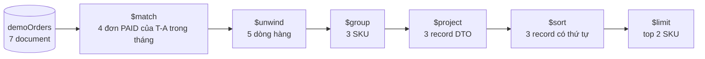

# Kiểm tra từng stage bằng dữ liệu nhỏ và pipeline thực tế

**Aggregation pipeline** là một chuỗi phép biến đổi dữ liệu được MongoDB Server thực hiện lần lượt: lọc document, trải mảng thành nhiều dòng, nhóm dữ liệu, tính tổng, chọn trường và sắp xếp. Trong **Spring Data MongoDB**, ta có thể dựng pipeline bằng `Aggregation` và chạy qua `MongoTemplate` hoặc khai báo các pipeline cố định trong repository. Pipeline chạy được không đồng nghĩa với **kết quả đúng**: đặt một stage sai vị trí, quên lọc tenant, làm rơi document có mảng rỗng hoặc nhóm nhầm khóa đều có thể tạo báo cáo sai mà không có exception.

Bài này trình bày một cách làm có thể lặp lại: **chuẩn bị tập dữ liệu nhỏ với kết quả tính tay được → kiểm tra từng stage độc lập → ghép pipeline hoàn chỉnh → chuyển sang Spring Data → kiểm thử với MongoDB thực → đo hiệu năng trên dữ liệu đại diện**. Ví dụ xuyên suốt là báo cáo **số lượng sản phẩm đã bán theo SKU** từ đơn hàng có nhiều dòng sản phẩm, theo tenant và khoảng thời gian.

Đây là chủ đề trong chương **Aggregation cơ bản** của module `SPRING_DATA_MONGODB`. Dịch vụ học cách kết nối MongoDB, ánh xạ document, thao tác qua `MongoTemplate`/repository, thiết kế truy vấn, index, transaction, reactive access, kiểm thử và chẩn đoán hiệu năng dữ liệu. Với nội dung này, mục tiêu chính là **đúng đắn và kiểm chứng được ở từng stage**, không phải đưa tất cả các toán tử MongoDB vào một pipeline dài.

Sau bài học, bạn có thể:

- Đọc pipeline từ trái sang phải và xác định **đầu vào, đầu ra, số document và schema** sau mỗi stage.
- Tự tính kết quả kỳ vọng cho `$match`, `$unwind`, `$group`, `$project`, `$sort` và `$limit` trên dữ liệu nhỏ.
- Dùng `mongosh` chạy từng prefix của pipeline, tạo checkpoint và xác định stage đầu tiên làm sai kết quả.
- Xây pipeline tương đương với `MongoTemplate.aggregate(...)` và ánh xạ kết quả sang DTO/record.
- Kiểm thử cả **đường đúng lẫn trường hợp biên**: tenant khác, đơn không đạt trạng thái, mảng rỗng, trùng SKU, hòa điểm, thời điểm sát ranh giới và kiểu dữ liệu số.
- Dùng `explain`, index và dữ liệu đại diện để đánh giá pipeline thực tế sau khi xác minh logic.

## 1. Tư duy pipeline: mỗi stage thay đổi một tập document

Một aggregation pipeline là **mảng các stage có thứ tự**, ví dụ:

```javascript
db.demoOrders.aggregate([
  { $match: { status: "PAID" } },
  { $unwind: "$lines" },
  { $group: { _id: "$lines.sku", units: { $sum: "$lines.quantity" } } },
  { $sort: { units: -1, _id: 1 } },
  { $limit: 10 }
]);
```

MongoDB Server nhận document từ collection, xử lý qua từng stage và đưa kết quả từ stage trước sang stage sau:



Không chỉ **giá trị** thay đổi; **hình dạng** và **số lượng** document cũng có thể thay đổi:

| Stage | Mục đích | Ảnh hưởng thường gặp |
| --- | --- | --- |
| `$match` | Lọc những document thỏa điều kiện | Giảm số document; giữ cấu trúc document còn lại |
| `$unwind` | Trải từng phần tử array thành một document | Có thể tăng số dòng, hoặc làm rơi mảng rỗng/null |
| `$group` | Gom theo một khóa và dùng accumulator | Thường giảm số dòng; tạo field `_id` là khóa nhóm |
| `$project` | Chọn, đổi tên hoặc tính field | Đổi schema; có thể mất field các stage sau cần |
| `$sort` | Sắp xếp theo một hay nhiều khóa | Không tự thay số dòng; có thể tốn bộ nhớ |
| `$limit` | Chỉ lấy N document đầu tại vị trí đó | Giảm số dòng; đặt sớm có thể **thay nghĩa báo cáo** |

**Nguyên tắc kiểm tra:** sau mỗi stage phải trả lời được ba câu hỏi: **còn bao nhiêu dòng? mỗi dòng chứa những field gì? từng giá trị có hợp lý không?** Chỉ xem kết quả cuối dễ khiến lỗi ở stage đầu bị che bởi các phép biến đổi sau.

### 1.1. `find` khác `aggregate`

`find` phù hợp lọc document, chọn field và sắp xếp đơn giản. `aggregate` dùng khi cần **biến đổi** dữ liệu như trải mảng, nhóm, tính tổng, nối collection hoặc dựng báo cáo. Cả hai đều chạy tại MongoDB Server; không nên tải toàn bộ đơn hàng về Java rồi dùng `stream().groupingBy(...)` nếu có thể tính gọn trên server.

Ví dụ “lấy đơn hàng đã trả tiền” chỉ cần `find`; “đếm tổng quantity của từng SKU từ mọi dòng hàng trong đơn PAID” cần xử lý cả array và group, nên aggregation là lựa chọn tự nhiên.

## 2. Đề bài thực tế: doanh số theo SKU trong một tháng

Một đơn hàng lưu các field:

- `_id`: mã đơn duy nhất (BSON String).
- `tenantId`: đơn vị kinh doanh/scope dữ liệu.
- `status`: `PAID`, `PENDING` hoặc trạng thái khác.
- `createdAt`: thời điểm tạo đơn (BSON Date).
- `lines`: mảng các dòng hàng, mỗi dòng có `sku`, `quantity` và `lineTotalVnd`.

Giả sử báo cáo cần **top 2 SKU theo tổng số đơn vị đã bán**, chỉ từ đơn `PAID` của tenant `T-A` trong khoảng:

```text
2026-10-01T00:00:00Z <= createdAt < 2026-11-01T00:00:00Z
```

Khi số lượng bằng nhau, ưu tiên SKU có tổng tiền lớn hơn; nếu vẫn bằng nhau, sắp xếp SKU tăng dần để có thứ tự ổn định.

**Quy ước để minh họa:** `lineTotalVnd` là tổng tiền đã ghi nhận cho **dòng hàng** theo nghiệp vụ mẫu, không phải đơn giá; `quantity` luôn là số nguyên dương. Báo cáo này **không tự xử lý hoàn tiền, đổi trả hoặc phân bổ giảm giá**. Nếu ứng dụng thực có các loại sự kiện đó, phải xác định công thức doanh thu trước khi viết `$sum`.

### 2.1. Dữ liệu nhỏ: bảy đơn có chủ ý gài trường hợp biên

Tất cả lệnh dưới đây chỉ chạy trên **database test riêng**, không chạy trên collection thật. Nếu muốn lặp lại, hãy sử dụng test database mới hoặc dọn fixture an toàn trước khi insert.

```javascript
db.demoOrders.insertMany([
  {
    _id: "O-100", tenantId: "T-A", status: "PAID",
    createdAt: ISODate("2026-10-02T08:00:00Z"),
    lines: [
      { sku: "A", quantity: 2, lineTotalVnd: NumberLong("200000") },
      { sku: "B", quantity: 1, lineTotalVnd: NumberLong("50000") }
    ]
  },
  {
    _id: "O-101", tenantId: "T-A", status: "PAID",
    createdAt: ISODate("2026-10-15T09:00:00Z"),
    lines: [
      { sku: "A", quantity: 1, lineTotalVnd: NumberLong("100000") },
      { sku: "C", quantity: 3, lineTotalVnd: NumberLong("75000") }
    ]
  },
  {
    _id: "O-102", tenantId: "T-A", status: "PENDING",
    createdAt: ISODate("2026-10-20T10:00:00Z"),
    lines: [
      { sku: "A", quantity: 5, lineTotalVnd: NumberLong("500000") }
    ]
  },
  {
    _id: "O-103", tenantId: "T-A", status: "PAID",
    createdAt: ISODate("2026-10-25T11:00:00Z"),
    lines: []
  },
  {
    _id: "O-104", tenantId: "T-A", status: "PAID",
    createdAt: ISODate("2026-10-30T12:00:00Z"),
    lines: [
      { sku: "B", quantity: 1, lineTotalVnd: NumberLong("50000") }
    ]
  },
  {
    _id: "O-105", tenantId: "T-B", status: "PAID",
    createdAt: ISODate("2026-10-10T13:00:00Z"),
    lines: [
      { sku: "A", quantity: 10, lineTotalVnd: NumberLong("1000000") }
    ]
  },
  {
    _id: "O-106", tenantId: "T-A", status: "PAID",
    createdAt: ISODate("2026-11-01T00:00:00Z"),
    lines: [
      { sku: "C", quantity: 10, lineTotalVnd: NumberLong("250000") }
    ]
  }
]);
```

Mục đích của những bản ghi đặc biệt:

| ID | Tình huống kiểm tra | Kỳ vọng |
| --- | --- | --- |
| `O-100`, `O-101`, `O-104` | Đơn PAID có nhiều hoặc một dòng; SKU lặp lại ở nhiều đơn | Được tính vào báo cáo |
| `O-102` | Đúng tenant/tháng nhưng `PENDING` | Bị loại ở `$match` |
| `O-103` | `PAID` nhưng `lines: []` | Qua `$match` rồi không tạo dòng ở `$unwind` mặc định |
| `O-105` | `PAID` trong tháng nhưng thuộc `T-B` | Bị loại để không lộ dữ liệu tenant |
| `O-106` | Đúng tenant/status nhưng đúng thời điểm `toExclusive` | Bị loại vì dùng `$lt` thay `$lte` |

**Không chỉ tạo dữ liệu “đẹp”.** Nếu mọi đơn có một dòng và một SKU riêng, lỗi `$unwind` hoặc `$group` có thể vẫn cho kết quả trông hợp lý. Dữ liệu test nhỏ nên có **trùng khóa nhóm, array rỗng, dòng bị loại, hòa điểm và ranh giới thời gian**.

### 2.2. Tính kết quả kỳ vọng bằng tay

Chỉ tính các đơn `O-100`, `O-101`, `O-103` và `O-104` sau `$match`; trong đó `O-103` có mảng rỗng.

| SKU | Các quantity hợp lệ | Tổng `units` | Các `lineTotalVnd` | `grossVnd` |
| --- | --- | ---: | --- | ---: |
| A | 2 + 1 | 3 | 200.000 + 100.000 | 300.000 |
| B | 1 + 1 | 2 | 50.000 + 50.000 | 100.000 |
| C | 3 | 3 | 75.000 | 75.000 |

Sau sort theo `units DESC, grossVnd DESC, sku ASC`, thứ tự đúng là:

1. **A** — 3 đơn vị, 300.000 VND.
2. **C** — 3 đơn vị, 75.000 VND.
3. **B** — 2 đơn vị, 100.000 VND.

Top 2 phải là **A và C**, không phải A và B. Đây là test tốt để phát hiện việc sort nhầm theo doanh thu trước số lượng.

## 3. Stage `$match`: lọc đúng dữ liệu trước khi cộng

Điều kiện bắt buộc gồm tenant, trạng thái và khoảng thời gian **nửa mở**:

```javascript
const fromInclusive = ISODate("2026-10-01T00:00:00Z");
const toExclusive = ISODate("2026-11-01T00:00:00Z");

const matchStage = {
  $match: {
    tenantId: "T-A",
    status: "PAID",
    createdAt: { $gte: fromInclusive, $lt: toExclusive }
  }
};

db.demoOrders.aggregate([matchStage]).toArray();
```

Kết quả phải chứa **bốn document**: `O-100`, `O-101`, `O-103`, `O-104`. Nếu chứa `O-102`, điều kiện status sai; nếu chứa `O-105`, điều kiện tenant thiếu; nếu chứa `O-106`, ranh giới thời gian đã viết sai.

Để kiểm tra số lượng mà không in mọi field:

```javascript
db.demoOrders.aggregate([
  matchStage,
  { $count: "ordersAfterMatch" }
]).toArray();

// [{ ordersAfterMatch: 4 }]
```

`$count` trong đoạn này là **stage chẩn đoán tạm thời**, không phải stage trong pipeline báo cáo cuối. Nó cho phép hỏi “sau `$match` còn bao nhiêu document?” mà không phải chuyển hàng nghìn document về ứng dụng.

### 3.1. Vì sao đặt `$match` sớm?

Nếu filter giảm bảy đơn xuống bốn đơn, `$unwind` và `$group` chỉ phải xử lý bốn đơn hợp lệ. Trên dữ liệu lớn, đặt bộ lọc có thể tận dụng index sớm giúp giảm I/O, bộ nhớ và CPU.

Tuy nhiên, không phải `$match` nào cũng có thể đẩy lên đầu. Một filter theo `units` là giá trị **được tạo sau `$group`** thì phải đặt sau `$group`; đẩy nó lên trước sẽ không có field để lọc. Trình tối ưu MongoDB có thể tự sắp xếp lại một số stage khi giữ nguyên ý nghĩa, nhưng thiết kế logic rõ ràng vẫn cần thiết.

### 3.2. Thời gian và múi giờ

BSON Date lưu thời điểm. Vì vậy khoảng `[2026-10-01T00:00:00Z, 2026-11-01T00:00:00Z)` là **tháng 10 theo UTC**, không tự động là “tháng 10 theo giờ Việt Nam”. Nếu báo cáo nghiệp vụ lấy theo `Asia/Ho_Chi_Minh`, service phải đổi mốc đầu/cuối tháng địa phương thành `Instant` tương ứng trước khi xây `$match`.

Việc dùng `$lt(toExclusive)` tránh cộng trùng document ở ranh giới khi hai khoảng liên tiếp được tổng hợp. Không tự đổi sang `$lte(endOfDay)` rồi phải đoán chính xác millisecond/nanosecond cuối ngày.

## 4. Stage `$unwind`: chuyển đơn hàng thành dòng hàng

Các đơn hợp lệ có field `lines` là array. Để nhóm theo từng SKU nằm trong mảng, cần trải array:

```javascript
const unwindStage = { $unwind: "$lines" };

db.demoOrders.aggregate([
  matchStage,
  unwindStage,
  { $project: {
      _id: 1,
      "lines.sku": 1,
      "lines.quantity": 1,
      "lines.lineTotalVnd": 1
  } }
]).toArray();
```

Expected output (rút gọn, chưa cần dựa vào thứ tự khi chưa sort):

| `_id` | `lines.sku` | `quantity` | `lineTotalVnd` |
| --- | --- | ---: | ---: |
| O-100 | A | 2 | 200.000 |
| O-100 | B | 1 | 50.000 |
| O-101 | A | 1 | 100.000 |
| O-101 | C | 3 | 75.000 |
| O-104 | B | 1 | 50.000 |

**Có năm document sau unwind**, dù chỉ bốn đơn được chọn ở `$match`. Đơn `O-103` có `lines: []` nên **không tạo output** với `$unwind` mặc định.

```javascript
db.demoOrders.aggregate([
  matchStage,
  unwindStage,
  { $count: "linesAfterUnwind" }
]).toArray();

// [{ linesAfterUnwind: 5 }]
```

Nếu đếm ra bốn vì nhầm “mỗi đơn là một dòng” hoặc sáu vì tính thêm một dòng từ mảng rỗng, nên dừng ngay và sửa cách hiểu `$unwind` trước khi viết `$group`.

### 4.1. `preserveNullAndEmptyArrays` có thể thay nghĩa báo cáo

Để giữ document không có phần tử trong array, MongoDB hỗ trợ:

```javascript
{
  $unwind: {
    path: "$lines",
    preserveNullAndEmptyArrays: true
  }
}
```

Tùy trạng thái field `lines` (rỗng, null, thiếu), các document này có thể được giữ lại **không có một dòng hàng hợp lệ**. Nếu sau đó nhóm theo `lines.sku`, có thể xuất hiện nhóm `_id: null` hoặc số dòng “ảo”.

Với báo cáo **sản phẩm đã bán**, muốn bỏ đơn không có dòng hàng nên dùng unwind mặc định. Với báo cáo **đơn hàng kể cả đơn không có dòng**, có thể cần preserve và tính toán riêng. **Không bật tùy chọn chỉ để làm số lượng sau unwind trông giống số đơn ban đầu.**

### 4.2. Sai lầm khi group trước unwind

Nếu `$group` theo `"$lines.sku"` **trước** khi unwind, input vẫn chứa một **mảng SKU** hoặc đường dẫn qua array. Khóa nhóm không còn là từng SKU đơn lẻ và `$sum("$lines.quantity")` cũng không được diễn giải như tổng từng dòng hàng mong muốn. Muốn báo cáo từng SKU, hãy xác nhận dữ liệu đã về **một dòng cho một phần tử** trước khi group.

## 5. Stage `$group`: xác định khóa nhóm và accumulator

Sau `$unwind`, mỗi output tương ứng một dòng hàng. Ta nhóm theo SKU và cộng hai đại lượng:

```javascript
const groupStage = {
  $group: {
    _id: "$lines.sku",
    units: { $sum: "$lines.quantity" },
    grossVnd: { $sum: "$lines.lineTotalVnd" }
  }
};

db.demoOrders.aggregate([
  matchStage,
  unwindStage,
  groupStage
]).toArray();
```

Kỳ vọng **ba document nhóm**, không cần quan tâm thứ tự:

```javascript
[
  { _id: "A", units: 3, grossVnd: NumberLong("300000") },
  { _id: "B", units: 2, grossVnd: NumberLong("100000") },
  { _id: "C", units: 3, grossVnd: NumberLong("75000") }
]
```

MongoDB có thể hiển thị kiểu số dưới dạng NumberInt, NumberLong hoặc Extended JSON tùy dữ liệu và môi trường; **giá trị** cần kiểm tra là 3/300.000, 2/100.000 và 3/75.000. Thứ tự phần tử của kết quả `$group` **không được bảo đảm** nếu chưa có `$sort`.

### 5.1. `_id` sau group là **khóa nhóm**, không phải ID đơn hàng

Trước `$group`, `_id` là mã đơn như `"O-100"`. Sau `$group`, `_id` là SKU như `"A"`. Đây là sự **thay đổi schema quan trọng**:

| Trước group | Sau group |
| --- | --- |
| `_id = "O-100"` | `_id = "A"` |
| `tenantId = "T-A"` | Không còn là field riêng nếu không đưa vào accumulator/key |
| `lines.sku = "A"` | SKU nằm trong `_id` |
| `lines.quantity = 2` | `units = 3` (cộng từ nhiều đơn) |
| `lines.lineTotalVnd = 200000` | `grossVnd = 300000` |

Vì vậy nếu stage sau viết `$sort: { "lines.sku": 1 }` thì không còn field đó. Phải sắp xếp theo `_id` hoặc dùng `$project` để đổi tên khóa nhóm thành `sku`.

### 5.2. `$sum` không tự sửa dữ liệu sai kiểu

`$sum` cộng các giá trị số. Nếu có một dòng `quantity` lưu dạng BSON String `"2"`, không nên kỳ vọng nó được tính như số 2; với accumulator, các giá trị không phải số có thể bị bỏ qua. Kết quả **vẫn có thể được trả về nhưng sai số liệu**.

Với tiền tệ, ví dụ dùng **VND nguyên** lưu dưới dạng BSON số nguyên 64-bit để tránh làm tròn kiểu double. Nếu domain dùng số thập phân, cân nhắc BSON Decimal128 và mapping `BigDecimal` phù hợp. Trên tập dữ liệu lớn, kiểm tra giới hạn/kiểu kết quả số để tránh giả định mọi tổng luôn vừa trong Java `int`.

### 5.3. `$sum: 1` không giống `$sum: "$lines.quantity"`

Hai biểu thức phục vụ các mục tiêu khác nhau:

```javascript
{
  $group: {
    _id: "$lines.sku",
    numberOfLines: { $sum: 1 },
    units: { $sum: "$lines.quantity" }
  }
}
```

Với SKU A, có **2 dòng hàng** (ở O-100 và O-101) nhưng **3 đơn vị**. Nếu dùng `$sum: 1` cho `units`, kết quả là 2 và báo cáo sẽ sai dù không có lỗi runtime. Một integration test có quantity lớn hơn 1 sẽ phát hiện lỗi này.

### 5.4. Đếm đơn duy nhất theo SKU là một bài toán khác

Một đơn có thể chứa cùng SKU ở nhiều dòng. `$sum: 1` sau unwind đếm **số dòng**, không đảm bảo là **số đơn duy nhất**. Nếu báo cáo hỏi “có bao nhiêu đơn chứa SKU A?”, cần gom theo cặp `(sku, orderId)` hoặc dùng một chiến lược deduplicate phù hợp rồi mới đếm.

Mục tiêu bài này là **số đơn vị bán**, nên trực tiếp `$sum("$lines.quantity")` là đúng.

## 6. Stage `$project`: định hình DTO và tránh nhầm khóa

Sau group, khóa SKU nằm trong `_id`. Ta muốn trả API có cấu trúc:

```json
{
  "sku": "A",
  "units": 3,
  "grossVnd": 300000
}
```

Thêm `$project`:

```javascript
const projectStage = {
  $project: {
    _id: 0,
    sku: "$_id",
    units: 1,
    grossVnd: 1
  }
};

db.demoOrders.aggregate([
  matchStage,
  unwindStage,
  groupStage,
  projectStage
]).toArray();
```

Số document vẫn là **ba**. Schema mới chỉ gồm `sku`, `units` và `grossVnd`; `_id` đã bị loại vì DTO không cần nó.

### 6.1. Kiểm tra field sau projection

Một số lỗi phổ biến:

```javascript
// SAI: group đã biến SKU thành _id, không còn "lines.sku".
{ $project: { _id: 0, sku: "$lines.sku", units: 1 } }

// SAI: quên grossVnd, nhưng stage sau lại sort theo grossVnd.
{ $project: { _id: 0, sku: "$_id", units: 1 } }
```

Nếu đã xóa field ở `$project`, stage sau **không tự đọc lại field từ document gốc**. Vì vậy pipeline stage-by-stage nên có một bảng theo dõi schema: trước group có `lines.sku`, sau group có `_id`, sau project có `sku`.

### 6.2. Projection không phải nơi sửa quy tắc tính tiền

Nếu cần tính `grossVnd` từ `quantity × unitPriceVnd`, có thể dùng `$multiply` trong một stage thích hợp. Nhưng ví dụ hiện tại lưu sẵn `lineTotalVnd`, nên cộng trường đó phản ánh đúng quy tắc minh họa.

Không tự cộng `order.totalVnd` sau unwind nếu mỗi đơn có nhiều dòng: một tổng tiền **cấp đơn hàng** có thể bị lặp lại trên mỗi dòng, dẫn tới nhân đôi hoặc nhân nhiều lần doanh thu. Hãy xác định **đại lượng đang ở cấp đơn hay cấp dòng** trước khi chọn stage và accumulator.

## 7. Stage `$sort` và `$limit`: chọn top 2 đúng thứ tự

Yêu cầu: ưu tiên nhiều đơn vị bán hơn; khi hòa, tổng tiền cao hơn; khi tiếp tục hòa, SKU tăng dần.

```javascript
const sortStage = {
  $sort: { units: -1, grossVnd: -1, sku: 1 }
};

const limitStage = { $limit: 2 };

db.demoOrders.aggregate([
  matchStage,
  unwindStage,
  groupStage,
  projectStage,
  sortStage
]).toArray();
```

Output sau sort là **ba dòng**, theo thứ tự:

```javascript
[
  { sku: "A", units: 3, grossVnd: NumberLong("300000") },
  { sku: "C", units: 3, grossVnd: NumberLong("75000") },
  { sku: "B", units: 2, grossVnd: NumberLong("100000") }
]
```

Đơn vị bán quyết định thứ tự ưu tiên, nên **C đứng trước B dù grossVnd của B lớn hơn C**. Cuối cùng thêm limit:

```javascript
db.demoOrders.aggregate([
  matchStage,
  unwindStage,
  groupStage,
  projectStage,
  sortStage,
  limitStage
]).toArray();

// Top 2: A (3, 300000), C (3, 75000).
```

### 7.1. Vì sao không đẩy `$limit` lên trước `$group`?

Nếu viết:

```javascript
[
  matchStage,
  { $limit: 2 }, // SAI khi mục tiêu là top SKU toàn bộ tháng!
  unwindStage,
  groupStage
]
```

pipeline chỉ tính từ **hai đơn đầu tiên được chọn trước khi group**, không phải toàn bộ đơn hợp lệ trong tháng. Kết quả có thể phụ thuộc thứ tự lấy document và bỏ qua một phần dữ liệu. **`$limit` ở đâu thì giới hạn dữ liệu ở đó**. MongoDB có tối ưu `$sort + $limit` trong các điều kiện phù hợp, nhưng không được tự thay đổi **ngữ nghĩa** bằng cách chuyển limit qua group.

### 7.2. Sort có cần khóa phụ?

Có. Nếu hai SKU cùng `units` và `grossVnd`, thiếu `sku` trong sort sẽ không xác định thứ tự giữa chúng. Với API top-N, phân trang hoặc snapshot so sánh kết quả, một tie-breaker rõ giúp test ổn định. Trong ví dụ, `sku` là khóa nhóm duy nhất nên phù hợp để phá hòa.

### 7.3. Khi muốn phân trang

Có thể dùng `$skip` và `$limit` sau sort, nhưng offset lớn tốn chi phí và kết quả có thể đổi khi dữ liệu cập nhật giữa các request. Với báo cáo tổng hợp thường xuyên, cân nhắc lưu một snapshot kết quả, đặt cutoff hoặc xây cơ chế cursor trên khóa sort của **kết quả đã group**. Không nhầm keyset trên đơn hàng gốc với keyset trên bảng tổng hợp SKU.

## 8. Kiểm tra từng prefix pipeline bằng một script `mongosh`

Thay vì liên tục sao chép sáu pipeline, ta có thể lưu các stage vào mảng trong **phiên mongosh test**:

```javascript
const pipeline = [
  matchStage,
  unwindStage,
  groupStage,
  projectStage,
  sortStage,
  limitStage
];

const names = [
  "$match", "$unwind", "$group", "$project", "$sort", "$limit"
];

for (let i = 1; i <= pipeline.length; i++) {
  const prefix = pipeline.slice(0, i);
  const rows = db.demoOrders.aggregate(prefix).toArray();

  print("--- Sau " + names[i - 1] + " ---");
  print("Số document: " + rows.length);
  printjson(rows);
}
```

Đoạn script này giả định đã chạy các khai báo `matchStage`, `unwindStage`, `groupStage`, `projectStage`, `sortStage` và `limitStage` trong **cùng một phiên mongosh** như các mục trước. Chỉ chạy `toArray()` cho **fixture nhỏ**, không làm tương tự cho pipeline trả hàng triệu document trong production.

### 8.1. Bảng kiểm tra số lượng và schema

| Điểm dừng | Số document kỳ vọng | Field quan trọng | Câu hỏi cần kiểm tra |
| --- | ---: | --- | --- |
| Collection gốc | 7 | `_id, tenantId, status, createdAt, lines` | Đã seed đúng fixture chưa? |
| Sau `$match` | 4 | Như document đơn gốc | Đúng tenant/status/tháng? |
| Sau `$unwind` | 5 | `lines` là một object, có `sku/quantity/lineTotalVnd` | Mảng rỗng đã được xử lý theo quy tắc? |
| Sau `$group` | 3 | `_id, units, grossVnd` | Tính đúng A/B/C chưa? |
| Sau `$project` | 3 | `sku, units, grossVnd` | Đã đổi `_id` thành `sku`? |
| Sau `$sort` | 3 | Ba field trên, đã có thứ tự | A, C, B hay thứ tự khác? |
| Sau `$limit` | 2 | `sku, units, grossVnd` | Đúng A, C không? |

Nếu bước 4 đúng mà bước 5 sai, nguyên nhân nằm ở `$project`, không cần sửa lại `$group`. Nếu bước 2 sai, hãy sửa `$match`/fixture trước khi xem accumulation.

### 8.2. Chẩn đoán bằng `$count` thay vì tải cả prefix

Với pipeline có nhiều kết quả, ghép `$count` ngay sau stage muốn xem:

```javascript
function countAfter(prefix) {
  return db.demoOrders.aggregate([
    ...prefix,
    { $count: "n" }
  ]).toArray();
}

printjson(countAfter([matchStage]));              // [{ n: 4 }]
printjson(countAfter([matchStage, unwindStage])); // [{ n: 5 }]
printjson(countAfter([
  matchStage, unwindStage, groupStage
]));                                              // [{ n: 3 }]
```

**Trường hợp đặc biệt:** nếu không có document nào vào `$count`, stage này có thể **không trả document**, chứ không trả `{n:0}`. Test cần xử lý mảng rỗng. Khi chạy diagnostic count, phải hiểu đó là **pipeline đã được bổ sung một stage khác**, không phải kết quả cuối của pipeline báo cáo.

### 8.3. Kiểm tra giá trị trung gian khi có quá nhiều dòng

Thêm `$project` chẩn đoán ngay sau `$unwind` để chỉ xem `orderId`, `sku`, `quantity` và `lineTotalVnd`. Dùng `$sort` theo `_id`/`sku` nếu muốn output ổn định khi so sánh. Với dữ liệu lớn, giới hạn số dòng **sau stage đang kiểm tra** để chỉ lấy mẫu, nhưng không dùng kết quả có `$limit` chẩn đoán như một bằng chứng rằng tổng nhóm đã được tính đầy đủ.

**Quy tắc thử nghiệm:** mỗi lần chỉ thay một giả định hoặc một stage; giữ fixture và expected output không đổi. Nếu vừa sửa filter, vừa đổi group key, vừa đổi sort, khi kết quả thay đổi sẽ khó biết vì sao.

## 9. Viết lại pipeline bằng Spring Data MongoDB

Sau khi xác nhận từng stage trong `mongosh`, hãy chuyển ý định đó sang Spring Data. `MongoTemplate` có API `Aggregation`, `Criteria`, `Sort` để dựng pipeline bằng Java; Spring Data mapping tên thuộc tính/giá trị sang BSON theo entity metadata khi sử dụng input type phù hợp.

### 9.1. Entity nguồn và DTO kết quả

Ví dụ dùng Java 17+:

```java
import java.time.Instant;
import java.util.List;
import org.springframework.data.mongodb.core.mapping.Document;
import org.springframework.data.mongodb.core.mapping.MongoId;

// Một dòng sản phẩm trong đơn hàng.
record DemoOrderLine(
        String sku,
        int quantity,
        long lineTotalVnd
) {}

@Document(collection = "demoOrders")
public record DemoOrder(
        @MongoId String id,
        String tenantId,
        String status,
        Instant createdAt,
        List<DemoOrderLine> lines
) {}
```

Output aggregation được ánh xạ vào DTO, **không phải entity `DemoOrder`**:

```java
// Một dòng báo cáo tổng hợp, không tương ứng với document đơn hàng.
public record SkuSalesRow(
        String sku,
        long units,
        long grossVnd
) {}
```

`DemoOrder.id` là `_id` BSON String, `createdAt` là BSON Date tương ứng `Instant`, `lines` là array embedded document. Tổng tiền được lưu bằng `long` vì ví dụ dùng VND nguyên. Dữ liệu báo cáo sau `$group`/`$project` không có các field như `tenantId`, `status` hay `createdAt`, nên **không ánh xạ kết quả vào DemoOrder để rồi gọi `save`**.

### 9.2. Service xây pipeline có thể kiểm thử

```java
import java.time.Instant;
import java.util.List;
import org.springframework.data.domain.Sort;
import org.springframework.data.mongodb.core.MongoTemplate;
import org.springframework.data.mongodb.core.aggregation.Aggregation;
import org.springframework.data.mongodb.core.aggregation.AggregationResults;
import org.springframework.data.mongodb.core.query.Criteria;
import org.springframework.stereotype.Service;

@Service
public class SkuSalesReportService {

    private final MongoTemplate template;

    public SkuSalesReportService(MongoTemplate template) {
        this.template = template;
    }

    public List<SkuSalesRow> topSkus(
            String authorizedTenantId,
            Instant fromInclusive,
            Instant toExclusive,
            long topN
    ) {
        if (authorizedTenantId == null || authorizedTenantId.isBlank()
                || fromInclusive == null || toExclusive == null
                || !fromInclusive.isBefore(toExclusive)
                || topN < 1 || topN > 100) {
            throw new IllegalArgumentException(
                    "Tenant, khoảng thời gian hoặc topN không hợp lệ");
        }

        Criteria filter = Criteria.where("tenantId")
                .is(authorizedTenantId)
                .and("status").is("PAID")
                .and("createdAt").gte(fromInclusive).lt(toExclusive);

        Aggregation pipeline = Aggregation.newAggregation(
                Aggregation.match(filter),
                Aggregation.unwind("lines"),
                Aggregation.group("lines.sku")
                        .sum("lines.quantity").as("units")
                        .sum("lines.lineTotalVnd").as("grossVnd"),
                Aggregation.project("units", "grossVnd")
                        .and("_id").as("sku")
                        .andExclude("_id"),
                Aggregation.sort(Sort.by(
                        Sort.Order.desc("units"),
                        Sort.Order.desc("grossVnd"),
                        Sort.Order.asc("sku"))),
                Aggregation.limit(topN)
        );

        AggregationResults<SkuSalesRow> result =
                template.aggregate(
                        pipeline,
                        DemoOrder.class,
                        SkuSalesRow.class);

        return result.getMappedResults();
    }
}
```

Sử dụng:

```java
List<SkuSalesRow> top2 = reportService.topSkus(
        "T-A",
        Instant.parse("2026-10-01T00:00:00Z"),
        Instant.parse("2026-11-01T00:00:00Z"),
        2
);

// top2[0] = ("A", 3, 300000)
// top2[1] = ("C", 3, 75000)
```

Ở đây `reportService` là `SkuSalesReportService` được inject trong một controller/service/test; đoạn gọi cần import `Instant`, `List`. Với pipeline này, dùng input type `DemoOrder.class` giúp Spring Data hiểu ánh xạ thuộc tính domain. Nếu đổi tên field vật lý bằng `@Field`, nên kiểm tra pipeline BSON thực và test mapping DTO tương ứng.

### 9.3. Đối chiếu từng stage Java với `mongosh`

| `mongosh` | Spring Data | Điều cần so |
| --- | --- | --- |
| `{ $match: ... }` | `Aggregation.match(Criteria...)` | tenant, status và khoảng thời gian |
| `{ $unwind: "$lines" }` | `Aggregation.unwind("lines")` | 5 dòng hàng, bỏ empty array |
| `{ $group: { _id: "$lines.sku", ... } }` | `Aggregation.group("lines.sku").sum(...)` | A/B/C, hai tổng |
| `{ $project: { sku: "$_id", ... } }` | `Aggregation.project(...).and("_id").as("sku")` | DTO field `sku` |
| `{ $sort: ... }` | `Aggregation.sort(Sort.by(...))` | ưu tiên units, gross, sku |
| `{ $limit: 2 }` | `Aggregation.limit(2)` | chỉ A và C |

**Chú ý tên field:** `id` là thuộc tính Java nhưng lưu trong BSON dưới tên `_id`. Sau `$group`, khóa nhóm lại ở `_id`, dù đó **không phải mã order**. Nếu đặt một `@Field` cho `lines.lineTotalVnd`, hoặc dùng custom converter, cần xác minh pipeline sinh ra đúng đường dẫn BSON.

### 9.4. Vì sao `MongoTemplate` phù hợp với pipeline này?

Repository có thể khai báo `@Aggregation` khi pipeline cố định. Nhưng khi có **tenant/time window động, topN, nhiều stage và nhu cầu debug từng stage**, xây bằng `MongoTemplate`/`Aggregation` thường dễ tổ chức thành method và kiểm thử riêng.

Chọn API không làm MongoDB Server tự chạy nhanh hơn. `@Aggregation` và `MongoTemplate.aggregate` đều phải được đánh giá qua **pipeline BSON cuối**, index và kết quả thật.

## 10. Dùng stage “quan sát” trong Spring Data khi đang phát triển

Trong quá trình debug, không nhất thiết lần nào cũng chạy trọn pipeline. Có thể **cắt ở stage cần kiểm tra** rồi trả về `Document` hoặc một DTO chẩn đoán.

Ví dụ chỉ muốn biết số đơn sau match và số dòng sau unwind. Có thể chạy hai aggregation **độc lập**:

```java
import java.time.Instant;
import java.util.List;
import org.bson.Document;
import org.springframework.data.mongodb.core.MongoTemplate;
import org.springframework.data.mongodb.core.aggregation.Aggregation;
import org.springframework.data.mongodb.core.query.Criteria;

Criteria filter = Criteria.where("tenantId").is("T-A")
        .and("status").is("PAID")
        .and("createdAt")
        .gte(Instant.parse("2026-10-01T00:00:00Z"))
        .lt(Instant.parse("2026-11-01T00:00:00Z"));

Aggregation countOrders = Aggregation.newAggregation(
        Aggregation.match(filter),
        Aggregation.count().as("n"));

Aggregation countLines = Aggregation.newAggregation(
        Aggregation.match(filter),
        Aggregation.unwind("lines"),
        Aggregation.count().as("n"));

List<Document> orders = template.aggregate(
        countOrders, DemoOrder.class, Document.class)
        .getMappedResults();
List<Document> lines = template.aggregate(
        countLines, DemoOrder.class, Document.class)
        .getMappedResults();

// Với fixture: orders[0].get("n") == 4;
//              lines[0].get("n") == 5.
```

Đây là đoạn code trong service/test có `template` được inject. Nếu kết quả đầu vào của `$count` rỗng, `getMappedResults()` có thể là danh sách rỗng; không được gọi `get(0)` khi chưa kiểm tra. Trong test, nên chuyển `Document.get("n")` sang `Number.longValue()` thay vì mặc định kiểu int/long BSON cố định.

### 10.1. Debug group mà chưa project

```java
Aggregation grouped = Aggregation.newAggregation(
        Aggregation.match(filter),
        Aggregation.unwind("lines"),
        Aggregation.group("lines.sku")
                .sum("lines.quantity").as("units")
                .sum("lines.lineTotalVnd").as("grossVnd")
);

List<Document> rawGroups = template.aggregate(
        grouped, DemoOrder.class, Document.class)
        .getMappedResults();
```

Mỗi `Document` phải chứa `_id` là SKU cùng `units` và `grossVnd`. Đừng đối chiếu thứ tự danh sách `rawGroups` trước khi thêm sort: group **không cam kết output order**. Có thể chuyển chúng thành map theo `_id` để assert độc lập thứ tự.

### 10.2. Xem command thực thay vì tin mọi đoạn DSL được dịch đúng

Khi dùng tên property Java, `@Field`, constructor DTO hoặc stage tùy chỉnh, đừng chỉ nhìn object `Aggregation` trong debugger. Có thể dùng **MongoDB Driver command monitoring** trong môi trường test hoặc MongoDB profiler (khi được cấp quyền) để xem `aggregate` command và pipeline thực gửi.

Log query có thể chứa tenant ID, dữ liệu tìm kiếm hoặc thông tin nhạy cảm. Cần che giấu dữ liệu phù hợp và chỉ bật logging chi tiết trong môi trường được phép. Không coi câu `pipeline.toString()` là bằng chứng đầy đủ về BSON thực đã được driver/server xử lý.

## 11. Kiểm thử tích hợp end-to-end

Unit test của method tạo pipeline không thể kiểm tra hoàn toàn cách MongoDB xử lý `$unwind`, `$group`, BSON Date, mapping Java record và sort. Để chống regression, nên chạy **MongoDB test instance thật nhưng cô lập**, ví dụ Testcontainers và `@DataMongoTest`.

### 11.1. Test slice và cách chuẩn bị dữ liệu

Đây là ví dụ Spring Boot 3.x, Java 17+; nó sử dụng `DemoOrder`, `DemoOrderLine`, `SkuSalesRow` và `SkuSalesReportService` đã định nghĩa ở mục 9:

```java
import static org.assertj.core.api.Assertions.assertThat;

import java.time.Instant;
import java.util.List;
import java.util.Map;
import org.bson.Document;
import org.junit.jupiter.api.BeforeEach;
import org.junit.jupiter.api.Test;
import org.springframework.beans.factory.annotation.Autowired;
import org.springframework.boot.test.autoconfigure.data.mongo.DataMongoTest;
import org.springframework.data.mongodb.core.MongoTemplate;
import org.springframework.data.mongodb.core.aggregation.Aggregation;
import org.springframework.data.mongodb.core.query.Criteria;
import org.springframework.data.mongodb.core.query.Query;

@DataMongoTest
class SkuSalesAggregationIntegrationTest {

    @Autowired
    MongoTemplate template;

    private SkuSalesReportService service;

    private static Instant t(String iso) {
        return Instant.parse(iso);
    }

    private static DemoOrderLine line(
            String sku, int quantity, long grossVnd
    ) {
        return new DemoOrderLine(sku, quantity, grossVnd);
    }

    private static DemoOrder order(
            String id, String tenant, String status,
            String createdAt, DemoOrderLine... lines
    ) {
        return new DemoOrder(
                id, tenant, status, t(createdAt), List.of(lines));
    }

    @BeforeEach
    void seedFixture() {
        service = new SkuSalesReportService(template);

        // Chỉ dùng trên database test cô lập, tuyệt đối không dùng production.
        template.remove(new Query(), DemoOrder.class);
        template.insertAll(List.of(
                order("O-100", "T-A", "PAID",
                        "2026-10-02T08:00:00Z",
                        line("A", 2, 200_000L),
                        line("B", 1, 50_000L)),
                order("O-101", "T-A", "PAID",
                        "2026-10-15T09:00:00Z",
                        line("A", 1, 100_000L),
                        line("C", 3, 75_000L)),
                order("O-102", "T-A", "PENDING",
                        "2026-10-20T10:00:00Z",
                        line("A", 5, 500_000L)),
                order("O-103", "T-A", "PAID",
                        "2026-10-25T11:00:00Z"),
                order("O-104", "T-A", "PAID",
                        "2026-10-30T12:00:00Z",
                        line("B", 1, 50_000L)),
                order("O-105", "T-B", "PAID",
                        "2026-10-10T13:00:00Z",
                        line("A", 10, 1_000_000L)),
                order("O-106", "T-A", "PAID",
                        "2026-11-01T00:00:00Z",
                        line("C", 10, 250_000L))
        ));
    }

    @Test
    void finalPipelineReturnsTopTwoInCorrectOrder() {
        List<SkuSalesRow> rows = service.topSkus(
                "T-A",
                t("2026-10-01T00:00:00Z"),
                t("2026-11-01T00:00:00Z"),
                2
        );

        assertThat(rows).extracting(SkuSalesRow::sku)
                .containsExactly("A", "C");
        assertThat(rows).extracting(SkuSalesRow::units)
                .containsExactly(3L, 3L);
        assertThat(rows).extracting(SkuSalesRow::grossVnd)
                .containsExactly(300_000L, 75_000L);
    }

    @Test
    void matchAndUnwindProduceExpectedCounts() {
        Criteria filter = Criteria.where("tenantId").is("T-A")
                .and("status").is("PAID")
                .and("createdAt")
                .gte(t("2026-10-01T00:00:00Z"))
                .lt(t("2026-11-01T00:00:00Z"));

        Aggregation afterMatch = Aggregation.newAggregation(
                Aggregation.match(filter),
                Aggregation.count().as("n")
        );

        Aggregation afterUnwind = Aggregation.newAggregation(
                Aggregation.match(filter),
                Aggregation.unwind("lines"),
                Aggregation.count().as("n")
        );

        Document countOrders = template.aggregate(
                afterMatch, DemoOrder.class, Document.class)
                .getUniqueMappedResult();
        Document countLines = template.aggregate(
                afterUnwind, DemoOrder.class, Document.class)
                .getUniqueMappedResult();

        assertThat(countOrders).isNotNull();
        assertThat(countLines).isNotNull();
        assertThat(((Number) countOrders.get("n")).longValue())
                .isEqualTo(4L);
        assertThat(((Number) countLines.get("n")).longValue())
                .isEqualTo(5L);
    }
}
```

Hai test xác minh **hai lớp khác nhau**: một test kiểm tra output thật của pipeline, một test bắt lỗi sớm ở `$match`/`$unwind`. Dữ liệu gồm cả đơn pending, tenant khác, mảng rỗng và mốc thời gian đúng ranh giới; test không chỉ xác minh các case “đẹp”.

`@DataMongoTest` không tự bảo đảm một MongoDB Server đang chạy trong mọi dự án. Cần cấu hình URI của MongoDB test instance (có thể Testcontainers) và dependency của Spring Boot Test/JUnit/AssertJ. Phương thức `template.remove(new Query(), ...)` **xóa toàn bộ collection target** nên chỉ hợp lệ trong database test cô lập.

### 11.2. Test group trước khi project

Một test tốt khác: thực thi đến `$group` rồi kiểm tra map theo SKU, **không dựa thứ tự**:

```java
import java.util.Map;
import java.util.stream.Collectors;
import org.bson.Document;

Map<String, Document> bySku = rawGroups.stream()
        .collect(Collectors.toMap(
                doc -> doc.getString("_id"),
                doc -> doc));

assertThat(bySku.keySet()).containsExactlyInAnyOrder("A", "B", "C");
assertThat(((Number) bySku.get("A").get("units")).longValue())
        .isEqualTo(3L);
assertThat(((Number) bySku.get("B").get("grossVnd")).longValue())
        .isEqualTo(100_000L);
```

Đây là **đoạn trong một test** đã tạo `rawGroups` theo mục 10.1 và có AssertJ import; không phải một test chạy độc lập. Nó giúp phân biệt lỗi tích lũy ở `$group` với lỗi đổi tên field ở `$project`.

### 11.3. Test input không hợp lệ và tập kết quả rỗng

Ngoài fixture chính, cần test tenant trống, `from >= to`, topN bằng 0 hoặc quá giới hạn, và trường hợp một tháng không có đơn PAID. Pipeline báo cáo không khớp gì thì `getMappedResults()` cho danh sách rỗng; **đừng tự biến nó thành một bản ghi giả `{sku:null, units:0}`**.

Ở các pipeline có `$count`, trường hợp input rỗng cũng cần phân biệt rõ với một document trả về có `count = 0`. Giữ kỳ vọng JSON/API nhất quán giữa hai trường hợp.

## 12. Pipeline thực tế hoàn chỉnh, không phụ thuộc các biến `mongosh` trước đó

Các mục trước dùng `matchStage`, `unwindStage`... để quan sát từng bước. Khi đã xác nhận kết quả, đây là bản **copy được độc lập trong mongosh** trên database test đã seed fixture:

```javascript
db.demoOrders.aggregate([
  {
    $match: {
      tenantId: "T-A",
      status: "PAID",
      createdAt: {
        $gte: ISODate("2026-10-01T00:00:00Z"),
        $lt: ISODate("2026-11-01T00:00:00Z")
      }
    }
  },
  {
    $unwind: "$lines"
  },
  {
    $group: {
      _id: "$lines.sku",
      units: { $sum: "$lines.quantity" },
      grossVnd: { $sum: "$lines.lineTotalVnd" }
    }
  },
  {
    $project: {
      _id: 0,
      sku: "$_id",
      units: 1,
      grossVnd: 1
    }
  },
  {
    $sort: {
      units: -1,
      grossVnd: -1,
      sku: 1
    }
  },
  {
    $limit: 2
  }
]).toArray();
```

Kết quả kỳ vọng, bỏ qua khác biệt cách in NumberInt/NumberLong:

```json
[
  {"sku": "A", "units": 3, "grossVnd": 300000},
  {"sku": "C", "units": 3, "grossVnd": 75000}
]
```

Mỗi stage có một trách nhiệm:

1. `$match` chỉ cho dữ liệu được phép và thuộc kỳ báo cáo đi tiếp.
2. `$unwind` biến một đơn có N lines thành N dòng hàng.
3. `$group` gom các dòng theo SKU và cộng đúng các đại lượng **cấp dòng**.
4. `$project` đổi schema từ `_id` nhóm sang `sku` cho DTO.
5. `$sort` định nghĩa độ ưu tiên và thứ tự hòa điểm.
6. `$limit` lấy hai SKU dẫn đầu **sau khi** đã tính toàn bộ nhóm.

**Không được coi ba điều sau là tương đương:** “hai đơn hàng đầu tiên”, “hai dòng hàng đầu tiên” và “hai SKU bán chạy nhất”. Chúng tương ứng với `$limit` đặt **trước unwind**, **sau unwind** hoặc **sau group + sort**, và cho kết quả rất khác nhau.

### 12.1. Xác minh ý nghĩa của ngày báo cáo

Ví dụ lọc `createdAt` (ngày tạo đơn) vì schema mẫu chỉ có trường này. Trong một hệ thống bán hàng thật, người quản lý có thể muốn báo cáo theo **ngày thanh toán `paidAt`**, không phải ngày tạo. Một đơn tạo cuối tháng 9 nhưng trả tiền đầu tháng 10 sẽ bị loại nếu dùng `createdAt`, dù có thể phải nằm trong báo cáo doanh thu tháng 10.

Trước khi đưa pipeline lên production, phải chốt rõ:

- Báo cáo theo ngày tạo đơn, ngày thanh toán hay ngày ghi nhận kế toán?
- Trạng thái `PAID` có bao gồm đơn đã refund một phần không?
- `lineTotalVnd` đã trừ giảm giá/voucher/thuế chưa?
- Một đơn có được thay đổi lines sau thanh toán không?
- Có cần lọc `deleted`, `cancelledAt` hoặc các chứng từ hoàn tiền không?

**Pipeline có thể đúng về cú pháp nhưng sai về định nghĩa số liệu.** Expected output phải được nghiệp vụ xác nhận trước khi tối ưu index.

### 12.2. Nếu kết quả là bảng tổng hợp, không save như document gốc

`SkuSalesRow` chỉ chứa `sku`, `units` và `grossVnd`, không phải một `DemoOrder`. Nó nên dùng để trả báo cáo, xuất CSV, cache kết quả hoặc ghi một collection materialized view có schema riêng. **Không ánh xạ kết quả aggregate thành entity đơn hàng rồi gọi `save`**, vì đó không phải document đơn hàng đầy đủ.

Nếu cần lưu báo cáo theo kỳ, thiết kế khóa `tenantId + period + sku`, timestamp tạo snapshot, version của phép tính và cơ chế update/upsert riêng. Không tự ghi đè collection nguồn bằng output đã group.

## 13. Những trường hợp biên phải kiểm tra trước khi tin số liệu

Một fixture nhỏ tốt không chỉ chứa các dòng được kỳ vọng; nó có **dữ liệu đối kháng** với các giả định của pipeline.

| Tình huống | Hậu quả nếu không kiểm tra | Cách xử lý |
| --- | --- | --- |
| `lines: []` | `$unwind` mặc định bỏ document | Xác nhận báo cáo đếm dòng hàng hay đếm đơn |
| `lines` thiếu/null | Có thể bị bỏ, hoặc thành nhóm null khi preserve | Quy định schema và cách xử lý riêng |
| `lines` bị ghi thành object thay vì array | `$unwind` có hành vi với giá trị non-array, dễ gây số liệu bất ngờ | Schema validation và test dữ liệu sai |
| Hai dòng cùng SKU trong một đơn | `$sum:1` đếm 2 dòng, không phải 1 SKU/đơn | Xác định cần tổng quantity, số dòng hay số đơn duy nhất |
| `quantity = 0` hoặc âm | `units` có thể giảm/không tăng | Validate domain; xác định semantics của return/adjustment |
| `quantity` lưu là String | Accumulator số có thể không cộng như kỳ vọng | Chuẩn hóa BSON type và validator |
| `lineTotalVnd` là double | Tổng tiền có thể chịu lỗi số thực | Sử dụng integer minor unit hoặc Decimal128 |
| `sku` null hoặc rỗng | `$group` tạo nhóm không có SKU hợp lệ | Validate, hoặc có `$match` sau unwind để loại có chủ đích |
| Đơn `PENDING` có nhiều lines | Số lượng bán bị phóng đại nếu thiếu filter status | Test riêng đơn sai trạng thái |
| Tenant khác có cùng SKU | Có thể cộng lẫn dữ liệu nếu thiếu tenant filter | Tenant bắt buộc ở đầu pipeline |
| Đơn tại đúng `toExclusive` | Có thể bị cộng trùng kỳ nếu dùng `$lte` | Dùng khoảng nửa mở `$gte`/`$lt` |
| Nhiều SKU cùng `units` | Top-N thay đổi nếu không có tie-breaker | Sort thêm grossVnd và SKU |
| Bộ dữ liệu nguồn thay đổi khi đang chạy | Hai lần chạy có thể khác kết quả | Xác định consistency/cutoff và snapshot nếu cần |

### 13.1. Thêm một dòng thiếu SKU để thử hậu quả

Ví dụ trong **database test riêng**:

```javascript
db.demoOrders.insertOne({
  _id: "O-BAD-SKU",
  tenantId: "T-A",
  status: "PAID",
  createdAt: ISODate("2026-10-17T00:00:00Z"),
  lines: [
    { quantity: 1, lineTotalVnd: NumberLong("10000") }
  ]
});
```

Nếu chạy lại pipeline **không có bước kiểm tra SKU**, `$group` theo `lines.sku` có thể xuất hiện nhóm `_id: null`. Dữ liệu lỗi có thể không lọt vào top 2, nhưng vẫn sai nghĩa báo cáo và có thể ảnh hưởng khi danh sách nhóm ít.

Một stage kiểm tra sau unwind:

```javascript
{
  $match: {
    "lines.sku": { $type: "string", $ne: "" },
    "lines.quantity": { $type: "number", $gt: 0 }
  }
}
```

Đây là **chính sách lọc minh họa**. Nếu báo cáo tài chính cần minh bạch việc bỏ record lỗi, phải đếm và báo **số dòng bị loại**, chứ không lặng lẽ làm sạch dữ liệu rồi nói mọi đơn đều đã được tính. Nên thiết lập validator ở đường ghi và báo cảnh báo khi dữ liệu vi phạm schema.

Sau khi thêm `O-BAD-SKU`, số lượng sau `$match` và `$unwind` **không còn là 4/5**. Đó là lý do phải giữ **fixture chuẩn ban đầu** riêng với các ca thử lỗi, thay vì thêm dữ liệu rồi tiếp tục dùng expected count cũ.

### 13.2. Tại sao không dùng `$first` để “lấy một SKU đại diện”?

`$first` là accumulator lấy giá trị đầu theo một thứ tự có ý nghĩa trong từng ngữ cảnh; nó không tự chọn “SKU chính xác” khi grouping key đã sai. Nếu cần chọn đơn mới nhất hoặc dòng đại diện, phải xác định sort phù hợp và quy tắc tie-breaker. Đừng dùng `$first` để che các trường bị thiếu khi pipeline group nhầm.

### 13.3. Missing và BSON null khác thế nào?

Khi debug, có thể dùng `$type` để phân biệt field bị thiếu với field có BSON null:

```javascript
db.demoOrders.aggregate([
  { $match: { _id: "O-100" } },
  {
    $project: {
      linesType: { $type: "$lines" },
      tenantType: { $type: "$tenantId" },
      createdAtType: { $type: "$createdAt" }
    }
  }
]);
```

Trong aggregation, `$type` trả `"missing"` cho field không tồn tại và `"null"` khi field có giá trị null. Kết quả Java từ converter đôi khi không phân biệt được hai trạng thái nếu chúng cùng thành `null`; chẩn đoán nên đối chiếu BSON thô.

## 14. Từ dữ liệu nhỏ sang pipeline trên dữ liệu thật

Một pipeline trả đúng **A, C** trên bảy document mới chỉ xác nhận **logic của fixture**. Khi chạy trên hàng triệu đơn, phải kiểm tra chi phí từng stage và khả năng mở rộng.

### 14.1. Index cho điều kiện lọc ở đầu

Với filter `tenantId = "T-A"`, `status = "PAID"` và `createdAt` trong khoảng:

```javascript
db.demoOrders.createIndex({
  tenantId: 1,
  status: 1,
  createdAt: 1
});
```

Đây là **index khởi đầu để cân nhắc**, không phải công thức luôn tối ưu. Equality trên tenant/status và range trên thời gian có thể tận dụng thứ tự index phù hợp. Độ chọn lọc, tần suất các query khác và chi phí duy trì index khi ghi cần được đo trên dữ liệu thực.

Nếu ứng dụng có `soft delete` hoặc filter khác, thiết kế index phải xét workload tổng thể. Không nên tạo một compound index khổng lồ với tất cả field chỉ vì pipeline dùng chúng ở các stage khác nhau.

### 14.2. Dùng `explain("executionStats")`

MongoDB cho phép quan sát kế hoạch thực thi aggregation qua `explain`:

```javascript
const pipeline = [
  {
    $match: {
      tenantId: "T-A",
      status: "PAID",
      createdAt: {
        $gte: ISODate("2026-10-01T00:00:00Z"),
        $lt: ISODate("2026-11-01T00:00:00Z")
      }
    }
  },
  { $unwind: "$lines" },
  {
    $group: {
      _id: "$lines.sku",
      units: { $sum: "$lines.quantity" },
      grossVnd: { $sum: "$lines.lineTotalVnd" }
    }
  },
  { $project: { _id: 0, sku: "$_id", units: 1, grossVnd: 1 } },
  { $sort: { units: -1, grossVnd: -1, sku: 1 } },
  { $limit: 2 }
];

db.demoOrders.explain("executionStats").aggregate(pipeline);
```

Quan sát các thông tin phù hợp với phiên bản MongoDB:

- `IXSCAN`/`COLLSCAN` và số document/index key đã đọc trong phần truy vấn.
- Số document đi vào `$unwind` và số dòng tạo ra.
- Số group tạo bởi `$group`, ảnh hưởng của cardinality SKU.
- Sort có dùng nhiều bộ nhớ hoặc ghi tạm ra disk không.
- Thời gian xử lý trên server, so với thời gian truyền dữ liệu và mapping phía Java.

Tùy phiên bản và query optimizer, pipeline đã tối ưu có thể **không hiển thị từng stage giống hệt thứ tự JavaScript ban đầu**. Không kết luận pipeline sai chỉ vì `explain` cho thấy một số phép biến đổi được gộp/đẩy lên; điều quan trọng là kết quả và ý nghĩa giữ nguyên.

### 14.3. `$group` và `$sort` tiêu thụ tài nguyên

`$group` phải tổng hợp theo từng SKU, có thể tiêu thụ bộ nhớ tỷ lệ với số nhóm; `$sort` cần sắp xếp kết quả group. Khi số SKU và dữ liệu lớn, những stage này có thể phát sinh áp lực RAM/disk và tăng thời gian đáp ứng.

MongoDB có các giới hạn bộ nhớ và tùy chọn cho phép ghi tạm ra disk như `allowDiskUse` trong những trường hợp phù hợp; cơ chế mặc định thay đổi theo version/cấu hình server. **Bật `allowDiskUse` không chữa một pipeline lọc sai hoặc aggregation có cardinality bùng nổ**.

Ví dụ yêu cầu thực thi aggregation với tùy chọn disk khi thật sự cần và đã được vận hành cho phép:

```javascript
db.demoOrders.aggregate(pipeline, {
  allowDiskUse: true,
  maxTimeMS: 30000
});
```

`maxTimeMS` là giới hạn thời gian thực thi của command, không tự bảo đảm frontend có response trong đúng thời gian đó; cần timeout và retry policy ở tầng service phù hợp. Không bật tùy chọn tăng tài nguyên trên production mà không đo đạc.

### 14.4. Đừng tối ưu sai thứ tự

Quy trình khuyến nghị:

1. **Khóa định nghĩa số liệu**: trường nào là ngày ghi nhận, đơn nào tính, công thức tiền/quantity.
2. **Test correctness** trên fixture nhỏ, có edge cases và expected output tính tay.
3. **Đo pipeline gốc** trên dữ liệu gần production bằng `explain`/metrics.
4. **Thêm/chỉnh index và filter sớm** nếu đó là bottleneck.
5. **Xem lại kiến trúc báo cáo** nếu phải nhóm quá nhiều document thường xuyên: cache, pre-aggregation/materialized view hoặc xử lý định kỳ.
6. **Chạy lại test correctness** sau mọi tối ưu, nhất là khi đổi vị trí `$match`, `$unwind`, `$sort` hoặc `$limit`.

Một pipeline nhanh nhưng trả báo cáo sai vì limit sớm vẫn là lỗi. Một pipeline đúng với dữ liệu nhỏ nhưng mất vài phút khi 100 request cùng chạy cũng chưa sẵn sàng cho production.

## 15. Chẩn đoán: kết quả sai ở stage nào?

Khi output cuối không đúng, cách hiệu quả nhất là **tìm điểm đầu tiên lệch khỏi bảng kỳ vọng**, không sửa ngẫu nhiên stage cuối.

| Triệu chứng | Stage cần kiểm tra trước | Nguyên nhân thường gặp | Cách kiểm chứng |
| --- | --- | --- | --- |
| Có dữ liệu tenant T-B trong báo cáo T-A | `$match` | Quên tenant hoặc dùng điều kiện OR sai | Đếm và in `_id/tenantId` sau match |
| Tính cả đơn PENDING | `$match` | Sai status, hoặc match đặt sau group | Kiểm tra O-102 có bị loại không |
| Đơn đúng mốc đầu/cuối kỳ bị thiếu/thừa | `$match` | Sai UTC/múi giờ, nhầm `$lt` với `$lte` | Test O-106 đúng `toExclusive` |
| Sau match có 4 đơn nhưng sau unwind là 4 thay vì 5 | `$unwind` | Không trải array đúng cách hoặc dữ liệu mẫu sai | In `_id + lines.sku` của từng output |
| Sau unwind có nhóm `sku = null` | `$unwind`/`$group` | Mảng rỗng được preserve hoặc dòng thiếu SKU | Kiểm tra schema, `preserveNullAndEmptyArrays` |
| SKU A có 2 units thay vì 3 | `$group` | Dùng `$sum: 1` thay vì `$sum(quantity)` | Đối chiếu hai dòng A có quantity 2 và 1 |
| Gross A bị nhân đôi | `$group`/`$unwind` | Cộng tổng tiền cấp đơn sau khi unwind | Xác định field đang ở cấp order hay line |
| Gross khác tổng tính tay nhưng units đúng | `$group`/kiểu BSON | Sai field tiền, giá trị String hoặc double | In `lines.lineTotalVnd` và `$type` |
| Output có `_id` nhưng không có `sku` | `$project` | Chưa đổi tên `_id` nhóm | Quan sát output ngay sau group/project |
| Top 2 là A, B thay vì A, C | `$sort` | Sort gross trước units, hoặc sai chiều sort | Kiểm tra thứ tự ba SKU **trước limit** |
| Output chỉ phản ánh hai đơn đầu | `$limit` | Limit đặt trước unwind/group | Đối chiếu số document từng prefix |
| Test Spring Data trả DTO null ở `sku` | `$project`/mapping | Sai alias hoặc field BSON/Java không khớp | Kiểm tra BSON sau project và constructor DTO |
| Pipeline trên test đúng nhưng production chậm | `$match`/index, `$group`/`$sort` | Quét collection, group quá lớn, sort tốn RAM | `explain("executionStats")` và metrics |
| Đôi lúc báo cáo thay đổi giữa hai lần chạy | Data consistency/định nghĩa kỳ | Dữ liệu nguồn thay đổi, hoàn tiền, late updates | Chốt cutoff/snapshot và quy tắc số liệu |

### 15.1. Quy trình điều tra một lỗi cụ thể

Giả sử báo cáo đang trả:

```json
[
  {"sku": "A", "units": 2, "grossVnd": 300000},
  {"sku": "B", "units": 2, "grossVnd": 100000}
]
```

Số tiền đúng nhưng số lượng A sai. Hãy làm theo thứ tự:

1. Kiểm tra `$match` có đúng bốn đơn không; nếu đúng thì không phải filter.
2. Kiểm tra `$unwind` có đúng năm dòng không và có hai dòng SKU A (quantity 2 + 1) không.
3. Chạy `$group` **mà chưa project/sort/limit** và xem `units` của A.
4. Nếu A có `units: 2`, tìm biểu thức `$sum: 1` hoặc field path quantity sai.
5. Nếu A có `units: 3` nhưng output cuối là 2, kiểm tra `$project`/mapping hoặc một stage sau đang ghi đè giá trị.
6. Sửa đúng stage, sau đó chạy lại **toàn bộ integration test**, không chỉ test stage bị lỗi.

Phương pháp này giúp người học phân biệt **nguồn lỗi** với **vị trí lỗi biểu hiện**. Stage `$limit` chỉ làm lộ việc chọn sai top 2; lỗi thực tế có thể ở `$group` hoặc `$sort`.

### 15.2. Khác biệt giữa số document và số đơn vị

Tại từng bước, hãy đặt tên đơn vị rõ:

```text
7 order documents
  ↓ $match
4 order documents
  ↓ $unwind
5 line documents
  ↓ $group
3 SKU groups
  ↓ $project + $sort + $limit
2 SKU result rows
```

Số document sau unwind bằng **tổng số phần tử array của các đơn hợp lệ**, không nhất thiết bằng tổng quantity. Ở fixture, có 5 line documents nhưng **8 đơn vị** được bán (A3 + B2 + C3). Đừng dùng “8 sản phẩm”, “5 dòng hàng”, “4 đơn” như ba cách nói cho cùng một chỉ số.

## 16. Triển khai thực tế: đảm bảo đúng dữ liệu, giới hạn tài nguyên và reactive access

### 16.1. Tenant là điều kiện phân quyền, không chỉ filter báo cáo

Trong ví dụ, `authorizedTenantId` phải được lấy từ security context hoặc một nguồn đã xác thực. Không mặc định tin tham số `tenantId` do client gửi vì người dùng có thể đổi `T-A` thành `T-B`.

Mọi đường truy vấn—repository, `MongoTemplate`, aggregation, export và job background—đều phải bảo vệ tenant theo cùng quy tắc. Không phải cứ đặt `$match` ở đầu pipeline là đã đủ bảo mật nếu giá trị tenant đầu vào chưa được kiểm tra quyền.

### 16.2. Giới hạn số dòng và số byte trả về

`$limit: 2` chỉ giới hạn **số dòng output sau group/sort**, không giới hạn số document nguồn phải đọc hoặc số dòng trung gian. Một báo cáo top 2 vẫn có thể duyệt hàng triệu order/lines để tổng hợp toàn bộ SKU.

Do đó, cần:

- Giới hạn kỳ báo cáo cho API tương tác, ví dụ không cho người dùng tự chạy nhiều năm dữ liệu trong một request nhỏ.
- Kiểm soát số báo cáo đồng thời, quota theo tenant và timeout.
- Tạo chỉ số theo kỳ hoặc materialized view khi báo cáo thường xuyên trên dữ liệu rất lớn.
- Theo dõi số document quét, thời gian group/sort, dung lượng phản hồi và mức dùng tài nguyên.
- Không làm `getMappedResults()` trên pipeline có hàng triệu output khi chỉ cần vài nhóm.

### 16.3. Streaming aggregation khi kết quả lớn

Khi output aggregation rất lớn, `MongoTemplate` có hỗ trợ streaming aggregation trong những phiên bản API phù hợp. Nó cho phép tiêu thụ từng phần kết quả thay vì gom toàn bộ vào `List`. Với API trả Java `Stream<T>`, phải **đóng stream trong `try-with-resources`**:

```java
import java.util.stream.Stream;

// pipeline ở đây là một Aggregation có thể trả nhiều dòng.
try (Stream<SkuSalesRow> stream = template.aggregateStream(
        pipeline, DemoOrder.class, SkuSalesRow.class)) {
    stream.forEach(this::writeReportRow);
}
```

Đây là đoạn trong service có `template`, `pipeline` và `writeReportRow` được định nghĩa. Nếu callback ghi output lỗi, scope `try` đóng nguồn. Không gọi `stream.toList()` trên output có hàng triệu dòng rồi mặc định vẫn tiết kiệm bộ nhớ.

**Nhưng lưu ý:** streaming output **không làm `$group`/`$sort` trở thành phép tính không cần bộ nhớ ở server**. Nếu có stage blocking, server vẫn phải hoàn tất các công việc cần thiết trước khi phát kết quả, tùy kế hoạch thực thi.

### 16.4. Reactive aggregation

Ứng dụng reactive có thể dùng `ReactiveMongoTemplate.aggregate(...)` để nhận `Flux<SkuSalesRow>`:

```java
import org.springframework.data.mongodb.core.ReactiveMongoTemplate;
import reactor.core.publisher.Flux;

public Flux<SkuSalesRow> topSkusReactive(
        ReactiveMongoTemplate template,
        Aggregation pipeline
) {
    return template.aggregate(
            pipeline, DemoOrder.class, SkuSalesRow.class);
}
```

`Flux` được tiêu thụ theo subscription và có cơ chế cancellation/backpressure, **không dùng `try-with-resources` của Java Stream**. Pipeline vẫn được thực thi trên MongoDB Server với cùng giới hạn index, grouping, sorting và dữ liệu. Không gọi `block()` trên event loop để chờ báo cáo; cũng không dùng `collectList()` một cách vô hạn.

### 16.5. Transaction và snapshot

Đọc aggregate đơn thuần không tự biến kết quả thành snapshot **bất biến trong nhiều phút** nếu writer khác vẫn cập nhật đơn hàng. Nếu nghiệp vụ yêu cầu một báo cáo kế toán nhất quán tại một thời điểm, phải xác định chính sách read concern/snapshot hoặc cách chốt dữ liệu và lưu phiên bản báo cáo, có xét hạn chế của MongoDB deployment.

Không bọc một pipeline đọc dài trong transaction nhiều document chỉ vì muốn “an toàn”: transaction có chi phí và giới hạn vận hành riêng. Chọn mô hình nhất quán tương ứng với giá trị báo cáo, không tùy tiện bật mọi cơ chế.

## 17. Bài tập: thêm hai yêu cầu vào pipeline

Giữ nguyên **bảy document fixture** ở mục 2 để mọi kết quả có thể đối chiếu bằng tay.

### Bài 1 — Tổng số dòng hàng theo SKU

Ngoài `units` và `grossVnd`, thêm trường `lineCount` đếm **số dòng hàng** đã đóng góp cho mỗi SKU.

**Câu hỏi:** sau group, A/B/C có `lineCount` bằng bao nhiêu?

Đáp án:

| SKU | `lineCount` | `units` | `grossVnd` |
| --- | ---: | ---: | ---: |
| A | 2 | 3 | 300.000 |
| B | 2 | 2 | 100.000 |
| C | 1 | 3 | 75.000 |

Thêm một accumulator:

```javascript
{
  $group: {
    _id: "$lines.sku",
    lineCount: { $sum: 1 },
    units: { $sum: "$lines.quantity" },
    grossVnd: { $sum: "$lines.lineTotalVnd" }
  }
}
```

Để trả `lineCount` trong API, phải cập nhật **cả `$project` và DTO**. Nếu chỉ thêm field vào `$group` nhưng `$project` không chọn nó, output cuối sẽ không có `lineCount`.

### Bài 2 — Chỉ lấy SKU bán ít nhất ba đơn vị

Sau `$group`, cần lọc `units >= 3`. Đặt `$match` **sau group**:

```javascript
[
  { $match: {
      tenantId: "T-A",
      status: "PAID",
      createdAt: {
        $gte: ISODate("2026-10-01T00:00:00Z"),
        $lt: ISODate("2026-11-01T00:00:00Z")
      }
  } },
  { $unwind: "$lines" },
  { $group: {
      _id: "$lines.sku",
      units: { $sum: "$lines.quantity" },
      grossVnd: { $sum: "$lines.lineTotalVnd" }
  } },
  { $match: { units: { $gte: 3 } } },
  { $project: { _id: 0, sku: "$_id", units: 1, grossVnd: 1 } },
  { $sort: { units: -1, grossVnd: -1, sku: 1 } }
]
```

Kết quả: chỉ có **A và C**. Không đặt điều kiện `units >= 3` ở `$match` đầu tiên vì document đơn hàng **chưa có field `units`**—field đó chỉ được tạo sau `$group`.

### Bài 3 — Điều gì xảy ra nếu bỏ tenant filter?

Nếu bỏ `tenantId: "T-A"` khỏi `$match`, đơn `O-105` của tenant T-B sẽ tham gia. Đối với SKU A:

```text
units = 2 + 1 + 10 = 13
grossVnd = 200000 + 100000 + 1000000 = 1300000
```

Đây là lỗi **trộn dữ liệu tenant**, không phải lỗi chỉ số nhỏ. Một test bảo mật cho báo cáo phải bảo đảm aggregate **không bao giờ** dùng dữ liệu thuộc tenant khác.

### Bài 4 — Tại sao thêm `$limit: 2` ngay sau match là sai?

Vì đó là **lấy hai đơn hàng**, không phải **top 2 SKU sau nhóm**. Nếu query không có sort trước limit, hai đơn được chọn còn không phải một tập ổn định theo nghiệp vụ. Khi cần top 2 SKU bán chạy, chỉ limit **sau khi nhóm toàn bộ và sort kết quả nhóm**.

### Bài 5 — Đổi từ tháng UTC sang tháng theo giờ Việt Nam

Giả sử bộ phận kinh doanh báo cáo từ đầu ngày 01/10 đến trước đầu ngày 01/11 **theo `Asia/Ho_Chi_Minh`**. Trước khi xây `Criteria`, chuyển hai mốc địa phương thành `Instant`:

```java
import java.time.LocalDate;
import java.time.ZoneId;
import java.time.Instant;

ZoneId businessZone = ZoneId.of("Asia/Ho_Chi_Minh");

Instant from = LocalDate.of(2026, 10, 1)
        .atStartOfDay(businessZone).toInstant();
Instant to = LocalDate.of(2026, 11, 1)
        .atStartOfDay(businessZone).toInstant();

// Dùng createdAt >= from và createdAt < to trong $match.
```

Không nối `"Z"` vào chuỗi ngày địa phương rồi coi đó là UTC. Quy tắc này quan trọng với tenant ở nhiều múi giờ, kỳ báo cáo và ngày đóng sổ.

### Bài 6 — Phân biệt doanh thu theo dòng và tổng tiền cấp đơn

Giả sử đơn `O-100` có `orderTotalVnd = 250000`, còn hai dòng A/B lần lượt 200000 và 50000. Nếu thêm accumulator `{ $sum: "$orderTotalVnd" }` **sau unwind**, mỗi dòng của O-100 có thể mang cùng `orderTotalVnd`, làm tổng bị cộng hai lần.

Vì vậy:

- Nếu cần tổng tiền từ **dòng hàng**, dùng `lines.lineTotalVnd` như pipeline chính.
- Nếu cần tổng tiền từ **đơn hàng**, có thể group theo tenant/tháng **trước unwind** hoặc dùng pipeline riêng đúng cấp độ.
- Nếu cần phân bổ chi phí/discount cấp đơn xuống từng SKU, phải định nghĩa quy tắc phân bổ và tính toán cẩn thận trước khi group.

Đây là lỗi số liệu phổ biến vì pipeline chạy hợp lệ nhưng tổng tiền bị nhân theo số phần tử array.

## 18. Checklist kiểm tra từng stage trước khi bàn giao báo cáo

1. **Đã xác định đúng câu hỏi nghiệp vụ chưa?** Top SKU theo quantity, gross revenue hay số đơn duy nhất? Kỳ theo `createdAt` hay `paidAt`?
2. **Fixture nhỏ có thể tính bằng tay không?** Có cả giá trị trùng, trạng thái bị loại, tenant khác, array rỗng, ranh giới thời gian và hòa điểm?
3. **`$match` có lọc đúng tenant, status và khoảng thời gian nửa mở không?** Tên tenant phải từ context được phép.
4. **Đã đếm document sau `$match` chưa?** Với fixture bài này là **4 đơn**.
5. **`$unwind` có đúng path array không?** Có biết empty/null array sẽ bị loại hoặc giữ lại theo option nào?
6. **Đã đếm dòng sau `$unwind` chưa?** Với fixture là **5 dòng**, không phải 5 đơn và cũng không phải 8 units.
7. **`$group` có đúng khóa và accumulator không?** `$sum:1` đếm số dòng; `$sum(quantity)` đếm số đơn vị.
8. **Đã đối chiếu tất cả nhóm trước khi sort/limit chưa?** A = (3,300.000), B = (2,100.000), C = (3,75.000).
9. **`$project` có giữ/đổi tên đủ field cho các stage sau và DTO không?** `_id` sau group là SKU, không phải order ID.
10. **`$sort` có đúng thứ tự ưu tiên và khóa phụ không?** Sau sort kỳ vọng A, C, B.
11. **`$limit` có đặt sau khi đã tổng hợp toàn bộ các nhóm không?** Top 2 kỳ vọng A và C.
12. **Từng prefix có test hoặc checkpoint không?** Đừng chỉ assert số lượng output cuối.
13. **BSON type có đúng không?** `quantity` và tiền là số, `createdAt` là Date, ID và khóa nhóm là kiểu dự kiến.
14. **Spring Data DTO mapping có đúng không?** Test alias `sku`, `units`, `grossVnd` trên MongoDB thật, không chỉ mock template.
15. **Có test dữ liệu rỗng và invalid input không?** `$count` rỗng có thể không trả document; không giả định luôn nhận `{n:0}`.
16. **Đã kiểm tra performance thực tế chưa?** Tạo index theo `$match`, dùng `explain`, đo cardinality/group/sort và thời gian.
17. **Kết quả có bị thay đổi do ghi đồng thời không?** Nếu cần báo cáo tại một thời điểm, phải có chính sách cutoff/snapshot rõ.
18. **Mọi tối ưu có chạy lại test correctness không?** Một thay đổi vị trí `$match`/`$sort`/`$limit` có thể đổi nghĩa báo cáo.

**Quy tắc ghi nhớ:** Khi học aggregation, **đừng viết cả pipeline rồi chỉ nhìn hai dòng cuối**. Hãy bắt đầu bằng **fixture nhỏ có kết quả tính tay**, kiểm tra **số document và schema sau từng stage**, rồi chạy lại **pipeline thực tế tương đương bằng `MongoTemplate`** và test trên MongoDB thật. Chỉ khi logic đã đúng mới tối ưu index, batch và bộ nhớ. `$match` lọc đúng nguồn, `$unwind` xác định đơn vị dữ liệu, `$group` cộng đúng đại lượng, `$project` định hình kết quả, và `$sort` + `$limit` chọn đúng top-N.

### Tài liệu tham khảo

- [Spring Data MongoDB — Aggregation Framework Support](https://docs.spring.io/spring-data/mongodb/reference/mongodb/aggregation-framework.html): cách dùng `Aggregation`, `MongoTemplate.aggregate`, các operation, projection và DTO mapping.
- [MongoDB — Aggregation Pipeline](https://www.mongodb.com/docs/manual/core/aggregation-pipeline/): mô hình stage và cách dữ liệu chảy qua pipeline.
- [MongoDB — `$match`](https://www.mongodb.com/docs/manual/reference/operator/aggregation/match/): lọc document và vị trí match.
- [MongoDB — `$unwind`](https://www.mongodb.com/docs/manual/reference/operator/aggregation/unwind/): array rỗng/null, `preserveNullAndEmptyArrays` và hình dạng output.
- [MongoDB — `$group`](https://www.mongodb.com/docs/manual/reference/operator/aggregation/group/): khóa nhóm, accumulator và lưu ý hiệu năng.
- [MongoDB — `$project`](https://www.mongodb.com/docs/manual/reference/operator/aggregation/project/): chọn/đổi tên field và `_id`.
- [MongoDB — Aggregation Pipeline Optimization](https://www.mongodb.com/docs/manual/core/aggregation-pipeline-optimization/): sắp xếp lại stage và tối ưu theo phiên bản.
- [MongoDB — Explain Results](https://www.mongodb.com/docs/manual/reference/explain-results/): diễn giải các thông tin về kế hoạch và execution statistics.
