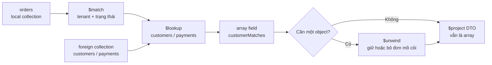

# $lookup: kết hợp collection theo trường hoặc pipeline

## 1. Vì sao cần $lookup?

MongoDB khuyến khích thiết kế document theo ranh giới aggregate, nhưng ứng dụng thực tế vẫn có các quan hệ giữa nhiều collection. Trong hệ thống **Mini Commerce** sử dụng **Spring Data MongoDB**, một `Order` lưu `customerId` để trỏ đến `Customer`; các biên nhận thanh toán `Payment` lại được lưu riêng vì chúng có vòng đời, phân quyền và tần suất cập nhật khác với đơn hàng.

Giả sử màn hình quản trị cần hiển thị: “Mỗi đơn hàng đã thanh toán, tên khách hàng tương ứng và biên nhận thanh toán đã capture gần nhất”. Có thể giải quyết bằng nhiều lần `findById` ở Java, nhưng làm vậy dễ sinh **N+1 queries**, tốn round-trip và gây khó khăn khi lọc/sắp xếp theo dữ liệu liên kết. MongoDB cung cấp stage **`$lookup`** để đưa dữ liệu từ một collection khác vào cùng aggregation pipeline.

Hai cách chính:

1. **Equality join theo trường:** sử dụng `from`, `localField`, `foreignField`, `as` khi điều kiện nối là bằng nhau.
2. **Lookup có pipeline:** sử dụng `let`, `pipeline`, `$expr` và có thể kết hợp `localField`/`foreignField` để thực hiện nhiều điều kiện, lọc trạng thái, projection, sort, limit hoặc tính toán trên collection đích.

Bài thuộc chương **Aggregation nâng cao** của `SPRING_DATA_MONGODB`. Ngoài cú pháp `mongosh`, chúng ta sẽ thực hiện bằng `MongoTemplate`, `LookupOperation` và repository `@Aggregation`, đồng thời kiểm tra index, transaction, reactive access, kiểm thử và chẩn đoán hiệu năng dữ liệu.

### Mục tiêu học tập

Sau bài này, bạn có thể:

- Diễn giải chính xác **left outer join** của `$lookup` và vì sao output luôn là **mảng**.
- Viết `$lookup` theo cặp `localField`/`foreignField`, xử lý document không có match bằng `$unwind` có/không có `preserveNullAndEmptyArrays`.
- Dùng `let`/`$$variable` và `$expr` cho phép nối có điều kiện liên quan đến document bên ngoài.
- Kết hợp **equality join + foreign pipeline** để lọc/projection tối ưu hơn.
- Dùng `Aggregation.lookup(...)` và `LookupOperation` với Spring Data MongoDB, trả DTO thay vì lưu kết quả nối thành entity.
- Giải quyết tên BSON/Java property, `null`, array, kiểu khóa khác nhau, dữ liệu mồ côi và tính nhất quán.
- Bảo vệ **tenant isolation** trên cả collection nguồn và collection được nối.
- Kiểm tra query plan với `explain("executionStats")`, đặc biệt index ở **foreignField** và giới hạn khi sử dụng `$expr`.
- Áp dụng phân trang, reactive, transaction đúng mục đích; xây integration test có dữ liệu thực.

**Điều kiện:** Java 17+, Spring Boot và `spring-boot-starter-data-mongodb`, MongoDB đang hoạt động, hiểu `@Document`/`@Id`, `MongoTemplate`, `Aggregation`, `Criteria` và BSON. Ví dụ dùng API đồng bộ; ở phần reactive sẽ đối chiếu với `ReactiveMongoTemplate`. Cần kiểm tra phiên bản MongoDB/Spring Data của dự án trước khi áp dụng tính năng dành cho phiên bản mới.

## 2. Bảng quyết định: nối theo trường hay dùng pipeline?

| Nhu cầu | Lookup theo trường | Lookup với pipeline |
| --- | --- | --- |
| `Order.customerId = Customer._id` | **Phù hợp nhất** | Làm được nhưng nhiều cú pháp hơn |
| Chỉ lấy Customer đang `active=true` | Cần lọc sau join hoặc dùng pipeline | **Phù hợp**: lọc ngay trên foreign |
| `tenantId` phải khớp giữa Order và Customer | Không đủ khi chỉ dùng một cặp trường | **Phù hợp**: thêm `$eq` trong `$expr` |
| Lấy payment `CAPTURED` mới nhất của từng Order | Không tự chọn được newest | **Phù hợp**: `$match/$sort/$limit` |
| Chỉ lấy `fullName`/`email` từ Customer | Có thể project sau lookup | Có thể project ngay trong foreign pipeline |
| Lookup theo nhiều điều kiện/biểu thức | Hạn chế | `let` + `$expr` |
| Tìm theo khóa unique đã index | Đơn giản, thường hiệu quả | Được, cần kiểm tra index trong pipeline |
| Cần tổng hợp nhiều bản ghi ngoại | Thường phải thêm stages sau lookup | Có thể `$group` ngay trong foreign pipeline |

**Bản chất:** `$lookup` không phải SQL join tự động phát sinh từ `@DBRef` hay `@DocumentReference`. Đây là **aggregation stage** do bạn định nghĩa. Nó nối dữ liệu trong MongoDB và thêm một mảng kết quả vào từng document của pipeline đang chạy.



## 3. Chuẩn bị dữ liệu Mini Commerce

### 3.1. Các collection và khóa nối

| Collection | Khóa | Vai trò |
| --- | --- | --- |
| `orders` | `_id`, `tenantId`, `customerId`, `status`, `totalAmount` | Document đầu vào của aggregation |
| `customers` | `_id`, `tenantId`, `active`, `fullName`, `email` | Collection ngoại để tra cứu khách hàng |
| `payments` | `_id`, `tenantId`, `order_id`, `status`, `capturedAt` | Collection ngoại để tra cứu biên nhận theo Order |
| `products` | `_id`, `sku`, `unit_price` | Dữ liệu hàng hóa, dùng khi mở rộng báo cáo |

Để tránh các biến thể chuyển đổi ID trong bước đầu, ví dụ dùng **BSON String** cho `Order._id`, `Customer._id` và các khóa tham chiếu. Trong hệ thống khác, nếu `Customer._id` thực sự là BSON ObjectId nhưng `Order.customerId` là String không tương thích, một equality lookup có thể trả mảng rỗng dù nội dung hiển thị của chúng trông giống nhau.

### 3.2. Fixture trong mongosh

Sử dụng **database thử nghiệm riêng**, không chạy trên production:

```javascript
use mini_commerce

db.customers.insertMany([
  {
    _id: "customer-001",
    tenantId: "shop-a",
    fullName: "Nguyễn Thị Lan",
    email: "lan@example.test",
    active: true
  },
  {
    _id: "customer-002",
    tenantId: "shop-a",
    fullName: "Trần Văn Mai",
    email: "mai@example.test",
    active: false
  },
  {
    _id: "customer-003",
    tenantId: "shop-b",
    fullName: "Lê Anh Bảo",
    email: "bao@example.test",
    active: true
  }
]);

db.orders.insertMany([
  {
    _id: "order-101",
    tenantId: "shop-a",
    customerId: "customer-001",
    status: "PAID",
    placedAt: ISODate("2026-11-19T08:00:00Z"),
    totalAmount: NumberDecimal("150000.00")
  },
  {
    _id: "order-102",
    tenantId: "shop-a",
    customerId: "customer-002",
    status: "PAID",
    placedAt: ISODate("2026-11-19T09:00:00Z"),
    totalAmount: NumberDecimal("99000.00")
  },
  {
    _id: "order-103",
    tenantId: "shop-a",
    customerId: "customer-missing",
    status: "PLACED",
    placedAt: ISODate("2026-11-20T10:00:00Z"),
    totalAmount: NumberDecimal("80000.00")
  },
  {
    _id: "order-104",
    tenantId: "shop-b",
    customerId: "customer-003",
    status: "PAID",
    placedAt: ISODate("2026-11-20T11:00:00Z"),
    totalAmount: NumberDecimal("180000.00")
  },
  {
    _id: "order-105",
    tenantId: "shop-a",
    customerId: "customer-001",
    status: "PAID",
    placedAt: ISODate("2026-11-20T12:00:00Z"),
    totalAmount: NumberDecimal("200000.00")
  }
]);

db.payments.insertMany([
  {
    _id: "payment-101-a",
    tenantId: "shop-a",
    order_id: "order-101",
    status: "AUTHORIZED",
    capturedAt: null
  },
  {
    _id: "payment-101-b",
    tenantId: "shop-a",
    order_id: "order-101",
    status: "CAPTURED",
    capturedAt: ISODate("2026-11-19T08:10:00Z")
  },
  {
    _id: "payment-105-a",
    tenantId: "shop-a",
    order_id: "order-105",
    status: "CAPTURED",
    capturedAt: ISODate("2026-11-20T12:10:00Z")
  },
  {
    _id: "payment-104-a",
    tenantId: "shop-b",
    order_id: "order-104",
    status: "CAPTURED",
    capturedAt: ISODate("2026-11-20T11:10:00Z")
  },
  {
    _id: "payment-101-wrong-tenant",
    tenantId: "shop-b",
    order_id: "order-101",
    status: "CAPTURED",
    capturedAt: ISODate("2026-11-20T13:00:00Z")
  }
]);
```

**Chú ý bảo mật:** payment cuối cùng cố ý có `order_id = order-101` nhưng lại thuộc `shop-b`. Nó giúp test lỗi lộ dữ liệu nếu lookup chỉ nối theo `order_id` mà không kiểm tra `tenantId`. Đây là fixture giả, không phải giao dịch hợp lệ của hệ thống bán hàng.

### 3.3. Kết quả dự kiến

| Order | Tenant | Khách | Active? | Payment CAPTURED đúng tenant? |
| --- | --- | --- | --- | --- |
| `order-101` | shop-a | Nguyễn Thị Lan | Có | `payment-101-b` |
| `order-102` | shop-a | Trần Văn Mai | Không | Không có |
| `order-103` | shop-a | Không tìm thấy | — | Không có |
| `order-104` | shop-b | Lê Anh Bảo | Có | `payment-104-a` |
| `order-105` | shop-a | Nguyễn Thị Lan | Có | `payment-105-a` |

Nếu chạy lại `insertMany` cùng `_id` sẽ bị duplicate key. Hãy dùng fixture riêng cho mỗi test, cleanup an toàn và không thực hiện lệnh xóa toàn bộ collection production.

## 4. $lookup theo localField và foreignField

Đây là biến thể ngắn nhất để nối theo điều kiện bằng nhau:

```javascript
db.orders.aggregate([
  {
    $lookup: {
      from: "customers",
      localField: "customerId",
      foreignField: "_id",
      as: "customerMatches"
    }
  }
]);
```

Ý nghĩa từng trường:

| Trường | Ý nghĩa |
| --- | --- |
| `from` | Collection ngoại, trong cùng database; ở đây là `customers` |
| `localField` | Field trên document **đầu vào** của pipeline, `orders.customerId` |
| `foreignField` | Field trong collection **được nối**, `customers._id` |
| `as` | Tên **mảng** được bổ sung vào từng Order, `customerMatches` |

Kết quả rút gọn:

```json
[
  {
    "_id": "order-101",
    "customerId": "customer-001",
    "customerMatches": [
      { "_id": "customer-001", "fullName": "Nguyễn Thị Lan",
        "tenantId": "shop-a", "active": true }
    ]
  },
  {
    "_id": "order-103",
    "customerId": "customer-missing",
    "customerMatches": []
  }
]
```

Đây là **minh họa hai document** trong tập kết quả, đã lược bớt trường. Dữ liệu gốc có năm Order, nên pipeline không `$match` sẽ xử lý cả năm.

### 4.1. Left outer join, không phải inner join

`$lookup` **giữ Order đầu vào** kể cả khi không có Customer khớp. Khi không tìm thấy, trường `as` chứa **array rỗng `[]`**, không phải `null` và không tự loại Order.

Nếu `customerId` trùng nhiều document ở `foreignField` (khi không có unique index), `customerMatches` có thể chứa **nhiều phần tử**. Trong fixture, `_id` của customers là duy nhất nên mỗi Order chỉ có 0 hoặc 1 Customer.

**Không giả định Order tự có quan hệ foreign-key như SQL.** MongoDB không tự bắt buộc `customerId` phải tồn tại; ứng dụng phải quyết định xử lý dữ liệu mồ côi.

### 4.2. $lookup không tự thay root document

`$lookup` thêm trường `customerMatches` vào Order hiện tại. Các field như `status`, `placedAt` và `totalAmount` vẫn có mặt trừ khi stage trước/sau bỏ chúng.

Nếu tên `as` trùng một field đã tồn tại, `$lookup` **ghi đè field đó** trong kết quả pipeline. Nên đặt tên rõ ràng như `customerMatches` hoặc `latestCapturedPayments`, tránh ghi đè field nghiệp vụ mang nghĩa khác.

### 4.3. Không có bảo đảm thứ tự trong mảng matched

Đừng tin thứ tự `customerMatches` nếu có nhiều match mà không có sort trong foreign pipeline. Khi yêu cầu “thanh toán mới nhất”, phải thêm `$sort` và khóa phụ duy nhất trước `$limit` trong pipeline ngoại.

## 5. $unwind: giữ hay loại Order không có Customer?

Sau lookup, UI thường cần một object Customer hơn là array một phần tử. `$unwind` biến từng phần tử mảng thành một document pipeline.

### 5.1. Inner-join-like: bỏ Order không khớp

```javascript
db.orders.aggregate([
  { $match: { tenantId: "shop-a" } },
  {
    $lookup: {
      from: "customers",
      localField: "customerId",
      foreignField: "_id",
      as: "customer"
    }
  },
  { $unwind: "$customer" },
  {
    $project: {
      _id: 1,
      status: 1,
      "customer.fullName": 1
    }
  }
]);
```

`order-103` bị loại vì `customer = []`. Với fixture shop-a, còn `order-101`, `order-102` và `order-105`. Nếu một Order khớp nhiều Customer, `$unwind` có thể **nhân bản Order thành nhiều document**.

### 5.2. Giữ Order mồ côi

```javascript
db.orders.aggregate([
  { $match: { tenantId: "shop-a" } },
  {
    $lookup: {
      from: "customers",
      localField: "customerId",
      foreignField: "_id",
      as: "customer"
    }
  },
  {
    $unwind: {
      path: "$customer",
      preserveNullAndEmptyArrays: true
    }
  }
]);
```

Với `preserveNullAndEmptyArrays: true`, `order-103` được giữ lại. Trường `customer` có thể không hiện diện trong BSON đầu ra sau unwind khi không có match; DTO nên cho phép nullable customer.

**Quyết định nghiệp vụ:** màn hình lịch sử đơn cần giữ Order mồ côi để chẩn đoán, nhưng một báo cáo chỉ xét khách đã xác thực có thể chọn loại dữ liệu không đủ điều kiện. Không để `$unwind` vô tình định nghĩa chính sách nghiệp vụ.

### 5.3. $arrayElemAt và $first

Nếu muốn giữ 1 document đầu ra cho mỗi Order mà không dùng unwind:

```javascript
db.orders.aggregate([
  {
    $lookup: {
      from: "customers",
      localField: "customerId",
      foreignField: "_id",
      as: "customerMatches"
    }
  },
  {
    $set: {
      customer: { $arrayElemAt: ["$customerMatches", 0] }
    }
  },
  { $unset: "customerMatches" }
]);
```

Cách này chỉ hợp lý khi nghiệp vụ **bảo đảm** không quá một Customer khớp. Nếu foreign key không unique, lấy phần tử đầu tiên mà không sort là **không xác định**. `$unwind` cho phép nhận biết trường hợp nhiều match khi kiểm thử.

## 6. Những trường hợp dễ sai: null, missing, array và BSON type

### 6.1. Local hoặc foreign field thiếu

Trong equality `$lookup`, nếu document nguồn **không có `localField`**, MongoDB xử lý giá trị đó như `null` cho mục đích so khớp. Tương tự, một document ngoại **thiếu `foreignField`** được coi như `null`.

Hậu quả: nếu cả phía nguồn và ngoại có field thiếu/null, các document tưởng như không có khóa có thể **vô tình khớp nhau**. Đặc biệt nguy hiểm nếu nối theo field nghiệp vụ không được validate.

Biện pháp:

```javascript
db.orders.aggregate([
  {
    $match: {
      customerId: { $exists: true, $ne: null },
      tenantId: "shop-a"
    }
  },
  {
    $lookup: {
      from: "customers",
      localField: "customerId",
      foreignField: "_id",
      as: "customerMatches"
    }
  }
]);
```

Việc lọc `$exists`/`$ne` có thể được thay bằng schema validation/chính sách bắt buộc khóa. Nếu dùng pipeline ngoại, thêm điều kiện khóa không null trước khi nối.

### 6.2. Khóa String và ObjectId không bằng nhau

Ví dụ:

```javascript
// orders:
{ customerId: "507f1f77bcf86cd799439011" }

// customers:
{ _id: ObjectId("507f1f77bcf86cd799439011") }
```

Hai giá trị này **khác BSON type**; `$lookup` equality không tự “coerce” String sang ObjectId để nối. Nếu schema cũ bị trộn type, lựa chọn tốt là **migration chuẩn hóa**. Chuyển đổi bằng `$toObjectId`/`$convert` có thể giải quyết tạm thời nhưng cần xử lý input không hợp lệ và thường làm tối ưu index phức tạp hơn.

Đối với Spring Data, `@Id String` có thể được mapping ra BSON ObjectId nếu giá trị phù hợp quy tắc converter; không đoán type qua Java class, hãy kiểm tra document thực sự trong MongoDB.

### 6.3. localField là array

`$lookup` cho phép một `localField` dạng array khớp các giá trị scalar của `foreignField`, không bắt buộc `$unwind` mảng nguồn trước:

```javascript
db.orders.aggregate([
  {
    $lookup: {
      from: "products",
      localField: "skuList",
      foreignField: "sku",
      as: "matchedProducts"
    }
  }
]);
```

Ví dụ giả định Order có `skuList: ["KBD-001", "MOU-001"]`. Kết quả `matchedProducts` là mảng Product có SKU thuộc danh sách đó. **Đây không phải ánh xạ từng SKU theo đúng thứ tự gốc**, cũng không tự trả giá snapshot hay số lượng dòng hàng. Nếu cần join dữ liệu theo từng OrderLine và giữ quantity, hãy dùng `$unwind` hoặc `$map`/pipeline thích hợp.

### 6.4. Collation và tính đúng của khóa

Các phép so sánh chuỗi chịu ảnh hưởng collation của operation/collection. Nếu SKU không phân biệt case theo nghiệp vụ, index và query cần quy định collation nhất quán. Nhưng với reference keys như `customerId`, tốt hơn nên dùng ID canonical có cùng BSON type thay vì dựa vào collation để khắc phục schema lệch.

## 7. Spring Data MongoDB: LookupOperation theo trường

`MongoTemplate` thực thi aggregation; `Aggregation.lookup(...)` dựng stage `$lookup`.

### 7.1. Entity Order và Customer tối giản

Đây là **hai file Java riêng** trong package domain:

```java
package com.example.minicommerce.domain;

import java.math.BigDecimal;
import java.time.Instant;
import org.springframework.data.annotation.Id;
import org.springframework.data.mongodb.core.mapping.Document;
import org.springframework.data.mongodb.core.mapping.Field;
import org.springframework.data.mongodb.core.mapping.FieldType;

@Document(collection = "orders")
public class Order {
    @Id private String id;
    private String tenantId;
    private String customerId;
    private String status;
    private Instant placedAt;

    @Field(targetType = FieldType.DECIMAL128)
    private BigDecimal totalAmount;

    public Order() {}
    public String getId() { return id; }
    public String getTenantId() { return tenantId; }
    public String getCustomerId() { return customerId; }
    public String getStatus() { return status; }
    public Instant getPlacedAt() { return placedAt; }
    public BigDecimal getTotalAmount() { return totalAmount; }
}
```

```java
package com.example.minicommerce.domain;

import org.springframework.data.annotation.Id;
import org.springframework.data.mongodb.core.mapping.Document;

@Document(collection = "customers")
public class Customer {
    @Id private String id;
    private String tenantId;
    private String fullName;
    private String email;
    private boolean active;

    public Customer() {}
    public String getId() { return id; }
    public String getTenantId() { return tenantId; }
    public String getFullName() { return fullName; }
    public String getEmail() { return email; }
    public boolean isActive() { return active; }
}
```

### 7.2. Service sử dụng Aggregation.lookup

```java
package com.example.minicommerce.service;

import java.util.List;
import org.springframework.data.mongodb.core.MongoTemplate;
import org.springframework.data.mongodb.core.aggregation.Aggregation;
import org.springframework.data.mongodb.core.aggregation.AggregationResults;
import org.springframework.data.mongodb.core.query.Criteria;
import org.springframework.stereotype.Service;

import com.example.minicommerce.domain.Order;

@Service
public class OrderLookupService {

    private final MongoTemplate template;

    public OrderLookupService(MongoTemplate template) {
        this.template = template;
    }

    public List<OrderCustomerView> listForTenant(String tenantId) {
        Aggregation pipeline = Aggregation.newAggregation(
            Aggregation.match(
                Criteria.where("tenantId").is(tenantId)),
            Aggregation.lookup(
                "customers", "customerId", "_id", "customer"),
            Aggregation.unwind("customer", true),
            Aggregation.project()
                .and("_id").as("orderId")
                .and("status").as("status")
                .and("customer.fullName").as("customerName")
                .andExclude("_id")
        );

        AggregationResults<OrderCustomerView> result =
            template.aggregate(
                pipeline, Order.class, OrderCustomerView.class);

        return result.getMappedResults();
    }
}
```

DTO đọc:

```java
package com.example.minicommerce.service;

public class OrderCustomerView {
    private String orderId;
    private String status;
    private String customerName;

    public OrderCustomerView() {}
    public String getOrderId() { return orderId; }
    public void setOrderId(String orderId) {
        this.orderId = orderId;
    }
    public String getStatus() { return status; }
    public void setStatus(String status) {
        this.status = status;
    }
    public String getCustomerName() { return customerName; }
    public void setCustomerName(String customerName) {
        this.customerName = customerName;
    }
}
```

`Aggregation.lookup("customers", "customerId", "_id", "customer")` tạo equality lookup. `Aggregation.unwind("customer", true)` giữ Order khi lookup không tìm được Customer. `Aggregation.project()` đổi tên/giới hạn trường để trả DTO.

**Quan trọng:** đoạn code trên chỉ lọc `tenantId` ở collection **orders**, nhưng equality lookup chưa kiểm tra `customers.tenantId`. Nó dùng để giới thiệu API theo trường, **chưa đủ ràng buộc bảo mật cho multi-tenant** nếu một Order chứa `customerId` trỏ sai tenant. Ở phần pipeline chúng ta sẽ sửa bằng điều kiện nối cả `tenantId`.

### 7.3. LookupOperation builder

Có thể dùng builder để dễ đọc:

```java
import org.springframework.data.mongodb.core.aggregation.LookupOperation;

LookupOperation customerLookup = LookupOperation.newLookup()
    .from("customers")
    .localField("customerId")
    .foreignField("_id")
    .as("customerMatches");

Aggregation pipeline = Aggregation.newAggregation(
    Aggregation.match(Criteria.where("tenantId").is("shop-a")),
    customerLookup
);
```

Từ Spring Data MongoDB 4.1, builder còn hỗ trợ khai báo `let`/`pipeline` cho lookup nâng cao. Nếu dự án đang dùng API cũ hơn, cần kiểm tra những overload có sẵn; bài này chọn Java API từ các dòng Spring Data MongoDB hiện đại.

## 8. Lookup bằng pipeline: let, $$variable và $expr

Trong multi-tenant Mini Commerce, chỉ nối `Order.customerId = Customer._id` là **chưa đủ**. Cần đồng thời bảo đảm:

- `Order.customerId = Customer._id`.
- `Order.tenantId = Customer.tenantId`.
- `Customer.active = true`.
- Trả về một tập field hạn chế (ví dụ `fullName`), không tự động trả cả email nếu không cần.

### 8.1. Pipeline correlated trong mongosh

```javascript
db.orders.aggregate([
  { $match: { tenantId: "shop-a" } },
  {
    $lookup: {
      from: "customers",
      let: {
        oidCustomer: "$customerId",
        oidTenant: "$tenantId"
      },
      pipeline: [
        {
          $match: {
            $expr: {
              $and: [
                { $eq: ["$_id", "$$oidCustomer"] },
                { $eq: ["$tenantId", "$$oidTenant"] }
              ]
            }
          }
        },
        { $match: { active: true } },
        {
          $project: {
            _id: 1,
            fullName: 1,
            tenantId: 1
          }
        }
      ],
      as: "activeCustomer"
    }
  }
]);
```

Giải thích:

1. `$match` đầu tiên giới hạn **Order của tenant shop-a**.
2. `let.oidCustomer` lấy giá trị `$customerId` **từ Order hiện tại**.
3. `let.oidTenant` lấy giá trị `$tenantId` **từ Order hiện tại**.
4. Bên trong foreign `pipeline`, `$$oidCustomer` và `$$oidTenant` là **biến đã khai báo**; một dấu `$` đơn như `$_id` trỏ tới field trên **Customer hiện tại**.
5. `$expr` cho phép so sánh các expression trong `$match`; `$and` kết hợp hai điều kiện.
6. `$match: { active: true }` là điều kiện cố định trên Customer, **không cần `$expr`** vì không tham chiếu biến.
7. `$project` giới hạn field được mang ra ngoài.

Kết quả với fixture `shop-a`:

| Order | `activeCustomer` |
| --- | --- |
| `order-101` | Mảng chứa Customer Lan |
| `order-102` | `[]` vì Customer Mai inactive |
| `order-103` | `[]` vì không tìm thấy Customer |
| `order-105` | Mảng chứa Customer Lan |

### 8.2. Nhận biết $ và $$

| Biểu thức | Nghĩa trong foreign pipeline |
| --- | --- |
| `"$_id"` | Field `_id` của Customer hiện tại |
| `"$tenantId"` | Field `tenantId` của Customer hiện tại |
| `"$$oidCustomer"` | Biến từ `let`, nhận giá trị `Order.customerId` |
| `"$$oidTenant"` | Biến từ `let`, nhận giá trị `Order.tenantId` |
| `"$$ROOT"` | Root document **trong ngữ cảnh stage hiện tại**, không tự là outer Order |

Nếu viết `"$customerId"` trong pipeline của `customers` mà tưởng nó tham chiếu Order, MongoDB sẽ tìm field `customerId` trên **Customer**, thường sai. Dùng `let` và `$$variable` để chuyển giá trị outer document.

### 8.3. Khi nào phải dùng $expr?

Trong `$match` của foreign pipeline, muốn sử dụng giá trị từ `let`, ta dùng `$expr`:

```javascript
{
  $match: {
    $expr: {
      $eq: ["$tenantId", "$$oidTenant"]
    }
  }
}
```

Nếu điều kiện chỉ là `{ active: true }`, có thể dùng `$match` thông thường. Không biến mọi điều kiện thành `$expr` mà không cần, vì điều đó có thể làm pipeline khó đọc và ảnh hưởng cơ hội tận dụng index.

## 9. Kết hợp localField/foreignField với foreign pipeline

Trong MongoDB hiện đại (cú pháp concise correlated subquery hỗ trợ từ 5.0), một `$lookup` có thể khai báo **cặp trường nối trực tiếp** và thêm **pipeline ngoại**:

```javascript
db.orders.aggregate([
  { $match: { tenantId: "shop-a" } },
  {
    $lookup: {
      from: "customers",
      localField: "customerId",
      foreignField: "_id",
      let: { currentTenant: "$tenantId" },
      pipeline: [
        {
          $match: {
            active: true,
            $expr: {
              $eq: ["$tenantId", "$$currentTenant"]
            }
          }
        },
        { $project: { _id: 1, fullName: 1 } }
      ],
      as: "activeCustomer"
    }
  }
]);
```

MongoDB thực hiện equality join theo `customerId/_id` và sau đó áp dụng các điều kiện trong foreign pipeline. Cú pháp này có thể dễ đọc hơn việc biểu diễn cả equality join bằng một `$expr` duy nhất.

**Lưu ý:** foreign pipeline vẫn cần `let` cho điều kiện tenant, và `$expr` khi tham chiếu biến `$$currentTenant` trong `$match`. Bản thân cặp `localField/foreignField` không truyền mặc định các biến khác từ Order sang pipeline.

### 9.1. Đặt $match ở đâu?

```javascript
// $match TRƯỚC lookup: giảm số Order phải xử lý.
{ $match: { tenantId: "shop-a", status: "PAID" } }

// $match BÊN TRONG lookup: giảm số Customer/Payment được trả về.
{ $match: { active: true } }
```

Chỉ lọc `activeCustomer` **sau** lookup bằng `$filter` hoặc `$unwind/$match` cũng có thể cho kết quả đúng, nhưng đôi khi phải đưa nhiều foreign documents hơn qua pipeline. Khi có thể, lọc sớm ở đúng phía mà điều kiện thuộc về.

### 9.2. Không làm rò rỉ dữ liệu qua projection

`$project` trong foreign pipeline giới hạn trường được xuất sang kết quả `as`. Nếu màn hình chỉ cần tên, không đưa email, điện thoại, thông tin thanh toán hoặc thuộc tính nội bộ ra ngoài. **Projection không thay thế authorization**, nhưng là một lớp hạn chế dữ liệu cần thiết.

## 10. Bài toán nâng cao: tìm payment CAPTURED mới nhất

Một Order có thể có nhiều bản ghi `Payment`. Yêu cầu: “Mỗi Order trả đúng payment `CAPTURED` gần nhất **trong cùng tenant**”.

Nếu chỉ dùng:

```javascript
{
  $lookup: {
    from: "payments",
    localField: "_id",
    foreignField: "order_id",
    as: "payments"
  }
}
```

ta sẽ nhận **tất cả** payment có `order_id` phù hợp, gồm cả `AUTHORIZED` và một bản ghi sai tenant trong fixture. Điều đó không đáp ứng yêu cầu nghiệp vụ/bảo mật.

### 10.1. Pipeline đầy đủ

```javascript
db.orders.aggregate([
  { $match: { tenantId: "shop-a", status: "PAID" } },
  {
    $lookup: {
      from: "payments",
      let: {
        oid: "$_id",
        tenant: "$tenantId"
      },
      pipeline: [
        {
          $match: {
            status: "CAPTURED",
            $expr: {
              $and: [
                { $eq: ["$order_id", "$$oid"] },
                { $eq: ["$tenantId", "$$tenant"] }
              ]
            }
          }
        },
        { $sort: { capturedAt: -1, _id: -1 } },
        { $limit: 1 },
        {
          $project: {
            _id: 1,
            status: 1,
            capturedAt: 1
          }
        }
      ],
      as: "latestCapturedPayments"
    }
  }
]);
```

Kết quả:

- `order-101` → `payment-101-b`. Không nhận `payment-101-wrong-tenant` dù timestamp của nó mới hơn.
- `order-102` → `[]` vì không có payment `CAPTURED`.
- `order-105` → `payment-105-a`.
- `order-103` không xuất hiện vì chưa `PAID`.

Thứ tự `{ capturedAt: -1, _id: -1 }` có tie-breaker duy nhất `_id` để xác định rõ record “mới nhất” khi nhiều payment trùng timestamp. `$limit: 1` ở **foreign pipeline** chỉ giới hạn số payment **cho từng Order**, không giới hạn tổng số Order.

### 10.2. Kết hợp $unwind nếu cần object

```javascript
db.orders.aggregate([
  { $match: { tenantId: "shop-a", status: "PAID" } },
  {
    $lookup: {
      from: "payments",
      let: { oid: "$_id", tenant: "$tenantId" },
      pipeline: [
        {
          $match: {
            status: "CAPTURED",
            $expr: {
              $and: [
                { $eq: ["$order_id", "$$oid"] },
                { $eq: ["$tenantId", "$$tenant"] }
              ]
            }
          }
        },
        { $sort: { capturedAt: -1, _id: -1 } },
        { $limit: 1 }
      ],
      as: "payment"
    }
  },
  {
    $unwind: {
      path: "$payment",
      preserveNullAndEmptyArrays: true
    }
  },
  {
    $project: {
      _id: 1,
      status: 1,
      "payment._id": 1,
      "payment.capturedAt": 1
    }
  }
]);
```

Đây là cách tránh nạp toàn bộ lịch sử payment vào màn hình khi chỉ cần biên nhận cuối. Tuy vậy, để báo cáo tài chính chính xác, cần xem thêm refund, chargeback, partial capture, currency và đối soát; `status = CAPTURED` trong fixture chỉ là quy tắc minh họa.

## 11. Spring Data: LookupOperation với let và pipeline

Trong Spring Data MongoDB hiện đại, `Aggregation.lookup()` builder hỗ trợ `let(...)` và `pipeline(...)`. Có thể đưa một stage BSON tường minh qua `AggregationOperation` khi biểu thức `$expr` phức tạp.

### 11.1. Lookup Customer với tenant guard

```java
import java.util.List;

import org.bson.Document;
import org.springframework.data.mongodb.core.aggregation.Aggregation;
import org.springframework.data.mongodb.core.aggregation.AggregationOperation;
import org.springframework.data.mongodb.core.aggregation.LookupOperation;
import org.springframework.data.mongodb.core.aggregation.VariableOperators;
import org.springframework.data.mongodb.core.query.Criteria;

import static org.springframework.data.mongodb.core.aggregation.VariableOperators.Let.ExpressionVariable.newVariable;

// $expr so sánh các field Customer với biến của Order.
AggregationOperation matchTenantAndCustomer = context ->
    new Document("$match",
        new Document("$expr",
            new Document("$and", List.of(
                new Document("$eq",
                    List.of("$_id", "$$customerKey")),
                new Document("$eq",
                    List.of("$tenantId", "$$tenantKey"))
            ))));

LookupOperation lookup = Aggregation.lookup()
    .from("customers")
    .let(VariableOperators.Let.just(
        newVariable("customerKey").forField("customerId"),
        newVariable("tenantKey").forField("tenantId")))
    .pipeline(
        matchTenantAndCustomer,
        Aggregation.match(
            Criteria.where("active").is(true)),
        Aggregation.project("fullName"))
    .as("activeCustomer");

Aggregation aggregation = Aggregation.newAggregation(
    Aggregation.match(
        Criteria.where("tenantId").is("shop-a")),
    lookup
);
```

Giải thích:

- `VariableOperators.Let.just(...)` khai báo biến cho `$lookup`, không phải phép `$let` tính toán đầu ra độc lập.
- `newVariable("customerKey").forField("customerId")` nhận property nguồn từ `Order`.
- `matchTenantAndCustomer` tạo raw `$match/$expr` nên dùng **BSON names của Customer** và biến `$$customerKey`/`$$tenantKey`.
- `Aggregation.match(Criteria.where("active").is(true))` dùng filter cố định bên trong foreign pipeline.
- `Aggregation.project("fullName")` chỉ giữ tên khách.
- `as("activeCustomer")` tạo array kết quả trên mỗi Order.

**Hạn chế mapping:** các stage raw `AggregationOperation` viết `Document` trực tiếp không nhất thiết được Spring Data map field name tương tự TypedAggregation. Khi bên ngoài dùng `@Field`, cần xác minh BSON/variable field path hoặc dùng DSL/aggregation context thích hợp. Không đổi raw BSON key `"$_id"` thành Java property `"id"` trong foreign expression.

### 11.2. Viết pipeline bằng một stage BSON rõ ràng

Khi muốn biểu diễn biểu thức ít được DSL hỗ trợ, có thể tạo `AggregationOperation`:

```java
AggregationOperation foreignMatch = ctx -> new Document(
    "$match",
    new Document(
        "$expr",
        new Document(
            "$eq",
            List.of("$order_id", "$$orderKey")
        )
    )
);
```

Đây là một **stage** trong foreign pipeline, không phải cả `$lookup`. Nếu ứng dụng có nhiều stage phức tạp, hãy xây từng stage thành biến đặt tên, thêm test xác minh BSON pipeline sau mapping, và đo plan thực tế.

### 11.3. Dùng overload có localField/foreignField cho case đơn giản

```java
LookupOperation simple = Aggregation.lookup()
    .from("customers")
    .localField("customerId")
    .foreignField("_id")
    .as("customerMatches");
```

Khi chỉ nối equality, đừng tạo nhiều `let`/`$expr` không cần thiết. Biến thể field join ít lỗi cú pháp hơn và dễ xác định index foreignField.

## 12. Dùng @Aggregation trên repository

Một pipeline tương đối cố định có thể được khai báo qua `@Aggregation`:

```java
package com.example.minicommerce.repository;

import java.util.List;
import org.springframework.data.mongodb.repository.MongoRepository;
import org.springframework.data.mongodb.repository.Aggregation;

import com.example.minicommerce.domain.Order;
import com.example.minicommerce.service.OrderCustomerView;

public interface OrderReportRepository
        extends MongoRepository<Order, String> {

    @Aggregation(pipeline = {
        "{ '$match': { 'tenantId': ?0 } }",
        "{ '$lookup': { 'from': 'customers', " +
          "'localField': 'customerId', " +
          "'foreignField': '_id', 'as': 'customer' } }",
        "{ '$unwind': { 'path': '$customer', " +
          "'preserveNullAndEmptyArrays': true } }",
        "{ '$project': { '_id': 0, 'orderId': '$_id', " +
          "'status': 1, 'customerName': " +
          "'$customer.fullName' } }"
    })
    List<OrderCustomerView> findOrderCustomerView(
        String tenantId);
}
```

`@Aggregation` trên repository khác `Aggregation` DSL class. Ở ví dụ này, mục tiêu là cho thấy cách tổ chức một pipeline **cố định**; query vẫn chỉ bảo vệ tenant ở `orders`, chưa có điều kiện tenant trên `customers`. Đừng dùng nguyên pipeline này làm endpoint multi-tenant khi dữ liệu nguồn có thể tham chiếu sai tenant.

Khi pipeline cần nhiều biến `let`, điều kiện tùy chọn hoặc kiểm thử stage riêng, `MongoTemplate` với `LookupOperation`/`AggregationOperation` thường dễ kiểm soát hơn JSON string rất dài trong annotation.

## 13. @DocumentReference và @DBRef khác $lookup

Spring Data MongoDB hỗ trợ ánh xạ quan hệ bằng `@DBRef` hoặc `@DocumentReference` trong những mô hình phù hợp. Nhưng:

| Cơ chế | Vai trò | Cần cẩn trọng |
| --- | --- | --- |
| `@DBRef` | Lưu/đọc DBRef theo ánh xạ | Có thể phát sinh thêm truy vấn khi resolve; không phải aggregation join |
| `@DocumentReference` | Quan hệ document tham chiếu linh hoạt | Resolver có chiến lược truy vấn riêng, không mặc nhiên là `$lookup` |
| `$lookup` | Join server-side trong **aggregation** | Trả array, cần projection, index và kiểm soát quyền |
| Embedded document | Dữ liệu liên quan nằm cùng document root | Snapshot nhanh, nhưng có trùng lặp và chi phí cập nhật |

Một `Order` thường nên lưu **snapshot tên/giá/address tại thời điểm đặt** để lịch sử không đổi khi Customer hoặc Product thay đổi. Không dùng `$lookup` tới Product hiện tại để **tính lại giá đã bán** vì dữ liệu danh mục có thể đổi.

**Không phải cứ có quan hệ thì phải dùng $lookup.** Quyết định dựa trên read patterns, tính nhất quán, kích thước dữ liệu, quyền sở hữu và chi phí cập nhật.

## 14. Tại sao $lookup không giống SQL JOIN hoàn toàn?

Về trực giác `$lookup` là left outer join, nhưng có những đặc điểm MongoDB:

1. Kết quả được thêm thành **một mảng** `as`, không tự tạo một row cho mỗi match.
2. `$unwind` mới nhân bản document theo phần tử, làm tổng số document sau stage tăng hoặc giảm.
3. `$lookup` thông thường nối với collection trong **cùng database**; không dùng cú pháp `from: "other_db.customers"` rồi mặc nhiên kết nối cross-database.
4. `$lookup` không tự áp đặt foreign-key constraints.
5. Document kết quả sau join vẫn chịu **giới hạn kích thước BSON document**. Một Order có quá nhiều payment/line tham chiếu có thể tạo output quá lớn.
6. Các version/topology MongoDB khác nhau có ràng buộc khác nhau về sharded collection, transaction và engine tối ưu.
7. Thứ tự stage quyết định cả kết quả và chi phí: lookup sớm/lọc muộn có thể làm việc nhiều hơn.

Nếu chỉ cần một phép nối equality đơn giản và số match nhỏ, `$lookup` rất hữu ích. Nếu join tạo mảng hàng chục nghìn phần tử cho mỗi document, cần xem lại schema, phân trang theo foreign data hoặc chia nhỏ báo cáo.

## 15. Hiệu năng: index ở collection được nối

### 15.1. Equality lookup cần index foreignField

Với:

```javascript
{
  $lookup: {
    from: "customers",
    localField: "customerId",
    foreignField: "_id",
    as: "customerMatches"
  }
}
```

MongoDB đã có index `_id` mặc định trên `customers`. Vì thế lookup theo Customer `_id` thường có điểm khởi đầu tốt.

Nếu nối bằng `payments.order_id`:

```javascript
db.payments.createIndex({ order_id: 1 });
```

Thiếu index ở **foreignField** có thể khiến mỗi truy vấn tương quan phải dò nhiều dữ liệu ngoại, đặc biệt khi số Order đầu vào lớn. Nhưng có index chưa bảo đảm nhanh: còn phụ thuộc số match trên mỗi khóa, projection, cardinality và stage sau lookup.

### 15.2. Compound index cho payment mới nhất

Đối với pipeline `status = CAPTURED`, `tenantId`, `order_id` và sort `capturedAt DESC, _id DESC`, một index đáng benchmark:

```javascript
db.payments.createIndex({
  tenantId: 1,
  order_id: 1,
  status: 1,
  capturedAt: -1,
  _id: -1
});
```

Index trên là **ứng viên thiết kế** chứ không phải lời hứa MongoDB sẽ sử dụng đầy đủ với mọi foreign `$expr`. Cách so sánh, giá trị `let`, tình trạng missing/null, query planner và version server ảnh hưởng khả năng dùng index.

Ngoài ra nên đặt filter sớm ở Order:

```javascript
db.orders.createIndex({
  tenantId: 1,
  status: 1,
  placedAt: -1,
  _id: -1
});
```

Đây là index cho **outer pipeline** lọc/đọc Order; nó không thay index trên `payments`.

### 15.3. Giới hạn dùng index trong $expr

MongoDB ghi rõ các so sánh `$eq`, `$lt`, `$lte`, `$gt`, `$gte` trong `$expr` **có thể** tận dụng index của collection `from`, nhưng có các điều kiện:

- Phép so sánh phải có dạng phù hợp giữa **field và giá trị tương đương hằng số cho từng lookup**, ví dụ field ngoại so với một `let` đã resolve từ Order hiện tại; **field-to-field** trong foreign document thường không dùng index tương tự.
- Không dùng index cho các so sánh nếu giá trị `let` bị rỗng hoặc missing.
- Với các so sánh `$expr` trong `$lookup`, MongoDB nêu hạn chế đối với **multikey, partial hoặc sparse indexes**.
- Việc dùng index còn tùy planner, selectivity và cách pipeline được viết.

Không kết luận “có `$expr` thì không bao giờ dùng index”, cũng không kết luận “có index thì mọi `$expr` đều được tối ưu”. Hãy kiểm tra `explain` trên dữ liệu thực tế.

### 15.4. Hạn chế phía outer trước lookup

```javascript
db.orders.aggregate([
  { $match: { tenantId: "shop-a", status: "PAID" } },
  { $sort: { placedAt: -1, _id: -1 } },
  { $limit: 20 },
  {
    $lookup: {
      from: "customers",
      localField: "customerId",
      foreignField: "_id",
      as: "customerMatches"
    }
  }
]);
```

Nếu nghiệp vụ yêu cầu **20 Order mới nhất rồi mới hiện Customer**, cách trên giới hạn lượng Order đi vào `$lookup`. Nhưng nếu yêu cầu “20 Order mới nhất **có Customer active**”, limit trước lookup có thể cho **ít hơn 20 match** hoặc bỏ qua Order hợp lệ nằm ngoài 20 bản đầu.

**Thứ tự `$limit` trước/sau lookup phụ thuộc nghĩa của API**. Không đổi thứ tự stage chỉ để tối ưu mà vô tình thay kết quả.

## 16. Explain và chẩn đoán một $lookup chậm

Trong `mongosh`:

```javascript
db.orders.explain("executionStats").aggregate([
  { $match: { tenantId: "shop-a", status: "PAID" } },
  {
    $lookup: {
      from: "customers",
      localField: "customerId",
      foreignField: "_id",
      as: "customerMatches"
    }
  }
]);
```

Tùy phiên bản MongoDB và query engine, kết quả explain có thể chứa:

| Chỉ số | Diễn giải |
| --- | --- |
| `winningPlan`, `queryPlanner` | Kế hoạch xử lý đầu vào |
| `IXSCAN` / `COLLSCAN` | Có index scan hay collection scan |
| `totalKeysExamined` | Số index entries được duyệt |
| `totalDocsExamined` | Số document đã kiểm tra |
| `nReturned` | Số document được trả về trong stage/plan tương ứng |
| `indexesUsed` | Index được dùng trong lookup, **nếu phiên bản/format explain cung cấp** |
| `collectionScans` | Số lần collection scan ở foreign lookup, nếu có |
| `executionTimeMillisEstimate` | Ước tính thời gian cho stage, không phải thời gian tuyệt đối của mọi request |

Không trông chờ một vị trí JSON bất biến cho các trường `indexesUsed` hoặc `EQ_LOOKUP`: explain format thay đổi theo version và engine. MongoDB có thể sử dụng **slot-based execution engine (SBE)** cho một số equality lookup; foreign pipeline làm một số đường tối ưu SBE không áp dụng. Không xem một nhãn plan là bảo đảm chung cho mọi workload.

### 16.1. Quy trình tìm nguyên nhân

1. Xác nhận số Order **sau `$match` outer**.
2. Kiểm tra khóa nối có cùng **BSON type** và không missing/null bất thường.
3. Kiểm tra index trên collection ngoại đúng theo `foreignField`/điều kiện pipeline.
4. Kiểm tra số match trung bình/tối đa **trên mỗi Order**.
5. So sánh phiên bản dùng `$lookup` theo trường và `let/$expr` khi hai dạng có cùng semantics.
6. Giảm field với foreign `$project` và chỉ đưa dữ liệu cần thiết qua mạng.
7. Đọc explain/profiler, đo latency, CPU, memory và số document/keys examined.
8. Xem liệu schema embedded/snapshot, denormalized field hoặc báo cáo precomputed phù hợp hơn không.

**Không dùng `allowDiskUse(true)` như thuốc chữa cho mọi lookup.** Nó có thể hỗ trợ các stage có khả năng spill như sort/group trong điều kiện được hỗ trợ, nhưng không sửa được join thiếu index, tràn kích thước document hoặc rủi ro phân quyền.

## 17. Aggregation options và output size

Mỗi document đầu ra có mảng `as`, nên các phép nối một-nhiều có thể làm document trung gian rất lớn. MongoDB có giới hạn **16 MiB cho một BSON document được trả ra**; các stage và engine còn có giới hạn bộ nhớ riêng. Đừng suy luận một lần `$lookup` có thể nhét mọi Payment lịch sử vào một Order bất kể kích thước.

### 17.1. Chỉ lấy thông tin cần thiết

```javascript
{
  $lookup: {
    from: "payments",
    let: { oid: "$_id", tenant: "$tenantId" },
    pipeline: [
      {
        $match: {
          status: "CAPTURED",
          $expr: {
            $and: [
              { $eq: ["$order_id", "$$oid"] },
              { $eq: ["$tenantId", "$$tenant"] }
            ]
          }
        }
      },
      { $sort: { capturedAt: -1, _id: -1 } },
      { $limit: 1 },
      { $project: { _id: 1, capturedAt: 1 } }
    ],
    as: "latestCapturedPayments"
  }
}
```

Chỉ đưa payment ID/time thay vì dữ liệu phương thức thanh toán, token, payload từ cổng thanh toán.

### 17.2. AggregationOptions trong Spring Data

```java
import org.springframework.data.mongodb.core.aggregation.Aggregation;
import org.springframework.data.mongodb.core.aggregation.AggregationOptions;

AggregationOptions options = AggregationOptions.builder()
    .allowDiskUse(true)
    .build();

Aggregation configured = aggregation.withOptions(options);
```

`aggregation` là pipeline `Aggregation` đã tạo trước đó. `allowDiskUse` chỉ nên bật sau khi hiểu stage nào cần dùng memory/spill và chi phí I/O; không bật vô điều kiện cho mọi endpoint.

## 18. Pagination khi có $lookup

Hai thứ thường bị nhầm:

- **Phân trang Order** rồi hiển thị Customer.
- **Phân trang Customer/Payment nằm trong mảng lookup**.

### 18.1. Phân trang Order

```javascript
db.orders.aggregate([
  { $match: { tenantId: "shop-a", status: "PAID" } },
  { $sort: { placedAt: -1, _id: -1 } },
  { $skip: 0 },
  { $limit: 20 },
  {
    $lookup: {
      from: "customers",
      localField: "customerId",
      foreignField: "_id",
      as: "customerMatches"
    }
  }
]);
```

`$skip/$limit` giới hạn **Order**. Thêm sort ổn định với `_id` để hai trang có thứ tự xác định nếu dữ liệu không đổi. Offset sâu vẫn tốn chi phí skip; khi duyệt liên tục có thể dùng cursor/keyset dựa trên `(placedAt, _id)`.

### 18.2. Giới hạn mảng foreign cho mỗi Order

```javascript
{
  $lookup: {
    from: "payments",
    localField: "_id",
    foreignField: "order_id",
    pipeline: [
      { $sort: { capturedAt: -1, _id: -1 } },
      { $limit: 3 }
    ],
    as: "recentPayments"
  }
}
```

`$limit: 3` ở **bên trong foreign pipeline** là số Payment tối đa **trên một Order**. Ví dụ này chưa có tenant guard hoặc filter status; chỉ sử dụng khi nguồn dữ liệu đã được cách ly và yêu cầu đúng là lấy ba payment gần nhất bất kể trạng thái. Với multi-tenant phải thêm điều kiện tenant như phần 10.

### 18.3. Count sau lookup có thể khác count trước lookup

Nếu pipeline `$unwind: "$customer"` **loại** Order không match, `$count` sau unwind sẽ đếm ít hơn số Order ban đầu. Nếu một Order match nhiều Customer và unwind, count có thể cao hơn.

Khi UI cần `totalElements`, hãy định nghĩa rõ đang đếm **số Order**, **số Order có Customer active**, hay **số dòng Order–Customer sau unwind**. Không dùng `countDocuments({ tenantId: ... })` cho một màn hình đã có thêm điều kiện foreign Customer mà tưởng tổng luôn khớp.

## 19. Aggregation để tổng hợp liên kết

Sau khi lookup, có thể kết hợp thêm `$group`/`$project`:

```javascript
db.orders.aggregate([
  { $match: { tenantId: "shop-a", status: "PAID" } },
  {
    $lookup: {
      from: "customers",
      localField: "customerId",
      foreignField: "_id",
      as: "customer"
    }
  },
  { $unwind: "$customer" },
  {
    $group: {
      _id: "$customer._id",
      customerName: { $first: "$customer.fullName" },
      paidOrderCount: { $sum: 1 },
      totalPaid: { $sum: "$totalAmount" }
    }
  },
  { $sort: { totalPaid: -1 } }
]);
```

Với fixture shop-a, đây là **báo cáo theo khách**:

| Customer | paidOrderCount | totalPaid |
| --- | ---: | ---: |
| Nguyễn Thị Lan | 2 | 350.000 |
| Trần Văn Mai | 1 | 99.000 |

**Không dùng báo cáo này làm bằng chứng rằng Customer đang active.** Pipeline không có foreign filter `active`. Nếu chỉ muốn khách active, phải bổ sung điều kiện một cách chủ đích và xem lại tổng.

Giá trị `totalAmount` dùng BSON Decimal128. Nếu dữ liệu tiền bị trộn String/Double/Decimal128, cần kiểm tra kiểu và quy tắc đối soát; không sử dụng kết quả aggregation chưa xác minh cho tài chính.

## 20. Multi-tenant security: bắt buộc scope cả hai collection

Một hệ thống nhiều cửa hàng không thể chỉ dựa vào filter `orders.tenantId` nếu `Order.customerId` có thể bị ghi nhầm hoặc bị sửa độc hại để trỏ tới Customer khác tenant.

### 20.1. Ví dụ nguy hiểm

```javascript
db.orders.aggregate([
  { $match: { tenantId: "shop-a" } },
  {
    $lookup: {
      from: "customers",
      localField: "customerId",
      foreignField: "_id",
      as: "customer"
    }
  }
]);
```

Nếu một Order shop-a trỏ tới Customer shop-b, phép nối theo `_id` vẫn có thể trả Customer của shop-b. **Outer filter không bảo vệ foreign join**.

### 20.2. Join đúng tenant

```javascript
{
  $lookup: {
    from: "customers",
    let: {
      cid: "$customerId",
      tid: "$tenantId"
    },
    pipeline: [
      {
        $match: {
          $expr: {
            $and: [
              { $eq: ["$_id", "$$cid"] },
              { $eq: ["$tenantId", "$$tid"] }
            ]
          }
        }
      },
      { $project: { _id: 1, fullName: 1 } }
    ],
    as: "customer"
  }
}
```

Ngoài ra, cần:

- Xác định tenant từ **security context**/token đã xác thực, không tin `tenantId` do client tự cung cấp.
- Kiểm soát quyền xem `Customer`/`Payment` ở tầng API/service.
- Lọc/tối thiểu hóa các field nhạy cảm ngay trong foreign pipeline.
- Kiểm thử dữ liệu foreign cross-tenant dù outer Order hợp lệ.
- Bảo vệ cả các đường ghi tạo tham chiếu và unique keys theo tenant.

## 21. Sharded collection, transaction và giới hạn version

Một số mốc phiên bản MongoDB cần biết:

| Tính năng | Mốc chính |
| --- | --- |
| `$lookup` cơ bản | Đã tồn tại từ các phiên bản MongoDB trước 5.x |
| Concise correlated lookup với field join + pipeline | MongoDB **5.0** |
| `from` là sharded collection | MongoDB **5.1** trở đi |
| SBE có thể thực thi một số `$lookup` | MongoDB **6.0** trở đi, có điều kiện về pipeline/stages |
| `$lookup` trong transaction khi foreign collection được sharded | MongoDB **8.0** trở đi |

Luôn kiểm tra phiên bản server/topology và giới hạn hiện hành trước khi triển khai trên sharded cluster. Trong foreign lookup pipeline, **không được chứa `$out` hoặc `$merge`**. Những stage đặc biệt như MongoDB Search `$search` có yêu cầu version/position riêng.

### 21.1. Transaction không làm $lookup thành foreign key

Transaction MongoDB giúp một số phép đọc/ghi tuân theo ngữ cảnh nhất quán trên topology hỗ trợ, nhưng `$lookup` **không tự kiểm soát** các tham chiếu hợp lệ, quyền tenant hay mối quan hệ giữa hai document. Khi tạo Order và Payment:

- Dùng transaction nếu invariant yêu cầu nhiều document cùng commit.
- Dùng unique index, idempotency key và xử lý retry khi ghi.
- Dùng snapshot của thông tin quan trọng (giá bán, địa chỉ) nếu dữ liệu phải bất biến theo thời điểm đặt.
- Không truy vấn Customer/Product hiện tại bằng `$lookup` rồi giả định đó là dữ liệu tại thời điểm Order được tạo.

### 21.2. Consistency giữa các lần query

Một lần aggregation có thể đọc các document ở những thời điểm quan sát chịu ảnh hưởng read concern/topology. Không mặc định mọi aggregation thông thường tạo ra một snapshot nhất quán tuyệt đối xuyên tất cả collection trong bối cảnh ghi đồng thời. Nếu cần bảo đảm cụ thể, thiết kế read concern/transaction trên MongoDB topology phù hợp và test điều kiện race.

## 22. ReactiveMongoTemplate: trả Flux thay vì List

Với starter reactive, pipeline vẫn có cùng BSON semantics, nhưng kiểu kết quả thường là `Flux<DTO>`:

```java
import reactor.core.publisher.Flux;

import org.springframework.data.mongodb.core.aggregation.Aggregation;
import org.springframework.data.mongodb.core.query.Criteria;

Aggregation aggregation = Aggregation.newAggregation(
    Aggregation.match(
        Criteria.where("tenantId").is("shop-a")),
    Aggregation.lookup(
        "customers", "customerId", "_id", "customer"),
    Aggregation.unwind("customer", true),
    Aggregation.project()
        .and("_id").as("orderId")
        .and("customer.fullName").as("customerName")
        .andExclude("_id")
);

Flux<OrderCustomerView> views =
    reactiveMongoTemplate.aggregate(
        aggregation, Order.class, OrderCustomerView.class);
```

`reactiveMongoTemplate` là bean đã được inject trong service reactive, `OrderCustomerView`/`Order` thuộc package ứng dụng. Publisher được thực thi khi có subscriber. Không gọi `block()` trong event-loop WebFlux.

**Reactive không tự giảm chi phí join**: nếu `$lookup` thiếu index hoặc trả quá nhiều foreign documents, server vẫn phải làm công việc đó. Giới hạn page size, lọc sớm và kiểm tra execution plan vẫn cần thiết.

### 22.1. StepVerifier cho reactive aggregation

```java
import reactor.test.StepVerifier;

StepVerifier.create(views.collectList())
    .assertNext(items -> {
        // Kiểm tra ID, tên khách và số lượng Order.
        org.junit.jupiter.api.Assertions.assertFalse(items.isEmpty());
    })
    .verifyComplete();
```

Đây là khung test tối giản; `reactor-test` cần có trong test scope. Với security-sensitive lookup, nên kiểm tra đầy đủ việc không có Customer/Payment của tenant khác.

## 23. Integration test: field join, orphan và tenant guard

Một test chỉ mock `MongoTemplate.aggregate(...)` không chứng minh biến `$$...`, BSON type, `$unwind` hay mapping DTO đúng trên MongoDB. Hãy chạy với **MongoDB thật hoặc Testcontainers** trong database riêng.

### 23.1. Test lookup theo trường

Test sau tạo ID riêng để tránh tác động các fixture khác:

```java
package com.example.minicommerce;

import static org.junit.jupiter.api.Assertions.*;

import java.util.List;
import java.util.Map;
import java.util.function.Function;
import java.util.stream.Collectors;

import org.bson.Document;
import org.junit.jupiter.api.Test;
import org.springframework.beans.factory.annotation.Autowired;
import org.springframework.boot.test.context.SpringBootTest;
import org.springframework.data.mongodb.core.MongoTemplate;
import org.springframework.data.mongodb.core.aggregation.Aggregation;
import org.springframework.data.mongodb.core.query.Criteria;

import com.example.minicommerce.domain.Order;
import com.example.minicommerce.service.OrderCustomerView;

@SpringBootTest
class LookupAggregationIntegrationTest {

    @Autowired MongoTemplate template;

    @Test
    void fieldLookupKeepsOrphanWithUnwindPreserve() {
        String tenant = "lookup-test-tenant";
        List<String> customerIds = List.of(
            "lookup-test-c1", "lookup-test-c2");
        List<String> orderIds = List.of(
            "lookup-test-o1", "lookup-test-o2");

        var customers = template.getCollection("customers");
        var orders = template.getCollection("orders");
        Document customerFilter = new Document(
            "_id", new Document("$in", customerIds));
        Document orderFilter = new Document(
            "_id", new Document("$in", orderIds));

        customers.deleteMany(customerFilter);
        orders.deleteMany(orderFilter);
        try {
            customers.insertMany(List.of(
                new Document("_id", customerIds.get(0))
                    .append("tenantId", tenant)
                    .append("fullName", "Lan Test")
                    .append("active", true),
                new Document("_id", customerIds.get(1))
                    .append("tenantId", tenant)
                    .append("fullName", "Mai Test")
                    .append("active", false)
            ));
            orders.insertMany(List.of(
                new Document("_id", orderIds.get(0))
                    .append("tenantId", tenant)
                    .append("customerId", customerIds.get(0))
                    .append("status", "PAID"),
                new Document("_id", orderIds.get(1))
                    .append("tenantId", tenant)
                    .append("customerId", "lookup-test-missing")
                    .append("status", "PLACED")
            ));

            Aggregation pipeline = Aggregation.newAggregation(
                Aggregation.match(
                    Criteria.where("id").in(orderIds)),
                Aggregation.lookup(
                    "customers", "customerId", "_id", "customer"),
                Aggregation.unwind("customer", true),
                Aggregation.project()
                    .and("_id").as("orderId")
                    .and("customer.fullName").as("customerName")
                    .andExclude("_id")
            );

            List<OrderCustomerView> views = template.aggregate(
                pipeline, Order.class, OrderCustomerView.class)
                .getMappedResults();

            assertEquals(2, views.size());
            Map<String, OrderCustomerView> byId =
                views.stream().collect(Collectors.toMap(
                    OrderCustomerView::getOrderId,
                    Function.identity()));

            assertEquals("Lan Test",
                byId.get(orderIds.get(0)).getCustomerName());
            assertNull(
                byId.get(orderIds.get(1)).getCustomerName());

        } finally {
            orders.deleteMany(orderFilter);
            customers.deleteMany(customerFilter);
        }
    }
}
```

Test xác nhận `$lookup` cho Customer Lan và giữ Order mồ côi nhờ `preserveNullAndEmptyArrays`. Nó không nhằm xác minh index performance hay transaction. Hãy bảo đảm database test riêng, vì cleanup chỉ dựa trên fixture IDs đã chọn.

### 23.2. Test correlated lookup không rò payment cross-tenant

Một integration test **riêng**, dùng Order `lookup-pay-o1` thuộc `shop-test-a` và hai Payment cùng `order_id` nhưng thuộc hai tenant khác nhau:

```java
var orders = template.getCollection("orders");
var payments = template.getCollection("payments");

String orderId = "lookup-pay-o1";
String goodId = "lookup-pay-good";
String wrongId = "lookup-pay-wrong";

orders.deleteOne(new Document("_id", orderId));
payments.deleteMany(new Document("_id",
    new Document("$in", List.of(goodId, wrongId))));

try {
    orders.insertOne(new Document("_id", orderId)
        .append("tenantId", "shop-test-a")
        .append("status", "PAID"));

    payments.insertMany(List.of(
        new Document("_id", goodId)
            .append("tenantId", "shop-test-a")
            .append("order_id", orderId)
            .append("status", "CAPTURED"),
        new Document("_id", wrongId)
            .append("tenantId", "shop-test-b")
            .append("order_id", orderId)
            .append("status", "CAPTURED")
    ));

    // Dùng pipeline BSON để kiểm chứng chính xác $expr/$$variable.
    Document lookup = new Document("$lookup",
        new Document("from", "payments")
            .append("let", new Document("oid", "$_id")
                .append("tenant", "$tenantId"))
            .append("pipeline", List.of(
                new Document("$match",
                    new Document("$expr",
                        new Document("$and", List.of(
                            new Document("$eq",
                                List.of("$order_id", "$$oid")),
                            new Document("$eq",
                                List.of("$tenantId", "$$tenant"))
                        ))))
            ))
            .append("as", "matchedPayments"));

    List<Document> result = orders.aggregate(List.of(
        new Document("$match", new Document("_id", orderId)),
        lookup
    )).into(new java.util.ArrayList<>());

    assertEquals(1, result.size());
    List<Document> matched =
        result.get(0).getList("matchedPayments", Document.class);
    assertEquals(1, matched.size());
    assertEquals(goodId, matched.get(0).getString("_id"));

} finally {
    orders.deleteOne(new Document("_id", orderId));
    payments.deleteMany(new Document("_id",
        new Document("$in", List.of(goodId, wrongId))));
}
```

Đoạn trên là **thân method `@Test`**, không phải Java class độc lập. Nó giả định `MongoTemplate template` đã được inject, và cần import `java.util.List`, `org.bson.Document`, `assertEquals`. Test chủ động dùng raw driver để **không trộn** vấn đề mapping entity vào việc xác nhận semantics `$lookup`. Bổ sung test cho bản Spring Data `LookupOperation` builder của dự án để kiểm tra kết quả BSON stage sau mapping.

### 23.3. Ma trận kiểm thử đề xuất

| Kịch bản | Kỳ vọng |
| --- | --- |
| Equality `customerId → _id` | Mảng có đúng Customer |
| Customer không tồn tại | `as = []`, Order không bị loại trước unwind |
| `$unwind` mặc định | Loại Order không có match |
| `$unwind(preserveNullAndEmptyArrays=true)` | Giữ Order mồ côi |
| Khóa String vs BSON ObjectId | Không match khi kiểu khác nhau |
| Local field thiếu/null | Không nối nhầm foreign missing/null mà không có guard |
| Local array có nhiều SKU | Join được nhiều Product scalar |
| Foreign filter active | Không trả Customer inactive |
| Tenant guard | Không trả Customer/Payment thuộc tenant khác |
| `let` / `$$var` / `$expr` | Biến lấy từ Order được so sánh đúng trên foreign |
| Payment mới nhất | `$sort`/`$limit` chọn đúng bản ghi |
| Thứ tự timestamp trùng | Dùng tie-breaker `_id` |
| Mapping `@Field` | DSL dùng property hợp lệ, raw BSON dùng key thực |
| DTO projection | Không lộ email/field nhạy cảm |
| Explain lookup | Kiểm tra foreign index sử dụng theo workload |
| Reactive aggregation | Publisher trả kết quả đúng, không block |
| Transaction/sharding | Chạy trên topology/version hỗ trợ |

## 24. Những lỗi thường gặp và cách xử lý

| Triệu chứng | Nguyên nhân | Hướng xử lý |
| --- | --- | --- |
| `customerMatches` luôn rỗng | Sai `localField/foreignField` hoặc BSON type lệch | Kiểm tra raw document và type |
| Customer mồ côi không hiển thị | `$unwind` mặc định loại mảng rỗng | `preserveNullAndEmptyArrays: true` |
| Một Order xuất hiện nhiều lần | Foreign key không unique, sau đó unwind | Kiểm tra unique index/cardinality |
| Customer bị gắn sai Order | Khóa nối không đúng hoặc tham chiếu cũ | Xác định canonical key, migration |
| Rò dữ liệu tenant khác | Chỉ lọc outer Order, không ràng buộc foreign | `let + $expr` kiểm tra tenant trên foreign |
| Payment mới nhất sai | Không `$sort` hoặc thiếu tie-breaker | Sort `capturedAt DESC, _id DESC` trước limit |
| `$limit` chỉ còn ít Order | Đặt limit trước join rồi mới lọc Customer | Kiểm tra semantics và đổi thứ tự stage |
| Lookup trả mảng quá lớn | Nối một-nhiều không giới hạn | Foreign `$match/$project/$limit`, thiết kế lại schema |
| `$expr` không dùng index | Field-to-field, missing `let`, multikey/partial/sparse limitation | Soát điều kiện và explain, chọn index phù hợp |
| `IXSCAN` vẫn chậm | Cardinality cao, nhiều foreign matches | Đo keys/docs examined và trả ít field hơn |
| Raw stage dùng tên Java field | Không được map bằng metadata khi dùng Document trực tiếp | Dùng BSON key thực tế |
| `as` ghi đè field cũ | Trùng tên output | Chọn alias riêng, kiểm tra projection |
| Sai số lượng Order sau join | `$unwind` làm thay đổi cardinality | Đặt `$count` theo định nghĩa cần đo |
| Dữ liệu giá bị thay đổi khi lookup | Dùng Product hiện tại để tái tính giá Order cũ | Lưu snapshot giá tại thời điểm đặt |
| Query chậm khi foreign sharded | Network/shard routing/index hoặc version không phù hợp | Kiểm tra topology/version, explain |
| Pipeline chứa `$out`/`$merge` ở foreign | MongoDB không cho phép trong lookup pipeline | Chuyển ghi tổng hợp sang pipeline riêng |
| Reactive query vẫn quá tải | Server join thiếu index, dù I/O non-blocking | Tối ưu lookup, limit, rate/concurrency |
| `allowDiskUse` không giúp | Join thiếu index hoặc doc size quá lớn | Sửa query/schema, không chỉ thêm spill |

## 25. Bài tập thực hành

**Bài tập 1 — Lookup theo trường.** Tạo `Order`/`Customer` fixture. Dùng `localField: "customerId"` và `foreignField: "_id"`. Kiểm tra `as` là mảng 0/1 phần tử và Order mồ côi vẫn tồn tại.

**Bài tập 2 — Left vs inner join.** Chạy pipeline có `$unwind` mặc định và pipeline có `preserveNullAndEmptyArrays: true`. Dự đoán số Order trả về, giải thích vì sao khác nhau.

**Bài tập 3 — Correlated lookup.** Viết `let` với `cid/tid` và `$expr/$and/$eq` để nối Customer theo ID và tenant. Lọc `active=true` trong foreign pipeline; kiểm tra không trả Customer inactive.

**Bài tập 4 — Payment mới nhất.** Dùng `$lookup` trên `payments` có hai điều kiện `order_id` và `tenantId`, lọc `CAPTURED`, sort `capturedAt DESC, _id DESC` và limit 1. Gài thêm payment từ tenant khác có timestamp mới hơn để kiểm chứng isolation.

**Bài tập 5 — Spring Data DSL.** Viết `Aggregation.lookup("customers", ...)` và `LookupOperation.newLookup()` cho equality. Sau đó viết builder `let/pipeline` với `AggregationOperation` tạo raw `$expr` và trả DTO.

**Bài tập 6 — Mapping.** Đổi foreign key trong `Payment` thành `@Field("order_id")` trên Java property `orderId`; phân biệt tên dùng trong Spring DSL và raw BSON. Test với dữ liệu thực.

**Bài tập 7 — Index và explain.** Tạo index trên `payments.order_id` và compound `{tenantId, order_id, status, capturedAt, _id}`. Đo `totalKeysExamined`, `totalDocsExamined` và `indexesUsed` nếu có trên phiên bản MongoDB thực tế. Không suy diễn từ fixture quá nhỏ.

**Bài tập 8 — Pagination đúng nghĩa.** Viết hai API: (a) 20 Order mới nhất kèm Customer, (b) 20 Order mới nhất **có Customer active**. Chứng minh đặt `$limit` trước/sau lookup có thể thay đổi kết quả trong API (b).

**Bài tập 9 — Consistency.** Thảo luận khi nào cần snapshot dữ liệu Customer/Product trong Order, khi nào cần lookup dữ liệu hiện hành và trường hợp nào yêu cầu transaction/read concern cụ thể.

**Bài tập mở rộng — Reactive và sharding.** Chuyển một lookup sang `ReactiveMongoTemplate.aggregate(...)`, test bằng `StepVerifier`. Kiểm tra phiên bản MongoDB trước khi dùng lookup với sharded foreign collection hoặc trong transaction.

### Câu hỏi tự kiểm tra

1. Vì sao `$lookup` là left outer join và luôn thêm một array?
2. `from`, `localField`, `foreignField` và `as` mang ý nghĩa gì?
3. Không có Customer khớp thì Order còn xuất hiện không? `$unwind` thay đổi điều đó thế nào?
4. Khi nào phải dùng `let` và `$$variable` trong foreign pipeline?
5. Tại sao `$match` tham chiếu biến `let` phải dùng `$expr`?
6. Khác biệt giữa dùng `localField/foreignField` và so sánh cả khóa nối trong `$expr` là gì?
7. Muốn chọn payment CAPTURED mới nhất cho từng Order phải đặt `$sort` và `$limit` ở đâu?
8. Vì sao chỉ lọc `orders.tenantId` không đủ bảo mật cho lookup?
9. Khi `customerId` là String còn `customers._id` là ObjectId, kết quả lookup ra sao?
10. Index quan trọng nhất cho equality lookup nằm ở collection nào?
11. Những hạn chế nào của `$expr` làm MongoDB không dùng index?
12. Tại sao `allowDiskUse` không sửa được foreign join thiếu index?
13. Đặt limit trước lookup và sau lookup có thể làm thay đổi business semantics thế nào?
14. Vì sao không dùng Product hiện tại từ lookup để tính lại giá lịch sử Order?
15. Trong trường hợp nào `@DocumentReference` hoặc embedded snapshot phù hợp hơn `$lookup`?

**Kết quả mong đợi:** người học hiểu đúng **join theo trường** và **join theo pipeline**, dùng `MongoTemplate`/`LookupOperation` để tạo báo cáo, xử lý mảng `as` và dữ liệu mồ côi, bảo vệ tenant ở cả hai phía và kiểm soát index/cardinality. Các kiến thức này giúp triển khai aggregation nâng cao, kiểm thử và chẩn đoán hiệu năng Spring Data MongoDB mà không đánh đổi tính chính xác hay an toàn dữ liệu.

## Tài liệu tham khảo

- [MongoDB Manual — $lookup](https://www.mongodb.com/docs/manual/reference/operator/aggregation/lookup/): cú pháp, `let/pipeline`, lookup theo trường, giới hạn và performance.
- [MongoDB Manual — $unwind](https://www.mongodb.com/docs/manual/reference/operator/aggregation/unwind/): biến array thành document và `preserveNullAndEmptyArrays`.
- [MongoDB Manual — $expr](https://www.mongodb.com/docs/manual/reference/operator/query/expr/): so sánh expression trong `$match` và giới hạn dùng index trong lookup.
- [MongoDB Manual — Aggregation Pipeline](https://www.mongodb.com/docs/manual/core/aggregation-pipeline/): thứ tự stage, tối ưu và giới hạn.
- [MongoDB Manual — Explain Results](https://www.mongodb.com/docs/manual/reference/explain-results/): execution plan, thống kê và chỉ số lookup.
- [Spring Data MongoDB — Aggregation Framework](https://docs.spring.io/spring-data/mongodb/reference/mongodb/aggregation-framework.html): `Aggregation`, `AggregationResults`, DSL và typed mapping.
- [Spring Data MongoDB API — LookupOperation](https://docs.spring.io/spring-data/mongodb/docs/current/api/org/springframework/data/mongodb/core/aggregation/LookupOperation.html): builder và tạo stage lookup.
- [Spring Data MongoDB API — Aggregation](https://docs.spring.io/spring-data/mongodb/docs/current/api/org/springframework/data/mongodb/core/aggregation/Aggregation.html): `lookup(...)`, `unwind(...)`, `match(...)` và `project(...)`.
- [Spring Data MongoDB — Repository Query Methods](https://docs.spring.io/spring-data/mongodb/reference/mongodb/repositories/query-methods.html): repository `@Aggregation`.
- [Spring Data MongoDB — Client Sessions and Transactions](https://docs.spring.io/spring-data/mongodb/reference/mongodb/client-session-transactions.html): transaction, session và tính nhất quán.
