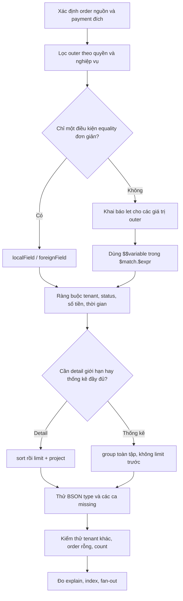

# let, biến pipeline và điều kiện tương quan trong $lookup

Trong **Spring Data MongoDB**, aggregation cho phép biến đổi document, nhóm dữ liệu và kết hợp kết quả từ nhiều collection. Toán tử **`$lookup`** có thể ghép các document theo một khóa đơn giản, tương tự *left outer join*. Tuy nhiên, nghiệp vụ thường phức tạp hơn “`orders._id = payments.orderId`”: một đơn hàng chỉ được ghép với những khoản thanh toán thuộc **cùng tenant**, có **số tiền đáp ứng ngưỡng riêng của đơn**, có **trạng thái hợp lệ** và phát sinh **sau khi đơn được tạo**.

Muốn diễn đạt điều kiện phụ thuộc vào từng document phía ngoài (*correlated subquery*), bạn dùng **`let` trong `$lookup`** để đặt tên cho các giá trị của document nguồn, rồi tham chiếu chúng bằng cú pháp **`$$variable`** ở pipeline của collection đích. Khi cần so sánh field ở collection đích với những biến đó, hãy đặt phép so sánh bên trong **`$expr`** của `$match`.

Ví dụ ý tưởng:

```javascript
{
  $lookup: {
    from: "payments_lookup_lab",
    let: {
      orderKey: "$_id",
      orderTenant: "$tenantId",
      minimum: "$minimumAmount"
    },
    pipeline: [
      {
        $match: {
          $expr: {
            $and: [
              { $eq: ["$orderId", "$$orderKey"] },
              { $eq: ["$tenantId", "$$orderTenant"] },
              { $gte: ["$amount", "$$minimum"] }
            ]
          }
        }
      }
    ],
    as: "eligiblePayments"
  }
}
```

Với mỗi order đầu vào, MongoDB đánh giá `orderKey`, `orderTenant` và `minimum` theo **order hiện tại**, chạy truy vấn liên quan tới collection `payments_lookup_lab` và gắn kết quả vào array `eligiblePayments` của order. Chính quan hệ giữa biến phía ngoài và field phía trong khiến truy vấn được gọi là **tương quan**.

Bài thuộc chương **Aggregation nâng cao** của module **SPRING_DATA_MONGODB**: ứng dụng Spring Data MongoDB để ánh xạ document, dùng repository/`MongoTemplate`, thiết kế truy vấn và aggregation, index, kiểm thử và chẩn đoán hiệu năng. Trọng tâm trực tiếp của bài là **`let`, biến pipeline và điều kiện tương quan trong `$lookup`**, không phải biến aggregation một cách chung chung.

Sau bài học, bạn có thể:

1. Phân biệt `$lookup` dạng `localField/foreignField` và dạng `let + pipeline`.
2. Hiểu phạm vi biến: `$field`, `$$variable`, `$$ROOT`, `$$CURRENT`, `$$NOW`.
3. Viết đúng `$match + $expr` để so sánh field của document đích với biến từ document nguồn.
4. Kết hợp điều kiện equality, khoảng thời gian, Decimal128, status và tenant trong cùng một correlated lookup.
5. Dùng `$project`, `$sort`, `$limit`, `$group` sau khi lọc; không nhầm “lấy 2 record” với “tính tổng tất cả”.
6. Xây một pipeline tương tự bằng `MongoTemplate.aggregate(...)`, hiểu khi nào dùng raw `AggregationOperation` và khi nào dùng DSL của Spring Data.
7. Nhận diện rủi ro của field thiếu, BSON type lệch, biến không được bind, xung đột tên và fan-out lớn.
8. Đọc `explain("executionStats")`, cân nhắc index của collection đích và kiểm thử tính đúng đắn trên nhiều tenant.

## 1. Từ `$lookup` đơn giản đến tương quan

### 1.1. Join chỉ bằng một khóa

Giả sử:

```javascript
// orders_lookup_lab
{ _id: ObjectId("665f1f2a4b6c7d8e9f001234"), tenantId: "T1" }

// payments_lookup_lab
{
  orderId: ObjectId("665f1f2a4b6c7d8e9f001234"),
  tenantId: "T1",
  amount: NumberDecimal("80.00")
}
```

Một join đơn giản:

```javascript
db.orders_lookup_lab.aggregate([
  {
    $lookup: {
      from: "payments_lookup_lab",
      localField: "_id",
      foreignField: "orderId",
      as: "payments"
    }
  }
]);
```

`localField` được lấy từ document nguồn, `foreignField` từ collection `from`. Đây là cú pháp đơn giản, phù hợp khi chỉ cần khớp khóa. Kết quả mặc định là array `payments`, kể cả khi không có bản ghi phù hợp (array rỗng).

Nhưng nếu mỗi order chỉ muốn những payment **cùng tenant**, **đã CAPTURED**, **sau thời điểm tạo order** và **amount ≥ minimumAmount của order**, một phép equality đơn lẻ không diễn đạt đủ.

### 1.2. Vì sao `$match` thông thường chưa đủ?

Một cách viết sai thường gặp:

```javascript
// SAI nếu muốn tham chiếu biến let theo cách này.
{
  $match: {
    orderId: "$$orderKey"
  }
}
```

Trong cú pháp query thông thường, `"$$orderKey"` ở vị trí giá trị không tự được đánh giá thành **giá trị biến aggregation**. Muốn so sánh field `orderId` với biến `orderKey` ở pipeline của `$lookup`, cần ngữ cảnh **expression**:

```javascript
{
  $match: {
    $expr: {
      $eq: ["$orderId", "$$orderKey"]
    }
  }
}
```

Ở đây:

- `"$orderId"` là **field path** trong document của collection đích `payments_lookup_lab`.
- `"$$orderKey"` là **biến đã khai báo trong `$lookup.let`**, nhận giá trị từ order hiện tại.
- `$eq` so sánh hai giá trị trong một biểu thức aggregation.

Không nhầm `"$orderKey"` với `"$$orderKey"`: một dấu `$` là tham chiếu field, hai dấu `$$` là tham chiếu **biến**.

### 1.3. Ba dạng lookup thường gặp

| Dạng | Ví dụ chính | Khi nên dùng |
| --- | --- | --- |
| `localField/foreignField` | `_id = orderId` | Một equality đơn giản |
| `let + pipeline` | `orderId = $$orderKey AND amount >= $$minimum` | Điều kiện phụ thuộc nhiều field của order |
| `localField/foreignField + pipeline` | Khớp `_id/orderId` và lọc thêm `status` | Cú pháp kết hợp được hỗ trợ trên các MongoDB version phù hợp |

Với MongoDB có hỗ trợ cú pháp kết hợp concise correlated lookup, bạn có thể dùng `localField`/`foreignField` cùng `pipeline` để diễn đạt phần equality phổ biến gọn hơn. Tuy nhiên, khi cần **nhiều giá trị outer** và biểu thức số/ngày, `let + $expr` vẫn là kỹ năng cốt lõi. Kiểm tra cú pháp/vùng tính năng đúng với phiên bản MongoDB và Spring Data của dự án trước khi sử dụng.

## 2. Cấu trúc đầy đủ của correlated `$lookup`

Một khung chuẩn:

```javascript
{
  $lookup: {
    from: "<collection-duoc-tra-cuu>",
    let: {
      variableA: "<bieu-thuc-tren-document-nguon>",
      variableB: "<bieu-thuc-khac>"
    },
    pipeline: [
      { $match: { $expr: { /* su dung $$variableA, $$variableB */ } } },
      { $project: { /* cac field can tra */ } }
    ],
    as: "matchedDocuments"
  }
}
```

Trong khung này:

| Thành phần | Vai trò | Sai lầm phổ biến |
| --- | --- | --- |
| `from` | Collection được truy vấn | Nhầm với tên Java entity/repository |
| `let` | Khai báo các biến cho pipeline đích | Dùng `$variable` thay cho `$$variable` |
| `variableA: "$_id"` | Lấy `_id` từ **document nguồn** | Tưởng đây là field trong collection đích |
| `pipeline` | Các stage chạy trên collection đích | Quên rằng `$match` ở đây không dùng field của order theo cách trực tiếp |
| `$match + $expr` | So sánh field đích với biến `let` | Viết `{ orderId: "$$orderKey" }` |
| `as` | Field array kết quả trong document nguồn | Đặt trùng field hiện có gây ghi đè kết quả dự kiến |

**Một điều kiện quan trọng:** biến `let` được xác định **cho từng document đầu vào**. Vì vậy, cùng một pipeline nhưng với order A và order B có thể dùng các ngưỡng tiền và thời điểm khác nhau. Đó là điểm phân biệt giữa correlated lookup và một subquery không phụ thuộc document nguồn.

### 2.1. Pipeline có nhiều stage

```javascript
{
  $lookup: {
    from: "payments_lookup_lab",
    let: {
      orderKey: "$_id",
      orderTenant: "$tenantId",
      minimum: "$minimumAmount"
    },
    pipeline: [
      { $match: { status: "CAPTURED" } },
      {
        $match: {
          $expr: {
            $and: [
              { $eq: ["$orderId", "$$orderKey"] },
              { $eq: ["$tenantId", "$$orderTenant"] },
              { $gte: ["$amount", "$$minimum"] }
            ]
          }
        }
      },
      { $sort: { paidAt: -1, _id: -1 } },
      { $limit: 2 },
      { $project: { orderId: 1, amount: 1, paidAt: 1 } }
    ],
    as: "recentEligiblePayments"
  }
}
```

Với một order, kết quả là **tối đa hai payment phù hợp gần nhất**. `$sort` được đặt **trước** `$limit` để xác định hai payment được chọn, và thêm `_id` làm tie-breaker khi nhiều payment có cùng `paidAt`. `$project` giảm dữ liệu trả về trong mảng. Nếu cần trả cả `tenantId` hoặc `status`, bổ sung những field đó vào projection.

**Không được suy ra** `$limit: 2` làm tổng số payment của order chỉ còn hai. Nó chỉ giới hạn array ghép ra. Nếu nghiệp vụ cần tính tổng tất cả khoản tiền, không được giới hạn hai bản ghi trước `$group` rồi coi kết quả là tổng thanh toán.

### 2.2. Scope của biến `let`

Biến của `$lookup.let` có thể được tham chiếu trong các stage thuộc pipeline của `$lookup`, bao gồm những stage lồng nhau phù hợp với quy tắc phạm vi biến. Nhưng không phải mọi vị trí đều diễn giải chuỗi `$$...` như biến:

```javascript
// Đúng: nằm trong aggregation expression.
{ $match: { $expr: { $gte: ["$amount", "$$minimum"] } } }

// Đúng: $project dùng một expression để tạo field.
{ $project: { amount: 1, expectedMinimum: "$$minimum" } }

// Sai cho phép so sánh biến trong query syntax thông thường.
{ $match: { amount: { $gte: "$$minimum" } } }
```

Ngoài ra, outer `$lookup.let` không làm xuất hiện một **field vật lý** tên `minimum` trong payment. Nó chỉ tạo một biến thuộc ngữ cảnh đánh giá biểu thức, không ghi thay đổi vào collection đích.

### 2.3. Giá trị từ field nguồn và expression nguồn

Giá trị trong `let` không bắt buộc là một field path đơn giản. Bạn có thể tạo một biểu thức:

```javascript
let: {
  orderKey: "$_id",
  minAllowed: {
    $ifNull: ["$minimumAmount", NumberDecimal("0")]
  },
  createdCutoff: "$createdAt"
}
```

Ở đây `minAllowed` là giá trị đã được tính cho **mỗi order**. Tuy nhiên, `$ifNull` chỉ nên dùng khi nghiệp vụ thực sự quy ước thiếu minimumAmount tương đương 0. Nếu thiếu field là dữ liệu lỗi, nên loại document hoặc sửa schema thay vì che khuất bằng default.

## 3. Hiểu biến aggregation: `$field`, `$$variable` và các biến hệ thống

Một trong những nguyên nhân khiến `$lookup` có pipeline khó đọc là MongoDB sử dụng dấu `$` trong nhiều vai trò khác nhau. Xác định rõ **đối tượng mà biểu thức đang đọc** giúp tránh vô số lỗi logic.

| Cú pháp | Ý nghĩa | Trong pipeline của `$lookup` |
| --- | --- | --- |
| `"$amount"` | Giá trị field `amount` của **payment hiện tại** | Field thuộc collection `from` |
| `"$$minimum"` | Giá trị biến `minimum` khai báo ở `let` | Thường lấy từ order nguồn |
| `"$_id"` | `_id` của document hiện tại trong pipeline | `_id` của payment, **không** phải order |
| `"$$orderKey"` | `_id` của order nguồn đã bind vào biến | Dùng để so với `payment.orderId` |
| `"$$ROOT"` | Root document của ngữ cảnh stage hiện tại | Bên trong pipeline đích, là root payment hiện tại |
| `"$$CURRENT"` | Document/ngữ cảnh hiện tại khi phân giải field path | Có thể bị thay đổi trong biểu thức nâng cao |
| `"$$NOW"` | Thời điểm hệ thống trong ngữ cảnh aggregation | Dùng cho điều kiện thời gian có chủ đích |

### 3.1. Biến không phải “tên cột trong bảng tạm”

```javascript
let: { orderKey: "$_id" }
```

không tạo field `orderKey` trong payment hoặc order. Nó chỉ đặt tên cho một giá trị mà `$lookup` cung cấp cho subpipeline. Muốn trả giá trị đó ra kết quả:

```javascript
{
  $project: {
    _id: 1,
    orderId: 1,
    amount: 1,
    lookupOrderKey: "$$orderKey"
  }
}
```

Field `lookupOrderKey` là **field kết quả của projection trong subpipeline**, không phải dữ liệu được ghi vào collection thanh toán. Việc debug bằng projection như vậy rất hữu ích để nhìn thấy mỗi document đích đã nhận biến `let` nào.

### 3.2. Không dùng `$$ROOT` thay cho outer document

Ví dụ:

```javascript
{
  $lookup: {
    from: "payments_lookup_lab",
    let: { orderKey: "$_id" },
    pipeline: [
      {
        $project: {
          paymentRoot: "$$ROOT",
          capturedOrderKey: "$$orderKey"
        }
      }
    ],
    as: "debugPayments"
  }
}
```

Trong `$project` của collection đích, `$$ROOT` là **payment hiện đang xử lý**, còn `$$orderKey` là giá trị outer `_id`. Nếu muốn lấy toàn bộ order vào subpipeline để dùng ở bước khác, bạn cần chủ động bind:

```javascript
let: {
  orderSnapshot: "$$ROOT"
}
```

Sau đó tham chiếu `"$$orderSnapshot.tenantId"` hoặc `"$$orderSnapshot._id"` ở ngữ cảnh expression phù hợp. Nhưng **không nên mang cả document lớn** qua `let` khi chỉ cần hai hoặc ba field. Bind các scalar cần thiết thường giúp query dễ đọc và dễ kiểm soát hơn.

### 3.3. `$lookup.let` và toán tử expression `$let` là hai cấu trúc khác nhau

MongoDB còn có toán tử **`$let`** trong aggregation expression:

```javascript
{
  $project: {
    remainingAmount: {
      $let: {
        vars: {
          paid: { $ifNull: ["$paidAmount", NumberDecimal("0")] },
          total: "$totalAmount"
        },
        in: { $subtract: ["$$total", "$$paid"] }
      }
    }
  }
}
```

Đây là `$let` **bên trong một expression**: `vars` định nghĩa biến cục bộ và `in` trả kết quả. Còn `let` trong `$lookup` là **một thuộc tính stage**, dùng để đưa biến từ outer document vào pipeline đích:

```javascript
{
  $lookup: {
    from: "payments_lookup_lab",
    let: { orderKey: "$_id" },
    pipeline: [ /* $match với $$orderKey */ ],
    as: "payments"
  }
}
```

| `$lookup.let` | Toán tử `$let` |
| --- | --- |
| Khai báo biến cho một correlated lookup pipeline | Khai báo biến cục bộ để tính một expression |
| Dùng object `let: { name: expr }` | Dùng object `$let: { vars: {...}, in: expr }` |
| Truyền ngữ cảnh outer document vào subpipeline | Tách công thức lớn thành những phần có tên |
| Không có thuộc tính `in` của toán tử `$let` | `in` xác định giá trị expression trả về |

Tránh viết `$lookup: { let: { vars: ..., in: ... } }` theo cấu trúc của `$let` expression; đó là hai hợp đồng khác nhau.

### 3.4. Shadowing và nested lookup

Khi một subpipeline chứa `$lookup` lồng sâu hơn, nó có thể dùng biến từ các scope phù hợp hoặc khai báo biến mới. Nếu đặt tên biến mới trùng tên cũ, việc đọc mã trở nên khó hiểu và có thể đổi ý nghĩa tham chiếu.

Quy ước nên dùng:

```text
outerOrderId      -> biến của order
outerTenantId     -> biến tenant của order
paymentId         -> biến được bind trong lookup sâu hơn
paymentCapturedAt -> mốc thời gian của payment
```

Đặt tên theo **nguồn và ý nghĩa**, không đặt hàng loạt biến chung chung như `id`, `id2`, `value`. Khi pipeline có nhiều tầng, ưu tiên tách các stage và kiểm thử từng tầng trước khi ghép.

## 4. Ví dụ nghiệp vụ: ghép payment hợp lệ vào mỗi order

### 4.1. Mô hình hai collection

Collection `orders_lookup_lab`:

```javascript
{
  _id: ObjectId("665f1f2a4b6c7d8e9f001234"),
  tenantId: "T1",
  status: "OPEN",
  createdAt: ISODate("2026-11-20T09:00:00Z"),
  minimumAmount: NumberDecimal("60.00")
}
```

Collection `payments_lookup_lab`:

```javascript
{
  _id: ObjectId("665f1f2a4b6c7d8e9f004567"),
  tenantId: "T1",
  orderId: ObjectId("665f1f2a4b6c7d8e9f001234"),
  status: "CAPTURED",
  amount: NumberDecimal("80.00"),
  paidAt: ISODate("2026-11-20T09:10:00Z")
}
```

Một payment được xem là **đạt điều kiện** với order nguồn khi:

```text
payment.orderId  == order._id
payment.tenantId == order.tenantId
payment.status   == "CAPTURED"
payment.amount   >= order.minimumAmount
payment.paidAt   >= order.createdAt
```

Mỗi điều kiện đều có ý nghĩa riêng:

- `orderId` xác định quan hệ nghiệp vụ giữa payment và order.
- `tenantId` là ranh giới truy cập. Một payment có `orderId` giống nhau nhưng khác tenant **không** được phép ghép.
- `status` chỉ cho phép những payment đã được ghi nhận thành công.
- `minimumAmount` **khác nhau với từng order**; không thể đặt một ngưỡng chung nếu yêu cầu phụ thuộc order.
- `createdAt` của order xác định mốc thời gian; thanh toán trước khi order được tạo không đạt điều kiện ví dụ.

Các quy tắc trên là **quy ước của bài tập**, không phải quy tắc kế toán áp dụng cho mọi sản phẩm. Một payment nhỏ hơn minimumAmount vẫn có thể là partial payment hợp lệ trong hệ thống khác. Ở đây `eligiblePayments` chỉ có nghĩa “payment đạt điều kiện lọc đã định nghĩa”.

### 4.2. Pipeline hoàn chỉnh: lọc outer rồi lookup tương quan

```javascript
db.orders_lookup_lab.aggregate([
  {
    $match: {
      tenantId: "T1",
      status: "OPEN"
    }
  },
  {
    $lookup: {
      from: "payments_lookup_lab",
      let: {
        orderKey: "$_id",
        scopeTenant: "$tenantId",
        minimum: "$minimumAmount",
        orderCreatedAt: "$createdAt"
      },
      pipeline: [
        {
          $match: {
            status: "CAPTURED",
            $expr: {
              $and: [
                { $eq: ["$orderId", "$$orderKey"] },
                { $eq: ["$tenantId", "$$scopeTenant"] },
                { $gte: ["$amount", "$$minimum"] },
                { $gte: ["$paidAt", "$$orderCreatedAt"] }
              ]
            }
          }
        },
        { $sort: { paidAt: -1, _id: -1 } },
        { $limit: 2 },
        {
          $project: {
            _id: 1,
            orderId: 1,
            tenantId: 1,
            amount: 1,
            paidAt: 1
          }
        }
      ],
      as: "eligiblePayments"
    }
  },
  {
    $addFields: {
      eligiblePaymentCount: {
        $size: "$eligiblePayments"
      }
    }
  },
  {
    $project: {
      tenantId: 1,
      status: 1,
      createdAt: 1,
      minimumAmount: 1,
      eligiblePayments: 1,
      eligiblePaymentCount: 1
    }
  }
]);
```

Luồng đánh giá:

1. `$match` đầu tiên lọc **orders** theo tenant và status.
2. Với mỗi order còn lại, `$lookup.let` lấy `_id`, `tenantId`, `minimumAmount` và `createdAt` của order đó.
3. Bên trong `$lookup.pipeline`, `$match` áp dụng `status` của **payment** và bốn biểu thức so sánh tương quan.
4. `$sort` sắp payment mới nhất lên trước; `_id` phá hòa nếu `paidAt` bằng nhau.
5. `$limit` giới hạn array payment cho **mỗi order** ở tối đa hai phần tử.
6. `$addFields` đếm **số payment được trả trong array**, tối đa hai, **không phải tổng số payment đạt điều kiện nếu có hơn hai**.
7. `$project` chỉ giữ các trường cần gửi về client.

Đối với order không có payment đạt điều kiện, `eligiblePayments` là array rỗng và `eligiblePaymentCount` bằng 0; order vẫn còn trong kết quả. Đây là tính chất **left outer join** cơ bản của `$lookup`.

### 4.3. Lọc chỉ những order có ít nhất một payment đạt điều kiện

Sau `$lookup` có thể thêm:

```javascript
{
  $match: {
    "eligiblePayments.0": { $exists: true }
  }
}
```

Điều kiện `eligiblePayments.0` chỉ tồn tại khi array có ít nhất một phần tử. Nó sẽ loại order có array rỗng, đưa ngữ nghĩa từ “trả mọi order kèm payment” sang “chỉ trả order có payment đạt điều kiện”.

Nếu cần giữ lại order chưa có payment để hiển thị trạng thái chờ thanh toán, **không thêm điều kiện này**. Sự khác biệt nằm ở **hợp đồng API**, không phải một tùy chọn tối ưu có thể thêm tùy ý.

### 4.4. `$unwind` và bảo toàn order rỗng

Nếu muốn một hàng kết quả cho mỗi payment:

```javascript
{
  $unwind: {
    path: "$eligiblePayments",
    preserveNullAndEmptyArrays: true
  }
}
```

Với `preserveNullAndEmptyArrays: true`, order không có payment vẫn được giữ với field payment không chứa một phần tử như bình thường. Nếu bỏ tùy chọn này hoặc để false, order có array rỗng sẽ bị loại khỏi kết quả sau `$unwind`.

Vì `$unwind` tạo thêm hàng, phân trang/`$count` sau đó có thể đếm **payment rows**, không phải **orders**. Chọn vị trí `$unwind` theo ý nghĩa dữ liệu bạn muốn trả.

## 5. Tính tổng tất cả payment: không đặt `$limit` trước `$group`

Hai câu hỏi nghiệp vụ sau khác nhau:

1. **Lấy hai payment hợp lệ gần nhất** của mỗi order.
2. **Tính tổng số tiền của mọi payment hợp lệ** của mỗi order.

Ở mục 4, `$sort + $limit` trả lời câu hỏi 1. Để trả lời câu hỏi 2, bạn cần tính aggregate trên **toàn bộ tập payment phù hợp**, không cắt bớt trước.

### 5.1. `$group` bên trong correlated lookup

```javascript
db.orders_lookup_lab.aggregate([
  { $match: { tenantId: "T1", status: "OPEN" } },
  {
    $lookup: {
      from: "payments_lookup_lab",
      let: {
        orderKey: "$_id",
        scopeTenant: "$tenantId",
        minimum: "$minimumAmount",
        orderCreatedAt: "$createdAt"
      },
      pipeline: [
        {
          $match: {
            status: "CAPTURED",
            $expr: {
              $and: [
                { $eq: ["$orderId", "$$orderKey"] },
                { $eq: ["$tenantId", "$$scopeTenant"] },
                { $gte: ["$amount", "$$minimum"] },
                { $gte: ["$paidAt", "$$orderCreatedAt"] }
              ]
            }
          }
        },
        {
          $group: {
            _id: null,
            totalEligibleAmount: { $sum: "$amount" },
            eligibleCount: { $sum: 1 }
          }
        },
        { $project: { _id: 0, totalEligibleAmount: 1, eligibleCount: 1 } }
      ],
      as: "paymentStats"
    }
  },
  {
    $addFields: {
      totalEligibleAmount: {
        $ifNull: [
          { $arrayElemAt: ["$paymentStats.totalEligibleAmount", 0] },
          NumberDecimal("0")
        ]
      },
      eligibleCount: {
        $ifNull: [
          { $arrayElemAt: ["$paymentStats.eligibleCount", 0] },
          0
        ]
      }
    }
  },
  { $project: { tenantId: 1, totalEligibleAmount: 1, eligibleCount: 1 } }
]);
```

Lưu ý:

- Vì `$group` tạo **một document thống kê** khi có payment khớp và **không có document** khi không khớp, `paymentStats` có thể là array `[]`.
- `$arrayElemAt` lấy phần tử thống kê đầu tiên nếu có; `$ifNull` trả 0 khi không có.
- `NumberDecimal("0")` giúp default cùng kiểu số tiền Decimal128 mà bài thực hành sử dụng.
- Không có `$limit` trước `$group`, vì thế các phép `$sum` và `$count` phản ánh **tất cả payment đạt điều kiện**, không chỉ hai payment mới nhất.
- `eligibleCount` là số payment đã vượt qua toàn bộ bộ lọc, không phải số payment bất kỳ của order.

Nếu ứng dụng cần **tổng tất cả khoản CAPTURED** bất kể minimumAmount của order, hãy bỏ điều kiện `$gte: ["$amount","$$minimum"]`. Tính đúng đắn của phép thống kê phụ thuộc vào ý nghĩa từ “hợp lệ” đã thống nhất.

### 5.2. Ghép cả chi tiết và thống kê

Có thể chạy hai correlated lookup khác nhau, một để lấy **hai payment gần nhất**, một để **thống kê toàn bộ**, rồi gộp kết quả vào DTO. Tuy nhiên, chạy hai lookup có thể tăng chi phí; trên workload lớn, xem xét một subpipeline `$group` kèm những thông tin cần thiết hoặc xây view/materialized summary theo thiết kế dữ liệu.

Tránh “tối ưu” bằng cách chỉ tính tổng trên `eligiblePayments` đã bị `$limit: 2`, vì có thể cho số tiền thấp hơn thực tế. Nếu muốn đồng thời có cả array giới hạn và count chính xác, hãy làm rõ stage nào xử lý tất cả document và stage nào chỉ giới hạn dữ liệu trả về.

## 6. Biến thể cú pháp và lookup không tương quan

### 6.1. Correlated lookup với `localField/foreignField` và pipeline

Với MongoDB hỗ trợ cú pháp kết hợp, phép equality theo order ID có thể được biểu diễn trực tiếp, còn điều kiện phụ thuộc order khác dùng `let`:

```javascript
{
  $lookup: {
    from: "payments_lookup_lab",
    localField: "_id",
    foreignField: "orderId",
    let: {
      scopeTenant: "$tenantId",
      minimum: "$minimumAmount",
      orderCreatedAt: "$createdAt"
    },
    pipeline: [
      {
        $match: {
          status: "CAPTURED",
          $expr: {
            $and: [
              { $eq: ["$tenantId", "$$scopeTenant"] },
              { $gte: ["$amount", "$$minimum"] },
              { $gte: ["$paidAt", "$$orderCreatedAt"] }
            ]
          }
        }
      }
    ],
    as: "eligiblePayments"
  }
}
```

Lúc này, `localField/foreignField` xử lý điều kiện `order._id = payment.orderId`, nên không cần lặp lại điều kiện đó trong `$expr`. Nhưng tenant, số tiền và thời điểm vẫn cần biến tương quan.

**Khả năng sử dụng cú pháp này phụ thuộc phiên bản MongoDB đang chạy.** Nếu muốn bài tập dùng một dạng duy nhất dễ kiểm tra và hỗ trợ nhiều điều kiện, phiên bản `let + pipeline + $expr` ở mục 4 là một lựa chọn rõ ràng.

### 6.2. Lookup không tương quan

Một *uncorrelated lookup* không sử dụng dữ liệu từ order hiện tại. Ví dụ mọi order đều cần tham chiếu cùng danh sách mã trạng thái:

```javascript
{
  $lookup: {
    from: "payment_status_definitions",
    pipeline: [
      { $match: { enabled: true } },
      { $project: { _id: 0, code: 1, label: 1 } }
    ],
    as: "availablePaymentStatuses"
  }
}
```

Không có `let` hay điều kiện phụ thuộc order. Tập trạng thái được trả cho mọi order theo cùng định nghĩa. Trong một số phiên bản và điều kiện, MongoDB có thể cache kết quả một subquery không tương quan, nhưng không nên giả định hiệu năng hoặc hành vi cache giống nhau trên mọi deployment. Với các pipeline không tương quan sử dụng random sampling như `$sample` hoặc `$rand`, hành vi thực thi có những quy tắc riêng theo phiên bản.

### 6.3. Khác biệt ở số hàng được tạo

Giả sử có 100 order và trung bình 10 payment/order:

| Kiểu pipeline | Dạng kết quả | Hệ quả |
| --- | --- | --- |
| `$lookup` không giới hạn | 100 order, mỗi order có array payment | Có thể tạo array lớn |
| `$lookup` với `$sort + $limit: 2` | 100 order, mỗi array tối đa 2 payment | Giới hạn payload theo order |
| `$lookup` rồi `$unwind` | Có thể thành ~1.000 hàng | Pagination/count có thể đổi ý nghĩa |
| `$lookup` với `$group` bên trong | 100 order, mỗi order có thống kê | Không phải trả toàn bộ detail payment |

Đừng chỉ nhìn số order sau `$lookup` để đánh giá tài nguyên. Kích thước từng mảng ghép, số candidate payment được xét và thứ tự stage có thể tạo khác biệt hiệu năng lớn.

## 7. Kiểu BSON và dữ liệu thiếu: lỗi join thường bị bỏ qua

### 7.1. `ObjectId` và String không giống nhau

Order có:

```javascript
_id: ObjectId("665f1f2a4b6c7d8e9f001234")
```

Payment có:

```javascript
orderId: "665f1f2a4b6c7d8e9f001234"
```

Hai giá trị trông giống khi in ra nhưng khác **BSON type** (`ObjectId` và String), nên phép `$eq: ["$orderId","$$orderKey"]` sẽ không diễn đạt mối quan hệ như dự định. Trong Java, hãy xác định rõ `ObjectId` cho ID và foreign key, hoặc áp dụng converter nhất quán cho hai collection.

Khi migration dữ liệu cũ lưu String, có thể dùng biểu thức chuyển đổi đúng loại trong các pipeline hỗ trợ. Tuy nhiên, chuyển đổi mỗi document khi join có thể làm query tốn tài nguyên và hạn chế tối ưu index; tốt hơn là chuẩn hóa dữ liệu lưu trữ.

### 7.2. Decimal128 so với Double và chuỗi tiền tệ

`amount` và `minimumAmount` nên có cùng chính sách lưu tiền:

```javascript
amount: NumberDecimal("80.00")
minimumAmount: NumberDecimal("60.00")
```

Nếu một phía lưu String `"80.00"`, phép so sánh không còn là so sánh số học theo nghiệp vụ. Nếu một phía dùng Double, có thể phát sinh sai khác độ chính xác trong các phép tính. Spring Data MongoDB hỗ trợ ánh xạ Java `BigDecimal` sang Decimal128 với `@Field(targetType = FieldType.DECIMAL128)`.

Trước khi tối ưu join, kiểm tra:

```javascript
db.payments_lookup_lab.aggregate([
  {
    $group: {
      _id: { amountType: { $type: "$amount" } },
      documents: { $sum: 1 }
    }
  }
]);
```

Làm tương tự cho `orders_lookup_lab.minimumAmount`. Dữ liệu test của bài sẽ cố ý dùng Decimal128 thống nhất.

### 7.3. BSON Date, timezone và độ phân giải

`paidAt` và `createdAt` ở ví dụ lưu dưới BSON Date. Chúng biểu diễn thời điểm (mili giây từ epoch UTC), không phải chuỗi “ngày hiển thị ở Việt Nam”. Trong Java nên dùng `Instant` hoặc một kiểu thời gian có chính sách chuyển đổi rõ ràng; tránh tự nối chuỗi `"2026-11-20 09:00"` rồi so sánh lexicographic.

Nếu nhiều payment có cùng `paidAt`, `$sort` chỉ theo `paidAt` chưa xác định thứ tự toàn phần. Thêm `_id` như một **tie-breaker duy nhất**, và giữ cùng thứ tự ở mọi query/cursor.

### 7.4. Field `null` hoặc không tồn tại

Nếu một order thiếu `minimumAmount`, biểu thức:

```javascript
{ $gte: ["$amount", "$$minimum"] }
```

không còn có ý nghĩa nghiệp vụ rõ ràng. Việc MongoDB so sánh khác BSON type có thể cho kết quả ngoài dự kiến; không mặc định missing nghĩa là 0.

Hai chính sách hợp lệ cần được chọn **trước khi viết query**:

1. **Bắt buộc đủ field**: lọc các order có `minimumAmount` đúng BSON type và thanh toán có `amount` đúng type.
2. **Giá trị mặc định có chủ đích**: khai báo `let.minimum` bằng `$ifNull` hoặc biểu thức phù hợp khi product contract cho phép coi thiếu minimum là 0.

Ví dụ yêu cầu order phải có Decimal128:

```javascript
{
  $match: {
    tenantId: "T1",
    status: "OPEN",
    minimumAmount: { $type: "decimal" },
    createdAt: { $type: "date" }
  }
}
```

Với payment, có thể thêm vào `$match` trong pipeline:

```javascript
{
  $match: {
    amount: { $type: "decimal" },
    paidAt: { $type: "date" },
    status: "CAPTURED"
  }
}
```

Sử dụng các check này nếu dữ liệu chưa đảm bảo schema. Khi đã có MongoDB JSON Schema validator và mọi đường ghi tuân thủ, có thể tập trung vào filter nghiệp vụ và đo hiệu năng.

### 7.5. Biến từ field array hoặc object

`$lookup.let` có thể bind biểu thức tạo array hoặc object, nhưng việc dùng chúng trong `$eq`, `$in` hay `$gte` sẽ có ngữ nghĩa khác scalar. Ví dụ, `$in` có thể kiểm tra một khóa thanh toán trong danh sách order IDs:

```javascript
{
  $expr: {
    $in: ["$orderId", "$$allowedOrderIds"]
  }
}
```

Điều này chỉ hợp lý nếu `allowedOrderIds` thực sự là **array**. Với dữ liệu lớn, việc mang một array ID dài vào mỗi correlated lookup có thể tốn tài nguyên; cân nhắc mô hình quan hệ và index phù hợp. Không lấy công thức scalar `$eq` rồi áp dụng máy móc cho array.

## 8. Spring Data MongoDB: tạo correlated lookup bằng `MongoTemplate`

Spring Data MongoDB cung cấp Aggregation API, `LookupOperation` và các expression DSL. Những DSL này phát triển theo phiên bản: tên method/kiểu hỗ trợ `let` và `pipeline` có thể khác giữa các bản phát hành. Để làm rõ **BSON thực sự gửi xuống MongoDB**, phần này sử dụng **`AggregationOperation` tùy biến tạo `Document`**, rồi thực thi với `MongoTemplate.aggregate`. Đây là một cách hữu ích khi cần một stage mới hoặc cấu trúc `$lookup` chưa được DSL của phiên bản dự án biểu diễn thuận tiện.

### 8.1. Các entity Java tối thiểu

```java
import java.math.BigDecimal;
import java.time.Instant;
import org.bson.types.ObjectId;
import org.springframework.data.annotation.Id;
import org.springframework.data.mongodb.core.mapping.Document;
import org.springframework.data.mongodb.core.mapping.Field;
import org.springframework.data.mongodb.core.mapping.FieldType;

@Document(collection = "orders_lookup_lab")
public class PurchaseOrder {
    @Id
    private ObjectId id;
    private String labRun;
    private String tenantId;
    private String status;
    private Instant createdAt;

    @Field(targetType = FieldType.DECIMAL128)
    private BigDecimal minimumAmount;

    protected PurchaseOrder() {}

    public PurchaseOrder(
            String labRun, String tenantId, String status,
            Instant createdAt, BigDecimal minimumAmount) {
        this.labRun = labRun;
        this.tenantId = tenantId;
        this.status = status;
        this.createdAt = createdAt;
        this.minimumAmount = minimumAmount;
    }

    public ObjectId getId() { return id; }
    public String getLabRun() { return labRun; }
    public String getTenantId() { return tenantId; }
    public String getStatus() { return status; }
    public Instant getCreatedAt() { return createdAt; }
    public BigDecimal getMinimumAmount() { return minimumAmount; }
}
```

Và:

```java
import java.math.BigDecimal;
import java.time.Instant;
import org.bson.types.ObjectId;
import org.springframework.data.annotation.Id;
import org.springframework.data.mongodb.core.mapping.Document;
import org.springframework.data.mongodb.core.mapping.Field;
import org.springframework.data.mongodb.core.mapping.FieldType;

@Document(collection = "payments_lookup_lab")
public class OrderPayment {
    @Id
    private ObjectId id;
    private String labRun;
    private String tenantId;
    private ObjectId orderId;
    private String status;
    private Instant paidAt;

    @Field(targetType = FieldType.DECIMAL128)
    private BigDecimal amount;

    protected OrderPayment() {}

    public OrderPayment(
            String labRun, String tenantId, ObjectId orderId,
            String status, Instant paidAt, BigDecimal amount) {
        this.labRun = labRun;
        this.tenantId = tenantId;
        this.orderId = orderId;
        this.status = status;
        this.paidAt = paidAt;
        this.amount = amount;
    }

    public ObjectId getId() { return id; }
    public String getLabRun() { return labRun; }
    public String getTenantId() { return tenantId; }
    public ObjectId getOrderId() { return orderId; }
    public String getStatus() { return status; }
    public Instant getPaidAt() { return paidAt; }
    public BigDecimal getAmount() { return amount; }
}
```

Hai class ở trên thuộc hai file Java riêng khi đưa vào ứng dụng thực tế. `OrderPayment.orderId` dùng `ObjectId` để tương thích với `PurchaseOrder.id`. Decimal128 ở hai class giúp so sánh ngưỡng tiền theo cùng chính sách lưu trữ. Các constructor cố ý giới hạn trong yêu cầu bài tập; production cần thêm validation, transaction policy và ràng buộc nghiệp vụ.

### 8.2. Dựng các biểu thức BSON bằng `Document`

```java
import java.util.List;
import org.bson.Document;
import org.springframework.data.mongodb.core.MongoTemplate;
import org.springframework.data.mongodb.core.aggregation.Aggregation;
import org.springframework.data.mongodb.core.aggregation.AggregationOperation;
import org.springframework.data.mongodb.core.query.Criteria;

public class OrderPaymentAggregationService {

    private final MongoTemplate template;

    public OrderPaymentAggregationService(MongoTemplate template) {
        this.template = template;
    }

    public List<Document> findOrdersWithEligiblePayments(
            String trustedTenantId, String labRun, int perOrderLimit) {

        if (trustedTenantId == null || trustedTenantId.isBlank()) {
            throw new IllegalArgumentException("Thiếu tenant");
        }
        if (labRun == null || labRun.isBlank()) {
            throw new IllegalArgumentException("Thiếu marker lab");
        }
        if (perOrderLimit < 1 || perOrderLimit > 20) {
            throw new IllegalArgumentException("limit không hợp lệ");
        }

        // Cấu trúc toán tử và field do server định nghĩa.
        Document compareOuterAndInner = new Document("$and", List.of(
            new Document("$eq",
                List.of("$orderId", "$$orderKey")),
            new Document("$eq",
                List.of("$tenantId", "$$scopeTenant")),
            new Document("$eq",
                List.of("$labRun", "$$scopeRun")),
            new Document("$gte",
                List.of("$amount", "$$minimum")),
            new Document("$gte",
                List.of("$paidAt", "$$orderCreatedAt"))
        ));

        Document paymentFilter = new Document("status", "CAPTURED")
            .append("amount", new Document("$type", "decimal"))
            .append("paidAt", new Document("$type", "date"))
            .append("$expr", compareOuterAndInner);

        Document variables = new Document("orderKey", "$_id")
            .append("scopeTenant", "$tenantId")
            .append("scopeRun", "$labRun")
            .append("minimum", "$minimumAmount")
            .append("orderCreatedAt", "$createdAt");

        Document lookupSpec = new Document(
            "from", "payments_lookup_lab"
        )
            .append("let", variables)
            .append("pipeline", List.of(
                new Document("$match", paymentFilter),
                new Document("$sort",
                    new Document("paidAt", -1).append("_id", -1)),
                new Document("$limit", perOrderLimit),
                new Document("$project",
                    new Document("orderId", 1)
                        .append("tenantId", 1)
                        .append("amount", 1)
                        .append("paidAt", 1))
            ))
            .append("as", "eligiblePayments");

        AggregationOperation lookupStage =
            context -> new Document("$lookup", lookupSpec);

        Aggregation aggregation = Aggregation.newAggregation(
            Aggregation.match(
                Criteria.where("labRun").is(labRun)
                    .and("tenantId").is(trustedTenantId)
                    .and("status").is("OPEN")
                    .and("minimumAmount").type(19)
            ),
            lookupStage,
            Aggregation.project(
                "tenantId", "status", "createdAt",
                "minimumAmount", "eligiblePayments"
            )
        );

        return template.aggregate(
            aggregation,
            "orders_lookup_lab",
            Document.class
        ).getMappedResults();
    }
}
```

Giải thích kỹ:

1. `Aggregation.match(...)` chạy trên **order**, áp dụng marker thực hành, tenant, status và kiểu BSON. `type(19)` là BSON type code của Decimal128; khi muốn dễ đọc hơn trong một stage raw, có thể dùng `$type: "decimal"`.
2. `variables` khai báo đúng tên biến `orderKey`, `scopeTenant`, `scopeRun`, `minimum` và `orderCreatedAt`. Không thêm ký tự `$$` ở **tên biến được khai báo**.
3. Trong `compareOuterAndInner`, `"$orderId"` đọc field **payment**, còn `"$$orderKey"` lấy biến **order**.
4. Cấu trúc `List.of(...)` giữ được thứ tự stage. `$sort` chạy trước `$limit`.
5. `AggregationOperation` tùy biến trả về BSON stage `$lookup` như đã định nghĩa. Vì đây là **raw Document**, các field path trong subpipeline phải đúng tên **BSON**, không dựa vào Spring Data tự dịch mọi chuỗi raw qua `@Field`.
6. `MongoTemplate.aggregate(...)` thực thi pipeline trên collection `orders_lookup_lab` và ánh xạ kết quả sang `Document`. Với API thực, có thể dùng DTO riêng cho output.

**Quan trọng về isolation:** phương thức demo có `labRun` để tách những bản ghi của một lần thực hành. Trong production, marker này không cần thiết; `tenantId` vẫn phải được kiểm tra theo quyền, và nếu join có nhiều phạm vi dữ liệu khác, filter phải phản ánh tất cả ranh giới đó.

### 8.3. Không nên dùng `Document.parse` với JSON từ client

Ví dụ **không an toàn**:

```java
// KHÔNG NÊN: client điều khiển cả cấu trúc truy vấn.
Document filter = Document.parse(clientSuppliedJson);
```

Ngay cả khi chạy bên trong fragment/repository/service, việc để client quyết định `$expr`, tên field, collection `from`, toán tử hay pipeline có thể vượt phạm vi API được phép, gây rò rỉ dữ liệu hoặc tạo truy vấn nặng.

Cách ở mục 8.2 giữ **cấu trúc cố định** và chỉ truyền các giá trị đã validate/authorize như `trustedTenantId`, `labRun` và `perOrderLimit`. Nếu cần cho client chọn sort hoặc bộ lọc, hãy dùng **allowlist** thay vì nhận nguyên đoạn JSON.

### 8.4. Khi nào dùng `LookupOperation` DSL thay vì raw stage?

Nếu phiên bản Spring Data MongoDB đã có DSL hỗ trợ đầy đủ `$lookup` với `let` và `pipeline`, có thể dùng `LookupOperation`/`AggregationExpression` để cấu trúc code nhất quán với các stage khác, tận dụng cú pháp kiểu Java và mapping context. Nhưng **không nên sao chép method chain từ phiên bản khác rồi đoán tên method**. Hãy xem API tương ứng với dependencies của ứng dụng và kiểm tra BSON pipeline được phát sinh.

Chọn raw `AggregationOperation` có thể giúp diễn đạt stage MongoDB rất rõ, đổi lại:

- Bạn phải tự bảo đảm tên BSON field và toán tử hợp lệ.
- Việc refactor `@Field` không tự động sửa string trong raw expression.
- Test phải xác nhận output/trường hợp biên chứ không chỉ test Java builder tạo object.
- Đừng ghép raw JSON thủ công từ input không tin cậy.

### 8.5. Sử dụng bên trong extended repository

Ở ứng dụng đã có `MongoRepository`, một **custom repository fragment** có thể inject `MongoTemplate` và gọi `template.aggregate(...)`, trong khi repository chính vẫn cung cấp CRUD. Đây là một mô hình tổ chức hợp lý khi aggregation cần nhiều field/biến mà tên method suy diễn không thể diễn đạt.

Không cần cố tạo derived query như `findByPaymentAmountGreaterThanOrderMinimumAmount` để so sánh hai field thuộc **hai collection**. Derived query thông thường là cơ chế khác, còn correlated `$lookup` thuộc aggregation pipeline.

## 9. Index và hiệu năng của correlated `$lookup`

Một correlated lookup có thể khiến MongoDB phải tìm những payment phù hợp **cho từng order đầu vào**. Khi số order lớn, thiết kế index, thứ tự stage, tính chọn lọc và kích thước mảng kết quả quan trọng không kém bản thân cú pháp `let`.

### 9.1. Lọc outer document càng sớm càng hợp lý

Nếu endpoint chỉ đọc order của một tenant ở trạng thái OPEN, hãy đặt:

```javascript
{
  $match: {
    tenantId: "T1",
    status: "OPEN"
  }
}
```

**trước** `$lookup`. Điều này có thể giảm số order cần thực hiện join. Nếu bạn ghép payment cho mọi order rồi mới lọc tenant, ứng dụng đã thực hiện nhiều công việc không cần thiết và tăng rủi ro đưa dữ liệu ngoài phạm vi cần thiết vào pipeline.

Đối với giao diện chỉ hiển thị 20 order mỗi trang, có thể cân nhắc phân trang **outer orders trước lookup**:

```javascript
[
  { $match: { tenantId: "T1", status: "OPEN" } },
  { $sort: { createdAt: -1, _id: -1 } },
  { $limit: 20 },
  { $lookup: { /* correlated lookup */ } }
]
```

Nhưng thứ tự đó có nghĩa “lấy 20 order mới nhất, **sau đó** lấy payment của chúng”. Nếu endpoint thực sự cần “20 order mới nhất **có payment đủ điều kiện**”, đặt `$limit` trước lookup sẽ có thể trả **ít hơn 20 order** hoặc bỏ qua order đạt điều kiện nằm sau nhóm 20 đầu. Xác định semantics trước khi tối ưu stage.

### 9.2. Chỉ mục cho collection nguồn và collection đích

Với phần lọc order:

```javascript
db.orders_lookup_lab.createIndex(
  {
    tenantId: 1,
    status: 1,
    createdAt: -1,
    _id: -1
  },
  { name: "idx_orders_tenant_status_created_id" }
);
```

Đây là một ứng viên phục vụ filter equality theo tenant/status và sort outer theo `createdAt DESC, _id DESC`.

Với payment:

```javascript
db.payments_lookup_lab.createIndex(
  {
    orderId: 1,
    tenantId: 1,
    status: 1,
    paidAt: -1,
    _id: -1
  },
  { name: "idx_payments_order_tenant_status_paid_id" }
);
```

Index này là một **ứng viên để đo** cho truy vấn tìm payment theo order, tenant, status và sắp theo thời điểm. Nếu một hệ thống thực tế luôn lọc theo `labRun` (chỉ thuộc bài tập), có thể cần cân nhắc thêm field đó. Nếu payment collection được phân vùng logic theo tenant khác, thứ tự index có thể thay đổi. Không có một compound index tối ưu cho mọi query.

### 9.3. Khi nào `$expr` có thể sử dụng index?

Không thể kết luận chung rằng “`$expr` luôn dùng được index” hay “`$expr` không bao giờ dùng được index”.

Trong các phiên bản MongoDB phù hợp, một số phép so sánh `$eq`, `$lt`, `$lte`, `$gt`, `$gte` **trong `$expr` thuộc pipeline `$lookup`** có thể sử dụng index trên collection đích khi so sánh **field với một giá trị được coi là hằng số đối với lần đánh giá document outer hiện tại**. Biến `let` lấy từ order có thể cung cấp giá trị đó, với các giới hạn của planner.

Ví dụ:

```javascript
{ $expr: { $eq: ["$orderId", "$$orderKey"] } }
```

có cơ hội tận dụng index theo `orderId` khi `$$orderKey` giải quyết được thành một giá trị cụ thể cho order đang xử lý.

Nhưng:

```javascript
{ $expr: { $eq: ["$amount", "$paidAmount"] } }
```

so sánh **hai field trong cùng payment**, không cung cấp một hằng số lookup thuận tiện để dùng một range index như trường hợp trên.

Những giới hạn quan trọng đối với việc sử dụng index trong loại so sánh `$expr` này gồm:

- Nếu biến `let` giải quyết thành giá trị **rỗng hoặc thiếu**, index có thể không được dùng cho phép so sánh đó.
- Các **multikey index** không được dùng cho những so sánh `$expr` được tối ưu theo cơ chế field-vs-constant trong `$lookup` như index trên field scalar.
- Việc dùng index cho range/sort phức tạp phụ thuộc hình dạng pipeline, dữ liệu, phiên bản và query planner.
- Nếu `status: "CAPTURED"` là điều kiện query thường, nó có thể được planner tối ưu khác với điều kiện `$expr`.
- Một index có thể giúp lọc `orderId` nhưng không đồng nghĩa mọi stage `$sort`, `$gte amount` và `$gte paidAt` đều được xử lý hoàn toàn bằng index.

**Quy tắc thực hành:** dùng `explain` trên chính pipeline, dữ liệu và MongoDB version định triển khai. Không coi các mô tả index là bảo đảm hiệu năng.

### 9.4. Đọc `explain("executionStats")` trên aggregation

```javascript
db.orders_lookup_lab.explain("executionStats").aggregate([
  { $match: { tenantId: "TENANT_THUC_TE", status: "OPEN" } },
  {
    $lookup: {
      from: "payments_lookup_lab",
      let: {
        orderKey: "$_id",
        scopeTenant: "$tenantId"
      },
      pipeline: [
        {
          $match: {
            status: "CAPTURED",
            $expr: {
              $and: [
                { $eq: ["$orderId", "$$orderKey"] },
                { $eq: ["$tenantId", "$$scopeTenant"] }
              ]
            }
          }
        }
      ],
      as: "payments"
    }
  }
]);
```

Khi đọc explain, hãy tìm:

| Mục | Câu hỏi cần trả lời |
| --- | --- |
| `winningPlan` hoặc thông tin planner tương ứng | Outer query có dùng index/scan như kỳ vọng không? |
| `indexesUsed` (nếu được báo cáo cho `$lookup`) | Collection `from` đang dùng index nào? |
| `totalKeysExamined` | Bao nhiêu index entry được duyệt? |
| `totalDocsExamined` | Bao nhiêu document cần kiểm tra? |
| `collectionScans` hoặc stage scan | Có collection scan lặp lại nhiều lần không? |
| `nReturned` / số lượng outer | Bao nhiêu document cuối cùng được trả? |
| `executionTimeMillisEstimate` / thời gian tương ứng | Chi phí của các stage có đáng kể không? |

Hình dạng output `explain` có thể khác giữa MongoDB versions và giữa các execution engine. Một vài trường trong bảng có thể không xuất hiện hoặc nằm ở cấp khác; hãy đọc **cấu trúc thực tế trả về** thay vì cố tìm một key bắt buộc.

Dataset vài chục document có thể chọn collection scan vì rẻ hơn index. Đánh giá production cần dữ liệu đại diện, thống kê query, concurrency và giới hạn phần cứng thực tế.

### 9.5. Hạn chế kích thước array đầu ra

`$lookup` gắn một array vào **mỗi document nguồn**. Nếu một order có hàng trăm nghìn payment và pipeline trả tất cả field, kết quả có thể rất lớn; MongoDB còn có giới hạn **16 MiB cho BSON document**. Một số pipeline aggregation có giới hạn bộ nhớ/stage riêng, không phải chỉ giới hạn document đầu ra.

Chiến lược thường dùng:

1. Chỉ trả field cần thiết bằng `$project`.
2. Giới hạn detail per order bằng `$sort + $limit` khi hợp đồng API cho phép.
3. Tính count/tổng tiền bằng `$group` bên trong lookup thay vì trả hết payment.
4. Giới hạn outer documents theo yêu cầu phân trang, cẩn thận ý nghĩa trước/sau join.
5. Cân nhắc query payment trực tiếp theo order ID, summary materialization hoặc mô hình truy cập khác nếu một order có fan-out quá lớn.

Không sử dụng `allowDiskUse` như một phương án “miễn mọi giới hạn bộ nhớ” hay giới hạn BSON document. Nó chỉ liên quan đến một số stage có thể spill dữ liệu ra disk trong các điều kiện/phiên bản phù hợp, không sửa logic join sai hoặc payload quá lớn.

## 10. Bảo mật truy vấn tương quan nhiều tenant

Một `$lookup` là thao tác kết hợp dữ liệu từ hai collection. Nếu không giới hạn đúng phạm vi, truy vấn có thể ghép payment của tenant khác hoặc đưa nội dung không được phép ra API.

### 10.1. Sai lầm: chỉ lọc tenant ở outer

```javascript
db.orders_lookup_lab.aggregate([
  { $match: { tenantId: "T1" } },
  {
    $lookup: {
      from: "payments_lookup_lab",
      localField: "_id",
      foreignField: "orderId",
      as: "payments"
    }
  }
]);
```

Nếu collection payment có dữ liệu sai tenant nhưng `orderId` trùng với order T1 (do ingest sai, migration, reuse khóa logic hoặc lỗi cũ), array payment có thể chứa dữ liệu không mong muốn. Khi mô hình nhiều tenant đòi hỏi ranh giới chặt, nên xác định **cả quan hệ ID và tenant** trong join hoặc có chính sách dữ liệu/bảo vệ tương đương đã được kiểm chứng.

### 10.2. Đúng: tenant nằm trong điều kiện correlated

```javascript
{
  $lookup: {
    from: "payments_lookup_lab",
    let: {
      orderKey: "$_id",
      scopeTenant: "$tenantId"
    },
    pipeline: [
      {
        $match: {
          $expr: {
            $and: [
              { $eq: ["$orderId", "$$orderKey"] },
              { $eq: ["$tenantId", "$$scopeTenant"] }
            ]
          }
        }
      }
    ],
    as: "payments"
  }
}
```

`scopeTenant` xuất phát từ **order đã nằm trong tập outer được phép đọc**. Nhưng điều đó không tự xác minh user được phép truy cập tenant order! Lớp service phải lấy `trustedTenantId` từ ngữ cảnh xác thực/ủy quyền và dùng nó khi lọc outer.

### 10.3. Sai logic `$or` có thể nới lỏng ranh giới

```javascript
// SAI: payment status CAPTURED có thể khớp dù sai tenant.
{
  $expr: {
    $or: [
      {
        $and: [
          { $eq: ["$orderId", "$$orderKey"] },
          { $eq: ["$tenantId", "$$scopeTenant"] }
        ]
      },
      { $eq: ["$status", "CAPTURED"] }
    ]
  }
}
```

Khi một nhánh `$or` không chứa các điều kiện bắt buộc về order/tenant, nó có thể chọn payment từ những order khác. Hãy tách **điều kiện phạm vi bắt buộc** ra cấp `$and` bên ngoài, rồi chỉ dùng `$or` cho các lựa chọn nghiệp vụ nằm **bên trong** phạm vi đó.

Ví dụ đúng hơn:

```javascript
{
  $expr: {
    $and: [
      { $eq: ["$orderId", "$$orderKey"] },
      { $eq: ["$tenantId", "$$scopeTenant"] },
      {
        $or: [
          { $eq: ["$status", "CAPTURED"] },
          { $eq: ["$status", "SETTLED"] }
        ]
      }
    ]
  }
}
```

Tùy nghiệp vụ, cũng có thể dùng điều kiện query thường `status: { $in: ["CAPTURED","SETTLED"] }` ngoài `$expr` kết hợp với các điều kiện correlated còn lại.

### 10.4. Tránh input làm thay đổi collection `from`

Không cho phép client chọn tên `from` tùy ý hoặc gửi toàn bộ `pipeline` dưới dạng JSON sẽ được chạy nguyên văn. Tên collection, field path, toán tử và projection phải do server quyết định. Những giá trị cho phép điều chỉnh, như tenant đáng tin cậy, filter status trong allowlist hoặc page size được giới hạn, phải được validate và bind đúng kiểu.

**Việc raw BSON được xây trong Java không làm nó tự an toàn** nếu ứng dụng đưa các chuỗi operator hoặc collection do client kiểm soát vào cấu trúc. Chính sách truy vấn và quyền truy cập vẫn thuộc trách nhiệm server.

## 11. Thực hành `mongosh` với dữ liệu hai collection

Thực hành này dùng database `spring_data_training`, hai collection `orders_lookup_lab` và `payments_lookup_lab`. Mọi document đều có `labRun` duy nhất của một lần chạy; các lệnh cleanup chỉ xóa theo marker đó. **Không chạy trên dữ liệu production.**

### 11.1. Tạo order A–E

Trong một phiên `mongosh`:

```javascript
use spring_data_training

const orders = db.getCollection("orders_lookup_lab");
const payments = db.getCollection("payments_lookup_lab");

const labRun = "advanced-aggregation-002-" +
  new ObjectId().toHexString();
const t1 = labRun + "-T1";
const t2 = labRun + "-T2";

const idA = new ObjectId();
const idB = new ObjectId();
const idC = new ObjectId();
const idD = new ObjectId();
const idE = new ObjectId();

orders.insertMany([
  {
    _id: idA, labRun: labRun,
    tenantId: t1, label: "A", status: "OPEN",
    createdAt: ISODate("2026-11-20T10:00:00Z"),
    minimumAmount: NumberDecimal("60.00")
  },
  {
    _id: idB, labRun: labRun,
    tenantId: t1, label: "B", status: "OPEN",
    createdAt: ISODate("2026-11-20T11:00:00Z"),
    minimumAmount: NumberDecimal("100.00")
  },
  {
    _id: idC, labRun: labRun,
    tenantId: t2, label: "C", status: "OPEN",
    createdAt: ISODate("2026-11-20T10:30:00Z"),
    minimumAmount: NumberDecimal("50.00")
  },
  {
    _id: idD, labRun: labRun,
    tenantId: t1, label: "D", status: "CLOSED",
    createdAt: ISODate("2026-11-20T12:00:00Z"),
    minimumAmount: NumberDecimal("50.00")
  },
  {
    _id: idE, labRun: labRun,
    tenantId: t1, label: "E", status: "OPEN",
    createdAt: ISODate("2026-11-20T09:00:00Z"),
    minimumAmount: NumberDecimal("20.00")
  }
]);

printjson({
  labRun: labRun, tenant1: t1, tenant2: t2,
  idA: idA, idB: idB, idC: idC, idD: idD, idE: idE
});
print(orders.countDocuments({ labRun: labRun })); // Dự kiến: 5
```

Những biến `labRun`, `t1`, `t2` và các ID là biến JavaScript **trong phiên shell hiện tại**. Tiếp tục các lệnh kế tiếp trong cùng phiên.

### 11.2. Tạo payment P1–P12

Hàm hỗ trợ để dữ liệu ví dụ dễ đọc:

```javascript
function payment(label, tenantId, orderId, status, amount, paidAt) {
  return {
    labRun: labRun,
    tenantId: tenantId,
    label: label,
    orderId: orderId,
    status: status,
    amount: NumberDecimal(amount),
    paidAt: ISODate(paidAt)
  };
}

payments.insertMany([
  payment("P1", t1, idA, "CAPTURED", "80.00",
          "2026-11-20T10:10:00Z"),
  payment("P2", t1, idA, "CAPTURED", "40.00",
          "2026-11-20T10:20:00Z"),
  payment("P3", t1, idA, "AUTHORIZED", "90.00",
          "2026-11-20T10:25:00Z"),
  payment("P4", t2, idA, "CAPTURED", "100.00",
          "2026-11-20T10:35:00Z"),
  payment("P5", t1, idA, "CAPTURED", "80.00",
          "2026-11-20T09:59:00Z"),
  payment("P6", t1, idB, "CAPTURED", "120.00",
          "2026-11-20T11:15:00Z"),
  payment("P7", t1, idB, "CAPTURED", "130.00",
          "2026-11-20T10:50:00Z"),
  payment("P8", t2, idC, "CAPTURED", "70.00",
          "2026-11-20T10:45:00Z"),
  payment("P9", t1, idD, "CAPTURED", "100.00",
          "2026-11-20T12:15:00Z"),
  payment("P10", t1, idA, "CAPTURED", "95.00",
          "2026-11-20T10:25:00Z"),
  payment("P11", t1, idA, "CAPTURED", "75.00",
          "2026-11-20T10:30:00Z"),
  payment("P12", t1, idB, "PENDING", "200.00",
          "2026-11-20T11:30:00Z")
]);

print(payments.countDocuments({ labRun: labRun })); // Dự kiến: 12
```

Ý nghĩa các payment:

| Payment | Order | Điều kiện đáng chú ý | Có hợp lệ với order tương ứng? |
| --- | --- | --- | --- |
| P1 | A | CAPTURED, 80 ≥ 60, sau tạo | Có |
| P2 | A | CAPTURED nhưng 40 < 60 | Không |
| P3 | A | 90 ≥ 60 nhưng AUTHORIZED | Không |
| P4 | A | 100 ≥ 60 nhưng tenant T2 | **Không**, kiểm tra bảo mật |
| P5 | A | 80 ≥ 60 nhưng thanh toán trước order | Không |
| P6 | B | CAPTURED, 120 ≥ 100, sau tạo | Có |
| P7 | B | 130 ≥ 100 nhưng trước tạo | Không |
| P8 | C | CAPTURED và đúng T2 | Có với C, nhưng C không thuộc tập outer T1 |
| P9 | D | CAPTURED sau tạo | Có với D, nhưng D là CLOSED |
| P10 | A | CAPTURED, 95 ≥ 60, sau tạo | Có |
| P11 | A | CAPTURED, 75 ≥ 60, sau tạo | Có |
| P12 | B | 200 ≥ 100 nhưng PENDING | Không |

Điểm có chủ đích: **order A có ba payment hợp lệ (P1, P10, P11)** nhưng ví dụ giới hạn `$limit: 2` sẽ chỉ lấy **hai payment mới nhất**. Điều này giúp phát hiện ngay sai lầm đếm hoặc tính tổng trên mảng đã bị cắt.

### 11.3. Chạy correlated lookup đầy đủ, có marker và tenant

```javascript
const correlatedPipeline = [
  {
    $match: {
      labRun: labRun,
      tenantId: t1,
      status: "OPEN",
      minimumAmount: { $type: "decimal" },
      createdAt: { $type: "date" }
    }
  },
  {
    $lookup: {
      from: "payments_lookup_lab",
      let: {
        orderKey: "$_id",
        scopeTenant: "$tenantId",
        scopeRun: "$labRun",
        minimum: "$minimumAmount",
        orderCreatedAt: "$createdAt"
      },
      pipeline: [
        {
          $match: {
            status: "CAPTURED",
            amount: { $type: "decimal" },
            paidAt: { $type: "date" },
            $expr: {
              $and: [
                { $eq: ["$orderId", "$$orderKey"] },
                { $eq: ["$tenantId", "$$scopeTenant"] },
                { $eq: ["$labRun", "$$scopeRun"] },
                { $gte: ["$amount", "$$minimum"] },
                { $gte: ["$paidAt", "$$orderCreatedAt"] }
              ]
            }
          }
        },
        { $sort: { paidAt: -1, _id: -1 } },
        { $limit: 2 },
        {
          $project: {
            _id: 1,
            label: 1,
            tenantId: 1,
            orderId: 1,
            amount: 1,
            paidAt: 1
          }
        }
      ],
      as: "eligiblePayments"
    }
  },
  { $sort: { label: 1 } },
  {
    $project: {
      _id: 1,
      label: 1,
      tenantId: 1,
      minimumAmount: 1,
      eligiblePayments: 1,
      eligiblePaymentCount: { $size: "$eligiblePayments" }
    }
  }
];

const joined = orders.aggregate(correlatedPipeline).toArray();

printjson(joined.map(o => ({
  order: o.label,
  eligiblePayments: o.eligiblePayments.map(p => p.label),
  returnedCount: o.eligiblePaymentCount
})));
```

Kết quả mong đợi:

```javascript
[
  {
    order: "A",
    eligiblePayments: ["P11", "P10"],
    returnedCount: 2
  },
  {
    order: "B",
    eligiblePayments: ["P6"],
    returnedCount: 1
  },
  {
    order: "E",
    eligiblePayments: [],
    returnedCount: 0
  }
]
```

A có P1 hợp lệ nhưng không nằm trong mảng vì mới nhất là P11 và P10. B có một payment hợp lệ P6; E không có payment phù hợp. C (tenant T2) và D (CLOSED) không xuất hiện từ outer `$match`.

**Đặc biệt:** P4 có cùng `orderId` của A nhưng tenant T2 và xuất hiện sau cả P11. Nếu quên điều kiện tenant trong correlated `$expr`, P4 có thể lọt vào kết quả và thậm chí chiếm vị trí đầu sau `$sort`. Đây là một ca test có giá trị về **data isolation**.

### 11.4. Tính đúng số payment và tổng tiền, không bị `$limit`

Để lấy kết quả thống kê chính xác, tạo pipeline khác với `$group` trong subpipeline:

```javascript
const statsPipeline = [
  {
    $match: {
      labRun: labRun,
      tenantId: t1,
      status: "OPEN"
    }
  },
  {
    $lookup: {
      from: "payments_lookup_lab",
      let: {
        orderKey: "$_id",
        scopeTenant: "$tenantId",
        scopeRun: "$labRun",
        minimum: "$minimumAmount",
        orderCreatedAt: "$createdAt"
      },
      pipeline: [
        {
          $match: {
            status: "CAPTURED",
            $expr: {
              $and: [
                { $eq: ["$orderId", "$$orderKey"] },
                { $eq: ["$tenantId", "$$scopeTenant"] },
                { $eq: ["$labRun", "$$scopeRun"] },
                { $gte: ["$amount", "$$minimum"] },
                { $gte: ["$paidAt", "$$orderCreatedAt"] }
              ]
            }
          }
        },
        {
          $group: {
            _id: null,
            total: { $sum: "$amount" },
            count: { $sum: 1 }
          }
        },
        { $project: { _id: 0, total: 1, count: 1 } }
      ],
      as: "stats"
    }
  },
  {
    $project: {
      _id: 0,
      label: 1,
      total: {
        $ifNull: [
          { $arrayElemAt: ["$stats.total", 0] },
          NumberDecimal("0")
        ]
      },
      count: {
        $ifNull: [
          { $arrayElemAt: ["$stats.count", 0] },
          0
        ]
      }
    }
  },
  { $sort: { label: 1 } }
];

printjson(orders.aggregate(statsPipeline).toArray());
```

Kết quả dự kiến:

| Order | Count đầy đủ | Total đầy đủ |
| --- | ---: | ---: |
| A | 3 | 250.00 (= 80 + 95 + 75) |
| B | 1 | 120.00 |
| E | 0 | 0 |

Đối chiếu A: `returnedCount` ở pipeline `$limit: 2` là **2**, nhưng count thực theo điều kiện là **3**. Nếu thống kê doanh thu/đối soát, phải dùng quy tắc ở `statsPipeline` hoặc một phương án tính tổng tất cả, không tính từ mảng đã giới hạn.

### 11.5. Thử lỗi cố tình bỏ điều kiện tenant

Chỉ dùng truy vấn **read-only**, không thay đổi dữ liệu:

```javascript
const wrongTenantLookup = orders.aggregate([
  { $match: { _id: idA, labRun: labRun } },
  {
    $lookup: {
      from: "payments_lookup_lab",
      let: { orderKey: "$_id", minimum: "$minimumAmount" },
      pipeline: [
        {
          $match: {
            status: "CAPTURED",
            $expr: {
              $and: [
                { $eq: ["$orderId", "$$orderKey"] },
                { $gte: ["$amount", "$$minimum"] }
              ]
            }
          }
        },
        { $sort: { paidAt: -1, _id: -1 } },
        { $project: { _id: 0, label: 1, tenantId: 1 } }
      ],
      as: "wronglyJoined"
    }
  }
]).toArray();

printjson(wrongTenantLookup[0].wronglyJoined);
// Có thể chứa P4 thuộc tenant2: đó là lỗi ranh giới tenant.
```

Bài học không phải “sau này lọc kết quả ở Java là đủ”. Điều kiện tenant nên được bảo vệ **ngay trong truy vấn liên quan** và kiểm thử với dữ liệu sai tenant có `orderId` trùng.

### 11.6. Đọc explain của pipeline thực hành

```javascript
orders.explain("executionStats").aggregate(correlatedPipeline);
```

Hãy kiểm tra thông tin của outer `$match` và `$lookup`, các index được báo cáo, số keys/docs examined và scan. Nếu sau đó tạo index thử nghiệm:

```javascript
payments.createIndex(
  { orderId: 1, tenantId: 1, status: 1, paidAt: -1, _id: -1 },
  { name: "idx_payment_lab_order_tenant_status_paid" }
);
```

thì chạy lại explain và **so sánh thực tế**. Trên 12 payment, planner có thể vẫn chọn scan; mục tiêu ở đây là luyện cách đọc kế hoạch, không phải đo throughput production.

### 11.7. Cleanup đúng lần chạy

Sau khi hoàn tất:

```javascript
const orderCount = orders.countDocuments({ labRun: labRun });
const paymentCount = payments.countDocuments({ labRun: labRun });
printjson({ orderCount: orderCount, paymentCount: paymentCount });

const removedPayments = payments.deleteMany({ labRun: labRun });
const removedOrders = orders.deleteMany({ labRun: labRun });

printjson({
  removedPayments: removedPayments.deletedCount,
  removedOrders: removedOrders.deletedCount
});

print(orders.countDocuments({ labRun: labRun }));   // 0
print(payments.countDocuments({ labRun: labRun })); // 0
```

Chỉ xóa document theo marker `labRun` của chính phiên. Không dùng `deleteMany({})` hoặc `drop()` trên collection có thể được dùng chung. Index được tạo trong bài tập, nếu còn tồn tại, là cấu trúc dùng chung của collection và **không tự biến mất khi xóa các document thử**; hãy quản lý index riêng theo quy định môi trường, không xóa index người khác đang cần.

## 12. Kiểm thử tích hợp Spring Data MongoDB

Unit test chỉ xác nhận object `Document` chứa `"$expr"` và `"$$orderKey"` chưa đủ. Cần chắc chắn MongoDB thực sự đánh giá biến tương quan, mapping ObjectId/Decimal128/Date chính xác và không để payment sai tenant lọt vào output.

### 12.1. Những ca kiểm thử bắt buộc

| Trường hợp | Bộ dữ liệu | Điều cần khẳng định |
| --- | --- | --- |
| Khớp order ID | Payment có `orderId = order._id` | Payment phù hợp xuất hiện |
| Sai order ID | Payment thuộc order khác | Không xuất hiện |
| Sai tenant nhưng trùng order ID | Payment T2 có `orderId` của order T1 | Không xuất hiện |
| Sai trạng thái | Payment AUTHORIZED hoặc PENDING | Không xuất hiện |
| Dưới ngưỡng của **chính order** | Amount 40 với minimum 60 | Không xuất hiện |
| Khác ngưỡng giữa A/B | Minimum A=60, B=100 | Mỗi order dùng đúng giá trị `$$minimum` của nó |
| Sai thời gian | Payment có `paidAt < order.createdAt` | Không xuất hiện |
| Nhiều payment hợp lệ | A có P1/P10/P11, limit=2 | Trả hai payment mới nhất |
| Order không có payment | E không có payment | Array rỗng, order vẫn xuất hiện |
| Order tenant khác | C thuộc T2 | Không có trong outer result T1 |
| Order sai trạng thái | D CLOSED | Không có trong outer result OPEN |
| Tính tổng | A có 3 payment đạt điều kiện | Count=3, total=250, không phải count=2 |
| Thiếu field hoặc sai kiểu | Payment `orderId` String hoặc amount String | Không coi là tương đương BSON đúng |
| Query plan | Có và không có index phù hợp | Đo thay đổi, không giả định kết quả |

### 12.2. JUnit 5 với `@DataMongoTest`

Đoạn test dưới đây sử dụng hai entity `PurchaseOrder`/`OrderPayment` và service `OrderPaymentAggregationService` ở mục 8. Test tự tạo service với `MongoTemplate` được inject, để kiểm tra đúng pipeline mà không cần đăng ký thêm service bean trong test slice.

```java
import static org.junit.jupiter.api.Assertions.*;

import java.math.BigDecimal;
import java.time.Instant;
import java.util.List;
import java.util.Map;
import java.util.UUID;
import java.util.function.Function;
import java.util.stream.Collectors;
import org.bson.Document;
import org.bson.types.ObjectId;
import org.junit.jupiter.api.Test;
import org.springframework.beans.factory.annotation.Autowired;
import org.springframework.boot.test.autoconfigure.data.mongo.DataMongoTest;
import org.springframework.data.mongodb.core.MongoTemplate;
import org.springframework.data.mongodb.core.query.Criteria;
import org.springframework.data.mongodb.core.query.Query;

@DataMongoTest
class CorrelatedLookupIntegrationTest {

    @Autowired
    MongoTemplate template;

    private PurchaseOrder order(
            String run, String tenant, String status,
            String createdAt, String minimum) {
        return template.insert(new PurchaseOrder(
            run, tenant, status,
            Instant.parse(createdAt), new BigDecimal(minimum)
        ));
    }

    private OrderPayment payment(
            String run, String tenant, ObjectId orderId,
            String status, String paidAt, String amount) {
        return template.insert(new OrderPayment(
            run, tenant, orderId, status,
            Instant.parse(paidAt), new BigDecimal(amount)
        ));
    }

    private void cleanup(String run) {
        template.remove(
            Query.query(Criteria.where("labRun").is(run)),
            OrderPayment.class
        );
        template.remove(
            Query.query(Criteria.where("labRun").is(run)),
            PurchaseOrder.class
        );
    }

    @Test
    void lookupUsesEachOuterOrderAndDoesNotCrossTenant() {
        String run = UUID.randomUUID().toString();
        String tenant1 = run + "-T1";
        String tenant2 = run + "-T2";

        PurchaseOrder a = order(
            run, tenant1, "OPEN",
            "2026-11-20T10:00:00Z", "60.00"
        );
        PurchaseOrder b = order(
            run, tenant1, "OPEN",
            "2026-11-20T11:00:00Z", "100.00"
        );
        PurchaseOrder e = order(
            run, tenant1, "OPEN",
            "2026-11-20T09:00:00Z", "20.00"
        );
        order(
            run, tenant2, "OPEN",
            "2026-11-20T10:30:00Z", "50.00"
        );
        order(
            run, tenant1, "CLOSED",
            "2026-11-20T12:00:00Z", "50.00"
        );

        try {
            OrderPayment p1 = payment(
                run, tenant1, a.getId(), "CAPTURED",
                "2026-11-20T10:10:00Z", "80.00"
            );
            payment(
                run, tenant1, a.getId(), "CAPTURED",
                "2026-11-20T10:20:00Z", "40.00"
            );
            payment(
                run, tenant1, a.getId(), "AUTHORIZED",
                "2026-11-20T10:25:00Z", "90.00"
            );
            payment(
                run, tenant2, a.getId(), "CAPTURED",
                "2026-11-20T10:35:00Z", "100.00"
            );
            payment(
                run, tenant1, a.getId(), "CAPTURED",
                "2026-11-20T09:59:00Z", "80.00"
            );
            OrderPayment p6 = payment(
                run, tenant1, b.getId(), "CAPTURED",
                "2026-11-20T11:15:00Z", "120.00"
            );
            payment(
                run, tenant1, b.getId(), "CAPTURED",
                "2026-11-20T10:50:00Z", "130.00"
            );
            OrderPayment p10 = payment(
                run, tenant1, a.getId(), "CAPTURED",
                "2026-11-20T10:25:00Z", "95.00"
            );
            OrderPayment p11 = payment(
                run, tenant1, a.getId(), "CAPTURED",
                "2026-11-20T10:30:00Z", "75.00"
            );

            OrderPaymentAggregationService service =
                new OrderPaymentAggregationService(template);

            List<Document> rows =
                service.findOrdersWithEligiblePayments(
                    tenant1, run, 2
                );

            Map<ObjectId, Document> byOrderId = rows.stream()
                .collect(Collectors.toMap(
                    d -> d.getObjectId("_id"),
                    Function.identity()
                ));

            assertEquals(3, byOrderId.size());
            assertTrue(byOrderId.containsKey(a.getId()));
            assertTrue(byOrderId.containsKey(b.getId()));
            assertTrue(byOrderId.containsKey(e.getId()));

            List<Document> aPayments = byOrderId.get(a.getId())
                .getList("eligiblePayments", Document.class);
            assertEquals(
                List.of(p11.getId(), p10.getId()),
                aPayments.stream()
                    .map(d -> d.getObjectId("_id"))
                    .toList()
            );
            assertFalse(aPayments.stream()
                .anyMatch(d -> p1.getId().equals(d.getObjectId("_id"))));

            List<Document> bPayments = byOrderId.get(b.getId())
                .getList("eligiblePayments", Document.class);
            assertEquals(1, bPayments.size());
            assertEquals(
                p6.getId(), bPayments.get(0).getObjectId("_id")
            );

            assertTrue(
                byOrderId.get(e.getId())
                    .getList("eligiblePayments", Document.class)
                    .isEmpty()
            );
        } finally {
            cleanup(run);
        }
    }
}
```

Test này được thiết kế để **thất bại** nếu:

- Biến `$$orderKey` không được bind/so sánh đúng.
- `$$scopeTenant` không được áp dụng trong subpipeline và payment sai tenant xuất hiện.
- `status` hoặc ngưỡng `minimumAmount`/`createdAt` bị bỏ qua.
- Thứ tự `paidAt DESC` và `$limit: 2` không còn đúng.
- Outer query không giới hạn tenant/status/marker như mong đợi.

**Giới hạn:** test này gọi service đã dựng BSON thô bằng `Document`; nó không chứng minh code DSL `LookupOperation` ở phiên bản khác tạo pipeline tương tự. Mã được soạn để học tập, **chưa chạy** trong quá trình viết bài. Khi sử dụng trong dự án thật, cấu hình một MongoDB test riêng (ví dụ container dành cho test), đảm bảo Spring Data MongoDB version và dependency test slice phù hợp, và kiểm tra kết quả trên engine thật.

### 12.3. Test count/tổng tiền không bị cắt bởi `$limit`

Với cùng fixture, có thể chạy `statsPipeline` của mục 11.4, sau đó assert:

```text
Order A: eligibleCount=3, total=250.00
Order B: eligibleCount=1, total=120.00
Order E: eligibleCount=0, total=0.00
```

Đây là một test đặc biệt hữu ích: nếu ai đó “tối ưu” bằng cách thêm `$limit: 2` **trước `$group`**, test sẽ phát hiện count/tổng tiền A sai. Hãy assert trên BigDecimal/Decimal128 sau khi chuyển kiểu theo cấu hình, không so sánh String hiển thị khi không cần.

### 12.4. Test về query scope và BSON type

Hai bài kiểm thử bổ sung:

1. Chèn payment có `orderId` là **String** chứa hex của order._id, các field khác đều đúng. Confirm nó **không** được ghép khi điều kiện `$eq` so sánh ObjectId và String, rồi chuẩn hóa foreign key về ObjectId.
2. Chèn payment có `amount` là BSON String `"999.00"`. Nếu pipeline yêu cầu `amount: { $type: "decimal" }` như ví dụ service, nó bị loại. Kiểm tra converter, raw BSON và kế hoạch migration thay vì thay toàn bộ query bằng `$toDecimal` mà không đánh giá chi phí.

### 12.5. Test khi không có dữ liệu trả về

Với order E không có payment, `$lookup` tạo `eligiblePayments = []`. Nếu sau đó dùng `$unwind` mà không có `preserveNullAndEmptyArrays`, E sẽ mất khỏi tập kết quả. Cần một test phản ánh rõ hợp đồng API: **giữ** hay **loại** order rỗng. Không để sự thay đổi đó xảy ra vô tình khi refactor pipeline.

## 13. Lỗi thường gặp và cách chẩn đoán

| Triệu chứng | Nguyên nhân thường gặp | Cách xử lý |
| --- | --- | --- |
| Lookup không ghép được payment dù ID có vẻ giống | BSON `ObjectId` ở order nhưng String ở `payment.orderId` | Kiểm tra raw BSON type và chuẩn hóa khóa |
| `$match` coi `$$orderKey` như literal | So sánh bên ngoài `$expr` | Dùng `{ $expr: { $eq: ["$orderId","$$orderKey"] } }` |
| Lookup sử dụng ID của payment thay vì order | Dùng `"$_id"` trong subpipeline thay vì `"$$orderKey"` | Phân biệt field hiện tại và biến outer |
| Payment từ T2 lọt vào order T1 | Subpipeline chỉ so orderId, không so tenant hoặc scope OR sai | Bind `scopeTenant` và ràng buộc `$eq` trong `$and` |
| Thay đổi trạng thái payment mà kết quả vẫn có document không hợp lệ | Quên `status: "CAPTURED"` hoặc nhóm `$or` sai | Lọc status bắt buộc trong subpipeline |
| Payment nhỏ hơn threshold vẫn được trả | Dùng hằng số chung thay vì `$$minimum` của từng order | Bind `minimum: "$minimumAmount"` và dùng `$gte` đúng chiều |
| Payment trước khi order tạo vẫn xuất hiện | So sánh ngày sai chiều hoặc String thay cho BSON Date | Dùng `{ $gte: ["$paidAt","$$orderCreatedAt"] }` với Date |
| Kết quả không có order rỗng | Đã `$unwind` mà không preserve empty arrays | Dùng `preserveNullAndEmptyArrays` hoặc không unwind |
| Count/tổng tiền thấp hơn thực tế | `$limit` đặt trước `$group` | Tính thống kê trên toàn bộ payment phù hợp |
| Array payment quá lớn | Không giới hạn hay project field sau lookup | `$project`, `$limit` khi phù hợp, hoặc aggregate/summary riêng |
| Lookup làm chậm toàn bộ trang | Outer `$match` quá muộn, nhiều outer rows hoặc thiếu index phía `from` | Đưa filter sớm, đo `explain`, thử index |
| Có index nhưng lookup vẫn scan | `$expr` không đủ điều kiện dùng index hoặc planner chọn kế hoạch khác | Đo thực tế, kiểm tra let empty/missing, multikey, version và thống kê |
| Biến không tồn tại trong pipeline | Tên khai báo `let` khác `$$...` tham chiếu | Thống nhất tên và test bằng projection debug |
| Nhầm `$lookup.let` với expression `$let` | Dùng sai cấu trúc `vars/in` | Dùng đúng cú pháp theo vị trí trong pipeline |
| Raw Spring Data không map field alias | Dùng `"$minAmount"` nhưng BSON là `"$minimum_amount"` | Xác nhận tên BSON và test pipeline raw |
| `MongoTemplate.aggregate` trả sai kiểu số | Converter/BSON Double/String/Decimal128 không nhất quán | Khai báo type rõ, inspect raw document |
| Join theo outer tenant nhưng client có thể chọn tenant khác | Không xác thực quyền của tham số outer | Lấy tenant từ server-side trusted context |
| Biểu thức `$eq` không chọn đúng phần tử array | Bind array thay vì scalar và dùng sai toán tử | Xem kiểu dữ liệu, chọn `$in`/`$eq` theo ý nghĩa thật |
| Dữ liệu trùng khi sort/limit | `paidAt` trùng và sort thiếu khóa phá hòa | Thêm `_id` vào `$sort` |
| Test `MongoTemplate` pass nhưng endpoint sai | Khác filter/authorization/pagination ở service/API | Test cả service boundary và pipeline chạy thật |

### 13.1. Quy trình debug tối thiểu

Khi một correlated lookup trả sai, không bắt đầu bằng việc thêm nhiều stage tùy ý. Hãy lần lượt:

1. Chạy **outer `$match`** độc lập: có đúng order ID/tenant/status không?
2. Chọn một order cụ thể và ghi lại giá trị `_id`, `tenantId`, `minimumAmount`, `createdAt`.
3. Dựng một **`payments.find(...)` trực tiếp với các hằng số** tương ứng để biết tập payment đáng lẽ phải khớp.
4. Tạm thêm `$project` trong subpipeline để xem `$$orderKey`, `$$minimum` và `$$scopeTenant` (chỉ trong test, tránh lộ thông tin trên API).
5. Kiểm tra **BSON type** của `orderId`/`_id`, tiền và thời gian.
6. Kiểm tra vị trí `$sort`/`$limit` và có stage nào loại bản ghi trước khi tính tổng không.
7. Kiểm tra tên field raw với entity `@Field`.
8. Dùng `explain("executionStats")` để chẩn đoán hiệu năng **sau khi logic đã đúng**.

Đặc biệt, một pipeline chạy nhanh nhưng ghép sai payment của tenant khác là **lỗi tính đúng đắn và bảo mật**, không phải một trade-off hiệu năng có thể chấp nhận.

## 14. Lựa chọn mô hình dữ liệu và các đánh đổi nâng cao

### 14.1. `$lookup` không phải foreign-key constraint

MongoDB không tự tạo ràng buộc foreign key giữa `payments.orderId` và `orders._id` chỉ vì bạn viết `$lookup`. Ứng dụng vẫn có thể ghi một payment trỏ đến order không tồn tại, sai tenant hoặc sai kiểu ID nếu không có validation/logic ghi phù hợp.

`$lookup` là **thao tác truy vấn**, không phải bộ máy đảm bảo tính toàn vẹn tham chiếu. Khi cần bất biến mạnh ở nhiều collection, hãy thiết kế quy trình ghi, transaction (trên deployment hỗ trợ), cơ chế đối soát và migration dữ liệu.

### 14.2. Khi nào nên nhúng payment thay vì lookup?

| Thiết kế | Ưu điểm | Nhược điểm |
| --- | --- | --- |
| Payment là array nhúng trong order | Đọc chi tiết cùng document, cập nhật một document có thể nguyên tử | Mảng có thể lớn, giới hạn document 16 MiB, vòng đời payment độc lập khó quản lý |
| Payment ở collection riêng, `$lookup` khi đọc | Mỗi payment có ID/index/vòng đời riêng; truy vấn được theo nhiều chiều | Join có fan-out/chi phí, yêu cầu index và ranh giới tenant |
| Summary payment lưu trong order | Feed nhanh, tránh join để tính tổng thường xuyên | Cần đồng bộ khi ghi payment; rủi ro dữ liệu dẫn xuất stale |
| Query payments riêng theo order IDs | Linh hoạt batch/DTO, có thể tối ưu cho API cụ thể | Cần ứng dụng ghép kết quả đúng, tránh N+1 calls |

Chọn mô hình theo **đơn vị cập nhật nguyên tử**, kích thước tăng trưởng, đường đọc phổ biến, tần suất ghi và yêu cầu nhất quán. Không nên dùng `$lookup` chỉ để mô phỏng mọi join SQL mà không xem xét model document.

### 14.3. Transaction và snapshot giữa các collection

Một aggregation đọc order rồi payment không tự cung cấp **snapshot xuyên nhiều request API độc lập**. Nếu dữ liệu thay đổi giữa những lần gọi, cùng pipeline có thể trả kết quả khác nhau. Mức nhất quán đọc trong một request phụ thuộc read concern/session/transaction và topology/phiên bản MongoDB thực tế.

Nếu báo cáo tài chính yêu cầu một ảnh chụp thống nhất, cần định nghĩa rõ read concern hoặc transaction/snapshot semantics được hạ tầng hỗ trợ, thay vì suy luận `$lookup` “đương nhiên khóa cả hai collection”. Với một dashboard gần thời gian thực, chấp nhận dữ liệu có thể thay đổi giữa các lần đọc có thể là lựa chọn hợp lý.

### 14.4. Stage nào không nên đưa vào `$lookup.pipeline`?

Subpipeline của `$lookup` không phải nơi chạy mọi lệnh aggregation. Các stage ghi dữ liệu như **`$out` và `$merge` không được phép** trong pipeline trực tiếp của `$lookup`. Giữ lookup ở vai trò truy vấn/biến đổi kết quả. Nếu muốn materialize báo cáo, tổ chức pipeline ghi ở cấp thích hợp và kiểm tra quyền ghi, transaction và các giới hạn khác.

Một số stage nâng cao như search có ràng buộc thứ tự stage riêng theo phiên bản; nếu cần, xem khả năng hỗ trợ cụ thể thay vì nhét chúng sau bất kỳ `$match` nào.

### 14.5. Biến đổi array sau lookup có thể thay đổi cardinality

`$lookup` tự nó giữ **một output document cho mỗi input order** và gắn array kết quả. Nhưng:

```javascript
{ $unwind: "$eligiblePayments" }
```

có thể tạo **nhiều output document** cho một order. Nếu sau đó `$group` theo tenant, bạn phải quyết định đang đếm order hay payment. Đừng để một thay đổi stage vô tình làm dashboard từ “10 order” thành “14 payment rows”.

## 15. Checklist trước khi đưa correlated lookup vào sản phẩm

1. **Tập outer là gì?** Đã lọc đúng tenant/status/phạm vi trước lookup chưa?
2. **Tập foreign là gì?** `from` trỏ đúng tên collection BSON và quyền đọc chưa?
3. **Biến `let` là gì?** Mỗi biến có nguồn outer field/expression được mô tả rõ không?
4. **Tên biến đúng?** Trong pipeline đã dùng `$$variable`, không nhầm với `$field`?
5. **Điều kiện tương quan nằm đúng chỗ?** `$match.$expr` có đủ `$eq`, `$gte` và `$and`?
6. **Tenant và authorization?** Payment sai tenant dù trùng orderId có bị loại không?
7. **BSON type?** `ObjectId`/String, Decimal128/Double, Date/String có thống nhất không?
8. **Null/missing?** Có chính sách cho order thiếu threshold hoặc payment thiếu amount không?
9. **Array kết quả có bị giới hạn?** `$sort/$limit/$project` đúng thứ tự và ý nghĩa không?
10. **Count/tổng tiền có chính xác?** Có bị tính từ mảng đã bị `$limit` không?
11. **Vị trí `$unwind` có chủ đích?** Có giữ order rỗng hay loại chúng không?
12. **Index được đo?** Có đọc `indexesUsed`, keys/docs examined, outer fan-out theo MongoDB version không?
13. **Có test nhiều tenant?** Ít nhất một payment sai tenant nhưng cùng orderId đã được thử chưa?
14. **Đường Java đã kiểm tra BSON?** Raw `Document` và `@Field` có nhất quán khi refactor không?
15. **Tải và tính nhất quán?** Có cần batching, summary, transaction/read concern hoặc giải pháp khác không?

## 16. Bài tập tự luyện

**Bài 1 — Giải mã biểu thức.** Với `let: { orderKey: "$_id" }`, giải thích sự khác biệt giữa `"$orderId"`, `"$_id"`, `"$$orderKey"` và `"$$ROOT"` bên trong pipeline collection payment.

**Bài 2 — Viết correlated equality.** Viết `$lookup` từ `orders_lookup_lab` sang `payments_lookup_lab` chỉ với điều kiện `payment.orderId = order._id` bằng `let + $expr`. Sau đó thêm điều kiện hai field tenant phải bằng nhau.

**Bài 3 — Nhiều biến.** Mỗi order có `minimumAmount` và `createdAt`. Viết `let` và `$expr` để tìm những payment có `amount >= minimumAmount` và `paidAt >= createdAt`. Dùng đúng hướng `$gte`.

**Bài 4 — Phân biệt `$let` với `$lookup.let`.** Viết một `$project` dùng `$let: {vars, in}` tính `remainingAmount = total - paid`. So sánh cấu trúc đó với `let` của `$lookup` và giải thích lúc nào dùng `$$variable`.

**Bài 5 — Phạm vi tenant.** Dùng P4 ở bộ dữ liệu thực hành: tenant T2 nhưng `orderId = idA` của order T1. Viết pipeline sai chỉ kiểm tra orderId rồi sửa bằng `$eq` tenant. Assert payment P4 không xuất hiện trong kết quả A sau khi sửa.

**Bài 6 — Trạng thái và thời gian.** Với P3 AUTHORIZED, P5 quá sớm và P12 PENDING, hãy giải thích chúng bị loại bởi những điều kiện nào. Nếu một payment thiếu `paidAt`, bạn sẽ xử lý thế nào?

**Bài 7 — Sort và limit.** A có P1 (10:10), P10 (10:25) và P11 (10:30) đều hợp lệ. Dùng `$sort: {paidAt:-1,_id:-1}` và `$limit: 2`. Dự đoán mảng kết quả, rồi đổi `$sort` sang tăng dần để so sánh.

**Bài 8 — Group đúng tổng.** Viết subpipeline thống kê `total = $sum("$amount")` và `count = $sum(1)` cho mọi payment đạt điều kiện. Chứng minh A có count=3/total=250 chứ không phải count=2.

**Bài 9 — Giữ order rỗng.** Order E không có payment. Phân biệt `$lookup` đơn thuần, `$unwind` mặc định và `$unwind` với `preserveNullAndEmptyArrays:true`. Viết test cho hợp đồng API phải giữ E.

**Bài 10 — Join kiểu khác nhau.** Tạo payment có `orderId` là String hex giống `order._id` ObjectId. Kiểm chứng `$eq` không khớp như mong đợi và đề xuất migration để thống nhất BSON type.

**Bài 11 — Spring Data MongoDB.** Viết `AggregationOperation` trả `new Document("$lookup", ...)`, gọi `MongoTemplate.aggregate(...)`, và xác minh raw `Document` output có mảng `eligiblePayments`. Không dùng `Document.parse` với JSON do client gửi.

**Bài 12 — Lookup DSL.** Với phiên bản Spring Data MongoDB được dự án hỗ trợ, thử viết pipeline trên bằng `LookupOperation`/Aggregation DSL. So sánh BSON stage với phiên bản raw. Đảm bảo các field alias và biến `$$...` vẫn đúng.

**Bài 13 — Thiết kế index.** Đề xuất index cho payment dựa trên `orderId`, `tenantId`, `status`, `paidAt`. Chạy `explain("executionStats")`, tìm index thực sự được dùng; nêu những trường hợp `$expr` không tối ưu tốt với multikey hoặc biến missing.

**Bài 14 — Giới hạn fan-out.** Một order có 200.000 payment. Đề xuất phương án trả hai payment mới nhất và tổng tiền đúng mà không trả 200.000 document con lên API. So sánh hai lookup, group hoặc summary lưu sẵn.

**Bài 15 — Phân trang trước/sau join.** Endpoint cần 20 order mới nhất của T1. Endpoint khác cần 20 order mới nhất **có payment hợp lệ**. Với mỗi endpoint, thảo luận vị trí `$sort/$limit` trên outer và hệ quả khi thêm `$match` sau lookup.

**Bài 16 — Nested scope.** Trong một `$lookup` lồng nhau, đặt tên biến outer `outerOrderId` và biến ở lookup sâu `paymentId`. Viết sơ đồ quan hệ và chỉ ra vì sao đặt cả hai là `id` khiến code dễ lỗi.

**Bài 17 — Test đa tenant.** Dựa trên `@DataMongoTest` ở mục 12, thêm một payment sai tenant nhưng đúng orderId/số tiền/thời gian/trạng thái. Assert nó không xuất hiện; đồng thời kiểm tra order T2 không được trả khi truy vấn outer T1.

**Bài 18 — Đánh đổi dữ liệu.** Một dashboard đọc tổng thanh toán của hàng triệu order mỗi phút. Nêu khi nào dùng correlated `$lookup` trực tiếp và khi nào nên cập nhật summary/counter trong order; đề xuất cách bảo đảm consistency nếu lưu field dẫn xuất.

## 17. Tóm tắt tư duy triển khai



### Ghi nhớ

**`$lookup.let` truyền giá trị của từng outer document vào pipeline của collection đích; `$$variable` đọc giá trị đó, và `$match.$expr` dùng các toán tử biểu thức để so sánh field đích với biến outer.** Cần phân biệt `$field` với `$$variable`, và phân biệt thuộc tính `let` của `$lookup` với toán tử expression `$let` có `vars/in`.

Với Spring Data MongoDB, bạn có thể mô tả pipeline bằng Aggregation DSL phù hợp phiên bản hoặc một `AggregationOperation` tạo BSON `Document`, sau đó dùng `MongoTemplate.aggregate(...)`. Luôn kiểm tra **quan hệ ID**, **tenant**, **BSON type**, **trạng thái**, **thời gian** và **thứ tự stage**. `$sort/$limit` dùng để giới hạn chi tiết không thay thế `$group` khi cần tổng chính xác; `$unwind` có thể đổi cardinality; index chỉ được coi là hiệu quả khi đã đo trên pipeline thật.

Một correlated lookup đúng là truy vấn **có ý nghĩa nghiệp vụ và phạm vi dữ liệu rõ ràng**, không chỉ là một cú pháp ghép hai collection. Hãy xác minh với dữ liệu cố tình sai tenant, sai kiểu và sai thời gian trước khi tối ưu hiệu năng.


