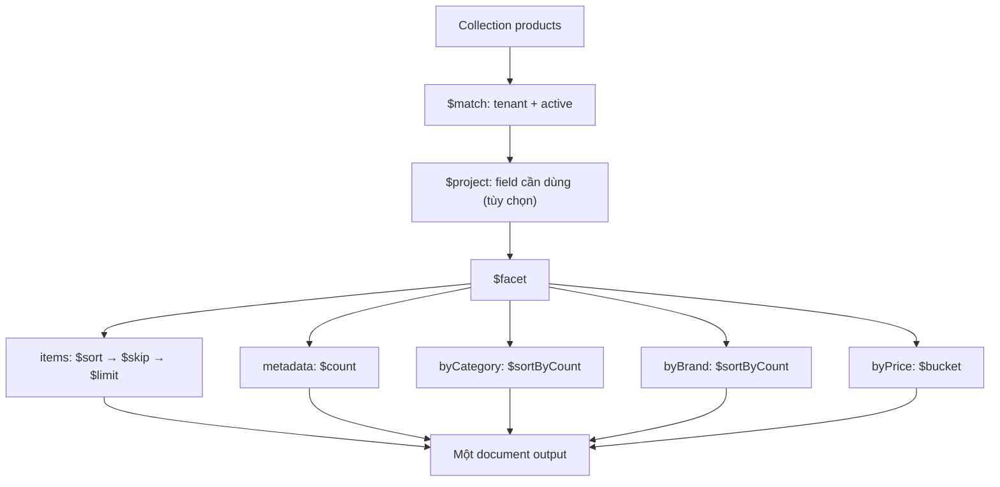

# $facet cho nhiều phép phân tích trên cùng đầu vào

## 1. Bài toán: một bộ lọc, nhiều góc nhìn dữ liệu

Trong một hệ thống thương mại điện tử sử dụng **Spring Data MongoDB**, trang danh sách sản phẩm thường cần hiển thị đồng thời:

- Những sản phẩm phù hợp với bộ lọc, có sort và phân trang.
- Tổng số sản phẩm phù hợp để dựng thông tin phân trang.
- Số sản phẩm theo **danh mục**.
- Số sản phẩm theo **thương hiệu**.
- Phân bố sản phẩm theo **khoảng giá**.

Nếu viết năm query độc lập, ứng dụng phải xây năm bộ điều kiện tương tự, gửi nhiều lần truy vấn tới MongoDB rồi ghép kết quả. Điều đó vẫn có thể hợp lý trong một số trường hợp, nhưng dễ phát sinh tình trạng **bộ lọc không đồng nhất** giữa các query, thêm round-trip và cần điều phối kết quả trong Java.

MongoDB Aggregation Framework cung cấp stage **`$facet`**, cho phép chạy **nhiều sub-pipeline độc lập trên cùng tập document đầu vào** của stage. Một pipeline chuẩn bị dữ liệu chung, còn mỗi nhánh tính một loại kết quả. Spring Data MongoDB cung cấp `Aggregation.facet(...)` và `FacetOperation` để cấu hình các nhánh bằng Java.

Đây là bài thuộc chương **Aggregation nâng cao** trong module **SPRING_DATA_MONGODB**. Bài kết nối thiết kế aggregation với cách dùng `MongoTemplate`/repository, ánh xạ DTO, index, transaction, reactive access, kiểm thử và chẩn đoán hiệu năng.

**Ý chính:** `$facet` không thực hiện phép join; nó **phân nhánh phép phân tích** của một dòng dữ liệu đầu vào. Các nhánh nhận cùng tập document tại điểm đặt `$facet`, nhưng mỗi nhánh có thể `$match`, `$group`, `$sort`, `$bucket` hoặc `$limit` theo nhu cầu riêng.

## 2. Cách đọc cú pháp `$facet`

Một stage có dạng:

```javascript
{
  $facet: {
    products: [
      // Pipeline A: danh sách sản phẩm
    ],
    byBrand: [
      // Pipeline B: số lượng theo thương hiệu
    ],
    byPrice: [
      // Pipeline C: số lượng theo khoảng giá
    ]
  }
}
```

Với mỗi tên nhánh như `products` hay `byBrand`:

1. MongoDB cấp cho nhánh **cùng một tập document** đi vào stage `$facet`.
2. Nhánh thực hiện các stage riêng theo thứ tự đã khai báo bên trong nó.
3. Kết quả của nhánh được gom thành **một array** đặt dưới field mang tên nhánh.
4. Kết quả cuối của `$facet` thường là **một document** chứa các array kết quả tương ứng.

Ví dụ hình dạng output:

```json
{
  "products": [
    { "_id": "p-5", "name": "Tai nghe", "price_cents": 320000 }
  ],
  "byBrand": [
    { "_id": "ACME", "count": 3 }
  ],
  "byPrice": [
    { "_id": 200000, "count": 2 }
  ]
}
```

Kết quả `byBrand` là **mảng các document thống kê**, không phải một map `{"ACME":3}` tự sinh. Nếu cần format khác cho HTTP response, hãy chuyển đổi ở pipeline sau `$facet` hoặc tại lớp Java DTO.

### 2.1. Hình dung pipeline



Các nhánh là **độc lập về dữ liệu và thứ tự stage**. Không nên đọc sơ đồ như cam kết rằng MongoDB chạy mọi nhánh bằng các luồng CPU song song; đây là mô hình phân tích cùng đầu vào, không phải một hợp đồng lập lịch parallel threads.

## 3. Dataset mẫu: sản phẩm theo tenant, trạng thái, danh mục, thương hiệu, giá

Để có thể tự đối chiếu kết quả, ta sử dụng tám sản phẩm:

| ID | Tenant | Active | Category | Brand | Giá (đơn vị nhỏ nhất) |
| --- | --- | --- | --- | --- | ---: |
| p-1 | t-A | true | keyboard | ACME | 150000 |
| p-2 | t-A | true | keyboard | Zenith | 240000 |
| p-3 | t-A | true | mouse | ACME | 80000 |
| p-4 | t-A | false | mouse | Zenith | 110000 |
| p-5 | t-A | true | headset | ACME | 320000 |
| p-6 | t-A | true | headset | Nova | 90000 |
| p-7 | t-A | true | keyboard | Nova | 120000 |
| p-8 | t-B | true | keyboard | ACME | 250000 |

Tạo dữ liệu trong **database kiểm thử**:

```javascript
db.products.insertMany([
  {
    _id: "p-1", tenant_id: "t-A", active: true,
    name: "Bàn phím A", category: "keyboard",
    brand: "ACME", price_cents: NumberLong("150000")
  },
  {
    _id: "p-2", tenant_id: "t-A", active: true,
    name: "Bàn phím Z", category: "keyboard",
    brand: "Zenith", price_cents: NumberLong("240000")
  },
  {
    _id: "p-3", tenant_id: "t-A", active: true,
    name: "Chuột A", category: "mouse",
    brand: "ACME", price_cents: NumberLong("80000")
  },
  {
    _id: "p-4", tenant_id: "t-A", active: false,
    name: "Chuột đã ngừng bán", category: "mouse",
    brand: "Zenith", price_cents: NumberLong("110000")
  },
  {
    _id: "p-5", tenant_id: "t-A", active: true,
    name: "Tai nghe A", category: "headset",
    brand: "ACME", price_cents: NumberLong("320000")
  },
  {
    _id: "p-6", tenant_id: "t-A", active: true,
    name: "Tai nghe N", category: "headset",
    brand: "Nova", price_cents: NumberLong("90000")
  },
  {
    _id: "p-7", tenant_id: "t-A", active: true,
    name: "Bàn phím N", category: "keyboard",
    brand: "Nova", price_cents: NumberLong("120000")
  },
  {
    _id: "p-8", tenant_id: "t-B", active: true,
    name: "Bàn phím tenant B", category: "keyboard",
    brand: "ACME", price_cents: NumberLong("250000")
  }
]);
```

Bài dùng `NumberLong` cho giá để minh họa đơn vị số nguyên. Một ứng dụng có giá thập phân có thể dùng BSON Decimal128/`BigDecimal`, nhưng phải thống nhất kiểu BSON trong so sánh và bucket. Giá được giả định không âm, có cùng đơn vị tiền; ví dụ không giải quyết chuyển đổi nhiều loại tiền.

### 3.1. Tập đầu vào chung chính xác gồm sáu document

Khi đặt trước `$facet`:

```javascript
{ $match: { tenant_id: "t-A", active: true } }
```

thì sáu document đầu vào là `p-1`, `p-2`, `p-3`, `p-5`, `p-6`, `p-7`.

`p-4` bị loại vì ngừng hoạt động; `p-8` bị loại vì thuộc tenant khác. **Tất cả nhánh** nhận đúng tập sáu document này nếu không có stage thay đổi tập đầu vào khác trước `$facet`.

## 4. Pipeline `mongosh` hoàn chỉnh: năm phép phân tích trong một query

```javascript
db.products.aggregate([
  // Bộ lọc bắt buộc áp dụng chung cho tất cả facet.
  {
    $match: {
      tenant_id: "t-A",
      active: true
    }
  },
  {
    $facet: {
      // Nhánh 1: trang sản phẩm.
      items: [
        { $sort: { price_cents: -1, _id: 1 } },
        { $skip: 0 },
        { $limit: 3 },
        {
          $project: {
            _id: 1,
            name: 1,
            category: 1,
            brand: 1,
            price_cents: 1
          }
        }
      ],

      // Nhánh 2: tổng số sau bộ lọc chung, không bị page limit.
      metadata: [
        { $count: "total" }
      ],

      // Nhánh 3: đếm theo category.
      byCategory: [
        { $sortByCount: "$category" }
      ],

      // Nhánh 4: đếm theo brand.
      byBrand: [
        { $sortByCount: "$brand" }
      ],

      // Nhánh 5: histogram giá theo boundary cố định.
      byPrice: [
        {
          $bucket: {
            groupBy: "$price_cents",
            boundaries: [0, 100000, 200000, 400000],
            default: "other",
            output: {
              count: { $sum: 1 }
            }
          }
        }
      ]
    }
  }
]);
```

Trong code production, `tenant_id` phải xuất phát từ danh tính/ủy quyền đáng tin cậy; không cho client chỉ định tenant bất kỳ rồi coi đó là cơ chế phân quyền. Các giá trị `skip`/`limit` phải được kiểm tra và giới hạn rõ.

**Phân biệt bộ lọc chung và bộ lọc riêng:** `$match` ở ngoài `$facet` áp dụng cho mọi nhánh; `$match` đặt trong `items` chỉ tác động nhánh `items`. Điều này quyết định cách xây faceted search có bộ lọc tùy chọn.

## 5. Đọc kết quả và tự xác minh bằng tay

Theo dataset:

- `items` có ba sản phẩm đắt nhất trong tập đang hoạt động của tenant A: `p-5` (320000), `p-2` (240000), `p-1` (150000).
- `metadata` chứa một phần tử có `total=6`.
- `byCategory`: keyboard = 3, headset = 2, mouse = 1.
- `byBrand`: ACME = 3, Nova = 2, Zenith = 1.
- `byPrice` có ba bucket đều có count = 2.

Một kết quả rút gọn:

```json
{
  "items": [
    { "_id": "p-5", "name": "Tai nghe A", "category": "headset", "brand": "ACME", "price_cents": 320000 },
    { "_id": "p-2", "name": "Bàn phím Z", "category": "keyboard", "brand": "Zenith", "price_cents": 240000 },
    { "_id": "p-1", "name": "Bàn phím A", "category": "keyboard", "brand": "ACME", "price_cents": 150000 }
  ],
  "metadata": [{ "total": 6 }],
  "byCategory": [
    { "_id": "keyboard", "count": 3 },
    { "_id": "headset", "count": 2 },
    { "_id": "mouse", "count": 1 }
  ],
  "byBrand": [
    { "_id": "ACME", "count": 3 },
    { "_id": "Nova", "count": 2 },
    { "_id": "Zenith", "count": 1 }
  ],
  "byPrice": [
    { "_id": 0, "count": 2 },
    { "_id": 100000, "count": 2 },
    { "_id": 200000, "count": 2 }
  ]
}
```

Đây là **hình dạng JSON minh họa**, trong `mongosh` số BSON Long có thể được biểu diễn theo kiểu hiển thị khác. Các nhánh `$sortByCount` sắp giảm dần theo count; nếu count bằng nhau, đừng dựa vào thứ tự hòa để làm business contract. Cần thêm stage `$sort` theo khóa phụ nếu yêu cầu thứ tự ổn định.

### 5.1. Kiểm tra tổng count với số lượng bucket

Từ dữ liệu mẫu, tổng số của các nhóm category và brand đều là 6 vì mỗi sản phẩm có **một** category và **một** brand.

Nhưng nếu mỗi sản phẩm có **nhiều category** và một nhánh `$unwind` thành nhiều dòng, tổng count các category có thể **lớn hơn** total sản phẩm. Đó không nhất thiết là lỗi, mà là cách đếm **số lần thuộc nhóm** thay vì đếm document duy nhất. Phải định nghĩa rõ metric.

## 6. Mỗi sub-pipeline độc lập: không thể lấy output của nhánh khác

Giả sử `metadata` tính tổng số, còn `items` trả sản phẩm. MongoDB **không cho** nhánh `items` đọc ngay giá trị `metadata.total` vừa tính ở cùng một `$facet` như một biến chia sẻ.

Sai về tư duy:

```text
$facet:
  metadata: tính total
  items: dùng metadata.total để limit hoặc tạo rank
```

Đúng:

- Mỗi nhánh tự xử lý input chung.
- Sau `$facet`, dùng `$project` hoặc `$set` để **kết hợp các array đầu ra**.
- Hoặc chuyển logic dùng chung lên **trước `$facet`** để tất cả nhánh thấy nó.

Một branch không tự “thay đổi” dữ liệu cho branch khác. Nếu trong `byCategory` thực hiện `$unwind`, `items` vẫn nhận mỗi sản phẩm là một document như trước `$facet`.

### 6.1. Cách dùng stage sau `$facet`

```javascript
db.products.aggregate([
  { $match: { tenant_id: "t-A", active: true } },
  {
    $facet: {
      items: [
        { $sort: { price_cents: -1, _id: 1 } },
        { $limit: 3 }
      ],
      metadata: [
        { $count: "total" }
      ]
    }
  },
  {
    $project: {
      items: 1,
      total: {
        $ifNull: [
          { $arrayElemAt: ["$metadata.total", 0] },
          0
        ]
      }
    }
  }
]);
```

Kết quả có dạng:

```json
{
  "items": [ { "_id": "p-5" }, { "_id": "p-2" }, { "_id": "p-1" } ],
  "total": 6
}
```

Phần `items` trên chỉ rút gọn để minh họa, không phải đầy đủ mọi field từ lệnh shell. `$arrayElemAt` lấy phần tử đầu của array `metadata.total`; `$ifNull` cung cấp giá trị 0 khi không có phần tử phù hợp.

## 7. Facet và phân trang: tại sao `$skip`/`$limit` phải nằm đúng nhánh?

Đây là một trong những use case thường gặp nhất: **trả danh sách trang hiện tại và tổng số bản ghi trong cùng aggregation**.

Đúng:

```javascript
[
  { $match: { tenant_id: "t-A", active: true } },
  {
    $facet: {
      items: [
        { $sort: { price_cents: -1, _id: 1 } },
        { $skip: 20 },
        { $limit: 20 }
      ],
      metadata: [
        { $count: "total" }
      ]
    }
  }
]
```

`metadata` đếm **toàn bộ kết quả sau bộ lọc chung**. `items` chỉ chứa document của trang được yêu cầu.

Sai nếu cần tổng toàn bộ:

```javascript
[
  { $match: { tenant_id: "t-A", active: true } },
  { $skip: 20 },
  { $limit: 20 },
  {
    $facet: {
      items: [],
      metadata: [{ $count: "total" }]
    }
  }
]
```

Ở cách sai, `metadata` chỉ đếm **tập đã bị phân trang**, không phải số sản phẩm khớp điều kiện gốc. Điều này làm UI tính tổng trang sai.

### 7.1. Sort ổn định trước khi phân trang

Nếu sort theo `price_cents` mà có nhiều sản phẩm cùng giá, thứ tự của những sản phẩm hòa giá có thể thay đổi. Thêm khóa `_id` để có thứ tự toàn phần:

```javascript
{ $sort: { price_cents: -1, _id: 1 } }
```

Điều đó giúp phân trang dễ dự đoán **trên dữ liệu không thay đổi**, nhưng offset pagination vẫn có thể trùng hoặc bỏ sót khi collection thay đổi giữa các request. Nếu cần scrolling sâu với cursor keyset, thiết kế riêng keyset query theo sort keys và không giả định `$facet` tự cung cấp cursor pagination.

### 7.2. Trang rỗng không đồng nghĩa không có kết quả tổng

Với 6 sản phẩm, nếu client yêu cầu `skip=100`, nhánh `items` trả `[]` nhưng `metadata` vẫn là `[{"total":6}]`. API không được suy rằng total=0 chỉ vì trang hiện tại rỗng.

Ngược lại, nếu bộ lọc chung không khớp document nào, nhánh `$count` trả **mảng rỗng** chứ không phải `[{"total":0}]`. Phải áp dụng giá trị mặc định khi dựng response.

## 8. `$sortByCount`: thống kê nhanh theo một chiều

Stage `$sortByCount` nhận một biểu thức và thực hiện phép nhóm/đếm rồi sort theo `count` giảm dần.

```javascript
{
  $facet: {
    byBrand: [
      { $sortByCount: "$brand" }
    ],
    byCategory: [
      { $sortByCount: "$category" }
    ]
  }
}
```

Về ý nghĩa, nó tương tự:

```javascript
[
  { $group: { _id: "$brand", count: { $sum: 1 } } },
  { $sort: { count: -1 } }
]
```

Nếu cần thứ tự ổn định khi count hòa, có thể thay nhánh bằng:

```javascript
byBrand: [
  { $group: { _id: "$brand", count: { $sum: 1 } } },
  { $sort: { count: -1, _id: 1 } }
]
```

Không nhất thiết mọi facet category đều là `$sortByCount`. Nếu cần tính nhiều metric (doanh thu, số SKU đang thiếu hàng, trung bình giá), `$group` với các accumulator phù hợp sẽ có tính diễn đạt tốt hơn.

### 8.1. Null, missing và “khác”

Nếu document thiếu `brand`, thống kê theo brand có thể xuất hiện nhóm `_id:null`. Hãy quyết định UX:

- Hiển thị “Không xác định”.
- Bỏ qua document thiếu brand trong **nhánh brand** bằng `$match` tương ứng.
- Chuẩn hóa dữ liệu ở thời điểm ghi/migration.

Không nên áp dụng filter bỏ brand ở **trước `$facet`** nếu các nhánh khác vẫn cần đếm sản phẩm thiếu brand.

## 9. `$bucket`: phân loại theo khoảng giá cố định

`$bucket` chia dữ liệu thành nhóm theo các **ranh giới** định trước. Ví dụ:

```javascript
{
  $bucket: {
    groupBy: "$price_cents",
    boundaries: [0, 100000, 200000, 400000],
    default: "other",
    output: { count: { $sum: 1 } }
  }
}
```

Các khoảng thông thường là:

| Giá (đơn vị nhỏ nhất) | Bucket |
| --- | --- |
| Từ 0 đến dưới 100000 | `_id:0` |
| Từ 100000 đến dưới 200000 | `_id:100000` |
| Từ 200000 đến dưới 400000 | `_id:200000` |
| Ngoài các khoảng, kể cả >=400000 | `_id:"other"` |

Ranh giới dưới **bao gồm**, trên **không bao gồm**. Các boundary phải tăng dần. `default` hữu ích nếu có giá nằm ngoài khoảng; nếu không có default và xuất hiện giá không thuộc bucket, MongoDB có thể báo lỗi.

Trong tập 6 sản phẩm đã lọc, mỗi bucket đầu tiên/giữa/cuối có 2 phần tử. `default:"other"` không xuất hiện trong output khi không có sản phẩm rơi vào nhóm đó.

### 9.1. Không trộn đơn vị tiền tệ

Với `price_cents`, cần hiểu rõ đơn vị: “100000” là **100000 đơn vị nhỏ nhất theo mô hình**, không tự động là 100000 VND hay 1000 USD. Trong hệ thống nhiều currency, không làm histogram cho số tiền chưa quy đổi chung một đơn vị.

### 9.2. `$bucketAuto` khi chưa biết ranh giới

`$bucketAuto` cho phép MongoDB ước lượng các boundary nhằm chia dữ liệu thành số nhóm mong muốn:

```javascript
{
  $facet: {
    automaticPrices: [
      {
        $bucketAuto: {
          groupBy: "$price_cents",
          buckets: 3
        }
      }
    ]
  }
}
```

Khác nhau:

| Tiêu chí | `$bucket` | `$bucketAuto` |
| --- | --- | --- |
| Ranh giới | Do ứng dụng định nghĩa | MongoDB tính từ phân bố dữ liệu |
| Giá trị khoảng giữa các request | Tương đối ổn định khi cấu hình cố định | Có thể thay đổi khi dữ liệu phân bố đổi |
| UX chọn bộ lọc giá cố định | Phù hợp | Cần cân nhắc |
| Khám phá phân bố dữ liệu | Ít linh hoạt | Có thể hữu ích |

`$bucketAuto` không hứa mỗi nhóm luôn có số phần tử bằng nhau, đặc biệt khi nhiều document có cùng giá trị. Nếu UI lưu một khoảng giá dưới dạng URL và muốn tiếp tục dùng nó về sau, bucket cố định thường dễ thiết kế hợp đồng hơn.

## 10. Facet cho mảng và `$unwind`: tránh đếm sai

Một sản phẩm có thể có nhiều tag:

```javascript
{
  _id: "p-extra",
  tags: ["gaming", "wireless", "sale"]
}
```

Muốn đếm số sản phẩm theo **từng tag**, trong nhánh thích hợp cần `$unwind`:

```javascript
db.products.aggregate([
  { $match: { tenant_id: "t-A", active: true } },
  {
    $facet: {
      byTag: [
        { $unwind: "$tags" },
        { $sortByCount: "$tags" }
      ],
      totalProducts: [
        { $count: "total" }
      ]
    }
  }
]);
```

`byTag` đếm **mỗi lần xuất hiện tag sau unwind**, không bắt buộc tổng các count bằng tổng sản phẩm. Một sản phẩm có ba tag có thể đóng góp vào ba nhóm. Nếu array chứa cùng một tag lặp lại, có thể cần `$setUnion` hoặc chuẩn hóa dữ liệu để tránh đếm hai lần cho một document.

### 10.1. Vì sao `$unwind` nên nằm trong đúng nhánh?

Nếu đặt `$unwind:"$tags"` **trước `$facet`**, nhánh `totalProducts` sẽ đếm **số dòng sau unwind**, không phải số sản phẩm ban đầu. Điều đó có thể gây sai nghiêm trọng cho UI.

Đúng khi đếm document gốc:

```javascript
{
  $facet: {
    byTag: [
      { $unwind: "$tags" },
      { $sortByCount: "$tags" }
    ],
    totalProducts: [
      { $count: "total" }
    ]
  }
}
```

Đây là lợi ích lớn của sub-pipeline độc lập: mỗi nhánh được quyền biến đổi số dòng mà không ảnh hưởng nhánh khác.

## 11. Faceted search: điều kiện chung và điều kiện riêng mỗi nhánh

Một trang thương mại điện tử thường có **bộ lọc đã chọn**. Ví dụ người dùng chọn:

- Tenant = `t-A` (bắt buộc).
- Active = true (bắt buộc).
- Category = `keyboard`.
- Brand = `ACME`.

Nếu áp dụng **cả category lẫn brand** trước `$facet`, thì:

- `items` và `metadata` chỉ thấy sản phẩm keyboard/ACME.
- `byCategory` sẽ chỉ còn keyboard, làm người dùng không thấy các category có thể chuyển sang.
- `byBrand` sẽ chỉ còn ACME.

Đôi khi đây là UX mong muốn (**conjunctive counts**), nhưng nhiều trang tìm kiếm cần **disjunctive faceting**: nhánh category được tính **không áp dụng chính filter category**, nhưng vẫn áp dụng các bộ lọc khác; tương tự cho brand.

### 11.1. Thiết kế branch-specific filters

```javascript
db.products.aggregate([
  // Bắt buộc cho tất cả nhánh.
  {
    $match: {
      tenant_id: "t-A",
      active: true
    }
  },
  {
    $facet: {
      // Danh sách sản phẩm: áp dụng mọi filter đã chọn.
      items: [
        { $match: { category: "keyboard", brand: "ACME" } },
        { $sort: { price_cents: -1, _id: 1 } },
        { $limit: 20 }
      ],

      // Tổng: cùng bộ lọc với items, nhưng không limit.
      metadata: [
        { $match: { category: "keyboard", brand: "ACME" } },
        { $count: "total" }
      ],

      // Thống kê category: bỏ chính category filter.
      byCategory: [
        { $match: { brand: "ACME" } },
        { $sortByCount: "$category" }
      ],

      // Thống kê brand: bỏ chính brand filter.
      byBrand: [
        { $match: { category: "keyboard" } },
        { $sortByCount: "$brand" }
      ]
    }
  }
]);
```

Với dataset mẫu, `items` chỉ có `p-1`; `metadata` là total=1. `byCategory` trên brand ACME gồm keyboard=1, mouse=1, headset=1. `byBrand` trên category keyboard gồm ACME=1, Zenith=1, Nova=1.

**Đừng tự suy rằng cách tính nào đúng cho mọi sản phẩm.** Hãy chốt hợp đồng UX: số lượng trong mỗi facet biểu thị “sau mọi filter” hay “sau các filter khác trừ chính dimension này”?

### 11.2. Quyền truy cập bắt buộc không thể bị loại trong branch

Filter tenant, quyền sản phẩm hoặc trạng thái nhạy cảm phải được áp dụng ở phần **chung** hoặc bảo đảm xuất hiện trong **mọi nhánh**. Không để client tự tạo một branch `$match` có thể mở rộng phạm vi sang tenant khác.

Khi phát sinh branch-specific query từ HTTP input, xây điều kiện từ các field đã được cho phép và kiểm tra giá trị; không nối raw BSON/SpEL/JSON tùy ý do client gửi vào pipeline.

## 12. Spring Data MongoDB: entity và kết quả DTO

### 12.1. Entity nguồn

```java
import org.springframework.data.mongodb.core.mapping.Document;
import org.springframework.data.mongodb.core.mapping.Field;
import org.springframework.data.mongodb.core.mapping.FieldType;
import org.springframework.data.mongodb.core.mapping.MongoId;

@Document(collection = "products")
public record ProductDocument(
    @MongoId(FieldType.STRING)
    String id,

    @Field("tenant_id")
    String tenantId,

    String name,
    String category,
    String brand,

    @Field("price_cents")
    Long priceCents,

    boolean active
) {}
```

`ProductDocument` là entity nguồn. Lưu ý:

- MongoDB lưu `id` trong `_id`.
- Java property `tenantId` ánh xạ BSON `tenant_id`.
- Java property `priceCents` ánh xạ BSON `price_cents`.
- Khi Spring Data xây aggregation typed cho entity này, metadata mapping giúp các operation tham chiếu đúng field BSON.

### 12.2. DTO cho danh sách và facet

Output của một `$facet` không giống một `ProductDocument`. Có thể tạo những DTO/record chỉ đọc:

```java
import java.util.List;

public record ProductHit(
    String id,
    String name,
    String category,
    String brand,
    Long priceCents
) {}

public record CountBucket(
    String id,
    long count
) {}

public record TotalCount(
    long total
) {}

public record ProductFacetResult(
    List<ProductHit> items,
    List<TotalCount> metadata,
    List<CountBucket> byCategory,
    List<CountBucket> byBrand,
    List<CountBucket> byPrice
) {}
```

Đây là **kiểu model kết quả**, không phải entity có thể `save`. Các nhánh có thể có `_id` dạng **khác nhau**:

- `byCategory._id` và `byBrand._id` là string.
- `byPrice._id` có thể là **number** (boundary) hoặc string `"other"`.

Vì vậy, `CountBucket(String id, long count)` **không thích hợp** cho một nhánh price bucket có mixed-type `_id` nếu không có chuyển đổi rõ ràng. Trong code vận hành, nên tạo `PriceBucket` với `Object id` (và kiểm tra type) hoặc chuẩn hóa alias/label ngay trong pipeline.

**Không** map mọi branch vào cùng một record chỉ vì mỗi document có `_id` và `count`. Loại giá trị của `_id` phải là một phần hợp đồng DTO.

### 12.3. DTO giá có kiểu riêng

```java
public record PriceBucket(
    Object id,
    long count
) {}

public record FacetResponse(
    List<ProductHit> items,
    long total,
    List<CountBucket> categories,
    List<CountBucket> brands,
    List<PriceBucket> prices
) {}
```

`FacetResponse` dành cho HTTP response đã chuẩn hóa: `metadata[0].total` trở thành `total` scalar, còn các nhánh mảng được giữ nguyên sau mapping. Nếu API public cần giữ tính ổn định lâu dài, chuyển bucket ID thành `label` + `minInclusive`/`maxExclusive` thay vì phơi bày một `Object` tùy tiện.

## 13. Viết `$facet` bằng `Aggregation.facet(...)` và `MongoTemplate`

Các API chính của Spring Data MongoDB gồm:

- `Aggregation.newAggregation(...)` tạo pipeline.
- `Aggregation.match(...)` xây `$match`.
- `Aggregation.facet(...)` khởi tạo các nhánh.
- `FacetOperation.as("name")` đặt tên nhánh.
- `FacetOperation.and(...)` khai báo nhánh kế tiếp.
- `Aggregation.sortByCount("field")` xây `$sortByCount`.
- `Aggregation.bucket("field")`, `bucketAuto("field", n)` xây histogram.
- `MongoTemplate.aggregate(...)` thực thi trên collection được ánh xạ.

### 13.1. Phương thức Java đầy đủ

```java
import static org.springframework.data.mongodb.core.aggregation
    .Aggregation.*;

import java.util.List;

import org.bson.Document;
import org.springframework.data.domain.Sort;
import org.springframework.data.mongodb.core.MongoTemplate;
import org.springframework.data.mongodb.core.aggregation.Aggregation;
import org.springframework.data.mongodb.core.aggregation.AggregationResults;
import org.springframework.data.mongodb.core.aggregation.FacetOperation;
import org.springframework.data.mongodb.core.query.Criteria;

public class ProductFacetReader {

    private final MongoTemplate template;

    public ProductFacetReader(MongoTemplate template) {
        this.template = template;
    }

    public Document queryForTenant(String trustedTenantId) {
        if (trustedTenantId == null
                || trustedTenantId.isBlank()) {
            throw new IllegalArgumentException(
                "Thiếu tenant đã xác thực"
            );
        }

        FacetOperation facets = facet(
            sort(Sort.by(
                Sort.Order.desc("priceCents"),
                Sort.Order.asc("id")
            )),
            skip(0L),
            limit(3L),
            project("id", "name", "category",
                    "brand", "priceCents")
        ).as("items")
         .and(count().as("total")).as("metadata")
         .and(sortByCount("category")).as("byCategory")
         .and(sortByCount("brand")).as("byBrand")
         .and(
             bucket("priceCents")
                 .withBoundaries(
                     0L, 100000L, 200000L, 400000L
                 )
                 .withDefault("other")
                 .andOutputCount().as("count")
         ).as("byPrice");

        Aggregation aggregation = newAggregation(
            match(Criteria.where("tenantId")
                .is(trustedTenantId)
                .and("active").is(true)),
            facets
        );

        AggregationResults<Document> result =
            template.aggregate(
                aggregation,
                ProductDocument.class,
                Document.class
            );

        return result.getUniqueMappedResult();
    }
}
```

**Giải thích về mapping:** phương thức `template.aggregate(aggregation, ProductDocument.class, Document.class)` sử dụng `ProductDocument` làm **input domain type** để ánh xạ tên field trong các operation typed. Kết quả kiểu `Document.class` vì output có nhiều array thống kê, không tương ứng với một entity nguồn duy nhất.

Đoạn ví dụ dùng `import static ...Aggregation.*` để gọi `facet`, `sort`, `skip`, `limit`, `project`, `count`, `sortByCount` và `bucket`. Tùy dòng thư viện, một số builder/overload có thể khác; cần đối chiếu phiên bản Spring Data MongoDB được quản lý bởi Spring Boot BOM đang dùng.

### 13.2. Đọc output `org.bson.Document`

```java
Document raw = reader.queryForTenant("t-A");

if (raw == null) {
    throw new IllegalStateException(
        "Aggregation không trả document kết quả"
    );
}

List<Document> items = raw.getList(
    "items", Document.class
);

List<Document> metadata = raw.getList(
    "metadata", Document.class
);

long total = metadata.isEmpty()
    ? 0L
    : ((Number) metadata.get(0).get("total"))
        .longValue();

List<Document> categories = raw.getList(
    "byCategory", Document.class
);

List<Document> brands = raw.getList(
    "byBrand", Document.class
);

List<Document> prices = raw.getList(
    "byPrice", Document.class
);
```

Đây là một cách kiểm tra BSON raw hữu ích khi đang tìm hiểu shape của `$facet`. Đối với ứng dụng production, nên có mapper đưa dữ liệu sang các DTO có type rõ, validate null/missing và kiểm soát những field được trả cho API public.

**Cảnh báo:** field `metadata` có thể là `[]` khi không có document khớp; không gọi `metadata.get(0)` vô điều kiện. Mọi nhánh đều là array — kể cả nhánh tổng số chỉ có một document.

## 14. Viết facet theo các điều kiện tùy chọn trong Java

Trong một endpoint thực tế, người dùng chọn category, brand, khoảng giá và số trang. Cần phân biệt:

- **Bộ lọc bắt buộc**: tenant, ACL/authorization, active.
- **Bộ lọc sản phẩm đang xem**: category, brand, khoảng giá.
- **Bộ lọc của facet**: có thể bao gồm hoặc loại chính dimension đang thống kê.
- **Giới hạn**: page size và số bucket/thương hiệu trả về.

### 14.1. Query request tường minh

```java
public record ProductFacetRequest(
    String category,
    String brand,
    Long minPriceCents,
    Long maxPriceCents,
    int page,
    int size
) {}
```

Trước khi xây pipeline:

- Kiểm tra `page >= 0`, `1 <= size <= maxPageSize`.
- Tính `skip = page * size` bằng kiểu `long` và kiểm tra tràn số.
- Validate khoảng giá và kiểu currency.
- Không tin `tenantId` do client gửi khi xây ACL.
- Không chấp nhận raw pipeline JSON từ request.

### 14.2. Giữ hàm xây `Criteria` ở phạm vi rõ

Một helper có thể dựng điều kiện bắt buộc và tùy chọn:

```java
import org.springframework.data.mongodb.core.query.Criteria;

public Criteria selectedFilters(
    String category,
    String brand,
    Long minPrice,
    Long maxPrice
) {
    Criteria result = new Criteria();

    if (category != null && !category.isBlank()) {
        result.and("category").is(category.trim());
    }

    if (brand != null && !brand.isBlank()) {
        result.and("brand").is(brand.trim());
    }

    if (minPrice != null || maxPrice != null) {
        Criteria price = result.and("priceCents");
        if (minPrice != null) {
            price.gte(minPrice);
        }
        if (maxPrice != null) {
            price.lte(maxPrice);
        }
    }

    return result;
}
```

Đây là helper dành cho **các field tùy chọn**; nó không chứa tenant. Để dùng với điều kiện bắt buộc, kết hợp ở pipeline ngoài:

```java
Criteria tenantAndActive = Criteria.where("tenantId")
    .is(trustedTenantId)
    .and("active").is(true);
```

Nếu muốn nhánh `byCategory` bỏ category đã chọn nhưng vẫn giữ brand/giá, xây một instance criteria riêng **không chứa category**. **Không** mutate một Criteria duy nhất rồi dùng lại ở nhiều nhánh với kỳ vọng đã tạo các bản sao độc lập.

### 14.3. Cấu trúc Java cho disjunctive faceting

```java
FacetOperation facets = facet(
    match(selectedFilters(
        category, brand, minPrice, maxPrice
    )),
    sort(Sort.by("name")),
    skip(offset),
    limit(size)
).as("items")
.and(
    match(selectedFilters(
        category, brand, minPrice, maxPrice
    )),
    count().as("total")
).as("metadata")
.and(
    match(selectedFilters(
        null, brand, minPrice, maxPrice
    )),
    sortByCount("category")
).as("byCategory")
.and(
    match(selectedFilters(
        category, null, minPrice, maxPrice
    )),
    sortByCount("brand")
).as("byBrand");
```

Phần này là mảnh code minh họa, dựa trên các biến `category`/`brand`/`minPrice`/`maxPrice`/`offset`/`size` đã được tính và kiểm tra. Với request không có filter tùy chọn nào, hãy quyết định **có bỏ qua một stage `$match` rỗng hay không**, tránh sinh một stage có nội dung không hợp lệ ở phiên bản đang dùng.

Với UX multi-select (chọn nhiều brands/categories), cần sử dụng `in(...)` hoặc logic OR rõ ràng; không coi một chuỗi ngăn cách dấu phẩy là điều kiện MongoDB hợp lệ.

## 15. Sử dụng `$project` và `$set` đúng chỗ

### 15.1. Projection trước facet giảm dữ liệu đi vào nhiều nhánh

Nếu document gốc có ảnh, mô tả dài, mảng lịch sử và thông tin nội bộ, các nhánh thống kê thường không cần tải/tính lại toàn bộ các field đó.

Có thể đặt:

```javascript
{
  $project: {
    _id: 1,
    tenant_id: 1,
    active: 1,
    name: 1,
    category: 1,
    brand: 1,
    price_cents: 1
  }
}
```

**Sau `$match` và trước `$facet`**, miễn là mọi nhánh vẫn nhận đủ field cần dùng. Tuy nhiên, MongoDB aggregation optimizer có thể tự thực hiện projection optimization ở một số trường hợp; không được kết luận chỉ vì viết thêm `$project` sẽ làm query luôn nhanh hơn.

Nếu vô tình loại `price_cents` trước facet, nhánh `byPrice` không còn đủ dữ liệu. Nếu loại `_id`, danh sách phân trang có thể mất khóa phân biệt để sort ổn định.

### 15.2. Projection trong riêng nhánh items

Để bảo mật response, đặt `$project` ở nhánh `items` để chỉ trả field cần cho giao diện:

```javascript
items: [
  { $sort: { price_cents: -1, _id: 1 } },
  { $skip: 0 },
  { $limit: 20 },
  {
    $project: {
      _id: 1,
      name: 1,
      category: 1,
      brand: 1,
      price_cents: 1
    }
  }
]
```

`$project` này không ảnh hưởng các nhánh thống kê, nhưng **không thay thế authorization**. Các document thuộc tenant khác phải được loại bằng điều kiện truy cập bắt buộc.

### 15.3. Thêm scalar total sau facet

Như mục 6:

```javascript
{
  $set: {
    total: {
      $ifNull: [
        { $arrayElemAt: ["$metadata.total", 0] },
        0
      ]
    }
  }
}
```

Nếu giữ `metadata` thì output có cả array metadata và scalar total. Có thể dùng `$project` để chỉ giữ `items`, `total`, `byCategory`, `byBrand` và `byPrice`.

**Không nhầm** stage `$set` sau `$facet` với `Update.set(...)` dùng để cập nhật document lưu trong MongoDB. Ở đây stage tạo/biến đổi **kết quả aggregation**, không ghi lại collection.

## 16. Giới hạn tài nguyên: 100 MB và 16 MiB

`$facet` mạnh nhưng có các giới hạn cần nhớ:

1. **Trong quá trình xử lý `$facet`**, document kết quả của stage bị giới hạn khoảng **100 MB**.
2. Cờ `allowDiskUse` **không làm `$facet` được spill xuống đĩa** để vượt giới hạn này.
3. **Document đầu ra cuối cùng** vẫn chịu giới hạn BSON **16 MiB**.
4. Những stage khác của aggregation có chính sách bộ nhớ khác, có thể cho phép disk spill tùy server và cấu hình; không áp chính sách đó cho chính `$facet`.

Vì vậy, nếu branch `items` giữ hàng trăm nghìn document hoặc branch `byBrand` tạo array hàng trăm nghìn nhãn, response có thể quá lớn dù server có nhiều RAM.

### 16.1. Vì sao `allowDiskUse(true)` không phải lời giải?

```java
// Ở các phiên bản Spring Data hỗ trợ AggregationOptions:
Aggregation aggregation = newAggregation(
    match(Criteria.where("tenantId").is("t-A")),
    facets
).withOptions(
    org.springframework.data.mongodb.core.aggregation
        .AggregationOptions.builder()
        .allowDiskUse(true)
        .build()
);
```

Option này có thể cho phép **những stage được hỗ trợ** dùng đĩa cho sort/group ngoài facet tùy MongoDB Server, nhưng **không vượt giới hạn 100 MB của `$facet`** hoặc 16 MiB cho output cuối.

Để kiểm soát kết quả:

- `$match` sớm để giảm số document.
- `$project` giữ field cần thiết.
- `$limit` trong nhánh `items`.
- Giới hạn số bucket/thương hiệu trong các nhánh thống kê theo UX.
- Tránh `$push: "$$ROOT"` tích lũy nguyên document lớn vào một array.
- Tách báo cáo quá lớn thành những query/collection riêng.
- Đánh giá giải pháp pre-aggregation/materialized views khi query nóng.

### 16.2. Limit từng nhánh khác limit trước facet

`{ $limit: 10 }` **trước `$facet`** làm mọi thống kê chỉ tính trên tối đa 10 document, có thể sai. Nhưng `{ $limit: 10 }` trong nhánh `items` chỉ giới hạn danh sách, không đổi total/byBrand.

Đặt stage theo đúng **phạm vi số liệu**; đây là lỗi nghiêm trọng thường hơn cả lỗi cú pháp.

## 17. Những stage không được dùng bên trong `$facet`

Không phải mọi aggregation stage đều hợp lệ ở sub-pipeline của `$facet`. Theo tài liệu MongoDB, những stage bị hạn chế bao gồm:

- `$facet` lồng bên trong `$facet`.
- `$out` hoặc `$merge` trong một branch.
- `$geoNear` trong branch.
- Các stage đặc biệt như `$collStats`, `$indexStats`, `$search`/`$searchMeta`, `$vectorSearch` và một số stage metadata khác tùy phiên bản.

Khi cần `$search`/`$geoNear` hoặc một bước đọc đặc thù, hãy xem khả năng đưa stage đó lên **trước `$facet`** nếu được phép theo quy tắc vị trí stage. Sau đó kết quả đầu vào chung mới phân nhánh.

Không tự thử nhét `$merge` vào nhánh để ghi report vì `$facet` có nhánh “độc lập”. `$facet` là công cụ **phân tích và cấu trúc output**, không phải một cơ chế chạy nhiều write operations.

Cần đọc danh sách bị cấm theo phiên bản MongoDB Server vì các stage có thể được bổ sung hoặc điều chỉnh qua các release.

## 18. Index, `$match` sớm và query planner

### 18.1. `$facet` đặt đầu pipeline có thể gây `COLLSCAN`

Theo hành vi MongoDB, nếu `$facet` là stage đầu tiên, stage này không sử dụng index để xác định tập đầu vào và thường phải quét collection. Ví dụ kém phù hợp:

```javascript
db.products.aggregate([
  {
    $facet: {
      byBrand: [
        { $match: { tenant_id: "t-A" } },
        { $sortByCount: "$brand" }
      ],
      byCategory: [
        { $match: { tenant_id: "t-A" } },
        { $sortByCount: "$category" }
      ]
    }
  }
]);
```

Dù các branch tự có `$match`, `$facet` vẫn đã đứng đầu pipeline; không nên mong những `$match` bên trong khởi tạo nhiều index scans độc lập theo đúng cách query thông thường.

### 18.2. Đưa filter bắt buộc lên trước

```javascript
db.products.aggregate([
  {
    $match: {
      tenant_id: "t-A",
      active: true
    }
  },
  {
    $facet: {
      byBrand: [{ $sortByCount: "$brand" }],
      byCategory: [{ $sortByCount: "$category" }]
    }
  }
]);
```

Tạo index phù hợp với bộ lọc chung:

```javascript
db.products.createIndex({
  tenant_id: 1,
  active: 1
});
```

MongoDB có thể dùng index ở `$match` trước `$facet` và chuyển tập phù hợp tới các nhánh. `$facet` **không buộc MongoDB quét lại toàn bộ collection** nếu stage trước đã sử dụng index. Nhưng lựa chọn index thực tế vẫn phụ thuộc dữ liệu, selectivity và query planner.

### 18.3. Sort trong branch có thể không sử dụng index như sort top-level

Một nhánh:

```javascript
items: [
  { $sort: { price_cents: -1, _id: 1 } },
  { $limit: 20 }
]
```

được chạy **sau khi đầu vào đã vào `$facet`**. Không suy rằng nó sẽ tận dụng index sort như một `find(...).sort(...).limit(...)` trực tiếp. Nếu sort theo giá là bottleneck, có thể xét đặt một `$sort` phù hợp **trước `$facet`** để lợi dụng index ở upstream, với điều kiện nghiệp vụ vẫn đúng và chi phí chuyển dòng không tăng vô ích.

Tuy nhiên, sort toàn bộ tập trước `$facet` khi chỉ nhánh items cần sort có thể làm các nhánh còn lại phải xử lý đầu vào đã sort không cần thiết. Phải so sánh bằng `explain` trên dữ liệu đại diện.

### 18.4. `explain` để kiểm tra thực tế

```javascript
db.products.explain("executionStats").aggregate([
  { $match: { tenant_id: "t-A", active: true } },
  {
    $facet: {
      items: [
        { $sort: { price_cents: -1, _id: 1 } },
        { $limit: 3 }
      ],
      metadata: [{ $count: "total" }],
      byBrand: [{ $sortByCount: "$brand" }]
    }
  }
]);
```

Quan sát các chỉ số và dấu hiệu:

| Chỉ số | Cần xác định |
| --- | --- |
| `IXSCAN` hoặc `COLLSCAN` | Stage đầu có dùng index không? |
| `totalKeysExamined` | Có duyệt quá nhiều index key? |
| `totalDocsExamined` | Có đọc quá nhiều document? |
| Sort stage | Có phải sort toàn bộ dataset trong branch không? |
| `nReturned` | Một `$facet` tạo bao nhiêu document đầu ra? |
| `executionTimeMillis` | Chi phí thực tế với bộ lọc và dữ liệu đại diện |
| Memory/error/usedDisk | Có chạm giới hạn stage hoặc sort/group không? |
| Latency p95/p99 | Có đạt SLA khi nhiều client cùng truy vấn? |

Đừng chỉ so sánh một lệnh `$facet` và năm lệnh riêng bằng số round-trip. Đo tổng latency, CPU server, bộ nhớ, kích thước output, cache hit và khả năng dùng index của từng phương án.

## 19. Tối ưu `$facet` bằng chiến lược thiết kế phù hợp

### 19.1. Khi dùng `$facet` có lợi

- Nhiều phép tổng hợp thật sự dùng **chung một bộ lọc đầu vào**.
- Kết quả từng nhánh là những array **nhỏ và có giới hạn**.
- UI cần trả dữ liệu từ nhiều chiều trong **một response**.
- Filter bắt buộc giống nhau và dễ đặt trước `$facet`.
- Có index hỗ trợ stage upstream.
- Không cần mỗi nhánh chạy trên một tập độc lập có kế hoạch index hoàn toàn khác.

### 19.2. Khi nhiều query riêng có thể tốt hơn

- Mỗi metric cần bộ lọc rất khác nhau hoặc các index chuyên biệt.
- Một nhánh chạy nặng đến mức làm toàn bộ endpoint chờ, dù các nhánh khác rất nhanh.
- Kết quả chứa hàng trăm nghìn bucket/tag, dễ vượt 16 MiB.
- Có nhu cầu cache từng metric ở TTL khác nhau.
- Báo cáo cần tính trên dữ liệu snapshot/materialized độc lập.
- Một count có thể lấy từ dữ liệu đã materialize rẻ hơn nhiều so với quét tập chung.

**Không kết luận `$facet` luôn nhanh hơn N query.** Nó giảm việc phải xây nhiều đường xử lý cùng đầu vào trong *một pipeline*, nhưng các phép nhóm/sort vẫn tốn tài nguyên và có giới hạn bộ nhớ.

### 19.3. Chia nóng/lạnh theo đặc điểm metric

Ví dụ danh sách sản phẩm thay đổi liên tục, nhưng thống kê brand/category không cần chính xác từng giây. Có thể:

- Query items theo index riêng và phân trang.
- Lưu snapshot facet counts định kỳ nếu business cho phép.
- Tách các phép phân tích lớn vào collection báo cáo.
- Dùng `$facet` cho những metric thực sự phải có cùng cơ sở dữ liệu lọc.

Quyết định phụ thuộc SLA, consistency và chi phí vận hành, không chỉ số dòng Java.

## 20. Reactive MongoDB: `Flux<Document>` cho output của `$facet`

Trong ứng dụng WebFlux, `ReactiveMongoTemplate.aggregate(...)` trả publisher của các document kết quả.

```java
import org.bson.Document;

import org.springframework.data.mongodb.core.ReactiveMongoTemplate;
import org.springframework.data.mongodb.core.aggregation.Aggregation;
import org.springframework.data.mongodb.core.query.Criteria;
import reactor.core.publisher.Mono;

import static org.springframework.data.mongodb.core.aggregation
    .Aggregation.*;

public Mono<Document> reactiveFacets(
    ReactiveMongoTemplate template,
    String trustedTenantId
) {
    Aggregation aggregation = newAggregation(
        match(Criteria.where("tenantId")
            .is(trustedTenantId)
            .and("active").is(true)),
        facet(
            sortByCount("category")
        ).as("byCategory")
         .and(sortByCount("brand")).as("byBrand")
    );

    return template.aggregate(
        aggregation,
        ProductDocument.class,
        Document.class
    ).next();
}
```

Một `$facet` cuối pipeline thông thường tạo **một document** chứa các mảng, do đó `next()` lấy phần tử đầu tiên để biểu diễn dưới dạng `Mono<Document>`. Nếu pipeline có các stage khác sau facet mà biến một document thành nhiều document, contract có thể thay đổi và không nên dùng `next()` máy móc.

**Reactive không làm phép aggregation tự nhanh hơn.** MongoDB vẫn phải đọc, nhóm, sort và xây document kết quả. `Flux` ở phía Java không biến các nhánh facet thành các stream kết quả độc lập có thể trả dần; server vẫn phải hoàn thành stage để có output phù hợp.

### 20.1. Reactive cancellation và timeout

- Không `block()` trong luồng WebFlux.
- Đặt timeout ở tầng API và cân nhắc `maxTime`/`maxTimeMS` ở MongoDB theo phiên bản.
- Kiểm soát size của output và phần tài nguyên server.
- Đảm bảo tenant filter và authorization được áp dụng trước khi subscribe.
- Nếu consumer hủy subscription, không giả định mọi tài nguyên/hành động phía server lập tức dừng theo cùng thời điểm.

## 21. Tính nhất quán và transaction

`$facet` cho các nhánh cùng **tập document được đưa vào stage**, nhưng không nên hiểu là mọi request khác nhau đều thấy cùng một snapshot của collection, hoặc một aggregation luôn thay thế được transaction đa document.

Các câu hỏi cần làm rõ:

- Các nhánh của cùng một aggregation có thể có số liệu so sánh hợp lý vì cùng tập đầu vào.
- Nếu collection bị sửa/xóa/chèn trong khi query đang chạy, chính sách read concern và deployment ảnh hưởng những bảo đảm quan sát thực tế.
- Một request trang 1 và request trang 2 vài giây sau có thể gặp dữ liệu thay đổi.
- `$facet` **không** ghi dữ liệu và không tự mở transaction.
- Nếu nghiệp vụ cần snapshot nghiêm ngặt qua nhiều phép đọc/ghi, cần thiết kế read concern, session, transaction hoặc materialized snapshot theo yêu cầu.

Một giao diện thống kê khám phá có thể chấp nhận eventual consistency ở một số chiều; báo cáo tài chính hoặc đối soát lại có thể cần chính sách mạnh hơn, kiểm thử trên replica set và quy trình chốt kỳ.

### 21.1. Transaction không phải giải pháp cho memory limit

Dù aggregation chạy trong transaction trên deployment hỗ trợ, `$facet` vẫn chịu giới hạn memory và BSON output. Không dùng transaction dài với aggregation nặng chỉ để tránh triển khai cache hoặc pre-aggregation.

Với nghiệp vụ cập nhật cùng lúc nhiều document, `MongoTransactionManager` hoặc `ReactiveMongoTransactionManager` là cơ chế khác; `$facet` vẫn thuộc phía **phân tích đọc**, không phải operation update.

## 22. Kiểm thử tích hợp với MongoDB thật

Unit test mock `MongoTemplate` không chứng minh MongoDB xử lý `$facet` đúng, cũng không kiểm chứng mapping `@Field`, boundary và limit. Nên chạy integration test trên MongoDB thật, ví dụ Testcontainers trong dự án Spring Boot.

### 22.1. Test repository dữ liệu và facet result

Ví dụ JUnit 5, sử dụng chính `ProductDocument` và `ProductFacetReader` ở các mục trên:

```java
import static org.assertj.core.api.Assertions.assertThat;

import java.util.List;

import org.bson.Document;
import org.junit.jupiter.api.Test;
import org.springframework.beans.factory.annotation.Autowired;
import org.springframework.boot.test.autoconfigure.data.mongo.DataMongoTest;
import org.springframework.context.annotation.Import;
import org.springframework.data.mongodb.core.MongoTemplate;

@DataMongoTest
@Import(ProductFacetReader.class)
class ProductFacetIntegrationTest {

    @Autowired MongoTemplate template;
    @Autowired ProductFacetReader reader;

    @Test
    void facetSharesTenantFilterAcrossAllBranches() {
        template.insertAll(List.of(
            new ProductDocument(
                "facet-01", "facet-tenant-A", "Keyboard A",
                "keyboard", "ACME", 150000L, true
            ),
            new ProductDocument(
                "facet-02", "facet-tenant-A", "Keyboard B",
                "keyboard", "Zenith", 240000L, true
            ),
            new ProductDocument(
                "facet-03", "facet-tenant-A", "Mouse A",
                "mouse", "ACME", 80000L, true
            ),
            new ProductDocument(
                "facet-04", "facet-tenant-A", "Mouse inactive",
                "mouse", "Zenith", 110000L, false
            ),
            new ProductDocument(
                "facet-05", "facet-tenant-A", "Headset A",
                "headset", "ACME", 320000L, true
            ),
            new ProductDocument(
                "facet-06", "facet-tenant-A", "Headset N",
                "headset", "Nova", 90000L, true
            ),
            new ProductDocument(
                "facet-07", "facet-tenant-A", "Keyboard N",
                "keyboard", "Nova", 120000L, true
            ),
            new ProductDocument(
                "facet-08", "facet-tenant-B", "Other tenant",
                "keyboard", "ACME", 250000L, true
            )
        ));

        Document result = reader.queryForTenant(
            "facet-tenant-A"
        );

        assertThat(result).isNotNull();

        List<Document> items =
            result.getList("items", Document.class);

        assertThat(items)
            .extracting(d -> d.getString("_id"))
            .containsExactly("facet-05", "facet-02", "facet-01");

        List<Document> metadata =
            result.getList("metadata", Document.class);

        assertThat(((Number) metadata.get(0).get("total"))
            .longValue()).isEqualTo(6L);

        List<Document> categories =
            result.getList("byCategory", Document.class);

        assertThat(categories)
            .anySatisfy(bucket -> {
                assertThat(bucket.getString("_id"))
                    .isEqualTo("keyboard");
                assertThat(((Number) bucket.get("count"))
                    .longValue()).isEqualTo(3L);
            });
    }
}
```

Test dùng `@Import` để đăng ký bean `ProductFacetReader` không có `@Component`. Nó thực thi aggregation qua Spring Data với entity mapping, kiểm tra danh sách đúng thứ tự, tổng số và một bucket category.

**Điều kiện chạy test:** cần MongoDB test instance, Spring Boot test dependencies phù hợp, database cô lập hoặc cleanup các ID cố định. Bài soạn theo STEP 4 **không chạy integration test**; trước khi đưa ví dụ vào CI cần xác nhận đúng phiên bản Spring Data, constructor, mapping DTO và test configuration.

### 22.2. Những case phải bổ sung

| Case | Kỳ vọng |
| --- | --- |
| Tenant A và B cùng category | Không rò rỉ dữ liệu tenant khác |
| Active false | Không xuất hiện trong bất kỳ nhánh chung nào |
| Nhiều category/brand | Bucket counts đúng theo dataset |
| `items` limit 3 | Chỉ ba item, metadata vẫn đếm toàn bộ |
| `items` skip lớn | Items rỗng, total không đổi |
| Bộ lọc không có kết quả | Metadata array rỗng, API normalizes total=0 |
| Giá đúng boundary | Giá 100000 vào bucket bắt đầu 100000 |
| Giá nằm ngoài ranh giới | Rơi vào `default` hoặc lỗi theo thiết kế |
| Giá null/missing hoặc sai BSON type | Chính sách rõ: loại, chuẩn hóa hoặc báo lỗi |
| Product có tags array | `$unwind` chỉ trong byTag, totalProducts không nhân |
| Brand/category được chọn | Chứng minh conjunctive/disjunctive behavior |
| Nhánh nhiều nhóm | Giới hạn bucket/output phù hợp |
| Có `@Field` rename | `tenant_id`, `price_cents` được mapping đúng |
| Reactive facet | Output shape đúng, không block |
| Pipeline index | `explain` cho thấy điều kiện chung có thể sử dụng index |

### 22.3. Test bằng `mongosh` trước khi map DTO

Một cách chẩn đoán tốt khi mapping sai:

1. Chạy pipeline shell trực tiếp với BSON field thật.
2. Ghi lại shape của `_id` trong từng bucket.
3. Chạy pipeline Spring Data typed tương ứng.
4. So sánh command thực tế được MongoDB nhận bằng command monitoring trong môi trường an toàn.
5. Nếu BSON đúng mà DTO sai, kiểm tra constructor/alias/type và null/missing.
6. Nếu BSON sai ngay từ đầu, kiểm tra `$match`, `$project` và thứ tự stage trước facet.

**Không** sửa DTO bằng cách ép mọi `_id` thành string mà không biết một nhánh trả number hay object. Mapping phải phản ánh schema output thật.

## 23. Những sai lầm phổ biến

**Sai lầm 1: cho rằng `$facet` tạo một result document cho từng sản phẩm.** Không; một stage facet trả một document chứa nhiều array kết quả.

**Sai lầm 2: đặt `$limit` trước `$facet` rồi dùng `$count` để tính tổng.** Khi ấy total chỉ đếm tập đã bị cắt.

**Sai lầm 3: cho rằng nhánh items có thể đọc metadata của nhánh count ngay trong cùng facet.** Không; các nhánh độc lập. Muốn dùng kết quả chung, thêm stage sau `$facet`.

**Sai lầm 4: nghĩ `$facet` đầu pipeline vẫn tự dùng index tốt của từng branch.** Stage facet đầu có nguy cơ `COLLSCAN`; đặt `$match` chung sớm.

**Sai lầm 5: nghĩ `allowDiskUse(true)` giải quyết mọi lỗi memory facet.** Không; `$facet` không spill xuống đĩa để vượt 100 MB và output cuối vẫn chịu 16 MiB.

**Sai lầm 6: không dùng `$limit` trong branch items.** Array result có thể quá lớn và vượt giới hạn BSON/memory.

**Sai lầm 7: đặt `$unwind` toàn cục khi chỉ byTag cần.** Khi ấy tổng số document và các facet khác có thể bị nhân bản theo số tag.

**Sai lầm 8: lấy `metadata.get(0)` mà không kiểm tra mảng rỗng.** `$count` có thể không trả document khi không có input phù hợp.

**Sai lầm 9: map `byPrice._id` vào `String` mà không xét kiểu numeric.** Bucket ID có thể là số hoặc string default.

**Sai lầm 10: đồng nhất số lượng facet categories với total.** Khi document thuộc nhiều tag/category hoặc có giá trị thiếu, cách tính có thể khác.

**Sai lầm 11: quên ràng buộc tenant trên mọi nhánh hoặc trước facet.** Có thể dẫn tới lộ dữ liệu thuộc tenant khác.

**Sai lầm 12: dùng `$bucketAuto` cho những khoảng giá URL phải cố định.** Boundary động có thể thay đổi khi dataset đổi.

**Sai lầm 13: coi `$facet` luôn rẻ hơn nhiều query.** Nó có thể dùng ít round-trip nhưng phải xử lý nhiều nhánh và có thể mất ưu thế index riêng.

**Sai lầm 14: tin rằng reactive `Flux` giúp stream từng nhánh sớm hơn khi server chưa xây xong result.** `$facet` vẫn là stage gom kết quả thành document.

**Sai lầm 15: coi kết quả nhiều nhánh trong một request là transaction snapshot vĩnh viễn.** Những request cách nhau vẫn có thể thấy dữ liệu đổi; consistency cần thiết kế riêng.

## 24. Bài thực hành

1. Tạo tám sản phẩm mẫu trong database test, giữ đúng `tenant_id`, `active` và `price_cents`.
2. Chạy `$match` riêng để xác minh tập đầu vào chung có **6 document**.
3. Chạy `$facet` gồm `items`, `metadata`, `byCategory`, `byBrand`, `byPrice`.
4. Tính expected result bằng tay và đối chiếu output: items 3, total 6, category (3/2/1), brand (3/2/1), price buckets (2/2/2).
5. Chuyển `$skip`/`$limit` ra trước `$facet` và quan sát total sai; sau đó sửa lại.
6. Thử `$bucketAuto` với 3 nhóm, so với bucket cố định.
7. Thêm product có tags array, đặt `$unwind` trong byTag và thử đặt nhầm trước facet.
8. Thêm lựa chọn category=keyboard, brand=ACME; so sánh conjunctive và disjunctive faceting.
9. Viết pipeline bằng `Aggregation.facet(...).as(...).and(...).as(...)` và chạy qua `MongoTemplate.aggregate(...)`.
10. Map `org.bson.Document` sang DTO và xử lý metadata rỗng.
11. Tạo index cho `tenant_id`/`active`, chạy `explain("executionStats")` trước/sau `$match` chung.
12. Giảm projection/output và thử giới hạn bucket; quan sát tài nguyên server.
13. Viết `@DataMongoTest` kiểm tra đủ tenant, limit, count, bucket, boundary và mapping.
14. Nếu ứng dụng reactive, thử `ReactiveMongoTemplate.aggregate(...)` và xử lý output bằng `Mono<Document>`.
15. Xác định trường hợp nên **tách query hoặc precompute** thay vì tiếp tục làm facet lớn hơn.

## 25. Checklist trước khi triển khai

| Kiểm tra | Câu hỏi |
| --- | --- |
| Bộ lọc chung | Tenant, ACL, active đặt ở đầu, áp dụng cho mọi nhánh? |
| Phạm vi metric | Total, categories, brands cùng tập input hay mỗi nhánh cần filter riêng? |
| Các nhánh | Có độc lập, không giả định chia sẻ kết quả trong cùng facet? |
| Pagination | Sort/skip/limit nằm trong nhánh items, count không bị cắt? |
| Sắp xếp | Sort có tie-breaker ID khi cần ổn định? |
| Buckets | Ranh giới tăng dần, đơn vị giá đúng, có default hợp lý? |
| Mảng | `$unwind` chỉ ở nhánh cần, số đếm rõ ý nghĩa? |
| Output | Mỗi nhánh là array, metadata rỗng đã xử lý, BSON type đúng? |
| Giới hạn | Facet 100 MB không spill, BSON output cuối 16 MiB? |
| Index | Có `$match` trước facet, kiểm tra plan thực tế? |
| DTO | Không nhầm output facet với entity nguồn; mapping `_id` đúng? |
| Bảo mật | Không để client tự điều khiển raw pipeline hoặc bỏ tenant? |
| Nguồn dữ liệu | Trường null/missing, BSON type, currency, stale data được xử lý? |
| Reactive | Không block; không nhầm output facet với streaming từng nhánh? |
| Consistency | Có yêu cầu snapshot hoặc report đã chốt kỳ không? |
| Kiểm thử | Dataset cố định, zero matches, limits, buckets, tenant, mapping? |
| Monitoring | Đã đo p95/p99, docs/keys examined, CPU, memory và output bytes? |

## 26. Tài liệu chính thức và tương thích phiên bản

`$facet` được MongoDB hỗ trợ từ **MongoDB 3.4**; Spring Data MongoDB có `FacetOperation`/`Aggregation.facet(...)` trong những dòng hỗ trợ aggregation facet. Chữ ký builder, cách mapping projection và các overload `aggregate` phụ thuộc phiên bản Spring Data được quản lý trong dự án; phải đối chiếu tài liệu theo phiên bản dependency thực tế.

Nguồn chính thức:

- [MongoDB Manual — `$facet` aggregation stage](https://www.mongodb.com/docs/manual/reference/operator/aggregation/facet/)
- [MongoDB Manual — `$bucket`](https://www.mongodb.com/docs/manual/reference/operator/aggregation/bucket/)
- [MongoDB Manual — `$bucketAuto`](https://www.mongodb.com/docs/manual/reference/operator/aggregation/bucketAuto/)
- [MongoDB Manual — `$sortByCount`](https://www.mongodb.com/docs/manual/reference/operator/aggregation/sortByCount/)
- [MongoDB Manual — Aggregation Pipeline Limits](https://www.mongodb.com/docs/manual/core/aggregation-pipeline-limits/)
- [MongoDB Manual — Explain Results](https://www.mongodb.com/docs/manual/reference/explain-results/)
- [Spring Data MongoDB — Aggregation Framework Support](https://docs.spring.io/spring-data/mongodb/reference/mongodb/aggregation-framework.html)
- [Spring Data MongoDB — Aggregation API](https://docs.spring.io/spring-data/mongodb/reference/api/java/org/springframework/data/mongodb/core/aggregation/Aggregation.html)
- [Spring Data MongoDB — FacetOperation API](https://docs.spring.io/spring-data/mongodb/reference/api/java/org/springframework/data/mongodb/core/aggregation/FacetOperation.html)

**Kết luận:** `$facet` cho phép thực hiện **nhiều phân tích độc lập từ cùng tập document đầu vào** và trả một document chứa các mảng kết quả, thích hợp cho UI cần danh sách, tổng số, nhóm danh mục/thương hiệu và histogram giá. Đặt **bộ lọc bắt buộc trước facet**, để **sort/skip/limit của trang** trong nhánh items, xác định rõ phép thống kê **conjunctive/disjunctive**, xử lý metadata rỗng, mảng và BSON type đúng, đồng thời giới hạn output để tránh **100 MB facet / 16 MiB BSON**. Qua `Aggregation.facet(...)` và `MongoTemplate.aggregate(...)`, Spring Data MongoDB cung cấp API Java có mapping domain type; hiệu năng và tính đúng vẫn phải được xác minh bằng index, `explain` và integration test trên dữ liệu thực.

