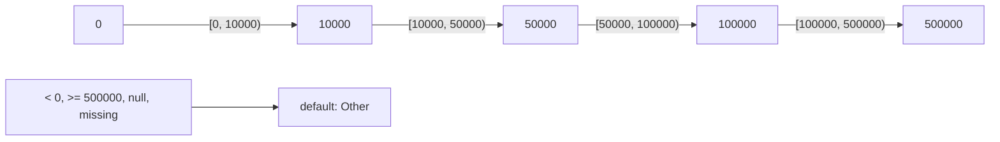

# $bucket, $bucketAuto và phân nhóm dữ liệu theo khoảng

Trong **Spring Data MongoDB**, Aggregation Framework giúp biến dữ liệu document thành kết quả thống kê, báo cáo và phân tích mà không phải tải toàn bộ bản ghi về Java. Hai stage đặc biệt hữu ích khi dựng **histogram (biểu đồ phân bố)**, các dải giá, nhóm tuổi hoặc khoảng thời gian là **`$bucket`** và **`$bucketAuto`**.

Cả hai đều nhận một biểu thức `groupBy` và tạo **một document tổng hợp cho mỗi bucket có dữ liệu**, nhưng cách chọn khoảng khác nhau:

- **`$bucket`**: ứng dụng **tự quy định các ranh giới** (`boundaries`), thích hợp với dải giá hoặc khoảng tuổi cố định và ổn định giữa các lần báo cáo.
- **`$bucketAuto`**: MongoDB **tính ranh giới từ tập dữ liệu hiện tại**, cố gắng phân phối document tương đối đều giữa số bucket mong muốn.
- Cả hai có thể tính `count`, `sum`, `avg`, `min`, `max` và tập giá trị qua các **accumulator**.

Bài này thuộc chương **Aggregation nâng cao** của module **SPRING_DATA_MONGODB** — thực hành thiết kế truy vấn, aggregation, index, transaction, reactive access, kiểm thử và chẩn đoán hiệu năng dữ liệu. Ta sẽ đi từ BSON thật và lệnh mongosh tới `MongoTemplate.aggregate(...)`, sau đó xét mapping Java, các trường hợp biên, phân trang dữ liệu thống kê, hiệu năng và kiểm thử tích hợp.

## 1. Một bài toán phân tích dải giá

Giả sử collection `products` chứa sản phẩm của nhiều tenant. Trang báo cáo cần biết số sản phẩm đã xuất bản trong các nhóm giá:

- Từ **0** đến dưới **10.000** đồng.
- Từ **10.000** đến dưới **50.000** đồng.
- Từ **50.000** đến dưới **100.000** đồng.
- Từ **100.000** đến dưới **500.000** đồng.
- Những giá trị **ngoài các khoảng trên**, gồm cả thiếu giá hoặc giá không hợp lệ.

Mặt khác, một trang khám phá dữ liệu muốn chia **giá của sản phẩm hợp lệ thành khoảng bốn nhóm có số document tương đối đồng đều**, bất kể ranh giới bắt đầu ở đâu.

Hai yêu cầu này không giống nhau:

| Câu hỏi nghiệp vụ | Stage phù hợp | Vì sao |
| --- | --- | --- |
| Có bao nhiêu sản phẩm giá 0–10.000, 10.000–50.000, …? | `$bucket` | Ranh giới do nghiệp vụ quyết định |
| Tạo bốn nhóm có lượng sản phẩm gần đều để quan sát phân bố | `$bucketAuto` | Ranh giới phụ thuộc dữ liệu hiện có |
| So sánh cùng dải giá giữa hai tháng | `$bucket` | Khoảng phải **giữ nguyên** để so sánh được |
| Gợi ý khoảng giá khám phá dữ liệu mới | `$bucketAuto` | Chưa biết nên đặt ranh giới ở đâu |
| Dữ liệu có nhiều mức giá bằng nhau | Cả hai, nhưng chú ý `$bucketAuto` | Giá trị trùng có thể khiến auto **không cân bằng được** |
| Cần hiện cả những dải giá trống | Xử lý bổ sung sau aggregation | `$bucket` không tự sinh document cho bucket rỗng |

**Không phải lúc nào “auto” cũng tốt hơn.** Nếu báo cáo bán hàng dùng các dải giá cố định, việc bucket tự đổi ranh giới qua từng ngày khiến người xem so sánh sai.

## 2. Dữ liệu mẫu: đủ cả giá hợp lệ và giá trị biên

Mỗi sản phẩm có `tenant_id`, `status`, `sku` và `price_cents`. Để tránh sai số tiền tệ trong ví dụ, chúng ta dùng **`long`/BSON Long** biểu diễn số đơn vị nhỏ nhất; tên `price_cents` là nhãn kỹ thuật cho đơn vị giá được hệ thống chọn. Trong ứng dụng VND thực tế có thể chọn `price_vnd` với số nguyên, hoặc `Decimal128` cho mô hình tiền nhiều đơn vị; quan trọng là dùng **một đơn vị nhất quán** trong cả dữ liệu và boundaries.

Dùng `mongosh` trên database test:

```javascript
db.products.insertMany([
  { tenant_id: "T1", status: "PUBLISHED", sku: "A", price_cents: NumberLong("0") },
  { tenant_id: "T1", status: "PUBLISHED", sku: "B", price_cents: NumberLong("2500") },
  { tenant_id: "T1", status: "PUBLISHED", sku: "C", price_cents: NumberLong("10000") },
  { tenant_id: "T1", status: "PUBLISHED", sku: "D", price_cents: NumberLong("10000") },
  { tenant_id: "T1", status: "PUBLISHED", sku: "E", price_cents: NumberLong("25000") },
  { tenant_id: "T1", status: "PUBLISHED", sku: "F", price_cents: NumberLong("49999") },
  { tenant_id: "T1", status: "PUBLISHED", sku: "G", price_cents: NumberLong("50000") },
  { tenant_id: "T1", status: "PUBLISHED", sku: "H", price_cents: NumberLong("99999") },
  { tenant_id: "T1", status: "PUBLISHED", sku: "I", price_cents: NumberLong("100000") },
  { tenant_id: "T1", status: "PUBLISHED", sku: "J", price_cents: NumberLong("250000") },
  { tenant_id: "T1", status: "PUBLISHED", sku: "K", price_cents: NumberLong("300000") },
  { tenant_id: "T1", status: "PUBLISHED", sku: "L", price_cents: NumberLong("499999") },
  { tenant_id: "T1", status: "PUBLISHED", sku: "M", price_cents: NumberLong("500000") },
  { tenant_id: "T1", status: "PUBLISHED", sku: "N", price_cents: NumberLong("-1000") },
  { tenant_id: "T1", status: "PUBLISHED", sku: "O", price_cents: null },
  { tenant_id: "T1", status: "PUBLISHED", sku: "P" },
  { tenant_id: "T2", status: "PUBLISHED", sku: "OTHER-TENANT", price_cents: NumberLong("2500") },
  { tenant_id: "T1", status: "DRAFT", sku: "DRAFT", price_cents: NumberLong("10000") }
]);
```

Trong tập **T1/PUBLISHED** có **16 document**. Các sản phẩm `M` (500.000), `N` (âm), `O` (BSON Null) và `P` (thiếu field) là dữ liệu biên/outlier.

**Quy tắc an toàn:** mọi biểu đồ của một tenant phải có `$match` áp dụng tenant từ ngữ cảnh xác thực, không tin tham số tenant tùy ý từ client. `$bucket` không tự giới hạn phạm vi dữ liệu; nếu quên `$match`, kết quả có thể tổng hợp cả dữ liệu tổ chức khác.

## 3. Cấu trúc stage $bucket

Cú pháp MongoDB:

```javascript
{
  $bucket: {
    groupBy: "$price_cents",
    boundaries: [
      NumberLong("0"),
      NumberLong("10000"),
      NumberLong("50000"),
      NumberLong("100000"),
      NumberLong("500000")
    ],
    default: "Other",
    output: {
      count: { $sum: 1 },
      totalPrice: { $sum: "$price_cents" },
      skus: { $push: "$sku" }
    }
  }
}
```

Các thành phần:

| Thuộc tính | Vai trò | Lưu ý quan trọng |
| --- | --- | --- |
| `groupBy` | Field path hoặc aggregation expression quyết định bucket | Field path phải có tiền tố `$` |
| `boundaries` | Danh sách **ít nhất hai** ranh giới sắp xếp **tăng dần** | Ranh giới liền kề tạo một khoảng |
| `default` | Giá trị `_id` của bucket nhận input ngoài khoảng hoặc khác kiểu | Không bắt buộc, nhưng thiếu nó có thể gây lỗi |
| `output` | Bộ accumulator tính số lượng, tổng, trung bình, danh sách,… | Khi chỉ định, phải **tự khai báo count** nếu muốn nhận count |

Các boundaries cần có kiểu BSON phù hợp và thứ tự tăng nghiêm ngặt; MongoDB cho phép trộn các **kiểu số BSON** theo quy tắc so sánh số, nhưng không nên trộn số với chuỗi/Date để định nghĩa dải giá.

### Ranh giới đóng ở dưới, mở ở trên

Với boundaries `[0, 10000, 50000, 100000, 500000]`, có **bốn** bucket chính:

```text
[0, 10000)       nghĩa là 0 <= price < 10000
[10000, 50000)   nghĩa là 10000 <= price < 50000
[50000, 100000)  nghĩa là 50000 <= price < 100000
[100000, 500000) nghĩa là 100000 <= price < 500000

"Other": ngoài bốn khoảng trên
```

Đây là **half-open interval**, rất quan trọng tại đúng giá trị biên:

- Giá **0** nằm ở bucket `0`.
- Giá **10.000** nằm ở bucket `10.000`, **không** nằm ở bucket `0`.
- Giá **50.000** nằm ở bucket `50.000`.
- Giá **100.000** nằm ở bucket `100.000`.
- Giá **500.000** **không** nằm trong bất kỳ bucket chính nào: đây là **cận trên cuối, mở**, nên rơi vào `"Other"` nếu có default.



Biểu đồ trên minh họa sự phân chia. Mỗi document chỉ thuộc **một** bucket theo kết quả `groupBy`, hoặc bucket default nếu có và giá trị không vào các dải chính.

## 4. Chạy $bucket trong mongosh

Tạo pipeline có `$match` trước để bảo vệ tenant và thu hẹp tập dữ liệu:

```javascript
db.products.aggregate([
  {
    $match: {
      tenant_id: "T1",
      status: "PUBLISHED"
    }
  },
  {
    $bucket: {
      groupBy: "$price_cents",
      boundaries: [
        NumberLong("0"),
        NumberLong("10000"),
        NumberLong("50000"),
        NumberLong("100000"),
        NumberLong("500000")
      ],
      default: "Other",
      output: {
        count: { $sum: 1 },
        totalPrice: { $sum: "$price_cents" },
        skus: { $push: "$sku" }
      }
    }
  }
]);
```

Một kết quả tiêu biểu (thứ tự các phần tử `skus` không phải hợp đồng nghiệp vụ nếu không sort input rõ ràng):

```javascript
{ _id: NumberLong("0"), count: 2, skus: ["A", "B"], ... }
{ _id: NumberLong("10000"), count: 4, skus: ["C", "D", "E", "F"], ... }
{ _id: NumberLong("50000"), count: 2, skus: ["G", "H"], ... }
{ _id: NumberLong("100000"), count: 4, skus: ["I", "J", "K", "L"], ... }
{ _id: "Other", count: 4, skus: ["M", "N", "O", "P"], ... }
```

Các kết quả `count` là **xác định** từ 16 document đã mô tả:

| `_id` bucket | Khoảng/ý nghĩa | Số document |
| --- | --- | ---: |
| `0` | [0, 10.000) | **2** |
| `10000` | [10.000, 50.000) | **4** |
| `50000` | [50.000, 100.000) | **2** |
| `100000` | [100.000, 500.000) | **4** |
| `"Other"` | Ngoài khoảng, BSON Null hoặc thiếu giá | **4** |
| **Tổng** | | **16** |

**Lưu ý:** `totalPrice` của bucket default cũng cộng các giá **số** ở đó; đối với dữ liệu mẫu đó là `500000 + (-1000)`, còn null/missing không đóng góp vào phép cộng. Nếu muốn default chỉ chứa nhóm “giá không hợp lệ”, hoặc muốn loại outlier khỏi phép tính tiền, phải thiết kế pipeline lọc/chuẩn hóa **trước** `$bucket` hoặc tách các nhóm lỗi.

### $bucket không tạo bucket rỗng

Nếu dải `[50.000, 100.000)` không có input thì stage **không trả document** với `_id=50000`. Một dashboard muốn hiển thị đầy đủ mọi dải giá cần:

1. Giữ **danh sách ranh giới chuẩn** ở service/cấu hình.
2. Map các bucket nhận được vào danh sách đó.
3. Điền `count = 0` cho những bucket không được server trả.
4. Giữ bucket default tách biệt với dải giá chính.

Đừng coi “không thấy bucket” là MongoDB đã bỏ qua định nghĩa range; đó là hành vi của aggregation khi nhóm không có document.

## 5. Không có default: dữ liệu ngoài khoảng sẽ làm stage lỗi

Nếu bỏ `default` nhưng vẫn để sản phẩm `M`, `N`, `O`, `P` trong tập input:

```javascript
db.products.aggregate([
  { $match: { tenant_id: "T1", status: "PUBLISHED" } },
  {
    $bucket: {
      groupBy: "$price_cents",
      boundaries: [
        NumberLong("0"),
        NumberLong("10000"),
        NumberLong("50000"),
        NumberLong("100000"),
        NumberLong("500000")
      ]
    }
  }
]);
```

MongoDB **có thể báo lỗi** vì có document không nằm trong bất kỳ khoảng nào. Không có `default` không phải là chỉ dẫn “bỏ qua input không hợp lệ”.

Có hai chiến lược đúng, tùy nghiệp vụ:

**Chiến lược A — giữ lại và quan sát outlier:** cấu hình `default: "Other"` như ở trên, có thể thống kê thêm số lượng theo nguyên nhân dữ liệu lỗi bằng một pipeline riêng.

**Chiến lược B — lọc tập input hợp lệ trước:**

```javascript
db.products.aggregate([
  {
    $match: {
      tenant_id: "T1",
      status: "PUBLISHED",
      price_cents: {
        $gte: NumberLong("0"),
        $lt: NumberLong("500000")
      }
    }
  },
  {
    $bucket: {
      groupBy: "$price_cents",
      boundaries: [
        NumberLong("0"),
        NumberLong("10000"),
        NumberLong("50000"),
        NumberLong("100000"),
        NumberLong("500000")
      ]
    }
  }
]);
```

Trong ví dụ, chỉ **12 document hợp lệ** đi qua `$match` thứ nhất, nên stage không cần default. MongoDB so sánh giá trị theo thứ tự BSON; với schema không nhất quán (ví dụ giá lưu string ở một số document), nên **kiểm tra kiểu** bằng `$type`/schema validation và có kế hoạch migration, không dựa vào so sánh range đơn thuần để diễn đạt mọi chính sách dữ liệu sạch.

**Rủi ro khi thiếu field:** nếu `price_cents` là null hoặc không tồn tại, expression `"$price_cents"` có thể không nằm trong dải số. Lúc đó `default` bảo vệ pipeline khỏi lỗi của những document ấy. Nhưng về mặt thống kê, cần quyết định “không có giá” là dữ liệu bỏ qua, dữ liệu lỗi hay một nhóm được hiển thị riêng.

## 6. Quy tắc chọn default và kiểu dữ liệu boundaries

Các `boundaries` phải thỏa:

- Có **ít nhất hai** giá trị.
- Được sắp **tăng dần**, mỗi cặp liền kề xác định khoảng không rỗng.
- Là các giá trị so sánh được theo quy tắc MongoDB; khi dùng loại giá/Date nhất quán sẽ giảm lỗi khó hiểu.

`default` phải là giá trị **nhỏ hơn** boundary đầu hoặc **lớn hơn hoặc bằng** boundary cuối, nếu nó cùng kiểu và có thể so sánh trong cùng miền; hoặc có thể mang **kiểu BSON khác** để tách nhóm ngoài khoảng. Với boundaries số, chọn string `"Other"` là cách phổ biến và dễ đọc.

```javascript
// Hợp lý: default là String, còn boundaries là số.
{ $bucket: {
    groupBy: "$price_cents",
    boundaries: [0, 100, 400],
    default: "Other"
}}

// Không hợp lệ: default nằm bên trong dải số đã khai báo.
// { $bucket: { groupBy: "$price_cents",
//              boundaries: [0, 100, 400], default: 200 } }
```

Không dùng `"Other"` nếu output DTO mặc định giả định `_id` luôn là `Long` mà không xử lý được String. Một bucket default tạo ra **_id đa kiểu**, không phải lỗi mapping tự nhiên của MongoDB.

## 7. Cấu trúc stage $bucketAuto

`$bucketAuto` không nhận mảng boundaries. Nó nhận số bucket mong muốn:

```javascript
{
  $bucketAuto: {
    groupBy: "$price_cents",
    buckets: 4,
    output: {
      count: { $sum: 1 },
      averagePrice: { $avg: "$price_cents" },
      minPrice: { $min: "$price_cents" },
      maxPrice: { $max: "$price_cents" }
    }
  }
}
```

MongoDB **tự xác định khoảng** từ dữ liệu sau các stage trước đó. Khác với `$bucket`:

- `_id` kết quả là **object** có `min` và `max`, không phải chỉ một cận dưới.
- Với **các bucket không phải cuối**, khoảng là `[min, max)`.
- Với **bucket cuối cùng**, khoảng là **`[min, max]`** — **cận trên được tính vào**.
- Mục tiêu là chia document tương đối đều, **không phải** tạo ra các khoảng có độ rộng giá bằng nhau.
- Số bucket thực tế **có thể ít hơn** `buckets` do quá ít document, quá ít giá trị phân biệt hoặc ràng buộc `granularity`.

Với dữ liệu mẫu, nên **lọc giá hợp lệ trước** để thuật toán auto không bị các dòng giá lỗi/âm/null điều khiển các khoảng:

```javascript
db.products.aggregate([
  {
    $match: {
      tenant_id: "T1",
      status: "PUBLISHED",
      price_cents: {
        $gte: NumberLong("0"),
        $lt: NumberLong("500000")
      }
    }
  },
  {
    $bucketAuto: {
      groupBy: "$price_cents",
      buckets: 4,
      output: {
        count: { $sum: 1 },
        averagePrice: { $avg: "$price_cents" }
      }
    }
  }
]);
```

Có **12 document** đi vào stage auto. Kết quả dự kiến là **tối đa 4** khoảng, với số document các nhóm càng cân bằng càng tốt. **Không hard-code các mốc min/max** vì chúng do server tính từ phân bố dữ liệu, khác biệt theo input và lựa chọn granularity.

### Diễn giải output

Một document kết quả có dạng:

```javascript
{
  _id: {
    min: NumberLong("10000"),
    max: NumberLong("50000")
  },
  count: 4,
  averagePrice: /* số trung bình trong bucket */
}
```

Đây là **ví dụ hình dạng**, không phải một bucket auto được cam kết tạo ra với mốc và count như vậy. Khi dựng API hoặc biểu đồ, nên giữ nguyên `_id.min` và `_id.max`, cùng quy tắc inclusive/exclusive cho bucket cuối.

**Đừng biến bucket cuối thành half-open bằng cách “+1” cho mọi kiểu dữ liệu**. Với `Date`, `Decimal128`, số thực hoặc số lớn, khái niệm “đơn vị kế tiếp” có thể không phù hợp. Hãy biểu diễn rõ cờ `upperInclusive` ở lớp response nếu cần.

## 8. $bucketAuto không bảo đảm đúng N bucket hoặc N/4 document

Một biến thể dữ liệu:

```javascript
db.products.insertMany([
  { tenant_id: "T1", status: "PUBLISHED", price_cents: NumberLong("10000") },
  { tenant_id: "T1", status: "PUBLISHED", price_cents: NumberLong("10000") },
  { tenant_id: "T1", status: "PUBLISHED", price_cents: NumberLong("10000") }
]);
```

Khi nhiều document có **cùng giá trị groupBy**, MongoDB không thể chia các bản ghi đó một cách độc lập vào nhiều dải giá không giao nhau mà vẫn giữ quy tắc bucket dựa trên giá trị. Vì vậy một bucket có thể nhiều bản ghi hơn, hoặc số bucket tạo được ít hơn yêu cầu.

```text
buckets: 4
không có nghĩa:
  - Luôn trả đúng 4 document.
  - Mỗi document luôn có đúng 25% tập dữ liệu.
  - Mỗi khoảng có cùng bề rộng.
  - Ranh giới giữa các lần chạy luôn giống nhau.
```

Trường hợp `groupBy` có cardinality thấp (ví dụ `status` chỉ có ba giá trị) và yêu cầu 10 buckets thường không hợp lý. `$group` theo trạng thái hoặc `$bucket` theo các nhóm đã biết dễ diễn đạt hơn.

## 9. Granularity: làm tròn ranh giới auto theo dãy số

Với biểu đồ tự động, các khoảng như `[1749, 5837)` có thể khó trình bày cho người dùng. `$bucketAuto` hỗ trợ tùy chọn `granularity` để ưu tiên những **dãy số “đẹp”** (preferred number series):

```javascript
db.products.aggregate([
  {
    $match: {
      tenant_id: "T1",
      status: "PUBLISHED",
      price_cents: {
        $gte: NumberLong("0"),
        $lt: NumberLong("500000")
      }
    }
  },
  {
    $bucketAuto: {
      groupBy: "$price_cents",
      buckets: 4,
      granularity: "R5",
      output: {
        count: { $sum: 1 }
      }
    }
  }
]);
```

MongoDB hỗ trợ các giá trị granularity như `R5`, `R10`, `R20`, `R40`, `R80`, `1-2-5`, `E6`, `E12`, `E24`, `E48`, `E96`, `E192` và `POWERSOF2` theo phiên bản/tài liệu server. Mỗi dãy xác định các bậc số ưu tiên cho ranh giới.

| Granularity | Khi nào cân nhắc |
| --- | --- |
| `R5` / `R10` | Biểu đồ phân bố số với các mốc ít hoặc tương đối thưa |
| `1-2-5` | Mốc số tròn kiểu 1–2–5 nhân lũy thừa 10 |
| `E24`, các dãy E khác | Cần các bước chuẩn theo dãy số được server hỗ trợ |
| `POWERSOF2` | Phân bố theo bậc lũy thừa của 2 |
| Không đặt | Chấp nhận ranh giới MongoDB xác định trực tiếp từ dữ liệu |

**Điều kiện quan trọng:** chỉ dùng `granularity` khi **tất cả giá trị groupBy đều là numeric và không có NaN**, và kiểm tra thêm các hạn chế của granularity cụ thể theo phiên bản server. Những field Date/string, document/array hoặc null trong input làm tùy chọn granularity không phù hợp. Một số dãy ưu tiên còn làm **ít khoảng hơn** hoặc giảm khả năng cân bằng.

`granularity` không phải là `withBoundaries` của `$bucket`: nó chỉ **hướng ranh giới auto về dãy số**, không hứa chính xác bốn khoảng có mốc do ứng dụng chỉ định.

## 10. Khi định nghĩa output, nhớ khai báo count

Ở cả hai stage, khi **không có `output`**, MongoDB tự tạo một field `count` cho mỗi bucket. Nhưng khi **có `output`**, kết quả chỉ chứa những accumulator được khai báo (ngoài `_id`).

```javascript
// Không khai báo output:
{ $bucketAuto: {
    groupBy: "$price_cents",
    buckets: 4
}}
// Kết quả mặc định có count.

// Có output chỉ để tính average:
{ $bucketAuto: {
    groupBy: "$price_cents",
    buckets: 4,
    output: { averagePrice: { $avg: "$price_cents" } }
}}
// Không có count, vì không khai báo count.

// Muốn cả hai:
{ $bucketAuto: {
    groupBy: "$price_cents",
    buckets: 4,
    output: {
      count: { $sum: 1 },
      averagePrice: { $avg: "$price_cents" }
    }
}}
```

Accumulator thường dùng:

| Accumulator | Ý nghĩa | Cẩn trọng |
| --- | --- | --- |
| `{ $sum: 1 }` | Số document trong bucket | Không phải tổng giá |
| `{ $sum: "$price_cents" }` | Tổng giá các document có giá numeric | Null/thiếu không đóng góp giá numeric |
| `{ $avg: "$price_cents" }` | Giá trung bình | Tránh chia thủ công bằng count toàn bộ nếu có null |
| `{ $min: "$price_cents" }` | Giá nhỏ nhất trong input của nhóm | Dữ liệu nhiều kiểu có BSON comparison rules |
| `{ $max: "$price_cents" }` | Giá lớn nhất | Kiểm tra chuẩn hóa đơn vị |
| `{ $push: "$sku" }` | Mảng giá trị sku trong bucket | Mảng lớn làm tăng memory/payload |
| `{ $addToSet: "$sku" }` | Tập các SKU phân biệt theo BSON equality | Không cam kết thứ tự |

Khi cần biểu đồ histogram đơn thuần, **chỉ `count` và bounds** thường đã đủ. Đừng `$push` hàng chục nghìn documents vào từng bucket nếu frontend chỉ cần cột biểu đồ.

## 11. Ánh xạ entity Java trong Spring Data MongoDB

Entity `Product`:

```java
import org.bson.types.ObjectId;
import org.springframework.data.annotation.Id;
import org.springframework.data.mongodb.core.mapping.Document;
import org.springframework.data.mongodb.core.mapping.Field;

@Document(collection = "products")
public class Product {
    @Id
    private ObjectId id;

    @Field("tenant_id")
    private String tenantId;

    private String status;

    private String sku;

    @Field("price_cents")
    private Long priceCents;

    public Product() {}

    public ObjectId getId() { return id; }
    public String getTenantId() { return tenantId; }
    public String getStatus() { return status; }
    public String getSku() { return sku; }
    public Long getPriceCents() { return priceCents; }
}
```

`Long` được dùng thay cho primitive `long` vì collection ví dụ có BSON Null và document thiếu `price_cents`. Nếu ánh xạ `long`, thiếu field có thể biến thành giá trị mặc định `0` ở phía Java, làm mờ sự phân biệt **“giá thật bằng 0”** và **“chưa có giá”**.

Trong Spring Data typed aggregation:

- `Criteria.where("tenantId")` được converter ánh xạ sang `tenant_id`.
- `Aggregation.bucket("priceCents")` tương ứng với `groupBy: "$price_cents"`.
- `andOutput("priceCents")` ánh xạ đúng property Java khi được sử dụng với domain type và aggregation context.
- `AggregationResults<Document>` phù hợp khi output là bucket dạng `_id` numeric hoặc object min/max, không giống schema entity `Product`.

**Không dùng entity `Product` làm kiểu kết quả bucket**: output của `$bucket`/`$bucketAuto` là document tổng hợp mới, không có đủ trường để dựng một sản phẩm bình thường.

## 12. Spring Data: Aggregation.bucket với boundaries cố định

API từ `org.springframework.data.mongodb.core.aggregation.Aggregation` hỗ trợ fluent builder:

```java
import java.util.List;
import org.bson.Document;
import org.springframework.data.domain.Sort;
import org.springframework.data.mongodb.core.MongoTemplate;
import org.springframework.data.mongodb.core.aggregation.Aggregation;
import org.springframework.data.mongodb.core.aggregation.AggregationResults;
import org.springframework.data.mongodb.core.query.Criteria;

public class PriceHistogramService {
    private final MongoTemplate template;

    public PriceHistogramService(MongoTemplate template) {
        this.template = template;
    }

    public List<Document> fixedPriceHistogram(String authorizedTenant) {
        Aggregation pipeline = Aggregation.newAggregation(
            Aggregation.match(
                Criteria.where("tenantId").is(authorizedTenant)
                    .and("status").is("PUBLISHED")
            ),
            Aggregation.bucket("priceCents")
                .withBoundaries(
                    0L, 10_000L, 50_000L, 100_000L, 500_000L
                )
                .withDefault("Other")
                .andOutputCount().as("count")
                .andOutput("priceCents").sum().as("totalPrice"),
            Aggregation.sort(Sort.Direction.ASC, "_id")
        );

        AggregationResults<Document> result =
            template.aggregate(pipeline, Product.class, Document.class);

        return result.getMappedResults();
    }
}
```

Giải thích chain:

1. `Aggregation.match(...)` giảm dữ liệu xuống tenant hiện tại và status cần thống kê.
2. `Aggregation.bucket("priceCents")` chọn **field Java** dùng để chia nhóm.
3. `withBoundaries(...)` định nghĩa bốn khoảng từ năm giá trị mốc.
4. `withDefault("Other")` nhận giá trị ngoài khoảng hoặc thiếu/khác loại.
5. `andOutputCount().as("count")` sinh `$sum: 1`.
6. `andOutput("priceCents").sum().as("totalPrice")` tính tổng giá của mỗi nhóm.
7. `Aggregation.sort(..., "_id")` sắp kết quả để hiển thị có thứ tự, nhưng cần nhớ `_id` lúc này gồm **số và String** (bucket default).

**Kiểu dữ liệu kết quả:** `_id` trong `Document` có thể là `Long`/`Number` hoặc `String` `"Other"`. Không viết DTO ép toàn bộ `_id` sang `long`, nếu không mapping default bucket sẽ lỗi.

### Lưu ý về thứ tự hiển thị

Sau `$bucket`, bucket numeric thường có thể sort theo `_id` để ra thứ tự tăng dần, nhưng bucket `"Other"` mang kiểu String; BSON comparison có quy tắc thứ tự kiểu riêng. Một API có thể tách `"Other"` rồi đặt ở cuối theo chủ đích để tránh phụ thuộc vào thứ tự type của server.

Nếu cần xuất nhóm rỗng, server trả ít hơn bốn nhóm numeric; service có thể tạo danh sách các lower bounds chuẩn rồi điền 0 cho nhóm không xuất hiện.

## 13. Spring Data: Aggregation.bucketAuto với số nhóm mong muốn

Dùng `Aggregation.bucketAuto("priceCents", 4)` thay vì `bucket(...).withBoundaries(...)`:

```java
import java.util.List;
import org.bson.Document;
import org.springframework.data.mongodb.core.aggregation.Aggregation;
import org.springframework.data.mongodb.core.aggregation.AggregationResults;
import org.springframework.data.mongodb.core.MongoTemplate;
import org.springframework.data.mongodb.core.query.Criteria;

public class AdaptiveHistogramService {
    private final MongoTemplate template;

    public AdaptiveHistogramService(MongoTemplate template) {
        this.template = template;
    }

    public List<Document> adaptivePrices(String authorizedTenant) {
        Aggregation pipeline = Aggregation.newAggregation(
            Aggregation.match(
                Criteria.where("tenantId").is(authorizedTenant)
                    .and("status").is("PUBLISHED")
                    .and("priceCents").gte(0L).lt(500_000L)
            ),
            Aggregation.bucketAuto("priceCents", 4)
                .andOutputCount().as("count")
                .andOutput("priceCents").avg().as("averagePrice")
        );

        AggregationResults<Document> result =
            template.aggregate(pipeline, Product.class, Document.class);
        return result.getMappedResults();
    }
}
```

Điểm khác với fixed:

- Không có `withBoundaries(...)`.
- Không có `default`; nếu dữ liệu cần xử lý null/outlier, phải **tiền xử lý bằng `$match`, `$project` hoặc tách nhánh `$facet`** theo nghiệp vụ.
- `_id` là document có `min`, `max`; nên dùng `Document` hoặc DTO gồm một `Range` object.
- Số bucket có thể ít hơn 4. Dù yêu cầu 4, code phải chấp nhận kết quả chỉ có 1–3 nhóm.

### Thêm granularity bằng Spring Data

```java
import org.springframework.data.mongodb.core.aggregation.BucketAutoOperation;

// Đây là operation thay thế cho dòng bucketAuto trong pipeline:
var operation = Aggregation.bucketAuto("priceCents", 4)
    .withGranularity(BucketAutoOperation.Granularities.R5)
    .andOutputCount().as("count")
    .andOutput("priceCents").avg().as("averagePrice");
```

`R5` chọn dãy mốc “đẹp” kiểu Renard. Nó không bảo đảm bucket count cân bằng tuyệt đối, đặc biệt khi giá trùng nhau hoặc số bucket yêu cầu vượt độ chi tiết của dãy.

**Kiểm tra dữ liệu đầu vào** trước khi bật granularity: các giá trị được group phải là numeric và không chứa NaN; các hạn chế khác của từng dãy cần đối chiếu tài liệu server theo phiên bản thực tế.

## 14. Trả về DTO: fixed bucket khác auto bucket

Vì `_id` khác nhau, không nên ép hai kết quả vào cùng một class Java đơn giản chỉ có `Long id`.

Cho fixed bucket có default string:

```java
public record FixedBucketView(
    Object key,
    long count,
    long totalPrice
) {}
```

Khi map từ `Document`:

```java
import java.util.List;
import org.bson.Document;

List<FixedBucketView> views = rawBuckets.stream()
    .map(bucket -> new FixedBucketView(
        bucket.get("_id"),
        ((Number) bucket.get("count")).longValue(),
        ((Number) bucket.get("totalPrice")).longValue()
    ))
    .toList();
```

`rawBuckets` là kết quả trả từ `fixedPriceHistogram(...)`. Dùng `Object key` chỉ là ví dụ mức mapping; production có thể dùng sealed representation/enum `OTHER` + lowerBound numeric, hoặc chuỗi nhãn được tạo từ boundaries chuẩn.

Cho auto bucket:

```java
public record AutoBucketView(
    Number min,
    Number max,
    boolean upperInclusive,
    long count
) {}
```

Cách map `_id`:

```java
List<Document> raw = adaptiveHistogramService.adaptivePrices(tenantId);

List<AutoBucketView> views = new java.util.ArrayList<>();

for (int i = 0; i < raw.size(); i++) {
    Document row = raw.get(i);
    Document range = row.get("_id", Document.class);

    views.add(new AutoBucketView(
        (Number) range.get("min"),
        (Number) range.get("max"),
        i == raw.size() - 1, // Bucket cuối có upper bound inclusive.
        ((Number) row.get("count")).longValue()
    ));
}
```

Ở đây giả định server trả bucket theo thứ tự ranh giới, đúng hành vi của stage auto; nếu pipeline sau đó có sort khác, phải tính lại bucket nào là cuối theo khoảng giá thay vì theo vị trí danh sách.

**Không lấy `min` và `max` của bucket auto làm “ID cố định” trong database.** Khi tập sản phẩm thay đổi, các boundaries có thể đổi; token/cache/dashboard nên gắn với snapshot hoặc thời điểm báo cáo nếu cần so sánh.

## 15. Phân biệt $bucket, $bucketAuto và $group

`$group` phân nhóm theo **giá trị khóa cụ thể hoặc biểu thức**, còn `$bucket`, `$bucketAuto` gom **một miền giá trị** vào các khoảng.

```javascript
// $group: số sản phẩm tại từng mức giá chính xác.
db.products.aggregate([
  { $match: { tenant_id: "T1", status: "PUBLISHED" } },
  { $group: { _id: "$price_cents", count: { $sum: 1 } } }
]);

// $bucket: số sản phẩm tại các khoảng giá cố định.
// $bucketAuto: chia thành các khoảng do MongoDB tính từ dữ liệu.
```

| Khả năng | `$group` | `$bucket` | `$bucketAuto` |
| --- | --- | --- | --- |
| Nhóm chính xác theo khóa | **Có** | Không phải mục đích chính | Không phải mục đích chính |
| Nhóm theo dải có mốc biết trước | Cần biểu thức tự tính dải | **Tự nhiên nhất** | Mốc tự thay đổi |
| Chia gần đều theo số document | Không tự làm | Phụ thuộc ranh giới đã cho | **Mục tiêu của stage** |
| Count/sum/avg | Có | Có | Có |
| Xử lý outlier bằng bucket default | Tự thiết kế | **Có** | Không có `default` theo cú pháp stage |
| Tạo bucket trống | Không tự động | Không tự động | Không tự động |
| `_id` result | Giá trị group key | Lower bound hoặc default value | `{min, max}` |

Khi muốn làm báo cáo có các dải cố định từ trước, đừng gọi `$bucketAuto` rồi lưu các khoảng hiện tại như một “định nghĩa dải giá”; lần chạy sau có thể trả boundaries khác.

## 16. Dùng $facet khi muốn nhiều cách phân nhóm trên cùng input

Một dashboard đôi khi cần cả dải giá cố định, dải giá tự động và dữ liệu chất lượng (thiếu giá, giá âm). `$facet` cho phép chạy nhiều nhánh aggregation **trên cùng tập input ban đầu**.

Ví dụ mongosh:

```javascript
db.products.aggregate([
  {
    $match: {
      tenant_id: "T1",
      status: "PUBLISHED"
    }
  },
  {
    $facet: {
      fixed: [
        {
          $bucket: {
            groupBy: "$price_cents",
            boundaries: [
              NumberLong("0"),
              NumberLong("10000"),
              NumberLong("50000"),
              NumberLong("100000"),
              NumberLong("500000")
            ],
            default: "Other",
            output: { count: { $sum: 1 } }
          }
        }
      ],
      adaptive: [
        {
          $match: {
            price_cents: {
              $gte: NumberLong("0"),
              $lt: NumberLong("500000")
            }
          }
        },
        {
          $bucketAuto: {
            groupBy: "$price_cents",
            buckets: 4,
            output: { count: { $sum: 1 } }
          }
        }
      ],
      quality: [
        {
          $group: {
            _id: null,
            totalInput: { $sum: 1 }
          }
        }
      ]
    }
  }
]);
```

Output `$facet` là **một document** chứa các array `fixed`, `adaptive`, `quality`. Từng nhánh chỉ nhận dữ liệu từ input chung sau `$match` đầu tiên; mỗi nhánh có thể tiếp tục lọc riêng.

**Đừng nhầm `$facet` với việc “có sẵn transaction snapshot”.** Nó là một aggregation pipeline trên tập dữ liệu mà server xử lý theo read concern hiện hành, không tự cam kết snapshot bất biến xuyên nhiều API calls. Hơn nữa, `$facet` có giới hạn bộ nhớ và kích thước output BSON; không đặt những mảng `$push` khổng lồ vào kết quả.

Trong Spring Data MongoDB, có thể dùng `Aggregation.facet(...)` để xây các nhánh, nhưng cần kiểm tra API builder theo phiên bản và map kết quả facet sang kiểu riêng thay vì entity `Product`.

## 17. GroupBy là expression, không nhất thiết là một field

Cả hai toán tử nhận **expression** cho `groupBy`, nên không bắt buộc trường BSON đã lưu sẵn đúng đơn vị cần thống kê.

Ví dụ nguồn lưu số tiền nhỏ nhất, nhưng dashboard muốn xem giá theo một đơn vị lớn hơn:

```javascript
db.products.aggregate([
  {
    $match: {
      tenant_id: "T1",
      status: "PUBLISHED",
      price_cents: { $gte: NumberLong("0") }
    }
  },
  {
    $bucket: {
      groupBy: { $divide: ["$price_cents", 100] },
      boundaries: [0, 100, 500, 1000, 5000],
      default: "Other",
      output: { count: { $sum: 1 } }
    }
  }
]);
```

Ở đây boundaries **không còn cùng đơn vị** với `price_cents` lưu trực tiếp; chúng áp dụng cho **kết quả phép chia**. Vì thế, khi xem biểu đồ, phải ghi rõ đơn vị và chính sách làm tròn. Nếu tiền dùng Decimal128, cần kiểm tra phép chia/chuyển kiểu để không tích lũy sai số nhị phân hoặc pha trộn kiểu số ngoài mong đợi.

Có thể biểu diễn tính toán phức tạp bằng `Aggregation.project(...)` tạo một field trung gian đã được chuẩn hóa, rồi `bucket("normalizedPrice")` hoặc `bucketAuto("normalizedPrice", n)`. Cách này thường dễ đọc và kiểm thử hơn so với nhồi expression rất dài vào chính stage bucket.

**Ví dụ với thời gian:** chia document vào các khoảng ngày/tháng bằng boundaries kiểu BSON Date:

```javascript
db.orders.aggregate([
  {
    $bucket: {
      groupBy: "$created_at",
      boundaries: [
        ISODate("2026-01-01T00:00:00Z"),
        ISODate("2026-02-01T00:00:00Z"),
        ISODate("2026-03-01T00:00:00Z")
      ],
      default: "OutsidePeriod",
      output: { count: { $sum: 1 } }
    }
  }
]);
```

Hai buckets tương ứng tháng 1 và tháng 2 (theo **UTC** trong ví dụ). Với múi giờ địa phương và DST, cần định nghĩa ranh giới theo timezone nghiệp vụ hoặc dùng `$dateTrunc`/date expressions phù hợp. Không dùng `$bucketAuto` nếu muốn “mỗi tháng là một bucket” vì auto sẽ tìm ranh giới theo phân bố số document, không theo tháng lịch.

## 18. $sort, index và thứ tự các stage

Một pipeline phân tích thường nên bắt đầu bằng `$match` có điều kiện chọn lọc, sau đó mới thực hiện stage blocking:

```javascript
db.products.aggregate([
  { $match: {
      tenant_id: "T1",
      status: "PUBLISHED",
      price_cents: { $gte: NumberLong("0") }
  }},
  { $bucketAuto: {
      groupBy: "$price_cents",
      buckets: 4,
      output: { count: { $sum: 1 } }
  }}
]);
```

Một compound index có thể xem xét:

```javascript
db.products.createIndex(
  { tenant_id: 1, status: 1, price_cents: 1 },
  { name: "products_tenant_status_price" }
);
```

Lý do:

1. `tenant_id` và `status` có thể là equality filters.
2. `price_cents` có thể dùng range filter từ `$match` để giảm input.
3. Server có thể dùng index ở bước tìm document ban đầu, nhưng **bucket vẫn phải tổng hợp các document được chọn**.

**Không nói index sẽ biến `$bucketAuto` thành một phép tra cứu tức thì.** Thuật toán phải phân tích phân bố groupBy của tập document; `$bucketAuto` và `$bucket` là các stage có thể cần nhiều bộ nhớ. Nếu trước đó có `$sort` và query không tận dụng được index, còn có thêm chi phí sort.

### Giới hạn bộ nhớ

Theo tài liệu MongoDB, `$bucket` và `$bucketAuto` chịu các giới hạn memory aggregation (thường liên quan mức **100 MB cho stage**, tùy cấu hình/version):

- `$bucket` có thể yêu cầu bật disk spilling bằng `allowDiskUse` nếu vượt bộ nhớ cho phép.
- `$bucketAuto` có khả năng dùng temporary files khi vượt ngưỡng, theo cơ chế `allowDiskUseByDefault`/`allowDiskUse` của server.
- Kết quả chứa array `skus`/documents lớn có thể còn chạm giới hạn BSON output **16 MiB**.
- `$facet` cũng có những hạn mức riêng; không dựa vào `allowDiskUse` để bỏ qua mọi giới hạn của nó.

Do đó hãy ưu tiên count/sum/avg thay vì `$push` toàn bộ entity, lọc tenant/status trước, và dùng các job/reporting pipeline phù hợp với khối lượng thực tế.

## 19. AggregationOptions trong Spring Data và giải thích query

Với aggregation nặng, `MongoTemplate` cho phép cấu hình aggregation options, ví dụ cho phép sử dụng disk khi stage cần:

```java
import org.springframework.data.mongodb.core.aggregation.Aggregation;
import org.springframework.data.mongodb.core.aggregation.AggregationOptions;

AggregationOptions options = AggregationOptions.builder()
    .allowDiskUse(true)
    .build();

Aggregation pipelineWithOptions = pipeline.withOptions(options);
```

`pipeline` là biến `Aggregation` đã xây ở các ví dụ trước. Đây là **một pipeline được cấu hình lại** để thực thi, không phải câu lệnh tạo index. Chính sách triển khai cần cân nhắc dung lượng disk, concurrency và giới hạn thời gian query; không nên bật `allowDiskUse` như cách thay cho tối ưu dữ liệu.

Để đo trên MongoDB, dùng `explain` với pipeline tương đương:

```javascript
db.products.explain("executionStats").aggregate([
  { $match: {
      tenant_id: "T1",
      status: "PUBLISHED",
      price_cents: { $gte: NumberLong("0"), $lt: NumberLong("500000") }
  }},
  { $bucketAuto: {
      groupBy: "$price_cents",
      buckets: 4
  }}
]);
```

Quan sát:

- Query plan có `IXSCAN` hay `COLLSCAN` ở bước lọc đầu?
- `totalDocsExamined`/`totalKeysExamined` có quá lớn so với tập input mong đợi?
- Stage aggregation có chi phí xử lý/memory hoặc spill nào?
- Số document sau `$match` và số bucket output có khớp các giả định?
- Độ trễ p95/p99 và tải server dưới các request dashboard đồng thời.

**Dữ liệu nhỏ không đủ để chứng minh index tốt.** Các stage aggregation thường được dùng trên lượng dữ liệu lớn, nên cần đo với dataset đại diện và giới hạn phạm vi tenant/time window.

## 20. Kiểm thử tích hợp với dữ liệu BSON thật

Unit test dùng mock `MongoTemplate` chỉ chứng minh method nào được gọi; nó không chứng minh:

- `@Field("price_cents")` được mapping khi gọi `Aggregation.bucket("priceCents")`.
- Giá đúng ranh giới vào bucket nào.
- Document null/missing/out-of-range vào default hay bị lọc.
- `$bucketAuto` trả `_id.min`/`_id.max` và số bucket như mô tả.
- `count` còn xuất hiện khi có custom output.
- Typed aggregation kết quả `Document` có đủ dữ liệu mà dashboard cần.

Dùng một MongoDB instance dành riêng cho integration test (ví dụ Testcontainers) và các raw BSON documents để kiểm tra đúng dữ liệu server lưu.

### 20.1. Kiểm thử $bucket với năm nhóm xác định

```java
import static org.assertj.core.api.Assertions.assertThat;

import java.util.List;
import java.util.UUID;
import org.bson.Document;
import org.bson.types.ObjectId;
import org.junit.jupiter.api.Test;
import org.springframework.beans.factory.annotation.Autowired;
import org.springframework.boot.test.autoconfigure.data.mongo.DataMongoTest;
import org.springframework.data.mongodb.core.MongoTemplate;
import org.springframework.data.mongodb.core.aggregation.Aggregation;
import org.springframework.data.mongodb.core.query.Criteria;

@DataMongoTest
class ProductBucketIntegrationTest {
    @Autowired MongoTemplate template;

    @Test
    void fixedBucketUsesHalfOpenRangesAndDefault() {
        String tenant = "test-" + UUID.randomUUID();
        String other = "other-" + UUID.randomUUID();

        template.getCollection("products").insertMany(List.of(
            raw(tenant, "PUBLISHED", "A", 0L, true),
            raw(tenant, "PUBLISHED", "B", 2_500L, true),
            raw(tenant, "PUBLISHED", "C", 10_000L, true),
            raw(tenant, "PUBLISHED", "D", 10_000L, true),
            raw(tenant, "PUBLISHED", "E", 25_000L, true),
            raw(tenant, "PUBLISHED", "F", 49_999L, true),
            raw(tenant, "PUBLISHED", "G", 50_000L, true),
            raw(tenant, "PUBLISHED", "H", 99_999L, true),
            raw(tenant, "PUBLISHED", "I", 100_000L, true),
            raw(tenant, "PUBLISHED", "J", 250_000L, true),
            raw(tenant, "PUBLISHED", "K", 300_000L, true),
            raw(tenant, "PUBLISHED", "L", 499_999L, true),
            raw(tenant, "PUBLISHED", "M", 500_000L, true),
            raw(tenant, "PUBLISHED", "N", -1_000L, true),
            raw(tenant, "PUBLISHED", "O", null, true),
            raw(tenant, "PUBLISHED", "P", null, false),
            raw(other, "PUBLISHED", "OTHER", 2_500L, true),
            raw(tenant, "DRAFT", "DRAFT", 10_000L, true)
        ));

        Aggregation aggregation = Aggregation.newAggregation(
            Aggregation.match(
                Criteria.where("tenantId").is(tenant)
                    .and("status").is("PUBLISHED")
            ),
            Aggregation.bucket("priceCents")
                .withBoundaries(
                    0L, 10_000L, 50_000L, 100_000L, 500_000L
                )
                .withDefault("Other")
                .andOutputCount().as("count")
        );

        List<Document> rows = template.aggregate(
            aggregation, Product.class, Document.class
        ).getMappedResults();

        assertThat(rows).hasSize(5);
        assertThat(countAt(rows, 0L)).isEqualTo(2);
        assertThat(countAt(rows, 10_000L)).isEqualTo(4);
        assertThat(countAt(rows, 50_000L)).isEqualTo(2);
        assertThat(countAt(rows, 100_000L)).isEqualTo(4);
        assertThat(countOther(rows)).isEqualTo(4);
    }

    static Document raw(
            String tenant, String status, String sku,
            Long price, boolean hasPriceField) {

        Document d = new Document("_id", new ObjectId())
            .append("tenant_id", tenant)
            .append("status", status)
            .append("sku", sku);
        if (hasPriceField) {
            d.append("price_cents", price);
        }
        return d;
    }

    static long countAt(List<Document> rows, long lowerBound) {
        return rows.stream()
            .filter(d -> d.get("_id") instanceof Number)
            .filter(d ->
                ((Number) d.get("_id")).longValue() == lowerBound
            )
            .mapToLong(d ->
                ((Number) d.get("count")).longValue()
            )
            .findFirst()
            .orElseThrow();
    }

    static long countOther(List<Document> rows) {
        return rows.stream()
            .filter(d -> "Other".equals(d.get("_id")))
            .mapToLong(d ->
                ((Number) d.get("count")).longValue()
            )
            .findFirst()
            .orElseThrow();
    }
}
```

Test xác minh toàn bộ 16 document của đúng tenant/status được phân loại vào năm bucket. Dữ liệu khác tenant/trạng thái không lọt vào kết quả. Helper đọc `_id` numeric qua `Number` để tránh cứng hóa BSON Int64/Int32 trong DTO test.

### 20.2. Kiểm thử $bucketAuto theo invariant thay vì mốc cố định

Với `$bucketAuto`, không nên viết test yêu cầu **chính xác** các boundaries mà thuật toán tự chọn (trừ khi một phiên bản server cụ thể đã có contract chặt hơn và test được thiết kế riêng).

```java
import static org.assertj.core.api.Assertions.assertThat;

import java.util.List;
import org.bson.Document;
import org.springframework.data.mongodb.core.aggregation.Aggregation;
import org.springframework.data.mongodb.core.query.Criteria;

// Thêm method này vào ProductBucketIntegrationTest,
// sau khi tạo dữ liệu 12 giá hợp lệ như test trước.
void verifyAutoInvariant(String tenant) {
    Aggregation aggregation = Aggregation.newAggregation(
        Aggregation.match(
            Criteria.where("tenantId").is(tenant)
                .and("status").is("PUBLISHED")
                .and("priceCents").gte(0L).lt(500_000L)
        ),
        Aggregation.bucketAuto("priceCents", 4)
            .andOutputCount().as("count")
    );

    List<Document> rows = template.aggregate(
        aggregation, Product.class, Document.class
    ).getMappedResults();

    assertThat(rows.size()).isBetween(1, 4);

    long total = rows.stream()
        .mapToLong(d -> ((Number) d.get("count")).longValue())
        .sum();
    assertThat(total).isEqualTo(12);

    for (Document row : rows) {
        Document range = row.get("_id", Document.class);
        assertThat(range).containsKeys("min", "max");
        assertThat(row.get("count")).isInstanceOf(Number.class);
    }
}
```

Đoạn trên là **helper kiểm chứng**, không có annotation `@Test` độc lập vì cần dựng dữ liệu trước và có `template` của test class. Khi thực hành, gọi nó trong cùng test đã insert dữ liệu hoặc tạo một setup method/fixture riêng để bảo đảm dữ liệu tồn tại.

Những invariant nên kiểm tra thêm:

- Mỗi giá hợp lệ thuộc **một** bucket và tổng count bằng số document đầu vào đã lọc.
- Các khoảng `min/max` tăng dần, không chồng lấn trái quy tắc; bucket cuối dùng cận trên inclusive.
- Số bucket `<= buckets`, không nhất thiết bằng.
- Input có nhiều giá bằng nhau không tạo lỗi phân loại hoặc “mất” document.
- Dữ liệu null/missing không bị vô tình tính là giá 0.
- `granularity` chỉ được dùng khi đầu vào hợp lệ numeric.

## 21. Các lỗi thường gặp và cách tránh

| Lỗi | Hậu quả | Cách xử lý |
| --- | --- | --- |
| Nghĩ giá bằng ranh giới vào bucket phía trái | Số liệu sai tại 10.000, 50.000, … | Nhớ `$bucket` dùng `[lower, upper)` |
| Nghĩ cận trên cuối của `$bucket` được tính vào | Sản phẩm giá 500.000 bị phân nhóm sai | Dùng default, tăng mốc cuối có chủ đích hoặc tiền xử lý |
| Không đặt default khi có outlier/null | Pipeline có thể thất bại | Đặt default hoặc `$match` dữ liệu hợp lệ trước |
| Đặt default nằm giữa boundaries | Lỗi cấu hình stage | Chọn giá ngoài toàn dải hoặc khác kiểu BSON |
| Tin `$bucket` sẽ trả các bucket trống với count 0 | Dashboard thiếu dải đã định nghĩa | Điền zero buckets ở service |
| Dùng `$bucketAuto` cho biểu đồ cần cố định mốc | Các dải biến động theo ngày/tháng | Dùng `$bucket` với boundaries từ nghiệp vụ |
| Tin auto luôn trả đúng N bucket, N bằng nhau | Sai khi dữ liệu có nhiều giá trùng | Kiểm tra cardinality, chấp nhận ít bucket hơn |
| Áp granularity lên groupBy Date/null/non-numeric | Query lỗi hoặc không hợp lệ | Chỉ dùng trên dữ liệu numeric đã làm sạch |
| Không khai báo count khi đã có output khác | Kết quả mất field count | Thêm `count: {$sum:1}` / `andOutputCount()` |
| Map cả fixed bucket và auto bucket vào DTO `Long id` | Lỗi khi `_id` là Object hoặc String | DTO riêng hoặc schema union có kiểm soát |
| Đọc `Product` entity làm kết quả aggregation | Mapping không phản ánh bucket output | Đọc `Document`/DTO aggregation |
| Dùng tên BSON trong DSL khi entity được mapping khác | Query hoặc stage sinh sai field | Dùng property Java với typed `Aggregation`, test raw BSON |
| Quên `$match` tenant trước bucket | Rò rỉ số liệu đa tenant | Áp tenant từ auth context ở đầu pipeline |
| `$push` toàn bộ document vào output bucket | Tốn RAM, payload lớn, có thể vượt BSON limit | Chỉ trả count/sum/avg hoặc sample có giới hạn |
| Tin index xử lý hết công việc bucket | Dashboard chậm với dữ liệu lớn | `$match` sớm, index cho input, explain và benchmark |
| Test cố định bounds của auto từ một dataset nhỏ | Test giòn theo phiên bản/phân bố | Test invariant và totals thay vì chốt mốc tùy thuật toán |

## 22. Bài tập tự kiểm tra

**1.** Boundaries của `$bucket` là `[0, 100, 200]`. Document có giá `100` vào bucket nào?  
**Đáp án:** bucket `_id=100`, vì cận dưới inclusive và cận trên exclusive.

**2.** Với cùng boundaries, document có giá `200` và không đặt default được xử lý thế nào?  
**Đáp án:** ngoài khoảng, có thể làm pipeline lỗi; cận trên cuối của `$bucket` không inclusive.

**3.** Tại sao `$bucketAuto` có thể trả ít hơn 5 buckets dù đã chọn `buckets:5`?  
**Đáp án:** số giá trị phân biệt hoặc số documents quá ít, hoặc granularity không cho phép chia thành đủ dải phù hợp.

**4.** Cận trên của bucket cuối `$bucketAuto` inclusive hay exclusive?  
**Đáp án:** **inclusive**; khác các bucket trước đó.

**5.** Khi có `output:{averagePrice:{$avg:"$price_cents"}}`, field `count` có tự xuất hiện không?  
**Đáp án:** không. Phải khai báo `count:{$sum:1}` hoặc API tương ứng.

**6.** Muốn so sánh cùng bốn khoảng giá cố định giữa hai tháng nên dùng stage nào?  
**Đáp án:** `$bucket` với cùng boundaries.

**7.** Có thể đặt `granularity:"R5"` cho `groupBy:"$created_at"` (BSON Date) không?  
**Đáp án:** không; granularity của `$bucketAuto` dành cho giá trị numeric và có các ràng buộc đầu vào.

**8.** Vì sao `$bucket` với boundaries giá lại cần kiểu tiền thống nhất?  
**Đáp án:** trộn BSON types/đơn vị tiền hoặc để giá dạng String sẽ làm so sánh, thống kê và phân nhóm sai hoặc khó dự đoán.

**9.** Có nên `$push:"$$ROOT"` toàn bộ sản phẩm vào một histogram chỉ hiển thị số lượng không?  
**Đáp án:** không; tăng bộ nhớ và kích thước result, không cần thiết cho biểu đồ count.

**10.** Khi dùng `Aggregation.bucket("priceCents")` trên `Product.class` có `@Field("price_cents")`, MongoDB thực sự đọc field nào?  
**Đáp án:** `price_cents` thông qua Spring Data mapping context.

## 23. Thực hành mở rộng và tài liệu tham khảo

**Bài thực hành:** sử dụng collection `products` trên MongoDB dành riêng cho phát triển/kiểm thử và thực hiện:

1. Chèn tập sản phẩm mẫu với giá 0, 10.000, 50.000, 100.000, 500.000, âm, null và thiếu field.
2. Viết `$bucket` với boundaries cố định; xác nhận `[2, 4, 2, 4]` và `Other=4` cho đúng tenant/status.
3. Bỏ `default` để quan sát lỗi khi dữ liệu ngoài khoảng, sau đó sửa bằng `$match` lọc input hợp lệ.
4. Viết `$bucketAuto` với `buckets:4` và kiểm tra tổng count bằng 12, chấp nhận ít hơn 4 buckets nếu phân bố thay đổi.
5. Thử `granularity:"R5"` và `"POWERSOF2"`, so sánh ranh giới, số bucket và độ cân bằng.
6. Tạo Spring Data `Aggregation.bucket(...)` và `Aggregation.bucketAuto(...)` dựa trên entity `Product`; kiểm tra raw BSON query và Document result.
7. Thử một trường giá là `Decimal128` và xây boundaries phù hợp; không trộn đơn vị tiền.
8. Dùng `$facet` trả cả fixed histogram, adaptive histogram và tổng input trong một response.
9. Tạo index `{tenant_id:1,status:1,price_cents:1}`, đo `explain("executionStats")` trên tập dữ liệu đủ lớn, so sánh trước/sau.
10. Đặt định dạng DTO rõ inclusive/exclusive, ghi lại timezone/đơn vị tiền và kiểm tra khi input thay đổi giữa hai lần thống kê.

**Tài liệu chính thức để đối chiếu syntax và phiên bản:**

- [MongoDB — `$bucket` aggregation stage](https://www.mongodb.com/docs/manual/reference/operator/aggregation/bucket/).
- [MongoDB — `$bucketAuto` aggregation stage](https://www.mongodb.com/docs/manual/reference/operator/aggregation/bucketauto/).
- [Spring Data MongoDB — Aggregation Framework Support](https://docs.spring.io/spring-data/mongodb/reference/mongodb/aggregation-framework.html).
- [Spring Data MongoDB — BucketOperation API](https://docs.spring.io/spring-data/mongodb/reference/api/java/org/springframework/data/mongodb/core/aggregation/BucketOperation.html).
- [Spring Data MongoDB — BucketAutoOperation API](https://docs.spring.io/spring-data/mongodb/reference/api/java/org/springframework/data/mongodb/core/aggregation/BucketAutoOperation.html).

**Kết luận:** `$bucket` phân nhóm theo **khoảng cố định** do ứng dụng quy định, với cận dưới **bao gồm** và cận trên **không bao gồm**; `$bucketAuto` tạo **khoảng động** để cố gắng phân bổ document đều, và bucket cuối có cận trên **bao gồm**. Trong Spring Data MongoDB, `Aggregation.bucket(...)` và `Aggregation.bucketAuto(...)` cho phép xây các stage bằng DSL có mapping entity; phải kết hợp `$match` đúng tenant, xác định đơn vị/kiểu BSON, xử lý null/outlier, khai báo accumulator tường minh và test giá trị ngay ranh giới. Việc tối ưu không dừng ở index mà còn ở số document đi vào aggregation, memory, format kết quả và hợp đồng báo cáo khi dữ liệu thay đổi.

