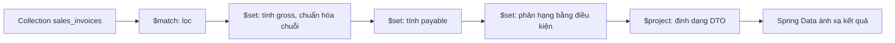

# Biểu thức số học, chuỗi, điều kiện và chuyển đổi kiểu

## 1. Mục tiêu: biến dữ liệu gốc thành dữ liệu có ý nghĩa nghiệp vụ

Trong **Spring Data MongoDB**, aggregation không chỉ dùng để `$group` hoặc đếm document. Một pipeline có thể tạo cột tính toán, chuẩn hóa tên hiển thị, phân loại hóa đơn và chuyển các kiểu BSON không đồng nhất trước khi trả dữ liệu cho ứng dụng.

Giả sử một hệ thống bán hàng cần hiển thị danh sách hóa đơn đã thanh toán với các trường:

- **Tên khách hàng đã bỏ khoảng trắng thừa**.
- **Thành tiền gốc** = số lượng × đơn giá.
- **Số tiền phải trả** = thành tiền gốc − chiết khấu + phí vận chuyển.
- **Phân hạng** `HIGH`, `MEDIUM`, `LOW` dựa trên số tiền phải trả.
- **Giá trị đã kiểm tra kiểu**, đặc biệt khi đọc dữ liệu legacy có số lưu dưới dạng chuỗi.

Nếu gọi `find` rồi tính toàn bộ trong Java, ứng dụng phải nhận các document nguồn và áp dụng cùng quy tắc trên mọi nơi dùng dữ liệu. Aggregation cho phép đẩy một phần công việc xuống **MongoDB server**, rồi ánh xạ kết quả vào DTO bằng `MongoTemplate`, repository hoặc reactive API. Đổi lại, ta phải hiểu ngữ nghĩa biểu thức, BSON types, null/missing, độ chính xác tiền tệ, điều kiện lỗi và khả năng tối ưu truy vấn.

Bài thuộc chương **Aggregation nâng cao** của module **SPRING_DATA_MONGODB**. Các nhóm kỹ thuật chính:

1. **Số học:** `$add`, `$subtract`, `$multiply`, `$divide`, `$mod`, `$abs`, `$round` và các phép liên quan.
2. **Chuỗi:** `$trim`, `$concat`, `$toLower`, `$toUpper`, `$substrCP`, `$strLenCP`, `$split`.
3. **Điều kiện:** `$cond`, `$switch`, `$ifNull` và biểu thức so sánh/logic.
4. **Chuyển kiểu:** `$convert`, `$toInt`, `$toLong`, `$toDecimal`, `$toString`, `$toDate`, `$type`.

Cuối bài có pipeline mongosh, code Spring Data MongoDB, kiểm thử tích hợp, những bẫy dữ liệu thường gặp và cách đo hiệu năng.

## 2. Biểu thức (expression) khác stage (pipeline operation)

Trong MongoDB aggregation, **stage** điều khiển luồng document; **expression** tính giá trị bên trong một stage.

```javascript
db.sales_invoices.aggregate([
  { $match: { tenantId: "tenant-a", status: "PAID" } },
  {
    $set: {
      grossAmount: {
        $multiply: ["$quantity", "$unitPrice"]
      }
    }
  },
  {
    $project: {
      _id: 0,
      invoiceId: "$_id",
      grossAmount: 1
    }
  }
]);
```

Ở ví dụ:

| Thành phần | Vai trò |
| --- | --- |
| `$match` | Stage lọc những hóa đơn cần xét |
| `$set` | Stage thêm hoặc ghi đè field trong **document trung gian** |
| `$multiply` | Expression trả một giá trị số được tính từ hai toán hạng |
| `"$quantity"` | Field path, nghĩa là lấy giá trị của field `quantity` |
| `"$unitPrice"` | Field path, nghĩa là lấy đơn giá của document hiện tại |
| `$project` | Stage tạo cấu trúc kết quả cuối |
| `"invoiceId": "$_id"` | Expression đọc field `_id` rồi đặt vào tên mới |

Một aggregation chỉ có các stage đọc/biến đổi **không sửa document nguồn**. `$set` bên trong pipeline tạo field ở luồng kết quả; nó khác lệnh update `{$set: ...}` dùng với `updateOne`. Chỉ khi dùng những stage ghi như `$merge` hoặc `$out` (và có quyền/cấu hình phù hợp), pipeline mới có thể ghi kết quả ra collection.



**Lưu ý:** trong cùng một stage `$set`, không nên viết biểu thức thứ hai giả định đọc được field vừa được tạo bởi biểu thức thứ nhất trong stage đó. Muốn tham chiếu một field mới được tính, hãy đặt biểu thức tiếp theo vào **stage sau** hoặc lồng phép tính trực tiếp.

## 3. Thiết kế dữ liệu mẫu và kết quả mong muốn

### 3.1. Document hóa đơn

Giả sử ứng dụng lưu giá bằng BSON **Decimal128** để hỗ trợ số thập phân trong phép tính tiền:

```javascript
db.sales_invoices.insertMany([
  {
    _id: "invoice-101",
    tenantId: "tenant-a",
    status: "PAID",
    currency: "VND",
    customerName: "  Nguyễn An  ",
    quantity: NumberInt("2"),
    unitPrice: NumberDecimal("120000.00"),
    discountAmount: NumberDecimal("20000.00"),
    shippingFee: NumberDecimal("10000.00")
  },
  {
    _id: "invoice-102",
    tenantId: "tenant-a",
    status: "PAID",
    currency: "VND",
    customerName: "  Tran Binh ",
    quantity: NumberInt("1"),
    unitPrice: NumberDecimal("80000.00"),
    discountAmount: null,
    shippingFee: NumberDecimal("5000.00")
  },
  {
    _id: "invoice-103",
    tenantId: "tenant-a",
    status: "DRAFT",
    currency: "VND",
    customerName: "  Legacy  ",
    quantity: "2",
    unitPrice: "khong-hop-le"
  },
  {
    _id: "invoice-201",
    tenantId: "tenant-b",
    status: "PAID",
    currency: "VND",
    customerName: "  Ngoai tenant ",
    quantity: NumberInt("9"),
    unitPrice: NumberDecimal("990000.00")
  }
]);
```

Các giá trị trong `invoice-103` cố ý sai kiểu để dùng trong phần chuyển đổi dữ liệu legacy; nó mang `status=DRAFT` để **không** làm hỏng pipeline chính dành cho hóa đơn PAID.

### 3.2. Tính tay trước khi viết pipeline

| Hóa đơn | Gross = quantity × unitPrice | Discount | Shipping | Payable |
| --- | ---: | ---: | ---: | ---: |
| `invoice-101` | 240.000 | 20.000 | 10.000 | **230.000** |
| `invoice-102` | 80.000 | 0 (thay null có chủ đích) | 5.000 | **85.000** |

Giả sử chính sách phân hạng là:

- `HIGH`: số tiền phải trả **từ 200.000 trở lên**.
- `MEDIUM`: từ **100.000 đến dưới 200.000**.
- `LOW`: **dưới 100.000**.

Kết quả kỳ vọng: `invoice-101` thuộc `HIGH`; `invoice-102` thuộc `LOW`. Những hóa đơn của tenant khác, hoặc không ở trạng thái PAID, không được trả về.

Ở ví dụ học tập, VND được lưu dưới dạng Decimal128 có hai chữ số thập phân. Trong production, cần quy định rõ đơn vị tiền, cách làm tròn, thuế, hoàn tiền, ưu đãi âm/dương và thời điểm chốt tỷ giá trước khi xây báo cáo.

## 4. Phép số học trong aggregation

### 4.1. Cộng, trừ, nhân, chia

Các biểu thức số học thường nhận **mảng toán hạng** hoặc một toán hạng tùy operator:

```javascript
{
  $project: {
    _id: 0,
    a: 1,
    b: 1,
    total: { $add: ["$a", "$b"] },
    difference: { $subtract: ["$a", "$b"] },
    product: { $multiply: ["$a", "$b"] },
    quotient: { $divide: ["$a", "$b"] }
  }
}
```

| Biểu thức | Ví dụ với `a=12`, `b=3` | Kết quả |
| --- | --- | ---: |
| `{$add:["$a","$b"]}` | 12 + 3 | 15 |
| `{$subtract:["$a","$b"]}` | 12 − 3 | 9 |
| `{$multiply:["$a","$b"]}` | 12 × 3 | 36 |
| `{$divide:["$a","$b"]}` | 12 ÷ 3 | 4 |
| `{$mod:["$a","$b"]}` | 12 mod 3 | 0 |

**Không nhầm** biểu thức `$add` với stage `$addFields`, hoặc phép tính `$multiply` với việc cập nhật trường trong document nguồn.

Trong bài toán hóa đơn:

```javascript
{
  $multiply: ["$quantity", "$unitPrice"]
}
```

trả `240000.00` đối với `invoice-101` (với kiểu số phù hợp).

### 4.2. Chia cho 0 cần được xử lý trước

Không dùng `$divide` trực tiếp nếu mẫu số có thể bằng 0:

```javascript
// Có thể lỗi khi totalQuantity = 0:
{
  $divide: ["$totalRevenue", "$totalQuantity"]
}
```

Nếu nghiệp vụ muốn trả `null` khi không thể tính đơn giá trung bình:

```javascript
{
  $cond: [
    { $eq: ["$totalQuantity", 0] },
    null,
    { $divide: ["$totalRevenue", "$totalQuantity"] }
  ]
}
```

Phép `$cond` giúp chọn giữa hai biểu thức dựa trên điều kiện. Tuy nhiên, ứng dụng còn phải quyết định ý nghĩa của mẫu số **missing**, BSON null hoặc giá trị sai kiểu; kiểm tra mỗi trường hợp trên dữ liệu nguồn, không coi mọi giá trị không hợp lệ là 0.

### 4.3. Giá trị tuyệt đối, làm tròn và chia dư

```javascript
{
  $project: {
    absoluteAdjustment: { $abs: "$adjustment" },
    roundedAverage: { $round: ["$average", 2] },
    roundedUp: { $ceil: "$average" },
    roundedDown: { $floor: "$average" },
    remainder: { $mod: ["$quantity", 3] }
  }
}
```

`$round` làm tròn theo số chữ số được chỉ định; với trường hợp **đúng giữa hai giá trị**, MongoDB dùng quy tắc *round to nearest even* (banker's rounding). Điều này có thể khác quy tắc làm tròn thuế, hóa đơn hoặc hiển thị giá của doanh nghiệp.

Ví dụ 2,5 làm tròn tới số nguyên có thể thành 2 thay vì 3. Nếu luật nghiệp vụ yêu cầu half-up hoặc một chính sách đặc biệt, hãy định nghĩa rõ và kiểm chứng phép tính thay vì ngầm dùng `$round`.

### 4.4. Lũy thừa và tính toán có phạm vi

MongoDB còn có các expression như `$pow` và `$sqrt`. Dùng chúng khi thực sự cần tính điểm hoặc công thức kỹ thuật:

```javascript
{
  $project: {
    squared: { $pow: ["$value", 2] },
    root: { $sqrt: "$nonNegativeValue" }
  }
}
```

Điều kiện đầu vào quan trọng: giá trị âm với phép căn bậc hai và những giá trị quá lớn có thể gây lỗi/overflow hoặc kết quả không mong muốn. Giới hạn miền dữ liệu ở tầng ghi, tầng truy vấn hoặc trong biểu thức.

## 5. Số thập phân và BSON numeric types

### 5.1. Không phải mọi trường “trông như số” đều cùng kiểu

Các document sau khác nhau về BSON:

```javascript
[
  { _id: "a", amount: NumberInt("1200") },
  { _id: "b", amount: NumberLong("1200") },
  { _id: "c", amount: 1200.0 },
  { _id: "d", amount: NumberDecimal("1200.00") },
  { _id: "e", amount: "1200" }
]
```

MongoDB có các numeric types như Int32, Int64, Double và Decimal128. Chuỗi `"1200"` **không tự trở thành số** chỉ vì có các chữ số. Khi biểu thức số học dùng field sai kiểu, kết quả có thể lỗi hoặc không giống mong đợi.

`NumberDecimal` hỗ trợ thập phân nhưng **không có độ chính xác vô hạn**; Decimal128 vẫn có giới hạn chữ số và số mũ. `Double` không biểu diễn chính xác nhiều phân số thập phân, nên không dùng nó làm lựa chọn mặc định cho tiền nếu ứng dụng cần độ chính xác thập phân.

### 5.2. Spring Data mapping BigDecimal sang Decimal128

Entity Java:

```java
package example.invoice;

import java.math.BigDecimal;
import org.springframework.data.mongodb.core.mapping.Document;
import org.springframework.data.mongodb.core.mapping.Field;
import org.springframework.data.mongodb.core.mapping.FieldType;
import org.springframework.data.mongodb.core.mapping.MongoId;

@Document(collection = "sales_invoices")
public record Invoice(
    @MongoId(FieldType.STRING) String id,
    String tenantId,
    String status,
    String currency,
    String customerName,
    int quantity,
    @Field(targetType = FieldType.DECIMAL128) BigDecimal unitPrice,
    @Field(targetType = FieldType.DECIMAL128) BigDecimal discountAmount,
    @Field(targetType = FieldType.DECIMAL128) BigDecimal shippingFee
) {}
```

`@Field(targetType = FieldType.DECIMAL128)` làm rõ kiểu BSON mong muốn khi Spring Data ghi các trường BigDecimal. Không mặc định rằng document legacy đã tồn tại được tự migration về Decimal128: phải xem raw BSON và quy tắc converter của hệ thống.

Trong các ví dụ phép toán ở MongoDB, nên dùng hằng số `NumberDecimal("0")` hoặc giá trị Decimal128 tương ứng khi phối hợp với số tiền Decimal128, thay vì vô tình tạo hằng Double `0.0` rồi phát sinh chuyển kiểu không mong muốn.

### 5.3. Phép nhân và tổng tiền phải đúng đơn vị

Nếu `quantity` là số lượng và `unitPrice` là **tiền một đơn vị**, `$multiply` cho giá trị tiền. Nếu `discountAmount` là **số tiền chiết khấu tuyệt đối**, công thức:

\[
\text{payable} = \text{quantity}\times\text{unitPrice}
 - \text{discountAmount} + \text{shippingFee}.
\]

Nếu hệ thống lưu `discountRate` (ví dụ 0,15), công thức sẽ khác:

\[
\text{payable} = \text{gross}\times(1-\text{discountRate})+\text{shippingFee}.
\]

Đừng nhầm tỷ lệ với số tiền tuyệt đối. Tên field và dữ liệu kiểm thử nên thể hiện rõ đơn vị; một pipeline chạy thành công vẫn có thể tạo hóa đơn sai nếu lấy một tỷ lệ phần trăm làm số tiền VND.

## 6. Biểu thức chuỗi: chuẩn hóa và tạo nhãn hiển thị

### 6.1. $trim: bỏ khoảng trắng ở hai đầu

```javascript
{
  $set: {
    customerNameClean: {
      $trim: { input: "$customerName" }
    }
  }
}
```

Với `customerName = "  Nguyễn An  "`, kết quả là `"Nguyễn An"`. `$trim` không tự gộp nhiều khoảng trắng ở giữa chuỗi thành một, cũng không bảo đảm mọi kiểu Unicode whitespace/hình thức ký tự sẽ được chuẩn hóa theo quy tắc ứng dụng.

Các biến thể:

```javascript
{
  $project: {
    leftTrimmed: { $ltrim: { input: "$customerName" } },
    rightTrimmed: { $rtrim: { input: "$customerName" } },
    trimmedCustom: {
      $trim: {
        input: "$code",
        chars: " -"
      }
    }
  }
}
```

`chars` xác định **tập ký tự** bị loại ở các đầu, không phải một chuỗi con phải khớp nguyên vẹn. Dùng cẩn thận với mã có dấu gạch ngang là thành phần có ý nghĩa.

### 6.2. $concat: ghép nhiều phần

```javascript
{
  $project: {
    customerLabel: {
      $concat: [
        { $ifNull: ["$customerNameClean", "Chưa có tên"] },
        " / ",
        "$status"
      ]
    }
  }
}
```

**Bẫy null:** `$concat` trả `null` nếu một toán hạng field là null/missing. Vì thế cần `$ifNull` với giá trị thay thế phù hợp khi một phần chuỗi được phép trống.

Nếu field đầu vào là một số, dùng `$toString` hoặc `$convert` trước khi `$concat`; `$concat` không phải bộ formatter tự xử lý mọi BSON type.

### 6.3. $toLower và $toUpper

```javascript
{
  $project: {
    upperStatus: { $toUpper: "$status" },
    lowerCurrency: { $toLower: "$currency" }
  }
}
```

Các expression này tiện với mã ASCII như `PAID`, `VND`, `abc-123`. **Với tiếng Việt có dấu và text người dùng**, đừng giả định `$toLower`/`$toUpper` cung cấp case mapping đúng mọi ngôn ngữ, hay xử lý Unicode normalization/locale như thư viện text chuyên dụng; tài liệu MongoDB nêu các toán tử này có hành vi được xác định tốt cho **ASCII**. Với tìm kiếm tên người/địa danh, cần thiết kế collation, chuẩn hóa Unicode và nghiệp vụ riêng.

### 6.4. $substrCP và $strLenCP cho Unicode

```javascript
{
  $project: {
    preview: { $substrCP: ["$customerNameClean", 0, 5] },
    lengthCodePoints: { $strLenCP: "$customerNameClean" }
  }
}
```

Hậu tố **CP** nghĩa là **Unicode code points**, khác với byte UTF-8. `$substrBytes` và `$strLenBytes` tính theo byte và có thể không phù hợp khi cắt text có dấu.

Tuy vậy, **code point không đồng nghĩa grapheme cluster** (một ký tự mà người dùng nhìn thấy). Một chữ có dấu có thể được lưu bằng một code point dựng sẵn hoặc bằng một chữ cơ sở cộng dấu kết hợp. Vì thế, nếu cần cắt chuỗi an toàn theo ký tự hiển thị, có thể phải xử lý ở ứng dụng với thư viện Unicode phù hợp.

### 6.5. split và thay thế chuỗi

```javascript
{
  $project: {
    parts: { $split: ["$skuPath", "/"] },
    cleanedCode: {
      $replaceAll: {
        input: "$legacyCode",
        find: " ",
        replacement: ""
      }
    }
  }
}
```

`$split` trả array các thành phần, còn `$replaceAll` thay những chuỗi con đúng mẫu. Việc loại bỏ toàn bộ dấu cách của SKU có thể làm đổi nghĩa mã: chỉ thực hiện nếu quy tắc domain cho phép.

Một số toán tử chuỗi yêu cầu input **kiểu String**; dùng `$convert` có kiểm soát khi collection chứa dữ liệu lịch sử không đồng nhất.

## 7. Điều kiện: $cond, $switch và $ifNull

### 7.1. $cond: if–then–else

MongoDB hỗ trợ hai cách biểu diễn `$cond`:

```javascript
{
  $cond: [
    { $gte: ["$payable", NumberDecimal("200000")] },
    "HIGH",
    "NORMAL"
  ]
}
```

và dạng object:

```javascript
{
  $cond: {
    if: { $gte: ["$payable", NumberDecimal("200000")] },
    then: "HIGH",
    else: "NORMAL"
  }
}
```

Hai dạng thể hiện cùng ý tưởng: kiểm tra điều kiện và chọn một trong hai nhánh. Các biểu thức so sánh có thể dùng `$eq`, `$ne`, `$gt`, `$gte`, `$lt`, `$lte`; biểu thức logic có `$and`, `$or` và `$not`.

### 7.2. $switch: nhiều nhánh phân loại

Phân ba hạng đơn hàng:

```javascript
{
  $switch: {
    branches: [
      {
        case: {
          $gte: ["$payable", NumberDecimal("200000")]
        },
        then: "HIGH"
      },
      {
        case: {
          $gte: ["$payable", NumberDecimal("100000")]
        },
        then: "MEDIUM"
      }
    ],
    default: "LOW"
  }
}
```

MongoDB xét các nhánh theo thứ tự và chọn nhánh đầu có điều kiện đúng. **Phải đặt ngưỡng lớn trước ngưỡng nhỏ**: nếu xét `>=100000` trước, mọi hóa đơn HIGH sẽ bị gắn MEDIUM.

Khi không có nhánh nào khớp và không chỉ định `default`, `$switch` có thể gây lỗi. Hãy xác định giá trị mặc định theo chính sách nghiệp vụ, thay vì dựa vào một trạng thái tình cờ.

### 7.3. $ifNull: giá trị mặc định cho null/missing

```javascript
{
  $set: {
    discountSafe: {
      $ifNull: [
        "$discountAmount",
        NumberDecimal("0")
      ]
    }
  }
}
```

`$ifNull` xử lý BSON null và field missing như trường hợp cần thay bằng giá trị dự phòng. Với `invoice-102`, chiết khấu trở thành 0 theo **quy tắc nghiệp vụ đã chọn**.

**Cảnh báo:** chỉ đặt mặc định 0 khi nghiệp vụ cho phép. Nếu `discountAmount` thiếu vì lỗi ingest, âm thầm coi nó là 0 có thể tạo báo cáo sai. Với dữ liệu tài chính chưa chuẩn hóa, nhiều khi cần **đánh dấu lỗi và đối soát** hơn là ép về 0.

Ở MongoDB 5.0+, `$ifNull` còn hỗ trợ danh sách nhiều biểu thức đầu vào, lấy giá trị đầu tiên khác null trước fallback cuối. Nếu cần tương thích phiên bản cũ hơn, dùng dạng hai phần tử hoặc nested `$ifNull`.

### 7.4. Null không phải false và missing không phải 0

Với ba document:

```javascript
{ _id: "a", discountAmount: null }
{ _id: "b" }
{ _id: "c", discountAmount: NumberDecimal("0") }
```

`$ifNull` có thể cho giá trị 0 trên cả ba, nhưng **dữ liệu gốc khác nhau**. Nếu báo cáo cần đếm đơn thiếu thông tin giảm giá, hãy tính một indicator riêng hoặc truy vấn theo `$type`/`$exists` phù hợp. Đừng xóa dấu vết dữ liệu thiếu trước khi việc kiểm tra chất lượng được thực hiện.

## 8. Chuyển đổi kiểu: $convert và các dạng viết tắt

### 8.1. $convert có chính sách lỗi rõ ràng

MongoDB cho phép mô tả cách chuyển một expression sang kiểu BSON mong muốn:

```javascript
{
  $convert: {
    input: "$legacyPrice",
    to: "decimal",
    onError: null,
    onNull: null
  }
}
```

| Thành phần | Ý nghĩa |
| --- | --- |
| `input` | Giá trị cần chuyển, có thể là field reference hoặc expression |
| `to` | Kiểu đích như `"int"`, `"long"`, `"double"`, `"decimal"`, `"string"`, `"date"` theo trường hợp hỗ trợ |
| `onError` | Giá trị trả về nếu **chuyển đổi thất bại** |
| `onNull` | Giá trị trả về khi input là **null hoặc missing** |

Nếu không cung cấp `onError`, một conversion không hợp lệ thường **làm pipeline lỗi**. Nếu không cung cấp `onNull`, kết quả của input null/missing thường là null. Với tài chính, chọn `onError: null` và ghi nhận trạng thái invalid thường an toàn hơn `onError: NumberDecimal("0")` vì số 0 giả có thể bị cộng nhầm vào báo cáo.

### 8.2. Các toán tử viết tắt

```javascript
{
  $project: {
    quantityInt: { $toInt: "$legacyQuantity" },
    quantityLong: { $toLong: "$legacyQuantity" },
    priceDecimal: { $toDecimal: "$legacyPrice" },
    priceString: { $toString: "$unitPrice" },
    normalizedDate: { $toDate: "$legacyDate" }
  }
}
```

Những dạng `$toX` tiện khi dữ liệu **đã được bảo đảm có thể chuyển**. Chúng không có đầy đủ cơ chế `onError` và `onNull` linh hoạt như `$convert`. Nếu chỉ một giá trị legacy là `"khong-hop-le"`, `$toDecimal` có thể khiến cả query thất bại.

Hãy dùng `$convert` khi cần **không làm hỏng toàn bộ báo cáo vì một document sai định dạng**, sau đó phân loại record nào cần đối soát.

### 8.3. Chuyển đổi không sửa được dữ liệu nguồn

```javascript
{
  $set: {
    normalizedPrice: {
      $convert: {
        input: "$legacyPrice",
        to: "decimal",
        onError: null,
        onNull: null
      }
    }
  }
}
```

Field `normalizedPrice` chỉ xuất hiện trong output của pipeline nếu không có stage ghi tiếp theo. Document lưu với `legacyPrice: "1200.00"` vẫn là String. **Aggregation không phải migration**; nếu muốn chuẩn hóa dữ liệu vĩnh viễn, cần kế hoạch update/migration và kiểm tra rollback riêng.

### 8.4. Không lạm dụng ép số trong báo cáo

Một vài trường hợp cần quyết định kỹ:

- `$toInt` trên số thực có thể **cắt phần thập phân** thay vì làm tròn theo quy tắc nghiệp vụ.
- Chuyển một số vượt phạm vi Int32/Int64 có thể lỗi.
- Chuyển `Double` sang Decimal128 không khôi phục được độ chính xác thập phân đã mất từ trước.
- Chuyển String phụ thuộc format hợp lệ; dấu phân cách hàng nghìn, ký hiệu tiền tệ hoặc dấu phẩy địa phương có thể khiến conversion lỗi.
- Chuyển `Date` sang String thay đổi kiểu dữ liệu, không tự tạo format/locale dành cho người dùng.

Với yêu cầu tiền tệ, ưu tiên **chuẩn hóa kiểu dữ liệu tại nguồn ghi**. `$convert` là công cụ chuyển tiếp, phân tích dữ liệu legacy hoặc tạo read model phù hợp, không phải lý do để lưu cùng field bằng nhiều kiểu tùy ý.

## 9. Kiểm tra kiểu trước khi tính: $type và $isNumber

Khi collection có lịch sử nhiều schema, hãy xác định loại BSON trước khi áp dụng một biểu thức nhạy cảm.

```javascript
db.sales_invoices.aggregate([
  {
    $project: {
      _id: 1,
      quantityType: { $type: "$quantity" },
      priceType: { $type: "$unitPrice" },
      priceIsNumber: { $isNumber: "$unitPrice" }
    }
  }
]);
```

`$type` trong aggregation có thể cho `"missing"` khi field không tồn tại, giúp phân biệt với `"null"`. `$isNumber` kiểm tra input có phải BSON numeric type không, hữu ích trước khi dùng số học.

### 9.1. Tách dữ liệu hợp lệ và không hợp lệ

Ví dụ chuyển dữ liệu legacy rồi lọc những bản ghi không chuyển được:

```javascript
db.sales_invoices.aggregate([
  {
    $set: {
      unitPriceDecimal: {
        $convert: {
          input: "$unitPrice",
          to: "decimal",
          onError: null,
          onNull: null
        }
      }
    }
  },
  {
    $set: {
      priceValid: {
        $ne: ["$unitPriceDecimal", null]
      }
    }
  },
  {
    $project: {
      _id: 1,
      unitPriceType: { $type: "$unitPrice" },
      unitPriceDecimal: 1,
      priceValid: 1
    }
  }
]);
```

Trong fixture, `invoice-103` có `unitPrice="khong-hop-le"` nên `unitPriceDecimal` sẽ là null và `priceValid=false`. Nếu không muốn tải toàn bộ vào ứng dụng, có thể thêm `$match: {priceValid:false}` để tạo danh sách cần xử lý.

**Không đồng nhất hai ý nghĩa**: giá chuyển đổi lỗi và giá gốc thực sự null. Khi phân loại nguyên nhân, lưu cả `$type` gốc và một indicator riêng, hoặc tạo message lỗi theo `$switch` dựa trên tình huống cụ thể.

## 10. Chuyển đổi ngày giờ và chuỗi ngày tháng

Aggregation có các toán tử như `$toDate`, `$dateFromString` và `$dateToString`, nhưng **chúng không tương đương**.

```javascript
{
  $project: {
    parsedTime: {
      $dateFromString: {
        dateString: "$paidAtText",
        format: "%Y-%m-%d %H:%M:%S",
        timezone: "Asia/Ho_Chi_Minh",
        onError: null,
        onNull: null
      }
    },
    paidDay: {
      $dateToString: {
        format: "%Y-%m-%d",
        date: "$paidAt",
        timezone: "Asia/Ho_Chi_Minh"
      }
    }
  }
}
```

`$dateFromString` tạo giá trị Date từ chuỗi, có thể chỉ định format/timezone khi chuỗi chưa có thông tin múi giờ. Đừng chỉ định thêm timezone một cách mâu thuẫn nếu input đã chứa offset hoặc `Z`. `$dateToString` **tạo String để hiển thị/nhóm**, không còn là BSON Date để so sánh theo thời gian giống trước.

Trong Spring Data MongoDB, field kiểu `Instant` thường được lưu dạng BSON Date theo converter thông dụng. Nếu document legacy lưu ngày giờ bằng String, phải biết nó đang biểu thị UTC hay giờ địa phương trước khi chuyển, nếu không có thể dịch lệch thời điểm.

Với báo cáo ngày kinh doanh, chọn timezone trong `$dateToString` hoặc `$dateTrunc`, và lọc theo khoảng `[from, toExclusive)` đã quy đổi từ lịch của người dùng. Chỉ đổi format thành `YYYY-MM-DD` không tự sửa sai lệch timezone của dữ liệu nguồn.

## 11. Pipeline hoàn chỉnh kết hợp bốn nhóm biểu thức

Phần này nối các kỹ thuật thành một luồng đọc danh sách hóa đơn theo ngữ nghĩa đã kiểm tra ở phần 3.

### 11.1. Bước 1: lọc trước khi tính

```javascript
{
  $match: {
    tenantId: "tenant-a",
    status: "PAID",
    currency: "VND"
  }
}
```

Đặt `$match` sớm giúp MongoDB có cơ hội tận dụng index và giảm số document cần tính toán. Filter này cố ý loại hóa đơn DRAFT có unitPrice sai kiểu và tenant khác. Nhưng **việc loại một record sai không thay thế quy trình kiểm tra dữ liệu chất lượng**, vì ngay cả các hóa đơn PAID cũng có thể mang dữ liệu hỏng trong hệ thống thật.

### 11.2. Bước 2: chuẩn hóa tên, tính gross, xử lý nullable fields

```javascript
{
  $set: {
    customerNameClean: {
      $trim: { input: "$customerName" }
    },
    grossAmount: {
      $multiply: ["$quantity", "$unitPrice"]
    },
    discountSafe: {
      $ifNull: ["$discountAmount", NumberDecimal("0")]
    },
    shippingSafe: {
      $ifNull: ["$shippingFee", NumberDecimal("0")]
    }
  }
}
```

Ở đây, các field mới chỉ phụ thuộc **field có sẵn của document đầu vào**, nên có thể tính trong cùng stage.

### 11.3. Bước 3: tính số tiền thực trả

```javascript
{
  $set: {
    payable: {
      $add: [
        {
          $subtract: [
            "$grossAmount",
            "$discountSafe"
          ]
        },
        "$shippingSafe"
      ]
    }
  }
}
```

Stage này tham chiếu ba field đã tạo ở stage trước. Kết quả: `invoice-101` payable 230.000; `invoice-102` payable 85.000.

### 11.4. Bước 4: phân loại và tạo nhãn

```javascript
{
  $set: {
    tier: {
      $switch: {
        branches: [
          {
            case: {
              $gte: ["$payable", NumberDecimal("200000")]
            },
            then: "HIGH"
          },
          {
            case: {
              $gte: ["$payable", NumberDecimal("100000")]
            },
            then: "MEDIUM"
          }
        ],
        default: "LOW"
      }
    },
    highValue: {
      $gte: ["$payable", NumberDecimal("200000")]
    },
    customerLabel: {
      $concat: [
        "$customerNameClean",
        " / ",
        "$status"
      ]
    }
  }
}
```

`highValue` được biểu diễn trực tiếp bằng biểu thức so sánh trả Boolean; không bắt buộc phải gói mọi so sánh vào `$cond` khi kết quả mong muốn đã là Boolean.

### 11.5. Bước 5: định hình kết quả và sắp xếp

```javascript
{
  $project: {
    _id: 0,
    id: "$_id",
    customerName: "$customerNameClean",
    grossAmount: 1,
    payable: 1,
    tier: 1,
    highValue: 1,
    customerLabel: 1
  }
}
```

Sau đó:

```javascript
{ $sort: { payable: -1, id: 1 } }
```

Thêm `id` làm khóa phá hòa để thứ tự xác định khi nhiều hóa đơn có cùng payable. Nếu API thực sự phân trang qua dữ liệu thay đổi, còn cần một chiến lược cursor/keyset hoặc snapshot phù hợp; khóa phá hòa **không** tự giải quyết mọi vấn đề concurrent insert/update.

### 11.6. Câu lệnh mongosh chạy trọn pipeline

```javascript
db.sales_invoices.aggregate([
  {
    $match: {
      tenantId: "tenant-a",
      status: "PAID",
      currency: "VND"
    }
  },
  {
    $set: {
      customerNameClean: {
        $trim: { input: "$customerName" }
      },
      grossAmount: {
        $multiply: ["$quantity", "$unitPrice"]
      },
      discountSafe: {
        $ifNull: ["$discountAmount", NumberDecimal("0")]
      },
      shippingSafe: {
        $ifNull: ["$shippingFee", NumberDecimal("0")]
      }
    }
  },
  {
    $set: {
      payable: {
        $add: [
          { $subtract: ["$grossAmount", "$discountSafe"] },
          "$shippingSafe"
        ]
      }
    }
  },
  {
    $set: {
      tier: {
        $switch: {
          branches: [
            {
              case: { $gte: ["$payable", NumberDecimal("200000")] },
              then: "HIGH"
            },
            {
              case: { $gte: ["$payable", NumberDecimal("100000")] },
              then: "MEDIUM"
            }
          ],
          default: "LOW"
        }
      },
      highValue: {
        $gte: ["$payable", NumberDecimal("200000")]
      },
      customerLabel: {
        $concat: ["$customerNameClean", " / ", "$status"]
      }
    }
  },
  {
    $project: {
      _id: 0,
      id: "$_id",
      customerName: "$customerNameClean",
      grossAmount: 1,
      payable: 1,
      tier: 1,
      highValue: 1,
      customerLabel: 1
    }
  },
  { $sort: { payable: -1, id: 1 } }
]);
```

Kết quả về mặt giá trị dự kiến:

```javascript
[
  {
    id: "invoice-101",
    customerName: "Nguyễn An",
    grossAmount: NumberDecimal("240000.00"),
    payable: NumberDecimal("230000.00"),
    tier: "HIGH",
    highValue: true,
    customerLabel: "Nguyễn An / PAID"
  },
  {
    id: "invoice-102",
    customerName: "Tran Binh",
    grossAmount: NumberDecimal("80000.00"),
    payable: NumberDecimal("85000.00"),
    tier: "LOW",
    highValue: false,
    customerLabel: "Tran Binh / PAID"
  }
]
```

Biểu diễn scale của Decimal128 có thể phụ thuộc phép tính và kiểu số đầu vào; hãy so sánh **giá trị số học** trong test, không giả định mọi kết quả luôn có đúng hai chữ số thập phân trong chuỗi JSON. `$project`/`$set` không làm thay đổi các invoice gốc.

## 12. Spring Data MongoDB: ánh xạ pipeline vào DTO

### 12.1. DTO dành cho kết quả, không phải entity để save

```java
package example.invoice;

import java.math.BigDecimal;

public record InvoiceReportRow(
    String id,
    String customerName,
    BigDecimal grossAmount,
    BigDecimal payable,
    String tier,
    boolean highValue,
    String customerLabel
) {}
```

Field `payable` được tạo từ expression và **không tồn tại trong document nguồn**. Không xây một `Invoice` mới từ DTO này rồi `save` như thể nó đã được nạp đầy đủ. Báo cáo là **read model**.

### 12.2. Dùng AggregationOperation với BSON Document rõ ràng

Spring Data có DSL như `Aggregation.match`, `Aggregation.project`, `ArithmeticOperators`, `StringOperators` và `ConditionalOperators`. Với pipeline chứa nhiều biểu thức lồng nhau, một lựa chọn minh họa dễ đối chiếu mongosh là khai báo `AggregationOperation` trả BSON `Document`.

Ví dụ dưới đây giữ **tên field BSON trùng tên property Java** và dùng `org.bson.types.Decimal128` cho hằng số tiền, nhờ vậy tránh phụ thuộc ngầm vào conversion của hằng `BigDecimal` trong raw expression:

```java
package example.invoice;

import java.util.List;
import org.bson.Document;
import org.bson.types.Decimal128;
import org.springframework.data.domain.Sort;
import org.springframework.data.mongodb.core.MongoTemplate;
import org.springframework.data.mongodb.core.aggregation.Aggregation;
import org.springframework.data.mongodb.core.aggregation.AggregationOperation;
import org.springframework.data.mongodb.core.query.Criteria;
import org.springframework.stereotype.Service;

@Service
public class InvoiceAggregationService {

    private final MongoTemplate template;

    public InvoiceAggregationService(MongoTemplate template) {
        this.template = template;
    }

    public List<InvoiceReportRow> report(
            String authorizedTenantId) {

        if (authorizedTenantId == null
                || authorizedTenantId.isBlank()) {
            throw new IllegalArgumentException(
                "tenantId không hợp lệ"
            );
        }

        Decimal128 zero = Decimal128.parse("0");
        Decimal128 medium = Decimal128.parse("100000");
        Decimal128 high = Decimal128.parse("200000");

        AggregationOperation deriveFields = context ->
            new Document("$set",
                new Document("customerNameClean",
                    new Document("$trim",
                        new Document("input", "$customerName")))
                    .append("grossAmount",
                        new Document("$multiply",
                            List.of("$quantity", "$unitPrice")))
                    .append("discountSafe",
                        new Document("$ifNull",
                            List.of("$discountAmount", zero)))
                    .append("shippingSafe",
                        new Document("$ifNull",
                            List.of("$shippingFee", zero)))
            );

        AggregationOperation calculatePayable = context ->
            new Document("$set",
                new Document("payable",
                    new Document("$add", List.of(
                        new Document("$subtract", List.of(
                            "$grossAmount", "$discountSafe"
                        )),
                        "$shippingSafe"
                    ))
                )
            );

        AggregationOperation classify = context ->
            new Document("$set",
                new Document("tier",
                    new Document("$switch",
                        new Document("branches", List.of(
                            new Document("case",
                                new Document("$gte",
                                    List.of("$payable", high)))
                                .append("then", "HIGH"),
                            new Document("case",
                                new Document("$gte",
                                    List.of("$payable", medium)))
                                .append("then", "MEDIUM")
                        )).append("default", "LOW")
                    )
                ).append("highValue",
                    new Document("$gte", List.of("$payable", high))
                ).append("customerLabel",
                    new Document("$concat", List.of(
                        "$customerNameClean", " / ", "$status"
                    ))
                )
            );

        AggregationOperation shape = context ->
            new Document("$project",
                new Document("_id", 0)
                    .append("id", "$_id")
                    .append("customerName", "$customerNameClean")
                    .append("grossAmount", 1)
                    .append("payable", 1)
                    .append("tier", 1)
                    .append("highValue", 1)
                    .append("customerLabel", 1)
            );

        Aggregation pipeline = Aggregation.newAggregation(
            Aggregation.match(
                Criteria.where("tenantId").is(authorizedTenantId)
                    .and("status").is("PAID")
                    .and("currency").is("VND")
            ),
            deriveFields,
            calculatePayable,
            classify,
            shape,
            Aggregation.sort(
                Sort.by(
                    Sort.Order.desc("payable"),
                    Sort.Order.asc("id")
                )
            )
        );

        return template.aggregate(
            pipeline,
            "sales_invoices",
            InvoiceReportRow.class
        ).getMappedResults();
    }
}
```

Giải thích các điểm cần chú ý:

1. `Aggregation.match` giới hạn tenant/status/currency ngay từ đầu.
2. Các `AggregationOperation` tự tạo raw BSON `Document`, nên **đường dẫn trong biểu thức phải dùng tên field thực trong MongoDB**. Nếu entity dùng `@Field("unit_price")`, không được giữ `"$unitPrice"` trong raw stage rồi mong hệ thống tự sửa.
3. Hằng `Decimal128` giúp giữ ý định số thập phân khi so ngưỡng và thay null bằng 0.
4. Mỗi phép tính phụ thuộc kết quả của stage trước được đặt trong **stage riêng**.
5. `template.aggregate(..., "sales_invoices", InvoiceReportRow.class)` dùng tên collection và DTO kết quả; khi dùng raw stages không có mapping đầu vào tự động giống typed aggregation.
6. `authorizedTenantId` phải đến từ ngữ cảnh xác thực của server. Không xây chuỗi BSON từ tenant hoặc tên field do client gửi tùy ý.
7. Với khối lượng kết quả lớn, cân nhắc thêm `$limit`, phân trang hoặc chiến lược streaming thay vì luôn trả `List` không giới hạn.

Khi đã hiểu pipeline, có thể thay từng raw stage bằng các builder mạnh kiểu của Spring Data; cách đó giúp refactor field path thuận tiện hơn khi metadata mapping được áp dụng đúng.

### 12.3. Một vài biểu thức tương đương qua DSL

Spring Data MongoDB cung cấp các builder chuyên biệt:

```java
import java.math.BigDecimal;
import org.bson.types.Decimal128;
import org.springframework.data.mongodb.core.aggregation.Aggregation;
import org.springframework.data.mongodb.core.aggregation.ArithmeticOperators;
import org.springframework.data.mongodb.core.aggregation.ConditionalOperators;

// Tính gross = quantity * unitPrice:
var grossExpression =
    ArithmeticOperators.Multiply
        .valueOf("quantity")
        .multiplyBy("unitPrice");

// Xử lý discount null/missing:
var discountExpression =
    ConditionalOperators.ifNull("discountAmount")
        .then(Decimal128.parse("0"));

// Đưa expression vào một stage mới:
var addFields = Aggregation.addFields()
    .addFieldWithValue("grossAmount", grossExpression)
    .addFieldWithValue("discountSafe", discountExpression)
    .build();
```

Đoạn này minh họa cách viết **một phần** của pipeline, không phải service hoàn chỉnh. Spring Data có `StringOperators`, `ComparisonOperators` và `ConditionalOperators` cho các trường hợp khác; tên method cụ thể có thể thay đổi theo phiên bản Spring Data. Khi sử dụng biểu thức lồng phức tạp, hãy kiểm tra BSON được gửi đi và integration test, nhất là với kiểu Decimal128/field aliases.

### 12.4. Chú thích @Aggregation trong repository

Với pipeline **cố định**, có thể khai báo `@Aggregation` trên repository method và bind tham số, nhưng biểu thức dài, nhiều nhánh điều kiện hoặc filter động thường dễ bảo trì hơn trong service dùng DSL/custom repository.

```java
import java.util.List;
import org.springframework.data.mongodb.repository.Aggregation;
import org.springframework.data.mongodb.repository.MongoRepository;

public interface InvoiceRepository
        extends MongoRepository<Invoice, String> {

    @Aggregation(pipeline = {
        "{ '$match': { 'tenantId': ?0, 'status': 'PAID' } }",
        "{ '$project': { '_id': 0, 'id': '$_id', " +
            "'grossAmount': { '$multiply': [" +
                "'$quantity', '$unitPrice' ] } } }"
    })
    List<InvoiceGrossRow> grossByTenant(String tenantId);
}
```

Với DTO:

```java
package example.invoice;

import java.math.BigDecimal;

public record InvoiceGrossRow(
    String id,
    BigDecimal grossAmount
) {}
```

Đây chỉ là query **gross**, không phải toàn bộ báo cáo có chiết khấu/điều kiện; không giả định ví dụ ngắn thực hiện đầy đủ mọi yêu cầu của phần 11. Repository parameter binding `?0` tốt hơn tự ghép chuỗi JSON từ input không tin cậy, nhưng **không tự cấp quyền tenant**.

## 13. Reactive aggregation dùng lại cùng biểu thức

`ReactiveMongoTemplate.aggregate(...)` trả `Flux<T>` thay vì `List<T>` đồng bộ. Những stage, expression và quy tắc BSON **không thay đổi** vì chuyển sang reactive:

```java
import org.springframework.data.mongodb.core.ReactiveMongoTemplate;
import org.springframework.data.mongodb.core.aggregation.Aggregation;
import reactor.core.publisher.Flux;

// aggregation là pipeline đã xây dựng đúng như phần 12.
Flux<InvoiceReportRow> rows =
    reactiveMongoTemplate.aggregate(
        aggregation,
        "sales_invoices",
        InvoiceReportRow.class
    );
```

`Flux` giúp tổ chức I/O theo reactive programming và backpressure ở tầng tiêu thụ, nhưng **không tự làm stage tính toán trên MongoDB trở nên rẻ hơn**. Một pipeline chứa `$sort`, `$group` hoặc những phép chuyển đổi nhiều document vẫn tiêu thụ CPU/bộ nhớ server.

Nếu dùng:

```java
Mono<List<InvoiceReportRow>> all = rows.collectList();
```

thì mọi kết quả được phát sẽ được gom thành một `List` ở phía ứng dụng. Với tập lớn, cần giới hạn/stream kết quả và có kiểm soát bộ nhớ.

Trong service WebFlux, tránh gọi `block()` để chờ query chỉ nhằm biến reactive thành đồng bộ. Đồng thời lưu ý lỗi conversion trong pipeline thường phát thành **error signal**, không phải một document có giá trị mặc định trừ khi đã cấu hình `onError`.

## 14. Lựa chọn vị trí đặt biểu thức và ảnh hưởng tới index

### 14.1. Lọc theo field nguồn trước khi tạo field tính toán

Một index ứng viên cho pipeline chính:

```javascript
db.sales_invoices.createIndex(
  { tenantId: 1, status: 1, currency: 1 },
  { name: "by_tenant_status_currency" }
);
```

`$match` trên field nguồn có thể tận dụng index nếu query và dữ liệu phù hợp. Nếu chỉ lọc bằng:

```javascript
{
  $match: {
    payable: { $gte: NumberDecimal("200000") }
  }
}
```

thì `payable` là field **được tạo trong pipeline**, không phải field được lưu sẵn; muốn lọc theo nó, phải đặt `$match` sau stage tính `payable`. Một index trên collection nguồn không tự trở thành index cho giá trị aggregate mới.

Nếu đây là filter rất phổ biến và đắt, có thể cân nhắc lưu `payable` ở document nguồn hoặc materialized summary; đổi lại phải bảo đảm nó được tính/cập nhật nhất quán khi các thành phần thay đổi.

### 14.2. $project sớm không phải lúc nào cũng nhanh

`$project` giúp tạo output nhỏ và rõ, nhưng MongoDB optimizer có thể tự loại một số field không cần cho các stage. Không chèn nhiều `$project` sớm chỉ vì nghĩ mỗi stage tự động giảm CPU; hãy đo. Phân biệt:

- **Cardinality:** số document qua mỗi stage.
- **Document width:** kích thước/field của document trung gian.
- **Cost của expression:** các phép regex, conversion, chuỗi, số học và điều kiện.
- **Blocking stage:** `$sort`/`$group` có thể cần giữ trạng thái trong bộ nhớ.

Trên hàng triệu document, cần ưu tiên giảm cardinality bằng `$match` sớm và tận dụng index phù hợp; sau đó đánh giá chi phí của những biểu thức thật sự cần thiết.

### 14.3. Explain trên pipeline tương đương

```javascript
db.sales_invoices.explain("executionStats").aggregate([
  {
    $match: {
      tenantId: "tenant-a",
      status: "PAID",
      currency: "VND"
    }
  },
  {
    $set: {
      grossAmount: {
        $multiply: ["$quantity", "$unitPrice"]
      }
    }
  },
  { $sort: { grossAmount: -1 } },
  { $limit: 20 }
]);
```

Đây là **pipeline rút gọn** phục vụ chẩn đoán, không phải báo cáo payable hoàn chỉnh. Quan sát plan, số document examined, khóa index examined, stage execution time và memory/spill nếu phiên bản MongoDB cung cấp thông tin đó.

Đừng kết luận aggregation nhanh hơn `find` chỉ vì số dòng output ít. Một phép `$sort` trên field tính toán không có index hỗ trợ trực tiếp vẫn có thể rất tốn tài nguyên.

## 15. Dữ liệu lỗi: báo cáo phải rõ chính sách

### 15.1. Không thay lỗi bằng zero một cách âm thầm

Giả sử một hóa đơn PAID có `unitPrice: "khong-hop-le"`. Nếu ứng dụng dùng:

```javascript
{
  $convert: {
    input: "$unitPrice",
    to: "decimal",
    onError: NumberDecimal("0"),
    onNull: NumberDecimal("0")
  }
}
```

thì report có thể **vẫn chạy nhưng doanh thu bị giảm sai**. Việc chọn 0 ở đây không phải chỉ là một vấn đề kỹ thuật: nó thay đổi ý nghĩa dữ liệu kế toán.

Chiến lược an toàn hơn:

1. Chuyển kiểu sang một field mới với `onError: null`.
2. Ghi indicator `conversionOk` và loại lỗi (missing/null/invalid).
3. Tách những document lỗi ra để sửa hoặc đối soát.
4. Chỉ tính doanh thu trên tập đã xác minh hợp lệ, đồng thời công bố số record bị loại.

Nếu nghiệp vụ bắt buộc phải fail toàn báo cáo khi có dữ liệu lỗi, có thể để conversion ném lỗi và xử lý ở service. Dù chọn hướng nào, phải ghi lại trong contract và test.

### 15.2. Thứ tự kiểm tra khi biểu thức có nhiều nguồn lỗi

Khi report sai:

```text
1. Tenant/status/currency filter có đúng không?
2. Field có tồn tại và có kiểu BSON gì?
3. quantity/unitPrice/discount/shipping có cùng đơn vị?
4. Biểu thức arithmetic có chia 0, overflow hoặc null?
5. $switch đặt ngưỡng theo thứ tự đúng?
6. $concat có toán hạng null/missing?
7. $convert có đang che lỗi bằng giá trị mặc định?
8. DTO output có map đúng tên và kiểu không?
9. Index và $sort có tạo chi phí ngoài dự kiến?
```

Đối với data pipeline quan trọng, nên có metrics: tổng document đầu vào, document không hợp lệ, document đủ điều kiện, số kết quả và thời gian chạy. Chỉ dựa vào `matchedCount` của một query hoặc số dòng cuối báo cáo là không đủ để kiểm soát chất lượng dữ liệu.

## 16. Kiểm thử tích hợp: giá trị Decimal128, null, phân hạng và tenant

### 16.1. Vì sao cần test raw BSON và DTO?

Một unit test kiểm tra hàm Java có thể xác minh công thức số học, nhưng **không xác minh** MongoDB thực sự tính `$multiply`, `$convert`, `$switch` hoặc map Decimal128 vào `BigDecimal` như dự kiến.

Integration test nên:

1. Tạo dữ liệu có chiết khấu Decimal128 và null.
2. Thêm document khác tenant hoặc trạng thái không hợp lệ.
3. Chạy `MongoTemplate.aggregate`.
4. Kiểm tra giá trị output, hạng và tên đã trim.
5. Xác minh document gốc không bị sửa bởi pipeline đọc.
6. Tạo dữ liệu legacy sai kiểu để test conversion error policy.

### 16.2. JUnit 5 với @DataMongoTest

```java
package example.invoice;

import static com.mongodb.client.model.Filters.eq;
import static org.junit.jupiter.api.Assertions.*;

import java.math.BigDecimal;
import java.util.List;
import java.util.UUID;
import org.bson.Document;
import org.bson.types.Decimal128;
import org.junit.jupiter.api.Test;
import org.springframework.beans.factory.annotation.Autowired;
import org.springframework.boot.test.autoconfigure.data.mongo.DataMongoTest;
import org.springframework.context.annotation.Import;
import org.springframework.data.mongodb.core.MongoTemplate;

@DataMongoTest
@Import(InvoiceAggregationService.class)
class InvoiceAggregationTest {

    @Autowired
    MongoTemplate template;

    @Autowired
    InvoiceAggregationService service;

    @Test
    void computesDecimalAmountsAndTiersWithoutChangingSource() {
        String suffix = UUID.randomUUID().toString();
        String tenant = "t-" + suffix;
        String highId = "high-" + suffix;
        String lowId = "low-" + suffix;

        template.insert(new Invoice(
            highId, tenant, "PAID", "VND",
            "  Nguyễn An  ", 2,
            new BigDecimal("120000.00"),
            new BigDecimal("20000.00"),
            new BigDecimal("10000.00")
        ));

        template.insert(new Invoice(
            lowId, tenant, "PAID", "VND",
            "  Tran Binh ", 1,
            new BigDecimal("80000.00"),
            null,
            new BigDecimal("5000.00")
        ));

        template.insert(new Invoice(
            "other-" + suffix, "other-" + suffix,
            "PAID", "VND", "Outside", 9,
            new BigDecimal("900000.00"),
            null, null
        ));

        List<InvoiceReportRow> rows = service.report(tenant);

        assertEquals(2, rows.size());
        InvoiceReportRow high = rows.get(0);
        InvoiceReportRow low = rows.get(1);

        assertEquals(highId, high.id());
        assertEquals("Nguyễn An", high.customerName());
        assertEquals("HIGH", high.tier());
        assertTrue(high.highValue());
        assertEquals(
            0,
            high.grossAmount().compareTo(
                new BigDecimal("240000")
            )
        );
        assertEquals(
            0,
            high.payable().compareTo(
                new BigDecimal("230000")
            )
        );

        assertEquals(lowId, low.id());
        assertEquals("LOW", low.tier());
        assertFalse(low.highValue());
        assertEquals(
            0,
            low.payable().compareTo(
                new BigDecimal("85000")
            )
        );

        Document source = template
            .getCollection("sales_invoices")
            .find(eq("_id", highId))
            .first();

        assertNotNull(source);
        assertInstanceOf(
            Decimal128.class, source.get("unitPrice")
        );
        assertFalse(source.containsKey("payable"));
        assertEquals("  Nguyễn An  ",
            source.getString("customerName"));
    }
}
```

`BigDecimal.compareTo` so sánh theo giá trị số học, không bắt buộc scale bằng nhau như `BigDecimal.equals`. Test kiểm tra **raw BSON Decimal128**, chứng minh kết quả pipeline không ghi ngược `payable` vào document gốc.

`@DataMongoTest` không tự khởi chạy MongoDB ở mọi môi trường. Cần MongoDB test instance hoặc Testcontainers phù hợp phiên bản Spring Boot/driver. Bài viết chưa chạy build hay test thực tế ở giai đoạn soạn nội dung này.

### 16.3. Test chuyển kiểu lỗi mà không làm hỏng pipeline

Test riêng với field legacy:

```java
@Test
void convertInvalidLegacyAmountToNullWithExplicitPolicy() {
    String suffix = UUID.randomUUID().toString();
    String id = "legacy-" + suffix;

    template.getCollection("sales_invoices").insertOne(
        new Document("_id", id)
            .append("tenantId", "t-" + suffix)
            .append("status", "DRAFT")
            .append("legacyPrice", "khong-hop-le")
    );

    org.springframework.data.mongodb.core.aggregation.AggregationOperation
        conversion = context -> new Document(
            "$project",
            new Document("_id", 0)
                .append("normalizedPrice", new Document(
                    "$convert",
                    new Document("input", "$legacyPrice")
                        .append("to", "decimal")
                        .append("onError", null)
                        .append("onNull", null)
                ))
        );

    var pipeline =
        org.springframework.data.mongodb.core.aggregation.Aggregation
            .newAggregation(
                org.springframework.data.mongodb.core.aggregation.Aggregation
                    .match(
                        org.springframework.data.mongodb.core.query.Criteria
                            .where("_id").is(id)
                    ),
                conversion
            );

    List<Document> output = template.aggregate(
        pipeline, "sales_invoices", Document.class
    ).getMappedResults();

    assertEquals(1, output.size());
    assertNull(output.get(0).get("normalizedPrice"));
}
```

Test minh họa đặt **bên trong class `InvoiceAggregationTest`** ở trên. Ở ví dụ này, aggregation nhận tên collection trực tiếp, không có entity input type để ánh xạ tên Java `id` sang `_id`. Vì vậy, điều kiện `Criteria.where("_id").is(id)` sử dụng **tên field BSON thật**. Đây là khác biệt quan trọng giữa **query typed theo entity** và **aggregation trên collection name**.

### 16.4. Những ca biên cần bổ sung

| Ca kiểm thử | Điều cần xác minh |
| --- | --- |
| Quantity = 0 | Gross = 0, policy có cho phép hóa đơn như vậy không |
| Giá trị âm hoặc chiết khấu lớn hơn gross | Có validation/điều chỉnh nghiệp vụ rõ |
| `unitPrice` là String hợp lệ | `$convert` chuyển được theo format mong muốn |
| `unitPrice` là chuỗi không hợp lệ | `onError` xử lý đúng; record lỗi được nhận diện |
| `unitPrice` missing/BSON null | `onNull` xử lý tách biệt với dữ liệu hợp lệ |
| `shippingFee` thiếu | `$ifNull` áp dụng chính sách 0 nếu hợp lệ |
| Payable đúng 100.000 | Thuộc MEDIUM |
| Payable đúng 200.000 | Thuộc HIGH |
| Tiền vượt giới hạn số | Có policy lỗi, không âm thầm overflow |
| Tên có dấu và ký tự kết hợp | Trim hoạt động; không giả định case mapping Unicode đầy đủ |
| Chuỗi null trong `$concat` | Có fallback hoặc kết quả null được xử lý |
| Tenant khác vẫn có dữ liệu hợp lệ | Không bị trả về |
| Kết quả cùng payable | Sort ổn định với ID phụ |

## 17. Quy tắc an toàn và kiểm soát dữ liệu đầu vào

Biểu thức aggregation được tính tại database, nên việc để client tùy ý cung cấp field path hoặc operator là rủi ro. Không xây raw BSON/JSON bằng cách ghép chuỗi từ input người dùng.

```java
// Không làm thế này với fieldName do client tự chọn:
String raw = "{ $set: { value: '$" + fieldName + "' } }";
```

Thay vào đó:

- Dùng **allowlist** field/filter/sort được phép;
- Bind **giá trị** của tenant, thời gian và điều kiện qua API tương ứng;
- Giới hạn kích thước pipeline, topN, phân trang và độ dài chuỗi;
- Kiểm tra quyền truy cập ở tầng service;
- Có chính sách xử lý dữ liệu sai kiểu và log lỗi theo giới hạn bảo mật;
- Không cho người dùng tạo pipeline có `$function` hoặc stage tùy ý nếu không có kiểm soát quyền và tài nguyên;
- Kiểm thử tên field thực khi có `@Field`, converters và type aliases.

**Aggregation không phải lớp phân quyền.** Việc pipeline có `$match: {tenantId: ...}` chỉ an toàn nếu giá trị tenant đến từ nguồn xác thực/ủy quyền và tất cả đường đọc đều tuân thủ ràng buộc đó.

## 18. Sai lầm thường gặp

| Triệu chứng | Nguyên nhân có thể | Hướng xử lý |
| --- | --- | --- |
| Pipeline báo lỗi khi gặp một invoice legacy | `$toDecimal` không chuyển được String sai format | Dùng `$convert` với chính sách `onError` rõ |
| Báo cáo vẫn chạy nhưng số tiền thấp bất thường | Ép dữ liệu invalid thành 0 | Đánh dấu/đối soát record lỗi |
| Hóa đơn phân loại MEDIUM dù phải HIGH | `$switch` đặt ngưỡng nhỏ trước | Xét threshold từ lớn xuống nhỏ |
| `$concat` trả null | Một toán hạng null/missing | Dùng `$ifNull` hoặc validate |
| Tên tiếng Việt bị case-folding sai | Giả định `$toUpper` theo Unicode/locale | Xử lý text với chính sách Unicode phù hợp |
| Chuỗi bị cắt sai ký tự hiển thị | Dùng byte length hoặc nhầm code point với grapheme | Chọn công cụ Unicode phù hợp |
| `payable` null dù gross đúng | Discount/shipping null mà không fallback | Kiểm tra các toán hạng và `$ifNull` |
| Sai giá ở biên 100k/200k | Nhầm `$gt` và `$gte` | Test đúng giá trị ranh giới |
| Stage thứ hai không thấy field vừa tạo | Cố tham chiếu field trong cùng `$set` | Tách thành các stage kế tiếp |
| Query thô không tìm được `id` | Field MongoDB là `_id`, không phải `id` | Phân biệt typed mapping và raw BSON |
| DTO nhận field null | Tên `$project`/type không khớp DTO | Đọc raw aggregation output và test mapping |
| Kết quả không đúng kiểu Decimal128 | Data source lưu Double/String hoặc custom converter | Xem `$type`, raw BSON và schema |
| Aggregation chậm dù output ít | Tính/convert/sort nhiều document, không có index đầu vào | `$match` sớm, `explain`, đo memory |
| Date bị lệch giờ | Chuyển String/Date không đúng timezone | Xác định timezone nguồn và test ranh giới |
| Reactive query vẫn ngốn CPU server | Stage tính toán chạy ở MongoDB | Tối ưu pipeline, không chỉ chuyển sang `Flux` |

### Checklist chẩn đoán

1. Viết **công thức nghiệp vụ bằng số liệu tay** trên vài document mẫu.
2. Xác nhận tên field và BSON type thật, đặc biệt tiền/ngày giờ.
3. Chạy từng stage, kiểm tra output sau mỗi `$set` hoặc `$project`.
4. Kiểm tra null/missing và các fallback `$ifNull`/`$convert`.
5. Xác nhận thứ tự các nhánh `$switch` và các ranh giới `$gte`/`$lt`.
6. Đối chiếu raw BSON kết quả với DTO Java.
7. Xác nhận tenant filter/authorization và tránh truyền tên field chưa được kiểm soát.
8. Dùng `explain` và quan sát stage cardinality, CPU/memory, kết quả sort.
9. Kiểm tra conversion policy có đang che lỗi dữ liệu nguồn hay không.

## 19. Bài tập thực hành

### Bài 1 — Công thức số học

Tạo ba invoice với quantity, đơn giá, chiết khấu và phí vận chuyển khác nhau. Viết `$set` tính gross/payable và `$project` trả đúng các giá trị. Thử `unitPrice=0`, `quantity=0` và chiết khấu lớn hơn gross; ghi rõ chính sách nghiệp vụ.

### Bài 2 — Chia và làm tròn

Từ tổng doanh thu và số lượng, tạo average price. Dùng `$cond` ngăn chia cho 0 và `$round` làm tròn hai chữ số. Kiểm tra các trường hợp đúng ở giữa để hiểu quy tắc làm tròn tới số chẵn.

### Bài 3 — Chuỗi và Unicode

Tạo chuỗi có khoảng trắng đầu/cuối, ký tự tiếng Việt dựng sẵn và ký tự kết hợp. Thử `$trim`, `$concat`, `$strLenCP`, `$substrCP` và `$strLenBytes`. So sánh độ dài theo byte, code point và ký tự người dùng nhìn thấy.

### Bài 4 — switch và biên phân loại

Tạo payable bằng 99.999, 100.000, 199.999 và 200.000. Viết `$switch` phân HIGH/MEDIUM/LOW; cố ý đảo thứ tự branch để xem lỗi, rồi sửa. Test cả field payable null/missing và quyết định chúng thuộc “không xác định” hay LOW.

### Bài 5 — Convert dữ liệu legacy

Tạo các document với `legacyAmount` lần lượt là `"1200.00"`, `"khong-hop-le"`, BSON null và field missing. So sánh `$toDecimal` với `$convert` có `onError/onNull`. Tạo báo cáo chỉ nhận record hợp lệ và báo riêng số record lỗi.

### Bài 6 — Spring Data và DTO

Tái hiện pipeline doanh thu trên bằng `MongoTemplate.aggregate` và `InvoiceReportRow`. Kiểm tra Decimal128 nguồn, BigDecimal output, số tiền, tier và tenant. Nếu dự án dùng `@Field` để đổi tên BSON, điều chỉnh raw stages sang tên field lưu thật.

### Bài 7 — Hiệu năng

Tạo dữ liệu thử đủ lớn và index trên `tenantId/status/currency`. So sánh `$match` trước/sau các biểu thức tốn tài nguyên, dùng `explain("executionStats")`, đo số document được xét và latency. Kiểm tra ảnh hưởng của việc sort theo `payable` là field được tính.

### Câu hỏi tự kiểm tra

- Stage `$set` trong aggregation có cập nhật document nguồn như lệnh `updateOne` không?
- Vì sao nên chia thành nhiều stage khi expression thứ hai cần giá trị được expression trước tạo ra?
- Sự khác nhau giữa `$multiply` và `$sum` là gì?
- Khi nào cần dùng `$cond` để tránh lỗi `$divide`?
- `$round` xử lý trường hợp đúng giữa hai số theo quy tắc nào?
- Vì sao `$concat` có thể trả null dù các phần chuỗi khác đều hợp lệ?
- `$substrCP` có bảo đảm không cắt đôi một grapheme cluster Unicode không?
- `$switch` xét các branch theo thứ tự nào?
- `$ifNull` có phân biệt field missing với BSON null không?
- `$convert` có lợi gì hơn `$toDecimal` khi xử lý dữ liệu legacy?
- Chuyển Double đã làm tròn sang Decimal128 có phục hồi được độ chính xác ban đầu không?
- Tại sao `$sort` trên `payable` tính toán có thể không dùng index nguồn giống sort theo một field đã lưu?
- Aggregation reactive có tự làm giảm CPU sử dụng tại MongoDB server không?

## Ghi nhớ

Trong **Spring Data MongoDB**, các biểu thức aggregation biến document nguồn thành read model có giá trị: **số học** để tính tổng/hiệu/tích, **chuỗi** để chuẩn hóa và ghép thông tin, **điều kiện** để phân nhánh, **chuyển kiểu** để xử lý BSON không đồng nhất. Luôn hiểu rõ **stage khác expression**, đặt các stage phụ thuộc theo đúng thứ tự, phân biệt **null/missing/invalid**, và nhất quán **đơn vị tiền, Decimal128, timezone, Unicode và điều kiện biên**. Đừng che lỗi dữ liệu bằng giá trị mặc định vô lý; hãy xác minh raw BSON, DTO và kết quả trên fixture có ca biên. Khi tối ưu, dùng `$match` và index thích hợp, đo `explain`, nhớ rằng các phép tính và sort trên field tạo trong pipeline vẫn tiêu thụ tài nguyên MongoDB.

## Tài liệu tham khảo

- [Spring Data MongoDB Reference — Aggregation Framework Support](https://docs.spring.io/spring-data/mongodb/reference/mongodb/aggregation-framework.html)
- [Spring Data MongoDB API — ArithmeticOperators](https://docs.spring.io/spring-data/mongodb/docs/current/api/org/springframework/data/mongodb/core/aggregation/ArithmeticOperators.html)
- [Spring Data MongoDB API — ConditionalOperators](https://docs.spring.io/spring-data/mongodb/docs/current/api/org/springframework/data/mongodb/core/aggregation/ConditionalOperators.html)
- [Spring Data MongoDB API — StringOperators](https://docs.spring.io/spring-data/mongodb/docs/current/api/org/springframework/data/mongodb/core/aggregation/StringOperators.html)
- [MongoDB Manual — Aggregation Expressions](https://www.mongodb.com/docs/manual/reference/operator/aggregation/)
- [MongoDB Manual — $convert](https://www.mongodb.com/docs/manual/reference/operator/aggregation/convert/)
- [MongoDB Manual — $switch](https://www.mongodb.com/docs/manual/reference/operator/aggregation/switch/)
- [MongoDB Manual — Aggregation Pipeline Optimization](https://www.mongodb.com/docs/manual/core/aggregation-pipeline-optimization/)
