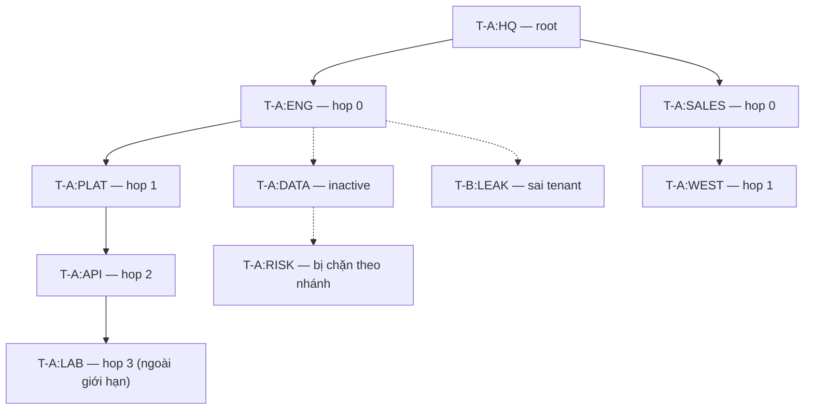

# `$graphLookup` và duyệt dữ liệu tham chiếu có giới hạn

Trong MongoDB, nhiều quan hệ không nằm trong một document duy nhất: phòng ban có cấp trên, nhóm quyền kế thừa nhóm quyền khác, danh mục có danh mục cha, hoặc một tác vụ phụ thuộc nhiều tác vụ trước đó. `$lookup` có thể nối dữ liệu theo một quan hệ, nhưng khi ứng dụng phải đi qua **nhiều cạnh liên tiếp**, MongoDB cung cấp aggregation stage **`$graphLookup`** để thực hiện phép duyệt đệ quy trên collection.

Điều khó không chỉ là làm cho pipeline chạy. Một truy vấn đệ quy thiếu giới hạn có thể chạm hàng nghìn node, đi sang dữ liệu tenant khác, bị ảnh hưởng bởi vòng lặp trong đồ thị, dùng quá nhiều bộ nhớ hoặc trả mảng không có thứ tự. Khi làm việc với **Spring Data MongoDB**, ta còn cần ánh xạ đúng `GraphLookupOperation` sang BSON, kiểm tra `maxDepth`/`depthField` và có chiến lược kiểm thử.

Bài thuộc chương **Aggregation nâng cao** của module `SPRING_DATA_MONGODB`, nơi người học kết nối, ánh xạ document và thao tác MongoDB qua `MongoTemplate` hoặc repository, kết hợp truy vấn, index, transaction, reactive access, kiểm thử và chẩn đoán hiệu năng. Mục tiêu chính ở đây là **duyệt dữ liệu tham chiếu một cách có giới hạn, có thể kiểm chứng và không vượt ranh giới dữ liệu**.

Sau bài học, bạn có thể:

- Nhận biết khi nào dùng `$graphLookup` thay cho `$lookup` hoặc nhiều query lặp từ Java.
- Giải thích đúng vai trò `from`, `startWith`, `connectFromField`, `connectToField` và `as`.
- Hiểu `maxDepth = 0`, `depthField` bắt đầu từ 0, và tại sao giới hạn chiều sâu **khác** giới hạn số node.
- Duyệt **hậu duệ** và **tổ tiên** bằng cùng một mô hình tham chiếu, tránh nhầm chiều kết nối.
- Áp `restrictSearchWithMatch` cho tenant/trạng thái; hiểu giới hạn của filter này đối với biến của document gốc.
- Dùng `Aggregation.graphLookup(...)` cùng `MongoTemplate`, kiểm thử bằng MongoDB thật và phân tích index, bộ nhớ, vòng lặp, sharding.

## 1. Đồ thị tham chiếu khác gì một phép nối thông thường?

Giả sử một tổ chức lưu mỗi đơn vị trong collection `orgUnits`. Mỗi document chứa `key` (định danh nghiệp vụ duy nhất) và `parentKey` (khóa của đơn vị cha):

```text
T-A:HQ
├── T-A:ENG
│   ├── T-A:PLAT
│   │   └── T-A:API
│   │       └── T-A:LAB
│   └── T-A:DATA (inactive)
│       └── T-A:RISK
└── T-A:SALES
    └── T-A:WEST
```

Một document `T-A:API` chỉ lưu `parentKey = "T-A:PLAT"`. Nó không chứa toàn bộ tổ tiên hay tất cả người kế nhiệm; các quan hệ phải được giải quyết theo đường nối.

| Câu hỏi | Lựa chọn thường phù hợp | Vì sao |
| --- | --- | --- |
| Tìm parent trực tiếp của `T-A:API` | `$lookup` hoặc `findOne` theo khóa | Chỉ cần **một bước** |
| Tìm toàn bộ ancestor tới cấp 3 | **`$graphLookup`** | Cần đi từ parent lên parent của parent |
| Tìm mọi descendant của `T-A:HQ` tới cấp 2 | **`$graphLookup`** | Cần duyệt nhiều tầng từ cha xuống con |
| Tìm cây chỉ có số cấp cố định rất nhỏ | Có thể dùng `$lookup` lồng hoặc query khác | Độ sâu cố định, dễ kiểm soát trong một số mô hình |
| Duyệt đồ thị có trọng số và đường đi tối ưu | Thường cần giải thuật chuyên biệt | `$graphLookup` không phải Dijkstra/A* hay công cụ shortest path có trọng số |

`$graphLookup` trả về một **mảng node đã duyệt**, không tự tạo một cây lồng nhiều cấp, không xác nhận đồ thị không có chu trình và không bảo đảm các phần tử mảng đã được sắp xếp. Muốn cấu trúc cây API, ứng dụng phải dựng lại từ `key/parentKey` hoặc dùng pipeline/DTO phù hợp.

### 1.1. Đồ thị, cây và dữ liệu không sạch

Một cây đúng nghĩa thường có một root, mỗi node khác root có một cha, không có vòng lặp. Nhưng collection thực tế có thể chứa:

- **Orphan**: `parentKey` trỏ tới node đã bị xóa hoặc chưa được import.
- **Cycle**: A trỏ B, B trỏ C, C trỏ A.
- **Cross-tenant edge**: một node tenant B trỏ nhầm parent tenant A.
- **Duplicate business key**: nhiều node có cùng `key` nếu không có unique index.
- **Inactive intermediate node**: một node bị vô hiệu hóa nhưng có hậu duệ đang hoạt động.

Chính vì những tình huống này, pipeline cần **giới hạn chiều sâu, ranh giới tenant, kiểm soát trạng thái, index và test đối kháng**, chứ không chỉ chạy với một cây hoàn hảo.

## 2. Cú pháp `$graphLookup` và chiều di chuyển

Khung BSON của stage:

```javascript
{
  $graphLookup: {
    from: "orgUnits",
    startWith: "$key",
    connectFromField: "key",
    connectToField: "parentKey",
    as: "descendants",
    maxDepth: 2,
    depthField: "hop",
    restrictSearchWithMatch: {
      tenantId: "T-A",
      active: true
    }
  }
}
```

Các tham số:

| Trường | Bắt buộc? | Ý nghĩa trong ví dụ |
| --- | --- | --- |
| `from` | Có | Collection MongoDB để tìm các node kế tiếp; phải ở cùng database |
| `startWith` | Có | Biểu thức tính từ **document đầu vào**; `"$key"` lấy khóa của root hiện tại |
| `connectFromField` | Có | Field của **node vừa tìm được** dùng để tìm bước tiếp theo |
| `connectToField` | Có | Field trong collection `from` được so với giá trị hiện tại |
| `as` | Có | Tên field mảng gắn vào document đầu vào |
| `maxDepth` | Không | Chiều sâu đệ quy tối đa, số nguyên không âm |
| `depthField` | Không | Trường bổ sung cho từng node kết quả, chứa độ sâu tính từ 0 |
| `restrictSearchWithMatch` | Không | Filter MongoDB áp **trong quá trình** duyệt tới các node |

Để hiểu chiều đi, đừng chỉ nhớ hai chữ “From/To”. Hãy tự hỏi:

1. Bắt đầu từ document root, `startWith` lấy **giá trị nào**?
2. Giá trị ấy được so với **field nào của collection `from`** (`connectToField`)?
3. Khi tìm được node, muốn đi tiếp phải đọc **field nào của node mới** (`connectFromField`)?

### 2.1. Đi từ cha xuống con

Với `key` và `parentKey`, muốn tìm con của root `T-A:HQ`:

```text
startWith = "T-A:HQ"
      ↓ so với connectToField = parentKey
T-A:ENG (parentKey = "T-A:HQ")
T-A:SALES (parentKey = "T-A:HQ")
      ↓ lấy connectFromField = key ở từng node mới
T-A:PLAT, T-A:WEST, ...
```

Vậy **descendant traversal** dùng:

```javascript
startWith: "$key",
connectFromField: "key",
connectToField: "parentKey"
```

### 2.2. Đi từ con lên cha

Muốn tìm ancestor của `T-A:API`, trước tiên lấy `parentKey = "T-A:PLAT"`, rồi tìm document có `key` bằng giá trị đó:

```javascript
startWith: "$parentKey",
connectFromField: "parentKey",
connectToField: "key"
```

Khi tìm thấy PLAT, đọc `PLAT.parentKey = "T-A:ENG"` và tiếp tục. **Đảo hai field nối sẽ đảo hướng duyệt**, dù vẫn dùng cùng collection.

### 2.3. `startWith` có thể trả một mảng

Khi một node có nhiều quan hệ đầu ra (ví dụ `dependencyKeys: ["TASK-A","TASK-B"]`), `startWith` có thể là mảng, và `$graphLookup` dùng các phần tử để tìm nhiều nhánh. Nếu `connectFromField` cũng chứa mảng, các giá trị được theo tiếp tương ứng.

Điều này hữu ích cho đồ thị nhiều cạnh, nhưng dễ tạo **branching factor** lớn. `maxDepth` vẫn chỉ giới hạn số bước, **không hạn chế số node ở mỗi bước**.

## 3. Fixture nhỏ để kiểm tra toàn bộ phép duyệt

Ta dùng **11 document** trong cùng collection. Các khóa `key` có tiền tố tenant; `_id` riêng dùng làm định danh lưu trữ:

```javascript
// Chỉ chạy trên database test, collection trống/được phép reset.
db.orgUnits.insertMany([
  { _id: "A-0", key: "T-A:HQ",    tenantId: "T-A", parentKey: null,
    name: "Trụ sở",        active: true },
  { _id: "A-1", key: "T-A:ENG",   tenantId: "T-A", parentKey: "T-A:HQ",
    name: "Kỹ thuật",      active: true },
  { _id: "A-2", key: "T-A:SALES", tenantId: "T-A", parentKey: "T-A:HQ",
    name: "Kinh doanh",    active: true },
  { _id: "A-3", key: "T-A:PLAT",  tenantId: "T-A", parentKey: "T-A:ENG",
    name: "Nền tảng",      active: true },
  { _id: "A-4", key: "T-A:WEST",  tenantId: "T-A", parentKey: "T-A:SALES",
    name: "Miền Tây",      active: true },
  { _id: "A-5", key: "T-A:DATA",  tenantId: "T-A", parentKey: "T-A:ENG",
    name: "Dữ liệu",       active: false },
  { _id: "A-6", key: "T-A:RISK",  tenantId: "T-A", parentKey: "T-A:DATA",
    name: "Rủi ro",        active: true },
  { _id: "A-7", key: "T-A:API",   tenantId: "T-A", parentKey: "T-A:PLAT",
    name: "API",           active: true },
  { _id: "A-8", key: "T-A:LAB",   tenantId: "T-A", parentKey: "T-A:API",
    name: "Phòng lab",     active: true },
  { _id: "B-0", key: "T-B:HQ",    tenantId: "T-B", parentKey: null,
    name: "Trụ sở B",      active: true },
  { _id: "B-1", key: "T-B:LEAK",  tenantId: "T-B", parentKey: "T-A:ENG",
    name: "Liên kết sai",  active: true }
]);
```

`T-B:LEAK` cố ý trỏ nhầm parent thuộc T-A. Đây là fixture **đối kháng**, không phải mô hình dữ liệu được khuyến nghị. Trong production cần từ chối quan hệ cross-tenant ở đường ghi; chỉ đặt tên khóa có tiền tố tenant **chưa tự đảm bảo** dữ liệu luôn sạch.

Để tránh khóa nghiệp vụ trùng:

```javascript
db.orgUnits.createIndex(
  { key: 1 },
  { unique: true }
);
```

Trong mô hình khóa chỉ unique **trong tenant** (không có prefix tenant), thay bằng unique index `{tenantId:1,key:1}` và thiết kế điều kiện nối cẩn thận. Với ví dụ hiện tại, `key` đã chứa tenant và được unique toàn cục cho dễ đối chiếu.

### 3.1. Tính tay trước khi viết pipeline

Từ root `T-A:HQ`, chỉ duyệt **active node thuộc T-A**:

| Độ sâu `hop` | Các node tìm được | Lý do |
| ---: | --- | --- |
| 0 | `T-A:ENG`, `T-A:SALES` | Có `parentKey = "T-A:HQ"` |
| 1 | `T-A:PLAT`, `T-A:WEST` | Con của ENG hoặc SALES, còn active |
| 2 | `T-A:API` | Con của PLAT |
| 3 | `T-A:LAB` | Ngoài giới hạn `maxDepth: 2` |

`T-A:DATA` bị loại vì `active:false`. Vì nhánh DATA không được theo tiếp, `T-A:RISK` cũng không được đưa vào kết quả dù bản thân nó active. `T-B:LEAK` không được phép lọt vào kết quả vì thuộc tenant T-B.

Khi `maxDepth:2`, kết quả phải có **đúng năm node**: ENG, SALES, PLAT, WEST, API. Root HQ **không** được tính là một descendant trong dữ liệu cây hợp lệ này.

### 3.2. Sơ đồ độ sâu



Các cạnh nét đứt thể hiện dữ liệu **không được duyệt** với filter/giới hạn của bài. Khi thiết kế API, đừng coi tên “descendants” là lời bảo đảm tự động về tenant, active hay độ sâu: chính pipeline phải thể hiện những ràng buộc đó.

## 4. Pipeline duyệt hậu duệ có giới hạn

Bắt đầu với một document root được chọn bằng `$match`, sau đó chạy `$graphLookup` vào chính collection `orgUnits`:

```javascript
const tenantId = "T-A"; // Giá trị đã được kiểm tra quyền.
const rootKey = "T-A:HQ";

const pipeline = [
  {
    $match: {
      tenantId: tenantId,
      key: rootKey,
      active: true
    }
  },
  {
    $graphLookup: {
      from: "orgUnits",
      startWith: "$key",
      connectFromField: "key",
      connectToField: "parentKey",
      as: "descendants",
      maxDepth: 2,
      depthField: "hop",
      restrictSearchWithMatch: {
        tenantId: tenantId,
        active: true
      }
    }
  }
];

const result = db.orgUnits.aggregate(pipeline).toArray();
printjson(result);
```

Kết quả có **một document gốc** (HQ) được bổ sung mảng `descendants` với năm node; ví dụ rút gọn:

```javascript
[
  {
    _id: "A-0",
    key: "T-A:HQ",
    tenantId: "T-A",
    name: "Trụ sở",
    active: true,
    descendants: [
      // Thứ tự KHÔNG được đảm bảo:
      { key: "T-A:ENG",   hop: NumberLong("0") },
      { key: "T-A:SALES", hop: NumberLong("0") },
      { key: "T-A:PLAT",  hop: NumberLong("1") },
      { key: "T-A:WEST",  hop: NumberLong("1") },
      { key: "T-A:API",   hop: NumberLong("2") }
    ]
  }
]
```

Đây là **minh họa rút gọn**, không phải document BSON đầy đủ: các node trong mảng thật còn có `_id`, `tenantId`, `parentKey`, `name`, `active`. MongoDB **không đảm bảo thứ tự** của phần tử trong mảng `as`, nên không dùng thứ tự in ra ở ví dụ để viết test.

### 4.1. Kiểm tra số node và các độ sâu

```javascript
const roots = db.orgUnits.aggregate(pipeline).toArray();

if (roots.length !== 1) {
  throw new Error("Không tìm đúng một root");
}

const descendants = roots[0].descendants;
print("Số node:", descendants.length); // 5

printjson(
  descendants.map(node => ({
    key: node.key,
    hop: Number(node.hop)
  })).sort((a, b) => a.hop - b.hop || a.key.localeCompare(b.key))
);
```

Kỳ vọng sau khi **tự sort trong JavaScript**:

| `key` | `hop` |
| --- | ---: |
| `T-A:ENG` | 0 |
| `T-A:SALES` | 0 |
| `T-A:PLAT` | 1 |
| `T-A:WEST` | 1 |
| `T-A:API` | 2 |

Nếu node T-B xuất hiện, `restrictSearchWithMatch` thiếu hoặc sai. Nếu DATA xuất hiện, điều kiện active đã bị bỏ. Nếu LAB xuất hiện, xem lại `maxDepth` hoặc cách giải thích chiều sâu.

### 4.2. Kiểm tra từng giai đoạn như một pipeline bình thường

```javascript
// Giai đoạn 1: chỉ xác nhận root.
db.orgUnits.aggregate([pipeline[0]]).toArray();

// Giai đoạn 2: root + descendants.
db.orgUnits.aggregate(pipeline).toArray();

// Giai đoạn 3: trải mảng để nhìn từng node riêng.
db.orgUnits.aggregate([
  ...pipeline,
  { $unwind: "$descendants" },
  { $project: {
      _id: 0,
      key: "$descendants.key",
      name: "$descendants.name",
      hop: "$descendants.hop"
  } },
  { $sort: { hop: 1, key: 1 } }
]).toArray();
```

Stage `$unwind` chuyển mảng descendants thành năm output; `$sort` cuối chỉ **sắp xếp những dòng output đã trải**, không tự sắp xếp mảng `descendants` nằm trong document gốc.

## 5. `maxDepth`, `depthField` và ba kiểu “giới hạn” khác nhau

`maxDepth` là **giới hạn số lần đi theo cạnh từ điểm bắt đầu** theo cách đếm MongoDB, với lần lookup đầu tiên có `depth = 0`:

| `maxDepth` | Node hợp lệ kỳ vọng của fixture | Số node |
| ---: | --- | ---: |
| 0 | ENG, SALES | 2 |
| 1 | ENG, SALES, PLAT, WEST | 4 |
| 2 | ENG, SALES, PLAT, WEST, API | 5 |
| 3 | Trên cộng LAB | 6 |

Vì độ sâu bắt đầu từ **0**, `maxDepth:0` **không phải “không tìm gì”**: nó vẫn thực hiện **một lần lookup**, tương đương thao tác chỉ qua một cạnh theo định nghĩa của MongoDB.

### 5.1. `depthField` là metadata trên từng node kết quả

`depthField:"hop"` bổ sung field `hop` vào **mỗi document trong mảng `descendants`**, dưới dạng BSON `NumberLong`. Nó **không tự thêm `hop` lên document root** và không tạo cấu trúc cây lồng.

Ví dụ `T-A:PLAT` có `hop=1`: nó được tìm từ ENG, còn ENG là lookup trực tiếp từ HQ (`hop=0`). Nếu API muốn nói “cách root hai cạnh”, có thể trình bày `level = hop + 1`; phải phân biệt cách đánh số ở UI và ở MongoDB.

### 5.2. `maxDepth` không phải giới hạn số node

Một root có 100 con, mỗi con có 100 cháu:

```text
maxDepth: 0 → có thể 100 node
maxDepth: 1 → có thể 100 + 10.000 node
maxDepth: 2 → có thể 100 + 10.000 + 1.000.000 node
```

Giới hạn độ sâu giúp chặn vòng đi quá dài, **không chặn bùng nổ độ rộng**. Thêm `$limit:10` **sau `$graphLookup`** giới hạn số *document root* hoặc các dòng output tùy vị trí, **không đảm bảo server chỉ duyệt 10 node**. Thêm `$slice` vào mảng kết quả chỉ giảm dữ liệu trả về sau khi traversal đã thực hiện.

Do đó ứng dụng cần **ba nhóm giới hạn khác nhau**:

1. **Giới hạn input/root**: chọn một số lượng root vừa phải bằng `$match`, limit/pagination thích hợp.
2. **Giới hạn traversal**: `maxDepth` nhỏ, filter `restrictSearchWithMatch` đủ chặt, index.
3. **Giới hạn tài nguyên/output**: timeout, ngân sách node/byte, số request đồng thời, cache/materialized view hoặc chuyển sang thuật toán duyệt theo từng batch khi cần giới hạn số node cứng.

MongoDB `$graphLookup` **không có tham số `maxNodes` tương đương `maxDepth`**. Nếu use case cần “tối đa 500 node đã ghé qua” như một ràng buộc bắt buộc, nên cân nhắc một quy trình BFS có kiểm soát/duyệt từng tầng, hoặc mô hình dữ liệu đã vật hóa quan hệ, thay vì chỉ dùng `$slice` sau traversal.

### 5.3. Không dựa vào `depthField` để xác định thứ tự mảng

Mảng output của `$graphLookup` **không được sắp xếp theo hop**. Muốn trả danh sách `hop ASC, key ASC` thì:

```javascript
db.orgUnits.aggregate([
  ...pipeline,
  { $unwind: "$descendants" },
  { $sort: {
      "descendants.hop": 1,
      "descendants.key": 1
  } },
  { $project: {
      _id: 0,
      key: "$descendants.key",
      parentKey: "$descendants.parentKey",
      name: "$descendants.name",
      hop: "$descendants.hop"
  } }
]).toArray();
```

Với MongoDB hỗ trợ `$sortArray`, có thể sắp xếp trực tiếp array trong một stage `$set`/`$project` phù hợp, nhưng phải kiểm tra version hỗ trợ và chi phí trên mảng lớn. Với API trả một danh sách phẳng, `$unwind + $sort + $project` thường dễ kiểm chứng.

## 6. `restrictSearchWithMatch` là filter **trong traversal**

Giả sử ta lọc root bằng `tenantId = "T-A"` nhưng **không** có `restrictSearchWithMatch`. Một node khác tenant có thể lưu sai `parentKey = "T-A:ENG"` như `T-B:LEAK` trong fixture. Khi graph traversal nối theo `parentKey`, node T-B này vẫn có thể được trả về.

Do đó, điều kiện ở **`$match` trước `$graphLookup` không tự lọc tất cả document mà graphLookup ghé qua**.

Một pipeline an toàn hơn cho bài:

```javascript
{
  $graphLookup: {
    from: "orgUnits",
    startWith: "$key",
    connectFromField: "key",
    connectToField: "parentKey",
    as: "descendants",
    maxDepth: 2,
    depthField: "hop",
    restrictSearchWithMatch: {
      tenantId: "T-A",
      active: true
    }
  }
}
```

### 6.1. Filter không chỉ ẩn node: nó có thể **chặn đường đi**

Node `T-A:DATA` inactive. Với restrict `active:true`, DATA **không trở thành node đã duyệt** nên `T-A:RISK` nằm dưới DATA cũng **không được tìm tiếp qua nhánh đó**, dù RISK active.

Đây là quy tắc quan trọng. Hai yêu cầu sau **không tương đương**:

- **“Chỉ đi qua node active”**: đặt `active:true` trong `restrictSearchWithMatch`, làm dừng nhánh qua node inactive.
- **“Có thể đi qua node inactive, nhưng chỉ trả node active”**: phải có chiến lược khác, ví dụ traversal có tenant restriction rồi lọc mảng kết quả sau đó; lúc này chi phí traversal lớn hơn và phải kiểm tra semantics của việc hiện node hậu duệ “vượt qua” một node inactive.

Nếu chính sách tổ chức quy định “một phòng ban inactive che tất cả cấp dưới”, restrict trong traversal là đúng. Nếu báo cáo muốn tìm mọi nhân viên active kể cả nằm sâu dưới một phòng ban tạm khóa, dùng restrict active có thể **bỏ sót** dữ liệu.

### 6.2. `restrictSearchWithMatch` không tham chiếu tùy ý field root

Đây là **query filter**, không phải một pipeline con nhận biến `let` như một số dạng `$lookup`. MongoDB không cho dùng aggregation expression để so sánh tùy ý với field của root trong `restrictSearchWithMatch`.

Ví dụ **sai kỳ vọng**:

```javascript
restrictSearchWithMatch: {
  tenantId: "$tenantId"
}
// "$tenantId" là CHUỖI LITERAL trong filter,
// không được thay bằng tenantId của root.
```

Với một API của user đang được xác thực là T-A, ta có thể đưa **giá trị đã xác thực** `"T-A"` vào filter ở lúc xây pipeline. Nhưng nếu một pipeline đồng thời xử lý **nhiều root của nhiều tenant khác nhau**, không nên tưởng `restrictSearchWithMatch` sẽ tự lấy tenant tương ứng cho từng root.

Các phương án phù hợp tùy hệ thống:

1. Chạy pipeline **theo tenant**, lấy tenant từ security context và bind vào cả `$match` lẫn restrict.
2. Thiết kế khóa nối **bao gồm tenant** và xác thực cạnh ngay khi ghi; vẫn kiểm thử isolation.
3. Nếu cần điều kiện liên quan root phức tạp, xem lại mô hình dữ liệu, tách query theo tenant hoặc xử lý traversal bằng quy trình khác có kiểm soát.

**Không tự nối chuỗi JSON với tenantId từ input công khai**. Trong Java nên xây `Criteria` từ giá trị đã xác thực, để driver mã hóa BSON đúng kiểu và tránh tạo query tùy ý.

### 6.3. Một phép lọc sau `$graphLookup` không thay thế filter trong traversal

Ví dụ:

```javascript
{ $set: {
    descendants: {
      $filter: {
        input: "$descendants",
        as: "node",
        cond: { $eq: ["$$node.tenantId", "T-A"] }
      }
    }
} }
```

Stage này có thể loại node T-B **khỏi mảng trả về** nhưng đã **quá muộn để ngăn graphLookup duyệt qua nó**. Nếu node T-B có các cạnh khác, traversal có thể đã truy cập nhiều dữ liệu ngoài scope. Phân quyền phải được thể hiện **trước và trong phép duyệt**, không chỉ lọc kết quả sau cùng.

## 7. Duyệt tổ tiên: thay đổi hướng nối

Một use case thường gặp là: “đơn vị `T-A:API` thuộc những đơn vị cấp trên nào, tối đa ba cấp?”. Với cùng dữ liệu, cần đọc `parentKey` trước rồi tìm document có `key` tương ứng.

```javascript
db.orgUnits.aggregate([
  {
    $match: {
      tenantId: "T-A",
      key: "T-A:API",
      active: true
    }
  },
  {
    $graphLookup: {
      from: "orgUnits",
      startWith: "$parentKey",
      connectFromField: "parentKey",
      connectToField: "key",
      as: "ancestors",
      maxDepth: 2,
      depthField: "hop",
      restrictSearchWithMatch: {
        tenantId: "T-A",
        active: true
      }
    }
  },
  { $unwind: "$ancestors" },
  { $sort: { "ancestors.hop": 1 } },
  { $project: {
      _id: 0,
      key: "$ancestors.key",
      name: "$ancestors.name",
      hop: "$ancestors.hop"
  } }
]).toArray();
```

Kỳ vọng:

| `key` | `hop` | Ý nghĩa |
| --- | ---: | --- |
| `T-A:PLAT` | 0 | Cha trực tiếp của API |
| `T-A:ENG` | 1 | Ông/bà (grandparent) |
| `T-A:HQ` | 2 | Cấp trên tiếp theo |

Đây là ví dụ giúp nhớ **đảo chiều**:

| Hướng | `startWith` | `connectFromField` | `connectToField` |
| --- | --- | --- | --- |
| Hậu duệ | `"$key"` | `"key"` | `"parentKey"` |
| Tổ tiên | `"$parentKey"` | `"parentKey"` | `"key"` |

### 7.1. Khi parent không tồn tại

Nếu `parentKey` của API trỏ tới `T-A:MISSING` nhưng không có document nào có `key` đó, `ancestors` sẽ là mảng rỗng (hoặc chỉ chứa những node đã tìm được trước khi gặp đứt liên kết). `$graphLookup` không tự tạo một placeholder “không tìm thấy” cho cạnh bị đứt.

Với API cần phản hồi root kể cả khi không có tổ tiên, **không dùng `$unwind` mặc định** nếu không muốn document root bị loại. Có thể giữ mảng `ancestors` trong response, hoặc dùng `preserveNullAndEmptyArrays` khi unwind với quy tắc output rõ ràng.

### 7.2. Khi dữ liệu lưu nhiều cha

Với mô hình graph có nhiều quan hệ cha, field `parentKeys` có thể là array. `startWith:"$parentKeys"` và `connectFromField:"parentKeys"` có thể duyệt nhiều hướng; kết quả không tự cho biết một node được đi tới qua **đường đi nào**, nhất là khi có nhiều đường dẫn dẫn tới cùng node.

`depthField` cho biết độ sâu traversal gắn với node kết quả, nhưng **không thay thế danh sách từng cạnh/path** nếu nghiệp vụ cần giải thích “đường dẫn phân quyền cụ thể nào đã cấp quyền”. Với yêu cầu audit path chính xác, nên thiết kế lưu path/cạnh hoặc thuật toán chuyên dụng.

## 8. Chu trình, dữ liệu mồ côi và khóa tham chiếu

### 8.1. Vì sao `maxDepth` vẫn cần ngay cả khi dữ liệu “là cây”?

Ứng dụng có thể muốn tổ chức là cây, nhưng không có foreign key tự động giữa `parentKey` và `key`. Một lần import hoặc update sai có thể tạo chu trình.

Giả sử trong test ta sửa `T-A:HQ.parentKey` thành `T-A:API`:

```text
HQ → ENG → PLAT → API → HQ
```

Đây là vòng lặp nếu hiểu cạnh “HQ là parent của ENG”, “ENG là parent của PLAT”, “PLAT là parent của API” và “API trở thành parent của HQ”. Duyệt hậu duệ từ HQ có thể gặp lại HQ **như một node được tham chiếu từ API** nếu `maxDepth` đủ lớn.

Không cần dựa vào việc một vòng lặp chắc chắn làm truy vấn chạy mãi: MongoDB có cơ chế xử lý duyệt để tránh lặp vô hạn một node đã ghé, nhưng **kết quả có thể chứa một node không phù hợp với giả định cây**, thậm chí chứa root khi có cạnh chu trình. `maxDepth` vẫn là giới hạn vận hành quan trọng.

### 8.2. Không tự tin rằng `$graphLookup` phát hiện cây hợp lệ

`$graphLookup` tìm các document có quan hệ khớp field, không xác nhận:

- Mỗi node có tối đa một parent hợp lệ.
- Root thực sự không có parent.
- Mọi parent đều ở cùng tenant.
- Không có vòng lặp.
- Tất cả parent đều active hoặc tồn tại.

Các quy tắc này cần được kiểm tra ở **đường ghi** và bằng job đối soát. Có thể dùng query traversal để phát hiện tình huống đáng ngờ, ví dụ:

```javascript
// Sau traversal, kiểm tra root có vô tình xuất hiện trong descendants không.
db.orgUnits.aggregate([
  { $match: { key: "T-A:HQ", tenantId: "T-A" } },
  {
    $graphLookup: {
      from: "orgUnits",
      startWith: "$key",
      connectFromField: "key",
      connectToField: "parentKey",
      as: "descendants",
      maxDepth: 10,
      restrictSearchWithMatch: { tenantId: "T-A" }
    }
  },
  {
    $project: {
      _id: 0,
      rootKey: "$key",
      hasRootInDescendants: {
        $in: ["$key", "$descendants.key"]
      }
    }
  }
]).toArray();
```

Đây là **tín hiệu kiểm tra** cho một kiểu chu trình trong phạm vi duyệt 10 tầng, không phải thuật toán chứng minh toàn đồ thị không có chu trình. Nếu chu trình nằm sâu hơn maxDepth hoặc không nằm trên đường từ root đang kiểm tra, phép kiểm tra có thể không phát hiện.

**Đừng chạy trực tiếp lệnh sửa `parentKey` trên production chỉ để thử cycle.** Khi test cycle, hãy dùng một database/collection cô lập và tạo fixture riêng, rồi khôi phục hoàn toàn.

### 8.3. Cách ngăn cycle ở đường ghi

Khi đổi parent của node A sang node B, một bước kiểm tra hợp lý là **xem B có thuộc danh sách hậu duệ của A hay không**. Nếu có, đặt B làm parent của A sẽ tạo vòng lặp.

Tuy nhiên, phép kiểm tra **đọc rồi ghi** tách rời có race condition: request khác có thể thay graph trước khi update chạy. Với yêu cầu nhất quán nghiêm ngặt, cần thiết kế transaction/optimistic version hoặc serialize thay đổi graph theo khóa tổ chức, kèm ràng buộc nghiệp vụ phù hợp.

Index unique `key` giúp ngăn duplicate key, **không ngăn chu trình** hoặc cross-tenant parent. Ở nhiều ứng dụng, cần validate parent được tìm bởi **tenantId + key**, trạng thái hợp lệ, giới hạn độ sâu và yêu cầu không tự làm parent của chính mình.

### 8.4. Orphan và node đã bị xóa

Một orphan `{key:"T-A:ORPHAN", parentKey:"T-A:REMOVED"}` không tự “bắt” vào cây HQ vì `$graphLookup` chỉ nối qua các node đã tồn tại. Nếu nghiệp vụ cần tổng hợp **mọi node không có đường lên root hợp lệ**, việc duyệt từ một root đơn lẻ không đủ; nên có job kiểm tra quan hệ và thống kê node không đến được root.

Không nên chọn `maxDepth` cực lớn để tìm tất cả orphan/cycle một cách vô kiểm soát. Dùng chiến lược kiểm tra schema, index và đối soát theo tenant có giới hạn.

## 9. Spring Data MongoDB: `GraphLookupOperation` trong `MongoTemplate`

Spring Data hỗ trợ `Aggregation.graphLookup(...)` và `GraphLookupOperation`, vì vậy với stage phổ biến ta không cần tự ghép JSON string. API builder chính có thứ tự:

```text
Aggregation.graphLookup(collection)
  .startWith(startProperty)
  .connectFrom(fromProperty)
  .connectTo(toProperty)
  .maxDepth(nonNegativeLong)
  .depthField(outputDepthField)
  .restrict(criteria)
  .as(outputArrayField)
```

Các tên trường nối được viết theo field/property tương ứng; ví dụ dùng `key` và `parentKey` **cùng tên ở Java và BSON** để tránh nhầm `@Id` ↔ `_id`. `startWith("key")` trong builder là **field reference**, tương ứng `"$key"` khi render sang BSON, không phải giá trị chuỗi literal `"key"`.

### 9.1. Entity nguồn và DTO kết quả

```java
import org.springframework.data.mongodb.core.mapping.Document;
import org.springframework.data.mongodb.core.mapping.MongoId;

@Document(collection = "orgUnits")
public record OrgUnit(
        @MongoId String id,
        String key,
        String tenantId,
        String parentKey,
        String name,
        boolean active
) {}
```

Khi đã `$unwind` descendants và project, kết quả **không còn là một `OrgUnit` đầy đủ**. Dùng DTO riêng:

```java
public record OrgHop(
        String key,
        String parentKey,
        String name,
        long hop
) {}
```

`long hop` phù hợp vì MongoDB `depthField` lưu BSON `NumberLong`. `OrgHop` là một record chỉ đọc cho output aggregation; **không gọi `save`** vào `orgUnits` với dữ liệu đã project một phần.

### 9.2. Service duyệt descendants tới một độ sâu tối đa

```java
import java.util.List;
import org.springframework.data.domain.Sort;
import org.springframework.data.mongodb.core.MongoTemplate;
import org.springframework.data.mongodb.core.aggregation.Aggregation;
import org.springframework.data.mongodb.core.aggregation.GraphLookupOperation;
import org.springframework.data.mongodb.core.query.Criteria;
import org.springframework.stereotype.Service;

@Service
public class OrgTraversalService {

    private final MongoTemplate template;

    public OrgTraversalService(MongoTemplate template) {
        this.template = template;
    }

    public List<OrgHop> descendants(
            String authorizedTenantId,
            String rootKey,
            long maxDepth
    ) {
        if (authorizedTenantId == null
                || authorizedTenantId.isBlank()
                || rootKey == null || rootKey.isBlank()
                || maxDepth < 0 || maxDepth > 3) {
            throw new IllegalArgumentException(
                    "Tenant, root hoặc độ sâu không hợp lệ");
        }

        Criteria rootFilter = Criteria.where("tenantId")
                .is(authorizedTenantId)
                .and("key").is(rootKey)
                .and("active").is(true);

        Criteria traversalFilter = Criteria.where("tenantId")
                .is(authorizedTenantId)
                .and("active").is(true);

        GraphLookupOperation traversal = Aggregation
                .graphLookup("orgUnits")
                .startWith("key")
                .connectFrom("key")
                .connectTo("parentKey")
                .maxDepth(maxDepth)
                .depthField("hop")
                .restrict(traversalFilter)
                .as("descendants");

        Aggregation pipeline = Aggregation.newAggregation(
                Aggregation.match(rootFilter),
                traversal,
                Aggregation.unwind("descendants"),
                Aggregation.sort(Sort.by(
                        Sort.Order.asc("descendants.hop"),
                        Sort.Order.asc("descendants.key"))),
                Aggregation.project()
                        .and("descendants.key").as("key")
                        .and("descendants.parentKey").as("parentKey")
                        .and("descendants.name").as("name")
                        .and("descendants.hop").as("hop")
                        .andExclude("_id")
        );

        return template.aggregate(
                pipeline, "orgUnits", OrgHop.class
        ).getMappedResults();
    }
}
```

Ví dụ gọi trong service/controller/test đã được inject `OrgTraversalService`:

```java
List<OrgHop> hops = orgTraversalService.descendants(
        "T-A", "T-A:HQ", 2);

// Kỳ vọng 5 row, theo hop rồi key:
// T-A:ENG (0), T-A:SALES (0),
// T-A:PLAT (1), T-A:WEST (1), T-A:API (2).
```

Ở ví dụ này, service **không cho client đẩy `maxDepth` tùy ý**; nó giới hạn 0–3 để minh họa kiểm soát tài nguyên. Giới hạn thật cần dựa trên độ rộng cây, độ trễ và quy định truy cập dữ liệu.

**Lưu ý:** `template.aggregate(pipeline, "orgUnits", OrgHop.class)` dùng collection tường minh. `@MongoId` của entity không được dùng trong đường nối nên ta tránh vấn đề `id` ánh xạ sang `_id` trong `GraphLookupOperation`. Nếu schema có `@Field` đổi tên `key/parentKey`, cần kiểm tra BSON pipeline được sinh ra và các đặc tính mapping của phiên bản Spring Data.

### 9.3. Giữ root kể cả khi không có descendant

Service trên dùng `Aggregation.unwind("descendants")` mặc định. Nếu root không có hậu duệ active, **không có output row**. Đối với một API chỉ trả danh sách node con, điều đó có thể phù hợp.

Nếu API phải trả **root và mảng descendants**, đừng unwind; có thể ánh xạ output thành một DTO:

```java
import java.util.List;
import org.bson.Document;

public record OrgTreeResult(
        String key,
        String name,
        List<Document> descendants
) {}
```

Trong thực tế, nên dùng DTO có cấu trúc ổn định thay vì để `Document` thô lan ra toàn ứng dụng. Khi không có descendants, mảng có thể rỗng; khác hẳn trường hợp root không tồn tại (aggregate không có document). Nếu cần phân biệt hai trường hợp, trả một result wrapper rõ ràng.

### 9.4. Duyệt ancestors với builder tương tự

Chỉ cần đổi `startWith`, `connectFrom` và `connectTo`:

```java
GraphLookupOperation ancestors = Aggregation
        .graphLookup("orgUnits")
        .startWith("parentKey")
        .connectFrom("parentKey")
        .connectTo("key")
        .maxDepth(2)
        .depthField("hop")
        .restrict(Criteria.where("tenantId").is("T-A")
                .and("active").is(true))
        .as("ancestors");
```

Với root `T-A:API`, mảng dự kiến chứa PLAT (0), ENG (1), HQ (2). Phần `$match` chọn root phải giữ tenant đã xác thực. Nếu không có parent hợp lệ, kết quả là mảng rỗng, không phải exception.

## 10. Index cho traversal: mỗi bước là một phép tìm tiếp

`$graphLookup` thực hiện nhiều lần so khớp theo `connectToField`. Vì vậy index phù hợp với **field đang được tìm** trong từng hướng là rất quan trọng:

| Hướng | Cặp nối | Điều kiện được tìm trên node kế | Index nên đánh giá |
| --- | --- | --- | --- |
| Hậu duệ | `connectFromField:"key"`, `connectToField:"parentKey"` | `parentKey = key của node hiện tại` và tenant/active | `{tenantId:1, parentKey:1, active:1}` hoặc biến thể theo workload |
| Tổ tiên | `connectFromField:"parentKey"`, `connectToField:"key"` | `key = parentKey của node hiện tại` và tenant/active | Unique `{key:1}`, hoặc `{tenantId:1,key:1}` theo schema |
| Tìm root | `$match {tenantId, key, active}` | Một node được chọn trước khi graphLookup | Unique key và các filter phù hợp |

Với fixture bài:

```javascript
// Unique business key.
db.orgUnits.createIndex(
  { key: 1 },
  { unique: true }
);

// Phục vụ tìm các con theo parentKey của node đã duyệt.
db.orgUnits.createIndex({
  tenantId: 1,
  parentKey: 1,
  active: 1
});
```

**Không tạo index lặp lại vô ích** trong môi trường thật: unique key đã được tạo ở phần fixture, câu lệnh trên chỉ nhắc lại cấu hình cần kiểm tra. Với index compound, thứ tự field phải được chọn dựa trên điều kiện equality, độ chọn lọc và workload; không có một trật tự tối ưu cho mọi collection.

### 10.1. Vì sao index `parentKey` quan trọng cho descendants?

Mỗi lần tìm descendants, MongoDB hỏi gần như “node nào có `parentKey` bằng khóa này?”. Nếu không có index hỗ trợ, quá trình recursive join có thể phải quét nhiều document để tìm một nhóm con, rồi lặp lại công việc ở các tầng tiếp theo.

Khi duyệt ancestors, query hỏi “node nào có `key` bằng parentKey này?”. Nếu `key` unique và có index, mỗi bước thường tìm được tối đa một parent. Hai hướng có **fan-out và đặc tính hiệu năng rất khác nhau**: đi lên cây một cha thường là chuỗi hẹp, đi xuống có thể mở rộng thành hàng nghìn nhánh.

### 10.2. `explain` và giới hạn của việc đọc plan

Với MongoDB hỗ trợ, dùng:

```javascript
db.orgUnits.explain("executionStats").aggregate([
  { $match: { tenantId: "T-A", key: "T-A:HQ", active: true } },
  {
    $graphLookup: {
      from: "orgUnits",
      startWith: "$key",
      connectFromField: "key",
      connectToField: "parentKey",
      as: "descendants",
      maxDepth: 2,
      depthField: "hop",
      restrictSearchWithMatch: {
        tenantId: "T-A",
        active: true
      }
    }
  }
]);
```

Tùy phiên bản và query optimizer, thông tin chi tiết cho `$graphLookup` có thể bao gồm các chỉ số như số document/index key được xét, thời gian và chi phí traversal. Không giả định mọi phiên bản in cùng một cấu trúc `executionStats` hay mọi phép tìm trong traversal được thể hiện thành `IXSCAN` độc lập dễ đọc.

Hãy quan sát đồng thời **thời gian thực tế** của request, số node trả về, độ sâu, bề rộng, số root được duyệt, memory/CPU và connection pool. Kết quả `explain` trên 11 document có thể rất khác workload production.

## 11. Bộ nhớ, giới hạn kết quả và phiên bản MongoDB

Một lỗi thiết kế là coi `maxDepth:2` nhỏ nên mặc định truy vấn rẻ. Nếu mỗi node có hàng trăm con, số lượng node có thể tăng cực nhanh ngay ở hai hoặc ba tầng.

### 11.1. Giới hạn BSON output

`$graphLookup` thêm một mảng `descendants` vào **một document root**. Nếu mảng này rất lớn, document đầu ra có thể chạm **giới hạn kích thước BSON document 16 MiB**. Lỗi này khác với giới hạn bộ nhớ dùng khi xử lý stage.

Ví dụ một root có 300.000 descendants, mỗi node còn chứa nhiều metadata dài: chỉ cần `maxDepth:1` hoặc `2` cũng có thể tạo output quá lớn. Việc dùng `$project` **sau graphLookup** chỉ loại field ở output đã tính; nó không biến graphLookup thành một traversal được đảm bảo có ít node.

Nếu dữ liệu rất rộng, cân nhắc:

- Giảm field được lưu trên mỗi node nếu phù hợp với schema; tách metadata lớn ra collection khác.
- Hạn chế root input, giới hạn độ sâu và trạng thái/kiểu node trong `restrictSearchWithMatch`.
- Dùng API đọc theo cấp hoặc BFS phân batch có ngân sách node rõ ràng.
- Dùng mô hình materialized path/ancestor keys khi cấu trúc cây và workload phù hợp.
- Cache cây nhỏ hay snapshot theo tenant và invalidate khi quan hệ thay đổi.

### 11.2. `allowDiskUse` **không có một hành vi chung cho mọi phiên bản**

Tài liệu MongoDB hiện hành và các tài liệu theo version có ghi nhận **khác biệt** về xử lý `$graphLookup` khi dùng nhiều bộ nhớ:

- Ở những phiên bản/đường thực thi có hỗ trợ spill, stage có thể ghi file tạm khi vượt ngưỡng khoảng **100 MiB**; nếu `allowDiskUse:false` có thể xảy ra lỗi.
- Tài liệu của một số phiên bản cũ (ví dụ nhánh 8.0) mô tả `$graphLookup` có **giới hạn bộ nhớ cứng khoảng 100 MiB** và có thể không hưởng lợi từ `allowDiskUse:true`, dù những stage khác trong pipeline có.

Vì vậy, **không được hứa “bật `allowDiskUse(true)` là graphLookup sẽ không lỗi bộ nhớ”**. Cần đọc tài liệu của **MongoDB Server version thực đang vận hành**, đo explain/server metrics và thiết kế giới hạn traversal ngay từ đầu.

```javascript
db.orgUnits.aggregate(pipeline, {
  allowDiskUse: true,
  maxTimeMS: 5000
});
```

Đây là tùy chọn command trong `mongosh`, không phải mẹo để bỏ qua schema hoặc một giới hạn độ sâu. `maxTimeMS` giới hạn thời gian xử lý được server cho phép, nhưng không thay thế timeout HTTP/client, giới hạn bộ nhớ hay chính sách hủy job.

### 11.3. Giới hạn thời gian và nhiều yêu cầu đồng thời

Một request xem cây phân cấp có thể chạy nhanh trong test nhưng chậm khi:

- Root có hàng nghìn con hoặc node trong nhiều level.
- Nhiều user cùng xem toàn cây mà không có cache.
- Index `connectToField` không khớp filter traversal.
- Collection bị sharded, network nhiều hop hoặc thời gian chờ tài nguyên.
- Output có nhiều field lớn, driver phải deserialize nhiều document.

Đặt ngân sách **maxDepth, số request đồng thời, timeout và lượng dữ liệu trả về**; rate limit/quota theo tenant khi cần. Với use case xem cây UI, thường **trả từng level khi người dùng mở node** dễ kiểm soát hơn trả toàn bộ tổ chức khổng lồ trong một lần gọi.

### 11.4. Sharding và transaction

Theo tài liệu MongoDB, từ **MongoDB 5.1**, collection được chỉ định trong `from` của `$graphLookup` **có thể là sharded collection**. Tuy nhiên, **không thể dùng `$graphLookup` trong transaction khi stage trỏ tới một sharded collection**.

Vì vậy, với ứng dụng có `@Transactional` MongoDB, **không được mặc định** rằng mọi aggregation `$graphLookup` sẽ chạy như một query thường bên trong transaction, nhất là khi collection `from` sharded. Hãy kiểm tra topology, phiên bản MongoDB và ranh giới transaction trước khi thiết kế workflow đọc/ghi đồ thị.

Ngay cả khi query chạy được, một traversal dài không tự đảm bảo toàn bộ sơ đồ quan hệ bất biến nếu writer khác đồng thời sửa parent. Nếu cần snapshot nhất quán cho báo cáo/chứng từ, phải chọn read concern/snapshot và cơ chế lưu phiên bản phù hợp với giới hạn deployment.

### 11.5. Collation và view

Nếu `from` là view và pipeline có nhiều view được dùng trong `$lookup`/`$graphLookup`, MongoDB yêu cầu quy tắc collation nhất quán theo tài liệu. Khi join key dạng String, các khác biệt case/collation có thể làm kết quả khó đoán nếu dùng tên hiển thị làm khóa.

Ví dụ dùng khóa chuẩn hóa `"T-A:ENG"` thay vì tên `"Kỹ thuật"` làm trường nối. **Không coi tên người dùng nhập là khóa tham chiếu ổn định**; dùng identifier có tính duy nhất và định dạng rõ ràng.

## 12. Lựa chọn mô hình dữ liệu khác khi truy vấn đệ quy quá đắt

`$graphLookup` không phải bắt buộc cho mọi cây. Tùy hướng truy cập và tần suất cập nhật, các mô hình khác có thể phù hợp hơn:

| Mô hình | Dữ liệu lưu | Điểm mạnh | Đánh đổi |
| --- | --- | --- | --- |
| **Parent reference** (ví dụ này) | Mỗi node có `parentKey` | Cập nhật một cạnh tương đối đơn giản, lưu gọn | Đọc nhiều cấp cần `$graphLookup`/truy vấn nhiều bước |
| **Materialized path** | Mỗi node lưu đường dẫn `"/HQ/ENG/PLAT"` | Có thể tìm subtree bằng prefix/path khi index và quy tắc khóa phù hợp | Đổi parent có thể phải cập nhật path của cả subtree |
| **Ancestor array** | Mỗi node lưu `ancestorKeys[]` | Kiểm tra tổ tiên nhanh với truy vấn array | Mỗi lần di chuyển node phải cập nhật nhiều descendants |
| **Nested tree document** | Cha chứa các con lồng trong một document | Đọc một cây nhỏ nhanh, ít join | Giới hạn BSON 16 MiB, update/đồng thời phức tạp |
| **Đọc từng cấp bằng `parentKey`** | Parent reference + API children | Giới hạn node mỗi request, hợp UI tree lazy-load | Nhiều round-trip nếu cần toàn bộ đồ thị |
| **Cache/materialized view** | Snapshot đã tính | Phục vụ đọc lặp nhanh | Cần cơ chế cập nhật/invalidate đúng |

**Khuyến nghị theo use case:** nếu UI chỉ cần mở từng node, `find({tenantId,parentKey}).limit(...)` thường dễ đặt giới hạn hơn một graphLookup toàn bộ. Nếu cần ancestor vài cấp hoặc báo cáo subtree có phạm vi hẹp, `$graphLookup` với `maxDepth` và filter là lựa chọn gọn. Nếu một cây được đọc hàng nghìn lần/giây nhưng hiếm khi thay đổi, cache/ancestor path có thể hiệu quả hơn.

### 12.1. Không nhầm `$lookup` với `$graphLookup`

`$lookup` tìm những document tham chiếu trực tiếp (hoặc join bằng pipeline) cho **một cấp quan hệ**. `$graphLookup` tiếp tục tìm từ các node vừa ghép được, có `maxDepth`/`depthField` và cơ chế filter traversal.

Nếu yêu cầu chỉ “lấy parent trực tiếp của API”, dùng một lookup hoặc truy vấn `key = parentKey` có thể đơn giản hơn. Nếu yêu cầu là “chuỗi parent tới root”, dùng graphLookup. **Không tăng độ phức tạp chỉ để sử dụng stage nâng cao**.

### 12.2. Không đồng nhất graph traversal với tìm đường đi ngắn nhất

`$graphLookup` duyệt các node liên quan tới điểm xuất phát. Nó không phải công cụ tối ưu đường đi có trọng số, không trả mọi path đã đi, và không tự cung cấp giải thích vì sao một node được đến qua một nhánh cụ thể.

Nếu sản phẩm yêu cầu xác định **đường ngắn nhất**, **chi phí thấp nhất**, số bước của **từng đường** hoặc chuỗi cấp quyền cụ thể, cần xem lại thuật toán và mô hình cạnh, có thể kết hợp bảng ancestor/edge riêng hoặc xử lý đồ thị ở tầng ứng dụng.

## 13. Kiểm thử tích hợp với MongoDB thật

Một unit test mock `MongoTemplate` chỉ chứng minh service đã gọi `aggregate(...)`. Nó **không xác nhận** MongoDB hiểu đúng chiều nối, hành vi `maxDepth`, kiểu `hop`, việc loại nhánh inactive hay cách `restrictSearchWithMatch` chặn liên kết sai tenant.

Do đó, nên có **integration test trên MongoDB Server thật nhưng cô lập** (ví dụ Testcontainers), với fixture nhỏ giống phần 3. Đoạn mã dưới đây minh họa Spring Boot 3.x, Java 17+ và `@DataMongoTest`.

### 13.1. Seed 11 node bằng mapping Spring Data

```java
import java.util.List;
import org.junit.jupiter.api.BeforeEach;
import org.junit.jupiter.api.Test;
import org.springframework.beans.factory.annotation.Autowired;
import org.springframework.boot.test.autoconfigure.data.mongo.DataMongoTest;
import org.springframework.data.mongodb.core.MongoTemplate;
import org.springframework.data.mongodb.core.query.Query;

@DataMongoTest
class OrgGraphLookupIntegrationTest {

    @Autowired MongoTemplate template;

    private OrgTraversalService traversal;

    private static OrgUnit unit(
            String id, String key, String tenant,
            String parent, String name, boolean active
    ) {
        return new OrgUnit(id, key, tenant, parent, name, active);
    }

    @BeforeEach
    void seed() {
        traversal = new OrgTraversalService(template);

        // CHỈ trong database test cô lập: xóa toàn bộ collection fixture.
        template.remove(new Query(), OrgUnit.class);
        template.insertAll(List.of(
                unit("A-0", "T-A:HQ", "T-A", null, "Trụ sở", true),
                unit("A-1", "T-A:ENG", "T-A", "T-A:HQ", "Kỹ thuật", true),
                unit("A-2", "T-A:SALES", "T-A", "T-A:HQ", "Kinh doanh", true),
                unit("A-3", "T-A:PLAT", "T-A", "T-A:ENG", "Nền tảng", true),
                unit("A-4", "T-A:WEST", "T-A", "T-A:SALES", "Miền Tây", true),
                unit("A-5", "T-A:DATA", "T-A", "T-A:ENG", "Dữ liệu", false),
                unit("A-6", "T-A:RISK", "T-A", "T-A:DATA", "Rủi ro", true),
                unit("A-7", "T-A:API", "T-A", "T-A:PLAT", "API", true),
                unit("A-8", "T-A:LAB", "T-A", "T-A:API", "Phòng lab", true),
                unit("B-0", "T-B:HQ", "T-B", null, "Trụ sở B", true),
                unit("B-1", "T-B:LEAK", "T-B", "T-A:ENG", "Sai tenant", true)
        ));
    }

    // Các test ở các mục tiếp theo đặt trong cùng class này.
}
```

`@DataMongoTest` khởi tạo slice cho MongoDB, **không đồng nghĩa** tự có MongoDB Server trên mọi máy. Dự án phải cấu hình URI/database test riêng và các dependency test cần thiết. Không chạy `template.remove(new Query(), OrgUnit.class)` trên database chia sẻ hoặc production.

### 13.2. Test độ sâu 0, 1, 2 và thứ tự đầu ra

Các method sau được đặt **bên trong class test trên**:

```java
import static org.assertj.core.api.Assertions.assertThat;

@Test
void maxDepthZeroMeansDirectChildren() {
    List<OrgHop> rows = traversal.descendants(
            "T-A", "T-A:HQ", 0);

    assertThat(rows).extracting(OrgHop::key)
            .containsExactly("T-A:ENG", "T-A:SALES");
    assertThat(rows).extracting(OrgHop::hop)
            .containsExactly(0L, 0L);
}

@Test
void maxDepthOneReturnsChildrenAndGrandchildren() {
    List<OrgHop> rows = traversal.descendants(
            "T-A", "T-A:HQ", 1);

    assertThat(rows).extracting(OrgHop::key)
            .containsExactly(
                    "T-A:ENG", "T-A:SALES",
                    "T-A:PLAT", "T-A:WEST");
    assertThat(rows).extracting(OrgHop::hop)
            .containsExactly(0L, 0L, 1L, 1L);
}

@Test
void maxDepthTwoStopsBeforeLab() {
    List<OrgHop> rows = traversal.descendants(
            "T-A", "T-A:HQ", 2);

    assertThat(rows).extracting(OrgHop::key)
            .containsExactly(
                    "T-A:ENG", "T-A:SALES",
                    "T-A:PLAT", "T-A:WEST",
                    "T-A:API");

    assertThat(rows).extracting(OrgHop::hop)
            .containsExactly(0L, 0L, 1L, 1L, 2L);
}
```

Các assertion dùng `containsExactly` vì service đã thêm `$sort` theo hop và key. Nếu test trực tiếp mảng `descendants` ngay sau `$graphLookup` **không có sort**, phải dùng `containsExactlyInAnyOrder` hoặc chuyển thành map; đừng tự áp đặt thứ tự mà MongoDB không cam kết.

### 13.3. Test tenant và nhánh inactive

```java
@Test
void inactiveBranchAndForeignTenantAreNotTraversed() {
    List<OrgHop> rows = traversal.descendants(
            "T-A", "T-A:HQ", 3);

    assertThat(rows).extracting(OrgHop::key)
            .contains("T-A:LAB")
            .doesNotContain(
                    "T-A:DATA",
                    "T-A:RISK",
                    "T-B:LEAK");
}

@Test
void rootOutsideAuthorizedTenantDoesNotMatch() {
    List<OrgHop> rows = traversal.descendants(
            "T-B", "T-A:HQ", 2);

    assertThat(rows).isEmpty();
}
```

Test thứ nhất chứng minh DATA bị loại và RISK **không được đi qua** nhánh inactive, ngay cả khi maxDepth = 3. Test thứ hai xác nhận phần `$match` root dùng tenant đã xác thực.

Một test bổ sung hữu ích là **bỏ restrict tenant có chủ đích trong test đặc tính** và quan sát `T-B:LEAK` xuất hiện, để chứng minh vì sao filter root đơn độc không đủ. Nhưng không dùng phiên bản thiếu restrict trong API thật.

### 13.4. Test duyệt ancestors độc lập

Để kiểm tra chiều ngược, tạo một aggregation cho `T-A:API`:

```java
import java.util.List;
import org.bson.Document;
import org.springframework.data.mongodb.core.aggregation.Aggregation;
import org.springframework.data.mongodb.core.aggregation.GraphLookupOperation;
import org.springframework.data.mongodb.core.query.Criteria;

@Test
void ancestorsFollowParentKeyUpward() {
    GraphLookupOperation ancestors = Aggregation
            .graphLookup("orgUnits")
            .startWith("parentKey")
            .connectFrom("parentKey")
            .connectTo("key")
            .maxDepth(2)
            .depthField("hop")
            .restrict(Criteria.where("tenantId").is("T-A")
                    .and("active").is(true))
            .as("ancestors");

    Aggregation pipeline = Aggregation.newAggregation(
            Aggregation.match(Criteria.where("tenantId").is("T-A")
                    .and("key").is("T-A:API")),
            ancestors
    );

    Document root = template.aggregate(
            pipeline, "orgUnits", Document.class)
            .getUniqueMappedResult();

    assertThat(root).isNotNull();
    List<Document> found = root.getList(
            "ancestors", Document.class);

    assertThat(found).extracting(x -> x.getString("key"))
            .containsExactlyInAnyOrder(
                    "T-A:PLAT", "T-A:ENG", "T-A:HQ");

    assertThat(found).extracting(x ->
            ((Number) x.get("hop")).longValue())
            .containsExactlyInAnyOrder(0L, 1L, 2L);
}
```

`containsExactlyInAnyOrder` được dùng vì `$graphLookup` **không đảm bảo thứ tự mảng**. Nếu muốn assert từng cặp `key/hop`, nên chuyển `found` thành `Map<String, Long>` và so các cặp dự kiến, thay vì assert hai danh sách riêng nếu fixture có nhiều nhánh.

### 13.5. Test cycle và độ sâu giới hạn

Trong **một test độc lập có dữ liệu riêng**, có thể tạo cycle bằng cách sửa parent của root:

```java
import org.springframework.data.mongodb.core.query.Update;
import org.springframework.data.mongodb.core.query.Query;

@Test
void cycleCanReturnRootAsDescendantWithoutInfiniteTraversal() {
    template.updateFirst(
            Query.query(Criteria.where("key").is("T-A:HQ")),
            new Update().set("parentKey", "T-A:API"),
            OrgUnit.class);

    List<OrgHop> rows = traversal.descendants(
            "T-A", "T-A:HQ", 3);

    // API -> HQ tạo vòng; tới hop=3 có thể thấy lại root HQ.
    assertThat(rows).extracting(OrgHop::key)
            .contains("T-A:HQ");
}
```

Điều kiện root của service chỉ kiểm tra `active/tenant/key`, nên sau khi sửa `parentKey` thì vẫn chọn HQ. Graph traversal có thể tìm lại HQ qua API ở hop 3. Ví dụ minh họa **không nên xem output tự động là cây hợp lệ**; trong production phải ngăn cycle ở đường ghi.

Các test trên chia sẻ một method `@BeforeEach` reset collection, nhưng khi framework chạy test **song song trên cùng database**, chúng có thể ảnh hưởng nhau. Cần sử dụng database/test container riêng theo test suite, cấu hình không chạy song song trên cùng collection, hoặc cơ chế cô lập phù hợp.

### 13.6. Test dữ liệu và kiểu BSON thực

Để kiểm tra mapping `depthField`:

```javascript
db.orgUnits.aggregate([
  { $match: { key: "T-A:HQ" } },
  {
    $graphLookup: {
      from: "orgUnits",
      startWith: "$key",
      connectFromField: "key",
      connectToField: "parentKey",
      as: "nodes",
      maxDepth: 0,
      depthField: "hop",
      restrictSearchWithMatch: { tenantId: "T-A", active: true }
    }
  },
  { $unwind: "$nodes" },
  { $project: {
      _id: 0,
      key: "$nodes.key",
      hop: "$nodes.hop",
      hopType: { $type: "$nodes.hop" }
  } }
]);
```

Mong đợi `hopType:"long"` theo tài liệu MongoDB. Nếu Java DTO gặp lỗi mapping, kiểm tra `Document` raw để phân biệt vấn đề ở server hay converter. Tránh cố ép kiểu `Integer` khi chính nguồn dữ liệu lưu `NumberLong`.

## 14. Kiểm tra tình huống không có kết quả và lỗi schema

| Tình huống | Hành vi mong đợi | Cách kiểm tra |
| --- | --- | --- |
| Không tồn tại root khớp tenant/key | `$match` không có document | Service trả list rỗng hoặc thông báo not found theo hợp đồng |
| Root tồn tại nhưng không có con | `descendants: []` | Nếu `$unwind` mặc định, output phẳng rỗng |
| `parentKey` trỏ node không tồn tại | Nhánh dừng tại liên kết đứt | Kiểm tra orphan bằng job đối soát |
| Node inactive có con active | Filter active trong traversal chặn cả nhánh | Test DATA/RISK |
| Node khác tenant trỏ vào node hiện tại | Restrict tenant loại node đó | Test B-1 |
| `maxDepth = 0` | Vẫn một lần lookup | ENG/SALES, hop 0 |
| `maxDepth` âm hoặc ngoài ngân sách | Validation từ chối trước khi query | Test `IllegalArgumentException` |
| `key` duplicate trong collection | Có thể tạo nhiều đường nối không dự kiến | Unique index và kiểm tra dữ liệu |
| `parentKey` sai type BSON | Có thể không match dù giá trị hiển thị giống nhau | Kiểm tra `$type` trong mongosh |
| Cycle | Không còn tính chất cây; root có thể quay lại | Test trong DB cô lập |
| Fan-out quá lớn | Có thể tốn RAM, timeout, output quá lớn | Giới hạn root/depth, đo, chọn API theo cấp |

### 14.1. `String` khác `ObjectId`

`"507f1f77bcf86cd799439011"` ở dạng BSON String **không giống** `ObjectId("507f1f77bcf86cd799439011")`. Nếu `key` trong node là String nhưng `parentKey` ở document khác được lưu thành ObjectId, phép nối có thể không match.

Ví dụ kiểm tra:

```javascript
db.orgUnits.aggregate([
  { $match: { tenantId: "T-A" } },
  { $project: {
      _id: 0,
      key: 1,
      keyType: { $type: "$key" },
      parentKey: 1,
      parentType: { $type: "$parentKey" }
  } },
  { $limit: 20 }
]);
```

Nếu thấy `keyType:"string"` nhưng `parentType:"objectId"` ở cùng một mô hình, phải chuẩn hóa schema hoặc thiết kế chuyển đổi hợp lệ. Không viết `$toString` bừa bãi trong mọi bước traversal rồi hy vọng index và tính duy nhất vẫn như trước.

## 15. Các sai lầm phổ biến khi dùng `$graphLookup`

| Sai lầm | Hậu quả | Cách sửa |
| --- | --- | --- |
| Đảo `connectFromField` và `connectToField` | Duyệt sai chiều, thường ra mảng rỗng | Vẽ một cạnh `parentKey → key` và thử với 2–3 node |
| Dùng `startWith:"key"` trong BSON thô | Tìm literal `"key"` thay vì giá trị field | Dùng `startWith:"$key"` trong mongosh; builder Java dùng field reference |
| Coi `maxDepth:0` là không duyệt | Hiểu sai số node trả về | Test direct children ở depth 0 |
| Dùng `maxDepth` lớn để “đảm bảo đủ cây” | Truy vấn bùng độ rộng, RAM/CPU tăng | Đặt giới hạn theo workload, lazy-load từng level |
| Chỉ `$match` root theo tenant | Node khác tenant vẫn có thể bị graphLookup ghé qua | Dùng `restrictSearchWithMatch` + khóa nối/phân quyền đúng |
| Dùng `"$tenantId"` trong restrict | MongoDB so với chuỗi literal, không lấy tenant của root | Bind tenant đã xác thực thành giá trị BSON |
| Đặt `active:true` trong restrict khi muốn đi qua inactive | Bỏ sót hậu duệ active nằm sâu dưới node inactive | Xác định semantics; tách lọc traversal và lọc output |
| Sort mảng descendants theo thứ tự MongoDB trả | Test không ổn định; UI thứ tự ngẫu nhiên | `$unwind + $sort` hoặc `$sortArray` đúng version |
| `$limit` sau `$graphLookup` với mục đích giới hạn node đã duyệt | Server vẫn có thể duyệt rất nhiều node | BFS có ngân sách node hoặc mô hình precomputed |
| Chạy từ hàng trăm root cùng lúc | Nhân chi phí traversal trên nhiều root | Hạn chế root, phân trang, cache/điều chỉnh API |
| Không có index theo `connectToField` | Tìm cạnh kế tiếp chậm | Index `parentKey` (descendants), `key` (ancestors) |
| Giữ nhiều field metadata lớn trên node | Mảng kết quả lớn, có thể chạm BSON 16 MiB | Tối giản dữ liệu, phân tách metadata, lazy-load |
| Coi cycle là vô hại vì có maxDepth | Cây không còn hợp lệ; root có thể nằm trong descendants | Validate quan hệ ở đường ghi, test cycle |
| Để `parentKey` khác type với `key` | Graph traversal rỗng dù giá trị hiển thị giống nhau | Chuẩn hóa BSON type, kiểm tra `$type` |
| Tưởng `allowDiskUse:true` luôn cứu lỗi bộ nhớ | Hành vi spill và hạn mức thay đổi theo server version | Kiểm tra docs version, giảm traversal, đo thực tế |
| Dùng `$graphLookup` trong transaction với `from` sharded | Có thể không được server hỗ trợ | Đối chiếu topology và MongoDB version |
| Ánh xạ root+descendants vào entity rồi `save` | Nguy cơ ghi đè document không đầy đủ hoặc field tính toán | Dùng DTO đọc riêng, không save output aggregate |
| Coi `depthField` là đường đi đầy đủ | Không biết các cạnh/path cụ thể | Lưu edge/path riêng nếu cần path provenance |
| Chỉ mock `MongoTemplate` | Không bắt được lỗi thực thi MongoDB/version/type | Thêm integration test với MongoDB thật |

### 15.1. Quy trình debug theo từng câu hỏi

Giả sử truy vấn từ HQ trả thiếu API, trong khi GUI thể hiện API là hậu duệ:

1. Kiểm tra `$match` có tìm đúng root HQ không. Nếu không có root, toàn bộ graphLookup không chạy trên root.
2. Chạy `maxDepth:0`, xem có ENG/SALES không. Nếu không, có thể sai `startWith`, `connectToField`, BSON type hoặc restrict.
3. Đổi tạm `maxDepth:1` **trên test database**, xem PLAT/WEST xuất hiện không.
4. Nếu PLAT bị thiếu, kiểm tra `PLAT.parentKey` và `PLAT.active/tenantId`; đừng vội tăng maxDepth.
5. Với `maxDepth:2`, API phải xuất hiện nếu PLAT có `key = "T-A:PLAT"` và API có `parentKey` tương ứng.
6. Nếu chỉ sai sau `$unwind/$project`, kiểm tra tên field `descendants.key` thay vì sửa logic `$graphLookup`.
7. Đối chiếu index và chi phí traversal bằng explain khi kết quả đúng nhưng chậm.

Quy trình này cô lập **stage đầu tiên sai**. Nếu không kiểm tra root/level 0, một trường hợp sai tenant hoặc sai type dễ bị nhầm thành lỗi `maxDepth`.

### 15.2. Một kết quả rỗng có nhiều nguyên nhân

`descendants:[]` có thể xuất hiện vì:

- Root không có con thật.
- `parentKey` ở con không khớp `key` của parent.
- Con ở tenant khác hoặc inactive bị restrict loại.
- Trong trường hợp bắt đầu tìm ancestor, root không có parent hoặc parent bị thiếu.
- Chữ hoa/thường hoặc BSON type của khóa không nhất quán.

**Không tự suy “chỉ cần tăng `maxDepth`”** khi bước tìm đầu tiên đã không match. Hãy kiểm tra trực tiếp một cạnh bằng `find({parentKey:"T-A:HQ"})` rồi thêm filter tenant/active.

## 16. Bài tập thực hành: duyệt kế thừa nhóm quyền

Một hệ thống lưu nhóm quyền trong `roleGroups`:

```javascript
[
  { _id: "role-admin", tenantId: "T-A",
    key: "T-A:ADMIN", parentKey: null, active: true },
  { _id: "role-editor", tenantId: "T-A",
    key: "T-A:EDITOR", parentKey: "T-A:ADMIN", active: true },
  { _id: "role-reviewer", tenantId: "T-A",
    key: "T-A:REVIEWER", parentKey: "T-A:EDITOR", active: true },
  { _id: "role-guest", tenantId: "T-A",
    key: "T-A:GUEST", parentKey: "T-A:REVIEWER", active: true }
]
```

Ở đây ta tạm dùng **cây kế thừa một cha** (không phải hệ thống phân quyền hoàn chỉnh). Bài toán: từ nhóm `T-A:GUEST`, tìm các nhóm tổ tiên tối đa 2 độ sâu, chỉ trong tenant T-A.

### 16.1. Viết pipeline và đoán kết quả trước khi chạy

```javascript
db.roleGroups.aggregate([
  { $match: {
      tenantId: "T-A",
      key: "T-A:GUEST",
      active: true
  } },
  { $graphLookup: {
      from: "roleGroups",
      startWith: "$parentKey",
      connectFromField: "parentKey",
      connectToField: "key",
      as: "ancestors",
      maxDepth: 2,
      depthField: "hop",
      restrictSearchWithMatch: {
        tenantId: "T-A",
        active: true
      }
  } },
  { $unwind: "$ancestors" },
  { $sort: { "ancestors.hop": 1 } },
  { $project: {
      _id: 0,
      key: "$ancestors.key",
      hop: "$ancestors.hop"
  } }
]);
```

Kết quả dự kiến:

| Nhóm | `hop` |
| --- | ---: |
| `T-A:REVIEWER` | 0 |
| `T-A:EDITOR` | 1 |
| `T-A:ADMIN` | 2 |

Tại sao `maxDepth:2` trả **ba cấp tổ tiên**? Vì MongoDB đếm direct lookup là hop 0. Nếu business UI gọi REVIEWER là cấp 1, nó có thể hiển thị `hop + 1`, nhưng không nên sửa semantics `maxDepth` mà không cập nhật test.

### 16.2. Thêm một node inactive

Nếu `T-A:EDITOR.active = false` và `restrictSearchWithMatch.active = true`, traversal đi lên từ GUEST sẽ tới REVIEWER (hop 0), rồi **dừng ở EDITOR** vì bị loại. ADMIN sẽ **không được đi tới qua nhánh này**.

Điều đó có thể đúng với quy tắc “một role inactive chặn quyền thừa kế” hoặc sai với quy tắc “bỏ qua role inactive nhưng vẫn cho thừa kế cấp cao hơn”. **Không dùng một phép graphLookup cho quyết định cấp quyền nếu chưa định nghĩa rõ semantics** và chưa test các trường hợp cạnh bị khóa.

### 16.3. Mở rộng sang DAG có nhiều cha

Nếu một nhóm quyền có thể kế thừa nhiều nhóm, thay `parentKey` bằng `parentKeys[]` và thiết kế join tương ứng. Với đồ thị có nhiều đường tới cùng node, đừng chỉ dựa vào `depthField` để giải thích “quyền này đến từ cạnh nào”.

Một hệ thống phân quyền thực tế còn cần giải quyết **deny/allow precedence, thời gian hiệu lực, trạng thái tenant và audit**. `$graphLookup` chỉ giúp thu thập node liên quan, không quyết định chính sách bảo mật thay cho ứng dụng.

## 17. Câu hỏi tự kiểm tra

1. **`maxDepth:0` có trả con trực tiếp không?** Có, lần lookup đầu tiên mang `hop=0`.
2. **`depthField` được gắn vào root hay từng node đã tìm?** Từng node trong mảng `as`.
3. **`$match {tenantId:"T-A"}` trước graphLookup có đủ cách ly tenant không?** Không; phải lọc traversal và validate cạnh/khóa ở đường ghi.
4. **Có thể dùng `restrictSearchWithMatch:{tenantId:"$tenantId"}` để lấy tenant theo từng root không?** Không, `"$tenantId"` là chuỗi literal trong filter.
5. **`maxDepth:2` có nghĩa tối đa hai node trả về không?** Không, đó là giới hạn chiều sâu, số node phụ thuộc độ rộng.
6. **`$limit:10` sau graphLookup có đảm bảo MongoDB chỉ ghé 10 node không?** Không.
7. **`$graphLookup` trả mảng theo thứ tự BFS đã sort sẵn không?** Không có bảo đảm thứ tự output.
8. **Nếu inactive node là trung gian, restrict active có làm mất descendant active dưới nó không?** Có, vì không đi tiếp qua node bị loại.
9. **Muốn duyệt ancestor của API, nên startWith `key` hay `parentKey`?** `parentKey`.
10. **Trong desc traversal, index quan trọng là `parentKey` hay chỉ `key`?** Index hỗ trợ lookup theo `parentKey`, kết hợp tenant/active tùy workload.
11. **Chu trình có thể làm root xuất hiện lại trong descendants không?** Có thể, khi cạnh nối tạo đường quay lại root và độ sâu cho phép.
12. **`allowDiskUse:true` có bảo đảm graphLookup không chạm giới hạn RAM không?** Không; hành vi tùy phiên bản, cần ngân sách traversal.
13. **Có thể dùng graphLookup trong transaction nhắm tới `from` sharded không?** Theo tài liệu MongoDB, không hỗ trợ trường hợp đó.
14. **Output sau `$unwind/$project` có thể save như entity `OrgUnit` không?** Không nên; đó là DTO/chế độ đọc không đầy đủ.

## 18. Checklist triển khai `$graphLookup` có giới hạn

1. **Câu hỏi là một cấp hay nhiều cấp?** Nếu một cấp, cân nhắc `$lookup`/query đơn giản trước.
2. **Sơ đồ cạnh đã được vẽ chưa?** Xác định `startWith`, `connectFromField` và `connectToField` theo đúng hướng.
3. **Đã chọn root cụ thể chưa?** Lọc tenant, key và trạng thái trước khi graphLookup, tránh chạy mọi root.
4. **Đã xác thực tenant từ security context chưa?** Không tin tenant input trực tiếp.
5. **`restrictSearchWithMatch` có chặn cross-tenant và trạng thái không hợp lệ không?** Không chỉ lọc sau traversal.
6. **Đã chốt semantics của node inactive chưa?** Chặn nhánh hay chỉ ẩn node khỏi output?
7. **`maxDepth` có giới hạn hợp lý và test 0/1/2 chưa?** Không cho user tự nhập độ sâu vô hạn.
8. **Có cần giới hạn số node cứng không?** `maxDepth` không giải quyết; chọn BFS phân batch/giới hạn node.
9. **`depthField` có được giải thích chính xác không?** Bắt đầu từ 0, BSON NumberLong.
10. **Đã xử lý kết quả không có root và root không có descendant khác nhau chưa?** Cẩn thận với `$unwind`.
11. **Có yêu cầu sort output không?** Mảng `as` không có thứ tự bảo đảm.
12. **Có unique key và index `connectToField` phù hợp chưa?** Kiểm tra cả desc và ancestor direction.
13. **Đã kiểm tra BSON type của khóa nối chưa?** Không trộn String với ObjectId.
14. **Đã test cycle, orphan, inactive và cross-tenant chưa?** Đừng chỉ dùng cây hoàn hảo.
15. **Có khả năng output quá 16 MiB hoặc fan-out rất lớn không?** Đo với dữ liệu gần production.
16. **Đã xác minh MongoDB version/sharding/transaction/allowDiskUse chưa?** Các giới hạn có thể khác theo deployment.
17. **Có test tích hợp trên MongoDB thật chưa?** Đối chiếu số node/hop và JSON BSON, không chỉ mock.
18. **Đã cân nhắc lazy-load, materialized path hoặc cache chưa?** Chọn mô hình theo workload và tần suất đổi quan hệ.

**Quy tắc ghi nhớ:** `$graphLookup` đi từ `startWith` qua `connectToField`, rồi dùng `connectFromField` của node vừa tìm để đi tiếp. Giới hạn bằng **`maxDepth`** (hop bắt đầu từ **0**), lọc ngay **trong traversal** bằng `restrictSearchWithMatch` và dùng **index theo field được tìm**. Đây là phép **thu thập node có quan hệ**, không tự xác minh cây hợp lệ, không sắp thứ tự, không giới hạn số node tuyệt đối và không tự bảo vệ tenant. Hãy bắt đầu bằng fixture nhỏ có edge cases rồi mới vận hành trên dữ liệu thật.

### Tài liệu tham khảo chính thức

- [MongoDB Manual — `$graphLookup`](https://www.mongodb.com/docs/manual/reference/operator/aggregation/graphlookup/): định nghĩa trường, độ sâu từ 0, filter traversal, giới hạn bộ nhớ/sharding và thứ tự kết quả.
- [MongoDB Manual v8.0 — `$graphLookup`](https://www.mongodb.com/docs/v8.0/reference/operator/aggregation/graphlookup/): đối chiếu các giới hạn của server 8.0, nhất là `allowDiskUse`/memory.
- [Spring Data MongoDB — Aggregation Framework Support](https://docs.spring.io/spring-data/mongodb/reference/mongodb/aggregation-framework.html): `Aggregation`, `MongoTemplate.aggregate` và các aggregation operation được hỗ trợ.
- [Spring Data MongoDB — `GraphLookupOperation` API](https://docs.spring.io/spring-data/mongodb/docs/current/api/org/springframework/data/mongodb/core/aggregation/GraphLookupOperation.html): fluent builder và BSON stage.
- [Spring Data MongoDB — `GraphLookupOperationBuilder` API](https://docs.spring.io/spring-data/mongodb/docs/current/api/org/springframework/data/mongodb/core/aggregation/GraphLookupOperation.GraphLookupOperationBuilder.html): `maxDepth`, `depthField`, `restrict` và `as`.
- [MongoDB Manual — Aggregation Pipeline Limits](https://www.mongodb.com/docs/manual/core/aggregation-pipeline-limits/): giới hạn tài nguyên của aggregation.
- [MongoDB Manual — Query Plans/`explain`](https://www.mongodb.com/docs/manual/reference/explain-results/): xem execution stats và hành vi thực thi.
