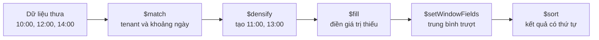

# $setWindowFields, densify và fill trong phiên bản hỗ trợ

## 1. Bối cảnh: phân tích chuỗi thời gian có khoảng trống

Một hệ thống IoT gửi nhiệt độ của nhiều cảm biến lên MongoDB. Cảm biến A có dữ liệu lúc 10:00, 12:00 và 14:00; không có document lúc 11:00. Có khi document tồn tại nhưng giá trị đo `null`. Ứng dụng cần:

1. Tính **trung bình trượt**, tổng tích lũy hoặc giá trị lần đo trước của từng cảm biến.
2. Tạo các mốc thời gian còn thiếu để biểu diễn chuỗi theo nhịp một giờ.
3. Điền giá trị bị khuyết theo quy tắc nghiệp vụ, ví dụ giữ giá trị gần nhất trước đó hoặc nội suy tuyến tính.

Ba aggregation stage liên quan trong MongoDB là:

| Stage | Công dụng | Có tạo thêm document? | Có thể điền giá trị null? |
| --- | --- | --- | --- |
| `$setWindowFields` | Tính biểu thức trên **cửa sổ các document** trong từng phân vùng | Không | Có thể dùng các window operator phù hợp như `$linearFill`/`$locf` trên phiên bản hỗ trợ |
| `$densify` | Sinh **document còn thiếu** theo bước số hoặc thời gian | **Có** | Không tự suy ra giá trị đo cho document mới |
| `$fill` | Điền field có giá trị `null` hoặc **missing** trong document đang tồn tại | Không | **Có**, bằng hằng/biểu thức, `locf` hoặc `linear` |



**Phân biệt hai kiểu khoảng trống:**

- *Thiếu document*: không có điểm dữ liệu mang timestamp tương ứng. `$fill` một mình **không sinh** điểm đó; cần `$densify` hoặc nguồn timeline khác.
- *Thiếu giá trị*: đã có document tại timestamp, nhưng field giá trị là `null` hoặc không tồn tại. `$fill` có thể xử lý theo quy tắc chọn.

Trong Spring Data MongoDB, các stage này chạy thông qua `MongoTemplate.aggregate(...)` hoặc `ReactiveMongoTemplate.aggregate(...)`. Mô hình entity, repository và các nguyên tắc kiểm thử/hiệu năng vẫn quan trọng; nhưng pipeline phức tạp thường cần `MongoTemplate` thay vì tên phương thức derived query.

## 2. Ma trận phiên bản và điều kiện sử dụng

Không nên viết pipeline rồi giả định mọi MongoDB đều hiểu các stage mới. **Phiên bản máy chủ MongoDB** là yếu tố quyết định tính hợp lệ của toán tử; **phiên bản Spring Data MongoDB** lại quyết định có DSL/builder nào tiện dùng.

| Thành phần | MongoDB giới thiệu | Ý nghĩa |
| --- | --- | --- |
| `$setWindowFields` | **5.0** | Window functions trên từng partition |
| `$densify` | **5.1** | Tạo các document theo nhịp số/thời gian |
| `$fill` | **5.3** | Lấp field null/missing bằng giá trị hoặc phương pháp `linear`/`locf` |
| `$setWindowFields` trong transaction và `snapshot` read concern | **Từ 5.3** | Trước đó có hạn chế sử dụng trong transaction/snapshot |
| `$densify` với `bounds: [x, x]` | **Thay đổi ở 8.0** | Từ 8.0 coi khoảng bằng nhau là rỗng; bản cũ từng có hành vi sinh điểm tại `x` |
| `$fill` nội suy linear khi các partition khác nhau có cùng giá trị `sortBy` | **Cải thiện ở 8.0.20** | Cần kiểm tra hành vi trên bản thấp hơn nếu nội suy tuyến tính đồng thời cho nhiều partition |

**Điều kiện cho bài thực hành đầy đủ:** MongoDB server **5.3 trở lên** và Java Driver/Spring Data tương thích. Với ví dụ `linear` trên nhiều cảm biến có timestamp trùng nhau, cần đối chiếu hành vi phiên bản đang chạy; bài này dùng `locf` trong pipeline đa cảm biến và demo `linear` trên **một cảm biến đã lọc** để không phụ thuộc vào thay đổi nêu trên.

Kiểm tra phiên bản trong `mongosh`:

```javascript
db.version()
db.adminCommand({ buildInfo: 1 }).version
```

Trong môi trường production, không mở quyền chạy lệnh quản trị không cần thiết cho tài khoản ứng dụng. Nếu server không hỗ trợ stage, **không có cách sửa Java DSL nào biến nó thành toán tử server hợp lệ**. Cần nâng phiên bản theo kế hoạch phù hợp hoặc thiết kế fallback (xử lý window/gap trong ứng dụng, truy vấn theo lô, hoặc lưu chuỗi thời gian đã chuẩn hóa).

Các tài liệu MongoDB chính thức để kiểm tra cú pháp, điều kiện và khác biệt phiên bản:

- `$setWindowFields`: https://www.mongodb.com/docs/manual/reference/operator/aggregation/setwindowfields/
- `$densify`: https://www.mongodb.com/docs/manual/reference/operator/aggregation/densify/
- `$fill`: https://www.mongodb.com/docs/manual/reference/operator/aggregation/fill/

## 3. Mô hình và dữ liệu mẫu theo giờ

Collection `sensor_readings` lưu dữ liệu của nhiều tenant. Dùng **BSON Date** cho timestamp, `Double` cho giá trị có thể null và BSON String cho ID. Trường `tenant_id` bắt buộc để tránh phân tích lẫn dữ liệu giữa các tổ chức.

| Field BSON | Ý nghĩa |
| --- | --- |
| `_id` | ID duy nhất của lần đo |
| `tenant_id` | Tenant sở hữu dữ liệu |
| `sensor_id` | ID cảm biến trong tenant |
| `recorded_at` | Thời điểm đo (UTC) |
| `observed_c` | Nhiệt độ °C, có thể null |

### Tạo dữ liệu thực hành bằng `mongosh`

**Chỉ chạy trên database thử nghiệm riêng biệt.** Không chạy lại `insertMany` nếu các ID đã có:

```javascript
use sensor_aggregation_demo

db.sensor_readings.insertMany([
  {
    _id: "A-10", tenant_id: "TENANT-A", sensor_id: "A",
    recorded_at: ISODate("2026-11-01T10:00:00Z"),
    observed_c: 10.0
  },
  {
    _id: "A-12", tenant_id: "TENANT-A", sensor_id: "A",
    recorded_at: ISODate("2026-11-01T12:00:00Z"),
    observed_c: 14.0
  },
  {
    _id: "A-13", tenant_id: "TENANT-A", sensor_id: "A",
    recorded_at: ISODate("2026-11-01T13:00:00Z"),
    observed_c: null
  },
  {
    _id: "A-14", tenant_id: "TENANT-A", sensor_id: "A",
    recorded_at: ISODate("2026-11-01T14:00:00Z"),
    observed_c: 18.0
  },
  {
    _id: "B-10", tenant_id: "TENANT-A", sensor_id: "B",
    recorded_at: ISODate("2026-11-01T10:00:00Z"),
    observed_c: 20.0
  },
  {
    _id: "B-12", tenant_id: "TENANT-A", sensor_id: "B",
    recorded_at: ISODate("2026-11-01T12:00:00Z"),
    observed_c: 26.0
  },
  {
    _id: "B-14", tenant_id: "TENANT-A", sensor_id: "B",
    recorded_at: ISODate("2026-11-01T14:00:00Z"),
    observed_c: 30.0
  },
  {
    _id: "OTHER-11", tenant_id: "TENANT-B", sensor_id: "A",
    recorded_at: ISODate("2026-11-01T11:00:00Z"),
    observed_c: 999.0
  }
])
```

Lược đồ trực quan của **TENANT-A**:

| Giờ UTC | A: đo ban đầu | B: đo ban đầu |
| --- | ---: | ---: |
| 10:00 | 10 | 20 |
| 11:00 | *(thiếu document)* | *(thiếu document)* |
| 12:00 | 14 | 26 |
| 13:00 | *null trong document* | *(thiếu document)* |
| 14:00 | 18 | 30 |

Điểm `TENANT-B/A/11:00 = 999` nhằm kiểm tra **không rò dữ liệu tenant khác**: dù cùng `sensor_id = "A"` và nằm giữa thời gian, nó không được lọt vào pipeline cho TENANT-A.

Khoảng phân tích thống nhất:

```javascript
const start = ISODate("2026-11-01T10:00:00Z");
const endExclusive = ISODate("2026-11-01T15:00:00Z");
```

Ở `$densify`, **cận dưới bao gồm, cận trên không bao gồm** khi `bounds` là một mảng tường minh. Vì vậy `[10:00, 15:00)` tạo lưới các mốc 10:00, 11:00, 12:00, 13:00 và 14:00; không sinh 15:00.

## 4. `$setWindowFields`: partition, sort và window

`$setWindowFields` tính giá trị cho **mỗi document** dựa trên các document xung quanh nó trong cùng một **partition**. Khác `$group`, stage này thường **giữ mỗi document đầu vào** và bổ sung field tính toán.

```javascript
{
  $setWindowFields: {
    partitionBy: "$sensor_id",
    sortBy: { recorded_at: 1 },
    output: {
      rolling_avg: {
        $avg: "$observed_c",
        window: { documents: [-2, 0] }
      }
    }
  }
}
```

Ý nghĩa:

- `partitionBy`: nhóm các document của cùng một cảm biến để chúng có thể ảnh hưởng lên nhau trong phép tính. Trong ứng dụng đa tenant, nên lọc tenant trước và/hoặc **gồm tenant trong partition key**.
- `sortBy`: xác định vị trí trước/sau trong mỗi partition; `recorded_at: 1` là thời gian tăng dần.
- `output`: danh sách field bổ sung cùng window operator.
- `documents: [-2, 0]`: current document và **tối đa hai document đứng ngay trước**, không nhất thiết là hai giờ trước.

### 4.1. Tổng tích lũy, trung bình trượt và giá trị trước

Ví dụ chạy trên cảm biến A để nhìn rõ kết quả khi vẫn còn khoảng thời gian thiếu:

```javascript
db.sensor_readings.aggregate([
  { $match: { tenant_id: "TENANT-A", sensor_id: "A" } },
  {
    $setWindowFields: {
      partitionBy: "$sensor_id",
      sortBy: { recorded_at: 1 },
      output: {
        running_sum: {
          $sum: "$observed_c",
          window: { documents: ["unbounded", "current"] }
        },
        mean_last_3_documents: {
          $avg: "$observed_c",
          window: { documents: [-2, 0] }
        },
        previous_value: {
          $shift: {
            output: "$observed_c",
            by: -1,
            default: null
          }
        }
      }
    }
  },
  {
    $project: {
      _id: 0,
      recorded_at: 1,
      observed_c: 1,
      running_sum: 1,
      mean_last_3_documents: 1,
      previous_value: 1
    }
  },
  { $sort: { recorded_at: 1 } }
])
```

Kết quả mong đợi cho A, trước khi `$densify`/`$fill`:

| Giờ | `observed_c` | `running_sum` | Trung bình tối đa 3 document | `previous_value` |
| --- | ---: | ---: | ---: | ---: |
| 10:00 | 10 | 10 | 10 | null |
| 12:00 | 14 | 24 | 12 | 10 |
| 13:00 | null | 24 | 12 | 14 |
| 14:00 | 18 | 42 | 16 | null |

`$sum`/`$avg` trong ví dụ bỏ qua giá trị null theo semantics accumulator phù hợp; `$shift` lấy giá trị **document đứng trước**, nên ở 14:00 giá trị trước là null (của 13:00), không tự tìm phép đo hợp lệ trước đó.

**Lưu ý:** `$shift` không nhận một `window` tường minh vì nó có **implicit window**. Các rank operator như `$rank`, `$denseRank` và `$documentNumber` cũng có hạn chế riêng; không sao chép `window: {documents: ...}` từ `$avg` sang mọi operator.

### 4.2. `documents` khác `range` thế nào?

Hai loại cửa sổ trả lời **hai câu hỏi khác nhau**:

| Kiểu | Ví dụ | Ý nghĩa |
| --- | --- | --- |
| `documents` | `[-2, 0]` | Hai *document* trước + hiện tại, dù timestamp cách xa |
| `range` với thời gian | `[-2, 0], unit: "hour"` | Các document có timestamp trong **hai giờ trước tới hiện tại** |

Ví dụ window theo thời gian:

```javascript
{
  $setWindowFields: {
    partitionBy: "$sensor_id",
    sortBy: { recorded_at: 1 },
    output: {
      avg_last_2_hours: {
        $avg: "$observed_c",
        window: { range: [-2, 0], unit: "hour" }
      }
    }
  }
}
```

Với time-range window, giá trị sort phải là **Date**; chỉ có **một field `sortBy`** và chiều sort tăng dần. Các biên range là **inclusive**, khác cận trên exclusive của `$densify.bounds` mảng. Không ghép `documents` và `range` trong cùng một window.

### 4.3. Thứ tự đầu ra và timestamp trùng

`$setWindowFields` **không bảo đảm thứ tự document trả về**, kể cả khi có `sortBy` nội bộ. Đặt `$sort` cuối khi API cần kết quả tuần tự rõ ràng. Ngoài ra, nếu các lần đo cùng cảm biến có timestamp trùng nhau, một cửa sổ `documents` hoặc `$shift` có thể phụ thuộc vào thứ tự không được xác định đầy đủ. Nên áp dụng ràng buộc duy nhất cho `(tenant_id, sensor_id, recorded_at)` hoặc thêm khóa sắp xếp phụ khi operator cho phép và phù hợp với ngữ nghĩa.

### 4.4. `partitionBy` không phải phân trang

`partitionBy` chỉ phân nhóm để tính toán; nó không thực hiện `$match`, không phân quyền và không tự giới hạn lượng dữ liệu xử lý. Nếu thiếu bộ lọc tenant và tính cùng các sensor ID của nhiều tenant trong một partition, giá trị trung bình có thể bị trộn lẫn. Với dữ liệu đa tenant, dùng filter tin cậy và partition theo toàn bộ khóa nghiệp vụ.

## 5. `$densify`: tạo các mốc bị thiếu

`$densify` dùng một field chứa **số hoặc ngày giờ** làm trục giá trị, tạo document mới tại các mốc còn thiếu theo bước `step`. Stage nhận các tham số:

```javascript
{
  $densify: {
    field: "recorded_at",
    partitionByFields: ["tenant_id", "sensor_id"],
    range: {
      step: 1,
      unit: "hour",
      bounds: [start, endExclusive]
    }
  }
}
```

- `field`: tên field cần làm dày, **không có dấu `$`**; ở đây phải là BSON Date.
- `partitionByFields`: tên các field tạo khóa partition; document được tạo theo lưới riêng cho mỗi cặp tenant/cảm biến.
- `step: 1` và `unit: "hour"`: nhịp một giờ. Với field Date, `unit` là bắt buộc và `step` phải là số nguyên hợp lệ.
- `bounds`: khoảng được tạo. Có thể là mảng cận tường minh hoặc chuỗi `"full"`/`"partition"`.

Chạy độc lập trên TENANT-A:

```javascript
const start = ISODate("2026-11-01T10:00:00Z");
const endExclusive = ISODate("2026-11-01T15:00:00Z");

db.sensor_readings.aggregate([
  {
    $match: {
      tenant_id: "TENANT-A",
      sensor_id: { $in: ["A", "B"] },
      recorded_at: { $gte: start, $lt: endExclusive }
    }
  },
  {
    $densify: {
      field: "recorded_at",
      partitionByFields: ["tenant_id", "sensor_id"],
      range: {
        step: 1,
        unit: "hour",
        bounds: [start, endExclusive]
      }
    }
  },
  { $sort: { sensor_id: 1, recorded_at: 1 } }
])
```

### 5.1. Dự kiến document mới được sinh

Với dữ liệu mẫu và khoảng trên:

| Partition | Document gốc trong khoảng | Timestamp được sinh thêm |
| --- | --- | --- |
| TENANT-A / A | 10:00, 12:00, 13:00, 14:00 | **11:00** |
| TENANT-A / B | 10:00, 12:00, 14:00 | **11:00, 13:00** |

Sau `$densify`, pipeline có **10 document** thay cho 7 document đầu vào của TENANT-A. Document gốc ở **A/13:00 có `observed_c: null`** nên **không phải mốc thiếu**: `$densify` không cần tạo lại document ở đó. Ba document mới chưa có `observed_c`, bởi stage này **không tự nội suy số đo**.

Một document được sinh có dạng tương đương:

```javascript
{
  tenant_id: "TENANT-A",
  sensor_id: "A",
  recorded_at: ISODate("2026-11-01T11:00:00Z")
  // Không có observed_c; không tự có _id gốc của một lần đo.
}
```

**Không giả định document được tạo mang đầy đủ metadata từ một document gốc gần nhất.** Những field không phải khóa partition hoặc field được densify thường không hiện diện trên document mới, ví dụ `device_model`, `customer_id` hoặc `quality_code`. Nếu stage sau cần các field này, phải định nghĩa rõ cách tổng hợp, gán hằng hoặc điền giá trị phù hợp.

### 5.2. `"full"`, `"partition"` và bounds tường minh

| `range.bounds` | Ý nghĩa | Rủi ro vận hành |
| --- | --- | --- |
| `[start, endExclusive]` | Lưới nằm trong khoảng chỉ định; cận trên **exclusive** | Phải tính khoảng và timezone chính xác |
| `"full"` | Dựa trên phạm vi tổng thể của field trong luồng đầu vào | Một sensor có dữ liệu rất xa sensor khác có thể khiến phát sinh nhiều document |
| `"partition"` | Dựa trên phạm vi của từng partition | Giảm khoảng cách giữa partition, nhưng một partition thưa vẫn có thể quá lớn |

`$densify` không phải một bộ lọc: **document nằm ngoài bounds vẫn có thể được chuyển tiếp**, nên nếu API chỉ muốn khoảng cụ thể, cần `$match` giới hạn timestamp/tenant tường minh trước hoặc sau stage tùy ngữ nghĩa.

**Cận trên của bounds dạng mảng là exclusive**, khác với các biên của window `range` thuộc `$setWindowFields`. Trường hợp `[x, x]` có hành vi khác giữa MongoDB trước 8.0 và từ 8.0; không dùng khoảng đó để biểu diễn một điểm trong ứng dụng xuyên phiên bản.

### 5.3. Densify với số thay vì thời gian

`$densify` cũng có thể dùng cho thứ tự số:

```javascript
db.metric_samples.aggregate([
  {
    $densify: {
      field: "sequence",
      partitionByFields: ["device_id"],
      range: { step: 1, bounds: [1, 6] }
    }
  }
])
```

Ví dụ này cần collection `metric_samples` riêng với `sequence` là BSON Number; được đưa ra để giải thích cú pháp, **không phải lệnh chạy trực tiếp trên bộ dữ liệu `sensor_readings`**. Với field số, `unit` không dùng; kiểu và bước tăng phải phù hợp. `[1, 6]` mô tả các mốc 1 đến trước 6.

### 5.4. Khi nào không nên densify?

Nếu trục thời gian kéo dài hàng năm nhưng cần điểm mỗi giây, lượng document được sinh có thể rất lớn. Server có giới hạn số document được tạo bởi `$densify` (giá trị mặc định của tham số quản trị `internalQueryMaxAllowedDensifyDocs` là 500.000 ở tài liệu tham chiếu), và pipeline có thể thất bại khi vượt giới hạn.

Không tăng giới hạn đó tùy tiện như cách chữa lỗi. Hãy giảm khoảng thời gian, chọn độ phân giải phù hợp, lọc tenant/sensor sớm, áp quota kết quả hoặc tính trước các bucket theo từng phút/giờ. Cần tính số điểm kỳ vọng trước khi chạy:

\[
\text{điểm dự kiến mỗi partition}
\approx
\frac{\text{độ dài khoảng}}{\text{bước}}
\]

Công thức mang tính ước lượng khi có ranh giới thời gian lịch, DST, đầu vào không đều và quy tắc đơn vị như tháng; không dùng phép chia mili giây cho mọi loại `unit`.

## 6. `$fill`: điền field null hoặc missing

Sau `$densify`, ta đã có lưới timestamp đầy đủ nhưng còn thiếu giá trị. `$fill` có cú pháp:

```javascript
{
  $fill: {
    partitionByFields: ["tenant_id", "sensor_id"],
    sortBy: { recorded_at: 1 },
    output: {
      observed_c: { method: "locf" }
    }
  }
}
```

`$fill` hỗ trợ hai nhóm cách điền:

1. **Giá trị/biểu thức**: `{ value: expression }` điền một giá trị được tính cho field null/missing.
2. **Phương pháp theo chuỗi**: `{ method: "locf" }` (last observation carried forward) hoặc `{ method: "linear" }` (nội suy tuyến tính).

`partitionBy` và `partitionByFields` là **hai lựa chọn loại trừ nhau**; nếu không chọn partition, toàn bộ document đầu vào có thể được coi là một partition. Đối với bài toán đa tenant, điều này đặc biệt nguy hiểm: cần partition theo khóa đủ đầy và scope tenant trong `$match`.

### 6.1. Điền một giá trị mặc định

```javascript
db.sensor_readings.aggregate([
  { $match: { tenant_id: "TENANT-A" } },
  {
    $fill: {
      output: {
        observed_c: { value: -999.0 }
      }
    }
  }
])
```

Ví dụ cho thấy cách **điền field**: `null` được thay bằng -999, nhưng **timestamp 11:00 vẫn không được tạo** nếu pipeline không chạy `$densify` trước đó. Hằng -999 chỉ nên dùng như **sentinel được thống nhất**; tuyệt đối không đưa vào tính trung bình nhiệt độ như một phép đo thật. Đối với dữ liệu ứng dụng, thường tốt hơn giữ null kèm cờ chất lượng nếu “không biết” khác “giá trị bằng 0”.

### 6.2. `locf` — giữ giá trị hợp lệ gần nhất trước đó

Chạy `$densify` trước rồi `$fill`:

```javascript
const start = ISODate("2026-11-01T10:00:00Z");
const endExclusive = ISODate("2026-11-01T15:00:00Z");

db.sensor_readings.aggregate([
  {
    $match: {
      tenant_id: "TENANT-A",
      recorded_at: { $gte: start, $lt: endExclusive }
    }
  },
  {
    $densify: {
      field: "recorded_at",
      partitionByFields: ["tenant_id", "sensor_id"],
      range: {
        step: 1, unit: "hour",
        bounds: [start, endExclusive]
      }
    }
  },
  {
    $fill: {
      partitionByFields: ["tenant_id", "sensor_id"],
      sortBy: { recorded_at: 1 },
      output: {
        observed_c: { method: "locf" }
      }
    }
  },
  {
    $project: {
      _id: 0,
      sensor_id: 1,
      recorded_at: 1,
      observed_c: 1
    }
  },
  { $sort: { sensor_id: 1, recorded_at: 1 } }
])
```

Kết quả mong đợi:

| Giờ UTC | A sau `locf` | B sau `locf` |
| --- | ---: | ---: |
| 10:00 | 10 | 20 |
| 11:00 | **10** | **20** |
| 12:00 | 14 | 26 |
| 13:00 | **14** (thay null) | **26** |
| 14:00 | 18 | 30 |

`locf` lấy **giá trị không null gần nhất đứng trước** trong cùng partition, không dùng một cảm biến khác làm nguồn điền. Nếu chưa có giá trị hợp lệ trước một khoảng trống ở **đầu chuỗi**, field vẫn null; `locf` không tự nhìn tới tương lai.

### 6.3. `linear` — nội suy các điểm có hai đầu mút hợp lệ

`linear` nội suy các giá trị null/missing giữa **hai quan sát hợp lệ**, dựa trên thứ tự `sortBy`. Ví dụ chỉ xét cảm biến A để tránh trường hợp nhiều partition dùng timestamp trùng trên các bản server cũ:

```javascript
const start = ISODate("2026-11-01T10:00:00Z");
const endExclusive = ISODate("2026-11-01T15:00:00Z");

db.sensor_readings.aggregate([
  {
    $match: {
      tenant_id: "TENANT-A",
      sensor_id: "A",
      recorded_at: { $gte: start, $lt: endExclusive }
    }
  },
  {
    $densify: {
      field: "recorded_at",
      partitionByFields: ["tenant_id", "sensor_id"],
      range: {
        step: 1, unit: "hour",
        bounds: [start, endExclusive]
      }
    }
  },
  {
    $fill: {
      partitionByFields: ["tenant_id", "sensor_id"],
      sortBy: { recorded_at: 1 },
      output: {
        observed_c: { method: "linear" }
      }
    }
  },
  { $sort: { recorded_at: 1 } }
])
```

Kết quả:

| Giờ | Giá trị gốc | Giá trị sau `linear` | Lý do |
| --- | ---: | ---: | --- |
| 10:00 | 10 | 10 | Có số đo |
| 11:00 | thiếu document | **12** | Giữa 10 và 14 |
| 12:00 | 14 | 14 | Có số đo |
| 13:00 | null | **16** | Giữa 14 và 18 |
| 14:00 | 18 | 18 | Có số đo |

Với `method: "linear"`, `sortBy` phải có **chính xác một field**; giá trị sort **không được trùng trong một partition**. Phương pháp cần hai mốc hợp lệ bao quanh: khoảng trống ở đầu/cuối partition không có đủ hai mốc sẽ vẫn null. Đối với server **trước 8.0.20**, kiểm tra hành vi khi nội suy cho nhiều partition có timestamp giống nhau; tài liệu MongoDB ghi nhận thay đổi hỗ trợ tình huống này ở 8.0.20.

Nội suy là **ước lượng**, không phải phép đo thực. Khi khoảng mất dữ liệu quá dài, nội suy tuyến tính có thể làm sai lệch tín hiệu (ví dụ cảm biến nhiệt độ bị ngắt trong khi thiết bị gặp sự cố). Nên giới hạn độ dài gap, gắn cờ dữ liệu được điền và không dùng số đã nội suy như bằng chứng một sự kiện thực tế đã xảy ra.

### 6.4. `$fill` không tạo document và không ghi ngược collection

Ngay cả sau khi chạy `$densify` + `$fill`, các document giả lập trong pipeline **không tự được insert vào `sensor_readings`**. Mọi giá trị được điền cũng **không thay field null trong document gốc**. Các stage này phục vụ kết quả đọc/trình bày/phân tích. Nếu nghiệp vụ thật sự cần lưu giá trị nội suy, đó là một quy trình ghi riêng có validation, audit, idempotency và nguồn dữ liệu phân biệt rõ.

## 7. Pipeline kết hợp: lọc → densify → fill → window

Đây là pipeline ứng dụng chủ đạo của bài. Nó:

1. Lọc dữ liệu theo tenant, cảm biến và khoảng thời gian.
2. Gắn dấu `source_record = true` cho các document **vốn tồn tại**.
3. Tạo các timestamp còn thiếu theo nhịp một giờ.
4. Điền giá trị bằng `locf`, **theo từng cặp tenant/sensor**.
5. Tính trung bình trượt trên **tối đa ba document liên tiếp sau khi làm dày**.
6. Đánh dấu `synthetic` cho document được `$densify` tạo.
7. Chỉ trả các field cần thiết rồi sort theo cảm biến/thời gian.

```javascript
const start = ISODate("2026-11-01T10:00:00Z");
const endExclusive = ISODate("2026-11-01T15:00:00Z");

const pipeline = [
  {
    $match: {
      tenant_id: "TENANT-A",
      sensor_id: { $in: ["A", "B"] },
      recorded_at: { $gte: start, $lt: endExclusive }
    }
  },
  { $set: { source_record: true } },
  {
    $densify: {
      field: "recorded_at",
      partitionByFields: ["tenant_id", "sensor_id"],
      range: {
        step: 1,
        unit: "hour",
        bounds: [start, endExclusive]
      }
    }
  },
  {
    $fill: {
      partitionByFields: ["tenant_id", "sensor_id"],
      sortBy: { recorded_at: 1 },
      output: {
        observed_c: { method: "locf" }
      }
    }
  },
  {
    $setWindowFields: {
      partitionBy: {
        tenant: "$tenant_id",
        sensor: "$sensor_id"
      },
      sortBy: { recorded_at: 1 },
      output: {
        moving_avg_3: {
          $avg: "$observed_c",
          window: { documents: [-2, 0] }
        }
      }
    }
  },
  {
    $set: {
      synthetic: { $ne: ["$source_record", true] }
    }
  },
  {
    $project: {
      _id: 0,
      tenant_id: 1,
      sensor_id: 1,
      recorded_at: 1,
      observed_c: 1,
      moving_avg_3: 1,
      synthetic: 1
    }
  },
  { $sort: { sensor_id: 1, recorded_at: 1 } }
];

db.sensor_readings.aggregate(pipeline);
```

### 7.1. Kết quả dự kiến

Với dữ liệu mẫu, pipeline trả **10 document** (mỗi cảm biến có năm mốc):

| Sensor | Giờ | Giá trị sau `locf` | `synthetic` | `moving_avg_3` xấp xỉ |
| --- | --- | ---: | --- | ---: |
| A | 10:00 | 10 | false | 10 |
| A | 11:00 | 10 | **true** | 10 |
| A | 12:00 | 14 | false | 11,333 |
| A | 13:00 | 14 | **false** | 12,667 |
| A | 14:00 | 18 | false | 15,333 |
| B | 10:00 | 20 | false | 20 |
| B | 11:00 | 20 | **true** | 20 |
| B | 12:00 | 26 | false | 22 |
| B | 13:00 | 26 | **true** | 24 |
| B | 14:00 | 30 | false | 27,333 |

`synthetic = true` chỉ ra **document được tạo mới bởi `$densify`**. Riêng A/13:00 là một document đã tồn tại với giá trị `null`; `$fill` thay null thành 14, nên `synthetic = false`. Như vậy **“đã được điền giá trị”** và **“document sinh thêm”** là hai thuộc tính khác nhau.

Nếu sản phẩm cần biết một con số là **thực đo hay ước lượng**, cần thêm cờ chất lượng trước khi `$fill`. Ví dụ ghi `original_value_missing` trước stage điền, đồng thời dùng `source_record` để phân biệt record gốc với record sinh thêm. Không coi chỉ số `synthetic` trong bài này là cờ “giá trị chắc chắn đo được”.

### 7.2. Tại sao window đặt sau fill?

Nếu chạy `$setWindowFields` trước `$densify`, cửa sổ `documents: [-2, 0]` trên A/12:00 chỉ có hai document 10:00 và 12:00, nên trung bình là **12**. Sau khi tạo mốc 11:00 và điền bằng `locf`, cửa sổ ở 12:00 chứa **10, 10, 14**, cho trung bình xấp xỉ **11,333**.

Hai phép tính đều có thể hợp lý, nhưng phục vụ **hai câu hỏi khác nhau**:

- Window **trước** densify/fill: trung bình trên các document gốc được quan sát.
- Window **sau** densify/fill: trung bình trên chuỗi đã được chuẩn hóa nhịp giờ theo quy tắc điền giá trị.

Phải thống nhất cách đánh giá KPI. Không báo cáo “trung bình trên dữ liệu đo thật” khi thực tế đã thêm những giá trị nội suy/ước lượng.

### 7.3. Densify trước, fill sau

Nếu đảo `$fill` lên trước `$densify`, A/13:00 được điền 14 nhưng A/11:00 **vẫn chưa có document** tại thời điểm fill. Stage densify sau đó sinh A/11:00 với `observed_c` thiếu, và giá trị vẫn chưa được điền. Trừ khi chạy một bước fill khác, chuỗi đầu ra vẫn có khoảng trống giá trị.

Do đó, với mục tiêu “lưới thời gian đủ mốc và mỗi mốc có giá trị theo phương pháp điền”, thứ tự **`$densify → $fill`** là phù hợp.

### 7.4. Không được bỏ `$sort` cuối

`$densify` không bảo đảm thứ tự document đầu ra, và `$setWindowFields` cũng **không bảo đảm thứ tự kết quả trả về** dù nó dùng `sortBy` để tính window. `$sort` cuối là nơi thiết lập hợp đồng thứ tự cho response của API. Nếu có nhiều document trùng tenant/sensor/timestamp trong dữ liệu thật, phải xác định quy tắc khử trùng hoặc thứ tự phụ cho kết quả.

## 8. Spring Data MongoDB: entity và đường thực thi

Ví dụ sau dùng **Java 17+**, `spring-boot-starter-data-mongodb` và `MongoTemplate`. Server phải hỗ trợ `$setWindowFields`, `$densify` và `$fill` (MongoDB **5.3+** cho cả ba). Một version Spring Data có thể có builder `DensifyOperation`/`FillOperation` hoặc tên DSL khác; để tránh phụ thuộc vào API builder cụ thể, bài dùng **`AggregationOperation` trả BSON `Document`** cho các stage nâng cao.

### 8.1. Entity `SensorReading`

```java
package com.example.sensors;

import java.time.Instant;
import org.springframework.data.mongodb.core.mapping.Document;
import org.springframework.data.mongodb.core.mapping.Field;
import org.springframework.data.mongodb.core.mapping.FieldType;
import org.springframework.data.mongodb.core.mapping.MongoId;

@Document(collection = "sensor_readings")
public class SensorReading {

    @MongoId(FieldType.STRING)
    private String id;

    @Field("tenant_id")
    private String tenantId;

    @Field("sensor_id")
    private String sensorId;

    @Field("recorded_at")
    private Instant recordedAt;

    @Field("observed_c")
    private Double observedC;

    protected SensorReading() {}

    public String getId() { return id; }
    public String getTenantId() { return tenantId; }
    public String getSensorId() { return sensorId; }
    public Instant getRecordedAt() { return recordedAt; }
    public Double getObservedC() { return observedC; }
}
```

`Double` (wrapper) giúp biểu diễn trường hợp có document nhưng phép đo null; nếu dùng `double` primitive, giá trị mặc định `0.0` có thể làm mất sự phân biệt giữa “không đo được” và “đo được số 0”.

### 8.2. Service tạo và chạy pipeline

```java
package com.example.sensors;

import java.time.Instant;
import java.util.Date;
import java.util.List;
import org.bson.Document;
import org.springframework.data.mongodb.core.MongoTemplate;
import org.springframework.data.mongodb.core.aggregation.Aggregation;
import org.springframework.data.mongodb.core.aggregation.AggregationOperation;
import org.springframework.data.mongodb.core.aggregation.AggregationResults;
import org.springframework.data.mongodb.core.query.Criteria;
import org.springframework.stereotype.Service;

@Service
public class SensorAggregationService {

    private final MongoTemplate template;

    public SensorAggregationService(MongoTemplate template) {
        this.template = template;
    }

    public List<Document> hourlySeries(
            String authorizedTenantId,
            List<String> sensorIds,
            Instant start,
            Instant endExclusive) {

        if (authorizedTenantId == null
                || authorizedTenantId.isBlank()
                || sensorIds == null || sensorIds.isEmpty()
                || sensorIds.size() > 20
                || sensorIds.stream().anyMatch(
                    id -> id == null || id.isBlank())
                || start == null || endExclusive == null
                || !start.isBefore(endExclusive)) {
            throw new IllegalArgumentException(
                "Tham số aggregation không hợp lệ");
        }

        // Ngưỡng demo: chỉ cho phép khoảng thời gian tối đa 24 giờ.
        if (java.time.Duration.between(start, endExclusive)
                .compareTo(java.time.Duration.ofHours(24)) > 0) {
            throw new IllegalArgumentException(
                "Khoảng thời gian vượt ngân sách truy vấn");
        }

        List<Date> bounds = List.of(
            Date.from(start), Date.from(endExclusive));

        AggregationOperation flagSource = context ->
            new Document("$set",
                new Document("source_record", true));

        AggregationOperation densify = context ->
            new Document("$densify",
                new Document("field", "recorded_at")
                    .append("partitionByFields",
                        List.of("tenant_id", "sensor_id"))
                    .append("range",
                        new Document("step", 1)
                            .append("unit", "hour")
                            .append("bounds", bounds)));

        AggregationOperation fill = context ->
            new Document("$fill",
                new Document("partitionByFields",
                    List.of("tenant_id", "sensor_id"))
                    .append("sortBy",
                        new Document("recorded_at", 1))
                    .append("output",
                        new Document("observed_c",
                            new Document("method", "locf"))));

        AggregationOperation window = context ->
            new Document("$setWindowFields",
                new Document("partitionBy",
                    new Document("tenant", "$tenant_id")
                        .append("sensor", "$sensor_id"))
                    .append("sortBy",
                        new Document("recorded_at", 1))
                    .append("output",
                        new Document("moving_avg_3",
                            new Document("$avg", "$observed_c")
                                .append("window",
                                    new Document("documents",
                                        List.of(-2, 0))))));

        AggregationOperation flagSynthetic = context ->
            new Document("$set",
                new Document("synthetic",
                    new Document("$ne",
                        List.of("$source_record", true))));

        AggregationOperation resultFields = context ->
            new Document("$project",
                new Document("_id", 0)
                    .append("tenant_id", 1)
                    .append("sensor_id", 1)
                    .append("recorded_at", 1)
                    .append("observed_c", 1)
                    .append("moving_avg_3", 1)
                    .append("synthetic", 1));

        AggregationOperation sortResult = context ->
            new Document("$sort",
                new Document("sensor_id", 1)
                    .append("recorded_at", 1));

        // Chỉ stage match dưới đây dùng tên property Java;
        // các stage raw bên trên dùng field BSON vật lý.
        Aggregation pipeline = Aggregation.newAggregation(
            Aggregation.match(
                Criteria.where("tenantId").is(authorizedTenantId)
                    .and("sensorId").in(sensorIds)
                    .and("recordedAt").gte(start).lt(endExclusive)
            ),
            flagSource,
            densify,
            fill,
            window,
            flagSynthetic,
            resultFields,
            sortResult
        );

        AggregationResults<Document> results =
            template.aggregate(
                pipeline, SensorReading.class, Document.class);

        return results.getMappedResults();
    }
}
```

**Điểm kỹ thuật quan trọng:** `Criteria.where("tenantId")` trong `Aggregation.match` có metadata entity để ánh xạ sang `tenant_id`. Các stage custom tạo `new Document(...)` dùng **tên field BSON vật lý** (`recorded_at`, `sensor_id`, `observed_c`). Đừng viết `"$recordedAt"` trong raw expression rồi mặc định Spring Data tự chuyển thành `"$recorded_at"`.

Lời gọi demo:

```java
List<Document> output = service.hourlySeries(
    "TENANT-A",
    List.of("A", "B"),
    Instant.parse("2026-11-01T10:00:00Z"),
    Instant.parse("2026-11-01T15:00:00Z")
);
```

**Không dùng `Document` làm API response công khai một cách thiếu kiểm soát**: trong ứng dụng thật, nên chuyển sang DTO và kiểm thử field đầu ra theo allowlist. Ví dụ service dùng `Document` để người học dễ quan sát đúng BSON sau aggregation.

### 8.3. Kiểm soát phiên bản API Spring Data

Các builder trong Spring Data MongoDB thay đổi theo các nhánh thư viện. Một số bản có DSL cho `$setWindowFields`, `$densify` và `$fill`; khi dùng API đó phải kiểm tra signature của đúng phiên bản đang chạy. Cách `AggregationOperation` tường minh giúp giữ syntax stage gần với MongoDB hơn, nhưng **không thay thế** kiểm tra cấu trúc BSON, quyền truy cập và compatibility server.

Khi pipeline có các stage custom, đừng giả định chúng được tự động ánh xạ/tối ưu như một truy vấn `Criteria` thông thường. Trong bài, mọi tên trong stage custom đã dùng tên BSON thật; pipeline nên được test bằng MongoDB server phù hợp, không chỉ kiểm tra Java compile.

## 9. Kiểm thử tích hợp: kết quả, partition và dữ liệu gốc

Để kiểm tra các stage phiên bản mới, **cần chạy thử với MongoDB server có hỗ trợ**, không chỉ mock `MongoTemplate`. Một unit test trả về `List<Document>` giả không thể chứng minh `$densify` sinh đúng các mốc, `$fill` chỉ điền trong partition hoặc window tính đúng giá trị.

Các bài test nên dùng MongoDB test cô lập (chẳng hạn Testcontainers được cấu hình với phiên bản **5.3+**) và `@DataMongoTest` của Spring Boot 3.x. `@DataMongoTest` không tự bảo đảm rằng một MongoDB đúng phiên bản đã được khởi động; dự án cần cung cấp URI/container phù hợp.

### 9.1. Dữ liệu test và ba tình huống đặc trưng

Với cùng tập dữ liệu ở mục 3, các assertion cốt lõi:

| Tình huống | Mong đợi |
| --- | --- |
| A/11:00 thiếu document | Có document sau densify, `synthetic = true`, `observed_c = 10` sau locf |
| A/13:00 có document nhưng `observed_c = null` | Không phải document sinh thêm, `synthetic = false`, `observed_c = 14` sau locf |
| B/13:00 thiếu document | Có document sinh thêm, `observed_c = 26` |
| TENANT-B/A/11:00 = 999 | **Không** xuất hiện trong kết quả TENANT-A và không ảnh hưởng phép fill/window |
| A/12:00 sau densify + locf | `moving_avg_3 = (10 + 10 + 14) / 3` |
| Dữ liệu MongoDB gốc | Không có document A/11:00 mới, A/13:00 vẫn null |

### 9.2. Mẫu `@DataMongoTest`

Đây là ví dụ tích hợp để kết hợp với `SensorReading`/`SensorAggregationService` phía trên:

```java
package com.example.sensors;

import java.time.Instant;
import java.util.ArrayList;
import java.util.Date;
import java.util.List;
import org.bson.Document;
import org.junit.jupiter.api.BeforeEach;
import org.junit.jupiter.api.Test;
import org.springframework.beans.factory.annotation.Autowired;
import org.springframework.boot.test.autoconfigure.data.mongo.DataMongoTest;
import org.springframework.data.mongodb.core.MongoTemplate;

import static org.assertj.core.api.Assertions.assertThat;

@DataMongoTest
class SensorAggregationIntegrationTest {

    @Autowired
    MongoTemplate template;

    private SensorAggregationService service;

    private final Instant start =
        Instant.parse("2026-11-01T10:00:00Z");
    private final Instant endExclusive =
        Instant.parse("2026-11-01T15:00:00Z");

    @BeforeEach
    void seedIsolatedDatabase() {
        // NGUY HIỂM: deleteMany xóa toàn bộ collection.
        // Chỉ dùng trên database test cô lập!
        template.getCollection("sensor_readings")
            .deleteMany(new Document());

        List<Document> records = new ArrayList<>();
        records.add(row(
            "A-10", "TENANT-A", "A", 10, 10.0));
        records.add(row(
            "A-12", "TENANT-A", "A", 12, 14.0));
        records.add(row(
            "A-13", "TENANT-A", "A", 13, null));
        records.add(row(
            "A-14", "TENANT-A", "A", 14, 18.0));
        records.add(row(
            "B-10", "TENANT-A", "B", 10, 20.0));
        records.add(row(
            "B-12", "TENANT-A", "B", 12, 26.0));
        records.add(row(
            "B-14", "TENANT-A", "B", 14, 30.0));
        records.add(row(
            "OTHER-11", "TENANT-B", "A", 11, 999.0));

        template.getCollection("sensor_readings")
            .insertMany(records);
        service = new SensorAggregationService(template);
    }

    static Document row(
            String id, String tenant, String sensor,
            int hour, Double observed) {
        return new Document("_id", id)
            .append("tenant_id", tenant)
            .append("sensor_id", sensor)
            .append("recorded_at",
                Date.from(Instant.parse(String.format(
                    "2026-11-01T%02d:00:00Z", hour))))
            .append("observed_c", observed);
    }

    static Document findAt(
            List<Document> rows, String sensor, int hour) {
        Date timestamp = Date.from(Instant.parse(
            String.format("2026-11-01T%02d:00:00Z", hour)));
        return rows.stream()
            .filter(d -> sensor.equals(d.getString("sensor_id")))
            .filter(d -> timestamp.equals(d.getDate("recorded_at")))
            .findFirst().orElseThrow();
    }

    @Test
    void densifyProducesOnlyExpectedHourlyBuckets() {
        List<Document> rows = service.hourlySeries(
            "TENANT-A", List.of("A", "B"), start, endExclusive);

        assertThat(rows).hasSize(10);
        assertThat(rows)
            .extracting(d -> d.getString("tenant_id"))
            .containsOnly("TENANT-A");

        Document a11 = findAt(rows, "A", 11);
        Document b13 = findAt(rows, "B", 13);

        assertThat(a11.getBoolean("synthetic")).isTrue();
        assertThat(b13.getBoolean("synthetic")).isTrue();
        assertThat(((Number) a11.get("observed_c")).doubleValue())
            .isEqualTo(10.0);
        assertThat(((Number) b13.get("observed_c")).doubleValue())
            .isEqualTo(26.0);
    }

    @Test
    void existingNullValueIsFilledButNotSynthetic() {
        List<Document> rows = service.hourlySeries(
            "TENANT-A", List.of("A"), start, endExclusive);

        Document a13 = findAt(rows, "A", 13);

        assertThat(a13.getBoolean("synthetic")).isFalse();
        assertThat(((Number) a13.get("observed_c")).doubleValue())
            .isEqualTo(14.0);

        Document a12 = findAt(rows, "A", 12);
        double mean = ((Number) a12.get("moving_avg_3"))
            .doubleValue();
        assertThat(mean)
            .isCloseTo(34.0 / 3.0,
                org.assertj.core.data.Offset.offset(0.000001));
    }

    @Test
    void aggregationDoesNotWriteSyntheticRowsToCollection() {
        service.hourlySeries(
            "TENANT-A", List.of("A", "B"), start, endExclusive);

        long stored = template.getCollection("sensor_readings")
            .countDocuments(new Document(
                "tenant_id", "TENANT-A"));
        assertThat(stored).isEqualTo(7);

        Document originalA13 =
            template.getCollection("sensor_readings")
                .find(new Document("_id", "A-13"))
                .first();
        assertThat(originalA13).isNotNull();
        assertThat(originalA13.get("observed_c")).isNull();
    }
}
```

**Cảnh báo an toàn test:** `deleteMany(new Document())` xóa **toàn bộ document** của collection đang kết nối, không phân biệt tenant. Chỉ dùng trên database test hoàn toàn cô lập; tuyệt đối không chạy trên production hoặc database nhiều người cùng dùng.

### 9.3. Các tình huống cần test thêm

1. Mốc trùng nhau trong một partition: xác định hành vi `$fill.linear` và thứ tự window; áp unique index hoặc làm sạch dữ liệu.
2. `linear` khi thiếu hai mốc bao quanh: field phải giữ null, không tự ngoại suy đầu/cuối.
3. Partition chỉ có giá trị null: `locf` không tự tạo số đo hợp lệ.
4. Cận dưới/cận trên và timezone: không sinh mốc bằng `endExclusive`.
5. Giới hạn 24 giờ và danh sách cảm biến tối đa 20 của service: từ chối request vượt ngân sách.
6. Đổi tên `@Field` trong entity: phát hiện raw BSON stage không khớp schema.
7. Version server thấp hơn: test phải phát hiện stage không hỗ trợ thay vì âm thầm chuyển nghĩa.
8. Cảm biến lưu timestamp sai kiểu (String thay vì Date): xử lý dữ liệu bất thường trước khi densify.
9. Pipeline với dữ liệu lớn: đo bộ nhớ/latency và số document phát sinh, không suy diễn từ tám document mẫu.

## 10. Hiệu năng, index và giới hạn tài nguyên

`$setWindowFields` có thể cần giữ trạng thái của window, `$densify` có thể **tăng số document** rất lớn, còn `$fill` có thể cần xem các điểm trước/sau trong partition. Ba stage này phù hợp với phân tích, nhưng không được coi là miễn phí về CPU, bộ nhớ, I/O hoặc thời gian.

### 10.1. Chỉ số và index cho bộ lọc đầu

Với workload luôn bắt đầu bằng tenant + sensor + khoảng thời gian, một compound index ứng viên:

```javascript
db.sensor_readings.createIndex(
  {
    tenant_id: 1,
    sensor_id: 1,
    recorded_at: 1
  },
  {
    name: "sensor_tenant_id_time",
    unique: true
  }
)
```

Index `unique` chỉ nên tạo nếu quy tắc nghiệp vụ thực sự là **một lần đo cho mỗi tenant/sensor/timestamp**. Trước khi tạo trên dữ liệu đang có, phải kiểm tra và xử lý duplicates. Nếu một cảm biến hợp lệ gửi nhiều mẫu cùng timestamp, cần đưa thêm `sample_id` vào khóa duy nhất và thiết kế cách chuẩn hóa dữ liệu trước khi nội suy.

Index trên giúp `$match` theo tenant, danh sách sensor và khoảng ngày có khả năng sử dụng khóa phù hợp. Nó không làm `$densify` hoặc `$fill` trở thành thao tác chi phí không đổi và không thay thế việc đặt hạn mức số điểm được tạo.

### 10.2. Ước lượng chi phí trước khi chạy

Giả sử ứng dụng cho phép 20 cảm biến và khoảng 24 giờ theo nhịp một giờ. Ngân sách lý thuyết là khoảng:

\[
20 \times 24 = 480\ \text{mốc trong lưới kết quả}
\]

Con số này áp dụng khi mỗi cảm biến có dữ liệu trong phạm vi được lọc, nguồn không có duplicates và mỗi mốc tương ứng một document. Với nhiều cảm biến hơn, khoảng dài hơn hoặc độ phân giải phút/giây, số document trung gian tăng nhanh. Cần phân biệt:

- **Số đầu vào**: document được `$match` giữ lại.
- **Số phát sinh**: document mới do `$densify` tạo.
- **Số đầu ra**: document sau `$fill`, window, projection và các stage giới hạn.

Một ngưỡng `$limit` cuối chỉ giảm số kết quả trả về, **không bảo đảm giảm chi phí tạo điểm trước đó**. Nếu có thể, hãy giới hạn tenant, sensor, thời gian và độ phân giải **trước** khi densify.

### 10.3. Dùng `explain` để xem query plan

Với pipeline không có stage ghi, có thể dùng explain để quan sát phần scan và các stage:

```javascript
const start = ISODate("2026-11-01T10:00:00Z");
const endExclusive = ISODate("2026-11-01T15:00:00Z");

db.sensor_readings.explain("executionStats").aggregate([
  {
    $match: {
      tenant_id: "TENANT-A",
      sensor_id: "A",
      recorded_at: { $gte: start, $lt: endExclusive }
    }
  },
  {
    $densify: {
      field: "recorded_at",
      partitionByFields: ["tenant_id", "sensor_id"],
      range: {
        step: 1, unit: "hour",
        bounds: [start, endExclusive]
      }
    }
  }
])
```

Tùy phiên bản và execution engine, `explain` có thể cung cấp `winningPlan`, `IXSCAN`/`COLLSCAN`, `totalKeysExamined`, `totalDocsExamined`, `nReturned` và thông tin khác về các stage. Đối chiếu với độ trễ thực đo tại ứng dụng; explain không bao gồm đầy đủ thời gian network, mapping BSON sang Java hoặc serialization JSON.

### 10.4. Sort, bộ nhớ và disk spill

Window computation có thể cần sắp xếp các document theo partition và thời gian. Một số stage có thể dùng bộ nhớ đáng kể hoặc ghi tạm xuống disk tùy server version, pipeline và tùy chọn `allowDiskUse`. **Bật spill không làm một truy vấn tạo hàng triệu mốc trở thành an toàn**: vẫn cần giới hạn input, output và thời gian.

Các metrics nên theo dõi:

| Metric | Lý do |
| --- | --- |
| `aggregation_duration_ms` p50/p95/p99 | Độ trễ của pipeline |
| `source_rows` | Số document được lọc từ collection |
| `synthetic_rows` | Mức phình do densify |
| `filled_values` / `missing_after_fill` | Chất lượng chuỗi sau lấp dữ liệu |
| `rows_per_partition` | Phát hiện sensor/time range bất thường |
| `memory_spill` / disk I/O | Truy vấn cần sắp xếp hoặc window vượt bộ nhớ |
| `query_timeout` và lỗi stage không hỗ trợ | Giám sát phiên bản/tài nguyên |

Không dùng tenant ID, sensor ID vô hạn làm label metric có cardinality cao; dùng correlation ID trong log có kiểm soát và tổng hợp metrics theo service/loại pipeline.

## 11. Reactive aggregation và xử lý luồng kết quả

Trong ứng dụng **Spring WebFlux**, `ReactiveMongoTemplate.aggregate(...)` trả `Flux<T>` thay vì `AggregationResults<T>`. Các stage chạy trên **MongoDB**, không phải từng phép toán Java thực thi trên thread của WebFlux.

Ví dụ có thể tái sử dụng cách xây `Aggregation` từ mục 8 trong một service reactive:

```java
import org.bson.Document;
import org.springframework.data.mongodb.core.ReactiveMongoTemplate;
import org.springframework.data.mongodb.core.aggregation.Aggregation;
import reactor.core.publisher.Flux;

public final class ReactiveSensorReader {
    private final ReactiveMongoTemplate template;

    public ReactiveSensorReader(ReactiveMongoTemplate template) {
        this.template = template;
    }

    public Flux<Document> run(Aggregation pipeline) {
        return template.aggregate(
            pipeline, SensorReading.class, Document.class);
    }
}
```

`pipeline` ở đây là một object `Aggregation` đã được xây từ input **được xác thực**, với `$match` tenant và ràng buộc sensor/time range như service đồng bộ. Không truyền một mảng stage tùy ý do client cung cấp.

**Ba nhầm lẫn cần tránh:**

1. **Reactive không chuyển phép tính window sang client.** MongoDB vẫn chạy `$densify`, `$fill` và `$setWindowFields`, nên phải đáp ứng giới hạn version, index và tài nguyên server.
2. **Backpressure không ngăn explosion trước khi trả kết quả.** Nếu `$densify` sinh số lượng rất lớn document tại MongoDB, việc subscriber chỉ request vài phần tử không nhất thiết ngăn server thực hiện nhiều công việc trung gian.
3. **Không gọi `block()` trong xử lý request reactive.** Với pipeline lớn, tránh `collectList()` không giới hạn và nên quy định output/timeout theo nhu cầu nghiệp vụ.

Nếu cần xuất nhiều năm dữ liệu, không nên mặc định trả một `Flux` của toàn bộ lưới theo giây. Hãy chia khoảng thời gian theo phần có thể quản lý, cache/precompute những bucket phù hợp hoặc thay đổi nhịp phân tích. Khi nhiều partition được xử lý song song, cần kiểm soát sức ép lên MongoDB và tránh mất tính nhất quán của chuỗi.

## 12. Những khác biệt và lỗi thường gặp

| Triệu chứng | Nguyên nhân có thể | Cách xử lý |
| --- | --- | --- |
| MongoDB báo `Unrecognized pipeline stage` | Server chưa hỗ trợ `$densify` hoặc `$fill` | Xác nhận version, yêu cầu MongoDB 5.3+ cho pipeline đầy đủ |
| `$densify` báo sai kiểu | `recorded_at` lưu String thay vì BSON Date, hoặc bounds không cùng loại | Chuẩn hóa BSON Date, dùng bounds đúng kiểu |
| `$densify` thêm quá nhiều document | Khoảng quá dài, step quá nhỏ hoặc dùng `"full"` ngoài ý định | Giới hạn input và số điểm, dùng bounds tường minh |
| Không có document ở timestamp thiếu | Chỉ chạy `$fill` mà chưa `$densify` | Densify trước fill hoặc tạo timeline bằng cách khác |
| Có document mới nhưng `observed_c` vẫn missing | Chạy densify mà không fill | Thêm `$fill` sau densify |
| Giá trị null ở đầu chuỗi không được điền | `locf` chưa có số đo trước đó; linear chưa có hai đầu mút | Định nghĩa chính sách cho gap biên, không mặc định ngoại suy |
| `linear` báo lỗi sort | `sortBy` có nhiều field hoặc trùng timestamp trong partition | Một field sort duy nhất, làm sạch dữ liệu trùng |
| `linear` trên nhiều partition có timestamp giống nhau không hoạt động như mong đợi | Hành vi phụ thuộc phiên bản, cải thiện ở 8.0.20 | Thử trên server đang dùng, hoặc xử lý từng partition khi cần |
| Trung bình trượt không giống “trong hai giờ” | Dùng `documents: [-2, 0]` thay vì time `range` | Chọn window theo số record hoặc thời gian đúng bài toán |
| Giá trị trung bình bị trộn giữa sensor/tenant | Thiếu `partitionBy` hoặc partition key thiếu tenant | Lọc tenant và dùng toàn bộ khóa partition |
| Kết quả bị đảo thứ tự | Tưởng `sortBy` trong window hoặc densify bảo đảm thứ tự đầu ra | Thêm `$sort` cuối pipeline |
| Kết quả ở cận trên bị thêm/thiếu | Nhầm `$densify.bounds` trên **exclusive** với window range **inclusive** | Viết test cho ranh giới thời gian |
| Query chạy chậm dù `$match` có index | Densify sinh quá nhiều điểm, window cần CPU/memory | Theo dõi điểm phát sinh, chọn độ phân giải, đo explain |
| Java DSL chạy khác mongosh | Raw `Document` dùng tên Java thay vì BSON | Kiểm tra `@Field` và truy vấn server nhận |
| Gọi aggregate xong collection không thay đổi | Pipeline đọc không tự ghi | Đó là hành vi mong đợi; nếu cần lưu, thiết kế thao tác ghi riêng |
| API công khai trả field nhạy cảm | Trả `Document` không giới hạn hoặc thiếu projection | Ánh xạ DTO và dùng field allowlist |

### Khi nào chọn `$setWindowFields` đơn lẻ?

Nếu dữ liệu đã được lấy mẫu đều hoặc chỉ cần tổng tích lũy trên **các document thực đo**, không cần `$densify`/`$fill`. Ví dụ báo cáo “trung bình ba lần đo gần nhất” có thể chỉ cần `$match → $setWindowFields → $project`. Tạo điểm giả sẽ thay đổi ý nghĩa báo cáo nếu nghiệp vụ chỉ muốn đo trên quan sát thật.

### Khi nào dùng `$fill` mà không densify?

Nếu ứng dụng luôn tạo sẵn một document cho **mọi** giờ nhưng vài field đo null, `$fill` là đủ. `$densify` chỉ cần khi **mốc thời gian/document** bị thiếu.

### Khi nào hai stage không phù hợp?

Trong hệ thống giao dịch có yêu cầu “số liệu phải đo thật, không được ước lượng”, dùng `locf`/`linear` có thể **gây hiểu nhầm dữ liệu**. Khi chỉ muốn báo cáo khoảng thời gian thiếu, có thể densify và giữ `null` cùng cờ chất lượng; hoặc tạo bảng cảnh báo thiếu dữ liệu, không gán giá trị giả.

## 13. Bài tập thực hành và đáp án

### Bài tập 1. Hai kiểu khoảng trống

**Câu hỏi:** A/11:00 không có document; A/13:00 có document với `observed_c = null`. Stage nào thực hiện nhiệm vụ gì?

**Đáp án:** `$densify` tạo document A/11:00, nhưng không tự tạo số đo. `$fill` điền giá trị thiếu ở A/11:00 và A/13:00 tùy phương pháp; nó không tự tạo mốc 11:00.

### Bài tập 2. Window theo document

**Câu hỏi:** A có ba document 10:00 = 10, 12:00 = 14 và 14:00 = 18. `documents: [-2, 0]` tại 14:00 tính trên những điểm nào?

**Đáp án:** Cả ba **document** 10:00, 12:00 và 14:00. Trung bình là `(10 + 14 + 18) / 3 = 14`. Nó không có nghĩa “hai giờ vừa qua” khi dữ liệu thưa.

### Bài tập 3. Time range theo giờ

**Câu hỏi:** Nếu muốn tính trung bình trên các document có timestamp từ hai giờ trước tới hiện tại, cấu hình window ra sao?

**Đáp án:** `window: { range: [-2, 0], unit: "hour" }` với một field Date `sortBy` tăng dần. Hai biên của window range là **inclusive**; không đánh đồng với `$densify.bounds`.

### Bài tập 4. LOCF

**Câu hỏi:** Với A/10:00 = 10, A/12:00 = 14, thiếu A/11:00 và A/13:00 là null, giá trị sau `densify → fill locf` ở 11:00 và 13:00 là gì?

**Đáp án:** 11:00 = **10** (giữ lần đo 10:00), 13:00 = **14** (giữ lần đo 12:00).

### Bài tập 5. Nội suy tuyến tính

**Câu hỏi:** A/10:00 = 10, A/12:00 = 14, A/14:00 = 18. Sau densify theo giờ và linear fill, hai mốc 11:00 và 13:00 có giá trị nào?

**Đáp án:** 11:00 = **12**, 13:00 = **16**. Đây là **giá trị ước lượng**, không phải dữ liệu quan sát thật.

### Bài tập 6. Thiếu giá trị ở đầu partition

**Câu hỏi:** Chuỗi có 10:00 null, 11:00 null và 12:00 = 20. Dùng `locf` sẽ điền được hai mốc đầu không?

**Đáp án:** Không, vì chưa có giá trị hợp lệ đứng trước. Cần một quy tắc nghiệp vụ khác nếu muốn điền đầu chuỗi; không mặc định thay bằng số 0.

### Bài tập 7. Bảo vệ tenant

**Câu hỏi:** Hai tenant có sensor ID A. Nếu `$setWindowFields.partitionBy = "$sensor_id"` trên dữ liệu toàn hệ thống, có rủi ro gì?

**Đáp án:** Dữ liệu của hai tenant có thể bị trộn trong cùng partition. Phải lọc theo tenant đã xác thực và/hoặc phân vùng bằng cặp `tenant_id` + `sensor_id`.

### Bài tập 8. Version

**Câu hỏi:** Server MongoDB 5.0 đã hỗ trợ pipeline `$setWindowFields → $densify → $fill` đầy đủ chưa?

**Đáp án:** Chưa. `$setWindowFields` có từ 5.0, `$densify` từ 5.1 và `$fill` từ 5.3. Cần MongoDB **5.3+** cho cả ba stage.

### Bài tập 9. Thứ tự đầu ra

**Câu hỏi:** Sau `$densify` và `$setWindowFields(sortBy: {recorded_at: 1})`, có thể dựa vào thứ tự đầu ra từ MongoDB không?

**Đáp án:** Không. Thêm `$sort: {sensor_id: 1, recorded_at: 1}` cuối để thiết lập thứ tự rõ ràng.

### Bài tập 10. Tính đúng của KPI

**Câu hỏi:** Trước fill, A/12:00 có hai document quan sát đến thời điểm đó (10, 14), nên trung bình là 12. Sau densify/locf, trung bình ba document tới 12:00 là bao nhiêu? Có nên coi hai kết quả là mâu thuẫn?

**Đáp án:** Sau densify/locf, chuỗi là `10, 10, 14` nên trung bình **11,333**. Hai phép tính dựa trên **hai tập dữ liệu khác nhau**, không mâu thuẫn; cần ghi rõ metric dựa trên quan sát hay giá trị điền.

## 14. Checklist triển khai production

1. **Xác nhận server version.** `$setWindowFields` cần 5.0+, `$densify` 5.1+, `$fill` 5.3+; cân nhắc khác biệt 8.0/8.0.20.
2. **Phân biệt thiếu document và thiếu field.** Chỉ densify khi trục thời gian/sequence có mốc bị thiếu.
3. **Chuẩn hóa BSON type.** Timestamp là Date, giá trị đo numeric hoặc null; không trộn String và Date.
4. **Dùng partition đầy đủ.** Tenant + sensor/device + các chiều nghiệp vụ cần tách riêng.
5. **Xác định nhịp và bounds.** Ghi rõ `step`, `unit`, timezone và cận trên exclusive của densify.
6. **Chọn `locf` hoặc `linear` có căn cứ.** Không tự xem nội suy là dữ liệu quan sát; giới hạn gap tối đa khi cần.
7. **Đặt window đúng loại.** `documents` cho số document, `range` cho khoảng giá trị/thời gian.
8. **Xác định thứ tự stage theo metric.** Window trước hay sau fill cho câu hỏi khác nhau.
9. **Lọc tenant và thời gian trước densify.** Hạn chế explosion và rò dữ liệu.
10. **Dùng `$sort` cuối.** Window sort không tạo hợp đồng thứ tự đầu ra.
11. **Kiểm soát đầu ra.** DTO/field allowlist, cờ synthetic/imputed khi thích hợp.
12. **Tính ngân sách số điểm.** Giới hạn sensor, độ phân giải và thời gian; theo dõi `synthetic_rows`.
13. **Thiết kế index từ `$match`.** Kiểm tra `explain` với dữ liệu đại diện, xử lý timestamp trùng.
14. **Kiểm thử trên MongoDB thực.** Dùng bản server hỗ trợ, test null/missing, các cận, tenant khác và việc không ghi ngược collection.
15. **Reactive không thay thế bảo vệ tài nguyên.** Dùng `ReactiveMongoTemplate` khi phù hợp, nhưng vẫn giới hạn pipeline.

## 15. Kết luận

`$setWindowFields`, `$densify` và `$fill` giải quyết **ba lớp vấn đề khác nhau** trong phân tích MongoDB: tính toán theo **cửa sổ**, tạo **mốc dữ liệu còn thiếu**, và điền **giá trị null/missing**. Với chuỗi thời gian thưa, thứ tự `$match → $densify → $fill → $setWindowFields` thường phù hợp nếu KPI cần phản ánh **chuỗi đã chuẩn hóa**; nếu KPI chỉ tính trên những quan sát gốc, window nên được tính trên dữ liệu gốc thay vì thêm mốc giả.

Trong Spring Data MongoDB, có thể biểu diễn pipeline bằng `Aggregation`/`MongoTemplate` hoặc reactive tương đương, sử dụng builder DSL nếu thư viện hỗ trợ hoặc `AggregationOperation` với BSON `Document` tường minh. Hãy kiểm tra **phiên bản MongoDB server** trước, bảo vệ tenant, xác định rõ quy tắc nội suy, giới hạn số document sinh thêm, kiểm tra index và kiểm thử bằng MongoDB thật. **Aggregation không tự sửa dữ liệu gốc**, và giá trị được điền là sản phẩm của quy tắc xử lý — không được đánh đồng với số đo thực.
