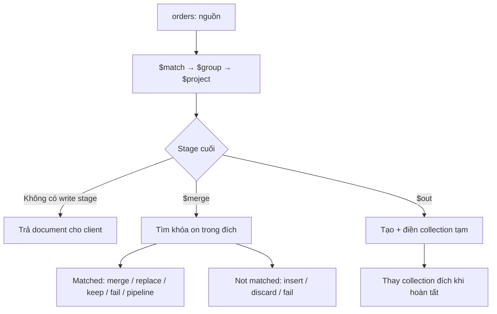
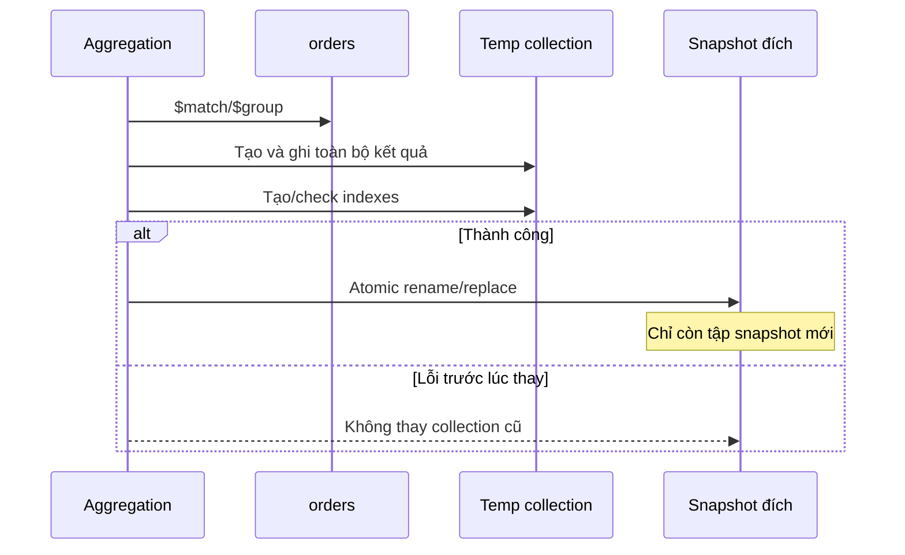

# $merge, $out và phạm vi pipeline có ghi dữ liệu

Trong **Spring Data MongoDB**, aggregation thường được dùng để **đọc và biến đổi document** bằng những stage như `$match`, `$group`, `$project` và `$sort`. Tuy nhiên, hai stage **`$merge`** và **`$out`** còn có thể **ghi kết quả vào collection**. Một pipeline có chúng không đơn thuần trả một danh sách DTO: nó trở thành một công việc làm thay đổi dữ liệu, chịu các quy tắc về quyền ghi, schema, index, lỗi và khả năng chạy lại.

- **`$merge`** tìm document đích theo khóa nhận diện `on` rồi **insert, merge, replace, giữ nguyên, bỏ qua hoặc báo lỗi**, tùy tùy chọn.
- **`$out`** tạo một tập document kết quả mới và, nếu collection đích đã tồn tại, **thay thế cả collection đó** khi tính toán hoàn tất thành công.
- **Cả hai phải đứng cuối pipeline** và **không được chạy trong MongoDB transaction**. Tính nguyên tử của từng thao tác hoặc việc thay collection không đồng nghĩa toàn bộ nghiệp vụ có transaction.

Bài thuộc chương **Aggregation nâng cao** của module **SPRING_DATA_MONGODB**: kết nối, ánh xạ document, thao tác qua `MongoTemplate`/repository, thiết kế aggregation và index, làm việc với transaction/reactive driver, kiểm thử và chẩn đoán hiệu năng. Chúng ta sẽ dựng bảng doanh thu theo ngày, thử hai cách ghi và phân tích các ranh giới ảnh hưởng tới tính nhất quán của báo cáo.

## 1. Từ aggregation chỉ đọc sang aggregation có ghi

Pipeline chỉ đọc:

```javascript
db.orders.aggregate([
  { $match: { status: "PAID" } },
  { $group: { _id: "$tenant_id", paidOrders: { $sum: 1 } } }
]);
```

Nó trả kết quả cho mongosh/driver, **không tạo collection**. Chỉ cần thêm stage cuối, ý nghĩa đã đổi:

```javascript
// Hợp nhất mỗi document summary theo _id.
db.orders.aggregate([
  { $match: { status: "PAID" } },
  { $group: { _id: "$tenant_id", paidOrders: { $sum: 1 } } },
  { $merge: "tenant_paid_counts" }
]);

// Thay nguyên collection snapshot bằng toàn bộ kết quả mới.
db.orders.aggregate([
  { $match: { status: "PAID" } },
  { $group: { _id: "$tenant_id", paidOrders: { $sum: 1 } } },
  { $out: "tenant_paid_snapshot" }
]);
```

Dù phần đầu giống nhau, **đích ghi và cách xử lý dữ liệu cũ** khác nhau.



Một số stage đọc có thể thực hiện trên secondary theo read preference/topology, nhưng **phần ghi của `$merge`/`$out` vẫn phải đi qua cơ chế primary và quyền ghi phù hợp**. Không thể coi chúng là read-only operation chỉ vì gọi qua phương thức `aggregate`.

## 2. So sánh phạm vi ghi

| Nội dung | `$merge` | `$out` |
| --- | --- | --- |
| Ý định | Cập nhật hoặc thêm từng document kết quả | Làm mới nguyên tập kết quả ở collection đích |
| Matching | `on` field(s), phải có unique index tương ứng | Không có khóa matching |
| Document đích đã tồn tại | Theo `whenMatched` | Thay collection cũ khi hoàn tất |
| Document kết quả không có trong đích | Theo `whenNotMatched` | Xuất hiện trong collection mới |
| Document cũ không còn được pipeline tạo ra | **Vẫn còn** nếu không dọn riêng | **Biến mất** sau khi collection được thay |
| Khi stage lỗi giữa chừng | Những ghi `$merge` trước lỗi có thể còn | Collection đích cũ được giữ nếu thay thế chưa hoàn tất |
| Output collection sharded | Có thể, theo điều kiện khóa/index | Không được |
| Bên trong MongoDB transaction | Không | Không |
| Vị trí | Phải là stage cuối | Phải là stage cuối |

**Quy tắc chọn:** làm mới một tập **đầy đủ** và được phép thay đích → cân nhắc `$out`; tính lại một số khóa trong bảng tổng hợp đang dùng chung → cân nhắc `$merge`.

## 3. Dữ liệu ví dụ: báo cáo doanh thu theo tenant/ngày

Giả sử collection `orders` lưu:

```javascript
db.orders.insertMany([
  {
    _id: ObjectId("674000000000000000001001"),
    tenant_id: "T1", status: "PAID", total_vnd: NumberLong("100000"),
    paid_at: ISODate("2026-11-18T01:00:00Z")
  },
  {
    _id: ObjectId("674000000000000000001002"),
    tenant_id: "T1", status: "PAID", total_vnd: NumberLong("200000"),
    paid_at: ISODate("2026-11-18T14:00:00Z")
  },
  {
    _id: ObjectId("674000000000000000001003"),
    tenant_id: "T1", status: "PAID", total_vnd: NumberLong("400000"),
    paid_at: ISODate("2026-11-19T02:00:00Z")
  },
  {
    _id: ObjectId("674000000000000000001004"),
    tenant_id: "T1", status: "PAID", total_vnd: NumberLong("50000"),
    paid_at: ISODate("2026-11-19T12:00:00Z")
  },
  {
    _id: ObjectId("674000000000000000001005"),
    tenant_id: "T1", status: "NEW", total_vnd: NumberLong("900000"),
    paid_at: null
  },
  {
    _id: ObjectId("674000000000000000001006"),
    tenant_id: "T2", status: "PAID", total_vnd: NumberLong("500000"),
    paid_at: ISODate("2026-11-18T08:00:00Z")
  }
]);
```

Tổng hợp đúng:

| Tenant | Ngày UTC | Số đơn PAID | Doanh thu VND |
| --- | --- | ---: | ---: |
| T1 | 2026-11-18 | 2 | 300.000 |
| T1 | 2026-11-19 | 2 | 450.000 |
| T2 | 2026-11-18 | 1 | 500.000 |

Đơn trạng thái `NEW` không được tính. Ngày được xác định bằng `$dateToString`, timezone `UTC`. Trong hệ thống thực tế, phải chọn **timezone nghiệp vụ**, đơn vị tiền và cách xác định thời điểm đã thanh toán nhất quán giữa mọi lần chạy.

**Chỉ dùng tập dữ liệu này trên MongoDB test**, không insert trực tiếp lên collection production.

## 4. Xây và kiểm tra phần pipeline chỉ đọc trước

Trước khi viết ra collection đích, hãy kiểm tra bộ lọc và các phép cộng:

```javascript
db.orders.aggregate([
  {
    $match: {
      status: "PAID",
      paid_at: { $type: "date" },
      total_vnd: { $type: "number" }
    }
  },
  {
    $group: {
      _id: {
        tenant: "$tenant_id",
        day: {
          $dateToString: {
            format: "%Y-%m-%d",
            date: "$paid_at",
            timezone: "UTC"
          }
        }
      },
      ordersCount: { $sum: 1 },
      revenueVnd: { $sum: "$total_vnd" }
    }
  },
  {
    $project: {
      _id: 0,
      tenant_id: "$_id.tenant",
      day: "$_id.day",
      orders_count: "$ordersCount",
      revenue_vnd: "$revenueVnd"
    }
  },
  { $sort: { tenant_id: 1, day: 1 } }
]);
```

Các invariant cần xác nhận:

1. `$match` chỉ nhận đơn `PAID` có ngày hợp lệ và giá trị numeric; giá trị string/null cần được xử lý riêng nếu schema cũ không nhất quán.
2. Tenant có mặt trong **khóa nhóm**, tránh cộng doanh thu các tổ chức với nhau.
3. `day` ổn định theo timezone; không đổi logic giữa hai phiên bản báo cáo.
4. `_id: 0` loại ID nhóm trung gian, tránh cố ghi `_id` không tương ứng khi dùng khóa `on` khác `_id`.
5. Đầu ra đã có `tenant_id`, `day`, `orders_count`, `revenue_vnd` đúng kiểu.

Kết quả của phần đọc phải có đúng **ba document** như bảng mục 3. Chỉ khi xác nhận đúng rồi mới nối stage có ghi.

## 5. Cấu trúc $merge

```javascript
{
  $merge: {
    into: "daily_sales",
    on: ["tenant_id", "day"],
    whenMatched: "merge",
    whenNotMatched: "insert"
  }
}
```

Có thể dùng `into: {db:"reporting",coll:"daily_sales"}` để chọn collection thuộc database khác **trong cùng MongoDB deployment** khi được cấp quyền. `$merge` có các thuộc tính:

| Trường | Vai trò |
| --- | --- |
| `into` | Collection/database đích |
| `on` | Field hoặc tập field định danh **duy nhất** để tìm record tương ứng |
| `whenMatched` | Chính sách khi bản ghi kết quả match bản ghi đã tồn tại |
| `whenNotMatched` | Chính sách khi khóa mới chưa có trong đích |
| `let` | Biến tùy chọn cho `whenMatched` dạng aggregation update pipeline |

Mặc định `whenMatched="merge"`, `whenNotMatched="insert"`. Với đích unsharded, `on` mặc định là `_id`; với đích sharded, các shard key fields và `_id` quyết định default identifier. Khi dùng khóa nghiệp vụ khác, **khai báo `on` rõ ràng**.

Dạng rút gọn `{ $merge: "tenant_paid_counts" }` phù hợp khi `_id` đã là khóa duy nhất của kết quả.

## 6. Unique index cho khóa $merge

Đối với `on:["tenant_id","day"]`, phải có unique index **đúng tập field đó** trên collection đích:

```javascript
db.daily_sales.createIndex(
  { tenant_id: 1, day: 1 },
  { unique: true, name: "tenant_day_unique" }
);
```

Những yêu cầu dễ bỏ sót:

- Index là **unique** và chỉ chứa các trường dùng trong `on`; một index còn thêm trường thứ ba không thay thế được index này.
- Collation của index phải khớp với collation aggregation.
- Index có thể sparse nhưng **không thể partial** nếu muốn dùng làm ràng buộc `on` của `$merge`.
- Giá trị `on` không được là array. Trên server **8.0 trở xuống**, những field `on` không được null/missing; **từ 8.1**, có các trường hợp null/missing được hỗ trợ nếu index tương ứng **không sparse**.
- Nếu output sharded, tập `on` phải bao gồm **tất cả shard key fields**.
- Nếu output collection chưa tồn tại và `on` khác `_id`, hãy tạo collection/unique index trước khi chạy: MongoDB không tự tạo unique index ghép theo ý định nghiệp vụ.

Khi `on` không bao gồm `_id`, tránh đẩy một `_id` ngẫu nhiên từ input vào output, vì `$merge` có thể bị lỗi cố thay đổi ID của document cũ. Đó là lý do ta đã có `$project:{_id:0}`.

## 7. $merge để cập nhật daily_sales

Với dữ liệu đã chuẩn bị, thực thi:

```javascript
db.orders.aggregate([
  {
    $match: {
      status: "PAID",
      paid_at: { $type: "date" },
      total_vnd: { $type: "number" }
    }
  },
  {
    $group: {
      _id: {
        tenant: "$tenant_id",
        day: {
          $dateToString: {
            format: "%Y-%m-%d",
            date: "$paid_at",
            timezone: "UTC"
          }
        }
      },
      ordersCount: { $sum: 1 },
      revenueVnd: { $sum: "$total_vnd" }
    }
  },
  {
    $project: {
      _id: 0,
      tenant_id: "$_id.tenant",
      day: "$_id.day",
      orders_count: "$ordersCount",
      revenue_vnd: "$revenueVnd"
    }
  },
  {
    $merge: {
      into: "daily_sales",
      on: ["tenant_id", "day"],
      whenMatched: "merge",
      whenNotMatched: "insert"
    }
  }
]);
```

Sau đó **đọc riêng collection đích**:

```javascript
db.daily_sales.find(
  {},
  { _id: 0, tenant_id: 1, day: 1, orders_count: 1, revenue_vnd: 1 }
).sort({ tenant_id: 1, day: 1 });
```

Sau một lần chạy thành công, thấy ba record theo bảng trên. Chạy lại khi nguồn không đổi sẽ **cập nhật các giá trị tổng hợp**, không mặc định cộng thêm vào bản cũ.

`whenMatched="merge"` ghi đè những field kết quả mang vào, **giữ các field khác** trên document đã có. Ví dụ một trường `review_status` tồn tại từ trước trong `daily_sales` sẽ còn nguyên nếu không xuất hiện trong document kết quả.

## 8. whenMatched: merge, replace, keepExisting, fail và pipeline

Nếu output đích có:

```javascript
{
  _id: ObjectId("674000000000000000002001"),
  tenant_id: "T1",
  day: "2026-11-18",
  orders_count: 1,
  revenue_vnd: NumberLong("100000"),
  review_status: "APPROVED"
}
```

và pipeline mới tạo:

```javascript
{
  tenant_id: "T1",
  day: "2026-11-18",
  orders_count: 2,
  revenue_vnd: NumberLong("300000")
}
```

thì:

| `whenMatched` | Tác dụng |
| --- | --- |
| `"merge"` | Update `orders_count/revenue_vnd`; **giữ `review_status`** |
| `"replace"` | Thay document; field `review_status` có thể mất vì không có trong output mới |
| `"keepExisting"` | Giữ nguyên toàn bộ document cũ, không làm mới số liệu |
| `"fail"` | Báo lỗi khi gặp record trùng `on` |
| Pipeline | Tính thay đổi theo kết quả mới và dữ liệu document cũ |

`replace` không được thay `_id` hoặc shard key của document hiện có. Nếu `on` không chứa `_id`, loại `_id` không phù hợp khỏi output trước khi merge.

### whenMatched dạng update pipeline

```javascript
{
  $merge: {
    into: "daily_sales",
    on: ["tenant_id", "day"],
    whenMatched: [
      {
        $set: {
          orders_count: "$$new.orders_count",
          revenue_vnd: "$$new.revenue_vnd",
          refresh_source: "aggregation"
        }
      }
    ],
    whenNotMatched: "insert"
  }
}
```

Trong update pipeline của `whenMatched`, `$$new` là document **kết quả aggregation** (nếu không khai báo `let` khác), còn `"$orders_count"` thường tham chiếu document **đích đang có**. Những stage được phép trong update pipeline này giới hạn ở `$set`/`$addFields`, `$project`/`$unset`, `$replaceRoot`/`$replaceWith`; không dùng tùy ý mọi stage aggregation.

Nếu refresh **lại toàn bộ doanh thu**, hãy **gán** kết quả tính lại. Không `$add` kết quả vào total cũ, vì mỗi lần chạy sẽ tăng doanh thu giả.

## 9. whenNotMatched: insert, discard, fail

| Chế độ | Khi khóa `on` mới chưa có | Ý nghĩa |
| --- | --- | --- |
| `"insert"` | Thêm document mới | Phù hợp cho một tenant/ngày lần đầu xuất hiện |
| `"discard"` | Bỏ kết quả không match | Chỉ cập nhật các khóa đã có |
| `"fail"` | Báo lỗi | Không cho xuất hiện khóa chưa được chuẩn bị |

**Rất quan trọng:** lỗi `"fail"` **không rollback** những document mà `$merge` đã kịp ghi trước đó. Nó không có tính nguyên tử của một transaction bao phủ toàn bộ pipeline.

Việc một collection có unique index phù hợp `on` **không tự giải quyết** mọi unique constraint khác. Nếu output vi phạm một unique index thứ hai hoặc schema validation, `$merge` có thể lỗi sau khi một số document trước đó đã được cập nhật.

## 10. $merge không dọn các dòng cũ không còn trong nguồn

Giả sử `daily_sales` đã có T1/ngày 18, T1/ngày 19, T2/ngày 18. Sau khi sửa dữ liệu, T1 **không còn** đơn PAID ngày 19. Lần chạy mới:

```text
Kết quả pipeline mới:
  T1/2026-11-18
  T2/2026-11-18

Collection daily_sales cũ:
  T1/2026-11-18
  T1/2026-11-19    <-- Không có trong pipeline mới
  T2/2026-11-18

Sau $merge:
  T1/2026-11-18   (được refresh)
  T1/2026-11-19   (vẫn có thể còn: stale)
  T2/2026-11-18   (được refresh)
```

`$merge` chỉ xử lý **các document xuất hiện trong kết quả pipeline**, không ngầm xóa những khóa đã biến mất.

Các phương án:

1. Nếu cần **snapshot hoàn toàn mới**, dùng `$out` khi được phép thay cả collection.
2. Nếu chỉ refresh một tenant, dùng `$merge`, rồi **dọn stale records có giới hạn phạm vi tenant và runId** theo một quy trình riêng.
3. Nếu nguồn thay đổi liên tục, dùng CDC/outbox hoặc job đối soát có watermark và cơ chế idempotency.
4. Nếu yêu cầu báo cáo không được có dữ liệu stale ở thời điểm công bố, dùng **versioned result/staging collection và công bố phiên bản sau khi đã kiểm chứng**.

Không quét xóa toàn bộ summary records không có trong kết quả của **riêng T1**, vì đó sẽ xóa dữ liệu T2.

## 11. $out: làm mới collection đích

Cú pháp:

```javascript
// Output cùng database:
{ $out: "tenant_paid_snapshot" }

// Output database khác trong cùng MongoDB deployment:
{ $out: { db: "reporting", coll: "tenant_paid_snapshot" } }
```

Khi collection đích đã tồn tại, MongoDB:

1. Tạo một **collection tạm**.
2. Sao chép **định nghĩa các index** từ collection cũ.
3. Ghi dữ liệu kết quả vào collection tạm, tuân thủ validation và unique constraints.
4. Sau khi pipeline hoàn tất thành công, dùng cơ chế **atomic rename/replace** collection đích.

Nếu lỗi xảy ra trong lúc xây dữ liệu/index, collection cũ **không bị thay từng phần**. Nếu đích chưa tồn tại, nó chỉ được công bố như collection mới sau khi job thành công.



Đây là **atomic replacement collection đích**, không phải transaction nhiều collection. Nó không “đóng băng” dữ liệu nguồn trong suốt thời gian job chạy và **không được phép chạy bên trong MongoDB transaction**.

## 12. Ví dụ $out: loại bỏ snapshot lỗi thời

```javascript
db.orders.aggregate([
  { $match: { status: "PAID" } },
  {
    $group: {
      _id: "$tenant_id",
      paidOrders: { $sum: 1 },
      paidRevenueVnd: { $sum: "$total_vnd" }
    }
  },
  { $out: "tenant_paid_snapshot" }
]);
```

Dữ liệu mẫu cho kết quả sau:

| `_id` tenant | paidOrders | paidRevenueVnd |
| --- | ---: | ---: |
| T1 | 4 | 750.000 |
| T2 | 1 | 500.000 |

Nếu `tenant_paid_snapshot` trước đó có dòng `_id="OLD_TENANT"` nhưng nguồn không còn tenant đó, sau `$out` thành công dòng ấy **không còn**.

**Cảnh báo đa tenant:** nếu thêm `$match:{tenant_id:"T1"}` vào đầu pipeline này và vẫn `$out` vào collection **dùng chung**, toàn collection đích sẽ bị **thay bằng kết quả chỉ có T1**, làm mất T2. `$match` đúng tenant **không đủ** để làm `$out` an toàn trên collection chung.

## 13. Những hạn chế của $out

Các hạn chế quan trọng cần biết:

- Không output vào **sharded collection**; input có thể là sharded collection. Khi output cần sharding, xem `$merge`.
- Không output vào **capped collection**.
- Không dùng trong **transaction**, view definition hoặc nested pipeline của `$lookup`, `$facet`, `$unionWith`.
- Có thể thất bại nếu output không thỏa **unique index** hoặc **schema validation** của collection đích; trong trường hợp đó collection cũ được giữ.
- Với **MongoDB Search index**, việc thay collection có thể cần xóa/tạo lại search index theo hướng dẫn server; nên xem `$merge` nếu không muốn thay cả collection/index metadata.
- Một số dạng **time series output** của `$out` được hỗ trợ theo phiên bản (từ MongoDB 7.0.3/7.1 cho các tùy chọn cụ thể); không áp dụng ví dụ collection thường mà không kiểm tra hạ tầng.
- Các thành phần phụ thuộc collection identity/change streams/metadata cần được kiểm thử khi collection bị thay.

**Không `drop` collection đích thủ công trước khi chạy `$out`**. Làm vậy bạn mất ưu điểm giữ kết quả cũ khi job thất bại.

## 14. Không được dùng $merge/$out trong MongoDB transaction

Cả hai là **aggregation write stages** và bị giới hạn ở cấp MongoDB Server, kể cả khi Spring đã cấu hình `MongoTransactionManager`:

```java
import org.springframework.transaction.annotation.Transactional;

// Sai: không đặt pipeline chứa $merge/$out vào transaction đang mở.
@Transactional(transactionManager = "mongoTransactionManager")
public void refresh() {
    // mongoTemplate.aggregate(pipelineWithMergeOrOut, ...);
}
```

Nếu cần nghiệp vụ nguyên tử nhiều document:

- Dùng các thao tác update/insert thông thường với MongoDB transaction phù hợp, không đặt `$merge`/`$out` bên trong.
- Hoặc dùng workflow staging → validate → publish version để tạo **snapshot báo cáo có thể đối soát**.
- Chấp nhận `$merge` có thể đã ghi một phần trước lỗi; chọn chính sách retry và reconciliation tương ứng.
- Chấp nhận `$out` có phạm vi atomic ở **thay collection output**, không phải toàn bộ luồng công việc trước/sau nó.

**Không nhầm transaction với idempotency.** Một job refresh tính lại rồi gán giá trị có thể chạy lại an toàn hơn một job cộng dồn, nhưng tính đúng còn tùy đầu vào, khóa, quyền ghi và cơ chế xử lý lỗi.

## 15. Phạm vi ghi: tenant, database và quyền

Pipeline bắt đầu ở **input collection**, nhưng `into`/`$out` có thể ghi sang **collection hoặc database đích khác** trong cùng deployment.

```javascript
{
  $merge: {
    into: { db: "reporting", coll: "daily_sales" },
    on: ["tenant_id", "day"],
    whenMatched: "merge",
    whenNotMatched: "insert"
  }
}
```

Các điều kiện an toàn:

1. Tenant phải đến từ ngữ cảnh xác thực, không tin client tự truyền tenant bất kỳ.
2. Với collection tổng hợp dùng chung, khóa `on` cần bao gồm tenant.
3. Tên database/collection đích phải đến từ **allowlist hoặc cấu hình backend**, không ghép trực tiếp từ input người dùng.
4. MongoDB user cần quyền đọc input, quyền ghi/tạo/đổi tên collection đích theo thao tác; dùng **least privilege**.
5. Test quyền trên cả **collection nguồn và output**, không chỉ test một lần `find`.
6. Nếu nhiều phiên bản báo cáo cùng tồn tại, phân biệt rõ `runId`/schema version trong khóa hoặc metadata.

Một pipeline có cấu trúc đúng vẫn có thể tạo **lỗi rò rỉ dữ liệu đa tenant** nếu thiếu filter hoặc ghi vào đích sai phạm vi.

## 16. Chạy đồng thời, job lặp lại và nguồn thay đổi

Trong lúc pipeline chạy, dữ liệu nguồn có thể thay đổi theo read concern/consistency semantics của MongoDB. Những rủi ro vận hành:

- Một đơn chuyển `NEW → PAID` đúng lúc job tổng hợp đang đọc, khiến báo cáo phản ánh một tập dữ liệu không đồng nhất với “thời điểm mong muốn” nếu không có chính sách snapshot.
- Hai job `$merge` cùng đích có thể ghi đan xen kết quả từ hai thời điểm; không có khóa toàn job chỉ nhờ `whenMatched:"merge"`.
- Hai job `$out` cạnh tranh có thể khiến snapshot tính từ dữ liệu **cũ hơn** được công bố sau cùng.
- Ghi `$merge` trở lại **chính source collection** có nguy cơ *Halloween problem*: document bị thay đổi vị trí vật lý và bị đọc/cập nhật lại, thậm chí vòng lặp.

Các hướng xử lý: job lock, runId, snapshotAsOf, watermark, chỉ công bố một phiên bản đã đối soát; tránh source=destination nếu không có thiết kế đặc biệt. Đối với dữ liệu định kỳ, nên lập lịch job và cảnh báo khi lần refresh cuối đã quá cũ.

## 17. Entity và mapping trong Spring Data MongoDB

Entity nguồn:

```java
import java.time.Instant;
import org.bson.types.ObjectId;
import org.springframework.data.annotation.Id;
import org.springframework.data.mongodb.core.mapping.Document;
import org.springframework.data.mongodb.core.mapping.Field;

@Document(collection = "orders")
public class Order {
    @Id
    private ObjectId id;

    @Field("tenant_id")
    private String tenantId;

    private String status;

    @Field("total_vnd")
    private long totalVnd;

    @Field("paid_at")
    private Instant paidAt;

    public Order() {}

    public ObjectId getId() { return id; }
    public String getTenantId() { return tenantId; }
    public String getStatus() { return status; }
    public long getTotalVnd() { return totalVnd; }
    public Instant getPaidAt() { return paidAt; }
}
```

Trong **typed aggregation** với `Order.class`, Spring Data áp dụng metadata:

- `Criteria.where("tenantId")` ánh xạ sang BSON `tenant_id`.
- `Aggregation.group("tenantId")` dùng đúng BSON field khi nhóm.
- `Aggregation.group(...).sum("totalVnd")` có thể dùng mapping `total_vnd`.
- `Aggregation.out("tenant_paid_snapshot")` chỉ định tên collection đích, không phải tên property.
- Với raw `Aggregation.stage("...")`, không được mặc định các trường trong chuỗi JSON tự đi qua mapping; nên viết **tên BSON thật**.

Kết quả sau `$group`/`$merge` không còn schema `Order`. Khi cần đọc bảng báo cáo, hãy dùng `Document` hoặc một DTO có trường tương ứng, thay vì cố ép vào entity nguồn.

## 18. Spring Data: MergeOperation cơ bản

`MergeOperation.mergeInto(String)` là API rút gọn cho mặc định của `$merge`:

```java
import org.bson.Document;
import org.springframework.data.mongodb.core.MongoTemplate;
import org.springframework.data.mongodb.core.aggregation.Aggregation;
import org.springframework.data.mongodb.core.aggregation.MergeOperation;
import org.springframework.data.mongodb.core.query.Criteria;

public class TenantSummaryJob {
    private final MongoTemplate template;

    public TenantSummaryJob(MongoTemplate template) {
        this.template = template;
    }

    public void refreshPaidCounts() {
        Aggregation pipeline = Aggregation.newAggregation(
            Aggregation.match(
                Criteria.where("status").is("PAID")
            ),
            Aggregation.group("tenantId")
                .count().as("paidOrders"),
            MergeOperation.mergeInto("tenant_paid_counts")
        );

        // Có stage ghi: không dùng kết quả như danh sách summary.
        template.aggregate(pipeline, Order.class, Document.class);
    }
}
```

`Aggregation.group("tenantId")` tạo `_id` bằng tên tenant. `MergeOperation.mergeInto(...)` mặc định dùng `_id` làm khóa ở output unsharded, nên lần chạy sau cập nhật cùng tenant thay vì tạo bản sao mới.

Khi cần đọc kết quả:

```java
import org.bson.Document;
import org.springframework.data.mongodb.core.query.Query;

var summary = template.find(
    new Query(),
    Document.class,
    "tenant_paid_counts"
);
```

Đây chỉ là minh họa; API production nên áp dụng tenant filter/limit và phân quyền ở bước đọc báo cáo.

**Giới hạn:** tenant không còn đơn PAID sẽ không tạo dòng `$group` và dòng summary cũ của tenant ấy vẫn có thể còn trong output.

## 19. Spring Data: MergeOperation builder với on tùy chỉnh

Khi pipeline đã tạo field output `tenant_id` và `day`, dùng builder:

```java
import org.springframework.data.mongodb.core.aggregation.MergeOperation;

MergeOperation mergeDailySales = MergeOperation.builder()
    .intoCollection("daily_sales")
    .on("tenant_id", "day")
    .build();
```

Điều này sử dụng default `whenMatched:"merge"`, `whenNotMatched:"insert"`. Với những phiên bản Spring Data hỗ trợ raw stage, có thể kết hợp:

```java
import org.bson.Document;
import org.springframework.data.mongodb.core.aggregation.Aggregation;

Aggregation pipeline = Aggregation.newAggregation(
    Aggregation.stage("""
      { "$match": {
          "status": "PAID",
          "paid_at": { "$type": "date" },
          "total_vnd": { "$type": "number" }
      } }
      """),
    Aggregation.stage("""
      { "$group": {
          "_id": {
              "tenant": "$tenant_id",
              "day": {
                  "$dateToString": {
                      "format": "%Y-%m-%d",
                      "date": "$paid_at",
                      "timezone": "UTC"
                  }
              }
          },
          "ordersCount": { "$sum": 1 },
          "revenueVnd": { "$sum": "$total_vnd" }
      } }
      """),
    Aggregation.stage("""
      { "$project": {
          "_id": 0,
          "tenant_id": "$_id.tenant",
          "day": "$_id.day",
          "orders_count": "$ordersCount",
          "revenue_vnd": "$revenueVnd"
      } }
      """),
    mergeDailySales
);

template.aggregate(pipeline, "orders", Document.class);
```

Đây là ví dụ pha trộn DSL builder và raw BSON. Phải có unique index `{tenant_id:1,day:1}` trên `daily_sales` trước khi chạy `on` ghép. Các stage `Aggregation.stage(...)` viết theo **BSON names**, không trộn `tenantId` và `tenant_id` tùy tiện.

## 20. Spring Data: $out với Aggregation.out

Spring Data MongoDB cung cấp `Aggregation.out("collection")`:

```java
import org.bson.Document;
import org.springframework.data.mongodb.core.aggregation.Aggregation;
import org.springframework.data.mongodb.core.query.Criteria;

public void refreshTenantSnapshot(MongoTemplate template) {
    Aggregation pipeline = Aggregation.newAggregation(
        Aggregation.match(Criteria.where("status").is("PAID")),
        Aggregation.group("tenantId")
            .count().as("paidOrders")
            .sum("totalVnd").as("paidRevenueVnd"),
        Aggregation.out("tenant_paid_snapshot")
    );

    template.aggregate(pipeline, Order.class, Document.class);
}
```

Ví dụ này tổng hợp **toàn bộ tenant** trong input collection. Nếu collection `tenant_paid_snapshot` dùng chung cho mọi tenant, **không** thay `$match` bằng filter chỉ T1 trừ khi chủ động muốn đích chỉ chứa T1.

Để chọn database khác trên phiên bản hỗ trợ, `OutOperation` có method `in(...)`:

```java
Aggregation.out("tenant_paid_snapshot").in("reporting");
```

**Pipeline chứa stage ghi không phải API trả số bản ghi đã ghi.** Sau khi `aggregate` hoàn tất, hãy đọc collection output và đối soát riêng.

## 21. ReactiveMongoTemplate: subscription và phạm vi ghi

Trong WebFlux, `ReactiveMongoTemplate.aggregate(...)` trả `Flux`:

```java
import org.bson.Document;
import org.springframework.data.mongodb.core.ReactiveMongoTemplate;
import org.springframework.data.mongodb.core.aggregation.Aggregation;
import reactor.core.publisher.Mono;

Mono<Void> refreshReactively(
        ReactiveMongoTemplate template,
        Aggregation pipeline) {
    return template.aggregate(
            pipeline, "orders", Document.class
        )
        .then();
}
```

Publisher phải được **subscribe** thì thao tác mới thực thi theo mô hình reactive. Không tự `subscribe()` trong service rồi trả thành công sớm, không dùng `block()` trên event loop, và không bỏ qua lỗi cuối publisher.

**Không dùng `ReactiveMongoTransactionManager` để bọc pipeline `$merge` hoặc `$out`**; giới hạn không được chạy trong transaction vẫn là giới hạn server, không phụ thuộc sync/reactive.

## 22. Monitoring, idempotency và đối soát sau ghi

Một aggregation có ghi thường không trả một danh sách các summary documents như pipeline chỉ đọc. Các tín hiệu cần ghi nhận:

- Terminal success/error của lệnh aggregate.
- `runId`, batch timestamp, schema version, collection nguồn/đích, tenant scope.
- Query đọc lại những khóa output theo `on` và kiểm tra counts/totals.
- Số record stale hoặc thiếu sau một lần refresh.
- Alert khi snapshot đã quá cũ, khi job lỗi hoặc khi summary lệch so với nguồn.

Với lỗi mạng khi chờ xác nhận, không nhất thiết biết chính xác bao nhiêu record đã được ghi. `$merge` có thể đã áp dụng một số document; `$out` có thể đã hoàn tất thay collection dù client chưa nhận xác nhận. Hãy **đối soát hiện trạng** và dùng pipeline recompute có khả năng chạy lại trước khi retry.

Nếu `whenMatched` dùng cộng dồn, retry có thể làm sai số liệu. Khi dùng total recompute, gán `new total` thay vì cộng `new total + old total`.

## 23. Index, explain và hiệu năng

Một pipeline báo cáo lớn vẫn cần `$match` đủ sớm:

```javascript
db.orders.createIndex(
  { status: 1, paid_at: 1, tenant_id: 1 },
  { name: "orders_paid_range_tenant" }
);
```

Index này chỉ là **ứng viên** cho workload lọc `status=PAID` và khoảng `paid_at`. Nếu truy vấn thường cố định tenant, thứ tự field index có thể cần điều chỉnh.

Dùng pipeline **chỉ đọc** để đo:

```javascript
db.orders.explain("executionStats").aggregate([
  {
    $match: {
      status: "PAID",
      paid_at: {
        $gte: ISODate("2026-11-18T00:00:00Z"),
        $lt: ISODate("2026-11-20T00:00:00Z")
      }
    }
  },
  {
    $group: {
      _id: "$tenant_id",
      paidOrders: { $sum: 1 }
    }
  }
]);
```

Xem `winningPlan`, `IXSCAN`/`COLLSCAN`, `totalKeysExamined`, `totalDocsExamined`, số group và memory/spill. Không thêm stage ghi vào pipeline dùng để chẩn đoán nếu đang trỏ production.

Chi phí của `$merge` gồm lookup/update theo unique `on`; chi phí của `$out` gồm dựng dữ liệu mới, indexes và thay collection. `$group` cũng có thể tốn memory lớn; `allowDiskUse` phải được xem xét theo hạ tầng thực, không phải giải pháp thay cho thiết kế filter/index.

## 24. Integration test: $merge cập nhật cùng khóa

Mock `MongoTemplate` không chứng minh BSON mapping, unique key hoặc write semantics. Dùng MongoDB thật dành cho test, ví dụ Testcontainers. Một test với khóa `_id` mặc định:

```java
import static org.assertj.core.api.Assertions.assertThat;

import java.util.List;
import org.bson.Document;
import org.bson.types.ObjectId;
import org.junit.jupiter.api.Test;
import org.springframework.beans.factory.annotation.Autowired;
import org.springframework.boot.test.autoconfigure.data.mongo.DataMongoTest;
import org.springframework.data.mongodb.core.MongoTemplate;
import org.springframework.data.mongodb.core.aggregation.Aggregation;
import org.springframework.data.mongodb.core.aggregation.MergeOperation;
import org.springframework.data.mongodb.core.query.Criteria;

@DataMongoTest
class MergeAggregationIntegrationTest {
    @Autowired MongoTemplate template;

    @Test
    void rerunUpdatesSameSummaryDocument() {
        String tenant = "test-" + new ObjectId().toHexString();
        String target = "test_merge_" + new ObjectId().toHexString();
        ObjectId id1 = new ObjectId();
        ObjectId id2 = new ObjectId();

        template.getCollection("orders").insertMany(List.of(
            new Document("_id", id1)
                .append("tenant_id", tenant)
                .append("status", "PAID")
                .append("total_vnd", 100_000L),
            new Document("_id", id2)
                .append("tenant_id", tenant)
                .append("status", "NEW")
                .append("total_vnd", 200_000L)
        ));

        Aggregation pipeline = Aggregation.newAggregation(
            Aggregation.match(
                Criteria.where("tenantId").is(tenant)
                    .and("status").is("PAID")
            ),
            Aggregation.group("tenantId")
                .count().as("paidOrders"),
            MergeOperation.mergeInto(target)
        );

        template.aggregate(pipeline, Order.class, Document.class);

        Document first = template.getCollection(target)
            .find(new Document("_id", tenant)).first();
        assertThat(first).isNotNull();
        assertThat(((Number) first.get("paidOrders")).longValue())
            .isEqualTo(1L);

        template.getCollection("orders").updateOne(
            new Document("_id", id2),
            new Document("$set", new Document("status", "PAID"))
        );

        template.aggregate(pipeline, Order.class, Document.class);

        Document after = template.getCollection(target)
            .find(new Document("_id", tenant)).first();
        assertThat(after).isNotNull();
        assertThat(((Number) after.get("paidOrders")).longValue())
            .isEqualTo(2L);
        assertThat(template.getCollection(target).countDocuments())
            .isEqualTo(1L);
    }
}
```

Điều test này chứng minh: Spring mapping chuyển `tenantId` thành `tenant_id`, output `_id` ổn định qua `$group`, lần refresh thứ hai thay `paidOrders=1` thành `2` chứ không sinh một document tenant thứ hai.

Test chạy trên database cô lập; nếu nhiều tests dùng chung collection `orders`, dùng ID/tenant duy nhất và quản lý cleanup theo test suite.

## 25. Integration test: $out thay snapshot

```java
import static org.assertj.core.api.Assertions.assertThat;

import org.bson.Document;
import org.bson.types.ObjectId;
import org.junit.jupiter.api.Test;
import org.springframework.beans.factory.annotation.Autowired;
import org.springframework.boot.test.autoconfigure.data.mongo.DataMongoTest;
import org.springframework.data.mongodb.core.MongoTemplate;
import org.springframework.data.mongodb.core.aggregation.Aggregation;
import org.springframework.data.mongodb.core.query.Criteria;

@DataMongoTest
class OutAggregationIntegrationTest {
    @Autowired MongoTemplate template;

    @Test
    void completedOutRemovesStaleTargetDocument() {
        String tenant = "test-" + new ObjectId().toHexString();
        String target = "test_out_" + new ObjectId().toHexString();

        template.getCollection("orders").insertOne(
            new Document("_id", new ObjectId())
                .append("tenant_id", tenant)
                .append("status", "PAID")
                .append("total_vnd", 300_000L)
        );
        template.getCollection(target).insertOne(
            new Document("_id", "STALE").append("paidOrders", 999)
        );

        Aggregation pipeline = Aggregation.newAggregation(
            Aggregation.match(
                Criteria.where("tenantId").is(tenant)
                    .and("status").is("PAID")
            ),
            Aggregation.group("tenantId")
                .count().as("paidOrders"),
            Aggregation.out(target)
        );

        template.aggregate(pipeline, Order.class, Document.class);

        assertThat(template.getCollection(target)
            .find(new Document("_id", "STALE")).first())
            .isNull();

        Document newSummary = template.getCollection(target)
            .find(new Document("_id", tenant)).first();

        assertThat(newSummary).isNotNull();
        assertThat(((Number) newSummary.get("paidOrders")).longValue())
            .isEqualTo(1L);
    }
}
```

**Điểm cần ghi nhớ:** test này cố ý lọc một tenant rồi `$out`, nhưng `target` là collection test **riêng cho lần chạy đó**. Không sao chép cấu trúc này vào output collection chung đa tenant ở production.

Test nên bổ sung:

1. `$merge` trên `on:["tenant_id","day"]` thiếu unique index phải báo lỗi.
2. `whenMatched:"merge"` giữ metadata cũ; `"replace"` làm mất field không có trong kết quả.
3. `$merge` khi một nhóm biến mất khỏi input: record cũ **không tự bị xóa**.
4. `$out` thành công loại record stale.
5. `$out` thất bại vì unique index/validation: collection đích cũ vẫn còn.
6. Hai tenant: refresh T1 bằng `$merge` không thay dữ liệu T2.
7. Pipeline có stage ghi trong transaction phải bị MongoDB từ chối.
8. Với output sharded: `$out` không hợp lệ; `$merge` cần shard key trong `on`.
9. Reactive publisher chưa subscribe không được tính là job đã hoàn thành.

## 26. Những lỗi triển khai phổ biến

| Sai lầm | Hậu quả | Cách tránh |
| --- | --- | --- |
| Đặt stage phía sau `$merge` hoặc `$out` | Pipeline không hợp lệ | Stage ghi là **stage cuối** |
| Dùng `$out` vào collection chung sau khi filter riêng T1 | Làm mất báo cáo T2 | Dùng `$merge` theo tenant hoặc đích riêng |
| Tin `$merge` sẽ xóa group không còn xuất hiện | Stale records tồn tại | Dọn riêng theo scope hoặc dùng snapshot |
| `on` ghép không có unique index tương ứng | `$merge` lỗi | Tạo unique index đúng field/collation |
| Dùng `on:"day"` cho nhiều tenant | Nhầm khóa và ghi đè số liệu | Dùng `["tenant_id","day"]` |
| Đưa `_id` không phù hợp qua `$merge` on field khác | Immutable ID error | `$project:{_id:0}` khi đúng |
| Dùng `replace` nhưng muốn giữ metadata cũ | Mất field | Chọn `merge` hoặc update pipeline |
| Dùng `keepExisting` cho số liệu cần refresh | Thống kê không đổi | Dùng merge/replace phù hợp |
| Cộng dồn trong một job recompute | Số liệu tăng qua mỗi lần chạy | Gán giá trị tổng mới, idempotent |
| Tin `"fail"` sẽ rollback các ghi trước | Partial write | Job reconciliation/staging |
| Bọc pipeline ghi trong `@Transactional` | MongoDB từ chối | Chạy ngoài transaction |
| Tin atomic `$out` thay luôn cả nguồn/đích khác | Hiểu sai phạm vi atomic | Chỉ đích được thay khi hoàn tất |
| `$out` lên sharded collection | Lệnh không hỗ trợ | Cân nhắc `$merge` |
| Dựa vào kết quả `aggregate` làm số record đã ghi | Không phản ánh write count | Truy vấn/đối soát riêng |
| Raw stage dùng `tenantId` thay cho BSON `tenant_id` | Kết quả sai | Tên BSON thật trong raw JSON |
| Chạy nhiều job cùng đích không điều phối | Ghi xen kẽ hoặc snapshot cũ công bố sau | Job lock, runId, versioning |
| `$merge` lại chính input collection | Halloween problem | Tránh source=destination |
| Cho client chỉ định tùy ý collection đích | Ghi phá dữ liệu | Allowlist và least privilege |

## 27. Tự đánh giá

**1.** `$merge` khác `$out` ở điểm quan trọng nào?  
**Đáp án:** `$merge` cập nhật/thêm **từng document có mặt trong kết quả**; `$out` thay **toàn bộ collection đích** khi thành công.

**2.** Nếu một ngày không còn đơn PAID, `$merge` có xóa dòng báo cáo ngày đó không?  
**Đáp án:** không tự xóa; cần xử lý stale riêng.

**3.** Vì sao `$merge on:["tenant_id","day"]` cần unique index?  
**Đáp án:** phải nhận diện duy nhất document đích cho mỗi khóa `on`.

**4.** `whenMatched:"merge"` và `"replace"` khác thế nào?  
**Đáp án:** merge giữ field đích cũ không có trong output; replace có thể loại chúng.

**5.** Dùng `$out` vào collection chung sau khi lọc T1 sẽ gây điều gì?  
**Đáp án:** thay collection bằng kết quả của T1, làm mất kết quả T2.

**6.** Có thể dùng các stage này trong `@Transactional` không?  
**Đáp án:** không, MongoDB không hỗ trợ `$merge`/`$out` trong transaction.

**7.** Nếu `$out` xây collection tạm lỗi vì unique index, collection cũ có bị thay từng phần không?  
**Đáp án:** không; khi việc thay chưa hoàn tất, collection cũ được giữ.

**8.** Có thể dùng `$out` trên output sharded không?  
**Đáp án:** không. `$merge` hỗ trợ output sharded theo điều kiện `on`/shard key/index.

**9.** Trong WebFlux, việc tạo `Flux` có làm job `$out` chạy ngay không?  
**Đáp án:** không; cần subscription và theo dõi terminal signal.

**10.** Vì sao cần loại `_id` của `$group` khi `on` dùng tenant/day thay thế?  
**Đáp án:** để tránh cố cập nhật một `_id` không khớp với document đích đã tồn tại.

## 28. Bài thực hành và tham khảo

**Bài thực hành:** tạo MongoDB database chỉ dành cho test. Chèn 6 đơn theo mục 3; kiểm tra pipeline chỉ đọc và ba nhóm doanh thu. Tạo unique index cho `daily_sales` rồi thực thi `$merge`. Thay đổi một đơn và chạy lại để xác minh total được refresh; chuyển tất cả đơn một ngày thành NEW để quan sát stale record. Tiếp theo chạy `$out` vào một **collection snapshot test riêng** và chứng minh dòng stale bị loại. Thử `whenMatched:"merge"`/`"replace"` với field metadata, thử unique index conflict, test tenant T1/T2, và đo `explain("executionStats")` trên phần pipeline chỉ đọc.

**Tài liệu chính thức:**

- [MongoDB — `$merge` aggregation stage](https://www.mongodb.com/docs/manual/reference/operator/aggregation/merge/).
- [MongoDB — `$out` aggregation stage](https://www.mongodb.com/docs/manual/reference/operator/aggregation/out/).
- [Spring Data MongoDB — Aggregation Framework Support](https://docs.spring.io/spring-data/mongodb/reference/mongodb/aggregation-framework.html).
- [Spring Data MongoDB — MergeOperation API](https://docs.spring.io/spring-data/mongodb/reference/api/java/org/springframework/data/mongodb/core/aggregation/MergeOperation.html).
- [Spring Data MongoDB — OutOperation API](https://docs.spring.io/spring-data/mongodb/docs/current/api/org/springframework/data/mongodb/core/aggregation/OutOperation.html).

**Kết luận:** `$merge` và `$out` biến aggregation thành **thao tác ghi**. `$merge` hợp nhất theo khóa `on` có unique index và **không tự xóa** các record không còn xuất hiện; `$out` tạo một tập kết quả mới và **thay cả collection đích** lúc hoàn tất thành công. Cả hai phải là **stage cuối** và không được dùng trong MongoDB transaction. Trong Spring Data MongoDB, cần chọn API `MergeOperation`/`Aggregation.out` phù hợp, giữ đúng mapping BSON, tenant scope, index, quyền ghi, chiến lược idempotency, đối soát và integration test trước khi chạy trên dữ liệu thật.

