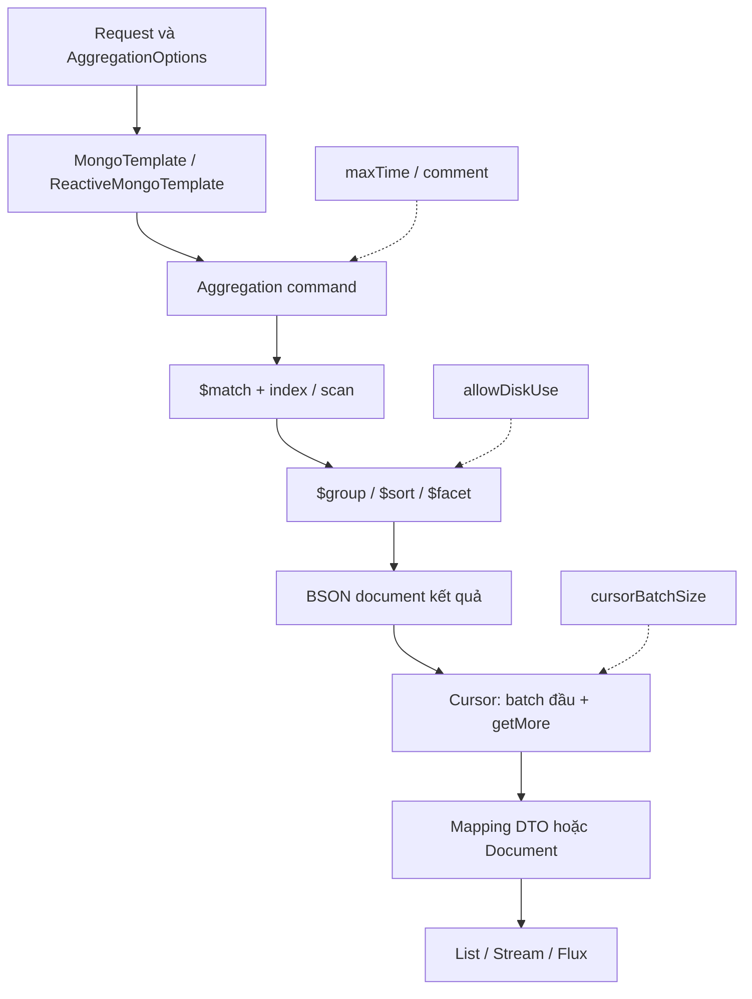

# AggregationOptions, allowDiskUse, batch size và giới hạn tài nguyên

## 1. Bài toán: báo cáo đúng nhưng chậm, tốn bộ nhớ hoặc thất bại

Một hệ thống thương mại điện tử dùng **Spring Data MongoDB** để lưu đơn hàng. Ban đầu, báo cáo doanh thu theo khu vực chỉ xử lý vài nghìn document:

```javascript
db.orders.aggregate([
  { $match: { tenant_id: "tenant-A", status: "PAID" } },
  {
    $group: {
      _id: "$region",
      orderCount: { $sum: 1 },
      revenue: { $sum: "$total_amount" }
    }
  },
  { $sort: { revenue: -1 } }
]);
```

Khi số đơn tăng lên hàng triệu và báo cáo phức tạp hơn, nhiều vấn đề xuất hiện:

- `$sort` hoặc `$group` dùng nhiều bộ nhớ ở phía MongoDB.
- Pipeline có quá nhiều stage, nhiều nhóm hay tích lũy array lớn.
- Response chứa document lớn vượt giới hạn BSON.
- Ứng dụng gọi `getMappedResults()` và giữ quá nhiều object Java trong RAM.
- Công việc đọc rất lâu, nhưng API không đặt thời gian thực thi tối đa.
- Người phát triển tăng `batchSize`, kỳ vọng nó giảm lượng bộ nhớ dùng để `$group`, nhưng thực tế hai việc khác nhau.
- Cờ `allowDiskUse` được bật, nhưng một stage như `$facet` vẫn báo lỗi tài nguyên.

Để kiểm soát hành vi thực thi, Spring Data MongoDB cung cấp **`AggregationOptions`**, được gắn với một `Aggregation` trước khi gọi `MongoTemplate.aggregate(...)` hoặc `ReactiveMongoTemplate.aggregate(...)`.

Bài thuộc chương **Aggregation nâng cao**, module **SPRING_DATA_MONGODB**. Ngoài `AggregationOptions`, nội dung còn kết nối thiết kế pipeline với query, index, transaction, reactive access, kiểm thử và chẩn đoán hiệu năng.

**Mục tiêu:** hiểu khi nào dùng `allowDiskUse`, `cursorBatchSize`, `maxTime` và các tùy chọn liên quan; nhận biết giới hạn tài nguyên MongoDB; chọn cách tiêu thụ kết quả phù hợp thay vì coi một option là giải pháp cho mọi vấn đề.

## 2. Bốn lớp tài nguyên khác nhau trong một aggregation

Trước khi sửa hiệu năng, phải phân biệt các lớp:

| Lớp | Ví dụ | Cái gì tiêu thụ tài nguyên? | Điều khiển phù hợp |
| --- | --- | --- | --- |
| **Truy cập dữ liệu** | `$match`, index scan | Số document/index key được đọc | Index, filter, projection, `explain` |
| **Xử lý pipeline** | `$sort`, `$group`, `$setWindowFields` | Bộ nhớ và có thể là không gian đĩa tạm của server | Thiết kế stage, `allowDiskUse` khi được hỗ trợ |
| **Kết quả BSON** | `$group` có `$push` lớn, `$facet` | Kích thước từng document kết quả | Giảm array, phân nhóm, giới hạn output; không thể vượt BSON limit |
| **Vận chuyển và tiêu thụ** | Cursor, `getMore`, mapping Java | Batch trên mạng, cursor, RAM phía ứng dụng | `cursorBatchSize`, stream/reactive, đóng cursor |

Bên cạnh đó còn có **thời gian thực thi** (`maxTime`) và **cơ chế quan sát** (comment, explain, profiler).

Một pipeline có thể có bộ nhớ server thấp nhưng trả hàng triệu document khiến ứng dụng hết RAM. Ngược lại, pipeline trả chỉ mười dòng vẫn có thể cần sort hoặc group trên hàng triệu đầu vào.

### 2.1. Sơ đồ vòng đời



**Không nhầm:** `cursorBatchSize` ảnh hưởng cách lấy **kết quả đã được tạo ra** qua cursor, chứ không ấn định một `$group` chỉ được dùng đúng số document tương ứng trong RAM.

## 3. Dữ liệu mẫu và ánh xạ BSON của `OrderDocument`

Ví dụ dùng những field:

| Java property | BSON field | Ý nghĩa |
| --- | --- | --- |
| `id` | `_id` | ID đơn dạng string |
| `tenantId` | `tenant_id` | Phân vùng dữ liệu theo tenant |
| `status` | `status` | `PAID`, `CANCELLED` ... |
| `region` | `region` | Khu vực của đơn hàng |
| `totalAmount` | `total_amount` | Tiền dạng BSON Decimal128 |
| `placedAt` | `placed_at` | BSON Date |

### 3.1. Entity nguồn

```java
import java.math.BigDecimal;
import java.time.Instant;

import org.springframework.data.mongodb.core.mapping.Document;
import org.springframework.data.mongodb.core.mapping.Field;
import org.springframework.data.mongodb.core.mapping.FieldType;
import org.springframework.data.mongodb.core.mapping.MongoId;

@Document(collection = "orders")
public record OrderDocument(
    @MongoId(FieldType.STRING)
    String id,

    @Field("tenant_id")
    String tenantId,

    String status,
    String region,

    @Field(
        value = "total_amount",
        targetType = FieldType.DECIMAL128
    )
    BigDecimal totalAmount,

    @Field("placed_at")
    Instant placedAt
) {}
```

`@Field("total_amount")` chỉ tên lưu, còn `targetType=FieldType.DECIMAL128` thể hiện chủ đích dùng BSON decimal cho tiền. Dữ liệu cũ kiểu double/string vẫn cần kiểm tra và migration riêng; annotation không tự sửa BSON đã tồn tại.

### 3.2. Tạo dữ liệu bằng `mongosh` trên database thử nghiệm

```javascript
db.orders.insertMany([
  {
    _id: "o-1", tenant_id: "tenant-A",
    status: "PAID", region: "north",
    total_amount: NumberDecimal("100000.00"),
    placed_at: ISODate("2026-11-18T01:00:00Z")
  },
  {
    _id: "o-2", tenant_id: "tenant-A",
    status: "PAID", region: "north",
    total_amount: NumberDecimal("200000.00"),
    placed_at: ISODate("2026-11-18T02:00:00Z")
  },
  {
    _id: "o-3", tenant_id: "tenant-A",
    status: "PAID", region: "south",
    total_amount: NumberDecimal("150000.00"),
    placed_at: ISODate("2026-11-18T03:00:00Z")
  },
  {
    _id: "o-4", tenant_id: "tenant-A",
    status: "PAID", region: "south",
    total_amount: NumberDecimal("50000.00"),
    placed_at: ISODate("2026-11-18T04:00:00Z")
  },
  {
    _id: "o-5", tenant_id: "tenant-A",
    status: "PAID", region: "north",
    total_amount: NumberDecimal("300000.00"),
    placed_at: ISODate("2026-11-18T05:00:00Z")
  },
  {
    _id: "o-6", tenant_id: "tenant-A",
    status: "CANCELLED", region: "north",
    total_amount: NumberDecimal("900000.00"),
    placed_at: ISODate("2026-11-18T06:00:00Z")
  },
  {
    _id: "o-7", tenant_id: "tenant-B",
    status: "PAID", region: "north",
    total_amount: NumberDecimal("999999.00"),
    placed_at: ISODate("2026-11-18T07:00:00Z")
  }
]);
```

Theo filter `tenant_id="tenant-A"` và `status="PAID"`:

- Khu vực `north` có 3 đơn, tổng `600000.00`.
- Khu vực `south` có 2 đơn, tổng `200000.00`.
- Đơn bị hủy và đơn tenant B **không** được tính.

Dữ liệu nhỏ chỉ dùng để xác minh **tính đúng**. Không sử dụng nó để kết luận một index hoặc `allowDiskUse` hiệu quả trên dữ liệu hàng triệu document.

## 4. `AggregationOptions` là gì và được gắn ở đâu?

Trong Spring Data MongoDB, **`AggregationOptions`** mô tả những tùy chọn cho lệnh aggregate, tách biệt với các stage nghiệp vụ.

```java
import java.time.Duration;

import org.springframework.data.mongodb.core.aggregation
    .AggregationOptions;

AggregationOptions options = AggregationOptions.builder()
    .allowDiskUse(true)
    .cursorBatchSize(100)
    .maxTime(Duration.ofSeconds(5))
    .build();
```

Một `Aggregation` gắn options:

```java
import org.springframework.data.mongodb.core.aggregation
    .Aggregation;
import org.springframework.data.mongodb.core.query.Criteria;

Aggregation aggregation = Aggregation.newAggregation(
    Aggregation.match(
        Criteria.where("tenantId").is("tenant-A")
    ),
    Aggregation.limit(20)
).withOptions(options);
```

Ví dụ trên dùng `match` và `limit` làm hai stage cụ thể để minh họa cách gắn options; pipeline báo cáo đầy đủ ở mục 5 bổ sung `group` và `sort`. Sau đó gọi:

```java
template.aggregate(
    aggregation,
    OrderDocument.class,
    org.bson.Document.class
);
```

**Phân biệt:**

- `Aggregation.newAggregation(...)` tạo **các stage** và định nghĩa logic tính toán.
- `AggregationOptions.builder()` tạo **metadata thực thi** cho command.
- `aggregation.withOptions(options)` gắn metadata vào pipeline.
- `MongoTemplate.aggregate(...)` thực hiện command và ánh xạ kết quả.

Nếu đã có `Aggregation`, thay đổi một đối tượng `AggregationOptions` khác không làm pipeline đang dùng tự đổi; phải tạo/gắn bản options phù hợp.

### 4.1. Những option thường gặp

| Option | Tác động chính | Cảnh báo |
| --- | --- | --- |
| `allowDiskUse(true/false)` | Cho phép một số stage dùng đĩa tạm khi vượt ngưỡng bộ nhớ | Không áp dụng cho mọi stage, không vô hiệu hóa 16 MiB BSON |
| `cursorBatchSize(n)` | Yêu cầu kích thước batch của cursor kết quả | Không giống `$limit`, không biến `List` thành stream |
| `maxTime(Duration)` | Giới hạn thời gian thực thi do server quản lý | Không thay thế HTTP/client timeout |
| `collation(...)` | Quy tắc so sánh/sort string theo locale | Phải tương thích với index khi cần tối ưu |
| `comment(...)` ở dòng hỗ trợ | Nhãn truy vết trong command | Không chứa dữ liệu nhạy cảm |
| `explain(...)` ở dòng hỗ trợ | Yêu cầu thông tin kế hoạch thực thi | Không phải kết quả DTO nghiệp vụ thông thường |
| Các option ánh xạ domain type | Mức nghiêm ngặt chuyển tên property Java sang BSON | Phụ thuộc phiên bản và pipeline |

**Cần đối chiếu Javadoc của dependency đang dùng:** chữ ký builder/overload và option được hỗ trợ có thể khác nhau giữa các dòng Spring Data MongoDB. Các ví dụ ở đây tập trung vào nhóm option phổ biến trong các dòng hiện đại.

## 5. Pipeline Java hoàn chỉnh với `MongoTemplate`

Một class service đọc báo cáo theo tenant:

```java
import java.time.Duration;
import java.util.List;

import org.bson.Document;
import org.springframework.data.domain.Sort;
import org.springframework.data.mongodb.core.MongoTemplate;
import org.springframework.data.mongodb.core.aggregation.Aggregation;
import org.springframework.data.mongodb.core.aggregation.AggregationOptions;
import org.springframework.data.mongodb.core.query.Criteria;

public final class OrderRevenueReader {

    private final MongoTemplate template;

    public OrderRevenueReader(MongoTemplate template) {
        this.template = template;
    }

    public List<Document> revenueByRegion(
        String trustedTenantId
    ) {
        if (trustedTenantId == null
                || trustedTenantId.isBlank()) {
            throw new IllegalArgumentException(
                "Thiếu tenant đã xác thực"
            );
        }

        AggregationOptions options = AggregationOptions
            .builder()
            .allowDiskUse(true)
            .cursorBatchSize(100)
            .maxTime(Duration.ofSeconds(5))
            .build();

        Aggregation aggregation = Aggregation.newAggregation(
            Aggregation.match(
                Criteria.where("tenantId").is(trustedTenantId)
                    .and("status").is("PAID")
            ),
            Aggregation.group("region")
                .count().as("orderCount")
                .sum("totalAmount").as("revenue"),
            Aggregation.sort(
                Sort.by(
                    Sort.Order.desc("revenue"),
                    Sort.Order.asc("_id")
                )
            ),
            Aggregation.limit(20)
        ).withOptions(options);

        return template.aggregate(
            aggregation,
            OrderDocument.class,
            Document.class
        ).getMappedResults();
    }
}
```

Dùng `OrderDocument.class` làm input domain type cho phép Spring Data ánh xạ:

- `tenantId` sang BSON `tenant_id`.
- `totalAmount` sang BSON `total_amount` trong `$group`.
- `id`/`_id` theo metadata mapping khi được tham chiếu.

`Aggregation.group("region")` tạo key nhóm trong output dưới field `_id`. Kết quả từ mẫu dữ liệu có hai document:

```javascript
[
  {
    _id: "north",
    orderCount: 3,
    revenue: NumberDecimal("600000.00")
  },
  {
    _id: "south",
    orderCount: 2,
    revenue: NumberDecimal("200000.00")
  }
]
```

Nếu chọn result DTO thay `Document.class`, cần bảo đảm alias/constructor tương ứng và kiểm thử `_id`, Decimal128 và kiểu số đếm.

**Điểm về `allowDiskUse(true)`:** code này minh họa việc cấu hình. Với chỉ bảy document mẫu, MongoDB không có lý do phải spill xuống đĩa. Bật cờ không có nghĩa đã sử dụng đĩa.

## 6. `allowDiskUse` cho phép điều gì ở server?

Nhiều stage aggregation có thể là **blocking stages**: chúng cần giữ đủ dữ liệu trung gian để tiếp tục hoặc hoàn thành một bước, ví dụ sort trên tập lớn hoặc group theo rất nhiều khóa.

Trong MongoDB hiện đại, một số stage nếu vượt ngưỡng bộ nhớ (thường được mô tả khoảng **100 MB** trong tài liệu đối với các stage cụ thể) có thể:

- Báo lỗi khi không được phép dùng đĩa.
- Ghi dữ liệu làm việc tạm xuống đĩa (*spill*) khi server/stage hỗ trợ và chính sách `allowDiskUse` cho phép.

Ví dụ trong `mongosh`:

```javascript
db.orders.aggregate(
  [
    { $match: { tenant_id: "tenant-A", status: "PAID" } },
    {
      $group: {
        _id: "$region",
        total: { $sum: "$total_amount" }
      }
    },
    { $sort: { total: -1 } }
  ],
  {
    allowDiskUse: true
  }
);
```

**`allowDiskUse=true` là quyền được dùng đĩa tạm khi cần**, không phải lệnh “buộc mọi stage ghi đĩa”. Nếu workload nhỏ, index hoặc optimizer đã giảm đủ tài nguyên, pipeline có thể hoàn thành hoàn toàn trong RAM.

### 6.1. Từ MongoDB 6.0: chính sách mặc định của server có thể khác

Trên MongoDB 6.0 trở lên, tham số server **`allowDiskUseByDefault`** ảnh hưởng việc stage được hỗ trợ có thể spill khi vượt ngưỡng mà không cần mỗi command đều đặt `allowDiskUse:true`.

Vì thế, ba trường hợp cần phân biệt:

1. Server có default **không cho phép** spill: đặt `allowDiskUse:true` có thể cho phép stage được hỗ trợ spill.
2. Server có default **cho phép** spill: command không chỉ định có thể được phép spill theo chính sách server.
3. Command chỉ định `allowDiskUse:false`: có thể ghi đè mặc định, dẫn đến lỗi khi stage vượt ngưỡng bộ nhớ thay vì spill.

Hành vi chính xác phụ thuộc MongoDB Server, stage và phiên bản; không dựa vào giá trị default bạn nhớ từ máy khác. Xác minh phiên bản và cấu hình môi trường thực tế.

### 6.2. Vì sao bật `allowDiskUse` không phải “sửa hiệu năng”?

Spill có thể biến một lỗi “không đủ bộ nhớ để sort” thành một kết quả hoàn tất, nhưng còn các chi phí:

- I/O tới ổ đĩa tạm.
- Thời gian tăng do ghi/đọc dữ liệu trung gian.
- Áp lực tài nguyên khi nhiều báo cáo chạy cùng lúc.
- Nguy cơ chạm giới hạn không gian đĩa hoặc tài nguyên container.
- Tương tác với index, collation, group cardinality và cách sắp xếp.

Nếu pipeline phải spill liên tục, ưu tiên xem xét index, `$match` sớm, projection, group cardinality, pre-aggregation hoặc kiến trúc báo cáo trước khi tăng năng lực đĩa.

### 6.3. Không phải stage nào cũng được spill

Các stage được phép dùng đĩa theo chính sách server có thể bao gồm một số dạng `$sort`, `$group` và những stage khác được liệt kê trong tài liệu từng phiên bản. Không suy rằng **mọi** stage MongoDB đều có cơ chế spill giống nhau.

Đặc biệt, **`$facet` có giới hạn riêng và không thể dùng `allowDiskUse` để vượt giới hạn bộ nhớ nội bộ của stage đó**. Phần 10 sẽ giải thích.

## 7. Tìm nguyên nhân memory pressure: sort, group và cardinality

Một số pipeline đều trả hai dòng nhưng mức sử dụng bộ nhớ có thể rất khác nhau.

### 7.1. `$sort` trên nhiều document

```javascript
db.orders.aggregate([
  { $match: { tenant_id: "tenant-A" } },
  { $sort: { placed_at: -1, _id: -1 } },
  { $limit: 100 }
]);
```

Nếu có index phù hợp với filter và sort, MongoDB có thể tránh sort lớn ngoài index. Ví dụ:

```javascript
db.orders.createIndex({
  tenant_id: 1,
  placed_at: -1,
  _id: -1
});
```

Một sort không được index hỗ trợ có thể phải giữ dữ liệu tạm. Trong một số điều kiện, optimizer có thể tối ưu `$sort` + `$limit` bằng chiến lược top-K thay vì giữ toàn bộ các document được sort. Nhưng **không mặc định** mọi pipeline có `$limit` đều tránh memory pressure; các stage ở giữa có thể ngăn tối ưu.

### 7.2. `$group` có nhiều khóa hoặc tích lũy array lớn

```javascript
db.orders.aggregate([
  { $match: { tenant_id: "tenant-A" } },
  {
    $group: {
      _id: "$region",
      orderCount: { $sum: 1 },
      revenue: { $sum: "$total_amount" }
    }
  }
]);
```

Khi `region` chỉ có vài giá trị, số nhóm nhỏ. Nếu đổi khóa thành `customer_id` hoặc một khóa gần như duy nhất của từng document, số nhóm có thể lên tới hàng triệu, tăng state phải quản lý.

Một ví dụ dễ làm output phình to:

```javascript
db.orders.aggregate([
  { $match: { tenant_id: "tenant-A" } },
  {
    $group: {
      _id: "$tenant_id",
      allOrders: { $push: "$$ROOT" }
    }
  }
]);
```

Lệnh gom mọi document vào **một array trong một document nhóm**. Với tập lớn, ngay cả khi cho phép disk spill, document output có thể vượt **16 MiB BSON**. Vấn đề này không được sửa bằng `cursorBatchSize` hay `allowDiskUse`.

### 7.3. Chỉ tính metric cần thiết

Nếu chỉ cần doanh thu và số đơn, dùng `$sum`/`$count` thay vì `$push: "$$ROOT"` rồi đếm và cộng ở Java. Nếu cần ví dụ đơn gần nhất của từng khu vực, cân nhắc accumulator `$first`/`$top` theo phiên bản hoặc stage sort trước group phù hợp, không gom toàn bộ tài liệu nguyên bản.

**Quyết định loại kết quả quan trọng hơn một flag runtime.**

## 8. `cursorBatchSize`: kích thước từng batch, không phải giới hạn tổng

Aggregation có thể trả kết quả qua một **cursor**. MongoDB trả batch đầu của command, sau đó client lấy batch tiếp theo bằng `getMore` khi cần.

Trong Spring Data:

```java
AggregationOptions options = AggregationOptions.builder()
    .cursorBatchSize(200)
    .build();
```

Trong `mongosh`:

```javascript
db.orders.aggregate(
  [
    { $match: { tenant_id: "tenant-A", status: "PAID" } },
    { $project: { _id: 1, region: 1, total_amount: 1 } }
  ],
  {
    cursor: { batchSize: 200 }
  }
);
```

**Batch size 200 không có nghĩa tổng kết quả chỉ có 200 document.** Nó là yêu cầu về số document trên một lượt cursor; kích thước batch thực tế vẫn phụ thuộc giới hạn byte, dữ liệu và hành vi server/driver. Một batch có thể ít hơn cấu hình.

### 8.1. So sánh `$limit`, `cursorBatchSize` và `skip`

| Cấu hình | Nó thực sự làm gì? |
| --- | --- |
| `Aggregation.limit(200)` / `$limit: 200` | Giới hạn **số document kết quả** của dòng pipeline ở vị trí đó |
| `Aggregation.skip(200)` / `$skip: 200` | Bỏ một số document trong dòng pipeline tại vị trí đó |
| `cursorBatchSize(200)` | Yêu cầu **số document mỗi batch** trên cursor kết quả |
| `$sort` | Sắp xếp document của dòng pipeline, có thể tốn bộ nhớ |
| `aggregateStream(...)` | Cho ứng dụng tiêu thụ kết quả theo stream, phải quản lý cursor |
| Reactive `aggregate(...)` | Publisher nhận các result document, dùng cơ chế driver reactive |

**Vị trí `$limit` là một phần semantics.** Đặt `$limit` trước `$group` sẽ chỉ tổng hợp trên một phần input; đặt sau `$group` sẽ giới hạn **số nhóm đầu ra**. Không đặt limit sớm chỉ để giảm bộ nhớ nếu điều đó làm báo cáo sai.

### 8.2. Vì sao batch lớn không nhất thiết nhanh?

- Batch quá nhỏ: nhiều vòng `getMore`, chi phí network round-trip.
- Batch quá lớn: tăng dung lượng dữ liệu nhận tại một thời điểm, có thể gây áp lực RAM và độ trễ cho client đang xử lý từng phần tử.
- Document rất lớn: giới hạn byte của batch có thể được chạm trước số document chỉ định.
- Consumer dừng sớm: một batch lớn có thể mang nhiều dữ liệu không dùng.
- Kết quả ít document: cấu hình batch lớn có thể hầu như không tạo khác biệt.

Nên đo với output thật và network thật. Không có một batch size chuẩn cho mọi báo cáo.

## 9. Batch size không biến `getMappedResults()` thành streaming

Đây là một bẫy quan trọng của `MongoTemplate`:

```java
List<Document> rows = template.aggregate(
    aggregation,
    OrderDocument.class,
    Document.class
).getMappedResults();
```

`getMappedResults()` trả **List** chứa các result document đã được materialize. Dù `cursorBatchSize` được đặt nhỏ, một danh sách kết quả rất lớn vẫn có thể chiếm nhiều RAM ứng dụng.

Ví dụ hai pipeline:

```javascript
// A: Trả hai document nhóm -> List rất nhỏ.
db.orders.aggregate([
  { $match: { tenant_id: "tenant-A", status: "PAID" } },
  { $group: { _id: "$region", count: { $sum: 1 } } }
]);

// B: Trả mọi đơn phù hợp -> List có thể rất lớn.
db.orders.aggregate([
  { $match: { tenant_id: "tenant-A", status: "PAID" } },
  { $project: { _id: 1, region: 1 } }
]);
```

Pipeline B có thể trả hàng triệu document. Giảm batchSize xuống 50 **không** ngăn `getMappedResults()` gom toàn bộ chúng vào `List`.

Nếu use case cần toàn bộ dữ liệu để xử lý tuần tự, hãy cân nhắc `aggregateStream(...)`; nếu API chỉ cần một trang, dùng `$sort`/`$skip`/`$limit` hoặc cơ chế scrolling phù hợp.

## 10. `aggregateStream` và vòng đời cursor

Trong Spring Data MongoDB imperative, có API **`MongoTemplate.aggregateStream(...)`** cho phép nhận `java.util.stream.Stream` thay vì materialize toàn bộ kết quả.

```java
import java.util.stream.Stream;

import org.bson.Document;
import org.springframework.data.mongodb.core.MongoTemplate;
import org.springframework.data.mongodb.core.aggregation.Aggregation;

public void exportRegionRows(
    MongoTemplate template,
    Aggregation aggregation
) {
    try (Stream<Document> stream = template.aggregateStream(
            aggregation,
            OrderDocument.class,
            Document.class
    )) {
        stream.forEach(row -> {
            // Xử lý từng result document; không giữ toàn bộ List.
            System.out.println(row.toJson());
        });
    }
}
```

**Quan trọng:** `Stream` gắn với cursor/tài nguyên bên dưới nên phải đóng bằng `try-with-resources`. Ví dụ in BSON để minh họa; production không nên log raw đơn hàng hoặc dữ liệu cá nhân. Một exporter thật cần mã hóa output, backpressure ở downstream, kiểm soát lỗi giữa chừng và checkpoint.

### 10.1. Stream không sửa được memory limit của server

Stream giúp tránh giữ **toàn bộ output** trong RAM của Java. Nó không khiến `$sort` hay `$group` phía MongoDB trở thành thuật toán dùng bộ nhớ cố định.

```text
Server:
  vẫn có thể phải hoàn thành sort/group lớn
  trước khi tạo result document phù hợp

Client:
  nhận từng batch, ánh xạ rồi tiêu thụ lần lượt
  thay vì lưu toàn bộ vào List
```

Đây là hai vấn đề độc lập. Nếu pipeline bắt buộc tạo một document nhóm có array 20 MiB, stream cũng không thể nhận document vượt BSON limit.

### 10.2. Không giữ cursor mở vô hạn

Cursor đang mở có thể tốn tài nguyên phía MongoDB và chịu timeout/session lifecycle. Nếu job phải xử lý hàng giờ, việc chỉ giữ một cursor mở lâu có thể khó phục hồi sau mất kết nối.

Cân nhắc:

- Chia job thành các chunk có checkpoint bền vững.
- Đọc theo keyset/ID ổn định nếu phù hợp dữ liệu và sort.
- Chỉ xuất những field cần thiết.
- Đặt thời gian chạy và giới hạn kích thước kết quả.
- Đóng stream khi gặp exception hoặc người dùng hủy.

Một cursor **không** tự bảo đảm exactly-once khi xuất hoặc gửi dữ liệu ra hệ thống bên ngoài. Phải có idempotency/checkpoint theo nghiệp vụ.

## 11. Giới hạn 100 MB và ngoại lệ `$facet`

`$facet` tạo **một document đầu ra có các array kết quả của từng nhánh**. Nó rất hữu ích khi API muốn vừa trả danh sách vừa tính số lượng, nhưng có giới hạn tài nguyên riêng.

Theo tài liệu MongoDB:

1. Trong quá trình xử lý `$facet`, kích thước document do stage tạo bị giới hạn khoảng **100 MB**.
2. **`$facet` không thể spill xuống đĩa** để vượt giới hạn đó, **kể cả khi `allowDiskUse:true`**.
3. Document kết quả cuối vẫn phải tuân giới hạn BSON **16 MiB**.
4. Một array nhánh `items` quá dài hoặc một nhánh thống kê tạo hàng trăm nghìn bucket có thể làm stage/response vượt giới hạn.

Ví dụ nguy hiểm:

```javascript
db.orders.aggregate(
  [
    { $match: { tenant_id: "tenant-A" } },
    {
      $facet: {
        allOrders: [
          // Không có $limit; có thể tích lũy output khổng lồ.
          { $project: { _id: 1, status: 1, total_amount: 1 } }
        ],
        totals: [
          { $group: { _id: "$status", count: { $sum: 1 } } }
        ]
      }
    }
  ],
  { allowDiskUse: true }
);
```

`allowDiskUse:true` không biến output `allOrders` thành một cursor riêng biệt có thể trả dần từng sản phẩm. `$facet` vẫn tạo document chứa các **array**.

### 11.1. Cách sửa đúng

```javascript
db.orders.aggregate([
  { $match: { tenant_id: "tenant-A" } },
  {
    $facet: {
      items: [
        { $sort: { placed_at: -1, _id: -1 } },
        { $limit: 20 },
        { $project: { _id: 1, status: 1, total_amount: 1 } }
      ],
      totals: [
        { $group: { _id: "$status", count: { $sum: 1 } } }
      ]
    }
  }
]);
```

Giới hạn nhánh `items` nhưng **không** đặt `$limit:20` trước `$facet` nếu totals phải tính trên toàn bộ tenant. Nếu số nhóm của totals vẫn quá lớn, giới hạn/chọn dimension hợp lý hoặc tách thành phép phân tích riêng.

### 11.2. `$facet` đầu pipeline và index

Nếu `$facet` là stage đầu tiên, MongoDB có thể phải collection scan thay vì tận dụng index cho bộ lọc nằm sâu trong các nhánh. Một `$match` được đặt **trước `$facet`** có thể tận dụng index và giảm input cho mọi nhánh.

Tuy nhiên, `$sort` trong một nhánh facet không mặc nhiên dùng index giống query sort trước facet. Quan sát `explain`, đừng suy luận chỉ từ việc collection đã có index.

## 12. Giới hạn document BSON 16 MiB: một ranh giới không thể nâng bằng option

MongoDB quy định kích thước **một BSON document** thông thường tối đa **16 MiB**. Điều này áp dụng cả document được lưu lẫn document đầu ra aggregation phải trả ở vị trí cuối pipeline.

Một số bẫy:

- `$group` cùng `$push: "$$ROOT"` thành một array lớn.
- `$lookup` tạo array joined documents khổng lồ trong một document.
- `$facet` gom nhiều mảng nhánh vào một document duy nhất.
- `$setWindowFields` hay `$project` tạo field với dữ liệu tích lũy lớn, tùy thiết kế.
- Biến nhiều document nhỏ thành một document kết quả có mảng rất dài.

**`cursorBatchSize` chỉ ảnh hưởng số document trong mỗi batch**, không thể chia **một document BSON 20 MiB** thành hai phần hợp lệ trong cùng query.

Ví dụ sai về kỳ vọng:

```text
Aggregation tạo 1 document lớn 20 MiB
      ↓
cursorBatchSize(1)
      ↓
Vẫn vượt giới hạn BSON của document đó.
```

Cách sửa là **đổi cấu trúc output**:

1. Trả nhiều document kết quả nhỏ thay vì một document chứa array vô hạn.
2. Giới hạn field bằng `$project` và `$limit` đúng stage.
3. Dùng phân trang/keyset hoặc chia theo khoảng thời gian/khu vực.
4. Pre-aggregate thành những snapshot nhỏ có cấu trúc ổn định.
5. Không chọn `$$ROOT` trong `$push` khi chỉ cần một vài field.

## 13. Giới hạn số stage trong pipeline

MongoDB hiện đại áp dụng giới hạn **1.000 stage** cho một aggregation pipeline. Một pipeline dựng động từ hàng trăm bộ lọc/nhánh không nên dựa vào việc server sẽ nhận vô hạn stage.

Ví dụ một code builder không được kiểm soát:

```text
$match
$project
$match
$project
... lặp hàng nghìn lần do vòng lặp cấu hình ...
```

Vấn đề không chỉ là chạm hard limit. Trước đó, chi phí parse, optimize, maintain và debug pipeline cũng đã cao.

Giải pháp:

- Gom điều kiện `$match` khi semantics cho phép.
- Dùng một `$project`/`$set` có biểu thức rõ thay vì sinh chuỗi stage không cần thiết.
- Không tạo một stage mới chỉ vì một field trong form HTTP.
- Review pipeline sinh động như review mã nguồn.
- Giới hạn độ sâu, số nhánh và độ phức tạp của input.
- Tách bài toán thành nhiều bước khi thuật toán thực sự cần.

Lưu ý pipeline có thể bị **tối ưu hóa và biến đổi** bởi MongoDB; số stage người lập trình khai báo không nhất thiết trùng số stage ở execution plan. Hãy đối chiếu phiên bản MongoDB Server và tài liệu giới hạn stage tương ứng.

## 14. `maxTime`: ngân sách thực thi phía MongoDB

Một pipeline có thể không vi phạm giới hạn bộ nhớ nhưng vẫn chạy quá lâu do quét nhiều document, sort hoặc join tốn tài nguyên.

```java
AggregationOptions options = AggregationOptions.builder()
    .allowDiskUse(true)
    .cursorBatchSize(100)
    .maxTime(Duration.ofSeconds(5))
    .build();
```

Đặt giới hạn phía MongoDB bằng option tương ứng `maxTimeMS`:

```javascript
db.orders.aggregate(
  [
    { $match: { tenant_id: "tenant-A", status: "PAID" } },
    { $group: { _id: "$region", total: { $sum: "$total_amount" } } }
  ],
  { maxTimeMS: 5000 }
);
```

Nếu lệnh bị server coi là vượt ngưỡng và bị ngắt ở một điểm kiểm tra phù hợp, client có thể nhận lỗi timeout. Đây **không phải** cam kết tổng thời gian HTTP sẽ không quá năm giây.

### 14.1. Phân biệt bốn loại thời gian

| Loại | Phạm vi | Điểm cần nhớ |
| --- | --- | --- |
| `AggregationOptions.maxTime` / `maxTimeMS` | Thời gian thực thi phía server theo semantics lệnh | Không bao trùm serialize HTTP, mapping Java, mạng |
| Driver socket/read timeout | Client chờ I/O tới MongoDB | Có thể xảy ra khi server vẫn đang xử lý |
| HTTP/gateway timeout | Toàn request phía ứng dụng/gateway | Không bảo đảm server đã dừng cùng thời điểm |
| Reactor `timeout(...)` | Thời gian quan sát publisher ở tầng reactive | Không thay thế `maxTimeMS` |

Với cursor có nhiều `getMore`, semantics giới hạn thời gian của lệnh và các lần lấy batch cần được đối chiếu theo driver/server version. Không giải thích `maxTimeMS` là “đồng hồ tuyệt đối tính tất cả xử lý Java và mọi batch”.

### 14.2. Chọn ngưỡng dựa trên workload

Ví dụ:

- Dashboard tương tác: có thể cần giới hạn chặt theo SLA.
- Job báo cáo đêm: có thể chấp nhận thời gian dài hơn, nhưng cần checkpoint và chống quá tải.
- Query đối soát: có thể cần độ chính xác mạnh hơn độ trễ, không cắt dữ liệu chỉ để đúng deadline.

Không đưa ra một ngưỡng cố định dùng cho mọi query. Đo p95/p99, xác định bottleneck, đặt giới hạn hợp lý và theo dõi số timeout thực tế.

**Không retry vô hạn** một aggregation nặng đang timeout; cần sửa query/index hoặc chuyển thành job phù hợp.

## 15. Collation, comment và hint: các tùy chọn vận hành liên quan

### 15.1. Collation và nhóm/sort chuỗi

Khi nhóm tên khách hàng hoặc sort theo địa danh có dấu, collation có thể thay đổi cách MongoDB so sánh string. Với Spring Data ở phiên bản hỗ trợ:

```java
import org.springframework.data.mongodb.core.query.Collation;

AggregationOptions options = AggregationOptions.builder()
    .collation(Collation.of("vi").strength(2))
    .build();
```

Ví dụ `locale="vi"`, `strength=2` thường nhằm phân biệt dấu nhưng không phân biệt hoa/thường theo quy tắc ICU. Không coi nó là full-text search, chuẩn hóa Unicode hay cơ chế tìm gần đúng.

Nếu cần tận dụng index cho filter/sort string, **collation của query và index phải tương thích**. Một index theo simple collation không nhất thiết hỗ trợ hiệu quả sort theo Vietnamese collation.

### 15.2. Comment để truy vết

Trong các dòng Spring Data MongoDB hỗ trợ builder comment, có thể gắn nhãn tĩnh cho aggregation:

```java
AggregationOptions options = AggregationOptions.builder()
    .comment("revenue-by-region-v1")
    .build();
```

Comment có thể giúp nhận diện command trong profiler, diagnostic log hoặc command monitoring tùy cấu hình. Nó không thay đổi thuật toán `$group` và không nên chứa tên người dùng, token, email, dữ liệu đơn hàng hoặc raw request.

Nếu dòng dependency không có method builder tương ứng, kiểm tra Javadoc của version thay vì tự thêm raw option không qua API được hỗ trợ.

### 15.3. Hint và kế hoạch thực thi

Hint có thể buộc MongoDB dùng một index thích hợp ở phần truy cập collection khi command hỗ trợ. Đây là một công cụ chẩn đoán hoặc workaround đã được đo, **không** thay thế việc thiết kế index tốt.

```javascript
db.orders.aggregate(
  [
    { $match: { tenant_id: "tenant-A", status: "PAID" } },
    { $group: { _id: "$region", total: { $sum: "$total_amount" } } }
  ],
  {
    hint: "idx_orders_tenant_status",
    comment: "revenue-by-region-index-test"
  }
);
```

Index phải tồn tại và tương thích với query. Nếu hint sai, lệnh có thể thất bại. Chỉ áp dụng hint khi đã so sánh execution plan thực tế với và không có hint.

## 16. Index thường quan trọng hơn `allowDiskUse`

Với báo cáo lọc tenant và trạng thái:

```javascript
db.orders.createIndex({
  tenant_id: 1,
  status: 1,
  region: 1
});
```

Index có thể giúp `$match` giảm số document và hỗ trợ đường truy cập. Nhưng nó **không tự loại bỏ mọi bộ nhớ dùng cho `$group`** vì output nhóm mới được tính từ nhiều document.

Một query `$sort` trên field của collection trước khi group có thể được index hỗ trợ nếu thứ tự và filter phù hợp. Ngược lại, sort theo `revenue` **sau `$group`** là sắp xếp **giá trị mới tính**, không có index trực tiếp trên collection nguồn cho field tổng hợp ấy.

### 16.1. Đặt `$match` sớm, nhưng không đổi semantics

```javascript
[
  { $match: { tenant_id: "tenant-A", status: "PAID" } },
  {
    $group: {
      _id: "$region",
      orderCount: { $sum: 1 },
      revenue: { $sum: "$total_amount" }
    }
  },
  { $sort: { revenue: -1 } }
]
```

Nếu đặt `$match` sau `$group` để lọc trên `tenant_id` (field không còn trong output nhóm), query có thể trả sai hoặc không trả kết quả. Không “tối ưu” stage chỉ bằng cách di chuyển tùy ý.

Khi cần lọc theo giá trị đã tổng hợp, phải dùng `$match` **sau `$group`** với field output như `revenue`; đó là một điều kiện hoàn toàn khác với lọc input.

### 16.2. Giảm số field và kích thước input

Đôi khi có thể dùng `$project` trước group để giảm số field đưa qua các stage tiếp theo. MongoDB optimizer cũng có thể tự loại field không dùng; cần đo chứ không mặc định thêm `$project` luôn tăng tốc.

Đặc biệt tránh đưa array ảnh, log, subdocuments lớn vào `$push` hoặc `$facet` nếu báo cáo chỉ cần count và sum.

## 17. Quan sát `explain("executionStats")` và disk spill

Có thể chạy pipeline trong `mongosh`:

```javascript
db.orders.explain("executionStats").aggregate(
  [
    { $match: { tenant_id: "tenant-A", status: "PAID" } },
    {
      $group: {
        _id: "$region",
        orderCount: { $sum: 1 },
        revenue: { $sum: "$total_amount" }
      }
    },
    { $sort: { revenue: -1 } }
  ],
  { allowDiskUse: true }
);
```

Các thành phần cần quan sát tùy execution engine và phiên bản MongoDB:

| Dấu hiệu | Ý nghĩa cần kiểm tra |
| --- | --- |
| `IXSCAN`, `COLLSCAN` | Stage truy cập collection có dùng index không? |
| `totalKeysExamined` | Bao nhiêu index key đã được duyệt? |
| `totalDocsExamined` | Bao nhiêu document nguồn đã đọc? |
| Sort / group stages | Stage nào đang tiêu thụ bộ nhớ? |
| `usedDisk` / thông tin spill (nếu có) | Có ghi tạm xuống đĩa không? |
| `executionTimeMillis` | Chi phí thực thi của phép thử |
| `nReturned` | Số document output của các stage |
| `maxTimeMS` / timeout errors | Có giới hạn thời gian và có bị hủy không? |

Các field explain không giống hệt trên mọi phiên bản/engine; đừng viết parser chỉ dựa trên một hình dạng `winningPlan` duy nhất.

### 17.1. Profiler và diagnostic log

MongoDB profiler/diagnostic log có thể phản ánh một số aggregation spill xuống đĩa qua chỉ báo phù hợp. Nếu cần monitor ngoài `explain`, có thể dùng command monitoring/metrics:

- Tỷ lệ pipeline bị timeout hoặc memory limit.
- Số lần/tổng dung lượng spill khi có telemetry.
- CPU, RAM và dung lượng đĩa tạm của MongoDB.
- Thời gian trung bình và p95/p99.
- Kích thước BSON trả về và số batch `getMore`.
- Bộ nhớ JVM và thời gian ánh xạ result DTO.
- Tỷ lệ failed/cancelled export jobs.

Không bật logging ghi toàn bộ query parameters chứa dữ liệu cá nhân trên production nếu chưa có chính sách masking và quyền truy cập phù hợp.

### 17.2. Hai phép đo bắt buộc khi tinh chỉnh batch

Khi thay `cursorBatchSize(50)` thành `cursorBatchSize(500)`, đo ít nhất:

1. **Phía server:** số lần `getMore`, tải MongoDB, thời gian pipeline, memory/spill.
2. **Phía ứng dụng:** CPU, RAM, tổng thời gian tiêu thụ, throughput, latency và áp lực downstream.

Nếu pipeline chỉ tạo 5 result document, thử batchSize 50 so với 500 hầu như không cung cấp bằng chứng hữu ích. Dùng bài toán có **nhiều result document** mới có thể đánh giá batch.

## 18. Đặt các option theo từng loại workload

### 18.1. Dashboard tương tác

Mục tiêu: response nhỏ, thời gian nhanh, ít ảnh hưởng hệ thống.

```java
AggregationOptions dashboardOptions =
    AggregationOptions.builder()
        .allowDiskUse(false)
        .cursorBatchSize(50)
        .maxTime(Duration.ofSeconds(2))
        .build();
```

Đây là một **chính sách mẫu**, không phải khuyến nghị cứng. Nếu dashboard có stage cần spill trên dữ liệu thật, `allowDiskUse(false)` có thể khiến query thất bại; khi đó phải đánh giá lại index, cardinality, pre-aggregation hoặc chính sách tài nguyên.

Với dashboard, nên dùng `$limit`/projection hợp lý và tránh branch facet xuất mảng không giới hạn.

### 18.2. Export theo batch

Mục tiêu: xử lý nhiều dòng, giảm RAM Java, có checkpoint.

```java
AggregationOptions exportOptions =
    AggregationOptions.builder()
        .allowDiskUse(true)
        .cursorBatchSize(200)
        .maxTime(Duration.ofMinutes(2))
        .build();
```

Nên dùng `aggregateStream` hoặc reactive pipeline **có kiểm soát tiêu thụ** thay vì gom toàn bộ vào List. Không mặc định 2 phút là đủ; một export dài có thể cần chia theo chunk/keyset và tái khởi động.

### 18.3. Báo cáo offline

Mục tiêu: số liệu chính xác trên phạm vi lớn, chấp nhận độ trễ nhất định.

Có thể:

- Chạy theo partition thời gian/tenant.
- Lưu kết quả từng phần có idempotency.
- Pre-aggregate hoặc materialize view theo yêu cầu nhất quán.
- Hạn chế concurrency để tránh nhiều query cùng spill ra đĩa.
- Không mở transaction đọc quá dài khi không cần.
- Dùng metric/alert riêng cho job.

**Chọn options theo SLA và loại pipeline**, không đặt `allowDiskUse(true), batchSize 10.000 và maxTime rất cao cho mọi endpoint chỉ vì một báo cáo cần chúng.

## 19. ReactiveMongoTemplate và giới hạn tài nguyên

Trong WebFlux, `ReactiveMongoTemplate.aggregate(...)` trả một publisher cho các result document.

```java
import java.time.Duration;

import org.bson.Document;
import org.springframework.data.mongodb.core.ReactiveMongoTemplate;
import org.springframework.data.mongodb.core.aggregation.Aggregation;
import org.springframework.data.mongodb.core.aggregation.AggregationOptions;
import org.springframework.data.mongodb.core.query.Criteria;
import reactor.core.publisher.Flux;

public Flux<Document> reactiveRevenueByRegion(
    ReactiveMongoTemplate template,
    String trustedTenantId
) {
    AggregationOptions options = AggregationOptions.builder()
        .allowDiskUse(true)
        .cursorBatchSize(50)
        .maxTime(Duration.ofSeconds(5))
        .build();

    Aggregation agg = Aggregation.newAggregation(
        Aggregation.match(
            Criteria.where("tenantId").is(trustedTenantId)
                .and("status").is("PAID")
        ),
        Aggregation.group("region")
            .count().as("orderCount")
            .sum("totalAmount").as("revenue")
    ).withOptions(options);

    return template.aggregate(
        agg,
        OrderDocument.class,
        Document.class
    );
}
```

Một số điểm:

- `Flux<Document>` giúp caller tiêu thụ result theo reactive publisher.
- `cursorBatchSize` ảnh hưởng cách driver lấy kết quả theo batch, không thay đổi semantics `$group`.
- `collectList()` trên publisher có hàng triệu result vẫn gom chúng vào RAM.
- Một `$facet` trả một document khổng lồ vẫn bị BSON/output limit; không trở thành nhiều document nhờ reactive.
- Không gọi `block()` trên event loop WebFlux để đợi kết quả.

### 19.1. Timeout và retry trong reactive

```java
return reactiveRevenueByRegion(template, tenantId)
    .timeout(Duration.ofSeconds(8));
```

`timeout` của Reactor không tương đương `maxTime` của MongoDB. Khi request bị hủy, cần kiểm tra hành vi cancellation của driver; không giả định server dừng ngay lập tức hay giải phóng mọi bộ nhớ đúng lúc downstream unsubscribe.

Với aggregation **chỉ đọc**, retry có thể phù hợp cho một số lỗi tạm thời, nhưng phải có giới hạn/backoff và lưu ý query tốn tài nguyên. Với pipeline chứa `$out`/`$merge`, nó **không còn là một phép đọc thuần**, nên retry cần phân tích idempotency và trạng thái ghi.

### 19.2. Reactive transaction là cơ chế khác

Nếu ứng dụng cần transaction MongoDB trong một workflow reactive, dùng `ReactiveMongoTransactionManager` và context phù hợp. `AggregationOptions.allowDiskUse` không mở transaction; `cursorBatchSize` không cấp quyền đọc snapshot cho nhiều request.

## 20. Transaction, read concern và báo cáo nhất quán

Aggregation thường là phép phân tích đọc. Nhưng kết quả có thể bị ảnh hưởng bởi thay đổi đồng thời của collection giữa các lần chạy hoặc trong quá trình xử lý, tùy read concern/deployment.

**Không suy rằng `$group` hoặc `$facet` tự tạo snapshot nhất quán qua mọi request.**

Nếu nghiệp vụ yêu cầu số liệu chốt kỳ:

- Định nghĩa thời điểm chốt dữ liệu và phạm vi tenant.
- Xem xét read concern/session phù hợp với replica set/sharded deployment.
- Cân nhắc transaction/snapshot khi có yêu cầu chính xác và tài nguyên cho phép.
- Tránh dùng transaction kéo dài để che đi một thiết kế báo cáo không có snapshot.
- Cân nhắc lưu snapshot báo cáo bất biến sau khi xác minh.

Một aggregation có stage ghi kết quả như `$merge`/`$out` có semantics và hạn chế riêng (vị trí stage, transaction, retry). Không coi mọi pipeline `Aggregation` là hoàn toàn read-only.

### 20.1. Bảo mật và tenant

Option tài nguyên không làm thay đổi yêu cầu bảo mật:

```java
Criteria.where("tenantId").is(trustedTenantId)
```

Điều kiện tenant phải được xây từ nguồn đáng tin, không bỏ trong một nhánh tùy chọn mà client có thể vô hiệu hóa. Bên cạnh giới hạn `maxTime`, nên có giới hạn page size, loại filter, quyền đọc và số request đồng thời để tránh một báo cáo làm cạn tài nguyên chung.

## 21. Kiểm thử tích hợp `AggregationOptions`

Unit test tạo options chỉ chứng minh object Java được cấu hình; muốn kiểm tra MongoDB thực thi pipeline, mapping BSON và option được gửi, cần integration test trên MongoDB thật, có thể dùng Testcontainers.

### 21.1. Kiểm tra kết quả trên dữ liệu nhỏ

Ví dụ JUnit 5 + Spring Boot `@DataMongoTest`. Trong dự án thật, test phải chạy trên database cô lập hoặc cleanup các ID test:

```java
import static org.assertj.core.api.Assertions.assertThat;

import java.math.BigDecimal;
import java.time.Instant;
import java.util.List;

import org.bson.Document;
import org.junit.jupiter.api.Test;
import org.springframework.beans.factory.annotation.Autowired;
import org.springframework.boot.test.autoconfigure.data.mongo.DataMongoTest;
import org.springframework.data.mongodb.core.MongoTemplate;
import org.springframework.data.domain.Sort;
import org.springframework.data.mongodb.core.aggregation.Aggregation;
import org.springframework.data.mongodb.core.aggregation.AggregationOptions;
import org.springframework.data.mongodb.core.query.Criteria;

@DataMongoTest
class AggregationResourceOptionsTest {

    @Autowired
    MongoTemplate template;

    @Test
    void aggregatesCorrectlyWithExecutionOptions() {
        String tenant = "aggregation-options-test";

        template.insertAll(List.of(
            new OrderDocument(
                "aggregation-opt-01", tenant, "PAID", "north",
                new BigDecimal("100000.00"),
                Instant.parse("2026-11-18T01:00:00Z")
            ),
            new OrderDocument(
                "aggregation-opt-02", tenant, "PAID", "north",
                new BigDecimal("200000.00"),
                Instant.parse("2026-11-18T02:00:00Z")
            ),
            new OrderDocument(
                "aggregation-opt-03", tenant, "PAID", "south",
                new BigDecimal("150000.00"),
                Instant.parse("2026-11-18T03:00:00Z")
            ),
            new OrderDocument(
                "aggregation-opt-04", tenant, "CANCELLED", "north",
                new BigDecimal("900000.00"),
                Instant.parse("2026-11-18T04:00:00Z")
            )
        ));

        AggregationOptions options = AggregationOptions.builder()
            .allowDiskUse(true)
            .cursorBatchSize(1)
            .maxTime(java.time.Duration.ofSeconds(10))
            .build();

        Aggregation agg = Aggregation.newAggregation(
            Aggregation.match(
                Criteria.where("tenantId").is(tenant)
                    .and("status").is("PAID")
            ),
            Aggregation.group("region")
                .count().as("orderCount")
                .sum("totalAmount").as("revenue"),
            Aggregation.sort(
                Sort.by(Sort.Order.desc("revenue"))
            )
        ).withOptions(options);

        List<Document> results = template.aggregate(
            agg, OrderDocument.class, Document.class
        ).getMappedResults();

        assertThat(results).hasSize(2);

        assertThat(results.get(0).getString("_id"))
            .isEqualTo("north");
        assertThat(((Number) results.get(0).get("orderCount"))
            .longValue()).isEqualTo(2L);

        assertThat(
            results.get(0).get("revenue")
        ).isNotNull();
    }
}
```

Test minh họa xác minh filter, group, sort và kết quả. Nó **không** chứng minh thực sự có disk spill (dataset quá nhỏ), cũng không chứng minh batchSize=1 đã sinh đúng một lần `getMore`. Muốn xác minh option ở cấp wire command, dùng MongoDB Java Driver **command monitoring** trong môi trường test và kiểm tra `aggregate`/`getMore` có những thông số mong đợi.

### 21.2. Bổ sung assert Decimal128 theo schema dữ liệu

Nếu `total_amount` được lưu BSON Decimal128, có thể kiểm tra kiểu tiền trong result raw; tuy nhiên đường `MongoTemplate.aggregate(..., Document.class)` có thể chịu ảnh hưởng converter/mapper tùy cách cấu hình. Một test cần dựa trên dữ liệu BSON thật qua driver, ví dụ:

```javascript
db.orders.aggregate([
  {
    $match: {
      tenant_id: "aggregation-options-test",
      status: "PAID"
    }
  },
  {
    $group: {
      _id: "$region",
      revenue: { $sum: "$total_amount" }
    }
  },
  {
    $project: {
      revenueType: { $type: "$revenue" },
      revenue: 1
    }
  }
]);
```

Với toàn bộ đầu vào `total_amount` đều là Decimal128, kiểu tổng mong đợi là `decimal`. Nếu một số document có string hoặc null, hãy thiết kế chính sách validation/migration thay vì âm thầm bỏ các khoản tiền sai kiểu.

### 21.3. Các trường hợp test cần có

| Tình huống | Điều cần xác minh |
| --- | --- |
| `allowDiskUse(true)` | Option được gửi; pipeline có kết quả đúng |
| `allowDiskUse(false)` | Kết quả đúng với input nhỏ; không ép thử hết RAM CI |
| `cursorBatchSize(1)` | Trên nhiều result có thể quan sát `getMore` bằng monitoring |
| `getMappedResults()` | Trả List chứa đầy đủ result, không phải lazy stream |
| `aggregateStream(...)` | Đọc được và đóng tài nguyên đúng lúc |
| `maxTime` | Command nhận giới hạn; không tạo query phá hoại để ép timeout |
| `$group` tiền Decimal128 | Tổng không bị sai do double/string |
| `$sort + $limit` | Có thứ tự đúng và số kết quả phù hợp |
| `$facet` không có limit nhánh | Phân tích rủi ro output lớn thay vì chạy đến lỗi trong CI |
| Output trên 16 MiB | Nhận diện ranh giới trong test cô lập nếu thật sự cần, không tự gây quá tải |
| Tenant khác / CANCELLED | Không được lọt vào metric |
| Reactive aggregation | Publisher đúng shape; không block |
| Index và explain | `$match` sử dụng index theo dữ liệu đại diện |
| Connection timeout/cancellation | Ứng dụng xử lý lỗi, đóng cursor và báo trạng thái đúng |

### 21.4. Test memory pressure trong môi trường có kiểm soát

Khi muốn kiểm tra spill thật:

- Dùng dataset đủ lớn ở môi trường đo hiệu năng **riêng**, không chạy trên database production.
- Biết chính xác MongoDB Server, deployment, `allowDiskUseByDefault` và loại stage đang thử.
- Theo dõi `usedDisk`/spill metrics và tài nguyên đĩa trong quá trình test.
- So sánh độ trễ, memory và kết quả của pipeline có/không có index.
- Không dùng test “cố tạo document vượt 16 MiB” như phương pháp benchmark thường ngày.
- Đặt giới hạn thời gian và cách dọn dữ liệu an toàn.

Nếu một pipeline chỉ được cứu bằng disk spill và quá chậm, đó thường là tín hiệu cần sửa **mô hình dữ liệu hoặc chiến lược báo cáo**, không chỉ tăng bộ nhớ.

## 22. Các lỗi phổ biến

**Sai lầm 1 — “`allowDiskUse(true)` làm MongoDB không giới hạn RAM.”** Không. Nó chỉ cho phép một số stage spill; nhiều giới hạn tài nguyên khác vẫn còn.

**Sai lầm 2 — “`allowDiskUse(true)` đảm bảo pipeline nhanh hơn.”** Không. I/O đĩa có thể khiến query chậm hơn; đây là cơ chế hoàn tất khi có giới hạn bộ nhớ, không phải tối ưu tự động.

**Sai lầm 3 — “`cursorBatchSize(100)` là giới hạn 100 document.”** Không. Cần `$limit` ở vị trí đúng trong pipeline.

**Sai lầm 4 — “Batch size nhỏ bảo đảm JVM không hết RAM.”** Không khi dùng `getMappedResults()` gom toàn bộ output.

**Sai lầm 5 — “`aggregateStream` giải quyết bộ nhớ của `$sort` và `$group`.”** Không. Nó giải quyết phần tiêu thụ **output phía client**.

**Sai lầm 6 — “Một document 20 MiB có thể gửi qua hai batch.”** Không. BSON document limit không bị chia bởi cursor.

**Sai lầm 7 — “`$facet` sẽ spill nếu bật `allowDiskUse`.”** Không. Giới hạn nội bộ `$facet` khoảng 100 MB không được vượt nhờ flag đó.

**Sai lầm 8 — “`$limit` trước group chỉ giảm chi phí, không đổi số liệu.”** Sai. Nó chỉ tổng hợp trên subset input.

**Sai lầm 9 — “Index trên `region` giúp sort doanh thu đã được tính trong `$group`.”** Không trực tiếp; `revenue` là giá trị mới tổng hợp.

**Sai lầm 10 — “`maxTime` là HTTP deadline chính xác.”** Không. Nó là giới hạn server-side theo semantics MongoDB.

**Sai lầm 11 — “MongoDB 6.0+ luôn cần `allowDiskUse(true)` để spill.”** Không chắc; `allowDiskUseByDefault` có thể cho phép khi command không chỉ định.

**Sai lầm 12 — “Có `$facet` là mỗi nhánh sẽ tận dụng index riêng.”** Không khi facet đã nhận input chung; cần index và stage upstream.

**Sai lầm 13 — “Reactive `Flux` khiến MongoDB tự xử lý ít document hơn.”** Không. Query plan và semantics aggregation không tự đổi.

**Sai lầm 14 — “Đặt option là đủ để kiểm soát chi phí của mọi báo cáo công khai.”** Không. Còn cần authorization, rate limit, query shape, output limit và observability.

**Sai lầm 15 — “`explain` của máy dev dự đoán chính xác production.”** Không. Dataset, index, server version, concurrency và phần cứng có thể khác nhau.

## 23. Quy trình chẩn đoán khi aggregation chậm hoặc báo lỗi tài nguyên

Bắt đầu từ **triệu chứng quan sát được**, không tăng tất cả options cùng lúc.

### Trường hợp A — Lỗi sort/group vượt bộ nhớ

1. Xác định stage gây lỗi và version MongoDB.
2. Xem `$match` có thể đặt sớm hơn không.
3. Kiểm tra index có hỗ trợ filter/sort không.
4. Giảm cardinality hoặc dữ liệu trung gian được giữ.
5. Nếu stage/server hỗ trợ, thử `allowDiskUse(true)` trên môi trường test.
6. Quan sát spill và độ trễ; quyết định có cần pre-aggregation không.

### Trường hợp B — Lỗi document quá lớn

1. Đọc pipeline xem có `$push: "$$ROOT"`, `$lookup` array hoặc `$facet` output rất lớn không.
2. Xác định stage tạo một document vượt BSON 16 MiB.
3. Chuyển output thành nhiều document nhỏ hoặc giới hạn array đúng semantics.
4. Không thử tăng `cursorBatchSize` hay bật spill để vượt hard limit.

### Trường hợp C — MongoDB nhanh nhưng API hết RAM

1. Kiểm tra có gọi `getMappedResults()`/`collectList()` trên tập quá lớn không.
2. Dùng stream/reactive với consumer xử lý tuần tự, có đóng cursor.
3. Thêm projection và giới hạn output theo use case.
4. Chia job thành batch/checkpoint nếu cần tính phục hồi.
5. Đo heap, số object, size BSON và số lượt `getMore`.

### Trường hợp D — Timeout phía API

1. Phân biệt lỗi server `maxTimeMS`, driver I/O và gateway timeout.
2. Dùng `explain("executionStats")` để xem index/scan, không chỉ tăng timeout.
3. Theo dõi concurrency và tải đĩa khi nhiều query spill.
4. Đặt SLA riêng cho dashboard và offline job.
5. Không retry mù một aggregation nặng, nhất là nếu pipeline có stage ghi.

## 24. Bài thực hành

1. Tạo bảy document mẫu, kiểm tra BSON `total_amount` bằng `$type`.
2. Chạy báo cáo `$match → $group → $sort` trong `mongosh`, tính expected north/south bằng tay.
3. Viết pipeline tương đương bằng `Aggregation.newAggregation(...)`.
4. Gắn `AggregationOptions.builder().allowDiskUse(true).cursorBatchSize(100).maxTime(Duration.ofSeconds(5)).build()`.
5. Chạy `MongoTemplate.aggregate(...).getMappedResults()`, kiểm tra DTO/`Document`.
6. Tạo thêm nhiều region để tạo nhiều result, đổi batchSize và quan sát `getMore` bằng command monitoring.
7. Thử `aggregateStream` và đóng stream bằng `try-with-resources`.
8. Chuyển `$limit` trước/sau `$group`, giải thích sự khác nhau về tính đúng.
9. Thử `$sort` theo input field với index phù hợp và `$sort` theo aggregate metric; đọc explain của cả hai.
10. Xây `$facet` với nhánh items có limit và nhánh count không có limit; giải thích giới hạn 100 MB/16 MiB.
11. Tạo index `{tenant_id:1,status:1}`, so sánh keys/docs examined.
12. Thử `maxTime` trên workload an toàn, kiểm tra command thay vì cố tạo timeout bằng cách gây quá tải.
13. Chuyển bài sang `ReactiveMongoTemplate.aggregate(...)`, tránh `collectList` khi output lớn.
14. Viết integration test trên MongoDB test độc lập, kiểm tra tenant, kiểu tiền, total và options.
15. Viết một bảng lựa chọn options khác nhau cho dashboard, export và báo cáo offline.

## 25. Checklist trước khi đưa aggregation vào production

| Câu hỏi | Điều cần xác minh |
| --- | --- |
| Pipeline có đúng nghiệp vụ? | `$match`/`$group`/`$sort`/`$limit` đặt đúng vị trí |
| Có giới hạn output? | Không tạo một BSON document quá 16 MiB |
| Có `$facet`? | Nhánh array có limit, nhớ giới hạn 100 MB non-spill |
| Có stage tốn RAM? | Biết stage nào hỗ trợ `allowDiskUse` |
| Có spill thật? | Quan sát usedDisk/spill telemetry, không suy từ flag |
| Server MongoDB phiên bản nào? | Kiểm tra `allowDiskUseByDefault` và pipeline stage limit |
| Batch size có lý do? | Tối ưu `getMore`, không nhầm với total limit |
| Cách tiêu thụ output? | List, stream hay reactive được chọn đúng |
| Stream có đóng không? | `try-with-resources`/cancellation |
| `maxTime` hợp lý? | Dựa SLA và p95/p99, phân biệt client timeout |
| Collation/index tương thích? | Có index theo filter/sort và locale nếu cần |
| Có query theo tenant? | Filter nguồn đáng tin, không lộ dữ liệu |
| Output có DTO rõ kiểu? | Decimal128/long, null/missing, alias được test |
| Có transaction không? | Chỉ dùng khi thật sự cần; không coi options là transaction |
| Có monitoring? | Explain, docs/keys examined, spill, bytes, error rates |
| Có kiểm thử đủ? | Mapping, performance riêng, resource failure trong môi trường cô lập |

## 26. Tài liệu tham khảo theo phiên bản

Các API và ngưỡng phụ thuộc **MongoDB Server**, **MongoDB Java Driver** và **Spring Data MongoDB**. Khi chuyển từ một môi trường sang môi trường khác, đọc Javadoc đúng dòng dependency; không dựa hoàn toàn vào ví dụ ở bản mới nhất.

Nguồn tài liệu chính thức:

- [Spring Data MongoDB — Aggregation Framework](https://docs.spring.io/spring-data/mongodb/reference/mongodb/aggregation-framework.html)
- [Spring Data MongoDB — AggregationOptions Javadoc](https://docs.spring.io/spring-data/mongodb/reference/api/java/org/springframework/data/mongodb/core/aggregation/AggregationOptions.html)
- [Spring Data MongoDB — AggregationOptions.Builder Javadoc](https://docs.spring.io/spring-data/mongodb/reference/api/java/org/springframework/data/mongodb/core/aggregation/AggregationOptions.Builder.html)
- [Spring Data MongoDB — MongoTemplate Aggregation](https://docs.spring.io/spring-data/mongodb/reference/mongodb/aggregation-framework.html)
- [MongoDB Manual — Aggregation Pipeline Limits](https://www.mongodb.com/docs/manual/core/aggregation-pipeline-limits/)
- [MongoDB Manual — `$facet`](https://www.mongodb.com/docs/manual/reference/operator/aggregation/facet/)
- [MongoDB Manual — `allowDiskUseByDefault`](https://www.mongodb.com/docs/manual/reference/parameters/#mongodb-parameter-param.allowDiskUseByDefault)
- [MongoDB Manual — Aggregation Method](https://www.mongodb.com/docs/manual/reference/method/db.collection.aggregate/)
- [MongoDB Manual — Explain Results](https://www.mongodb.com/docs/manual/reference/explain-results/)

**Kết luận:** `AggregationOptions` cho phép cấu hình cách MongoDB thực thi và trả kết quả aggregation. **`allowDiskUse`** chỉ mở quyền spill cho những stage được hỗ trợ, **`cursorBatchSize`** chỉ điều chỉnh batch cursor chứ không giới hạn tổng dữ liệu, còn **`maxTime`** là ranh giới thời gian server-side. Giới hạn **16 MiB cho một BSON document**, **100 MB nội bộ của `$facet` không spill** và giới hạn stage vẫn tồn tại. Để aggregation ổn định, hãy ưu tiên pipeline đúng semantics, `$match`/index/projection phù hợp, output có giới hạn, stream/reactive có quản lý tài nguyên, và xác minh bằng `explain` cùng integration test trên MongoDB thật.

