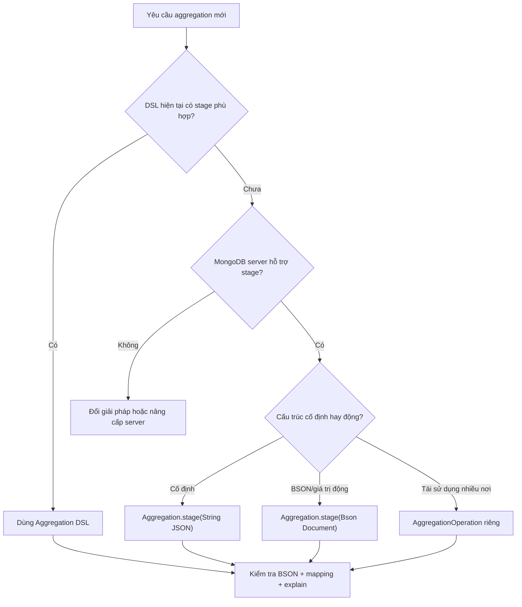

# Stage chưa có DSL: dùng AggregationOperation hoặc JSON/BSON tường minh

## 1. Vấn đề: MongoDB có stage nhưng Spring Data chưa có builder tương ứng

Spring Data MongoDB cung cấp DSL để tạo nhiều aggregation stage như `$match`, `$group`, `$lookup`, `$setWindowFields`, `$densify`, `$sort` và `$project`. Tuy nhiên, **MongoDB server và thư viện Spring Data có vòng đời phát hành khác nhau**. Có những stage đã tồn tại trên server nhưng chưa được phiên bản Spring Data đang sử dụng biểu diễn bằng một builder riêng; cũng có stage chỉ hoạt động trên nền tảng nhất định.

Ví dụ: MongoDB hỗ trợ **`$fill` từ phiên bản 5.3** để điền giá trị thiếu/null. Danh sách stage DSL trong tài liệu Spring Data MongoDB hiện hành có `DensifyOperation`, `SetWindowFieldsOperation`, nhưng không liệt kê một `FillOperation` tương ứng. Ta **không cần đợi nâng cấp DSL** mới có thể sử dụng `$fill`: có thể đưa một stage JSON/BSON tường minh vào cùng pipeline.

Ba cách phổ biến:

1. **`Aggregation.stage(String json)`:** khai báo một stage MongoDB bằng JSON, ngắn gọn với cấu trúc cố định.
2. **`Aggregation.stage(Bson bson)`:** truyền BSON do Java tạo bằng `Document` hoặc kiểu `Bson` tương thích, thuận tiện khi có giá trị động và cần giữ đúng BSON type.
3. **`AggregationOperation` tùy chỉnh:** đóng gói một stage thành class/lambda tái sử dụng, có quyền truy cập `AggregationOperationContext` nếu cần tham chiếu metadata.

**Chủ đề của bài không phải viết một ngôn ngữ query mới.** Ta chỉ mở rộng pipeline đúng chỗ, giữ các stage đã có DSL ở dạng DSL, và kiểm soát phần stage tường minh về mapping, phiên bản server, tính đúng đắn và hiệu năng.

Trong hệ thống **Mini Commerce** của mô-đun `SPRING_DATA_MONGODB`, chúng ta sẽ truy vấn các `Order`, điền `discount_amount` bị thiếu, tính số tiền thực thu cho báo cáo và xác minh dữ liệu BSON. Kiến thức áp dụng tương tự cho `Product`, `Customer`, truy vấn bằng `MongoTemplate`/repository, reactive access, index, transaction và chẩn đoán hiệu năng.

### Mục tiêu học tập

Sau bài này, bạn có thể:

- Nhận biết **stage** khác **aggregation expression/operator** và kiểm tra xem DSL thật sự thiếu ở phiên bản dự án hay không.
- Viết `Aggregation.stage(String)` và `Aggregation.stage(Bson)` chính xác, biết API này có từ **Spring Data MongoDB 4.0**.
- Tạo một `AggregationOperation` tái sử dụng bằng `toDocument(AggregationOperationContext)`; hiểu lý do cần context và giới hạn của việc mapping.
- Phân biệt **tên Java property** với **BSON field name** khi trộn DSL và stage tường minh.
- Sử dụng `$fill`, hiểu `value`, `method: "locf"/"linear"` và khác biệt với `$ifNull`/`$densify`.
- Giữ đúng kiểu tiền `BigDecimal`/BSON `Decimal128` khi tạo stage.
- Không đưa JSON, field path, stage operator hoặc tham số pipeline tùy ý từ HTTP vào MongoDB.
- Kiểm tra server capability, lỗi runtime, stage ordering, memory, index, `explain` và độ an toàn dữ liệu.
- Viết integration test chạy trên MongoDB thật và đối chiếu BSON/DTO.

**Điều kiện đầu vào:** Java 17+, Spring Boot tích hợp Spring Data MongoDB, hiểu `@Document`, `@Id`, `@Field`, `MongoTemplate`, `Aggregation`, `Query`/`Criteria`. Các ví dụ `$fill` cần **MongoDB server 5.3 trở lên**; ví dụ `Aggregation.stage(...)` cần **Spring Data MongoDB 4.0 trở lên**. Nếu dự án ở phiên bản khác, xem phần tương thích.

## 2. Bảng quyết định: chọn escape hatch nào?

| Tình huống | Nên chọn | Lý do |
| --- | --- | --- |
| Stage đã có DSL ổn định (`$match`, `$group`, `$lookup`...) | DSL Spring Data | Rõ kiểu API, dùng mapping/metadata nơi được hỗ trợ |
| Stage chưa có DSL, cấu trúc **cố định** | `Aggregation.stage(String)` | Ngắn, dễ đối chiếu với `mongosh` |
| Stage chưa có DSL, giá trị cấu hình là **Java/BSON values** | `Aggregation.stage(Bson)` | Dễ giữ `Decimal128`, `Date`, cấu trúc `Document` |
| Stage mới được dùng ở nhiều service | Class `AggregationOperation` tùy chỉnh | Gom kiểm tra và xây dựng stage vào một chỗ |
| Dự án Spring Data **trước 4.0** | `AggregationOperation` tùy chỉnh | `Aggregation.stage(...)` chưa có |
| Cần toàn quyền driver, không cần Spring entity mapping | `MongoCollection.aggregate(List<Bson>)` | Kiểm soát raw BSON hoàn toàn |
| Stage thuộc MongoDB Search hoặc chức năng nền tảng riêng | Kiểm tra nền tảng rồi dùng stage tường minh nếu phù hợp | Có API Java chưa đủ để server thực thi |
| Chỉ cần `null` thành giá trị mặc định trong một projection | DSL `$ifNull` / `$project` | Không cần thêm stage mới nếu semantics đã đáp ứng |

**Phân biệt:** `$fill` là **pipeline stage**; `$ifNull` là **expression** dùng trong `$project`/`$set`. Không được đặt `$ifNull` ở đầu một stage như `{ "$ifNull": ... }`: MongoDB yêu cầu mỗi stage phải bắt đầu bằng một stage operator hợp lệ.



## 3. Mini Commerce: dữ liệu báo cáo đơn hàng

Ta xây màn hình thống kê những đơn **PAID** của một cửa hàng. Document `Order` có `total_amount`, còn `discount_amount` có thể:

- **Missing:** dữ liệu từ phiên bản schema cũ chưa có khuyến mãi.
- **Null:** import đã tạo field nhưng không có giá trị.
- **Decimal128:** dữ liệu mới đã ghi tiền chiết khấu.

Yêu cầu báo cáo là coi giá trị discount thiếu/null là **0.00** rồi tính:

\[
\text{netAmount} = \text{totalAmount} - \text{discountAmount}
\]

### 3.1. Entity Order và @Field

```java
package com.example.minicommerce.domain;

import java.math.BigDecimal;
import java.time.Instant;

import org.springframework.data.annotation.Id;
import org.springframework.data.mongodb.core.mapping.Document;
import org.springframework.data.mongodb.core.mapping.Field;
import org.springframework.data.mongodb.core.mapping.FieldType;

@Document(collection = "orders")
public class Order {

    @Id
    private String id;

    @Field("tenant_id")
    private String tenantId;

    private String status;

    @Field("placed_at")
    private Instant placedAt;

    @Field(name = "total_amount", targetType = FieldType.DECIMAL128)
    private BigDecimal totalAmount;

    @Field(name = "discount_amount", targetType = FieldType.DECIMAL128)
    private BigDecimal discountAmount;

    public Order() {}

    public String getId() { return id; }
    public String getTenantId() { return tenantId; }
    public String getStatus() { return status; }
    public Instant getPlacedAt() { return placedAt; }
    public BigDecimal getTotalAmount() { return totalAmount; }
    public BigDecimal getDiscountAmount() { return discountAmount; }
}
```

Ở đây cần nhớ:

| Java property | BSON key trong MongoDB |
| --- | --- |
| `id` | `_id` |
| `tenantId` | `tenant_id` |
| `status` | `status` |
| `placedAt` | `placed_at` |
| `totalAmount` | `total_amount` |
| `discountAmount` | `discount_amount` |

Các tên BSON trên là **hợp đồng dữ liệu thực**. `Aggregation.stage(String/Bson)` không tự đổi `"discountAmount"` thành `"discount_amount"` cho bạn.

### 3.2. Fixture BSON trong mongosh

Thực hành trên database **test riêng**:

```javascript
use mini_commerce

db.orders.insertMany([
  {
    _id: "order-stage-101",
    tenant_id: "shop-a",
    status: "PAID",
    placed_at: ISODate("2026-11-19T09:00:00Z"),
    total_amount: NumberDecimal("300.00")
    // discount_amount bị thiếu
  },
  {
    _id: "order-stage-102",
    tenant_id: "shop-a",
    status: "PAID",
    placed_at: ISODate("2026-11-19T10:00:00Z"),
    total_amount: NumberDecimal("200.00"),
    discount_amount: null
  },
  {
    _id: "order-stage-103",
    tenant_id: "shop-a",
    status: "PAID",
    placed_at: ISODate("2026-11-19T11:00:00Z"),
    total_amount: NumberDecimal("500.00"),
    discount_amount: NumberDecimal("25.00")
  },
  {
    _id: "order-stage-104",
    tenant_id: "shop-b",
    status: "PAID",
    placed_at: ISODate("2026-11-19T12:00:00Z"),
    total_amount: NumberDecimal("999.00")
  },
  {
    _id: "order-stage-105",
    tenant_id: "shop-a",
    status: "PLACED",
    placed_at: ISODate("2026-11-19T13:00:00Z"),
    total_amount: NumberDecimal("40.00")
  }
]);
```

`insertMany` không phải idempotent với cùng `_id`; dùng fixture/collection cô lập. Không chạy những lệnh xóa hoặc nhập dữ liệu test trên production.

Kết quả mong đợi cho `tenant_id = "shop-a"` và `status = "PAID"`:

| Order | totalAmount | discountAmount sau fill | netAmount |
| --- | ---: | ---: | ---: |
| `order-stage-101` | 300.00 | 0.00 | 300.00 |
| `order-stage-102` | 200.00 | 0.00 | 200.00 |
| `order-stage-103` | 500.00 | 25.00 | 475.00 |

`order-stage-104` bị loại theo tenant; `order-stage-105` bị loại theo trạng thái. **`$fill` trong một aggregation đọc không sửa các Order gốc trên đĩa**. Nó chỉ thay đổi document trung gian của pipeline.

## 4. Viết $fill nguyên bản trong mongosh

Trước khi dùng Java, hãy xây một pipeline MongoDB rõ nghĩa:

```javascript
db.orders.aggregate([
  {
    $match: {
      tenant_id: "shop-a",
      status: "PAID"
    }
  },
  {
    $fill: {
      output: {
        discount_amount: { value: NumberDecimal("0.00") }
      }
    }
  },
  {
    $project: {
      _id: 0,
      orderId: "$_id",
      totalAmount: "$total_amount",
      discountAmount: "$discount_amount",
      netAmount: {
        $subtract: ["$total_amount", "$discount_amount"]
      }
    }
  },
  { $sort: { orderId: 1 } }
]);
```

Các stage:

1. `$match` chỉ lấy Order thuộc tenant và trạng thái cần báo cáo.
2. `$fill` điền `discount_amount = Decimal128(0.00)` cho những document thiếu/null; giá trị 25.00 đang có được giữ nguyên.
3. `$project` đổi tên field và tính `netAmount`.
4. `$sort` tạo thứ tự ổn định cho việc kiểm tra/báo cáo.

### 4.1. Vì sao dùng Decimal128 cho số 0?

Trong MongoDB, `0` là literal số nguyên; `0.00` trong JavaScript thông thường thường là Number/Double. Nếu nghiệp vụ tiền sử dụng BSON Decimal128, hãy truyền giá trị **Decimal128** thay vì dựa vào ép kiểu ngầm:

```javascript
NumberDecimal("0.00")
```

Trong Java, đại diện tương ứng là `new Decimal128(new BigDecimal("0.00"))`. Điều đó giúp kiểm thử đọc `discount_amount`/`netAmount` nhất quán và tránh đưa nhầm một String `"0.00"` vào phép trừ.

### 4.2. $fill khác $ifNull ở điểm nào?

Để điền một **giá trị mặc định ngay trong projection**, có thể dùng expression:

```javascript
{
  $project: {
    totalAmount: "$total_amount",
    discountAmount: {
      $ifNull: ["$discount_amount", NumberDecimal("0.00")]
    }
  }
}
```

Với yêu cầu đơn giản ở đây, `$ifNull` cũng đáp ứng được. **Không bắt buộc dùng `$fill` chỉ vì đang học cách mở rộng DSL.** `$fill` đặc biệt hữu ích khi cần lấp dữ liệu qua nhiều bản ghi theo thứ tự như **`method: "locf"`** (lấy giá trị gần nhất trước đó) hoặc **`method: "linear"`** (nội suy); lúc đó một `$ifNull` đơn thuần không có cùng ngữ nghĩa.

## 5. Cách 1: Aggregation.stage(String JSON)

Từ **Spring Data MongoDB 4.0**, `Aggregation.stage(String json)` cho phép thêm stage từ JSON:

```java
import java.util.List;

import org.springframework.data.mongodb.core.MongoTemplate;
import org.springframework.data.mongodb.core.aggregation.Aggregation;
import org.springframework.data.mongodb.core.aggregation.AggregationOperation;
import org.springframework.data.mongodb.core.aggregation.AggregationResults;
import org.springframework.data.mongodb.core.query.Criteria;

import com.example.minicommerce.domain.Order;

public List<OrderNetView> report(String tenantId, MongoTemplate template) {
    AggregationOperation fillDiscount = Aggregation.stage("""
        {
          "$fill": {
            "output": {
              "discount_amount": {
                "value": { "$numberDecimal": "0.00" }
              }
            }
          }
        }
        """);

    AggregationOperation projectNet = Aggregation.stage("""
        {
          "$project": {
            "_id": 0,
            "orderId": "$_id",
            "totalAmount": "$total_amount",
            "discountAmount": "$discount_amount",
            "netAmount": {
              "$subtract": ["$total_amount", "$discount_amount"]
            }
          }
        }
        """);

    Aggregation pipeline = Aggregation.newAggregation(
        Aggregation.match(
            Criteria.where("tenantId").is(tenantId)
                .and("status").is("PAID")),
        fillDiscount,
        projectNet,
        Aggregation.stage(
            "{ '$sort': { 'orderId': 1 } }")
    );

    AggregationResults<OrderNetView> results =
        template.aggregate(
            pipeline, Order.class, OrderNetView.class);

    return results.getMappedResults();
}
```

Đây là method minh họa trong service có đầy đủ import của `OrderNetView`. Java text block yêu cầu Java 15+ (điều kiện bài là Java 17+). Literal `{ "$numberDecimal": "0.00" }` dùng **MongoDB Extended JSON**, được parser BSON nhận diện thành Decimal128; không phải truyền nguyên một object có key `$numberDecimal` cho `$fill` xử lý như một operator.

### 5.1. Vì sao $match dùng Java property, còn $fill dùng BSON key?

`Aggregation.match(Criteria.where("tenantId").is(tenantId))` được Spring Data mapping theo `Order.class`, nên tên `tenantId` có thể thành `tenant_id`.

Ngược lại, **tài liệu API `Aggregation.stage(...)` nói rõ rằng field mapping theo domain type hoặc các stage trước đó không diễn ra** với stage này. Do đó phải viết:

```javascript
{ "$fill": { "output": { "discount_amount": { "value": 0 } } } }
```

chứ không mặc định:

```javascript
{ "$fill": { "output": { "discountAmount": { "value": 0 } } } }
```

JSON thứ hai có thể **tạo/thay một field BSON mới `discountAmount`** mà không đụng field thật `discount_amount`. Đây là lỗi nguy hiểm vì không nhất thiết gây exception: kết quả số liệu có thể sai trong khi pipeline vẫn chạy.

### 5.2. Ưu điểm và giới hạn của String JSON

**Ưu điểm:** dễ so sánh với pipeline trong `mongosh`, thuận tiện khi stage cố định, biểu thức dài nhưng ít thay đổi.

**Giới hạn:** field name không được compiler kiểm tra, không tự mapping `@Field`, khó bind giá trị động an toàn nếu cố nối string, sai cú pháp có thể chỉ phát hiện khi chạy, không tự kiểm tra MongoDB server có hỗ trợ stage.

**Quy tắc:** giữ JSON stage trong một constant/helper đã review; dùng DSL `Criteria` cho filter input của người dùng khi có thể. Đừng nối trực tiếp query từ HTTP vào JSON stage.

## 6. DTO báo cáo: không save kết quả aggregation

`OrderNetView` là **read model**, không phải aggregate root:

```java
package com.example.minicommerce.service;

import java.math.BigDecimal;

public class OrderNetView {
    private String orderId;
    private BigDecimal totalAmount;
    private BigDecimal discountAmount;
    private BigDecimal netAmount;

    public OrderNetView() {}

    public String getOrderId() { return orderId; }
    public void setOrderId(String value) { orderId = value; }
    public BigDecimal getTotalAmount() { return totalAmount; }
    public void setTotalAmount(BigDecimal value) { totalAmount = value; }
    public BigDecimal getDiscountAmount() { return discountAmount; }
    public void setDiscountAmount(BigDecimal value) {
        discountAmount = value;
    }
    public BigDecimal getNetAmount() { return netAmount; }
    public void setNetAmount(BigDecimal value) { netAmount = value; }
}
```

Đặt alias trong `$project` khớp tên property DTO. Vì `$project` đặt `"_id": 0`, output không còn MongoDB `_id`; `orderId` là field riêng.

**Không gọi `repository.save(...)` trên dữ liệu đọc qua aggregation/projection.** DTO này không chứa toàn bộ Order; nếu cố chuyển ngược thành entity rồi `save`, các trường chưa có có thể bị mất do ghi thay thế document.

## 7. Cách 2: Aggregation.stage(Bson) với Document

Khi cần giá trị động đúng kiểu BSON, có thể tạo stage Java:

```java
import java.math.BigDecimal;
import org.bson.Document;
import org.bson.types.Decimal128;
import org.springframework.data.mongodb.core.aggregation.Aggregation;
import org.springframework.data.mongodb.core.aggregation.AggregationOperation;

Decimal128 zero = new Decimal128(
    new BigDecimal("0.00"));

Document stage = new Document(
    "$fill",
    new Document("output",
        new Document("discount_amount",
            new Document("value", zero)))
);

AggregationOperation fillDiscount =
    Aggregation.stage(stage);
```

`org.bson.Document` triển khai giao diện `Bson`, nên được dùng với overload `Aggregation.stage(Bson)`. API này cũng có từ Spring Data MongoDB 4.0.

Mã Java trên có cùng ý nghĩa với JSON:

```javascript
{
  $fill: {
    output: {
      discount_amount: { value: NumberDecimal("0.00") }
    }
  }
}
```

### 7.1. Tại sao Document thường tốt hơn ghép JSON?

| Trường hợp | Ghép JSON String | Dựng Document/Bson |
| --- | --- | --- |
| Decimal128 | Dễ viết nhầm `"0.00"` hoặc `0.0` | Truyền `Decimal128` rõ ràng |
| Instant/Date | Phải viết đúng Extended JSON | Có thể dùng `java.util.Date`/BSON codec phù hợp |
| Biểu thức lồng sâu | Dễ sai dấu ngoặc/quote | Cấu trúc Java kiểm soát rõ |
| Giá trị cấu hình động | Dễ bị JSON injection nếu nối string | Giá trị Java được mã hóa theo BSON |
| Field path/operator động | Vẫn nguy hiểm | **Vẫn phải whitelist**, vì key là cấu trúc query |
| Review/reuse | Rất tốt với JSON tĩnh ngắn | Rất tốt với helper có tham số |

**Không nhầm “Document an toàn hơn JSON string” với “cho phép mọi đầu vào”.** Nếu người dùng điều khiển tên key, operator hoặc toàn bộ stage, họ vẫn có thể thay ý nghĩa pipeline dù bạn không nối string.

### 7.2. Helper giới hạn field được phép điền

```java
import java.math.BigDecimal;
import java.util.Set;

import org.bson.Document;
import org.bson.types.Decimal128;
import org.springframework.data.mongodb.core.aggregation.Aggregation;
import org.springframework.data.mongodb.core.aggregation.AggregationOperation;

public final class FillStages {

    private static final Set<String> ALLOWED_FIELDS =
        Set.of("discount_amount", "shipping_fee");

    private FillStages() {}

    public static AggregationOperation zeroMoneyIfMissing(
            String bsonField) {

        if (!ALLOWED_FIELDS.contains(bsonField)) {
            throw new IllegalArgumentException(
                "Unsupported BSON field");
        }

        Decimal128 zero = new Decimal128(
            new BigDecimal("0.00"));

        Document stage = new Document("$fill",
            new Document("output",
                new Document(bsonField,
                    new Document("value", zero))));

        return Aggregation.stage(stage);
    }
}
```

Helper này dùng **BSON field name**, không phải Java property name. Trong hệ thống lớn, có thể tạo một enum biểu diễn field được phép và ánh xạ enum → BSON key để tránh caller nhập chuỗi.

## 8. Cách 3: Tự cài đặt AggregationOperation

Nếu stage dùng lặp lại hoặc cần một factory có validation, tạo class riêng:

```java
package com.example.minicommerce.aggregation;

import java.math.BigDecimal;
import java.util.Objects;

import org.bson.Document;
import org.bson.types.Decimal128;
import org.springframework.data.mongodb.core.aggregation.AggregationOperation;
import org.springframework.data.mongodb.core.aggregation.AggregationOperationContext;

/**
 * $fill cho đúng BSON field discount_amount của orders.
 * Yêu cầu MongoDB >= 5.3.
 */
public final class FillDiscountOperation
        implements AggregationOperation {

    private final Decimal128 fallback;

    public FillDiscountOperation(BigDecimal value) {
        Objects.requireNonNull(value, "value");
        if (value.signum() < 0) {
            throw new IllegalArgumentException(
                "Discount fallback must be non-negative");
        }
        this.fallback = new Decimal128(value);
    }

    @Override
    public String getOperator() {
        return "$fill";
    }

    @Override
    public Document toDocument(
            AggregationOperationContext context) {

        return new Document("$fill",
            new Document("output",
                new Document("discount_amount",
                    new Document("value", fallback))));
    }
}
```

Sử dụng:

```java
AggregationOperation fill =
    new FillDiscountOperation(new BigDecimal("0.00"));

Aggregation agg = Aggregation.newAggregation(
    Aggregation.match(
        Criteria.where("tenantId").is("shop-a")
            .and("status").is("PAID")),
    fill,
    Aggregation.stage(
        "{ '$project': { '_id': 0, " +
        "'orderId': '$_id', " +
        "'discountAmount': '$discount_amount' } }")
);
```

### 8.1. Interface này thực sự có gì?

`AggregationOperation` đại diện một operation trong pipeline. Các API chính:

- `toDocument(AggregationOperationContext)`: tạo `Document` của stage. API vẫn có để tương thích nhưng được đánh dấu **deprecated trong các phiên bản Spring Data gần đây**, ưu tiên `toPipelineStages(...)` trong contract mới.
- `toPipelineStages(AggregationOperationContext)`: cho phép một operation xuất một hoặc nhiều stage; mặc định có thể dựa vào `toDocument(...)`.
- `getOperator()`: trả tên stage, ví dụ `"$fill"`, hữu ích để thư viện biết operator mà không phải render document.

Đoạn class dùng `toDocument(...)` vì đây là cách đơn giản, tương thích với nhiều phiên bản và phù hợp một stage. Nếu compiler dự án cảnh báo deprecated, cần đọc contract phiên bản đang dùng, có thể bổ sung `toPipelineStages(...)`; **không** xóa `toDocument(...)` khi interface ở phiên bản dự án vẫn yêu cầu implementation đó.

### 8.2. Tại sao có AggregationOperationContext?

Context cho phép truy cập metadata/field references của pipeline, bao gồm:

```java
AggregationOperation mapped = context -> {
    Document stage = new Document(
        "$match", new Document("tenantId", "shop-a"));

    return context.getMappedObject(stage);
};
```

`getMappedObject(...)` là API có thể áp dụng mapping dựa trên context cho cấu trúc được nhận diện. Tuy nhiên, **không được giả định rằng context hiểu toàn bộ cú pháp của một stage mới**, đặc biệt các trường dùng làm **key đầu ra** của `$fill`, biến `$$var` hoặc những expression đặc thù. Với stage không được DSL nhận diện, cách an toàn là dùng **BSON key đã được xác minh**, kết hợp các stage có DSL cho filter/project có sẵn và có integration test xác nhận BSON cuối.

Trong `FillDiscountOperation` trên, ta cố ý trả `Document` với key `discount_amount` đã đúng schema; không gọi `context.getMappedObject(...)` chỉ để “hy vọng framework sửa tên”.

### 8.3. Một custom operation không tự khai báo fields

Một stage `$set`/`$fill` có thể thêm field; Spring Data còn có cơ chế quản lý **field exposure** cho các aggregation operation. `Aggregation.stage(...)` và custom operation đơn giản **không tự bảo đảm** các stage DSL đứng sau biết chính xác field mới đã xuất hiện.

Nếu pipeline phức tạp và stage sau tham chiếu field vừa được sinh:

- Dùng alias BSON rõ ràng ở raw `$project`/`$sort` nếu cần.
- Hoặc triển khai các interface exposure thích hợp trong custom operation nâng cao.
- Kiểm tra pipeline đã render và chạy integration test.
- Nếu muốn kiểm tra field name nghiêm ngặt, đánh giá `strictMapping` nhưng nhớ rằng nó **không biến raw JSON stage thành DSL có mapping**.

## 9. Trộn DSL và raw stage trong cùng pipeline

Kiểu cấu trúc được khuyến nghị:

```text
Typed/DSL $match (theo Java property + mapping)
         |
         v
Raw $fill (BSON field discount_amount)
         |
         v
Raw $project (tham chiếu BSON total_amount/discount_amount)
         |
         v
Raw $sort hoặc DSL stage đã kiểm tra context
         |
         v
Read-only DTO
```

**Không cần chuyển mọi stage sang Document chỉ vì một stage thiếu DSL.** Ví dụ `Aggregation.match(Criteria.where("tenantId")...)` dễ bảo trì hơn tự viết JSON `$match` lặp lại trong mỗi service.

### 9.1. Sai lầm về tên field sau custom stage

Giả sử:

```java
@Field("discount_amount")
private BigDecimal discountAmount;
```

Khi viết stage `$fill`, các lựa chọn này khác nhau:

```javascript
// Đúng với BSON schema:
{ $fill: { output: { discount_amount: { value: NumberDecimal("0.00") } } } }

// Sai schema nếu chỉ có Java property discountAmount:
{ $fill: { output: { discountAmount: { value: NumberDecimal("0.00") } } } }
```

Trong ví dụ sai, MongoDB không biết `@Field` và có thể tạo field mới `discountAmount` trong document trung gian, dẫn tới báo cáo hai trường hoặc phép trừ còn null.

### 9.2. strictMapping không thay thế kiểm thử raw stage

`TypedAggregation`/`AggregationOptions` có cơ chế mapping theo domain. Từ Spring Data MongoDB 3.2, các tham chiếu field không tồn tại **không còn mặc định bị báo lỗi** theo cách cũ; có thể cấu hình `strictMapping` để khôi phục kiểm tra chặt chẽ hơn cho phần mapped operations.

```java
import org.springframework.data.mongodb.core.aggregation.Aggregation;
import org.springframework.data.mongodb.core.aggregation.AggregationOptions;

AggregationOptions options = AggregationOptions.builder()
    .strictMapping()
    .build();

Aggregation checked = aggregation.withOptions(options);
```

`aggregation` ở đây là pipeline đã tạo. `strictMapping()` **không cam kết** kiểm tra và chuyển tên field cho `Aggregation.stage(String/Bson)` vì API raw stage cố ý giữ nguyên BSON/JSON. Nếu bật `noMapping()`, bạn còn tắt mapping toàn pipeline; chỉ dùng khi đã chủ động viết tất cả field theo BSON.

## 10. $fill theo chuỗi dữ liệu: locf và linear

Ứng dụng Mini Commerce có thêm collection `product_signals` để lưu điểm chất lượng danh mục theo ngày. Một số ngày không có số liệu hoặc có giá trị `null`.

```javascript
db.product_signals.insertMany([
  {
    _id: "signal-1",
    tenant_id: "shop-a",
    sku: "KBD-001",
    measured_at: ISODate("2026-11-17T00:00:00Z"),
    quality_score: 80
  },
  {
    _id: "signal-2",
    tenant_id: "shop-a",
    sku: "KBD-001",
    measured_at: ISODate("2026-11-18T00:00:00Z"),
    quality_score: null
  },
  {
    _id: "signal-3",
    tenant_id: "shop-a",
    sku: "KBD-001",
    measured_at: ISODate("2026-11-19T00:00:00Z"),
    quality_score: 90
  }
]);
```

### 10.1. LOCF: giữ giá trị gần nhất trước đó

```javascript
db.product_signals.aggregate([
  { $match: { tenant_id: "shop-a", sku: "KBD-001" } },
  {
    $fill: {
      partitionByFields: ["tenant_id", "sku"],
      sortBy: { measured_at: 1 },
      output: {
        quality_score: { method: "locf" }
      }
    }
  },
  { $sort: { measured_at: 1 } }
]);
```

Với fixture, `quality_score` của ngày 18/11 được điền thành **80**. `locf` chỉ dùng giá trị đã biết **trước đó trong partition**; nếu không có giá trị trước đó, phần đầu chuỗi có thể vẫn null.

### 10.2. Linear: nội suy giữa hai quan sát

```javascript
db.product_signals.aggregate([
  { $match: { tenant_id: "shop-a", sku: "KBD-001" } },
  {
    $fill: {
      partitionByFields: ["tenant_id", "sku"],
      sortBy: { measured_at: 1 },
      output: {
        quality_score: { method: "linear" }
      }
    }
  },
  { $sort: { measured_at: 1 } }
]);
```

Với khoảng thời gian đều nhau giữa ngày 17 và 19/11, nội suy điểm 18/11 thành **85**. `linear` có giới hạn với `sortBy` (một field, không trùng giá trị thứ tự trong partition); MongoDB có các thay đổi hành vi cụ thể theo phiên bản. Hãy đọc tài liệu `$fill` của **server đang chạy** khi dùng nội suy.

**Không nhầm `$fill` với `$densify`:** `$fill` điền **field null/missing trong document đã có**, còn `$densify` có thể **sinh thêm document** để lấp khoảng trống của một trục thời gian/số. Nếu ngày 18/11 hoàn toàn không có document, chỉ `$fill` không tự tạo ra ngày đó.

### 10.3. Từ JSON sang Spring Data

```java
AggregationOperation fillScore = Aggregation.stage("""
    {
      "$fill": {
        "partitionByFields": ["tenant_id", "sku"],
        "sortBy": { "measured_at": 1 },
        "output": {
          "quality_score": { "method": "locf" }
        }
      }
    }
    """);
```

Đây là ví dụ stage chưa có DSL tương ứng trong danh sách hỗ trợ; các field path dùng **tên BSON thực**. Nếu đo `quality_score` là một biến nghiệp vụ không cho phép kế thừa giữa các ngày, **không** dùng LOCF chỉ vì nó dễ thực hiện: phương pháp điền là quyết định phân tích dữ liệu, không phải tính năng tự chọn của Spring Data.

## 11. Một trường hợp đặc thù: MongoDB Search / Atlas

Spring Data có thể cho phép đăng ký stage mà DSL chưa hỗ trợ, chẳng hạn `$search` trên nền tảng có **MongoDB Search**. Nhưng **có API Java không có nghĩa server bất kỳ đều chạy được stage này**.

Ví dụ ý tưởng cho collection `products` có search index `product_name_search` đã được cấu hình:

```java
Aggregation searchPipeline = Aggregation.newAggregation(
    Aggregation.stage("""
        {
          "$search": {
            "index": "product_name_search",
            "text": {
              "query": "ban phim",
              "path": "name"
            }
          }
        }
        """),
    Aggregation.limit(10)
);
```

**Điều kiện:** database/deployment hỗ trợ MongoDB Search và index tồn tại; không dùng ví dụ này như một tính năng bảo đảm có trên mọi MongoDB Community server. Stage `$search` có **quy tắc về vị trí** (thường cần là stage đầu pipeline chứa nó). Không tự đặt `$match` trước `$search` vì ở pipeline thông thường điều đó có thể không hợp lệ; đưa điều kiện lọc phù hợp vào `compound.filter` theo cú pháp Search khi cần.

Khác biệt quan trọng:

- `$search` thực thi trên search index/analyzer phù hợp.
- `$text` và text index truyền thống có semantics khác.
- `$regex` thường không thay thế được full-text/fuzzy search.
- Stage tường minh không làm các loại search “tự xuất hiện” trên server.

Không nhét thông tin truy cập, token, payload nội bộ hoặc JSON stage tùy ý từ request vào cấu hình Search.

## 12. Khi không dùng Spring DSL: MongoDB Java Driver

Nếu thực sự cần pipeline hoàn toàn theo BSON và chủ động quản lý tên field, có thể gọi native driver:

```java
import java.math.BigDecimal;
import java.util.ArrayList;
import java.util.List;

import com.mongodb.client.MongoCollection;
import com.mongodb.client.model.Aggregates;
import com.mongodb.client.model.Filters;

import org.bson.Document;
import org.bson.conversions.Bson;
import org.bson.types.Decimal128;

MongoCollection<Document> orders =
    mongoTemplate.getCollection("orders");

Document fillStage = new Document("$fill",
    new Document("output",
        new Document("discount_amount",
            new Document("value",
                new Decimal128(new BigDecimal("0.00"))))));

Document projectStage = Document.parse("""
    {
      "$project": {
        "_id": 0,
        "orderId": "$_id",
        "discountAmount": "$discount_amount"
      }
    }
    """);

List<Bson> pipeline = List.of(
    Aggregates.match(Filters.and(
        Filters.eq("tenant_id", "shop-a"),
        Filters.eq("status", "PAID"))),
    fillStage,
    projectStage
);

List<Document> results =
    orders.aggregate(pipeline).into(new ArrayList<>());
```

**Khác với `MongoTemplate.aggregate(..., Order.class, ...)`:** raw driver `MongoCollection<Document>` không tự áp dụng `@Field("tenant_id")`, conversion, entity callback hay auditing của Spring Data. Tất cả tên key trong ví dụ phải là **BSON key**.

Native driver hữu ích cho stage rất mới, pipeline tạo từ nhiều đoạn BSON hoặc chức năng server mà DSL chưa hỗ trợ. Với ứng dụng đã dùng Spring Data cho phần lớn truy vấn, thường chỉ cần `Aggregation.stage(...)` cho **một vài stage thiếu**, không cần bỏ toàn bộ `MongoTemplate`.

## 13. Stage ordering: DSL không thể sửa thứ tự sai

Một stage có thể chạy đúng cú pháp nhưng cho kết quả sai khi đặt sai vị trí.

### 13.1. $match càng sớm càng tốt, nếu không đổi semantics

```javascript
[
  { $match: { tenant_id: "shop-a", status: "PAID" } },
  { $fill: { output: { discount_amount: { value: NumberDecimal("0.00") } } } },
  { $project: { orderId: "$_id", discountAmount: "$discount_amount" } }
]
```

Filter `tenant_id/status` trước `$fill` thường giảm số document cần xử lý. Nhưng nếu một pipeline cần so sánh theo nhóm hoặc window chứa nhiều trạng thái trước khi lọc, đặt `$match` quá sớm có thể thay dữ liệu làm đầu vào cho phép điền. **Tối ưu chỉ sau khi xác định semantics**.

### 13.2. $project có thể làm mất field

```javascript
[
  { $project: { _id: 0, orderId: "$_id" } },
  { $fill: { output: { discount_amount: { value: NumberDecimal("0.00") } } } }
]
```

Ở pipeline này, `$project` đã loại `total_amount`, nên stage sau không thể sử dụng trường đó để tính net. Một raw stage không có cơ chế tự khôi phục field bị loại.

### 13.3. Stage có vị trí bắt buộc

Một số stage tuân theo quy tắc riêng:

- `$search` trong pipeline được hỗ trợ thường phải đứng đầu.
- `$geoNear` có hạn chế vị trí/điều kiện.
- `$out`/`$merge` là stage ghi kết quả, thường phải ở **cuối pipeline**.
- `$fill` với `method: "linear"/"locf"` yêu cầu sort theo cấu trúc hợp lệ; kết quả không nên dựa vào thứ tự ngầm.

`Aggregation.stage(...)` không tự kiểm tra mọi quy tắc này ở compile time. Server quyết định pipeline có hợp lệ và stage có sẵn trên deployment hay không.

## 14. Không ghép JSON động từ request

Một API nguy hiểm:

```java
// KHÔNG LÀM: cho client điều khiển raw aggregation stage.
String rawStage = request.getStageJson();
AggregationOperation operation =
    Aggregation.stage(rawStage);
```

Đoạn **phản ví dụ** trên giả định `request` có phương thức `getStageJson()`. Nếu client có quyền định nghĩa stage, họ có thể cố gắng đọc field không được phép, tạo pipeline tốn tài nguyên hoặc sử dụng stage ghi như `$merge`/`$out` trong một ngữ cảnh nguy hiểm.

### 14.1. Pattern an toàn

```java
public List<OrderNetView> reportForTenant(
        String verifiedTenantId,
        MongoTemplate template) {

    if (verifiedTenantId == null
            || verifiedTenantId.isBlank()) {
        throw new IllegalArgumentException(
            "Tenant is required");
    }

    Aggregation pipeline = Aggregation.newAggregation(
        Aggregation.match(
            Criteria.where("tenantId").is(verifiedTenantId)
                .and("status").is("PAID")),
        FillStages.zeroMoneyIfMissing("discount_amount"),
        Aggregation.stage("""
            {
              "$project": {
                "_id": 0,
                "orderId": "$_id",
                "totalAmount": "$total_amount",
                "discountAmount": "$discount_amount",
                "netAmount": {
                  "$subtract": [
                    "$total_amount",
                    "$discount_amount"
                  ]
                }
              }
            }
            """)
    );

    return template.aggregate(
        pipeline, Order.class, OrderNetView.class)
        .getMappedResults();
}
```

**`verifiedTenantId` phải đến từ security context hoặc nguồn đáng tin cậy**, không chỉ từ request body tùy ý. Các thành phần raw stage là constant hoặc được tạo từ helper có **field whitelist**. Khi API cần sort động, whitelist các tên field/sort direction thay vì cho phép bất kỳ JSON.

### 14.2. MongoDB JSON injection và expression injection

Ngay cả khi dùng `Document`, các vị trí sau là **cấu trúc**, không phải chỉ là giá trị:

- Tên stage operator: `"$fill"`, `"$project"`, `"$lookup"`.
- Tên field BSON: `"discount_amount"`.
- Đường dẫn: `"$customerId"` hoặc `"$$variable"`.
- Biểu thức: `"$subtract"`, `"$cond"`.
- Collection ngoại trong `$lookup` và tên output của `$out`/`$merge`.

**Chỉ bind giá trị chưa đủ** khi đầu vào được phép điều khiển cấu trúc query. Thiết kế schema/DTO cho tham số được phép, để service quyết định operator và path.

## 15. Version compatibility: ba thứ cần kiểm tra

| Thành phần | Điều cần xác minh | Hậu quả nếu thiếu |
| --- | --- | --- |
| MongoDB server | Hỗ trợ `$fill` từ **5.3** | Lỗi stage không được nhận diện khi aggregate |
| Spring Data MongoDB | `Aggregation.stage(String/Bson)` từ **4.0** | Code không biên dịch với API chưa có |
| Nền tảng triển khai | MongoDB Search/stage chuyên biệt cần môi trường tương ứng | Stage không chạy dù JSON hợp lệ |
| MongoDB Java Driver | `Document`, BSON codec, Extended JSON tương thích | Sai kiểu hoặc lỗi parse/serialize |
| Java runtime | Ví dụ `"""` cần Java **15+** | Compiler lỗi nếu Java cũ |
| Mapping schema | `@Field` và BSON key thực tế khớp | Pipeline trả null hoặc tạo field sai |

### 15.1. Dự án Spring Data trước 4.0

Nếu không có `Aggregation.stage(...)`, dùng `AggregationOperation`:

```java
AggregationOperation fill = context ->
    new Document("$fill",
        new Document("output",
            new Document("discount_amount",
                new Document("value",
                    new Decimal128(
                        new BigDecimal("0.00"))))));
```

Ví dụ cần import `AggregationOperation`, `Document`, `Decimal128`, `BigDecimal`. Đây là lối thoát ở tầng **Spring Data API**, nhưng **không thay đổi yêu cầu MongoDB server ≥ 5.3**. Nếu server cũ hơn, phải chọn stage/biểu thức mà server thực sự hỗ trợ hoặc nâng cấp.

### 15.2. Dự án mới không có nghĩa mọi stage mới đều cần raw

Các phiên bản Spring Data hiện hành đã hỗ trợ nhiều stage từng là mới như `$densify`, `$setWindowFields`, `$unionWith`. Trước khi tự viết wrapper:

1. Kiểm tra danh sách stage DSL ở phiên bản hiện tại.
2. Tìm builder trong `Aggregation` và các `*Operation`.
3. Chỉ dùng raw stage khi DSL thực sự thiếu hoặc không diễn đạt được semantics mong muốn.
4. Khi nâng cấp Spring Data, cân nhắc chuyển custom stage sang DSL nếu giảm được rủi ro mapping/maintenance.

Không dán “stage này luôn chưa có DSL” như một sự thật bất biến; khả năng thư viện có thể thay đổi theo version.

## 16. Options, hiệu năng và explain

### 16.1. Đặt index cho phần có thể tận dụng

`$fill` không thay thế index của phần `$match`. Với báo cáo Order:

```javascript
db.orders.createIndex({
  tenant_id: 1,
  status: 1,
  placed_at: 1
});
```

Filter `tenant_id + status` có thể được index hỗ trợ; nếu cần sắp xếp theo `placed_at` trong một báo cáo, thành phần index tiếp theo có thể hữu ích. Tuy nhiên không thể kết luận index trên sẽ tối ưu mọi pipeline `$fill`, nhất là khi sort/window và cardinality khác nhau.

### 16.2. Giới hạn thời gian và disk use khi cần

```java
import java.time.Duration;

import org.springframework.data.mongodb.core.aggregation.Aggregation;
import org.springframework.data.mongodb.core.aggregation.AggregationOptions;

AggregationOptions options = AggregationOptions.builder()
    .maxTime(Duration.ofSeconds(5))
    .allowDiskUse(true)
    .build();

Aggregation guarded = aggregation.withOptions(options);
```

`allowDiskUse(true)` chỉ hữu ích với những stage có khả năng spill ra disk khi cần; **không** khắc phục sai mapping, sai stage operator, vượt BSON document size hoặc query không có index. `maxTime` giúp giới hạn thao tác dài, không thay thế rate limiting, phân trang hoặc lựa chọn pipeline hợp lý.

### 16.3. Kiểm tra executionStats bằng mongosh

```javascript
db.orders.explain("executionStats").aggregate([
  {
    $match: {
      tenant_id: "shop-a",
      status: "PAID"
    }
  },
  {
    $fill: {
      output: {
        discount_amount: {
          value: NumberDecimal("0.00")
        }
      }
    }
  },
  {
    $project: {
      _id: 0,
      orderId: "$_id",
      netAmount: {
        $subtract: [
          "$total_amount",
          "$discount_amount"
        ]
      }
    }
  }
]);
```

Cần quan sát:

| Chỉ số/đặc điểm | Câu hỏi |
| --- | --- |
| `winningPlan` / `IXSCAN` / `COLLSCAN` | Stage `$match` đầu vào có tận dụng index không? |
| `totalKeysExamined` | Bao nhiêu index entries bị duyệt? |
| `totalDocsExamined` | Bao nhiêu document bị đọc? |
| `nReturned` | Bao nhiêu document cuối pipeline? |
| Stage-level statistics | `$fill`/sort có tiêu tốn bộ nhớ/thời gian lớn không? |
| `usedDisk` nếu có | Stage nào đã spill? |
| `executionTimeMillis` | Độ trễ của lần explain; cần đo workload thật |

Format explain khác theo version MongoDB, không hardcode một vị trí JSON. Trên fixture vài Order, planner có thể chọn `COLLSCAN` là hợp lý; muốn đánh giá hiệu năng cần data distribution và số lượng document đại diện.

### 16.4. Chú ý cardinality khi dùng locf/linear

Với `$fill` theo partition và sort, cần xử lý số liệu của một khoảng thời gian có phạm vi hợp lý. Chỉ thêm `$limit` vào đầu pipeline có thể làm thiếu những quan sát trước/sau cần thiết cho phương pháp LOCF/linear; đó là thay đổi kết quả, không đơn thuần tối ưu.

Khi dùng `$densify` kết hợp `$fill`, số document có thể tăng. Phải kiểm tra giới hạn sinh document, memory, sort và output size trước khi chạy toàn bộ lịch sử nhiều năm.

## 17. Ghi hay không ghi? $fill khác $merge và $out

`$fill` trong aggregation đọc **không cập nhật collection nguồn**. Để lưu kết quả tính toán, MongoDB có `$merge` hoặc `$out`, nhưng đây là quyết định nghiệp vụ riêng:

```javascript
// Chỉ minh họa hình dạng; KHÔNG chạy trên production.
db.orders.aggregate([
  { $match: { tenant_id: "shop-a", status: "PAID" } },
  { $fill: { output: { discount_amount: {
      value: NumberDecimal("0.00")
  } } } },
  { $merge: {
      into: "orders_report_cache",
      on: "_id",
      whenMatched: "replace",
      whenNotMatched: "insert"
  } }
]);
```

Lệnh trên có thể tạo/thay document ở `orders_report_cache`; phải xem chính sách `whenMatched`, unique index cho `on`, transaction/permissions và tính idempotent. Việc `Aggregation.stage(...)` cho phép nhập raw `$merge` **không có nghĩa nó là read-only**.

Không cho phép API báo cáo tùy ý nhận stage `$out`/`$merge` từ người dùng. Đối với bài toán báo cáo trực tiếp, hãy trả DTO và **không thêm stage ghi**.

## 18. ReactiveMongoTemplate: cùng semantics, kết quả Flux

Với Spring Data MongoDB reactive:

```java
import reactor.core.publisher.Flux;

import org.springframework.data.mongodb.core.aggregation.Aggregation;
import org.springframework.data.mongodb.core.query.Criteria;

Aggregation pipeline = Aggregation.newAggregation(
    Aggregation.match(
        Criteria.where("tenantId").is("shop-a")
            .and("status").is("PAID")),
    Aggregation.stage("""
        {
          "$fill": {
            "output": {
              "discount_amount": {
                "value": { "$numberDecimal": "0.00" }
              }
            }
          }
        }
        """),
    Aggregation.stage("""
        {
          "$project": {
            "_id": 0,
            "orderId": "$_id",
            "netAmount": {
              "$subtract": [
                "$total_amount",
                "$discount_amount"
              ]
            }
          }
        }
        """)
);

Flux<OrderNetView> views =
    reactiveMongoTemplate.aggregate(
        pipeline, Order.class, OrderNetView.class);
```

`reactiveMongoTemplate` là bean được inject trong service WebFlux; publisher thực thi khi được subscribe. Không gọi `block()` trong event-loop. **Reactive không thay đổi mapping hay yêu cầu phiên bản của `$fill`** và cũng không làm một pipeline lớn tự động có index.

Test bằng Reactor:

```java
import reactor.test.StepVerifier;

StepVerifier.create(views.collectList())
    .assertNext(rows -> {
        org.junit.jupiter.api.Assertions.assertFalse(
            rows.isEmpty());
    })
    .verifyComplete();
```

Đây là khung test ngắn; trong integration test thật hãy xác minh giá trị số, tenant isolation và thứ tự kết quả nếu API có sort.

## 19. Kiểm thử cấu trúc stage trước khi gọi server

`Aggregation.stage(String/Bson)` sinh một `AggregationOperation`. Ta có thể kiểm tra BSON render của riêng stage:

```java
import static org.junit.jupiter.api.Assertions.*;

import java.util.List;

import org.bson.Document;
import org.junit.jupiter.api.Test;
import org.springframework.data.mongodb.core.aggregation.Aggregation;
import org.springframework.data.mongodb.core.aggregation.AggregationOperation;

class FillStageUnitTest {

    @Test
    void createsOneFillStageWithExpectedField() {
        AggregationOperation stage = Aggregation.stage("""
            {
              "$fill": {
                "output": {
                  "discount_amount": {
                    "value": { "$numberDecimal": "0.00" }
                  }
                }
              }
            }
            """);

        List<Document> documents = stage.toPipelineStages(
            Aggregation.DEFAULT_CONTEXT);

        assertEquals(1, documents.size());
        assertTrue(documents.get(0).containsKey("$fill"));

        Document fill = documents.get(0)
            .get("$fill", Document.class);
        Document output = fill.get("output", Document.class);

        assertTrue(output.containsKey("discount_amount"));
        assertFalse(output.containsKey("discountAmount"));
    }
}
```

Test này bắt được một nhóm lỗi cơ bản (sai JSON, sai BSON key) nhưng **không** chứng minh server hỗ trợ `$fill`, filter DSL map đúng `tenantId`, hay giá tiền được tính đúng. Cần integration test tiếp theo.

## 20. Integration test với MongoDB thật

Sử dụng **MongoDB server 5.3+**, một database riêng hoặc Testcontainers phù hợp. Test dưới đây insert raw BSON để kiểm chứng:

- `Criteria.where("tenantId")` ánh xạ đúng thành `tenant_id`.
- `Aggregation.stage` phải tự dùng `discount_amount`.
- Field thiếu và `null` đều được fill về Decimal128 0.00.
- Discount đang có không bị đổi.
- Tenant khác và Order không PAID bị loại.
- `$fill` chỉ thay dữ liệu **trong kết quả**, không tự sửa Order gốc.

### 20.1. Test hoàn chỉnh

```java
package com.example.minicommerce;

import static org.junit.jupiter.api.Assertions.*;

import java.math.BigDecimal;
import java.util.List;
import java.util.Map;
import java.util.function.Function;
import java.util.stream.Collectors;

import org.bson.Document;
import org.bson.types.Decimal128;
import org.junit.jupiter.api.Test;
import org.springframework.beans.factory.annotation.Autowired;
import org.springframework.boot.test.context.SpringBootTest;
import org.springframework.data.mongodb.core.MongoTemplate;
import org.springframework.data.mongodb.core.aggregation.Aggregation;
import org.springframework.data.mongodb.core.query.Criteria;

import com.example.minicommerce.domain.Order;

@SpringBootTest
class RawAggregationStageIntegrationTest {

    @Autowired
    MongoTemplate template;

    @Test
    void fillDiscountUsesBsonAliasesAndKeepsSourceUnchanged() {
        List<String> ids = List.of(
            "raw-stage-test-1",
            "raw-stage-test-2",
            "raw-stage-test-3",
            "raw-stage-test-other-tenant",
            "raw-stage-test-not-paid");

        var orders = template.getCollection("orders");
        Document onlyFixture = new Document(
            "_id", new Document("$in", ids));

        orders.deleteMany(onlyFixture);
        try {
            orders.insertMany(List.of(
                order(ids.get(0), "shop-a", "PAID",
                    "300.00", null, false),
                order(ids.get(1), "shop-a", "PAID",
                    "200.00", null, true),
                order(ids.get(2), "shop-a", "PAID",
                    "500.00", "25.00", true),
                order(ids.get(3), "shop-b", "PAID",
                    "999.00", null, false),
                order(ids.get(4), "shop-a", "PLACED",
                    "40.00", null, false)
            ));

            Aggregation aggregation = Aggregation.newAggregation(
                Aggregation.match(
                    Criteria.where("id").in(ids)
                        .and("tenantId").is("shop-a")
                        .and("status").is("PAID")),
                Aggregation.stage("""
                    {
                      "$fill": {
                        "output": {
                          "discount_amount": {
                            "value": {
                              "$numberDecimal": "0.00"
                            }
                          }
                        }
                      }
                    }
                    """),
                Aggregation.stage("""
                    {
                      "$project": {
                        "_id": 0,
                        "orderId": "$_id",
                        "discountAmount": "$discount_amount",
                        "netAmount": {
                          "$subtract": [
                            "$total_amount",
                            "$discount_amount"
                          ]
                        }
                      }
                    }
                    """)
            );

            List<Document> actual = template.aggregate(
                aggregation, Order.class, Document.class)
                .getMappedResults();

            assertEquals(3, actual.size());

            Map<String, Document> byId = actual.stream()
                .collect(Collectors.toMap(
                    item -> item.getString("orderId"),
                    Function.identity()));

            assertMoney("0.00", byId.get(ids.get(0)),
                "discountAmount");
            assertMoney("0.00", byId.get(ids.get(1)),
                "discountAmount");
            assertMoney("25.00", byId.get(ids.get(2)),
                "discountAmount");

            assertMoney("300.00", byId.get(ids.get(0)),
                "netAmount");
            assertMoney("200.00", byId.get(ids.get(1)),
                "netAmount");
            assertMoney("475.00", byId.get(ids.get(2)),
                "netAmount");

            Document source = orders.find(
                new Document("_id", ids.get(0))).first();
            assertNotNull(source);
            assertFalse(source.containsKey("discount_amount"));

        } finally {
            orders.deleteMany(onlyFixture);
        }
    }

    private static Document order(
            String id, String tenant, String status,
            String total, String discount,
            boolean includeDiscountField) {

        Document document = new Document("_id", id)
            .append("tenant_id", tenant)
            .append("status", status)
            .append("total_amount",
                decimal(total));

        if (includeDiscountField) {
            document.append("discount_amount",
                discount == null ? null : decimal(discount));
        }
        return document;
    }

    private static Decimal128 decimal(String text) {
        return new Decimal128(new BigDecimal(text));
    }

    private static void assertMoney(
            String expected, Document row, String field) {
        assertNotNull(row);
        Decimal128 actual = row.get(field, Decimal128.class);
        assertNotNull(actual, "Missing Decimal128: " + field);
        assertEquals(
            0, new BigDecimal(expected)
                .compareTo(actual.bigDecimalValue()));
    }
}
```

Test dùng `Document` output thay vì DTO để nhìn đúng kiểu BSON `Decimal128`. Ở service, chuyển output sang `OrderNetView` đã trình bày là một bước khác cần xác minh conversion `Decimal128 → BigDecimal`.

**Lưu ý:** vì `@SpringBootTest` có thể dùng cấu hình MongoDB khác giữa môi trường, cần chỉ định database test riêng, bảo đảm server đạt version cần thiết và không chạy test trên production. Cleanup chỉ xóa IDs của fixture, không `drop()` cả collection.

### 20.2. Test lỗi mapping bị bỏ qua

Trong một test tách biệt, thay `"discount_amount"` của raw stage bằng `"discountAmount"` và kiểm tra output. Một kiểu thất bại có thể là:

- MongoDB tạo field `discountAmount` mới.
- `$project` vẫn đọc `"$discount_amount"`, nên discount của Order thiếu field vẫn null/missing.
- Phép `$subtract` không ra con số mong đợi.

Đừng chỉ assert pipeline chạy không ném exception: phải assert **giá trị đúng từng Order**. Những lỗi alias thường là **silent data errors** chứ không phải syntax errors.

### 20.3. Test server compatibility

Trong CI có nhiều phiên bản MongoDB, tách test `$fill` và chỉ chạy trên server hỗ trợ. Có thể dùng build matrix cho MongoDB phiên bản mục tiêu; nếu một profile không hỗ trợ, **không cố chạy rồi bắt exception như một kết quả thành công** của nghiệp vụ.

## 21. Ma trận kiểm thử cần có

| Kịch bản | Kỳ vọng |
| --- | --- |
| Stage JSON hợp lệ | Sinh một `$fill` stage |
| Stage BSON từ `Document` | Giữ `Decimal128(0.00)` |
| `@Field("tenant_id")` | DSL `Criteria.where("tenantId")` lọc đúng |
| Raw stage dùng `discount_amount` | Đọc/điền đúng field BSON |
| Raw stage dùng nhầm `discountAmount` | Test phát hiện sai kết quả |
| Discount missing | Điền 0.00 chỉ ở kết quả |
| Discount BSON Null | Điền 0.00 |
| Discount 25.00 đã có | Giữ 25.00 |
| Tenant khác | Không xuất hiện trong báo cáo |
| Trạng thái không PAID | Không xuất hiện |
| `$fill` không ghi database | Document nguồn không đổi |
| `locf` có quan sát trước | Lấp theo giá trị trước đó |
| `linear` có hai đầu mút | Nội suy theo trục sort |
| Thiếu cả document ngày | `$fill` không sinh thêm document |
| Server cũ hơn 5.3 | Nhận biết feature không có, dùng fallback thích hợp |
| JSON từ request không được whitelist | API từ chối raw stage tùy ý |
| DTO output | Alias và kiểu tiền được mapping đúng |
| Reactive `Flux` | Không block, kết quả tương đương |
| Explain/index | Filter stage có plan phù hợp dữ liệu thật |

## 22. Những lỗi thường gặp và cách khắc phục

| Dấu hiệu | Nguyên nhân | Cách xử lý |
| --- | --- | --- |
| Không tìm thấy method `Aggregation.stage` | Spring Data MongoDB trước 4.0 | Dùng custom `AggregationOperation` hoặc nâng version |
| Server báo không nhận `$fill` | MongoDB trước 5.3 | Dùng server/giải pháp được hỗ trợ |
| Stage JSON compile nhưng runtime lỗi | JSON/BSON stage sai cú pháp | Thử trên `mongosh`, kiểm tra unit test render |
| `discountAmount` bị null sau fill | Raw stage dùng tên Java thay BSON | Sử dụng `discount_amount`, assert raw result |
| `@Field` không có tác dụng trong stage | `Aggregation.stage` bỏ qua domain mapping | Khai báo BSON field tường minh |
| `strictMapping` không bắt lỗi raw stage | Chỉ kiểm tra phần mapping mà context hỗ trợ | Integration test BSON/alias |
| String `"0.00"` khiến arithmetic sai | Ghi tiền thành BSON String | Sử dụng Decimal128 |
| Dùng `double` cho tiền | Mất độ chính xác số thập phân | BigDecimal → Decimal128, kiểm tra schema |
| `locf` điền giá trị lạ | Partition/sort không đúng | Thêm `partitionByFields` và `sortBy` hợp lệ |
| `linear` lỗi trên sort | SortBy trùng/không hợp lệ | Kiểm tra giới hạn `$fill` theo phiên bản |
| Mong có ngày mới sau `$fill` | Nhầm với `$densify` | Dùng `$densify` khi thực sự cần sinh document |
| `$search` không chạy | Nền tảng chưa có MongoDB Search/index | Kiểm tra deployment và search index |
| `$search` bị báo sai stage order | Đặt `$match` trước `$search` | Tuân thủ quy tắc vị trí và Search filter |
| Pipeline chậm dù viết bằng Java DSL | Query/index/cardinality không phù hợp | Xem explain, không đo bằng cú pháp Java |
| `allowDiskUse` không giải quyết lỗi | Lỗi mapping/server hoặc giới hạn document | Sửa nguyên nhân, không tăng tài nguyên mù quáng |
| API bị truy vấn quá tải | Client điều khiển stage/field/path | Whitelist và giới hạn input, thời gian, kết quả |
| Báo cáo ghi đè collection | Vô tình thêm `$merge`/`$out` | Tách quyền read/write và review stage |
| Custom operation dùng lại bị lỗi | Lưu state mutable chung, alias không ổn định | Helper immutable, tests từng phiên bản |
| Test chỉ assert không có exception | Lỗi số liệu không gây exception | Assert BSON và từng giá trị nghiệp vụ |

## 23. Bài tập thực hành

**Bài tập 1 — Xác minh DSL.** Kiểm tra phiên bản Spring Data MongoDB trong dự án. Tìm `Aggregation.stage(String/Bson)` và danh sách `*Operation` hiện có. Ghi rõ vì sao ở phiên bản đang dùng `$fill` cần custom stage hoặc đã có DSL.

**Bài tập 2 — Ba cách viết cùng stage.** Xây `$fill` điền `discount_amount` bằng (a) JSON text block, (b) `Document/Bson`, (c) `FillDiscountOperation`. So sánh `toPipelineStages(...)` với BSON mong đợi.

**Bài tập 3 — Mapping property/BSON.** Dùng `Order.tenantId` có `@Field("tenant_id")`. Thêm `Aggregation.match(Criteria.where("tenantId")...)` và một raw `$fill`. Chứng minh DSL map `tenantId` còn raw stage phải dùng `discount_amount`.

**Bài tập 4 — Decimal128.** Lưu `total_amount` và `discount_amount` ở BSON Decimal128. Test ba Order: missing, null và 25.00. Tính `netAmount`, assert từng giá trị bằng BigDecimal `compareTo`.

**Bài tập 5 — LOCF.** Tạo `product_signals` có hai SKU và dữ liệu chất lượng theo ngày. Điền giá trị thiếu bằng `$fill.method = "locf"` theo partition SKU, bảo đảm điểm của SKU này không tràn sang SKU khác.

**Bài tập 6 — Linear và densify.** Thêm một số ngày bị thiếu cả document. Dùng `$densify` tạo trục ngày theo khoảng được chọn, sau đó `$fill` nội suy. So sánh kết quả với chỉ `$fill` và thảo luận chi phí số document được tạo.

**Bài tập 7 — Bảo mật.** Thử gửi field name `"$merge"`, một JSON stage bất kỳ hoặc tên field không được phép qua HTTP. Sửa service để chỉ nhận enum field/type và luôn áp dụng tenant filter từ security context.

**Bài tập 8 — Hiệu năng.** Tạo index `{ tenant_id: 1, status: 1, placed_at: 1 }`. Dùng `explain("executionStats")` trên dataset lớn, so sánh pipeline trước/sau khi thêm `$fill` và quan sát keys/docs examined, duration, memory.

**Bài tập 9 — Reactive.** Chuyển pipeline thành `ReactiveMongoTemplate.aggregate(...)`, test bằng `StepVerifier`, xác minh không có Order của tenant khác và không gọi `block()`.

**Bài tập mở rộng — Stage chỉ có trên nền tảng riêng.** Nếu có MongoDB Search, tạo một stage `$search` bằng `Aggregation.stage(String)`, bảo đảm vị trí đầu pipeline, search index hợp lệ và kiểm tra metadata. Nếu không có nền tảng, giải thích lý do không chạy và dùng `$fill` làm bài thực hành chạy được.

### Câu hỏi tự kiểm tra

1. Tại sao MongoDB server có stage nhưng Spring Data chưa có DSL?
2. `Aggregation.stage(String)`/`stage(Bson)` xuất hiện từ phiên bản nào?
3. `AggregationOperation` cần cung cấp những gì để biểu diễn một stage?
4. `AggregationOperationContext` có thể hỗ trợ mapping nhưng vì sao không bảo đảm hiểu mọi raw stage?
5. `@Field("discount_amount")` tác động thế nào đến DSL và raw BSON?
6. Vì sao `"$numberDecimal"` trong Extended JSON khác literal String `"0.00"`?
7. Khi nào dùng `$ifNull` đủ và khi nào cần `$fill`?
8. `$fill.method = "locf"` khác `"linear"` thế nào?
9. `$fill` khác `$densify` ở việc sinh document như thế nào?
10. Vì sao phải test MongoDB server ≥ 5.3 cho `$fill`?
11. `strictMapping` có xác minh được stage raw JSON hay không?
12. Vì sao không nhận raw stage JSON từ người dùng HTTP?
13. Tại sao stage `$merge`/`$out` có ảnh hưởng an toàn khác `$fill`?
14. Những chỉ số nào giúp chẩn đoán pipeline thiếu index hoặc tốn bộ nhớ?
15. Khi nào nên thay custom stage bằng DSL chính thức sau khi nâng cấp?

**Kết quả mong đợi:** người học chủ động sử dụng **`AggregationOperation` và JSON/BSON tường minh** để tận dụng stage MongoDB chưa có DSL, nhưng vẫn đảm bảo đúng schema, BSON type, tenant isolation, server compatibility, hiệu năng và kiểm thử. Đây là cách mở rộng Spring Data MongoDB có kiểm soát, thay vì bỏ hoàn toàn DSL hoặc đưa mọi truy vấn động từ client xuống database.

## Tài liệu tham khảo

- [Spring Data MongoDB — Aggregation Framework Support](https://docs.spring.io/spring-data/mongodb/reference/mongodb/aggregation-framework.html): danh sách stage DSL hiện có, cách đăng ký stage chưa được hỗ trợ và typed mapping.
- [Spring Data MongoDB — Aggregation API](https://docs.spring.io/spring-data/mongodb/reference/api/java/org/springframework/data/mongodb/core/aggregation/Aggregation.html): `stage(String)`, `stage(Bson)`, `newAggregation` và pipeline options.
- [Spring Data MongoDB — AggregationOperation API](https://docs.spring.io/spring-data/mongodb/reference/api/java/org/springframework/data/mongodb/core/aggregation/AggregationOperation.html): `toDocument`, `toPipelineStages`, `getOperator`.
- [Spring Data MongoDB — AggregationOperationContext API](https://docs.spring.io/spring-data/mongodb/reference/api/java/org/springframework/data/mongodb/core/aggregation/AggregationOperationContext.html): `getMappedObject` và field references.
- [Spring Data MongoDB — AggregationOptions](https://docs.spring.io/spring-data/mongodb/reference/api/java/org/springframework/data/mongodb/core/aggregation/AggregationOptions.Builder.html): `strictMapping`, `noMapping`, `maxTime` và `allowDiskUse`.
- [MongoDB Manual — $fill](https://www.mongodb.com/docs/manual/reference/operator/aggregation/fill/): `output.value`, `locf`, `linear`, partition/sort và phiên bản MongoDB.
- [MongoDB Manual — $densify](https://www.mongodb.com/docs/manual/reference/operator/aggregation/densify/): tạo document cho chuỗi dữ liệu còn thiếu.
- [MongoDB Manual — Aggregation Stages](https://www.mongodb.com/docs/manual/reference/mql/aggregation-stages/): các stage được MongoDB server hỗ trợ.
- [MongoDB Manual — Aggregation Pipeline Limits](https://www.mongodb.com/docs/manual/core/aggregation-pipeline-limits/): memory, giới hạn stage và output BSON.
- [MongoDB Manual — Explain Results](https://www.mongodb.com/docs/manual/reference/explain-results/): `winningPlan`, `executionStats` và chẩn đoán hiệu năng.
