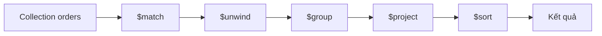

# Khai báo @Aggregation với một hoặc nhiều stage

## 1. Mục tiêu: aggregation ngay trên repository

Giả sử ứng dụng cần tìm những đơn hàng của một tenant theo trạng thái, tính tổng doanh thu mỗi trạng thái, hoặc thống kê số lượng sản phẩm đã đặt theo SKU. Nếu chỉ cần tìm document theo một điều kiện, query derivation như `findByTenantIdAndStatus(...)` thường đủ. Nhưng khi phải dùng `$group`, `$unwind`, `$project`, `$sort` hoặc tổ hợp nhiều stage, tên method dẫn xuất trở nên không thích hợp.

Spring Data MongoDB cung cấp annotation **`org.springframework.data.mongodb.repository.Aggregation`** để khai báo MongoDB aggregation pipeline trực tiếp trên **repository method**. Pipeline có thể chứa **một stage** hoặc **nhiều stage**, cùng hỗ trợ bind tham số method vào các giá trị trong JSON.

Ví dụ:

```java
@Aggregation("{ '$match': { 'tenantId': ?0, 'status': ?1 } }")
List<OrderDocument> findMatchingOrders(
    String tenantId,
    String status
);
```

hoặc:

```java
@Aggregation(pipeline = {
    "{ '$match': { 'tenantId': ?0, 'status': ?1 } }",
    "{ '$sort': { 'createdAt': -1, '_id': -1 } }",
    "{ '$limit': 10 }"
})
List<OrderDocument> findRecentOrders(
    String tenantId,
    String status
);
```

Bài thuộc chương **Aggregation repository** trong module **SPRING_DATA_MONGODB**. Module học cách sử dụng Spring Data MongoDB để kết nối, ánh xạ document và thao tác MongoDB qua `MongoTemplate` hoặc repository; đồng thời thực hành truy vấn, aggregation, index, transaction, reactive access, kiểm thử và chẩn đoán hiệu năng dữ liệu.

Sau bài học, bạn có thể:

1. Phân biệt `@Aggregation` với `@Query` và với `MongoOperations.aggregate(...)`.
2. Khai báo đúng một stage thông qua `@Aggregation("...")`, hoặc nhiều stage với `pipeline = { ... }`.
3. Bind `?0`, `?1` và các tham số Java thành giá trị BSON trong `$match`, `$limit` và những stage thích hợp.
4. Đọc được dữ liệu trả về là entity, DTO hoặc kết quả nhóm/tổng hợp.
5. Phân biệt tên property Java, field BSON, tên alias mới sau `$project`/`$group`.
6. Biết khi nào dùng annotation cố định và khi nào chuyển sang `MongoTemplate` để dựng pipeline động.
7. Kiểm thử nhiều tenant, dữ liệu rỗng, kết quả sắp xếp, index và hành vi reactive.

**Trọng tâm:** Mỗi phần tử khai báo trong `pipeline` là **một stage MongoDB hoàn chỉnh**, và các stage được thực thi **theo thứ tự được viết**. Không phải một đoạn JSON duy nhất chứa nhiều key `$match`, `$group`, `$sort` là cách biểu diễn tương đương.

## 2. MongoDB aggregation là gì?

MongoDB aggregation pipeline là một danh sách các **stage**. Mỗi stage nhận luồng document từ stage trước và tạo ra luồng mới.



Các stage thường gặp:

| Stage | Vai trò |
| --- | --- |
| `$match` | Lọc document theo điều kiện |
| `$project` | Chọn, đổi tên hoặc tính field kết quả |
| `$unwind` | Tách các phần tử array thành từng document trong luồng |
| `$group` | Gom nhóm theo khóa và tính accumulator như `$sum`, `$avg` |
| `$sort` | Sắp xếp kết quả hiện tại |
| `$skip` | Bỏ qua N kết quả đầu của luồng hiện tại |
| `$limit` | Giới hạn số kết quả đi tiếp |
| `$count` | Đếm số document đến stage đếm |
| `$facet` | Chạy nhiều nhánh pipeline trên tập đầu vào |
| `$lookup` | Kết hợp dữ liệu từ collection khác khi bài toán yêu cầu |

Không phải mọi stage đều giữ nguyên số lượng, hình dạng hay kiểu dữ liệu của document. Chẳng hạn:

- `$match` có thể loại bớt document.
- `$unwind` có thể tạo **nhiều kết quả** từ một document gốc.
- `$group` có thể tạo **một document cho mỗi nhóm**, không còn cấu trúc của entity ban đầu.
- `$project` có thể biến tên field và bỏ `_id`.

Do đó, **kiểu trả về repository method** phải phù hợp với **hình dạng kết quả cuối pipeline**, không đơn giản luôn là domain entity.

### 2.1. Đối chiếu mongosh và repository

Trong mongosh:

```javascript
db.orders.aggregate([
  { $match: { tenantId: "tenant-a", status: "PAID" } },
  { $sort: { createdAt: -1, _id: -1 } },
  { $limit: 10 }
]);
```

Trong repository Java, cùng ý tưởng:

```java
@Aggregation(pipeline = {
    "{ '$match': { 'tenantId': ?0, 'status': ?1 } }",
    "{ '$sort': { 'createdAt': -1, '_id': -1 } }",
    "{ '$limit': 10 }"
})
List<OrderDocument> paidOrders(
    String tenantId, String status
);
```

Annotation **khai báo pipeline trong mã nguồn Java**; Spring Data xây và gửi lệnh aggregate xuống MongoDB server. Đây không phải cơ chế lấy hết collection vào Java rồi tự lọc, sort hoặc group.

## 3. Dữ liệu mẫu xuyên suốt

### 3.1. Tạo fixture BSON

Ví dụ collection `orders`:

```javascript
db.orders.insertMany([
  {
    _id: "ord-101",
    tenantId: "tenant-a",
    status: "PAID",
    amount_vnd: NumberLong("100000"),
    customer: { display_name: "An" },
    items: [
      { sku_code: "BOOK-A", quantity: 1 },
      { sku_code: "BOOK-B", quantity: 2 }
    ],
    createdAt: ISODate("2026-11-18T08:00:00Z")
  },
  {
    _id: "ord-102",
    tenantId: "tenant-a",
    status: "PAID",
    amount_vnd: NumberLong("200000"),
    customer: { display_name: "Bình" },
    items: [
      { sku_code: "BOOK-A", quantity: 2 }
    ],
    createdAt: ISODate("2026-11-19T09:00:00Z")
  },
  {
    _id: "ord-103",
    tenantId: "tenant-a",
    status: "PAID",
    amount_vnd: NumberLong("300000"),
    customer: { display_name: "Ân" },
    items: [
      { sku_code: "BOOK-A", quantity: 3 },
      { sku_code: "BOOK-C", quantity: 1 }
    ],
    createdAt: ISODate("2026-11-20T08:00:00Z")
  },
  {
    _id: "ord-104",
    tenantId: "tenant-a",
    status: "NEW",
    amount_vnd: NumberLong("50000"),
    customer: { display_name: "Cúc" },
    items: [
      { sku_code: "BOOK-A", quantity: 4 }
    ],
    createdAt: ISODate("2026-11-20T09:00:00Z")
  },
  {
    _id: "ord-201",
    tenantId: "tenant-b",
    status: "PAID",
    amount_vnd: NumberLong("900000"),
    customer: { display_name: "Dũng" },
    items: [
      { sku_code: "BOOK-A", quantity: 100 }
    ],
    createdAt: ISODate("2026-11-20T10:00:00Z")
  }
]);
```

Đây là **dữ liệu học tập**, không chạy vào collection production hoặc collection đã có ID trùng. Cố ý có:

- Ba đơn PAID thuộc tenant-a: tổng tiền **600.000 VND**.
- Một đơn NEW thuộc tenant-a: **50.000 VND**.
- Một đơn PAID tenant-b: **900.000 VND**, phải bị loại khỏi các báo cáo tenant-a.
- Mảng `items` để minh họa `$unwind`.

### 3.2. Entity và ánh xạ BSON

```java
package com.example.orders.persistence;

import java.time.Instant;
import java.util.List;
import org.springframework.data.mongodb.core.mapping.Document;
import org.springframework.data.mongodb.core.mapping.Field;
import org.springframework.data.mongodb.core.mapping.FieldType;
import org.springframework.data.mongodb.core.mapping.MongoId;

@Document(collection = "orders")
public record OrderDocument(
    @MongoId(FieldType.STRING) String id,
    String tenantId,
    String status,
    @Field("amount_vnd") long amountVnd,
    CustomerSnapshot customer,
    List<OrderLine> items,
    Instant createdAt
) {}

record CustomerSnapshot(
    @Field("display_name") String displayName
) {}

record OrderLine(
    @Field("sku_code") String sku,
    int quantity
) {}
```

| Tên property Java | Đường dẫn BSON |
| --- | --- |
| `id` | `_id` |
| `amountVnd` | `amount_vnd` |
| `customer.displayName` | `customer.display_name` |
| `items.sku` | `items.sku_code` |
| `items.quantity` | `items.quantity` |
| `createdAt` | `createdAt` |

Trong mongosh, dùng **field BSON**. Trong Spring Data, một số phần pipeline có thể được ánh xạ dựa trên metadata của input entity. Tuy nhiên, khi viết JSON aggregation trong annotation, cần kiểm tra **BSON đã gửi thật**, nhất là sau `$group`/`$project`, khi schema trung gian đã khác entity.

## 4. Chuẩn bị repository và các import

### 4.1. Phân biệt @Aggregation và Aggregation class

Trong Spring Data MongoDB có hai API khác nhau:

```java
// Annotation gắn lên repository method:
import org.springframework.data.mongodb.repository.Aggregation;

// Class cho pipeline DSL của MongoTemplate (không import đồng thời
// dưới cùng simple name trong cùng file Java):
// org.springframework.data.mongodb.core.aggregation.Aggregation
```

**`@Aggregation`** là annotation. **`Aggregation`** trong `core.aggregation` là class để xây pipeline programmatically khi dùng `MongoOperations.aggregate(...)`.

Nếu cần cả hai trong một file, dùng fully qualified name cho một bên hoặc tách code vào những class thích hợp.

### 4.2. Repository interface tối thiểu

```java
package com.example.orders.persistence;

import java.util.List;
import org.springframework.data.repository.Repository;
import org.springframework.data.mongodb.repository.Aggregation;

public interface OrderAggregationRepository
        extends Repository<OrderDocument, String> {

    @Aggregation(
        "{ '$match': { 'tenantId': ?0, 'status': ?1 } }"
    )
    List<OrderDocument> matching(
        String tenantId, String status
    );
}
```

Ở đây `Repository<OrderDocument, String>` là marker interface: không tự công khai mọi thao tác của `MongoRepository`. Spring Data tạo proxy để thực hiện method. Tên `matching` không cần bắt đầu bằng `findBy` vì đã có annotation xác định query.

Với use case chỉ đọc, có thể chọn contract repository hẹp. Nếu ứng dụng thật cần đủ CRUD, dùng `MongoRepository<OrderDocument, String>` cũng hợp lệ; lựa chọn đó độc lập với việc có `@Aggregation` hay không.

## 5. Một stage: @Aggregation với một JSON stage

### 5.1. Chỉ dùng $match

```java
@Aggregation("{ '$match': { 'tenantId': ?0, 'status': ?1 } }")
List<OrderDocument> findByTenantAndStatusViaAggregation(
    String tenantId, String status
);
```

Với `("tenant-a", "PAID")`, query tương đương ý định:

```javascript
db.orders.aggregate([
  { $match: { tenantId: "tenant-a", status: "PAID" } }
]);
```

Kết quả có ba document `ord-101`, `ord-102`, `ord-103` nhưng **không có thứ tự được bảo đảm** khi không khai báo `$sort`. Nếu UI hiển thị theo thời gian, cần thêm stage sort.

### 5.2. Annotation.value và pipeline

`@Aggregation("...")` là cách viết ngắn cho một khai báo pipeline. Với nhiều stage, thường dùng thuộc tính `pipeline`:

```java
@Aggregation(pipeline = {
    "{ '$match': { 'tenantId': ?0, 'status': ?1 } }"
})
List<OrderDocument> sameFilter(String tenantId, String status);
```

Hai cách ở ví dụ này cùng biểu diễn **một stage `$match`**. Đừng nhầm dấu ngoặc `{...}` của Java annotation array với dấu ngoặc của JSON.

### 5.3. Một stage không có nghĩa luôn dùng @Aggregation

Nếu chỉ cần `$match`, repository method:

```java
List<OrderDocument> findByTenantIdAndStatus(
    String tenantId, String status
);
```

thường dễ đọc hơn. `@Aggregation` hữu ích nhất khi cần aggregation semantics như group, unwind, projection phức tạp hoặc một pipeline cố định rõ ràng. Đừng chọn annotation chỉ vì nó mới hơn derived query.

## 6. Nhiều stage: mỗi phần tử là một stage hoàn chỉnh

### 6.1. Một pipeline sắp xếp và giới hạn

```java
@Aggregation(pipeline = {
    "{ '$match': { 'tenantId': ?0, 'status': ?1 } }",
    "{ '$sort': { 'createdAt': -1, '_id': -1 } }",
    "{ '$limit': 2 }"
})
List<OrderDocument> latestTwoByStatus(
    String tenantId, String status
);
```

Với tenant-a và PAID, fixture trả theo thứ tự:

```text
ord-103  2026-11-20T08:00:00Z
ord-102  2026-11-19T09:00:00Z
```

Stage được viết theo thứ tự:

```text
$match: tenant + status
          ↓
$sort: createdAt DESC, _id DESC
          ↓
$limit: 2
          ↓
Mapping thành List<OrderDocument>
```

### 6.2. Lỗi chia một stage thành nhiều chuỗi

Ví dụ **sai**:

```java
// KHÔNG đúng: các phần tử là mảnh của một JSON stage.
@Aggregation(pipeline = {
    "{ '$match': {",
    "  'tenantId': ?0,",
    "  'status': ?1",
    "} }"
})
List<OrderDocument> broken(String tenant, String status);
```

Spring Data **không ghép** bốn phần tử String thành một JSON object. Nó sẽ xử lý chúng như các stage riêng, nên không đáp ứng cấu trúc pipeline hợp lệ.

Viết đúng:

```java
@Aggregation(pipeline = {
    "{ '$match': { 'tenantId': ?0, 'status': ?1 } }"
})
List<OrderDocument> valid(String tenant, String status);
```

**Quy tắc code review:** Một phần tử của `pipeline = {...}` phải tự parse được thành một **BSON document stage**. Nếu cần JSON dài, cân nhắc Java text blocks tùy phiên bản Java hoặc chuyển sang `MongoTemplate` để tránh annotation khó bảo trì.

### 6.3. Thứ tự stage làm đổi kết quả

Hai pipeline sau không tương đương:

```javascript
// Hai đơn PAID mới nhất.
[
  { $match: { tenantId: "tenant-a", status: "PAID" } },
  { $sort: { createdAt: -1, _id: -1 } },
  { $limit: 2 }
]

// Lấy hai document PAID trước, rồi sort hai document đó.
[
  { $match: { tenantId: "tenant-a", status: "PAID" } },
  { $limit: 2 },
  { $sort: { createdAt: -1, _id: -1 } }
]
```

Ở pipeline thứ hai, `$limit` không được chọn theo «mới nhất» vì sort chạy sau. Luôn mô tả bằng lời ý định của từng stage để tránh sai logic dù JSON hợp lệ.

## 7. Bind tham số: ?0, ?1, ?2...

### 7.1. Cách đánh số tham số

Spring Data sử dụng index bắt đầu từ **0**, dựa trên danh sách tham số method:

```java
@Aggregation(pipeline = {
    "{ '$match': { 'tenantId': ?0, 'status': ?1, 'amount_vnd': { '$gte': ?2 } } }",
    "{ '$sort': { 'createdAt': -1, '_id': -1 } }",
    "{ '$limit': 50 }"
})
List<OrderDocument> paidFromAmount(
    String tenantId,       // ?0
    String status,         // ?1
    long minimumAmountVnd  // ?2
);
```

Khi gọi `("tenant-a", "PAID", 150000L)`, chỉ `ord-102` và `ord-103` thỏa điều kiện tiền tối thiểu. Pipeline sort mới trước nên kết quả là `ord-103` rồi `ord-102`.

### 7.2. Tham số trong $limit

Có thể khai báo giới hạn từ method argument khi phiên bản repository query binding đang dùng hỗ trợ cách biểu diễn số đó:

```java
@Aggregation(pipeline = {
    "{ '$match': { 'tenantId': ?0, 'status': ?1 } }",
    "{ '$sort': { 'createdAt': -1, '_id': -1 } }",
    "{ '$limit': ?2 }"
})
List<OrderDocument> latestWithLimit(
    String tenantId, String status, int limit
);
```

**Không truyền trực tiếp giá trị limit bất kỳ từ client.** Lớp application service cần chặn `limit <= 0`, giới hạn trên như 100 và các trường hợp không hợp lệ. `$limit` cần một giá trị số phù hợp; việc bind tham số không thay thế input validation.

### 7.3. Binding không phải ghép String JSON

Không làm:

```java
// Anti-pattern: không ghép raw input thành JSON pipeline.
// String json = "{ '$match': { 'status': '" + input + "' } }";
```

Khi dùng `?0`, Spring Data bind đối số thành giá trị query, có cơ chế xử lý/escaping phù hợp. Điều đó khác với cho user gửi raw JSON, tên stage hoặc field path rồi ghép vào annotation.

### 7.4. Kiểu BSON phải tương thích

Các tham số `Instant`, `ObjectId`, `UUID`, enum hoặc custom value object phải được biểu diễn đúng kiểu BSON mà field đang lưu:

| Kiểu Java/value | Cần xác minh |
| --- | --- |
| `String` ID | Collection lưu `_id` dạng String hay ObjectId? |
| `Instant` | BSON Date hay chuỗi ISO từ hệ thống cũ? |
| `long` | BSON Int64/kiểu số và precision |
| `enum` | Tên String hay converter tùy chỉnh? |
| `UUID` | Representation và binary subtype |
| `null` | Semantics null/missing khác nhau khi filter |

Ví dụ model dùng `@MongoId(FieldType.STRING)` cho `id`, nên fixture lưu `_id` BSON String. Một filter trong mongosh dùng `ObjectId("...")` sẽ không khớp String ID tương ứng.

## 8. Query parameter và SpEL trong aggregation

Spring Data MongoDB hỗ trợ cách biểu diễn SpEL trong những chuỗi repository query phù hợp, thường thấy dưới dạng `?#{...}`. SpEL được đánh giá ở **tầng ứng dụng**, không phải một aggregation expression chạy trên MongoDB server.

Một ví dụ khái niệm:

```java
@Aggregation(pipeline = {
    "{ '$match': { 'tenantId': ?#{[0]}, 'status': ?#{[1]} } }",
    "{ '$count': 'total' }"
})
List<CountRow> countUsingSpel(
    String tenantId, String status
);
```

Để dùng đoạn mã này cần DTO `CountRow` được định nghĩa ở mục 12. Trong trường hợp đơn giản như trên, **`?0`/`?1` dễ hiểu hơn**, nên không cần dùng SpEL.

### 8.1. Hai tầng expression khác nhau

| Cú pháp | Ai xử lý? | Ý nghĩa |
| --- | --- | --- |
| `?0` | Spring Data parameter binder | Tham số thứ nhất của method |
| `?#{[0]}` | SpEL phía ứng dụng | Biểu thức truy cập tham số |
| `"$status"` | MongoDB aggregation engine | Tham chiếu field status của document hiện tại |
| `"$$NOW"` | MongoDB aggregation context | Biến hệ thống trong expression phù hợp |
| `{ '$sum': '$amount_vnd' }` | MongoDB aggregation engine | Tính tổng trường tiền |
| `{ '$literal': '$foo' }` | MongoDB aggregation engine | Giá trị String "$foo" thay vì field reference |

Không dùng SpEL để giả vờ tính toán trên field hiện tại của document: SpEL của method không tự có document MongoDB đang được xử lý.

### 8.2. Dữ liệu String bắt đầu bằng dấu $

Khi một **aggregation expression** nhận String như `"$special"`, MongoDB có thể diễn giải nó là field reference. Nếu mục tiêu là chuỗi literal, cần dùng `$literal` đúng nơi:

```javascript
[
  { $set: { note: { $literal: "$special" } } }
]
```

Trong `$match` equality thông thường, tham số String đơn giản là giá trị so sánh. Trong `$project`, `$set` hoặc `$add` expression, cần hiểu rõ cú pháp biểu thức. Parameter binding giúp tránh ghép JSON tùy tiện, nhưng không thay thế việc chọn đúng semantics của aggregation expression.

### 8.3. Nguyên tắc bảo mật

- Không đánh giá SpEL tùy ý do client gửi.
- Không cho client chọn field path, stage hoặc raw JSON tùy ý.
- Cho phép một **tập filter/sort được định nghĩa sẵn**.
- Tenant ID phải đến từ context đã xác thực hoặc được kiểm tra quyền.
- Kiểm thử input có dấu nháy, dấu `$` và kiểu BSON đặc biệt.

## 9. $group: tổng hợp nhiều đơn thành một kết quả

Đây là một lý do quan trọng để dùng `@Aggregation` trên repository.

Yêu cầu: với mỗi trạng thái của tenant-a, trả **số đơn và tổng tiền**.

### 9.1. Pipeline mongosh

```javascript
db.orders.aggregate([
  { $match: { tenantId: "tenant-a" } },
  {
    $group: {
      _id: "$status",
      orders: { $sum: 1 },
      totalVnd: { $sum: "$amount_vnd" }
    }
  },
  {
    $project: {
      _id: 0,
      status: "$_id",
      orders: 1,
      totalVnd: 1
    }
  },
  { $sort: { totalVnd: -1, status: 1 } }
]);
```

Kết quả từ fixture:

```javascript
[
  { status: "PAID", orders: 3, totalVnd: NumberLong("600000") },
  { status: "NEW",  orders: 1, totalVnd: NumberLong("50000") }
]
```

### 9.2. DTO kết quả

Sau `$group`, output không còn là `OrderDocument`. Dùng DTO:

```java
package com.example.orders.persistence;

public record StatusRevenue(
    String status,
    long orders,
    long totalVnd
) {}
```

### 9.3. Repository @Aggregation với bốn stage

```java
@Aggregation(pipeline = {
    "{ '$match': { 'tenantId': ?0 } }",
    "{ '$group': { '_id': '$status', 'orders': { '$sum': 1 }, 'totalVnd': { '$sum': '$amount_vnd' } } }",
    "{ '$project': { '_id': 0, 'status': '$_id', 'orders': 1, 'totalVnd': 1 } }",
    "{ '$sort': { 'totalVnd': -1, 'status': 1 } }"
})
List<StatusRevenue> revenueByStatus(String tenantId);
```

Các điểm cần hiểu:

1. `$match` loại dữ liệu tenant khác **trước khi tổng hợp**.
2. `$group` tạo nhóm theo trạng thái và tính số đơn/tổng tiền.
3. `$project` đổi `_id` của group thành field `status` phù hợp với DTO.
4. `$sort` sắp xếp **bản ghi tổng hợp** theo `totalVnd`.

**Đừng bỏ stage `$project` rồi mặc định `StatusRevenue.status` sẽ nhận đúng nhóm:** output của `$group` mang khóa `_id`. Mapping có thể có những quy tắc đặc biệt theo DTO, nhưng projection tường minh làm contract BSON dễ đọc và dễ kiểm thử hơn.

### 9.4. Kiểu số và sai lệch dữ liệu

`$sum` làm việc với giá trị numeric BSON. Nếu một số document legacy lưu `amount_vnd` dưới dạng String, hoặc tổng vượt miền của `long`, kết quả có thể không phù hợp với DTO. Hãy chuẩn hóa schema, cân nhắc Decimal128/BigDecimal nếu nghiệp vụ tiền cần precision/phạm vi khác, và kiểm thử dữ liệu biên.

## 10. $unwind: tổng số lượng sản phẩm theo SKU

Mỗi đơn có một mảng `items`. Khi cần tổng số lượng BOOK-A trên mọi đơn PAID của tenant-a, phải đi qua **phần tử của mảng**.

### 10.1. Pipeline mongosh

```javascript
db.orders.aggregate([
  { $match: { tenantId: "tenant-a", status: "PAID" } },
  { $unwind: "$items" },
  {
    $group: {
      _id: "$items.sku_code",
      quantity: { $sum: "$items.quantity" }
    }
  },
  {
    $project: {
      _id: 0,
      sku: "$_id",
      quantity: 1
    }
  },
  { $sort: { quantity: -1, sku: 1 } }
]);
```

Fixture trả:

| SKU | Tổng quantity |
| --- | ---: |
| BOOK-A | 6 |
| BOOK-B | 2 |
| BOOK-C | 1 |

Không cộng BOOK-A của đơn NEW tenant-a hoặc của tenant-b, vì `$match` đã loại các đơn đó.

### 10.2. DTO riêng cho kết quả

```java
package com.example.orders.persistence;

public record SkuQuantity(String sku, long quantity) {}
```

### 10.3. Khai báo repository

```java
@Aggregation(pipeline = {
    "{ '$match': { 'tenantId': ?0, 'status': ?1 } }",
    "{ '$unwind': '$items' }",
    "{ '$group': { '_id': '$items.sku_code', 'quantity': { '$sum': '$items.quantity' } } }",
    "{ '$project': { '_id': 0, 'sku': '$_id', 'quantity': 1 } }",
    "{ '$sort': { 'quantity': -1, 'sku': 1 } }"
})
List<SkuQuantity> quantityBySku(
    String tenantId, String status
);
```

Trong `@Aggregation` dạng raw JSON, các đường dẫn thể hiện bằng **tên field BSON của fixture**, đặc biệt `items.sku_code`. Nếu dùng Spring Data mapping alias phức tạp, xem lại command được gửi vì một số API áp dụng query/field mapping dựa trên entity metadata; **không suy luận từ chuỗi annotation một mình** rằng tất cả path sẽ bị giữ nguyên hoặc tất cả alias sẽ được tự dịch.

### 10.4. $unwind làm thay đổi đơn vị đếm

Nếu một đơn có hai dòng hàng, sau `$unwind` có thể có hai documents trong luồng. Một `$count` sau `$unwind` đếm **dòng hàng**, không đếm số đơn gốc. Quy tắc tương tự áp dụng khi `$group` đã tạo một document cho mỗi nhóm.

## 11. $project: mapping kết quả và tính toán

### 11.1. Chọn bớt field

Giả sử chỉ cần danh sách ID, tên khách và tiền:

```javascript
db.orders.aggregate([
  { $match: { tenantId: "tenant-a", status: "PAID" } },
  {
    $project: {
      _id: 0,
      orderId: "$_id",
      displayName: "$customer.display_name",
      amountVnd: "$amount_vnd"
    }
  },
  { $sort: { orderId: 1 } }
]);
```

Output có shape:

```javascript
{
  orderId: "ord-101",
  displayName: "An",
  amountVnd: NumberLong("100000")
}
```

Đây không còn là `OrderDocument` vì `_id`, `tenantId`, `status` và các field khác không được giữ lại. Đọc vào entity đầy đủ rồi gọi `save` sau này là nguy hiểm. Tốt hơn nên dùng DTO.

### 11.2. DTO projection

```java
public record OrderSummary(
    String orderId,
    String displayName,
    long amountVnd
) {}
```

Trong dự án Java, đặt public record trong file `OrderSummary.java` tương ứng.

### 11.3. Repository projection nhiều stage

```java
@Aggregation(pipeline = {
    "{ '$match': { 'tenantId': ?0, 'status': ?1 } }",
    "{ '$project': { '_id': 0, 'orderId': '$_id', 'displayName': '$customer.display_name', 'amountVnd': '$amount_vnd' } }",
    "{ '$sort': { 'orderId': 1 } }"
})
List<OrderSummary> summaries(String tenantId, String status);
```

**Lưu ý alias:** Stage `$sort` ở cuối dùng `orderId` — **field mới của output sau `$project`**, không dùng `_id` đã bị loại. Cần phân biệt schema gốc và schema trung gian khi tạo pipeline nhiều stage.

## 12. $count: đếm theo filter hoặc theo stage trước

### 12.1. Repository count bằng aggregation

Nếu cần trả số document theo filter:

```java
package com.example.orders.persistence;

public record CountRow(long total) {}
```

```java
@Aggregation(pipeline = {
    "{ '$match': { 'tenantId': ?0, 'status': ?1 } }",
    "{ '$count': 'total' }"
})
List<CountRow> countByTenantAndStatusAgg(
    String tenantId, String status
);
```

Với `tenant-a` và `PAID`, danh sách chứa một phần tử `CountRow(3)`. Dùng `List<CountRow>` ở đây để minh họa rõ trường hợp **không có document output**.

### 12.2. Khi không có kết quả

Với `status="UNKNOWN"`, `$match` không trả gì. `$count` trên tập đầu vào rỗng **không tạo một document `{total:0}`**; repository thường nhận danh sách rỗng.

Caller có thể xử lý:

```java
List<CountRow> rows =
    repository.countByTenantAndStatusAgg(
        authenticatedTenantId,
        "UNKNOWN"
    );

long total = rows.isEmpty() ? 0L : rows.get(0).total();
```

Trong ví dụ, `repository` là bean `OrderAggregationRepository` đã được inject. Nếu API cần đơn giản chỉ đếm theo filter, method count derived hoặc `MongoOperations.count(...)` thường ngắn hơn `@Aggregation`. Dùng `$count` khi mục tiêu là đếm **sau các stage khác** hoặc kết hợp với một facet.

### 12.3. Count sau $group đếm nhóm

```javascript
db.orders.aggregate([
  { $match: { tenantId: "tenant-a" } },
  { $group: { _id: "$status" } },
  { $count: "numberOfStatuses" }
]);
```

Fixture có hai trạng thái `PAID` và `NEW` của tenant-a, nên kết quả là `numberOfStatuses = 2`. Nếu đặt count ngay sau match, kết quả là **4 đơn**.

## 13. Sort, skip, limit và parameter Pageable/Sort

### 13.1. Sort và limit tường minh trong annotation

Đối với báo cáo ổn định, cách dễ review nhất là thể hiện đầy đủ:

```java
@Aggregation(pipeline = {
    "{ '$match': { 'tenantId': ?0 } }",
    "{ '$sort': { 'createdAt': -1, '_id': -1 } }",
    "{ '$skip': ?1 }",
    "{ '$limit': ?2 }"
})
List<OrderDocument> pageWithFixedSort(
    String tenantId, long offset, int pageSize
);
```

Application service cần validate `offset >= 0`, `pageSize > 0` và giới hạn sâu. Nếu một method trả toàn bộ `List` mà không có `$limit`, nó có thể tải rất nhiều document vào bộ nhớ.

### 13.2. Repository aggregation với Pageable và Sort

Spring Data MongoDB có khả năng xử lý các tham số đặc biệt như `Sort`/`Pageable` cho nhiều repository aggregation methods. Tuy nhiên, **khả năng và cách thêm sort/skip/limit vào pipeline phụ thuộc phiên bản**, và thường cần đặc biệt cẩn thận khi pipeline đã có `$group` hoặc `$project`.

Một dạng API có thể gặp:

```java
import org.springframework.data.domain.Sort;

@Aggregation(pipeline = {
    "{ '$match': { 'tenantId': ?0, 'status': ?1 } }"
})
List<OrderDocument> findWithRequestedSort(
    String tenantId, String status, Sort sort
);
```

Khi gọi, sort được áp dụng trên **kết quả cuối** của pipeline. Nếu output đã nhóm theo status hoặc đã project đổi tên field, một sort theo Java property ban đầu có thể sai hoặc không có ý nghĩa.

**Ưu tiên cho bài này:** Học cách viết rõ `$sort`/`$skip`/`$limit` trong `pipeline`. Khi dùng tham số `Sort` hoặc `Pageable` của framework, hãy kiểm tra tài liệu đúng version và command BSON thực tế để tránh tự thêm pagination trùng.

### 13.3. Không mặc định Page<T> được hỗ trợ

Một repository aggregation method không nên khai báo tùy tiện `Page<StatusRevenue>` rồi nghĩ Spring Data sẽ tự chạy count pipeline tương ứng. **`Page<T>` không được hỗ trợ trực tiếp cho annotated repository aggregation trong những thế hệ Spring Data phổ biến**; khả năng trả các kiểu như `Slice`/`Window` cũng cần được xác minh theo dependency và API cụ thể.

Nếu cần page + total theo pipeline phức tạp, cân nhắc:

- Hai truy vấn: một pipeline lấy nội dung, một pipeline count.
- Một pipeline `$facet` để trả `items` và `metadata`.
- Custom repository fragment dùng `MongoOperations` nếu cần kiểm soát tính toán count, output và options.

Không dùng `List.size()` để suy ra tổng số document đã lọc khi List chỉ chứa một trang.

## 14. $facet: nội dung trang và tổng số

Một API quản trị thường cần cả **nội dung trang** lẫn **tổng số bản ghi sau filter**. `$facet` chạy hai nhánh con trên cùng tập dữ liệu đã qua `$match`.

### 14.1. Pipeline mongosh

```javascript
db.orders.aggregate([
  { $match: { tenantId: "tenant-a", status: "PAID" } },
  {
    $facet: {
      items: [
        { $sort: { createdAt: -1, _id: -1 } },
        { $skip: 1 },
        { $limit: 2 },
        {
          $project: {
            _id: 0,
            orderId: "$_id",
            amountVnd: "$amount_vnd"
          }
        }
      ],
      metadata: [
        { $count: "total" }
      ]
    }
  }
]);
```

Fixture cho nhánh `items` gồm `ord-102` rồi `ord-101`; nhánh `metadata` chứa `{ total: 3 }`. Vì metadata nằm trong nhánh riêng nên không bị `$skip`/`$limit` của nhánh items ảnh hưởng.

### 14.2. Khai báo bằng @Aggregation

```java
@Aggregation(pipeline = {
    "{ '$match': { 'tenantId': ?0, 'status': ?1 } }",
    "{ '$facet': { 'items': [ { '$sort': { 'createdAt': -1, '_id': -1 } }, { '$skip': ?2 }, { '$limit': ?3 }, { '$project': { '_id': 0, 'orderId': '$_id', 'amountVnd': '$amount_vnd' } } ], 'metadata': [ { '$count': 'total' } ] } }"
})
List<org.bson.Document> pageWithTotal(
    String tenantId, String status,
    long offset, int pageSize
);
```

Pipeline facet là **một JSON stage**, dù bên trong nó chứa **hai mảng sub-pipeline**. Cú pháp nhiều stage bên trong facet không biến từng sub-stage thành một phần tử ở `@Aggregation.pipeline` bên ngoài.

Trong production, DTO kết quả nên có hợp đồng rõ (ví dụ `items: List<OrderSummary>` và `metadata: List<CountRow>`). Với `Document`, cần kiểm tra mapping nested, đặc biệt khi dùng reactive và thay đổi schema projection.

### 14.3. Empty metadata và giới hạn tài nguyên

Nếu không có đơn phù hợp, nhánh `metadata` thường trả mảng rỗng. Caller phải quy ước `total=0` thay vì truy cập phần tử đầu tiên vô điều kiện.

`$facet` có giới hạn bộ nhớ/result size và có thể khiến việc sort trong nhánh ít tận dụng index hơn pipeline riêng. Vì vậy **một round trip không bảo đảm nhanh hơn hai query**. Với tập dữ liệu lớn, cần benchmark và `explain`.

## 15. Khi pipeline annotation trở nên quá dài

Các ví dụ ở trên đã cho thấy chuỗi JSON dài khó bảo trì nếu:

- Có nhiều filter tùy chọn với hàng chục tổ hợp.
- Cần bổ sung nhiều `$lookup`, `$facet` hoặc expression lồng nhau.
- Có phân trang động kèm count độc lập.
- Cần collation, hint, allowDiskUse, read preference hoặc các option đặc biệt.
- Cần dùng metadata/converter tùy biến một cách có kiểm soát.
- Cần điều kiện tenant/security phức tạp và test từng phần pipeline.

Trong những trường hợp này, **custom repository fragment** với `MongoOperations`/`MongoTemplate` thường dễ đọc và dễ kiểm thử hơn so với việc cố nén mọi thứ vào `@Aggregation(pipeline = {...})`.

### 15.1. Ví dụ MongoOperations bằng DSL

```java
import java.util.List;
import org.springframework.data.domain.Sort;
import org.springframework.data.mongodb.core.MongoOperations;
import org.springframework.data.mongodb.core.aggregation.Aggregation;
import org.springframework.data.mongodb.core.query.Criteria;
import static org.springframework.data.mongodb.core.aggregation.Aggregation.*;

public final class OrderReportGateway {
    private final MongoOperations mongo;

    public OrderReportGateway(MongoOperations mongo) {
        this.mongo = mongo;
    }

    public List<StatusRevenue> revenueByStatus(String tenantId) {
        if (tenantId == null || tenantId.isBlank()) {
            throw new IllegalArgumentException("Missing tenant");
        }

        Aggregation pipeline = newAggregation(
            match(Criteria.where("tenantId").is(tenantId)),
            group("status")
                .count().as("orders")
                .sum("amountVnd").as("totalVnd"),
            project("orders", "totalVnd")
                .and("_id").as("status"),
            sort(Sort.by(
                Sort.Order.desc("totalVnd"),
                Sort.Order.asc("status")
            ))
        );

        return mongo.aggregate(
            pipeline, OrderDocument.class, StatusRevenue.class
        ).getMappedResults();
    }
}
```

Ở đây `Aggregation` là class của Spring Data DSL; `amountVnd` được tham chiếu qua property Java và mapper cần đổi sang BSON `amount_vnd`. Hãy kiểm chứng pipeline thực gửi ở phiên bản đang dùng — nhất là khi `$project` đã đổi schema output.

### 15.2. Không dùng lại Query/Criteria mutable giữa request

Khi tạo pipeline động bằng template, hãy dựng `Aggregation`/`Query`/`Criteria` **mới trong mỗi lời gọi**. Các fragment/adapter thường là singleton; không giữ filter tenant hiện tại trong mutable instance field vì sẽ rò rỉ dữ liệu giữa request.

### 15.3. Vai trò của repository và template

| Nhu cầu | API thường phù hợp |
| --- | --- |
| CRUD cơ bản | `MongoRepository` hoặc repository hẹp |
| Tìm theo field đơn giản | Derived query / `@Query` |
| Pipeline cố định, ít stage | `@Aggregation` |
| Thống kê group/unwind cố định | `@Aggregation` với DTO |
| Query/aggregation nhiều điều kiện tùy chọn | Repository fragment + `MongoOperations` |
| Cần option đặc biệt và inspect pipeline | `MongoTemplate`/driver qua adapter có kiểm soát |
| Ghi có điều kiện | `MongoOperations.updateFirst(...)` hoặc API update phù hợp, không dùng aggregation đọc để giả vờ ghi |

## 16. $lookup và collection tham chiếu

Mặc dù chủ đề chính là **khai báo annotation**, một pipeline thực tế có thể có `$lookup`:

```javascript
db.orders.aggregate([
  { $match: { tenantId: "tenant-a", status: "PAID" } },
  {
    $lookup: {
      from: "customers",
      localField: "customerId",
      foreignField: "_id",
      as: "customerDetails"
    }
  }
]);
```

Đây là **ví dụ cho schema khác** nơi orders có `customerId` và có collection `customers`; fixture ở mục 3 **không** có cấu trúc đó. Không nên nhầm embedded document `customer` trong fixture với reference ID.

Trong `@Aggregation`, có thể biểu diễn stage bằng một JSON String:

```java
@Aggregation(pipeline = {
    "{ '$match': { 'tenantId': ?0, 'status': 'PAID' } }",
    "{ '$lookup': { 'from': 'customers', 'localField': 'customerId', 'foreignField': '_id', 'as': 'customerDetails' } }"
})
List<org.bson.Document> paidWithCustomers(String tenantId);
```

Tuy nhiên, `$lookup` cần cân nhắc quyền, index ở collection được join, collection name chính xác và cardinality. Khi dùng multi-tenant, phải bảo đảm join không vô tình kéo dữ liệu từ tenant khác. **Filter tenant của orders không tự bảo vệ collection customers** nếu khóa tham chiếu/lookup design cho phép join sai.

## 17. Sorting, index và chi phí aggregation

### 17.1. Index ứng viên cho tìm đơn mới nhất

Với pipeline:

```javascript
[
  { $match: { tenantId: "tenant-a", status: "PAID" } },
  { $sort: { createdAt: -1, _id: -1 } },
  { $limit: 10 }
]
```

Một index ứng viên:

```javascript
db.orders.createIndex(
  { tenantId: 1, status: 1, createdAt: -1, _id: -1 },
  { name: "ix_orders_tenant_status_recent" }
);
```

Các field equality đứng trước field sort giúp MongoDB có cơ hội dùng index để tìm và giữ thứ tự. **Đây chỉ là ứng viên**; lựa chọn tốt phụ thuộc dữ liệu, selectivity, workload và chi phí duy trì index khi ghi.

### 17.2. Group và sort theo giá trị tổng hợp

Pipeline `$match → $group(status) → $sort(totalVnd)` tạo `totalVnd` **sau khi group**, nên index trên `amount_vnd` gốc không tự bảo đảm sort các tổng nhóm không cần xử lý. Đừng lấy index trên một field đầu vào làm bằng chứng sort trên giá trị tổng hợp sẽ nhanh.

### 17.3. Kiểm tra explain

```javascript
db.orders.explain("executionStats").aggregate([
  { $match: { tenantId: "tenant-a", status: "PAID" } },
  { $sort: { createdAt: -1, _id: -1 } },
  { $limit: 10 }
]);
```

Quan sát query plan/aggregation stages theo phiên bản server, `IXSCAN` hoặc `COLLSCAN`, số keys/docs examined, có sort phải dùng bộ nhớ hay không, số kết quả, thời gian.

### 17.4. Sort/limit và blocking stage

Một `$sort` không có index có thể phải sắp xếp nhiều dữ liệu và là **blocking stage**. MongoDB có thể tối ưu một số cặp `$sort + $limit` nhưng không nên coi mọi pipeline có limit đều rẻ. Nếu pipeline có `$unwind` làm tăng số dòng, `$group` trên tập lớn hoặc `$facet` chứa mảng lớn, chi phí vẫn đáng kể.

Các tùy chọn như `allowDiskUse` cần đối chiếu phiên bản server và cách cấu hình repository aggregation. Không thêm tùy chọn một cách mù quáng thay cho index và pipeline đúng.

## 18. Meta annotations và các tùy chọn thực thi

Spring Data MongoDB có cơ chế bổ sung metadata cho repository query/aggregation trong những phiên bản hỗ trợ, ví dụ thông qua annotation **`@Meta`** (được sử dụng để cấu hình một số execution options của MongoDB).

Một mẫu cần đối chiếu đúng phiên bản:

```java
import org.springframework.data.mongodb.repository.Meta;

@Meta(allowDiskUse = true)
@Aggregation(pipeline = {
    "{ '$match': { 'tenantId': ?0 } }",
    "{ '$group': { '_id': '$status', 'orders': { '$sum': 1 } } }",
    "{ '$sort': { 'orders': -1 } }"
})
List<org.bson.Document> countsWithMeta(String tenantId);
```

**Không dùng `allowDiskUse=true` làm mặc định vô điều kiện.** Nó cho phép một số giai đoạn cần bộ nhớ có thể spill ra disk khi server hỗ trợ/áp dụng, nhưng không chữa logic filter sai, index thiếu hay giới hạn riêng của `$facet`.

Khi cần collation, read preference, hint, maxTime hoặc các option khác, kiểm tra API thật của Spring Data version. Nếu annotation không biểu diễn được contract rõ ràng, chuyển sang `AggregationOptions` cùng `MongoOperations` hoặc driver ở persistence adapter có kiểm thử.

## 19. Repository aggregation với reactive

Với ứng dụng reactive, dùng **Reactive MongoDB repository** và kiểu kết quả non-blocking. Một ví dụ:

```java
package com.example.orders.persistence;

import org.springframework.data.mongodb.repository.ReactiveMongoRepository;
import org.springframework.data.mongodb.repository.Aggregation;
import reactor.core.publisher.Flux;

public interface ReactiveOrderAggregationRepository
        extends ReactiveMongoRepository<OrderDocument, String> {

    @Aggregation(pipeline = {
        "{ '$match': { 'tenantId': ?0, 'status': ?1 } }",
        "{ '$sort': { 'createdAt': -1, '_id': -1 } }",
        "{ '$limit': 20 }"
    })
    Flux<OrderDocument> recentByStatus(
        String tenantId,
        String status
    );
}
```

`Flux<OrderDocument>` biểu diễn các kết quả trả dần theo cơ chế reactive. Nó không tự chứa `totalPages` hoặc một `Page<OrderDocument>`. Consumer cần subscribe trong reactive chain phù hợp; tránh gọi `block()` trên event loop.

### 19.1. Reactive aggregation trả DTO

```java
@Aggregation(pipeline = {
    "{ '$match': { 'tenantId': ?0 } }",
    "{ '$group': { '_id': '$status', 'orders': { '$sum': 1 }, 'totalVnd': { '$sum': '$amount_vnd' } } }",
    "{ '$project': { '_id': 0, 'status': '$_id', 'orders': 1, 'totalVnd': 1 } }"
})
Flux<StatusRevenue> revenueByStatus(String tenantId);
```

Đoạn này được đặt **bên trong reactive repository interface** ở trên. Không khai báo `Flux` trong imperative repository và mặc định framework tự chuyển driver blocking sang non-blocking; phải bật đúng reactive repository infrastructure và dependencies.

### 19.2. Count trên input rỗng

Nếu pipeline kết thúc bằng `$count` và không có document đầu vào, reactive publisher không phát một `CountRow(0)`. Caller có thể xử lý:

```java
Mono<Long> total = reactiveRepository
    .countRowsByStatus(tenantId, "UNKNOWN")
    .next()
    .map(CountRow::total)
    .defaultIfEmpty(0L);
```

Ví dụ giả định reactive repository khai báo phương thức:

```java
@Aggregation(pipeline = {
    "{ '$match': { 'tenantId': ?0, 'status': ?1 } }",
    "{ '$count': 'total' }"
})
Flux<CountRow> countRowsByStatus(String tenantId, String status);
```

`Mono` cần import `reactor.core.publisher.Mono`. Các example methods liên quan phải được đặt trong cùng interface/được inject đúng; đây là minh họa các thành phần, không phải một file Java duy nhất chứa mọi đoạn code của bài.

## 20. Transaction, tính nhất quán và bảo mật

### 20.1. Aggregation không mặc định là snapshot

Một pipeline chạy trên dữ liệu đang được thêm, sửa hoặc xóa có thể nhìn thấy kết quả phụ thuộc read concern/topology và thời điểm thực thi. Nếu UI cần tuyệt đối nhất quán giữa trang 1 và trang 2, thêm `$sort` với khóa phá hòa vẫn chưa đủ để giữ snapshot giữa **hai lần gọi riêng**.

Nếu cần snapshot phục vụ báo cáo đối soát, thiết kế read concern/session/transaction phù hợp và kiểm thử. Đừng mở transaction dài vô điều kiện cho mọi màn hình chỉ vì dùng aggregation.

### 20.2. Không dùng $match tenant từ input chưa xác thực

```java
// Không an toàn nếu tenantId lấy trực tiếp từ query param người dùng.
repository.revenueByStatus(requestTenantId);
```

Application service phải lấy tenant từ security context hoặc xác minh user được phép xem tenant đó. Trong MongoDB không có cơ chế tự áp dụng tenant filter chỉ vì tên field là `tenantId`.

### 20.3. Projection không thay authorization

Một projection chỉ lấy `status` và `totalVnd` không có nghĩa report an toàn nếu nó tổng hợp cả dữ liệu tenant khác. Bảo mật phải được áp vào **tập document đầu vào**, nhất là khi `$lookup` hoặc `$facet` tạo các nhánh phức tạp.

### 20.4. Aggregation có thể chứa stage ghi

MongoDB có các stage như `$out` hoặc `$merge` phục vụ những pipeline ghi kết quả. Chúng có semantics, quyền và giới hạn riêng. Bài này dùng repository `@Aggregation` cho **read/reporting pipeline**; không thêm `$out`/`$merge` vào các method đọc thông thường khi chưa có thiết kế quyền, transaction và cách kiểm soát kết quả cụ thể.

## 21. Kiểm thử repository annotation

Unit test cho service chỉ xác nhận rằng service gọi `repository.revenueByStatus(...)` chưa đủ để biết JSON stage parse đúng, alias mapping đúng hoặc Spring Data proxy khởi tạo thành công. Cần **integration test với MongoDB**.

### 21.1. Các lớp kiểm thử

| Lớp kiểm tra | Vấn đề cần phát hiện |
| --- | --- |
| Repository bootstrap | Annotation parse, method signature, bean discovery |
| BSON fixture | Đúng field aliases, ID, numeric, date |
| Pipeline output | Đúng result shape và giá trị tổng hợp |
| Tenant isolation | Không lấy đơn tenant-b |
| Stage ordering | Sort/limit và group/project đúng vị trí |
| Empty result | Không ném lỗi khi không có group/count |
| Input binding | `?0`, `?1` không đảo thứ tự |
| Performance | Index và explain với dữ liệu đại diện |
| Reactive nếu dùng | Subscribe/Flux/Mono và empty semantics |

### 21.2. Khung JUnit 5 với @DataMongoTest

Giả sử test context MongoDB đã cấu hình và seed fixture ở mục 3:

```java
package com.example.orders.persistence;

import static org.junit.jupiter.api.Assertions.*;
import java.util.List;
import org.junit.jupiter.api.Test;
import org.springframework.beans.factory.annotation.Autowired;
import org.springframework.boot.test.autoconfigure.data.mongo.DataMongoTest;

@DataMongoTest
class OrderAggregationRepositoryIntegrationTest {

    @Autowired OrderAggregationRepository repository;

    @Test
    void matchesCorrectTenantAndStatus() {
        List<OrderDocument> results =
            repository.findByTenantAndStatusViaAggregation(
                "tenant-a", "PAID"
            );

        assertEquals(3, results.size());
        assertTrue(results.stream().allMatch(
            order -> order.tenantId().equals("tenant-a")
                && order.status().equals("PAID")
        ));
    }

    @Test
    void sortsBeforeLimiting() {
        List<OrderDocument> latest =
            repository.latestTwoByStatus(
                "tenant-a", "PAID"
            );

        assertEquals(2, latest.size());
        assertEquals("ord-103", latest.get(0).id());
        assertEquals("ord-102", latest.get(1).id());
    }

    @Test
    void mapsGroupedResultsToDto() {
        List<StatusRevenue> groups =
            repository.revenueByStatus("tenant-a");

        assertEquals(2, groups.size());
        assertEquals("PAID", groups.get(0).status());
        assertEquals(3, groups.get(0).orders());
        assertEquals(600000L, groups.get(0).totalVnd());
        assertEquals("NEW", groups.get(1).status());
    }
}
```

Đây là **khung test**, không phải class chạy độc lập: để compile, interface `OrderAggregationRepository` phải khai báo tất cả các method sử dụng trong test, entity/DTO phải được đặt đúng package, và cần MongoDB test database cùng fixture. Nếu dùng `@DataMongoTest`, kiểm tra những custom beans/configuration cần import. Test nên seed dữ liệu riêng và cleanup để không phụ thuộc thứ tự chạy.

### 21.3. Tập các method cần ghép trong repository thực tế

Những đoạn `@Aggregation` ở các mục trước là **các method lựa chọn hoặc mở rộng của cùng một repository interface**. Nếu muốn chạy integration test trên, khai báo trong `OrderAggregationRepository`:

```java
// Khung ghép vào OrderAggregationRepository, không phải interface mới:
//
// @Aggregation("{ '$match': { 'tenantId': ?0, 'status': ?1 } }")
// List<OrderDocument> findByTenantAndStatusViaAggregation(
//     String tenantId, String status);
//
// @Aggregation(pipeline = {
//     "{ '$match': { 'tenantId': ?0, 'status': ?1 } }",
//     "{ '$sort': { 'createdAt': -1, '_id': -1 } }",
//     "{ '$limit': 2 }"
// })
// List<OrderDocument> latestTwoByStatus(
//     String tenantId, String status);
//
// @Aggregation(pipeline = {
//     "{ '$match': { 'tenantId': ?0 } }",
//     "{ '$group': { '_id': '$status', 'orders': { '$sum': 1 }, 'totalVnd': { '$sum': '$amount_vnd' } } }",
//     "{ '$project': { '_id': 0, 'status': '$_id', 'orders': 1, 'totalVnd': 1 } }",
//     "{ '$sort': { 'totalVnd': -1, 'status': 1 } }"
// })
// List<StatusRevenue> revenueByStatus(String tenantId);
```

Để tránh duplication, phần này chỉ nhắc vị trí ghép method; các đoạn khai báo đầy đủ đã có ở mục 5–9. Đừng tạo một tệp Java chứa các method đứng ngoài interface.

### 21.4. Test count rỗng và SKU quantities

```java
@Test
void countEmptyFilterReturnsEmptyList() {
    List<CountRow> rows =
        repository.countByTenantAndStatusAgg(
            "tenant-a", "UNKNOWN"
        );
    assertTrue(rows.isEmpty());
}

@Test
void unwindsAndGroupsBySku() {
    List<SkuQuantity> rows =
        repository.quantityBySku("tenant-a", "PAID");

    assertEquals(3, rows.size());
    assertEquals("BOOK-A", rows.get(0).sku());
    assertEquals(6L, rows.get(0).quantity());
}
```

Đây là các method test bổ sung để đặt trong class test ở mục 21.2 sau khi khai báo `@Aggregation` tương ứng trên repository. Kỳ vọng dựa trên fixture chưa thay đổi.

### 21.5. Kiểm tra BSON và explain

Với lỗi mapping, đọc document thực:

```javascript
db.orders.findOne(
  { _id: "ord-101", tenantId: "tenant-a" },
  { amount_vnd: 1, items: 1, customer: 1 }
);
```

Xác minh:

- `amount_vnd` là field vật lý và có numeric BSON.
- `items.sku_code` đúng tên field trong array.
- `customer.display_name` đúng alias.
- Kết quả group/projection có các key đúng với DTO.

Sau khi logic đúng, dùng `explain("executionStats")` trên pipeline tương đương để kiểm tra index và chi phí.

## 22. Lỗi thường gặp

| Triệu chứng | Nguyên nhân có thể | Cách xử lý |
| --- | --- | --- |
| Repository startup báo JSON invalid | Một phần tử `pipeline` không phải stage JSON hoàn chỉnh | Đọc riêng từng stage, test bootstrap |
| Có nhiều stage nhưng kết quả sai | Stage order không đúng | Phân tích output sau mỗi stage |
| Method chỉ match nhưng dùng @Aggregation rất dài | Overengineering | Dùng derived query hoặc `@Query` |
| Result DTO bị null field | `$group` trả `_id` nhưng DTO cần `status` | Dùng `$project` alias tường minh |
| Không tìm thấy dữ liệu dùng alias | Trộn `amountVnd` với `amount_vnd` trong JSON | Kiểm tra BSON/mapping cuối |
| Tổng tiền gấp nhiều lần | `$unwind` trước `$group` làm nhân document | Xác định đơn vị tổng hợp |
| Kết quả lẫn tenant | Thiếu tenant `$match` hoặc tenant từ client | Security context và filter đúng |
| Sort không ổn định | Thiếu khóa phá hòa trên sort keys trùng nhau | Thêm `_id`/khóa duy nhất |
| `$limit` đặt trước `$sort` | Chỉ sort tập đã giới hạn | Đặt sort trước limit khi lấy top |
| Count total luôn bằng page size | `$count` đặt sau `$limit` | Dùng count trước page hoặc nhánh facet |
| Count trên tập rỗng ném lỗi | `$count` không trả document khi input rỗng | Empty list/Mono fallback 0 |
| Repository Page result không hoạt động | `Page<T>` không được hỗ trợ mặc định cho @Aggregation | Dùng DTO/facet hoặc custom adapter |
| Pageable tạo sort sai với DTO | Sort theo field sau project/group khác entity | Sort tường minh hoặc test BSON |
| Pipeline quá dài và khó sửa | Annotation hardcode nhiều expression | Tách fragment với MongoOperations |
| Facet chậm hoặc output lớn | Branch sort/count xử lý nhiều dữ liệu | Limit, projection, benchmark |
| `$lookup` kéo dữ liệu sai tenant | Join không ràng buộc scope | Thiết kế điều kiện join theo tenant |
| Reactive method trả publisher rỗng | Không có row hoặc count rỗng | `defaultIfEmpty` phù hợp |
| Benchmark khác mong đợi | Index/collation/data distribution không phù hợp | Explain và test workload thật |
| SpEL làm lộ khả năng nhập expression | Đánh giá input chưa tin cậy | Không nhận raw SpEL từ client |

### 22.1. Quy trình chẩn đoán từng bước

```text
1. Xác minh @Aggregation import đúng package repository.
                         ↓
2. Mỗi phần tử pipeline có là một JSON stage độc lập?
                         ↓
3. ?0, ?1 ... có bind đúng argument và BSON type?
                         ↓
4. $match có tenant/security scope chính xác?
                         ↓
5. $group/$project có đổi shape output hay field names?
                         ↓
6. DTO có field khớp BSON output, không thiếu _id/alias?
                         ↓
7. Kết quả rỗng, sort và count có xử lý đúng?
                         ↓
8. Cuối cùng mới xem explain/index/performance.
```

## 23. Bài thực hành có lời giải

### Bài 1 — Khai báo một stage

**Đề bài:** Viết một repository method dùng `@Aggregation` để lấy đơn của tenant đang đăng nhập có status `PAID`.

**Lời giải:**

```java
@Aggregation("{ '$match': { 'tenantId': ?0, 'status': 'PAID' } }")
List<OrderDocument> paidByTenant(String tenantId);
```

Fixture trả ba đơn tenant-a khi truyền `"tenant-a"`. Không dựa vào thứ tự kết quả nếu không có `$sort`.

### Bài 2 — Ba stage sắp xếp và giới hạn

**Đề bài:** Trả tối đa hai đơn PAID mới nhất của một tenant.

**Lời giải:**

```java
@Aggregation(pipeline = {
    "{ '$match': { 'tenantId': ?0, 'status': 'PAID' } }",
    "{ '$sort': { 'createdAt': -1, '_id': -1 } }",
    "{ '$limit': 2 }"
})
List<OrderDocument> latestPaid(String tenantId);
```

Với tenant-a, kết quả `ord-103`, `ord-102`.

### Bài 3 — Vì sao không chia JSON stage thành nhiều chuỗi?

**Đề bài:** Developer khai báo `pipeline = {"{ '$match': {", "'tenantId': ?0", "} }"}`. Có đúng không?

**Lời giải:** Không. Ba String trong Java annotation là ba stage riêng, không tự được nối thành một object. Viết **một String JSON hợp lệ** cho toàn stage `$match`.

### Bài 4 — Bind tham số amount tối thiểu

**Đề bài:** Lọc tenant-a, status PAID, tiền từ 150000 VND. Viết filter.

**Lời giải:**

```java
@Aggregation(pipeline = {
    "{ '$match': { 'tenantId': ?0, 'status': ?1, 'amount_vnd': { '$gte': ?2 } } }"
})
List<OrderDocument> minAmount(
    String tenantId, String status, long minimumAmountVnd
);
```

Với dữ liệu mẫu, `ord-102` và `ord-103` phù hợp. Tầng service phải validate `minimumAmountVnd >= 0` theo nghiệp vụ.

### Bài 5 — Tổng doanh thu theo trạng thái

**Đề bài:** Dùng `@Aggregation` tạo báo cáo tổng tiền và số đơn mỗi status thuộc một tenant.

**Lời giải:**

```java
@Aggregation(pipeline = {
    "{ '$match': { 'tenantId': ?0 } }",
    "{ '$group': { '_id': '$status', 'orders': { '$sum': 1 }, 'totalVnd': { '$sum': '$amount_vnd' } } }",
    "{ '$project': { '_id': 0, 'status': '$_id', 'orders': 1, 'totalVnd': 1 } }",
    "{ '$sort': { 'totalVnd': -1 } }"
})
List<StatusRevenue> report(String tenantId);
```

Với tenant-a, PAID có 3 đơn/600000; NEW có 1 đơn/50000. DTO `StatusRevenue` được định nghĩa ở mục 9.

### Bài 6 — Tổng số lượng SKU qua $unwind

**Đề bài:** Dữ liệu có `items` là array. Tại sao chỉ `$group` theo `$items.sku_code` chưa đủ để cộng quantity của từng line?

**Lời giải:** `$unwind` tách phần tử array thành pipeline documents trước khi group, để `$sum` thấy quantity của từng dòng:

```javascript
[
  { $match: { tenantId: "tenant-a", status: "PAID" } },
  { $unwind: "$items" },
  {
    $group: {
      _id: "$items.sku_code",
      quantity: { $sum: "$items.quantity" }
    }
  }
]
```

Fixture: BOOK-A = 6, BOOK-B = 2, BOOK-C = 1.

### Bài 7 — DTO sau $group

**Đề bài:** `$group` trả `{_id:"PAID",orders:3}`. DTO lại có property `status`. Nên làm gì?

**Lời giải:** Thêm `$project` như `{ '$project': { '_id': 0, 'status': '$_id', 'orders': 1 } }` để output có field status, rồi map vào DTO tương ứng. Đừng mặc định mọi alias được framework suy ra giống nhau.

### Bài 8 — $count với tập rỗng

**Đề bài:** Khi match status UNKNOWN, pipeline kết thúc bằng `$count`. Repository có chắc nhận một `CountRow(0)` không?

**Lời giải:** Không. `$count` không phát document khi đầu vào rỗng. Một method trả `List<CountRow>` có thể trả danh sách rỗng; caller chuyển thành 0 theo contract.

### Bài 9 — Khi nào không nên dùng @Aggregation?

**Đề bài:** API có 20 filter tùy chọn, nhiều sort choices, có `$facet` động, collation và quyền truy cập đặc biệt.

**Lời giải:** Cân nhắc repository fragment dùng `MongoOperations`/`MongoTemplate` để xây pipeline động có kiểm soát. Annotation JSON cố định sẽ trở nên dài, khó validate, khó tách nhánh và khó quản lý options.

### Bài 10 — Sửa thứ tự sort/limit

**Đề bài:** Một pipeline khai báo `$match → $limit(2) → $sort(createdAt DESC)` và được gọi là «hai đơn mới nhất». Đúng hay sai?

**Lời giải:** Sai. Phải sort trước rồi limit. Nếu giới hạn trước, chỉ sắp xếp hai document được lấy sớm, không bảo đảm top 2 toàn bộ.

### Bài 11 — Phân trang có tổng số

**Đề bài:** Giao diện cần hai đơn một trang và total của cả bộ lọc. Nếu đặt `$count` sau `$limit` có đúng không?

**Lời giải:** Không. `$count` sau limit đếm phần trang. Dùng hai pipeline riêng hoặc `$facet` với nhánh `items` có sort/skip/limit và nhánh `metadata` có count.

### Bài 12 — Kiểm soát tenant của aggregation

**Đề bài:** Controller nhận `tenantId` tùy ý rồi gọi `revenueByStatus(tenantId)`. Chỉ vì pipeline có `$match tenantId` đã an toàn chưa?

**Lời giải:** Chưa. Tenant do user nhập có thể là tenant khác. Lấy tenant từ principal/session được xác thực hoặc kiểm tra quyền truy cập hợp lệ trước khi gọi repository; test dữ liệu chéo tenant.

## 24. Checklist trước khi bàn giao

| Câu hỏi | Tiêu chí kiểm tra |
| --- | --- |
| Import đúng annotation? | `org.springframework.data.mongodb.repository.Aggregation` |
| Một stage khai báo đúng cú pháp? | `@Aggregation("{ ... }")` |
| Nhiều stage đúng hình thức? | `pipeline = { "stage1", "stage2" }` |
| Mỗi phần tử là JSON hoàn chỉnh? | Parse/bootstrapping test |
| Stage order đúng ngữ nghĩa? | `$match → $sort → $limit`, group trước sort tổng |
| Tham số `?0`, `?1` đúng vị trí? | Test binding và BSON types |
| Có input validation? | Limit, amount, date range, sort choices |
| Tenant có nguồn đáng tin cậy? | Security context/authorization test |
| Dữ liệu BSON khớp Java mapping? | Kiểm tra `@MongoId`, `@Field` và document thực |
| DTO khớp shape sau group/project? | Integration test các field và numeric type |
| Có khóa phá hòa khi sort? | Dùng `_id` hoặc khóa duy nhất |
| Có nhận đúng đơn vị count? | Trước/sau unwind/group/page |
| Có xử lý empty count? | Empty List/Mono thành total 0 |
| Có tránh Pageable/Page giả định? | Test framework version, thiết kế count riêng |
| Facet có giới hạn output? | Nhánh items có limit/projection |
| Aggregation quá dài có cần fragment? | Review complexity và options |
| Có index hỗ trợ match/sort? | `getIndexes()`/`explain("executionStats")` |
| Có rủi ro lộ dữ liệu qua lookup? | Join theo tenant và policy |
| Reactive repository đúng stack? | Flux/Mono, reactive driver và test |
| Có kiểm tra phiên bản Spring Data/MongoDB? | Dependency và feature support |
| Có integration test qua repository proxy? | Bootstrapping + MongoDB test thực |
| Content QA chuyên môn thực hiện khi nào? | STEP 6 NEW sau bước viết bài |

### Ghi nhớ

1. **`@Aggregation`** là annotation khai báo MongoDB aggregation pipeline trên **repository method**, khác với class `Aggregation` trong `core.aggregation` dùng cho template DSL.
2. Với **một stage**, có thể dùng `@Aggregation("{ '$match': ... }")`; với **nhiều stage**, dùng `@Aggregation(pipeline = { "...", "..." })`. **Mỗi String là một stage JSON hoàn chỉnh.**
3. Các placeholder **`?0`, `?1`...** bind vào method arguments; không ghép raw JSON từ input người dùng.
4. **Thứ tự stage làm đổi kết quả**; `$group`/`$project` làm đổi schema nên DTO phải khớp output cuối.
5. `$unwind` có thể nhân số pipeline documents; `$count` đếm số document đến đúng vị trí stage, và trên input rỗng **không trả `{total:0}`**.
6. Sử dụng `@Aggregation` cho **pipeline cố định, dễ đọc**. Với pipeline động, options phức tạp hoặc reporting cần điều khiển sâu, chọn **repository fragment + `MongoOperations`**.
7. **Tenant isolation, field mapping, index, reactive/transaction semantics và integration tests** quyết định việc pipeline an toàn và đúng ở môi trường production.
