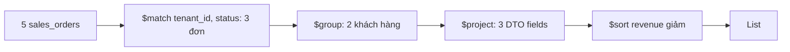
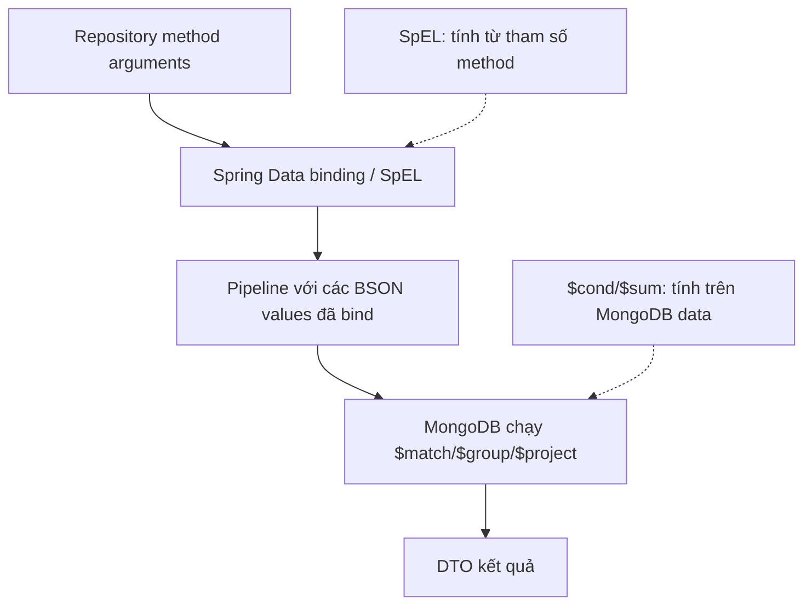
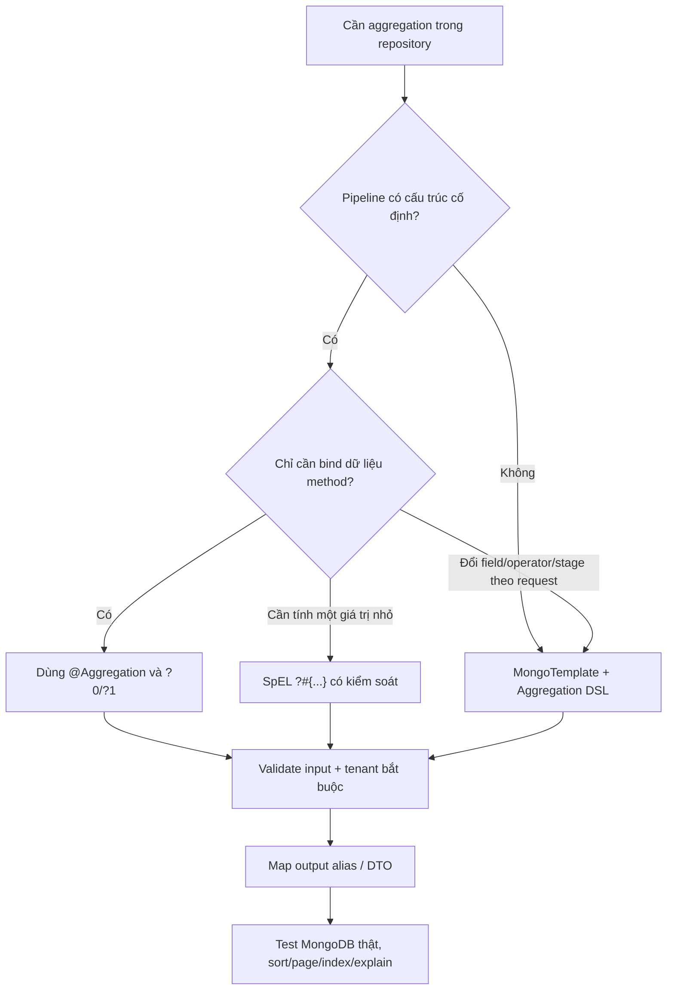

# Placeholder và SpEL trong pipeline aggregation của Spring Data MongoDB repository

## 1. Vì sao repository aggregation cần truyền tham số động?

Trong **Spring Data MongoDB**, ứng dụng Java không chỉ đọc và ghi document qua `MongoRepository` hoặc `MongoTemplate` mà còn có thể tổng hợp dữ liệu bằng MongoDB Aggregation Framework: lọc theo điều kiện, gom nhóm, tính tổng, chiếu trường và sắp xếp báo cáo. Khi pipeline tương đối ổn định, có thể khai báo nó trực tiếp trên một **repository method** bằng annotation `@Aggregation`.

Ví dụ, báo cáo doanh thu theo khách hàng có cùng cấu trúc ở mọi request:

```text
sales_orders
    ↓ $match: tenant và status
    ↓ $group: theo customer_id, tính count và sum
    ↓ $project: đặt alias đúng tên DTO
    ↓ $sort: revenue giảm dần
List<CustomerRevenue>
```

Tuy nhiên, **tenant**, **status**, **khoảng thời gian** hoặc **danh sách trạng thái** thường thay đổi theo tham số method. Nếu phải viết một pipeline mới cho từng tenant hoặc nối chuỗi JSON bằng tay, code sẽ khó kiểm thử và dễ tạo lỗi bảo mật.

Spring Data hỗ trợ hai cách quan trọng để biểu đạt phần động bên trong pipeline repository:

- **Placeholder dạng vị trí**, như `?0`, `?1`: liên kết một giá trị từ tham số method vào câu truy vấn/pipeline.
- **Biểu thức SpEL trong tham số liên kết**, như `?#{[0]}` hoặc `?#{[1] ? 'PAID' : 'NEW'}`: tính một biểu thức có kiểm soát rồi dùng kết quả của nó khi tạo query.

Hai cơ chế này không phải giấy phép để client tự soạn MongoDB pipeline. Chúng giúp **tái sử dụng một cấu trúc pipeline được server định nghĩa**, đồng thời kiểm soát giá trị input, ánh xạ BSON, output DTO và giới hạn hiệu năng.

### 1.1. Các đối tượng tham gia

| Khái niệm | Vai trò | Ví dụ |
|---|---|---|
| `@Aggregation` | Khai báo một hoặc nhiều stage của pipeline trên repository method | `@Aggregation(pipeline = { ... })` |
| `?0`, `?1` | Lấy giá trị tham số method theo chỉ số bắt đầu từ 0 | `{ 'tenant_id': ?0 }` |
| `?#{...}` | Biểu thức Spring Expression Language được đánh giá khi bind | `?#{[1] ? 'PAID' : 'NEW'}` |
| `MongoRepository` | Tạo proxy và thực thi repository method | `SalesOrderRepository` |
| `@Document`, `@Field` | Mô tả collection và mapping document | `@Field("total_cents")` |
| DTO kết quả | Nhận document sau `$group`/`$project`, không nhất thiết là entity nguồn | `CustomerRevenue` |
| `Sort` / `Pageable` | Tùy chọn sắp xếp/giới hạn kết quả repository aggregation | `Sort.by("revenueCents")` |

**Mục tiêu học tập:** tạo một pipeline `@Aggregation` có placeholder đúng kiểu, hiểu lúc nào SpEL mang lại giá trị, nhận biết các vấn đề escaping/bảo mật, ánh xạ kết quả sang DTO và kiểm tra bằng MongoDB integration test.

## 2. Bộ dữ liệu mẫu: doanh thu theo khách hàng

### 2.1. Document BSON trong collection sales_orders

Ví dụ database thử nghiệm có năm đơn:

```javascript
db.sales_orders.insertMany([
  {
    _id: "S-101", tenant_id: "T-A", customer_id: "C-01",
    status: "PAID", total_cents: NumberLong(15000),
    created_at: ISODate("2026-01-05T10:00:00Z"),
    tags: ["online", "priority"]
  },
  {
    _id: "S-102", tenant_id: "T-A", customer_id: "C-01",
    status: "PAID", total_cents: NumberLong(7000),
    created_at: ISODate("2026-01-08T10:00:00Z"),
    tags: ["online"]
  },
  {
    _id: "S-103", tenant_id: "T-A", customer_id: "C-02",
    status: "PAID", total_cents: NumberLong(9000),
    created_at: ISODate("2026-01-11T10:00:00Z"),
    tags: ["retail"]
  },
  {
    _id: "S-104", tenant_id: "T-A", customer_id: "C-02",
    status: "NEW", total_cents: NumberLong(5000),
    created_at: ISODate("2026-01-13T10:00:00Z"),
    tags: ["online"]
  },
  {
    _id: "S-201", tenant_id: "T-B", customer_id: "C-01",
    status: "PAID", total_cents: NumberLong(100000),
    created_at: ISODate("2026-01-09T10:00:00Z"),
    tags: ["online"]
  }
]);
```

Dữ liệu cố ý có đơn `S-201` thuộc tenant `T-B` và đơn `S-104` chưa thanh toán. Báo cáo đúng cho **tenant T-A và status PAID**:

| customerId | orderCount | revenueCents |
|---|---:|---:|
| C-01 | 2 | 22.000 |
| C-02 | 1 | 9.000 |

Tổng doanh thu 31.000 cents. **Không được cộng** đơn 5.000 cents có status NEW hoặc đơn 100.000 cents của tenant khác.

### 2.2. Entity Java dùng annotation mapping

Đặt class trong file Java thích hợp. Ví dụ dùng Java 17 và Spring Data MongoDB:

```java
import java.time.Instant;
import java.util.List;

import org.springframework.data.annotation.Id;
import org.springframework.data.mongodb.core.mapping.Document;
import org.springframework.data.mongodb.core.mapping.Field;

@Document(collection = "sales_orders")
public class SalesOrder {
    @Id
    private String id;

    @Field("tenant_id")
    private String tenantId;

    @Field("customer_id")
    private String customerId;

    private String status;

    @Field("total_cents")
    private long totalCents;

    @Field("created_at")
    private Instant createdAt;

    private List<String> tags;

    protected SalesOrder() {}

    public SalesOrder(
            String id,
            String tenantId,
            String customerId,
            String status,
            long totalCents,
            Instant createdAt,
            List<String> tags) {
        this.id = id;
        this.tenantId = tenantId;
        this.customerId = customerId;
        this.status = status;
        this.totalCents = totalCents;
        this.createdAt = createdAt;
        this.tags = tags;
    }

    public String getId() { return id; }
    public String getTenantId() { return tenantId; }
    public String getCustomerId() { return customerId; }
    public String getStatus() { return status; }
    public long getTotalCents() { return totalCents; }
    public Instant getCreatedAt() { return createdAt; }
    public List<String> getTags() { return tags; }
}
```

Mapping cần phân biệt:

| Property Java | Field BSON trong `sales_orders` |
|---|---|
| `id` | `_id` |
| `tenantId` | `tenant_id` |
| `customerId` | `customer_id` |
| `status` | `status` |
| `totalCents` | `total_cents` |
| `createdAt` | `created_at` |
| `tags` | `tags` |

Trong các chuỗi JSON của `@Aggregation` bên dưới, ví dụ dùng **tên BSON vật lý** (`tenant_id`, `customer_id`, `total_cents`) để minh họa trực tiếp cấu trúc MongoDB và tránh phụ thuộc vào giả định rằng mọi đoạn JSON raw sẽ được mapper đổi tên theo cùng một cách. Khi dùng Spring Data aggregation DSL/typed mapping, các property Java có thể được ánh xạ theo domain type; không được tùy ý trộn hai lớp tên.

### 2.3. DTO kết quả sau khi gom nhóm

Pipeline không trả lại từng đơn hàng nữa, nên khai báo một DTO riêng:

```java
public record CustomerRevenue(
    String customerId,
    long orderCount,
    long revenueCents
) {}
```

Đây là **output projection**, không phải entity để gọi `save` lên collection `sales_orders`. Tên ba field đầu ra phải được tạo rõ ràng bằng `$project` hoặc cấu trúc output khác tương thích với Java record.

## 3. Pipeline MongoDB gốc để đối chiếu

Trước khi chèn placeholder, viết pipeline với giá trị cố định trong `mongosh`:

```javascript
db.sales_orders.aggregate([
  { $match: { tenant_id: "T-A", status: "PAID" } },
  {
    $group: {
      _id: "$customer_id",
      orderCount: { $sum: 1 },
      revenueCents: { $sum: "$total_cents" }
    }
  },
  {
    $project: {
      _id: 0,
      customerId: "$_id",
      orderCount: 1,
      revenueCents: 1
    }
  },
  { $sort: { revenueCents: -1, customerId: 1 } }
]);
```

Các bước:

1. `$match` chọn document của đúng tenant, đúng trạng thái.
2. `$group` gom theo `customer_id`. Sau bước này, `_id` là **khóa nhóm**, không còn là `_id` của đơn nguồn.
3. `$project` tạo alias `customerId` và bỏ `_id` để DTO nhận đúng field.
4. `$sort` sắp theo doanh thu giảm dần và customerId tăng dần cho kết quả có thứ tự xác định.



Với `@Aggregation`, **cấu trúc bốn stage trên không đổi**, chỉ các **giá trị lọc** ở `$match` chuyển thành placeholder.

## 4. Khai báo @Aggregation trên repository

### 4.1. Repository method cơ bản với hai placeholder

```java
import java.util.List;

import org.springframework.data.mongodb.repository.Aggregation;
import org.springframework.data.mongodb.repository.MongoRepository;

public interface SalesOrderRepository
        extends MongoRepository<SalesOrder, String> {

    @Aggregation(pipeline = {
        "{ '$match': { 'tenant_id': ?0, 'status': ?1 } }",
        "{ '$group': { " +
            "'_id': '$customer_id', " +
            "'orderCount': { '$sum': 1 }, " +
            "'revenueCents': { '$sum': '$total_cents' } " +
        "} }",
        "{ '$project': { " +
            "'_id': 0, " +
            "'customerId': '$_id', " +
            "'orderCount': 1, " +
            "'revenueCents': 1 " +
        "} }",
        "{ '$sort': { 'revenueCents': -1, 'customerId': 1 } }"
    })
    List<CustomerRevenue> revenueByTenantAndStatus(
        String tenantId,
        String status
    );
}
```

Các chuỗi Java có dấu nháy kép bao quanh từng stage JSON; bên trong ví dụ dùng dấu nháy đơn như MongoDB/Spring Data thường cho phép trong cú pháp annotation pipeline. Dấu nối `+` chỉ để chia một Java string dài thành nhiều dòng, không phải nối giá trị user vào JSON. Pipeline thực tế gồm bốn stage.

Gọi repository:

```java
List<CustomerRevenue> rows =
    salesOrderRepository.revenueByTenantAndStatus(
        "T-A", "PAID");

// Dự kiến C-01: 2 đơn, 22.000 cents;
// C-02: 1 đơn, 9.000 cents.
```

`salesOrderRepository` ở đoạn này là bean đã được Spring inject. Không cần tự tạo `MongoTemplate` để thực thi một repository method đã được khai báo `@Aggregation`.

### 4.2. Đọc đúng thứ tự tham số

```text
revenueByTenantAndStatus("T-A", "PAID")
                         │       │
                         │       └── ?1 = "PAID"
                         └────────── ?0 = "T-A"
```

Placeholder **bắt đầu từ 0**. Với method trên:

| Placeholder | Tham số | Kết quả sau binding |
|---|---|---|
| `?0` | `tenantId` | Giá trị BSON String `"T-A"` |
| `?1` | `status` | Giá trị BSON String `"PAID"` |

Chỉ số placeholder chỉ nói **vị trí đối số của method** chứ không phải vị trí field trong BSON document. Có thể lặp lại `?0` ở nhiều stage nếu cùng một tham số cần được sử dụng nhiều lần. Khi method có các tham số đặc biệt như `Sort`/`Pageable`, cơ chế xác định các tham số có thể bind cần được xem cùng chữ ký và phiên bản Spring Data; không nên dựa vào một suy đoán về offset chỉ số nếu code có nhiều special parameters.

### 4.3. @Aggregation(value = ...) và @Aggregation(pipeline = ...)

Tùy phiên bản Spring Data MongoDB, `@Aggregation` có phần tử annotation `value`/`pipeline` dùng để khai báo các stage. Để người học nhận biết cấu trúc, ví dụ trên sử dụng `pipeline = { ... }`. Một số tài liệu hoặc code hiện có có thể viết:

```java
@Aggregation({
    "{ '$match': { 'status': ?0 } }",
    "{ '$group': { '_id': '$customer_id', 'count': { '$sum': 1 } } }"
})
List<org.bson.Document> countByCustomer(String status);
```

Hai cách minh họa một pipeline gồm nhiều chuỗi stage; hãy đối chiếu phiên bản annotation đang dùng. **Không ghép cả pipeline thành một JSON object chứa nhiều keys `$match`, `$group`**, vì pipeline là **mảng các stage theo thứ tự**.

### 4.4. Tại sao repository @Aggregation khác @Query?

`@Query` định nghĩa một query truy xuất document, còn `@Aggregation` định nghĩa **pipeline nhiều stage**. Ví dụ:

```java
// Với @Query: tìm order nguồn.
@org.springframework.data.mongodb.repository.Query(
    "{ 'tenant_id': ?0, 'status': ?1 }"
)
List<SalesOrder> findRawOrders(String tenantId, String status);

// Với @Aggregation: tạo báo cáo nhóm.
@Aggregation(pipeline = {
    "{ '$match': { 'tenant_id': ?0, 'status': ?1 } }",
    "{ '$group': { '_id': '$customer_id', 'count': { '$sum': 1 } } }"
})
List<org.bson.Document> countOrdersByCustomer(
    String tenantId, String status);
```

Đây là **hai method trong cùng repository interface**, có giá trị trả về và cách xử lý khác nhau. `@Query` không tự động thực hiện `$group`. `@Aggregation` có thể trả DTO hoặc `Document` được tạo từ pipeline, không nhất thiết là một entity đã lưu.

## 5. Placeholder ?0, ?1: liên kết giá trị chứ không nối JSON thủ công

### 5.1. Các placeholder đại diện cho giá trị đã được bind

Với khai báo:

```java
@Aggregation(pipeline = {
    "{ '$match': { 'tenant_id': ?0, 'status': ?1 } }",
    "{ '$count': 'orderCount' }"
})
List<org.bson.Document> countMatchingOrders(
    String tenantId,
    String status
);
```

Lời gọi:

```java
countMatchingOrders("T-A", "PAID");
```

được diễn giải như pipeline tương đương về ý nghĩa:

```javascript
[
  { $match: { tenant_id: "T-A", status: "PAID" } },
  { $count: "orderCount" }
]
```

Spring Data đảm nhiệm **binding và encoding các giá trị** theo query infrastructure và conversion áp dụng cho method; không phải phép thay thế chuỗi Java như `String.replace("?0", input)`. Điều này quan trọng vì một String có dấu nháy, backslash hoặc nội dung giống toán tử MongoDB vẫn cần được xử lý như **giá trị String**, không phải một stage mới.

### 5.2. Không tự bao placeholder trong dấu nháy để mô phỏng String

Phân biệt:

```java
// Nên dùng: giá trị do parameter binder xử lý.
"{ '$match': { 'status': ?0 } }"

// Không nên dùng để "tự quote" placeholder:
"{ '$match': { 'status': '?0' } }"
```

Ở dạng thứ hai, chuỗi có thể được hiểu như **literal chứa ký tự `?0`** hoặc tương tác với parser theo cách không như kỳ vọng, tùy cơ chế parser/version. Để rõ ràng và nhất quán, dùng `?0` ở vị trí **BSON value**, để Spring Data quyết định representation cho String, Boolean, số, Date, enum hay List.

Điều này không có nghĩa mọi tổ hợp String/type đều tự động hợp lệ: Spring phải có converter tương ứng, MongoDB vẫn kiểm tra kiểu BSON, và pipeline phải được viết đúng cấu trúc.

### 5.3. Binding không biến tên field thành dữ liệu

Trong JSON stage:

```java
"{ '$match': { 'tenant_id': ?0 } }"
```

`tenant_id` là **tên field** do người lập trình kiểm soát; `?0` là **giá trị**. Đừng nhận tên field từ client rồi cố dùng placeholder để tạo cấu trúc BSON tùy ý:

```text
Client chọn "field": "tenant_id"
Client chọn "operator": "$ne"
Client chọn "value": null
       ↓
Gắn toàn bộ field/operator vào pipeline
       ↓
Rủi ro thay đổi phạm vi truy vấn và quyền truy cập
```

Nếu API thực sự cần chọn field, thiết kế **allowlist public field → tên BSON/Java property cố định trong code**, kết hợp với tập toán tử được phép. Đừng coi placeholder là cơ chế kiểm soát truy cập.

### 5.4. Tham số String có vẻ giống JSON/operator không tự biến thành operator

Giả sử client gửi giá trị:

```text
PAID' }, { '$group': { '_id': null } }, { '$match': { 'status': 'PAID
```

Một binder nhận `String` và chèn nó làm **giá trị** sẽ không được phép biến text đó thành các stage `$group` mới. Nguy cơ xuất hiện khi application **tự tạo pipeline bằng nối chuỗi raw input**, chuyển một object/map không tin cậy thành BSON query structure, hoặc dùng SpEL để dựng key/operator/stage theo input mà không có allowlist.

Không bao giờ viết dạng:

```java
// ANTI-PATTERN: nối input tùy ý thành JSON pipeline.
String stage = "{ '$match': { 'status': '" + rawStatus
    + "' } }";
```

Thay bằng `?0` và validation enum `status` trước khi gọi repository.

### 5.5. Binding nhiều lần cùng một tham số

Nếu cần tái dùng một giá trị trong nhiều vị trí của pipeline:

```java
@Aggregation(pipeline = {
    "{ '$match': { 'tenant_id': ?0, 'status': ?1 } }",
    "{ '$group': { '_id': '$customer_id', 'total': { '$sum': '$total_cents' } } }",
    "{ '$project': { '_id': 0, 'customerId': '$_id', 'total': 1, 'tenant': ?0 } }"
})
List<org.bson.Document> revenueWithTenant(
    String tenantId,
    String status);
```

`?0` xuất hiện ở hai stage nhưng đều tham chiếu **cùng một đối số**. Việc lặp lại placeholder không làm tham số trở thành một biến mutable state giữa các lần thực thi.

Chú ý ví dụ `tenant: ?0` tạo một **giá trị literal** trong output projection, không phải tham chiếu đến field `"$tenant_id"`. Nếu muốn dùng giá trị từ document nguồn, cú pháp biểu thức aggregation phải tham chiếu một field như `"$tenant_id"` theo đúng stage/đường dẫn.

## 6. Binding theo đúng loại dữ liệu: String, số, thời gian, danh sách

### 6.1. Range ngày với Instant

Trong báo cáo theo khoảng thời gian, stage `$match` nhận hai giá trị thời điểm:

```java
import java.time.Instant;
import java.util.List;
import org.springframework.data.mongodb.repository.Aggregation;

public interface SalesOrderRepository
        extends MongoRepository<SalesOrder, String> {

    @Aggregation(pipeline = {
        "{ '$match': { " +
            "'tenant_id': ?0, " +
            "'status': ?1, " +
            "'created_at': { '$gte': ?2, '$lt': ?3 } " +
        "} }",
        "{ '$group': { " +
            "'_id': '$customer_id', " +
            "'orderCount': { '$sum': 1 }, " +
            "'revenueCents': { '$sum': '$total_cents' } " +
        "} }",
        "{ '$project': { '_id': 0, 'customerId': '$_id', " +
            "'orderCount': 1, 'revenueCents': 1 } }"
    })
    List<CustomerRevenue> revenueInWindow(
        String trustedTenantId,
        String status,
        Instant fromInclusive,
        Instant untilExclusive);
}
```

Ví dụ gọi:

```java
List<CustomerRevenue> january =
    salesOrderRepository.revenueInWindow(
        "T-A",
        "PAID",
        Instant.parse("2026-01-01T00:00:00Z"),
        Instant.parse("2026-02-01T00:00:00Z")
    );
```

Ý nghĩa `[fromInclusive, untilExclusive)`: đầu tháng được tính, đầu tháng sau bị loại. Không cần tạo thời điểm “23:59:59.999999” để biểu diễn cuối tháng. Khi UI dùng ngày theo timezone địa phương, controller phải chuyển khoảng ngày theo múi giờ nghiệp vụ thành các `Instant` chính xác.

**Điều kiện cần kiểm tra trước khi gọi repository:**

- Cả hai mốc thời gian không null nếu query yêu cầu range đầy đủ.
- `fromInclusive.isBefore(untilExclusive)`.
- Khoảng thời gian không vượt giới hạn sản phẩm.
- Field BSON `created_at` có kiểu Date nhất quán; nếu legacy dữ liệu lưu String, binding `Instant` không tự sửa schema sai.

### 6.2. Numeric placeholder: tổng tiền tối thiểu

```java
@Aggregation(pipeline = {
    "{ '$match': { 'tenant_id': ?0, 'status': 'PAID', " +
        "'total_cents': { '$gte': ?1 } } }",
    "{ '$group': { '_id': '$customer_id', " +
        "'revenueCents': { '$sum': '$total_cents' } } }",
    "{ '$project': { '_id': 0, 'customerId': '$_id', " +
        "'revenueCents': 1 } }"
})
List<org.bson.Document> revenueFromLargeOrders(
    String trustedTenantId, long minTotalCents);
```

Tham số `long minTotalCents` là số, không phải String cần được “quote”. Nếu `minTotalCents = 0L`, đây vẫn là một giá trị hợp lệ; không bỏ filter vì điều kiện kiểu `if (minTotalCents > 0)` trừ khi hợp đồng API thực sự nói vậy.

**Cẩn thận:** pipeline này cộng doanh thu **chỉ từ những order có `total_cents >= minTotalCents`**, không phải doanh thu của các khách hàng có tổng doanh thu vượt ngưỡng. Nếu muốn lọc **tổng sau group**, phải thêm `$match` **sau `$group`** trên `revenueCents`.

### 6.3. List parameter cho toán tử $in

```java
@Aggregation(pipeline = {
    "{ '$match': { 'tenant_id': ?0, " +
        "'status': { '$in': ?1 } } }",
    "{ '$group': { '_id': '$customer_id', " +
        "'orderCount': { '$sum': 1 } } }",
    "{ '$project': { '_id': 0, 'customerId': '$_id', " +
        "'orderCount': 1 } }"
})
List<org.bson.Document> countByCustomerForStatuses(
    String trustedTenantId, List<String> statuses);
```

Ở lời gọi:

```java
var rows = salesOrderRepository.countByCustomerForStatuses(
    "T-A",
    List.of("PAID", "NEW"));
```

`?1` cần được bind thành một array giá trị dùng trong `$in`. Validation nên bảo đảm:

- Danh sách khác null, kích thước giới hạn và từng giá trị nằm trong tập status được phép.
- Danh sách rỗng được xử lý rõ ràng: `$in: []` không khớp gì, khác với “không lọc theo status”.
- Không lấy một `Map<String, Object>` tùy ý từ client để thay thế danh sách giá trị; như thế có thể chuyển ranh giới từ dữ liệu sang cấu trúc query.

### 6.4. Enum, ObjectId và custom conversions

Nếu method nhận enum:

```java
public enum OrderStatus {
    NEW, PAID, CANCELLED
}
```

thì repository parameter mapping có thể chuyển enum thành BSON theo converter hiện hành. Nhưng nếu MongoDB đang lưu status như số hoặc mã khác enum name, **không** mặc định giá trị `OrderStatus.PAID` sẽ tự map thành chuỗi `"PAID"` theo đúng schema; cần kiểm chứng bằng test và cấu hình converter.

Tương tự, `String` có hình dạng ObjectId không đồng nghĩa với BSON ObjectId nếu field thực tế là String. Binding `_id` và `@Id`/`@MongoId` có quy tắc riêng; test một giá trị ID thực sự dùng trong hệ thống thay vì chỉ kiểm tra cú pháp placeholder.

## 7. Placeholder là biểu thức trong MongoDB hay chỉ là giá trị?

### 7.1. Phân biệt literal, field reference và operator

Trong aggregation syntax, các ký hiệu có ý nghĩa khác nhau:

```javascript
{
  $project: {
    tenantFromDocument: "$tenant_id",
    fixedText: { $literal: "PAID" },
    calculated: { $add: ["$total_cents", NumberLong(100)] }
  }
}
```

Trong `@Aggregation`, `?0` đặt ở vị trí **giá trị**. Nếu tham số là String `"$total_cents"`, không nên tự cho rằng Spring Data luôn hiểu đó là một field reference giống ký hiệu `"$total_cents"` viết trong DSL raw. Binding String và dựng aggregation expression là hai công việc khác nhau.

Muốn phép tính động với cấu trúc cố định, giữ operator do **server định nghĩa** và bind các số:

```java
@Aggregation(pipeline = {
    "{ '$match': { 'tenant_id': ?0 } }",
    "{ '$project': { " +
        "'customerId': '$customer_id', " +
        "'adjustedCents': { '$add': [ '$total_cents', ?1 ] } " +
    "} }"
})
List<org.bson.Document> previewAdjustedAmounts(
    String trustedTenantId,
    long fixedAdjustmentCents);
```

Ở đây `$add` và `"$total_cents"` là **cấu trúc biểu thức do developer kiểm soát**; `?1` là một số do method cung cấp. Đây chỉ là phép tính báo cáo/preview, không ghi lại field `total_cents` vào MongoDB. Đơn vị phải thống nhất và cần kiểm tra overflow/negative amount theo nghiệp vụ.

### 7.2. Tại sao không đưa tên trường làm tham số query tùy ý?

Anti-pattern ý tưởng:

```text
GET /report?groupBy=anyField&operator=$sum
     ↓
SpEL/placeholder chèn groupBy/operator vào pipeline
     ↓
Được phép nhóm theo trường nội bộ hoặc dùng toán tử không dự kiến
```

Ngay cả khi không có “injection” theo nghĩa phá cú pháp JSON, người dùng vẫn có thể làm thay đổi **phạm vi dữ liệu, chi phí thực thi hoặc hợp đồng DTO** nếu server cho họ điều khiển field path/operator. Giải pháp là map một tập lựa chọn nghiệp vụ như `groupBy=customer`, `groupBy=status` sang **pipeline tĩnh được review** hoặc một DSL chọn stage có allowlist.

### 7.3. Không nhầm binding với query được build sẵn ở Java

`@Aggregation` dành cho **pipeline đủ ổn định để khai báo trong annotation**. Nếu mỗi request thay đổi số stage, thứ tự stage, nhóm điều kiện hoặc các field cần projection, việc đẩy logic điều khiển này vào một biểu thức SpEL rất dài thường làm code khó kiểm thử.

Khi cấu trúc pipeline thực sự động, tạo `Aggregation.newAggregation(...)` bằng `MongoTemplate` trong một lớp query builder được kiểm soát. Vẫn có thể bind đầu vào thông qua `Criteria` và mapping entity mà không tự ghép JSON raw.

## 8. SpEL trong @Aggregation: cú pháp ?#{...}

**SpEL** là viết tắt của *Spring Expression Language*. Spring Data hỗ trợ dùng biểu thức SpEL tại vị trí binding để tạo ra một giá trị phụ thuộc vào các tham số method. Cú pháp cốt lõi:

```text
?#{ <biểu thức Spring Expression Language> }
│ │                                  │
│ └─ yêu cầu đánh giá expression      └─ kết thúc expression
└── prefix binding của Spring Data
```

Để lấy đối số thứ nhất, thứ hai:

```text
?#{[0]}  → giá trị tham số ở vị trí 0
?#{[1]}  → giá trị tham số ở vị trí 1
```

Đây là **cú pháp expression binding**, khác với việc đưa nguyên văn một chuỗi `"#{...}"` vào MongoDB. Biểu thức SpEL do **người viết repository** khai báo trong annotation; giá trị input do caller truyền vào khi chạy method.

### 8.1. Ví dụ đơn giản: SpEL chỉ lấy lại tham số

```java
@Aggregation(pipeline = {
    "{ '$match': { 'tenant_id': ?#{[0]}, 'status': ?#{[1]} } }",
    "{ '$count': 'orderCount' }"
})
List<org.bson.Document> countBySpelBoundValues(
    String tenantId, String status);
```

Về mục đích, `?#{[0]}` lấy cùng giá trị method parameter mà `?0` biểu diễn; `?#{[1]}` tương tự `?1`. **Khi chỉ cần truyền nguyên giá trị, ưu tiên `?0`/`?1`**: ngắn, dễ đọc và ít tạo thêm bề mặt biểu thức.

Nên dùng SpEL khi thực sự cần **tính/chuẩn hóa một giá trị theo chính sách đã định nghĩa**, ví dụ chọn một trạng thái hợp lệ từ một Boolean hoặc áp một ngưỡng số cố định.

### 8.2. Ví dụ điều kiện SpEL ternary

Giả sử một báo cáo hỗ trợ **hai chế độ do service kiểm soát**: `paid = true` dùng status PAID; `paid = false` dùng status NEW. Ta có thể diễn đạt:

```java
@Aggregation(pipeline = {
    "{ '$match': { 'tenant_id': ?0, " +
        "'status': ?#{[1] ? 'PAID' : 'NEW'} } }",
    "{ '$group': { " +
        "'_id': '$customer_id', " +
        "'orderCount': { '$sum': 1 }, " +
        "'revenueCents': { '$sum': '$total_cents' } " +
    "} }",
    "{ '$project': { '_id': 0, 'customerId': '$_id', " +
        "'orderCount': 1, 'revenueCents': 1 } }"
})
List<CustomerRevenue> revenueByStatusFlag(
    String trustedTenantId,
    boolean paid);
```

Biểu thức `?#{[1] ? 'PAID' : 'NEW'}` là toán tử ba ngôi của SpEL:

| Tham số `paid` | Giá trị SpEL trả về | Bộ lọc MongoDB theo nghĩa nghiệp vụ |
|---|---|---|
| `true` | `"PAID"` | `status = "PAID"` |
| `false` | `"NEW"` | `status = "NEW"` |

Ví dụ có chủ đích đơn giản để hiểu cú pháp. **Nó không có nghĩa mọi đơn chưa PAID đều là NEW**: dữ liệu thật có thể có CANCELLED, REFUNDED, PENDING... Hãy chọn một API/filter biểu diễn đúng các trạng thái kinh doanh.

### 8.3. Default giá trị khi tham số null

Ví dụ muốn quy định tham số status null thì áp dụng mặc định PAID:

```java
@Aggregation(pipeline = {
    "{ '$match': { 'tenant_id': ?0, " +
        "'status': ?#{[1] == null ? 'PAID' : [1]} } }",
    "{ '$count': 'orderCount' }"
})
List<org.bson.Document> countWithDefaultStatus(
    String trustedTenantId,
    String requestedStatus);
```

Nếu `requestedStatus` không null, biểu thức trả về chính nó. Nếu null, trả `"PAID"`. Nhưng:

- Không nên cho người dùng nhập giá trị String bất kỳ rồi mặc định mọi giá trị đều được phép. Hãy validate enum trước khi gọi.
- Dùng null để mang nghĩa “mặc định PAID” là một **quy định nghiệp vụ**, khác với “không lọc theo status”.
- Nếu cần **bỏ hẳn điều kiện status khi null**, SpEL trả null **không** tương đương với việc xóa field `status` khỏi `$match`. `status: null` có ngữ nghĩa MongoDB riêng và có thể khớp null/missing.

Trong code dễ bảo trì, chuẩn hóa input ở **service trước khi gọi repository** thường rõ ràng hơn một biểu thức SpEL dài:

```java
String status = requestedStatus == null
    ? "PAID" : validateStatus(requestedStatus);

var rows = salesOrderRepository.revenueByTenantAndStatus(
    authenticatedTenantId, status);
```

`validateStatus(...)` ở đoạn minh họa là helper nghiệp vụ cần triển khai; không phải method sẵn có của Spring Data.

### 8.4. SpEL tính toán giá trị số

Biểu thức có thể tính từ một tham số và một hằng số được developer lựa chọn. Ví dụ nếu tham số đưa vào là **số đồng** nhưng MongoDB lưu **đơn vị nhỏ nhất**, có thể có chuyển đổi cố định:

```java
@Aggregation(pipeline = {
    "{ '$match': { " +
        "'tenant_id': ?0, " +
        "'total_cents': { '$gte': ?#{[1] * 100} } " +
    "} }",
    "{ '$count': 'orderCount' }"
})
List<org.bson.Document> countAboveUnitAmount(
    String trustedTenantId,
    long amountInWholeUnits);
```

Ví dụ chỉ minh họa SpEL arithmetic. **Không áp dụng phép nhân 100 cho mọi loại tiền tệ hoặc mọi hệ thống giá**. Đơn vị, rounding, overflow và validation nên được chuẩn hóa tại domain/service. Nếu giá trị có thể lớn, `Math.multiplyExact` ở Java service cho phép phát hiện overflow rõ ràng trước khi truyền một `long` đã quy đổi vào `?1`.

### 8.5. Đừng nhầm String trong biểu thức với tên field trong BSON

Giả sử:

```java
"{ '$match': { 'status': ?#{[0] ? 'PAID' : 'NEW'} } }"
```

SpEL ở đây trả một **giá trị String**. Nó không sinh một tên field mới, không thêm stage và không có khả năng tự tham chiếu thuộc tính BSON của document trong pipeline như `"$status"`.

Nếu cần MongoDB tính toán **trên field của từng document**, viết aggregation expression như `$cond`, `$add`, `$subtract` và `$ifNull` trong stage. SpEL được đánh giá **khi chuẩn bị query từ tham số method**, còn MongoDB aggregation expression được đánh giá **khi database xử lý mỗi document hoặc nhóm**.



## 9. Cách lựa chọn: ?0 hay ?#{[0]}?

| Nhu cầu | Cú pháp nên ưu tiên | Vì sao? |
|---|---|---|
| Bind tenant ID, status, minAmount trực tiếp | `?0`, `?1` | Ngắn, rõ ràng, ít logic ẩn |
| Bind `List<String>` cho `$in` | `?1` | Binder xử lý giá trị danh sách |
| Chọn một trong hai literal đã được hardcode | `?#{[1] ? 'PAID' : 'NEW'}` | SpEL diễn đạt điều kiện nhỏ, có giới hạn |
| Default một giá trị đơn giản | Chuẩn hóa ở Java service, rồi dùng `?1` | Dễ validate và unit test |
| Chuyển đổi đơn vị/kiểm tra overflow | Java domain/service, rồi `?1` | Rõ type và error handling |
| Chọn field `$group` từ input người dùng | Không ghép raw SpEL tùy ý | Cần allowlist hoặc hai pipeline tĩnh |
| Đổi số lượng/thứ tự stage theo hàng chục trường hợp | `MongoTemplate` + Aggregation DSL | Query builder dễ đọc/test hơn annotation phức tạp |
| Logic nghiệp vụ cần database fields của từng document | Aggregation operators `$cond`/`$ifNull` | SpEL không chạy trên từng document nguồn |

**Nguyên tắc ưu tiên:** nếu có thể diễn đạt bằng placeholder `?0` mà không mất ý nghĩa, dùng nó. Nếu phải viết một SpEL biểu thức dài nhiều nhánh với collection, field path, toán tử, quyền và điều kiện phức tạp, đó thường là dấu hiệu cần **tách logic sang Java service/query builder**, không phải viết SpEL ngày càng lớn.

## 10. Named SpEL references, @Param và khả năng tương thích

Một số cấu hình Spring Data repository cho phép tham chiếu **tham số có tên** trong SpEL evaluation context. Ví dụ về mặt ý tưởng, một expression có thể tham chiếu `#status` thay vì `[1]` khi method parameter được đăng ký tên đúng cách (thường liên quan `@Param` hoặc metadata tên tham số).

Nhưng **không được mặc định** rằng tên Java parameter luôn hiện diện trong mọi cách biên dịch, mọi phiên bản Spring Data MongoDB hoặc mọi loại annotation. Với bài học này, các ví dụ có thể chạy độc lập dùng **positional binding `?0`/`?1`** và **SpEL indexing `[0]`/`[1]`**.

Khi dùng named SpEL ở dự án thật:

1. Đối chiếu tài liệu chính thức của Spring Data MongoDB và Spring Data Commons theo version.
2. Khai báo `@Param` nếu API đó yêu cầu.
3. Đảm bảo build configuration giữ tên tham số nếu dựa vào reflection metadata.
4. Integration test chính xác method với các giá trị khác nhau.
5. Không truyền text biểu thức SpEL trực tiếp từ người dùng vào evaluator.

Tránh nhầm `?#{[0]}` (SpEL lấy tham số) với dạng `@Value("#{...}")` được dùng ở mục đích khác như property/config injection hoặc projection của Spring Data; chúng không phải cùng một API thực thi.

## 11. Thời điểm đánh giá SpEL và ranh giới bảo mật

### 11.1. SpEL trong annotation không phải sandbox cho input không tin cậy

Đầu vào và code phải được tách rõ:

```text
Server developer định nghĩa:
  "$match tenant_id = ?0"
  "status = ?#{[1] ? 'PAID' : 'NEW'}"

Client gửi:
  chỉ giá trị dữ liệu được phép

Server xác thực:
  tenant từ security context
  status/flag từ kiểu và chính sách hợp lệ
         ↓
Repository query được bind và thực thi
```

Nếu ứng dụng cho client gửi nguyên chuỗi SpEL rồi sử dụng cơ chế đánh giá expression, người dùng có thể kiểm soát logic mà server chưa phê duyệt. **Không dùng SpEL như ngôn ngữ filter tùy ý cho API công khai.**

### 11.2. Đừng tin mọi cấu trúc Map như một giá trị vô hại

Một String bình thường đi qua placeholder mang tính dữ liệu. Nhưng nếu method nhận `Map<String, Object>` hay `Document` do user cung cấp rồi đưa vào vị trí operator/query structure, object đó có thể chứa keys dạng `$ne`, `$expr` hoặc nested expressions. Kết quả không còn đơn giản là “giá trị String đã được escape”.

Để giảm rủi ro:

- Nhận DTO với typed fields cụ thể, ví dụ `String status`, `Instant from`, `long minTotalCents`.
- Validate status theo enum/allowlist; validate thời gian, độ dài array, số tiền và page size.
- Giữ toàn bộ MongoDB field names, operators và stage structure trong **code do server kiểm soát**.
- Chỉ expose lựa chọn đã định nghĩa, ví dụ `groupBy=CUSTOMER` hoặc `groupBy=STATUS`, rồi chọn pipeline được kiểm thử.
- Không lấy raw JSON pipeline từ request và đưa trực tiếp vào `@Aggregation`/`BasicQuery`/`MongoTemplate`.

### 11.3. Tenant bắt buộc phải nằm ngoài tùy chọn OR

Mục tiêu: chỉ được đọc tenant `T-A`, còn status có thể là PAID **hoặc** NEW. Query đúng:

```javascript
{
  $and: [
    { tenant_id: "T-A" },
    { status: { $in: ["PAID", "NEW"] } }
  ]
}
```

Không viết:

```javascript
// Sai nếu muốn cô lập tenant:
{
  $or: [
    { tenant_id: "T-A" },
    { status: "PAID" }
  ]
}
```

Nhánh `status = PAID` có thể trả đơn của `T-B`, vi phạm phân quyền. Với pipeline repository, đảm bảo stage `$match` chứa tenant từ nguồn tin cậy và mọi nhánh OR tùy chọn vẫn bị ràng buộc bởi tenant.

### 11.4. SpEL không thay thế kiểm soát hiệu năng

Một pipeline dùng SpEL hợp lệ về cú pháp vẫn có thể tốn tài nguyên nếu client được chọn:

- Array `$in` quá lớn.
- `$regex` substring không index.
- Khoảng ngày rất rộng.
- `$skip` cực sâu.
- `$group` với cardinality cao hoặc `$sort` trên computed output.

Giới hạn input phải được đặt ở service/controller trước khi gọi repository. Với báo cáo phức tạp, theo dõi latency, số nhóm, `keysExamined`/`docsExamined` và memory/disk usage thay vì chỉ quan sát thời gian controller.

## 12. Kết quả @Aggregation: DTO, Document, scalar và alias

### 12.1. Output không nhất thiết là entity nguồn

`SalesOrderRepository` được khai báo với domain type `SalesOrder` vì repository làm việc trên collection `sales_orders`. Nhưng aggregation có thể trả:

- `List<CustomerRevenue>`: các dòng báo cáo.
- `List<org.bson.Document>`: BSON documents đầu ra, tiện cho debug và prototype.
- Một DTO tổng hợp một dòng như `TenantRevenueSummary`.
- Một giá trị scalar ở một số cấu trúc return type được repository mapping hỗ trợ, nhưng **hợp đồng scalar cần được kiểm tra rõ với shape output và version**.

Domain type `SalesOrder` **không quyết định** mọi dòng kết quả phải có `id`, `tenantId`, `status` hoặc toàn bộ field gốc. Stage `$group` và `$project` đã đổi schema đầu ra.

### 12.2. _id sau group không phải _id của order

Ví dụ stage:

```javascript
{
  $group: {
    _id: "$customer_id",
    orderCount: { $sum: 1 },
    revenueCents: { $sum: "$total_cents" }
  }
}
```

Raw document sau stage này:

```javascript
{
  _id: "C-01",
  orderCount: 2,
  revenueCents: NumberLong(22000)
}
```

Giá trị `_id = "C-01"` **không phải** `"S-101"` hoặc `"S-102"`. Nếu DTO:

```java
public record CustomerRevenue(
    String customerId,
    long orderCount,
    long revenueCents
) {}
```

thì cần alias `_id` sang `customerId` khi dự kiến ánh xạ trực tiếp theo record property name:

```javascript
{
  $project: {
    _id: 0,
    customerId: "$_id",
    orderCount: 1,
    revenueCents: 1
  }
}
```

Không mặc định mapper sẽ suy `customerId` từ `_id` mà không có mapping tương ứng. Alias tường minh giúp DTO dễ đọc và test.

### 12.3. Mapping sang record hoặc class

Với DTO Java record, tên output alias và thứ tự constructor parameters phải tương thích với cách Spring Data object mapping materialize record. Trong ví dụ có output field:

```javascript
{
  customerId: "C-01",
  orderCount: 2,
  revenueCents: NumberLong(22000)
}
```

Đây là shape dễ ánh xạ sang record `CustomerRevenue`. Nếu pipeline trả `customer_id` nhưng record chỉ có `customerId` và không có annotation converter, kết quả có thể null hoặc gây lỗi materialization tùy kiểu/constructor.

Nếu thay record bằng class, có thể dùng constructor được Spring Data hỗ trợ và getters phù hợp. Với phần lớn DTO báo cáo bất biến, record thuận tiện vì các field được định nghĩa rõ.

### 12.4. Kiểu số của accumulator

| MongoDB expression | Ví dụ | Lưu ý khi map |
|---|---|---|
| `{ '$sum': 1 }` | Đếm document | Dùng `long` nếu muốn khả năng chứa số lớn |
| `{ '$sum': '$total_cents' }` | Tổng tiền | Kiểm tra kiểu BSON, miền số, tràn |
| `{ '$avg': '$total_cents' }` | Giá trị trung bình | Có thể ra kiểu số thực/decimal; quyết định chính xác và rounding |
| `{ '$min': '$created_at' }` | Thời điểm sớm nhất | Chọn `Instant`/`Date` theo converter |
| `{ '$push': '$customer_id' }` | Tạo array | Có thể làm output group lớn, chạm giới hạn BSON |

MongoDB có quy tắc promotion/overflow cho accumulator và conversion. Khi nghiệp vụ tính tiền, **không** tự động đổi cents integer thành `double` chỉ vì aggregation cho phép số thực. Nếu tổng có thể vượt phạm vi 64-bit, cân nhắc cách lưu/accumulate phù hợp theo schema và kiểm thử với giá trị biên.

### 12.5. Một dòng tổng hợp cho cả tenant

```java
public record TenantRevenueSummary(
    long orderCount,
    long revenueCents
) {}
```

```java
@Aggregation(pipeline = {
    "{ '$match': { 'tenant_id': ?0, 'status': ?1 } }",
    "{ '$group': { '_id': null, " +
        "'orderCount': { '$sum': 1 }, " +
        "'revenueCents': { '$sum': '$total_cents' } } }",
    "{ '$project': { '_id': 0, 'orderCount': 1, " +
        "'revenueCents': 1 } }"
})
TenantRevenueSummary summarizeTenant(
    String trustedTenantId, String status);
```

Pipeline group với `_id: null` tạo tối đa **một nhóm** cho tập input không rỗng. Khi không có document nào khớp `$match`, kết quả có thể không có dòng; method trả DTO đơn có thể nhận `null` theo repository method semantics/version.

Vì vậy, service không nên mặc định:

```java
long total = salesOrderRepository
    .summarizeTenant("T-NONE", "PAID")
    .revenueCents(); // Có thể lỗi nếu result null.
```

Hãy định nghĩa chính sách khi không có dữ liệu và kiểm thử:

```java
TenantRevenueSummary rawSummary =
    salesOrderRepository.summarizeTenant(
        authenticatedTenantId, "PAID");

TenantRevenueSummary summary = rawSummary == null
    ? new TenantRevenueSummary(0L, 0L)
    : rawSummary;
```

Đặt record khác hoặc return type `Optional<TenantRevenueSummary>` nếu dependency/method contract của dự án hỗ trợ rõ ràng, rồi test cả trường hợp no rows.

### 12.6. Scalar result không luôn là một field tên bất kỳ

MongoDB pipeline:

```javascript
[
  { $match: { tenant_id: "T-A", status: "PAID" } },
  { $count: "orderCount" }
]
```

trả document dạng `{orderCount: 3}` nếu có dữ liệu, không trả raw number `3` trực tiếp từ server. Repository mapping có thể hỗ trợ các quy tắc trích giá trị scalar khi return type đơn giản, nhưng quy tắc lựa chọn field nếu kết quả có nhiều field phụ thuộc cấu trúc và phiên bản.

Với bài học cơ bản, dùng DTO rõ ràng:

```java
public record OrderCountResult(long orderCount) {}
```

```java
@Aggregation(pipeline = {
    "{ '$match': { 'tenant_id': ?0, 'status': ?1 } }",
    "{ '$count': 'orderCount' }"
})
OrderCountResult countPaidOrdersByTenant(
    String tenantId, String status);
```

Khi không có document sau `$match`, stage `$count` có thể **không tạo dòng**. Kiểm thử tình huống này để tránh gán kỳ vọng luôn có object với `orderCount = 0`.

## 13. Sort và Pageable với repository aggregation

### 13.1. Sort tham chiếu output sau pipeline

Spring Data MongoDB hỗ trợ các tham số đặc biệt như `Sort` cho repository aggregation theo version. Tùy chọn sort được áp dụng trên **kết quả của pipeline đã khai báo**, không làm thay đổi ý nghĩa các stage trước đó.

Ví dụ một method **không hardcode `$sort`**:

```java
import org.springframework.data.domain.Sort;

@Aggregation(pipeline = {
    "{ '$match': { 'tenant_id': ?0, 'status': ?1 } }",
    "{ '$group': { '_id': '$customer_id', " +
        "'orderCount': { '$sum': 1 }, " +
        "'revenueCents': { '$sum': '$total_cents' } } }",
    "{ '$project': { '_id': 0, 'customerId': '$_id', " +
        "'orderCount': 1, 'revenueCents': 1 } }"
})
List<CustomerRevenue> revenueSorted(
    String trustedTenantId,
    String status,
    Sort sort);
```

Caller:

```java
Sort sort = Sort.by(
    Sort.Order.desc("revenueCents"),
    Sort.Order.asc("customerId")
);

var rows = salesOrderRepository.revenueSorted(
    authenticatedTenantId, "PAID", sort);
```

Chú ý:

- `revenueCents` và `customerId` là **output fields/DTO properties** sau `$project`, không phải field nguồn `total_cents` và `customer_id`.
- Đặt tie-breaker giúp thứ tự rõ ràng khi doanh thu bằng nhau.
- Khi repository method đã có `$sort` mà caller cũng truyền `Sort`, phải kiểm tra **thứ tự và precedence** của các stage sort trong phiên bản đang dùng; đừng viết hai nguồn sort mà không có chủ ý.
- Việc map property khi sort có thể dùng metadata của return type, đặc biệt đối với field có `@Id`. Cần test lệnh và output alias thực tế, tránh đặt DTO aggregate `@Id` vô tình làm sort theo `_id` khác mục đích.

### 13.2. Pageable để giới hạn số dòng kết quả

Ví dụ method có `Pageable`:

```java
import org.springframework.data.domain.Pageable;

@Aggregation(pipeline = {
    "{ '$match': { 'tenant_id': ?0, 'status': ?1 } }",
    "{ '$group': { '_id': '$customer_id', " +
        "'orderCount': { '$sum': 1 }, " +
        "'revenueCents': { '$sum': '$total_cents' } } }",
    "{ '$project': { '_id': 0, 'customerId': '$_id', " +
        "'orderCount': 1, 'revenueCents': 1 } }"
})
List<CustomerRevenue> revenuePage(
    String trustedTenantId,
    String status,
    Pageable pageable);
```

Caller:

```java
import org.springframework.data.domain.PageRequest;

Pageable page = PageRequest.of(
    0,
    20,
    Sort.by(
        Sort.Order.desc("revenueCents"),
        Sort.Order.asc("customerId"))
);

List<CustomerRevenue> rows =
    salesOrderRepository.revenuePage(
        authenticatedTenantId, "PAID", page);
```

Trong Spring Data MongoDB repository aggregation, `Pageable` có thể được áp dụng qua các stage phục vụ sort/skip/limit **sau phần pipeline khai báo**. Bởi vậy một trang 20 ở ví dụ là **20 nhóm khách hàng sau khi đã tính doanh thu**, không phải chỉ group 20 đơn đầu vào.

Giới hạn page size và offset tại service/controller. Nếu pipeline trả số nhóm rất lớn, offset paging sâu có thể tốn tài nguyên; cân nhắc report snapshot, pagination theo key hoặc kiến trúc materialized summary phù hợp.

### 13.3. Không giả định @Aggregation hỗ trợ Page<T> giống findAll(Pageable)

Repository aggregation có thể hỗ trợ tham số `Pageable`, nhưng **return type `Page<T>` không phải lúc nào cũng được hỗ trợ**. Trong Spring Data MongoDB, các tài liệu repository aggregation lưu ý không hỗ trợ `Page` vì muốn có total count cho kết quả aggregation thường cần pipeline đếm riêng.

Khác với truy vấn find theo document, **tổng số nhóm** sau `$group` có thể khác xa **số order nguồn**. Ví dụ:

```text
T-A có 3 đơn PAID
        ↓ group by customer
2 dòng CustomerRevenue

Page.totalElements đúng cho trang nhóm = 2
không phải 3
```

Vì vậy:

- Dùng `List<CustomerRevenue>` hoặc kiểu kết quả được framework/version hỗ trợ khi cần lấy một trang.
- Nếu UI cần tổng số nhóm, viết một **count-groups pipeline** riêng hoặc `$facet` được thiết kế đúng.
- Không tự lấy `repository.count()` của document nguồn rồi gán làm `totalElements` của báo cáo nhóm.

### 13.4. Count-groups bằng một pipeline khác

Trong MongoDB:

```javascript
db.sales_orders.aggregate([
  { $match: { tenant_id: "T-A", status: "PAID" } },
  { $group: { _id: "$customer_id" } },
  { $count: "totalGroups" }
]);
// [{ totalGroups: 2 }]
```

Repository method:

```java
public record GroupCount(long totalGroups) {}
```

```java
@Aggregation(pipeline = {
    "{ '$match': { 'tenant_id': ?0, 'status': ?1 } }",
    "{ '$group': { '_id': '$customer_id' } }",
    "{ '$count': 'totalGroups' }"
})
GroupCount countCustomerGroups(
    String trustedTenantId,
    String status);
```

Khi không có nhóm, `$count` có thể không trả document; service cần xem null là 0 theo hợp đồng. Nếu content query và count query chạy tách thời điểm, dữ liệu có thể thay đổi giữa hai phép tính, nên tổng và trang không nhất thiết phản ánh cùng snapshot.

### 13.5. Sort và trường $id của DTO

Giả sử DTO được thiết kế:

```java
public record GroupRow(
    String customerId,
    long revenueCents
) {}
```

Tránh gắn `@Id` lên `customerId` nếu pipeline đã `$project` thành alias `customerId` và không còn `_id`, trừ khi thật sự muốn Spring Data xử lý property đó như một ID. Trong repository aggregation, mapping special Sort và materialization có thể chịu ảnh hưởng của metadata `@Id`.

**Ưu tiên:** output DTO không có ID mapping đặc biệt khi chỉ là một dòng báo cáo; alias output theo tên property và test câu sort sau pipeline.

## 14. @Meta và các tùy chọn thực thi aggregation

`@Aggregation` giữ cấu trúc pipeline ở repository. Một số tùy chọn query có thể khai báo qua metadata annotation hoặc cấu hình framework, tùy phiên bản.

Ví dụ Spring Data MongoDB repository có hỗ trợ `@Meta`:

```java
import org.springframework.data.mongodb.repository.Meta;

@Meta(allowDiskUse = true)
@Aggregation(pipeline = {
    "{ '$match': { 'tenant_id': ?0, 'status': ?1 } }",
    "{ '$group': { '_id': '$customer_id', " +
        "'revenueCents': { '$sum': '$total_cents' } } }"
})
List<org.bson.Document> revenueWithDiskUse(
    String trustedTenantId, String status);
```

`allowDiskUse` liên quan đến khả năng MongoDB dùng đĩa cho một số stage cần tài nguyên lớn, tùy phiên bản MongoDB và cấu hình cluster. Nó **không tự làm pipeline nhanh hơn**, không thay thế index, không loại bỏ giới hạn document BSON 16 MiB hoặc miễn áp dụng các giới hạn khác.

Khi cần timeout, collation, comment, batch size, `allowDiskUse` hoặc options động phức tạp, kiểm tra những option mà `@Meta`/`@Aggregation` hỗ trợ ở dependency hiện tại. Nếu một option không thể biểu đạt rõ trong repository annotation, cân nhắc `MongoTemplate` với `AggregationOptions`.

## 15. Khi placeholder và SpEL không đủ: chuyển sang MongoTemplate

### 15.1. Phân biệt giá trị tùy chọn với việc bỏ cả một stage

Giả sử một màn hình báo cáo có request:

```text
tenantId (bắt buộc, từ bảo mật)
status (tùy chọn, null nghĩa là không lọc status)
from/until (tùy chọn theo cặp)
groupBy (CUSTOMER hoặc STATUS)
sortBy (REVENUE hoặc COUNT)
```

Một annotation chứa `?#{[1] == null ? null : [1]}` cho field `status` sẽ tạo điều kiện tương tự `status: null` khi input null, **không phải** “xóa hoàn toàn điều kiện status”. MongoDB equality với null có thể khớp cả null/missing, khác với không lọc. Nếu yêu cầu tạo **nhiều cấu trúc stage khác nhau**, nên dùng `MongoTemplate`.

### 15.2. Request DTO cho báo cáo động

```java
import java.time.Instant;

public record RevenueFilter(
    String status,
    Instant fromInclusive,
    Instant untilExclusive
) {}
```

Không đưa tenant ID vào request DTO này; service nhận `trustedTenantId` từ security context. Không chuyển đối tượng DTO thành raw BSON query bằng reflection hoặc serializer mà không có validate.

### 15.3. Xây một pipeline từ các stage có kiểm soát

```java
import java.util.ArrayList;
import java.util.List;

import org.springframework.data.domain.Sort;
import org.springframework.data.mongodb.core.MongoTemplate;
import org.springframework.data.mongodb.core.aggregation.Aggregation;
import org.springframework.data.mongodb.core.aggregation.AggregationOperation;
import org.springframework.data.mongodb.core.query.Criteria;
import org.springframework.stereotype.Service;

@Service
public class RevenueReportService {
    private final MongoTemplate template;

    public RevenueReportService(MongoTemplate template) {
        this.template = template;
    }

    public List<CustomerRevenue> search(
            String trustedTenantId, RevenueFilter filter) {
        if (trustedTenantId == null || trustedTenantId.isBlank()
                || filter == null) {
            throw new IllegalArgumentException("Missing search context");
        }

        Criteria criteria = Criteria.where("tenantId")
            .is(trustedTenantId);

        if (filter.status() != null) {
            String status = filter.status().trim();
            if (!List.of("NEW", "PAID", "CANCELLED")
                    .contains(status)) {
                throw new IllegalArgumentException("Invalid status");
            }
            criteria.and("status").is(status);
        }

        if ((filter.fromInclusive() == null)
                != (filter.untilExclusive() == null)) {
            throw new IllegalArgumentException(
                "Both time bounds are required together");
        }

        if (filter.fromInclusive() != null) {
            if (!filter.fromInclusive()
                    .isBefore(filter.untilExclusive())) {
                throw new IllegalArgumentException("Invalid time range");
            }
            criteria.and("createdAt")
                .gte(filter.fromInclusive())
                .lt(filter.untilExclusive());
        }

        List<AggregationOperation> stages = new ArrayList<>();
        stages.add(Aggregation.match(criteria));
        stages.add(Aggregation.group("customerId")
            .count().as("orderCount")
            .sum("totalCents").as("revenueCents"));
        stages.add(Aggregation.project(
                "orderCount", "revenueCents")
            .and("_id").as("customerId")
            .andExclude("_id"));
        stages.add(Aggregation.sort(
            Sort.by(
                Sort.Order.desc("revenueCents"),
                Sort.Order.asc("customerId"))));

        Aggregation pipeline =
            Aggregation.newAggregation(stages);

        return template.aggregate(
            pipeline,
            SalesOrder.class,
            CustomerRevenue.class
        ).getMappedResults();
    }
}
```

Trong example này:

- Điều kiện tenant **luôn được thêm**.
- Khi status null, **không có** điều kiện status, khác với `status: null`.
- Range thời gian được thêm khi cả hai cận hợp lệ.
- `SalesOrder.class` cung cấp input mapping từ `tenantId` thành `tenant_id` và tương tự cho các field khác.
- DTO `CustomerRevenue` vẫn cần alias ở `$project` như repository pipeline.
- Code có thể unit-test riêng việc validation/request normalization và integration-test MongoDB output.

### 15.4. Chọn groupBy nhưng không cho phép field tự do

Giả sử sản phẩm chỉ hỗ trợ nhóm theo **khách hàng** hoặc **trạng thái**:

```java
public enum RevenueGroup {
    CUSTOMER,
    STATUS
}
```

```java
String groupField = switch (groupBy) {
    case CUSTOMER -> "customerId";
    case STATUS -> "status";
};

stages.add(
    Aggregation.group(groupField)
        .count().as("orderCount")
        .sum("totalCents").as("revenueCents")
);
```

Đây là **đoạn minh họa thay stage group** trong service ở trên, không phải ghép thêm một `$group` thứ hai sau stage trước. `groupBy` là enum đã kiểm soát; user không được truyền `"$customer.sensitiveField"` hoặc một path bất kỳ.

Khi chuyển groupBy từ customer sang status, **output DTO cũng đổi nghĩa**. Nên dùng DTO chung có property `groupKey` nếu cả hai chế độ thực sự cùng hợp đồng, hoặc DTO riêng rõ ràng. Không tiếp tục gọi field `customerId` khi dữ liệu thực ra là status.

### 15.5. Repository custom để vẫn giữ abstraction repository

Khi muốn public API vẫn là repository:

```java
public interface SalesOrderReportCustom {
    List<CustomerRevenue> searchRevenue(
        String trustedTenantId, RevenueFilter filter);
}
```

Có thể triển khai fragment với `MongoTemplate`, gắn vào repository phù hợp theo convention Spring Data. Cách này cho phép repository exposure nhưng không ép pipeline động vào một chuỗi annotation SpEL dài. Tuân thủ naming convention fragment implementation của phiên bản Spring Data trong dự án; tránh tạo class trùng tên bean hoặc vô tình dùng cơ chế custom implementation cũ không còn được khuyến nghị.

### 15.6. Khi nào giữ @Aggregation?

| Trường hợp | `@Aggregation` repository | `MongoTemplate` DSL |
|---|---|---|
| Pipeline tĩnh, một vài scalar values thay đổi | Rất phù hợp | Cũng được |
| `?0`, `?1`, `List`, `Instant` đã validate | Phù hợp | Cũng được |
| Một SpEL ternary nhỏ giữa các giá trị cố định | Có thể phù hợp | Có thể quá nhiều code |
| Bỏ hẳn một nhóm điều kiện khi null | Không tự nhiên, dễ nhầm null semantics | Rõ ràng |
| Thay đổi số lượng và thứ tự stage | Khó review | Phù hợp |
| Nhiều nhánh AND/OR, grouping tùy chọn | Dễ thành JSON khó bảo trì | Phù hợp |
| Dùng `AggregationOptions` phức tạp | Phụ thuộc annotation/version | Linh hoạt |
| Cần collectionName khác theo nghiệp vụ | Repository thường gắn với entity collection | Có overload nhận collection |
| Pipeline được quản lý/kiểm thử như code builder | Khó tách biểu thức | Dễ unit/integration test |

## 16. Collection, mapping và những giả định dễ sai

### 16.1. @Document quyết định collection của repository

`SalesOrderRepository extends MongoRepository<SalesOrder, String>` làm việc với domain type `SalesOrder` có `@Document(collection = "sales_orders")`. Pipeline `@Aggregation` mặc định chạy với collection được xác định từ repository entity. Một tham số String của method như `tenantId` **không tự đổi collection**.

Nếu cần tổng hợp `sales_orders_archive`, không thể chỉ truyền một giá trị tên collection vào `?0` trong `$match` rồi kỳ vọng Spring Data chọn collection đó. Cần một repository/entity mapping khác phù hợp hoặc `MongoTemplate.aggregate(aggregation, collectionName, outputType)`.

### 16.2. @Field và raw JSON pipeline

`SalesOrder.customerId` là Java property, nhưng MongoDB lưu `customer_id`. Trong các JSON stages ví dụ, ta dùng:

```java
"{ '$group': { '_id': '$customer_id', " +
    "'revenueCents': { '$sum': '$total_cents' } } }"
```

Đây là dạng dễ đối chiếu với `mongosh`. Khi một annotation parser/aggregation context áp dụng mapping cho stage, cần đối chiếu chính xác behavior theo phiên bản và kiểu stage: **không mặc định** chuỗi field literal trong JSON raw luôn được chuyển đổi giống `Criteria.where("customerId")` trong typed aggregation DSL.

Ngược lại, trong DSL:

```java
Aggregation.group("customerId")
    .sum("totalCents").as("revenueCents")
```

Spring Data có thể dùng input type mapping phù hợp khi gọi `MongoTemplate.aggregate(..., SalesOrder.class, ...)`. Một integration test nên đối chiếu cả hai đường với dữ liệu thực.

### 16.3. Alias sau $project là tên đầu ra

Khi đã tạo:

```javascript
{
  $project: {
    customerId: "$_id",
    revenueCents: 1,
    _id: 0
  }
}
```

thì Sort của caller hoặc `$sort` tiếp theo phải dựa trên **tên field output** như `customerId`, không phải `customer_id` trong document nguồn (nếu field nguồn đã bị mất). Đây là lỗi dễ thấy khi chuyển một pipeline từ trả `Document` sang DTO rồi thêm `Sort`.

### 16.4. Không dùng DTO aggregate để save vào collection nguồn

`CustomerRevenue` có `customerId` nhưng không có ID của sales order. `RevenueCents` là tổng nhiều document, không phải số tiền của một order. Gọi `save(customerRevenue)` không phải cách cập nhật doanh thu của từng đơn và có thể ghi vào collection ngoài ý muốn khi DTO không có mapping entity phù hợp.

Nếu cần lưu báo cáo materialized, thiết kế collection/bảng báo cáo riêng với identity, lịch tính lại, consistency, retention và khả năng backfill rõ ràng.

## 17. Hiệu năng: bind tham số đúng chưa đủ để pipeline chạy nhanh

### 17.1. Index cho phần lọc ở đầu pipeline

Một index có thể phù hợp khi đa số báo cáo lọc theo `tenant_id`, `status` và đôi khi khoảng `created_at`:

```javascript
db.sales_orders.createIndex(
  { tenant_id: 1, status: 1, created_at: 1, customer_id: 1 },
  { name: "ix_sales_tenant_status_time_customer" }
);
```

Đây là **index ứng viên để đo**, không phải index tối ưu tuyệt đối. Nếu phần lớn query không lọc theo thời gian mà group theo customer, cần đo một thứ tự khóa index khác hoặc cân nhắc thêm index phục vụ query chủ đạo; một index quá rộng cũng tăng chi phí mỗi lần ghi.

Placeholder `?0`/`?1` không tự tạo index. Nếu một ứng dụng thường xuyên gọi:

```java
salesOrderRepository.revenueByTenantAndStatus(
    authenticatedTenantId, "PAID");
```

thì MongoDB vẫn cần kế hoạch truy vấn, access path và resources phù hợp với dữ liệu.

### 17.2. $match sớm, $group đúng phạm vi

Thứ tự hợp lý cho báo cáo:

```text
$match(tenant, status, time range)
    ↓
$group(customer)
    ↓
$project(output aliases)
    ↓
$sort(revenue)
    ↓
$limit(page size)
```

Không tự đặt `$limit: 20` **trước `$group`** rồi gọi kết quả là “top 20 khách hàng theo toàn bộ doanh thu”. Làm vậy chỉ tính trên 20 order đầu vào và trả một báo cáo sai nghĩa.

Ngay cả khi `$match` dùng index, việc `$sort` theo `revenueCents` được tính bằng `$sum` sau `$group` thường không thể tận dụng index của **field nguồn `total_cents`** như sort trên một field document bình thường.

### 17.3. Chạy explain cho pipeline tương đương

Trong `mongosh`:

```javascript
db.sales_orders.explain("executionStats").aggregate([
  { $match: { tenant_id: "T-A", status: "PAID" } },
  {
    $group: {
      _id: "$customer_id",
      orderCount: { $sum: 1 },
      revenueCents: { $sum: "$total_cents" }
    }
  },
  { $sort: { revenueCents: -1 } }
]);
```

Khi phân tích:

| Chỉ số/dấu hiệu | Ý nghĩa |
|---|---|
| `IXSCAN` | Dùng index scan, nhưng cần xem quét bao nhiêu keys |
| `COLLSCAN` | Quét collection; với dataset rất nhỏ đôi khi hợp lý |
| `totalKeysExamined` | Số index keys được xem xét |
| `totalDocsExamined` | Số document được xem xét |
| `nReturned` | Số dòng ở phần kế hoạch/kết quả tương ứng |
| Bộ nhớ/đĩa của `$group` | Tính nhiều nhóm có thể tốn tài nguyên |
| `$sort` sau group | Sort trên computed field có thể đắt |
| `executionTimeMillis` | Thời gian đo trên một lần chạy, cần benchmark nhiều lần |

Không kết luận hiệu năng của index từ đúng năm document mẫu. Để đo thật, dùng dữ liệu có quy mô và phân bố gần production, test các mốc thời gian, số tenant, số trạng thái và số customer khác nhau.

### 17.4. Giá trị tham số ảnh hưởng selectivity

Hai lời gọi cùng một `@Aggregation`:

```java
revenueByTenantAndStatus("T-A", "PAID");
revenueByTenantAndStatus("T-LARGE", "PAID");
```

có thể khác nhau rất lớn về độ dài xử lý nếu tenant thứ hai có hàng triệu order. “Cùng pipeline code” không bảo đảm “cùng chi phí query”. Với multi-tenant, cần theo dõi phân bố tenant nóng, kích thước tập dữ liệu, index và quyền truy cập, đồng thời dùng giới hạn thời gian/cadence phù hợp.

### 17.5. Count, projection và report size

Một pipeline trả vài dòng có thể vẫn đọc/tổng hợp hàng triệu document trước đó. Ngược lại, một pipeline trả hàng trăm nghìn nhóm rồi materialize thành `List<CustomerRevenue>` có thể tạo pressure lên heap JVM.

Giới hạn số nhóm đầu ra khi phù hợp, cân nhắc streaming/template khi cần, hoặc tạo materialized report với hợp đồng cập nhật rõ ràng. Đừng chỉ cắt `List` ở Java sau khi MongoDB đã xử lý và truyền toàn bộ kết quả.

### 17.6. Không tùy ý đưa regex vào SpEL

Nếu `status` là enum mã định danh, so sánh equality mới là ý định phù hợp. Không dùng `?#{[0]}` để dựng regex hoặc `CONTAINING` tự do trên status chỉ vì frontend muốn “tìm gần đúng”: điều đó có thể làm query quét nhiều dữ liệu và thay đổi logic.

Với tìm kiếm văn bản thực sự, dùng `Pattern.quote` cho chuỗi literal và cân nhắc tìm kiếm prefix/canonical field/Search phù hợp. Không cho phép raw regex phức tạp từ user đi vào các stage chưa được review.

## 18. Kiểm thử tích hợp repository aggregation

### 18.1. Điều cần kiểm chứng

Đừng dừng ở unit test xác nhận annotation string có `?0`. Cần chạy MongoDB thật để phát hiện:

1. Repository proxy có bind đúng `?0`/`?1` không?
2. String/Instant/List có được serialize thành **đúng BSON type** không?
3. `@Field` và tên BSON vật lý trong annotation có khớp dữ liệu lưu không?
4. `$group`/`$project` có tạo output đúng tên record không?
5. SpEL ternary có trả status đúng với `true` và `false` không?
6. Mỗi lời gọi với tham số khác nhau có kết quả riêng không, không bị “giữ” filter của lần trước?
7. Tenant khác có bị loại khỏi kết quả không?
8. Sort/Pageable có được áp dụng sau output projection đúng như version mong đợi không?
9. Giá trị đặc biệt có được bind như dữ liệu thay vì bị parse thành cấu trúc query không?
10. Khi không có document đầu vào, kết quả là list rỗng hay null DTO theo hợp đồng method?

Mock repository chỉ kiểm tra interaction; nó **không xác minh** query được Spring Data sinh và MongoDB thực thi ra sao.

### 18.2. Setup dữ liệu qua MongoTemplate trong @DataMongoTest

Ví dụ dưới đây đặt database MongoDB ở môi trường integration test **cô lập**, ví dụ Testcontainers hoặc URI thử nghiệm. Chỉ test database được phép cleanup:

```java
import java.time.Instant;
import java.util.List;

import org.bson.Document;
import org.junit.jupiter.api.BeforeEach;
import org.junit.jupiter.api.Test;
import org.springframework.beans.factory.annotation.Autowired;
import org.springframework.boot.test.autoconfigure.data.mongo.DataMongoTest;
import org.springframework.data.domain.PageRequest;
import org.springframework.data.domain.Sort;
import org.springframework.data.mongodb.core.MongoTemplate;

import static org.assertj.core.api.Assertions.assertThat;

@DataMongoTest
class SalesOrderRepositoryAggregationTest {
    @Autowired
    SalesOrderRepository repository;

    @Autowired
    MongoTemplate template;

    @BeforeEach
    void seed() {
        // CHỈ trên database test cô lập; xóa đúng collection test.
        template.getCollection("sales_orders")
            .deleteMany(new Document());

        repository.saveAll(List.of(
            order("S-101", "T-A", "C-01", "PAID", 15000L,
                "2026-01-05T10:00:00Z"),
            order("S-102", "T-A", "C-01", "PAID", 7000L,
                "2026-01-08T10:00:00Z"),
            order("S-103", "T-A", "C-02", "PAID", 9000L,
                "2026-01-11T10:00:00Z"),
            order("S-104", "T-A", "C-02", "NEW", 5000L,
                "2026-01-13T10:00:00Z"),
            order("S-201", "T-B", "C-01", "PAID", 100000L,
                "2026-01-09T10:00:00Z")
        ));
    }

    private static SalesOrder order(
            String id, String tenant, String customer,
            String status, long amount, String at) {
        return new SalesOrder(
            id, tenant, customer, status, amount,
            Instant.parse(at), List.of("online"));
    }

    @Test
    void positionalBindingFiltersTenantAndStatus() {
        var rows = repository.revenueByTenantAndStatus(
            "T-A", "PAID");

        assertThat(rows)
            .extracting(CustomerRevenue::customerId)
            .containsExactly("C-01", "C-02");

        assertThat(rows)
            .extracting(CustomerRevenue::orderCount)
            .containsExactly(2L, 1L);

        assertThat(rows)
            .extracting(CustomerRevenue::revenueCents)
            .containsExactly(22000L, 9000L);
    }

    @Test
    void sameRepositoryMethodAcceptsDifferentValues() {
        var paidT_A = repository.revenueByTenantAndStatus(
            "T-A", "PAID");
        var newT_A = repository.revenueByTenantAndStatus(
            "T-A", "NEW");
        var paidT_B = repository.revenueByTenantAndStatus(
            "T-B", "PAID");

        assertThat(paidT_A).hasSize(2);
        assertThat(newT_A)
            .singleElement()
            .satisfies(row -> {
                assertThat(row.customerId()).isEqualTo("C-02");
                assertThat(row.revenueCents()).isEqualTo(5000L);
            });
        assertThat(paidT_B)
            .singleElement()
            .satisfies(row -> {
                assertThat(row.customerId()).isEqualTo("C-01");
                assertThat(row.revenueCents()).isEqualTo(100000L);
            });
    }

    @Test
    void spelTernaryUsesChosenStatus() {
        var paid = repository.revenueByStatusFlag("T-A", true);
        var fresh = repository.revenueByStatusFlag("T-A", false);

        assertThat(paid)
            .extracting(CustomerRevenue::revenueCents)
            .containsExactlyInAnyOrder(22000L, 9000L);
        assertThat(fresh)
            .extracting(CustomerRevenue::revenueCents)
            .containsExactly(5000L);
    }

    @Test
    void datePlaceholdersRespectHalfOpenRange() {
        var rows = repository.revenueInWindow(
            "T-A",
            "PAID",
            Instant.parse("2026-01-01T00:00:00Z"),
            Instant.parse("2026-01-10T00:00:00Z")
        );

        assertThat(rows)
            .extracting(CustomerRevenue::customerId)
            .containsExactly("C-01");
        assertThat(rows.get(0).revenueCents())
            .isEqualTo(22000L);
    }

    @Test
    void listParameterIsAnInFilter() {
        var rows = repository.countByCustomerForStatuses(
            "T-A", List.of("PAID", "NEW"));

        assertThat(rows).hasSize(2);
        // C-01 có hai PAID; C-02 có một PAID và một NEW.
        assertThat(rows.stream()
            .map(row -> row.get("orderCount"))
            .map(Number.class::cast)
            .map(Number::longValue))
            .containsExactlyInAnyOrder(2L, 2L);
    }

    @Test
    void pageableLimitsRowsAfterGrouping() {
        var page = PageRequest.of(0, 1,
            Sort.by(
                Sort.Order.desc("revenueCents"),
                Sort.Order.asc("customerId")));

        var rows = repository.revenuePage(
            "T-A", "PAID", page);

        assertThat(rows).hasSize(1);
        assertThat(rows.get(0).customerId())
            .isEqualTo("C-01");
    }
}
```

Đoạn test dùng các method repository đã giới thiệu ở các mục 4, 6, 8 và 13. Khi triển khai thực hành, **gộp những chữ ký method này vào một `SalesOrderRepository` duy nhất**; các khai báo interface ở những mục trước là ví dụ từng phần, không phải đề nghị tạo nhiều file trùng tên.

**Lưu ý độ an toàn:** `deleteMany(new Document())` trong `@BeforeEach` chỉ phù hợp với **database test cô lập tuyệt đối**. Không chạy trên môi trường phát triển dùng chung hoặc production. Nếu cần test database được tái sử dụng, xóa theo prefix ID dành riêng cho test và vẫn phải bảo đảm namespace/credential không chứa dữ liệu thật.

### 18.3. Test giá trị trông giống toán tử MongoDB

Một test regression giúp phân biệt **binding giá trị String** và tự nối JSON:

```java
@Test
void suspiciousStringRemainsAStringValue() {
    String statusText = "{ '$ne': null }";

    var rows = repository.revenueByTenantAndStatus(
        "T-A", statusText);

    // Trong fixture không có status nào đúng bằng text này.
    assertThat(rows).isEmpty();
}
```

Test này được đặt **bên trong class test phía trên**. Nó không thay thế validation enum hay authorization ở service, nhưng giúp phát hiện một regression rất nguy hiểm nếu ai đó bỏ placeholder và thay bằng nối chuỗi JSON raw.

### 18.4. Khi muốn kiểm tra BSON sau binding

Có thể bật command monitoring/logging có kiểm soát trong MongoDB test environment để xem command đã gửi, đặc biệt khi SpEL không cho ra kết quả như dự kiến. Cũng có thể chạy pipeline MongoDB tương đương trong `mongosh` để so sánh.

Không cố suy JSON cuối cùng bằng cách chỉ gọi `annotation.pipeline()[0]`: giá trị annotation chứa `?0`/`?#{...}` **trước binding**. Query thực tế còn đi qua converter/mapping context và repository infrastructure.

Khi log command, cần loại bỏ hoặc che dữ liệu cá nhân, tenant identifiers nhạy cảm, email, tokens, credentials và nội dung request. Việc bật logging verbose trong production có thể vừa tốn tài nguyên vừa lộ dữ liệu.

### 18.5. Những test cần bổ sung trước production

| Trường hợp | Cần chứng minh |
|---|---|
| Tenant khác nhưng cùng customerId | Không lẫn dữ liệu giữa tenant |
| `?0` và `?1` đảo vị trí | Test báo sai thay vì lặng lẽ trả kết quả |
| Status null/blank/không nằm trong enum | Bị từ chối hoặc áp default đúng hợp đồng |
| List `$in` rỗng, null, quá dài | Có chính sách rõ và giới hạn tài nguyên |
| Mốc thời gian đảo chiều | Bị từ chối trước khi gọi repository |
| Giá trị ngày nằm đúng cận trên | Không được tính khi dùng `$lt untilExclusive` |
| Document thiếu `total_cents` hoặc khác kiểu | Aggregation/DTO xử lý theo quy tắc schema |
| Kết quả không có dòng | Không gây NullPointerException |
| Hai nhóm có doanh thu bằng nhau | Sort có tie-breaker |
| Pageable page sâu | Được giới hạn hoặc có chiến lược khác |
| JSON stage lỗi cú pháp | Bị phát hiện bằng integration test, không chỉ compile Java |
| SpEL trên runtime version khác | Thực thi đúng biểu thức hoặc test fail rõ ràng |
| Output DTO field mismatch | Kiểm tra tên alias và kiểu số |
| Pipeline có lookup/array stage | Kiểm tra index, quyền và khả năng phình số dòng |

Không cần chạy vòng QA/refactor chuyên môn hoặc benchmark production trong bước **viết bài Markdown** này; các ví dụ test là hướng dẫn để học viên tự thực hiện trong môi trường đúng cấu hình.

## 19. Bảng chẩn đoán lỗi repository @Aggregation, placeholder và SpEL

| Hiện tượng | Nguyên nhân có thể | Hướng điều tra |
|---|---|---|
| `?0` và `?1` cho kết quả rỗng | Nhầm thứ tự đối số, sai field BSON hoặc sai kiểu BSON | Đối chiếu chữ ký method, JSON stage và raw document |
| Query chỉ đúng khi tenant/status hardcode | Binding không đúng hoặc literal placeholder đặt sai chỗ | Xem cú pháp `?0`, không tự quote thành `'?0'` |
| SpEL không được hiểu hoặc báo parse error | Sai cú pháp `?#{...}`, dấu ngoặc/nháy, expression không hợp lệ | Tách expression nhỏ, kiểm tra runtime version, integration test |
| `?#{[1]}` có vẻ lấy nhầm dữ liệu | Nhầm index method argument hoặc special parameter | Kiểm tra positional binding và signature thực |
| String có ký tự đặc biệt làm JSON lỗi | Code tự nối raw input vào annotation/dynamic string | Dùng placeholder, không dựng pipeline từ chuỗi user |
| `$in` không trả kết quả | List rỗng, null hoặc kiểu phần tử sai | Validate input và kiểm tra BSON array |
| Null status khiến query hẹp ngoài ý muốn | `status: null` khác với bỏ filter | Chuyển sang query builder `MongoTemplate` khi cần bỏ điều kiện |
| `revenueCents` bằng 0 dù nguồn có tiền | Group dùng sai `total_cents` hoặc giá trị không phải số | Kiểm tra output stage và BSON schema |
| DTO `customerId` null | Group key còn ở `_id`, thiếu alias output | Thêm `$project customerId: "$_id"` |
| Sort theo `customer_id` không đúng | Field đã được alias thành `customerId` | Sort trên output của stage cuối |
| Method báo cáo T-A chứa đơn T-B | Tenant filter bị thiếu/đặt trong OR sai | Điều kiện tenant bắt buộc từ security context |
| Chạy ở collection không mong muốn | Repository gắn với domain entity khác | Kiểm tra `@Document`; dùng template khi cần override |
| Kết quả scalar không như kỳ vọng | `$count` trả document, mapping scalar/version khác | Dùng DTO rõ field và test empty result |
| `Page<CustomerRevenue>` gây lỗi | Repository aggregation không hỗ trợ page-count như find query | Dùng `List`/supported type và count-groups riêng |
| Pageable page 2 có dữ liệu bất thường | Thiếu sort ổn định; số nhóm thay đổi giữa request | Có tie-breaker; xét snapshot/materialization |
| `@Meta(allowDiskUse=true)` không tăng tốc | Nghẽn index/filter hoặc group cardinality | `explain` và benchmark, không chỉ tăng resources |
| Tham số query hợp lệ nhưng tốn nhiều RAM | Aggregation trả quá nhiều nhóm rồi materialize List | Giới hạn result, stream/template hoặc materialized report |
| Test mock xanh nhưng MongoDB thật lỗi | Annotation JSON chỉ parse khi thực thi | Integration test trên MongoDB cô lập |

### 19.1. Phương pháp debug theo sáu lớp

1. **Lớp method:** tên method, thứ tự tham số, special parameters, kiểu trả về.
2. **Lớp binding:** giá trị `?0`/`?1`, SpEL `?#{...}`, default/null và conversion.
3. **Lớp pipeline:** từng stage JSON hợp lệ, tên field BSON, vị trí `$match`/`$group`/`$project`/`$sort`.
4. **Lớp database:** collection từ `@Document`, quyền, tenant, schema thực, index và data distribution.
5. **Lớp output mapping:** alias `_id`, tên field DTO, constructor/record và kiểu số.
6. **Lớp hiệu năng:** explain plan, resource use, pagination, số group và log/metrics đã giảm thiểu PII.

Đừng cố sửa annotation bằng cách đổi bừa `?0` sang `?#{[0]}` khi vấn đề thật là **trường BSON gõ sai**. Ngược lại, đừng đổi tên `@Field` trên entity nếu query logic đúng nhưng DTO chưa được alias.

### 19.2. Phân biệt ba kiểu “rỗng”

```text
Không có document thỏa $match
  → $group/$count có thể trả 0 dòng

Kết quả group có một dòng nhưng một field giá trị null/missing
  → mapping DTO phụ thuộc field, constructor và schema

Repository method có return type duy nhất và không có dòng
  → có thể trả null/Optional.empty tùy method contract
```

Ba trường hợp cần **ba bộ test khác nhau**. Không dùng một giá trị mặc định `0` cho mọi field mà chưa xác định tại sao dữ liệu thiếu.

### 19.3. Đọc và so sánh pipeline đã được thực thi

Khi cần chẩn đoán:

```javascript
// Thay giá trị đã bind bằng giá trị cụ thể trong mongosh.
db.sales_orders.aggregate([
  { $match: { tenant_id: "T-A", status: "PAID" } },
  {
    $group: {
      _id: "$customer_id",
      orderCount: { $sum: 1 },
      revenueCents: { $sum: "$total_cents" }
    }
  },
  {
    $project: {
      _id: 0,
      customerId: "$_id",
      orderCount: 1,
      revenueCents: 1
    }
  },
  { $sort: { revenueCents: -1, customerId: 1 } }
]);
```

Đối chiếu kết quả `mongosh` với repository:

- Cả hai sai cùng cách: kiểm tra logic và schema đầu vào.
- `mongosh` đúng, repository rỗng: kiểm tra binding, mapping, collection, converter và typed context.
- Raw result đúng nhưng DTO sai: kiểm tra projection alias và Java materialization.
- Thỉnh thoảng sai khi hai request chạy đồng thời: kiểm tra việc tái sử dụng mutable state ở service/query builder; repository proxy không phải lý do để giữ một shared mutable map giữa request.

## 20. Bài thực hành: repository report với placeholder và SpEL

### 20.1. Mục tiêu

Xây các method repository cho báo cáo đơn hàng theo khách hàng. Dữ liệu nằm ở `sales_orders` với năm document mẫu. API bắt buộc cô lập tenant; status, khoảng thời gian và danh sách trạng thái là những input nghiệp vụ được kiểm soát.

### 20.2. Phần A — Pipeline tĩnh và ?0/?1

1. Tạo entity `SalesOrder` có `@Document(collection = "sales_orders")` và các `@Field` tương ứng.
2. Tạo record `CustomerRevenue` gồm `customerId`, `orderCount` và `revenueCents`.
3. Viết pipeline trong `mongosh` theo `$match → $group → $project → $sort`.
4. Định nghĩa `SalesOrderRepository` với `@Aggregation(pipeline = { ... })`.
5. Đổi literal tenant/status thành `?0` và `?1`; giữ field keys/operator trong code do server kiểm soát.
6. Gọi `revenueByTenantAndStatus("T-A", "PAID")`. Xác minh C-01 = 22.000, C-02 = 9.000.
7. Gọi cùng method với `"NEW"` và tenant `"T-B"`; xác minh kết quả riêng không bị lẫn.
8. Thử truyền String có dấu nháy và nội dung giống toán tử; xác minh binding được xử lý như dữ liệu.

### 20.3. Phần B — Binding nhiều loại dữ liệu

1. Thêm `revenueInWindow(tenant, status, Instant from, Instant until)` với `?2` và `?3`.
2. Tạo test khoảng ngày nửa mở `[2026-01-01, 2026-01-10)`; kết quả chỉ có C-01.
3. Thêm filter `total_cents >= ?1`, xác minh điều kiện số tiền đặt **trước group** chỉ chọn order đạt ngưỡng.
4. Thêm method `countByCustomerForStatuses(tenant, List<String> statuses)` dùng `$in: ?1`.
5. Thử danh sách rỗng/null và giá trị enum không hợp lệ; định nghĩa validation ở service.
6. Nếu entity có custom converter hoặc enum status, kiểm tra BSON query thực thay vì suy từ Java type.

### 20.4. Phần C — SpEL

1. Thay `?0` bằng `?#{[0]}` cho một giá trị để hiểu cú pháp.
2. Viết method `revenueByStatusFlag(tenant, boolean paid)` với `?#{[1] ? 'PAID' : 'NEW'}`.
3. Test `paid = true` và `paid = false`, kiểm tra dữ liệu từng nhóm.
4. Thử một SpEL expression trả default khi tham số null; thảo luận vì sao default khác với **bỏ filter**.
5. Cân nhắc phép chuyển đổi số cố định trong SpEL, sau đó chuyển logic về Java service để xử lý overflow rõ ràng.
6. Giải thích vì sao text SpEL từ client, tên field tùy ý hoặc raw BSON object từ request không được đưa thẳng vào pipeline.

### 20.5. Phần D — Sort, Pageable, DTO và đếm nhóm

1. Bỏ `$sort` khỏi pipeline và thêm tham số `Sort`; sort theo output `revenueCents`, rồi `customerId`.
2. Dùng `PageRequest.of(0, 1, Sort...)` với repository aggregation; xác nhận page đầu có nhóm C-01.
3. Đếm **số nhóm** bằng `$match → $group → $count`; phân biệt số customer và số order.
4. Test một tenant không có dữ liệu; xác định quy tắc trả `0` hoặc empty result.
5. Kiểm tra việc thiếu alias `customerId` sẽ ảnh hưởng mapping DTO ra sao.
6. Giải thích vì sao không nên dùng `Page<CustomerRevenue>` một cách máy móc và vì sao `count()` document nguồn không thay cho count-groups.

### 20.6. Phần E — Khi nào phải dùng MongoTemplate?

1. Thêm yêu cầu “status null nghĩa là **không lọc** theo status”. Chứng minh `status: null` không tương đương bỏ điều kiện.
2. Viết service dùng `Criteria` dựng `$match` tùy chọn và `Aggregation.newAggregation(...)`.
3. Thêm lựa chọn groupBy theo CUSTOMER/STATUS bằng enum hoặc allowlist; không nhận raw field path tùy ý.
4. So sánh độ dài, khả năng review và integration test giữa annotation SpEL dài và template DSL.
5. Thử index `{tenant_id:1,status:1,created_at:1,customer_id:1}` trên dữ liệu test có quy mô đủ; dùng `explain("executionStats")` để đánh giá.
6. Viết tài liệu kỹ thuật cho endpoint: input validation, tenant rule, sort/page limits, cách xử lý empty result, pipeline shape và DTO output.

### 20.7. Tiêu chí hoàn thành

Học viên đạt yêu cầu khi:

- Giải thích vì sao `@Aggregation` dùng **mảng stage** và từng stage có chức năng cụ thể.
- Phân biệt `?0`/`?1` với `?#{[0]}`/SpEL expression.
- Bind đúng `String`, `Instant`, `long` và `List` mà không nối JSON tùy ý.
- Chứng minh filter tenant là bắt buộc và không bị OR/SpEL làm vô hiệu hóa.
- Dùng SpEL cho một phép chọn/biến đổi giá trị nhỏ, **không dùng để tạo ngôn ngữ query từ client**.
- Ánh xạ chính xác `_id` group key sang output DTO alias.
- Dùng Sort/Pageable phù hợp với **dòng kết quả aggregate**, không nhầm với document gốc.
- Biết khi nào `MongoTemplate` là công cụ tốt hơn.
- Có integration test chạy thật trên MongoDB, kiểm tra giá trị từng nhóm và case khác tenant.

## 21. Bảng ghi nhớ và kết luận

| Câu hỏi | Cách hiểu đúng |
|---|---|
| `@Aggregation` làm gì? | Khai báo pipeline trên repository method |
| Mỗi string trong `pipeline = {...}` đại diện gì? | Một stage MongoDB theo thứ tự |
| `?0` là gì? | Tham số method có vị trí bind đầu tiên |
| `?1` là gì? | Tham số method tiếp theo |
| `?#{[0]}` là gì? | SpEL đánh giá để lấy giá trị tham số đầu tiên |
| Khi nào cần SpEL? | Khi cần một phép tính/chọn giá trị nhỏ đã kiểm soát |
| Khi chỉ cần truyền giá trị? | Ưu tiên `?0`/`?1` |
| Có cần tự quote `?0` khi bind String không? | Không; dùng placeholder ở vị trí value |
| Parameter binding có cho user chọn field tùy ý không? | Không; cần allowlist và query structure do server xác định |
| `status: null` có nghĩa bỏ filter không? | Không; MongoDB có null/missing semantics riêng |
| @Aggregation repository dùng collection nào? | Collection được xác định từ entity/repository mapping |
| `@Field` có liên quan không? | Có; kiểm tra domain mapping và tên BSON trong annotation |
| `_id` sau `$group` là gì? | Group key, không nhất thiết là ID document nguồn |
| Vì sao cần `$project`? | Giữ/đổi tên field đúng hợp đồng DTO |
| Sort/Pageable áp dụng ở đâu? | Trên kết quả pipeline theo cơ chế repository/version |
| Có thể dùng Page như find query không? | Không nên giả định hỗ trợ; thường cần đếm nhóm riêng |
| Khi nào chuyển sang MongoTemplate? | Cấu trúc stage hoặc điều kiện thực sự thay đổi theo request |
| Kiểm tra hiệu năng thế nào? | `explain("executionStats")`, index, cardinality, sort và workload thực |
| Kiểm thử thế nào? | Integration test với MongoDB, nhiều tenant, SpEL, type, alias và empty result |

### Sơ đồ quyết định



**Kết luận:** Trong Spring Data MongoDB, placeholder `?0`/`?1` giúp một pipeline `@Aggregation` **tái sử dụng cấu trúc cố định với những giá trị khác nhau**. SpEL `?#{...}` mở rộng khả năng tính một giá trị từ tham số method, nhưng nó không nên thay thế thiết kế input DTO, validation, authorization hay query builder. Khi số stage, tên field, toán tử hoặc các nhánh logic thay đổi theo request, `MongoTemplate` và Aggregation DSL thường rõ ràng hơn. Luôn kiểm chứng **BSON thực thi, output DTO và chi phí trên MongoDB** bằng integration test và explain.

**Tài liệu tham khảo theo phiên bản dự án:** [Spring Data MongoDB — Repository Aggregation Methods](https://docs.spring.io/spring-data/mongodb/reference/mongodb/repositories/query-methods.html), [Spring Data MongoDB — Aggregation Framework Support](https://docs.spring.io/spring-data/mongodb/reference/mongodb/aggregation-framework.html), [Spring Data MongoDB — @Aggregation API](https://docs.spring.io/spring-data/mongodb/docs/current/api/org/springframework/data/mongodb/repository/Aggregation.html), [Spring Data Commons — Query Method Expressions](https://docs.spring.io/spring-data/commons/reference/repositories/query-methods-details.html), [MongoDB — Aggregation Pipeline](https://www.mongodb.com/docs/manual/core/aggregation-pipeline/), [MongoDB — Explain](https://www.mongodb.com/docs/manual/reference/command/explain/). Đối chiếu cú pháp binding, SpEL context, special parameters, output mapping và `@Meta` với phiên bản Spring Data MongoDB/Spring Boot/Java Driver thực tế của dự án.
