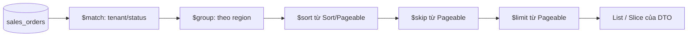

# Ảnh hưởng của Sort và Pageable lên pipeline

Một báo cáo MongoDB có thể gồm nhiều stage như `$match`, `$group`, `$project`, `$sort` và `$limit`. Khi triển khai báo cáo bằng repository method có `@Aggregation` trong **Spring Data MongoDB**, bạn còn có thể truyền `Sort` hoặc `Pageable` tại lúc gọi method. Điều dễ nhầm là **Sort/Pageable không tự len vào đầu pipeline**: Spring Data áp dụng chúng **sau các stage mà annotation đã định nghĩa**. Vì vậy chúng sắp xếp hoặc phân trang **kết quả cuối của aggregation**, không nhất thiết là document nguồn.

Ví dụ: sau `$group` mỗi dòng kết quả đại diện cho **một vùng bán hàng**, không còn là một đơn hàng. Nếu truyền `PageRequest.of(0, 2, Sort.by("revenueCents"))` cho repository method, ý nghĩa thông thường là **lấy hai vùng trong danh sách kết quả đã nhóm**, không phải chỉ đọc hai đơn hàng rồi mới nhóm.

Bài thuộc chương **Aggregation repository** của module `SPRING_DATA_MONGODB`. Module hướng dẫn dùng Spring Data MongoDB để kết nối, ánh xạ document và thao tác MongoDB bằng `MongoTemplate` hoặc repository, cũng như truy vấn, aggregation, index, transaction, reactive access, kiểm thử và chẩn đoán hiệu năng.

> **Ba điều quan trọng:** (1) `Sort`/`Pageable` thêm vào **cuối** pipeline `@Aggregation`; (2) tên field dùng để sort động được ánh xạ theo **kiểu kết quả trả về**, không nhất thiết là entity đầu vào; (3) **`Page<T>` không được hỗ trợ trực tiếp** cho repository method `@Aggregation`, dù bạn vẫn có thể truyền `Pageable` và trả `Slice<T>`.

## 1. Mục tiêu học tập

Sau bài học, bạn có thể:

1. Giải thích cách Spring Data nối `Sort` và `Pageable` vào repository aggregation pipeline.
2. Phân biệt sắp xếp **document trước khi nhóm** với sắp xếp **kết quả sau khi nhóm**.
3. Tạo `@Aggregation` trả `List<DTO>` với tham số `Sort` ở runtime.
4. Dùng `Pageable` để thêm `$sort`, `$skip` và `$limit` vào kết quả aggregation.
5. Giải thích vì sao `Page<DTO>` không phải return type được hỗ trợ cho `@Aggregation` và khi nào dùng `Slice<DTO>`.
6. Hiểu `Sort.by("region")` có thể được ánh xạ thành `{ $sort: { _id: 1 } }` nếu `region` là property `@Id` của **DTO đầu ra**.
7. Phân tích thứ tự stage, field bị mất sau `$project`, alias sau `$group` và giới hạn của sort động.
8. Bảo đảm phân trang ổn định bằng thứ tự có **tie-breaker duy nhất** và hiểu nguy cơ dữ liệu thay đổi giữa các trang.
9. Thiết kế phương án cần **total count** bằng `MongoTemplate` hoặc `$facet` với count **trước** stage phân trang.
10. Đánh giá chi phí `$sort` trên kết quả nhóm, `$skip` lớn, index và tối ưu `$sort + $limit`.
11. Viết integration test xác minh dữ liệu, thứ tự và pipeline thực sự gửi đến MongoDB.
12. Dùng đúng API đồng bộ/reactive, kiểm soát tenant, whitelist sort và giới hạn page size.

## 2. Phân biệt ba tầng dữ liệu trong pipeline

Hãy xem pipeline gồm:

```javascript
[
  { $match: { status: "PAID" } },
  {
    $group: {
      _id: "$region",
      orderCount: { $sum: 1 },
      revenueCents: { $sum: "$total_cents" }
    }
  }
]
```

Có ba tầng cần phân biệt:

| Tầng | Hình dạng document | Field có ý nghĩa |
| --- | --- | --- |
| **Nguồn** trước `$match` | `{_id, tenant_id, region, status, total_cents}` | Field của đơn hàng |
| **Sau `$group`** | `{_id:"north", orderCount:2, revenueCents:2500}` | `_id` là nhóm; các field tổng hợp |
| **Sau Sort/Pageable** | Vẫn là document nhóm, nhưng đã sắp xếp/cắt trang | `_id`, `revenueCents`, `orderCount` |

Sơ đồ:



Đây là **thứ tự logic** muốn áp dụng để phân trang kết quả đã nhóm. Thứ tự stage BSON do Spring Data tạo và cách MongoDB optimizer thực thi có thể được điều chỉnh theo phiên bản và loại pipeline; hãy kiểm chứng command thực khi những chi tiết ấy quan trọng.

**Không nhầm:** `Pageable` trong một repository aggregation không tương đương với việc thêm `PageRequest` cho từng document nguồn rồi mới xử lý toàn bộ báo cáo.

## 3. Dataset và entity mẫu

Collection `sales_orders` có các đơn hàng của nhiều tenant, region và status. Dữ liệu dùng xuyên suốt:

| Order ID | Tenant | Region | Status | total_cents |
| --- | --- | --- | --- | ---: |
| `SO-A1` | tenant-a | north | PAID | 1.000 |
| `SO-A2` | tenant-a | south | PAID | 4.000 |
| `SO-A3` | tenant-a | north | PAID | 1.500 |
| `SO-A4` | tenant-a | central | PAID | 2.000 |
| `SO-A5` | tenant-a | central | PAID | 500 |
| `SO-A6` | tenant-a | north | PENDING | 9.000 |
| `SO-B1` | tenant-b | north | PAID | 8.000 |

Tạo entity Java:

```java
package dev.learning.sales;

import org.springframework.data.annotation.Id;
import org.springframework.data.mongodb.core.mapping.Document;
import org.springframework.data.mongodb.core.mapping.Field;

@Document("sales_orders")
public record SalesOrder(
    @Id String id,
    @Field("tenant_id") String tenantId,
    String region,
    String status,
    @Field("total_cents") long totalCents) {
}
```

Mỗi tài liệu minh họa có ID tiền tố `SO-` để tránh các quy tắc chuyển chuỗi hex thành ObjectId. Trong ứng dụng thực, chọn ID type nhất quán với BSON `_id`, test dữ liệu lịch sử và dùng index phù hợp.

Query báo cáo chỉ xét:

```javascript
{ tenant_id: "tenant-a", status: "PAID" }
```

Kết quả sau khi nhóm theo region là:

| `_id` = region | orderCount | revenueCents |
| --- | ---: | ---: |
| north | 2 | 2.500 |
| south | 1 | 4.000 |
| central | 2 | 2.500 |

**Có 5 đơn PAID nhưng chỉ có 3 nhóm.** Đây là ví dụ chính để nhận biết phân trang đang xảy ra **trước hay sau** `$group`.

### 3.1. DTO ánh xạ kết quả nhóm

```java
package dev.learning.sales;

import org.springframework.data.annotation.Id;

public record RegionRevenue(
    @Id String region,
    long orderCount,
    long revenueCents) {
}
```

`@Id` trên `RegionRevenue.region` cho biết key nhóm MongoDB `_id` sẽ được ánh xạ thành property `region` trong **DTO**. Annotation này cũng ảnh hưởng cách Spring Data xử lý **Sort động theo return type**.

Đừng cho rằng `RegionRevenue` là một entity cần lưu trở lại `sales_orders`. Đây là **read model** tạo bởi aggregation; nó không có những field đầy đủ của một `SalesOrder`.

## 4. Repository @Aggregation không truyền Sort/Pageable

```java
package dev.learning.sales;

import java.util.List;
import org.springframework.data.mongodb.repository.MongoRepository;
import org.springframework.data.mongodb.repository.Aggregation;

public interface SalesOrderRepository
        extends MongoRepository<SalesOrder, String> {

    @Aggregation(pipeline = {
        "{ '$match': { 'tenantId': ?0, 'status': 'PAID' } }",
        "{ '$group': { '_id': '$region',"
          + " 'orderCount': { '$sum': 1 },"
          + " 'revenueCents': { '$sum': '$totalCents' } } }"
    })
    List<RegionRevenue> revenueByRegion(String tenantId);
}
```

Trong pipeline annotation:

- `?0` là placeholder cho tham số `tenantId` đầu tiên.
- `$match` dùng `tenantId` (property Java), được Spring Data MongoDB ánh xạ thành BSON `tenant_id` của domain `SalesOrder`.
- `$group` dùng `$totalCents` từ entity nguồn, được ánh xạ thành `$total_cents` theo `@Field`.
- `_id` của kết quả nhóm chứa region, `orderCount` và `revenueCents` là **field đầu ra do aggregation sinh ra**.
- Kết quả được ánh xạ vào `RegionRevenue`.

Một pipeline BSON tương đương về ý nghĩa:

```javascript
db.sales_orders.aggregate([
  { $match: { tenant_id: "tenant-a", status: "PAID" } },
  {
    $group: {
      _id: "$region",
      orderCount: { $sum: 1 },
      revenueCents: { $sum: "$total_cents" }
    }
  }
]);
```

**Không có `$sort`**, vì vậy MongoDB **không cam kết** trả north/south/central theo thứ tự nào. Việc kết quả có vẻ luôn giống nhau trong tập dữ liệu nhỏ không tạo ra hợp đồng sắp xếp.

### 4.1. JSON annotation và placeholder

`@Aggregation` nhận một hoặc nhiều chuỗi mô tả các stage. Ngoài `?0`, Spring Data còn hỗ trợ các biểu thức SpEL `?#{ ... }` theo tài liệu. Chỉ đưa dữ liệu động qua binding do framework cung cấp; không nối trực tiếp đoạn JSON từ request để tạo stage hay field name.

Khi query có dữ liệu theo tenant, giá trị tenant phải được lấy từ context xác thực và kiểm tra quyền, không chỉ tin vào tham số HTTP do client gửi.

## 5. Truyền Sort: $sort được thêm sau pipeline annotation

Khai báo một method có `Sort`:

```java
@Aggregation(pipeline = {
    "{ '$match': { 'tenantId': ?0, 'status': 'PAID' } }",
    "{ '$group': { '_id': '$region',"
      + " 'orderCount': { '$sum': 1 },"
      + " 'revenueCents': { '$sum': '$totalCents' } } }"
})
List<RegionRevenue> revenueByRegion(
    String tenantId,
    org.springframework.data.domain.Sort sort);
```

Gọi:

```java
import org.springframework.data.domain.Sort;

Sort sort = Sort.by(
    Sort.Order.desc("revenueCents"),
    Sort.Order.asc("region")
);

List<RegionRevenue> rows =
    repository.revenueByRegion("tenant-a", sort);
```

Pipeline **logic**:

```javascript
[
  { $match: { tenant_id: "tenant-a", status: "PAID" } },
  {
    $group: {
      _id: "$region",
      orderCount: { $sum: 1 },
      revenueCents: { $sum: "$total_cents" }
    }
  },
  { $sort: { revenueCents: -1, _id: 1 } }
]
```

Kết quả mong đợi:

| Vị trí | region | revenueCents |
| ---: | --- | ---: |
| 1 | south | 4.000 |
| 2 | central | 2.500 |
| 3 | north | 2.500 |

`region` được dùng để **phá hòa** khi central và north có cùng doanh thu, nên thứ tự ổn định hơn so với chỉ sort theo `revenueCents`.

### 5.1. Tại sao Sort.by("region") trở thành _id?

Tài liệu Spring Data MongoDB chỉ rõ: với repository `@Aggregation`, **field của `Sort` được ánh xạ dựa theo kiểu kết quả trả về**. Vì `RegionRevenue.region` có annotation `@Id`, sort theo `"region"` được ánh xạ thành `"_id"` ở BSON.

Đây là điểm khác với việc `$match` trong pipeline được ánh xạ theo **domain source**. Hãy phân biệt:

| Thao tác | Kiểu/shape dùng cho field mapping | Ví dụ |
| --- | --- | --- |
| `$match` trong annotation | Source `SalesOrder` | `tenantId` → `tenant_id` |
| `$group` trong annotation | Source và biểu thức pipeline | `$totalCents` → `$total_cents` |
| `Sort` tham số method | **Return type `RegionRevenue`** | `region` có `@Id` → `_id` |
| `Sort` theo field tổng hợp | Field có trên output DTO | `revenueCents` → `revenueCents` |

Nếu bạn trả `Document` hoặc interface projection có metadata khác, việc mapping sort có thể khác. **Luôn test output và lệnh BSON thực**, đặc biệt khi DTO sử dụng `@Id`, `@Field` hoặc đổi tên alias.

### 5.2. Đừng sort theo field nguồn đã biến mất

Sau `$group`, mỗi document chỉ còn `_id`, `orderCount` và `revenueCents`. Nếu truyền:

```java
Sort wrong = Sort.by("totalCents");
```

thì `totalCents` là field của **SalesOrder**, không phải field hiện có trên kết quả nhóm. Tùy mapping, lệnh có thể sort trên một field không tồn tại hoặc gây lỗi. Nếu mọi output đều thiếu sort key, thứ tự không xác định. Hãy sort theo **field của DTO/group result**, ví dụ `revenueCents` hoặc `region`.

## 6. Sort trước và sau $group có ý nghĩa khác nhau

Hai pipeline sau **không tương đương**.

### 6.1. Sort document nguồn trước group

```javascript
[
  { $match: { tenant_id: "tenant-a", status: "PAID" } },
  { $sort: { total_cents: -1, _id: 1 } },
  {
    $group: {
      _id: "$region",
      orderCount: { $sum: 1 },
      revenueCents: { $sum: "$total_cents" },
      highestOrderId: { $first: "$_id" }
    }
  }
]
```

`$sort` này sắp **đơn hàng trước group**; `$first` nhận ID đơn có `total_cents` cao nhất của mỗi region (nếu sort được thiết kế phù hợp và tie-breaker duy nhất). Nó không sắp xếp các dòng kết quả `RegionRevenue`.

### 6.2. Sort group sau group

```javascript
[
  { $match: { tenant_id: "tenant-a", status: "PAID" } },
  {
    $group: {
      _id: "$region",
      orderCount: { $sum: 1 },
      revenueCents: { $sum: "$total_cents" }
    }
  },
  { $sort: { revenueCents: -1, _id: 1 } }
]
```

`$sort` này sắp **các region đã tổng hợp**, không ảnh hưởng việc chọn đơn nào trong `$first` của ví dụ trước.

**Điểm then chốt:** `Sort` method parameter của `@Aggregation` được thêm **sau những stage khai báo**, nên **không thể dùng nó để thay thế một `$sort` trước `$group`** khi logic phụ thuộc `$first`, `$last` hoặc thứ tự tính toán. Nếu cần sort **bên trong** pipeline ở vị trí cụ thể, khai báo `$sort` tại đúng vị trí annotation hoặc dùng `MongoTemplate` dựng pipeline động.

## 7. Pageable: sort, skip và limit áp dụng ở cuối pipeline

Thêm một repository method:

```java
import org.springframework.data.domain.Pageable;
import org.springframework.data.domain.Slice;

@Aggregation(pipeline = {
    "{ '$match': { 'tenantId': ?0, 'status': 'PAID' } }",
    "{ '$group': { '_id': '$region',"
      + " 'orderCount': { '$sum': 1 },"
      + " 'revenueCents': { '$sum': '$totalCents' } } }"
})
Slice<RegionRevenue> revenueByRegion(
    String tenantId,
    Pageable pageable);
```

Gọi:

```java
import org.springframework.data.domain.PageRequest;
import org.springframework.data.domain.Sort;

Pageable firstPage = PageRequest.of(
    0, 2,
    Sort.by(
        Sort.Order.desc("revenueCents"),
        Sort.Order.asc("region"))
);

Slice<RegionRevenue> first =
    repository.revenueByRegion("tenant-a", firstPage);
```

Về ý nghĩa, các operator phân trang được **gắn sau kết quả nhóm**:

```javascript
[
  { $match: { tenant_id: "tenant-a", status: "PAID" } },
  {
    $group: {
      _id: "$region",
      orderCount: { $sum: 1 },
      revenueCents: { $sum: "$total_cents" }
    }
  },
  { $sort: { revenueCents: -1, _id: 1 } },
  { $skip: 0 },
  { $limit: 2 }
]
```

Kết quả trang đầu: `south` và `central`. Khi gọi `PageRequest.of(1,2,...)`, offset = 1×2 = 2; trang thứ hai chứa `north`.

### 7.1. Chỉ phân trang group, không phân trang order trước group

Sáu? Trong tenant-a có **5 đơn PAID** nhưng chỉ **3 vùng**. Page size 2 nghĩa là lấy **2 group result rows** trong ba vùng. Không có ý nghĩa “tính doanh thu từ đúng 2 đơn đầu tiên”.

Nếu bạn muốn **phân trang các đơn hàng trước rồi tính tổng trên trang đó**, đó là một báo cáo khác. Cần đặt `$sort`/`$skip`/`$limit` **trước `$group`** trong pipeline theo yêu cầu và hiểu rằng số tổng chỉ phản ánh subset của đơn hàng.

### 7.2. Không có Sort thì phân trang không ổn định

```java
Pageable risky = PageRequest.of(1, 2);
```

Không có thứ tự xác định, page0 và page1 có thể trùng hoặc bỏ sót group khi thứ tự đầu ra thay đổi. Với offset pagination, hãy luôn đặt sort có **khóa duy nhất**:

```java
Pageable stable = PageRequest.of(
    1, 2,
    Sort.by(
        Sort.Order.desc("revenueCents"),
        Sort.Order.asc("region"))
);
```

Ở output group-by-region, `region`/`_id` là duy nhất trong tập nhóm theo region. Nếu group theo cặp `(tenant, region)`, tie-breaker phải là **toàn bộ composite group key**, không chỉ một phần mà nhiều group vẫn có thể trùng.

### 7.3. Không cam kết thứ tự BSON y hệt ví dụ

Tài liệu nói Spring Data nối `$sort`, `$skip`, `$limit` từ `Pageable` vào cuối pipeline. Cú pháp mẫu ở đây diễn tả thứ tự logic để có kết quả đúng. Framework và MongoDB optimizer có thể tổ chức/gộp stage khác nhau; hãy xác minh command thực trên version dự án khi cần dựa vào thứ tự chính xác.

## 8. Vì sao Page<T> không được hỗ trợ trong @Aggregation?

Một `Page<T>` thường chứa:

- Nội dung trang hiện tại.
- `totalElements`: tổng số record khớp trên **toàn bộ tập kết quả trước phân trang**.
- `totalPages` được tính từ tổng và page size.
- Metadata `hasNext`, `number`, `size`.

Với aggregation, tổng bản ghi sau `$group`/`$unwind`/`$facet` có thể rất khác số document nguồn. Spring Data MongoDB **không hỗ trợ `Page<T>` return type cho repository methods có `@Aggregation`**, theo reference documentation hiện hành. Việc method nhận tham số `Pageable` **không tạo một count pipeline tự động** có đúng semantics cho mọi báo cáo.

Sai ý định:

```java
// KHÔNG DÙNG: @Aggregation không hỗ trợ Page<RegionRevenue>.
@Aggregation("{ '$group': { '_id': '$region',"
    + " 'revenueCents': { '$sum': '$totalCents' } } }")
Page<RegionRevenue> unsupported(Pageable pageable);
```

Cách đúng nếu chỉ cần duyệt từng trang:

```java
@Aggregation("{ '$group': { '_id': '$region',"
    + " 'revenueCents': { '$sum': '$totalCents' } } }")
Slice<RegionRevenue> supported(Pageable pageable);
```

**`Slice<T>`** cho nội dung trang và thông tin duyệt tiếp theo **không yêu cầu totalElements** giống `Page`. Tài liệu Spring Data cho phép phương thức aggregation dùng `Pageable` trả `Slice`. Hãy test `hasNext()` và giới hạn lấy dữ liệu trên version hiện dùng; không tự suy Spring Data luôn chạy thêm một count query.

### 8.1. List + Pageable cũng hợp lệ

Nếu endpoint chỉ cần mảng kết quả và không cần `Slice`:

```java
@Aggregation("{ '$group': { '_id': '$region',"
    + " 'revenueCents': { '$sum': '$totalCents' } } }")
List<RegionRevenue> groupedList(Pageable pageable);
```

`Pageable` vẫn dùng để điều khiển sort/offset/limit. `List` không có `getTotalElements()`, `hasNext()` hay page metadata.

## 9. Count nào mới là đúng khi muốn tổng trang?

Quay lại dataset:

- **7 đơn hàng nguồn** thuộc hai tenant và nhiều status.
- **5 đơn hàng PAID của tenant-a**.
- **3 region** sau khi lọc và `$group`.
- **2 region** ở trang đầu khi page size 2.

Nếu UI hiển thị “đang xem 1–2 trên 3 vùng”, **totalElements phải là 3**, không phải 5 hay 7.

### 9.1. Sai: đếm collection nguồn

```java
long wrongForGroups = repository.count();
```

`repository.count()` đếm documents trong collection (trừ điều kiện riêng nếu có), **không đếm output rows sau `$group`**.

Cũng sai khi làm:

```javascript
db.sales_orders.countDocuments({
  tenant_id: "tenant-a", status: "PAID"
});
```

Kết quả là 5 orders, không phải 3 groups.

### 9.2. Đếm output group trước skip/limit

```javascript
db.sales_orders.aggregate([
  { $match: { tenant_id: "tenant-a", status: "PAID" } },
  { $group: { _id: "$region" } },
  { $count: "totalGroups" }
]);
```

Kết quả:

```javascript
[ { totalGroups: 3 } ]
```

Count pipeline này **bắt buộc** phản ánh đúng các stage quyết định số output rows, nhưng **không** được chứa `$skip`/`$limit` của trang hiện tại.

Nếu pipeline gốc có `$unwind` hoặc `$lookup` làm thay đổi cardinality, count phải diễn tả cùng semantics sau những stage ấy. Không thể mặc định `countDocuments` thay thế được.

### 9.3. Total = 0 khi $count không trả document

`$count` trên luồng đầu vào rỗng thường không phát document nào, thay vì một document `{totalGroups:0}`. Khi parse kết quả, hãy dùng giá trị mặc định 0 nếu nhánh đếm rỗng; đừng làm `results.get(0)` khi không có dòng.

## 10. $facet: một pipeline có cả dữ liệu trang và tổng số nhóm

`$facet` có thể xử lý cùng một tập kết quả đã được group bằng hai nhánh:

- `items`: sắp xếp, skip và limit.
- `total`: đếm toàn bộ group trước phân trang.

```javascript
db.sales_orders.aggregate([
  { $match: { tenant_id: "tenant-a", status: "PAID" } },
  {
    $group: {
      _id: "$region",
      orderCount: { $sum: 1 },
      revenueCents: { $sum: "$total_cents" }
    }
  },
  {
    $facet: {
      items: [
        { $sort: { revenueCents: -1, _id: 1 } },
        { $skip: 0 },
        { $limit: 2 }
      ],
      total: [
        { $count: "value" }
      ]
    }
  }
]);
```

Output:

```javascript
[
  {
    items: [
      { _id: "south", orderCount: 1, revenueCents: 4000 },
      { _id: "central", orderCount: 2, revenueCents: 2500 }
    ],
    total: [
      { value: 3 }
    ]
  }
]
```

**Quan trọng:** Nếu đặt `$facet` vào trong `@Aggregation` rồi lại truyền `Pageable` của repository, Spring Data sẽ bổ sung `$sort`/`$skip`/`$limit` **sau toàn bộ pipeline annotation**, tức là **sau `$facet`**. Khi đó các operator sẽ thao tác trên **document chứa `items` và `total`**, không tự phân trang mảng `items[]` bên trong. Vì vậy một báo cáo dùng `$facet` cho page+total nên **tự quản lý pagination trong nhánh items** qua `MongoTemplate` hoặc pipeline được xây phù hợp, không phối trộn mù quáng với Pageable gắn cuối method.

### 10.1. $facet không phải luôn là phương án tối ưu

Một pipeline `$facet` có thể giảm nhu cầu ghép kết quả từ hai lệnh độc lập và đảm bảo các nhánh cùng xử lý một luồng đầu vào của invocation đó, nhưng `$facet` có những giới hạn riêng về bộ nhớ và kích thước output document. Đặt `$facet` quá sớm có thể khiến các tối ưu và index usage kém hơn.

Nếu report nhỏ, hoặc UI chỉ cần “còn trang sau không?”, `Slice` có thể đơn giản hơn. Với tập dữ liệu lớn, đo cả pipeline và độ lớn nhánh kết quả trước khi chọn.

## 11. Khi cần Page thực sự: tự dựng bằng MongoTemplate

Một hướng triển khai là dùng hai aggregation:

1. **Data pipeline**: filter → group → sort → skip → limit.
2. **Count pipeline**: filter → group → count.

Sau đó kết hợp thành `PageImpl<RegionRevenue>` ở tầng service.

Ví dụ có sử dụng Spring Data aggregation DSL:

```java
import java.util.List;
import org.springframework.data.domain.Page;
import org.springframework.data.domain.PageImpl;
import org.springframework.data.domain.Pageable;
import org.springframework.data.domain.Sort;
import org.springframework.data.mongodb.core.MongoTemplate;
import org.springframework.data.mongodb.core.aggregation.Aggregation;
import org.springframework.data.mongodb.core.aggregation.TypedAggregation;
import org.springframework.data.mongodb.core.query.Criteria;

public class RegionReportService {
    private final MongoTemplate template;

    public RegionReportService(MongoTemplate template) {
        this.template = template;
    }

    public Page<RegionRevenue> revenueByRegion(
            String authorizedTenant, Pageable page) {

        var filter = Aggregation.match(
            Criteria.where("tenantId").is(authorizedTenant)
                .and("status").is("PAID"));

        var grouped = Aggregation.group("region")
            .count().as("orderCount")
            .sum("totalCents").as("revenueCents");

        // Sort sau group bằng field BSON output, không nhầm field source.
        Sort outputSort = Sort.by(
            Sort.Order.desc("revenueCents"),
            Sort.Order.asc("_id"));

        TypedAggregation<SalesOrder> dataPipeline =
            Aggregation.newAggregation(
                SalesOrder.class,
                filter, grouped,
                Aggregation.sort(outputSort),
                Aggregation.skip(page.getOffset()),
                Aggregation.limit(page.getPageSize())
            );

        List<RegionRevenue> content = template.aggregate(
            dataPipeline, RegionRevenue.class
        ).getMappedResults();

        TypedAggregation<SalesOrder> countPipeline =
            Aggregation.newAggregation(
                SalesOrder.class,
                Aggregation.match(
                    Criteria.where("tenantId").is(authorizedTenant)
                        .and("status").is("PAID")),
                Aggregation.group("region"),
                Aggregation.count().as("total")
            );

        var totals = template.aggregate(
            countPipeline, org.bson.Document.class
        ).getMappedResults();

        long total = totals.isEmpty()
            ? 0L
            : ((Number) totals.get(0).get("total")).longValue();

        return new PageImpl<>(content, page, total);
    }
}
```

Đoạn này có **sort cố định đã kiểm soát ở tầng service** để tập trung minh họa phân trang và đếm đúng số group; nếu nhận `page.getSort()` từ request, cần validate whitelist và chuyển property của DTO (`region`) sang field output BSON (`_id`) một cách đúng đắn trước khi dựng sort.

**Cảnh báo về nhất quán:** hai aggregation là **hai lệnh đọc**. Nếu đơn hàng thay đổi giữa data query và count query, `content` và `total` có thể lệch thời điểm. Khi nghiệp vụ yêu cầu một snapshot chung, nghiên cứu read concern/transaction hoặc một `$facet` thích hợp với topology và yêu cầu hiệu năng.

## 12. $project, alias và field không còn tồn tại

Một pipeline có thêm `$project`:

```javascript
[
  {
    $group: {
      _id: "$region",
      revenueCents: { $sum: "$total_cents" }
    }
  },
  {
    $project: {
      _id: 0,
      regionName: "$_id",
      total: "$revenueCents"
    }
  }
]
```

Output **không còn** `_id` hay `revenueCents`; thay bằng `regionName` và `total`.

Nếu sau đó truyền `Sort.by("revenueCents")` hoặc `Sort.by("region")` với return type không tương thích alias:

- Sort có thể nhắm **field không tồn tại** ở output.
- Các output document thiếu sort key sẽ có giá trị sort tương đương và thứ tự không ổn định.
- Kết quả có thể “đúng số trang” nhưng **sai thứ tự** rất khó phát hiện.

Hãy định nghĩa output DTO phù hợp và sort theo **field đang tồn tại sau stage cuối**:

```java
public record RegionRevenueFlat(
    String regionName,
    long total) {
}
```

```java
Sort correct = Sort.by(
    Sort.Order.desc("total"),
    Sort.Order.asc("regionName"));
```

Nếu muốn return property `region` nhưng BSON output field là `regionName`, cần metadata/projection có thể map đúng và xác minh sort của repository. Không cố dùng property của source entity ở nơi output shape đã thay đổi.

### 12.1. Không dùng Sort để thay đổi alias

`Sort.by("total")` chỉ sắp xếp, **không tạo** field `total`. Nếu pipeline chưa tạo field này, phải thay đổi `$group`/`$project` hoặc chọn field đã tồn tại.


## 13. Pipeline có $sort/$limit sẵn: tránh trộn hai tầng phân trang

Giả sử một repository có pipeline cố định:

```java
@Aggregation(pipeline = {
    "{ '$match': { 'tenantId': ?0, 'status': 'PAID' } }",
    "{ '$group': { '_id': '$region',"
      + " 'revenueCents': { '$sum': '$totalCents' } } }",
    "{ '$sort': { 'revenueCents': -1 } }",
    "{ '$limit': 10 }"
})
List<RegionRevenue> topTenRegions(
    String tenantId,
    org.springframework.data.domain.Pageable pageable);
```

Pipeline khai báo chọn **tối đa 10 vùng có doanh thu cao nhất**. Khi truyền `PageRequest.of(1,5,Sort.by("region"))`, Spring Data thêm phân trang/sort **sau `$limit:10`**. Kết quả là **sắp xếp và chọn trang trong tập tối đa 10 vùng đã chọn**, không phân trang trên toàn bộ các vùng trong database.

Diễn giải:

```javascript
[
  { $match: { tenant_id: "tenant-a", status: "PAID" } },
  { $group: { _id: "$region",
              revenueCents: { $sum: "$total_cents" } } },
  { $sort: { revenueCents: -1 } },
  { $limit: 10 },
  // Phần được truyền động sau pipeline:
  { $sort: { _id: 1 } },
  { $skip: 5 },
  { $limit: 5 }
]
```

**Hai lớp sort không “thay thế” nhau về semantics của tập dữ liệu đã cắt:** sort đầu quyết định **10 vùng nào lọt vào tập top**, sort thứ hai quyết định **thứ tự trong tập top đó**. Nếu tưởng sort từ Pageable luôn điều khiển cách chọn top 10, kết quả có thể sai nghiệp vụ.

### 13.1. Khi nào nên bỏ $limit cố định?

- Nếu muốn người dùng xem **mọi vùng** theo nhiều trang, bỏ `$limit` cố định trước Pageable.
- Nếu muốn **top N** nhưng thứ tự top N do người dùng lựa chọn, phải xây `$sort` và `$limit` ở cùng logic top-N, không chỉ thêm sort cuối.
- Nếu muốn “trang thứ n của top 100”, đó là bài toán hợp lệ, nhưng API nên diễn đạt rõ chỉ đang duyệt subset top 100.
- Nếu muốn total count, phải xác định total là **mọi vùng sau group** hay **100 vùng thuộc tập top** trước khi viết count pipeline.

### 13.2. Sort theo trường không còn sau $project

`$project` có thể đổi tên hoặc loại field. Nếu định nghĩa:

```javascript
{ $project: { _id: 0, regionName: "$_id", total: "$revenueCents" } }
```

thì việc sort theo field `_id` hoặc `revenueCents` **sau** project không còn tác dụng mong muốn. Trước khi thêm `Sort` vào repository method, đọc **shape ở stage cuối** và kiểu kết quả.

## 14. Tính ổn định của phân trang: tie-breaker và dữ liệu thay đổi

MongoDB `$sort` **không phải stable sort**. Khi hai document có cùng sort key, thứ tự tương đối giữa chúng không được bảo đảm. Với offset pagination:

```javascript
{ $sort: { revenueCents: -1 } },
{ $skip: 2 },
{ $limit: 2 }
```

giả sử nhiều region cùng doanh thu, hai lần chạy có thể đặt những region bằng nhau vào vị trí khác nhau. Khi đọc page0 và page1 riêng, một region có thể lặp hoặc bị bỏ sót.

Thêm khóa duy nhất:

```javascript
{ $sort: { revenueCents: -1, _id: 1 } }
```

làm thứ tự xác định hơn **trong cùng một snapshot dữ liệu**. Với `@Id String region` ở return DTO:

```java
Sort sort = Sort.by(
    Sort.Order.desc("revenueCents"),
    Sort.Order.asc("region")
);
```

được ánh xạ theo return type để sort `_id`. Đừng thay `region` bằng `"id"` một cách tùy tiện: đó có thể không phải property đang được DTO khai báo.

### 14.1. Tie-breaker không giải quyết dữ liệu thay đổi

Ngay cả khi sort gồm `_id`, giữa request trang 1 và request trang 2:

- Có thể có đơn mới làm tăng doanh thu một vùng.
- Có thể có đơn bị hủy hoặc chuyển trạng thái khỏi PAID.
- Một group mới xuất hiện; một group cũ biến mất.
- Thứ hạng doanh thu thay đổi, khiến offset 2 chỉ đến các group khác.

Khi cần báo cáo nhất quán qua nhiều trang, cân nhắc **snapshot/materialized report**, khóa phiên bản dữ liệu báo cáo hoặc read concern/session thích hợp. Một sort ổn định **không tự bảo đảm snapshot xuyên nhiều HTTP requests**.

### 14.2. Keyset/seek pagination không đơn giản khi sort theo aggregate

Với danh sách entity có khóa ổn định, keyset pagination đôi khi dùng điều kiện “sau khóa cuối cùng” thay `$skip` lớn. Nhưng với aggregation sort theo `revenueCents` tính từ `$sum`, muốn tìm “sau (revenue,region)” phải áp điều kiện trên **output đã nhóm**, ví dụ logic:

```javascript
{
  $match: {
    $or: [
      { revenueCents: { $lt: lastRevenue } },
      {
        revenueCents: lastRevenue,
        _id: { $gt: lastRegion }
      }
    ]
  }
}
```

Đây là cách suy luận cho sort `revenueCents DESC, _id ASC`, đặt **sau $group**. Nó không phải tính năng tự động của `@Aggregation(Pageable)`. Dữ liệu nguồn đổi có thể làm aggregate sort key đổi, nên keyset cũng cần consistency strategy cho báo cáo thời gian thực.

## 15. Kiểm soát Sort và Pageable từ API công khai

Với endpoint REST:

```text
GET /reports/regions?sort=revenueCents,desc&page=0&size=20
```

Không được cho rằng framework tự giới hạn mọi giá trị:

- Client có thể truyền field tùy ý, khiến sort nhắm field không tồn tại hoặc field nhạy cảm.
- Page size quá lớn có thể làm tăng payload, memory và tải DB.
- Page number cực lớn tạo offset lớn; `$skip` phải duyệt/bỏ qua nhiều output group.
- Sort chứa quá nhiều khóa hoặc field không nhất quán có thể gây lỗi MongoDB.
- Tenant ID phải được lấy từ context xác thực, không từ query string chưa xác nhận.

### 15.1. Whitelist field sort

Một factory chỉ cho phép sort theo doanh thu, số đơn hoặc vùng:

```java
package dev.learning.sales;

import org.springframework.data.domain.Sort;

public final class RegionSortFactory {
    private RegionSortFactory() {}

    public static Sort by(String requestedField,
                          boolean descending) {
        String property = switch (requestedField) {
            case "revenue" -> "revenueCents";
            case "orders"  -> "orderCount";
            case "region"  -> "region";
            default -> throw new IllegalArgumentException(
                "Trường sắp xếp không được hỗ trợ");
        };

        Sort.Direction direction = descending
            ? Sort.Direction.DESC
            : Sort.Direction.ASC;

        if (property.equals("region")) {
            return Sort.by(new Sort.Order(direction, "region"));
        }
        return Sort.by(
            new Sort.Order(direction, property),
            Sort.Order.asc("region")
        );
    }
}
```

`region` là tie-breaker. Nếu sort chính là `region` thì chính nó đã duy nhất trong tập group-by-region. Không cần thêm lần thứ hai cùng field.

### 15.2. Validate phân trang

```java
import org.springframework.data.domain.PageRequest;
import org.springframework.data.domain.Pageable;
import org.springframework.data.domain.Sort;

public static Pageable regionPage(
        int requestedPage, int requestedSize, Sort sort) {

    if (requestedPage < 0) {
        throw new IllegalArgumentException("page phải >= 0");
    }
    if (requestedSize < 1 || requestedSize > 100) {
        throw new IllegalArgumentException("size phải từ 1 đến 100");
    }
    if (requestedPage > 10_000) {
        throw new IllegalArgumentException(
            "Vượt ngưỡng phân trang; dùng export/report riêng");
    }
    return PageRequest.of(requestedPage, requestedSize, sort);
}
```

Ngưỡng `100` và `10_000` chỉ minh họa **chính sách ứng dụng**, không phải giới hạn Spring Data cố định. Ngoài validation, cần có giới hạn thời gian thực thi, query monitoring và đánh giá trải nghiệm khi dữ liệu quá lớn.

### 15.3. Tenant phải là filter ở đầu pipeline

```java
String authorizedTenant = authenticationContext.currentTenantId();

Slice<RegionRevenue> result = repository.revenueByRegion(
    authorizedTenant, regionPage(page, size, validatedSort));
```

`authenticationContext.currentTenantId()` là API minh họa do ứng dụng cung cấp. Không dùng `Sort` hay `Pageable` như cơ chế phân quyền: chúng chỉ đổi thứ tự/số lượng kết quả, **không ngăn dữ liệu tenant khác vào pipeline** nếu `$match` đầu vào thiếu điều kiện tenant.

## 16. Hiệu năng: sort sau group không giống sort theo index nguồn

Một `$match` sớm có thể tận dụng index của `sales_orders`:

```javascript
db.sales_orders.createIndex(
  { tenant_id: 1, status: 1, region: 1 },
  { name: "tenant_status_region" }
);
```

Nhưng `revenueCents` **không tồn tại trên document nguồn**, nó được tính bởi `$group: {$sum: "$total_cents"}`. Vì vậy:

```javascript
{ $sort: { revenueCents: -1 } }
```

ở **sau group** thường là sort trên tập kết quả trung gian, không thể dùng trực tiếp một index B-tree nguồn trên `revenueCents` để tránh stage sort. Chỉ index trên `total_cents` của order không biến nó thành index trên tổng doanh thu theo region.

### 16.1. Page nhỏ không có nghĩa đọc ít order

```javascript
{ $group: { _id: "$region",
            revenueCents: { $sum: "$total_cents" } } },
{ $sort: { revenueCents: -1 } },
{ $limit: 2 }
```

Dù chỉ trả hai nhóm, server vẫn phải xử lý đủ đơn thuộc filter để tính tổng các vùng. `$limit:2` sau group **không thể tùy ý chuyển trước group** mà vẫn giữ kết quả doanh thu đúng.

Với tập rất lớn, xem xét pre-aggregated/materialized views, cập nhật báo cáo định kỳ hoặc thiết kế read model phù hợp. Nhưng phải định nghĩa consistency và cơ chế bù trừ nếu đồng bộ bất đồng bộ.

### 16.2. $sort + $skip + $limit optimization

MongoDB có thể tối ưu chuỗi:

```javascript
{ $sort: { revenueCents: -1, _id: 1 } },
{ $skip: 100 },
{ $limit: 20 }
```

thành một sort giữ **top 120** kết quả rồi skip 100, nếu không có stage thay đổi số lượng document xen giữa. Đó là một **optimizer transformation** giúp giảm bộ nhớ sort trong trường hợp thích hợp; nó **không biến `$skip:100` thành thao tác O(1)**, cũng không làm `$group` phía trước khỏi phải xử lý input.

Nếu có `$unwind`/`$group` xen giữa `$sort` và `$limit`, điều kiện coalescence có thể không còn thỏa. Dùng `explain` trên phiên bản server cụ thể vì optimizer có thể thay đổi.

### 16.3. allowDiskUse và memory

`$sort` là blocking stage; `$group` cũng có thể cần nhiều memory. Một repository method có thể dùng `@Meta`:

```java
import org.springframework.data.mongodb.repository.Meta;

@Meta(
    allowDiskUse = "true",
    maxExecutionTimeMs = 5_000L,
    comment = "region-revenue-report"
)
@Aggregation(pipeline = {
    "{ '$match': { 'tenantId': ?0, 'status': 'PAID' } }",
    "{ '$group': { '_id': '$region',"
      + " 'revenueCents': { '$sum': '$totalCents' } } }"
})
List<RegionRevenue> revenueReportWithLimits(
    String authorizedTenant, Sort sort);
```

`allowDiskUse` theo annotation `Meta` là **chuỗi** (ví dụ `"true"`) trong các dòng Spring Data MongoDB hiện hành, không dùng `allowDiskUse=true` nếu chữ ký version yêu cầu String. Thiết lập này cho phép server ghi file tạm khi những stage hỗ trợ cần spill, tùy server/config.

`allowDiskUse` **không giảm số dòng** phải nhóm/sắp xếp, không thay thế index và không giải quyết mọi giới hạn tài nguyên. Với `$facet`, có giới hạn riêng: intermediate facet result 100 MB không thể spill và BSON output cuối tối đa 16 MiB. Hãy đo trước khi dùng.

### 16.4. Monitor thời gian, query plan và payload

Theo dõi ít nhất:

- Tỷ lệ request theo page size/page number và field sort.
- Độ trễ p50/p95/p99 của report.
- Số input orders sau `$match` và số output groups sau `$group`.
- `totalKeysExamined`, `totalDocsExamined`, `IXSCAN`/`COLLSCAN`.
- Blocking `SORT`/`GROUP`, spill to disk, memory và server load.
- Số bytes trả về của DTO và thời gian materialize ở Java.
- Rate của timeout, hủy request, repeated pagination và đọc báo cáo không nhất quán.

Một pipeline có `$skip` lớn hoặc sort theo aggregate có thể đắt ngay cả khi DTO chỉ trả vài dòng.

## 17. Phân tích $sort, $group và index bằng explain

Chạy BSON tương đương trong `mongosh` trên database test:

```javascript
db.sales_orders.explain("executionStats").aggregate([
  { $match: { tenant_id: "tenant-a", status: "PAID" } },
  {
    $group: {
      _id: "$region",
      orderCount: { $sum: 1 },
      revenueCents: { $sum: "$total_cents" }
    }
  },
  { $sort: { revenueCents: -1, _id: 1 } },
  { $skip: 0 },
  { $limit: 2 }
]);
```

Đọc explain theo phiên bản server:

- `queryPlanner` và index scan của `$match` ban đầu.
- Số document nguồn đã được đọc.
- Số group output sau `$group`.
- Sort trên `revenueCents` là sort output hay có cơ chế tối ưu khác.
- Giới hạn top-N có được gộp với sort không.
- Có spill to disk hay dùng memory nhiều không.
- Stage nào thực sự chiếm chi phí.

**Lưu ý:** MongoDB có thể tái sắp xếp/coalesce stage trong query plan. Pipeline logic `$sort → $skip → $limit` vẫn diễn tả đúng yêu cầu phân trang, nhưng cấu trúc explain có thể không hiển thị nguyên dạng.

### 17.1. Xác minh pipeline do repository tạo

Đừng chỉ in annotation string rồi kết luận tham số Sort đã ánh xạ đúng. Để biết command thật:

1. Cấu hình **MongoDB Java Driver CommandListener** trong môi trường test.
2. Theo dõi command `aggregate` và trường `pipeline`.
3. Kiểm tra `$match` dùng `tenant_id`, `$group` dùng `$total_cents`.
4. Kiểm tra `$sort` dùng `revenueCents` và `_id` khi sort theo DTO `RegionRevenue`.
5. Kiểm tra có `$skip`/`$limit` đúng với PageRequest.
6. Nếu pipeline có project hoặc alias mới, kiểm tra sort key **thực sự tồn tại** trên output.

Không log toàn bộ BSON document production chứa PII, mã khách hàng hoặc dữ liệu tài chính chưa được phép. Command/profiler test nên che hoặc dùng dữ liệu giả.

## 18. Kiểm thử tích hợp Sort và Pageable trên output nhóm

Một integration test cần chứng minh **đúng stage semantics**, không chỉ trả đúng số lượng.

### 18.1. Fixture và test sort group

Các ví dụ sau giả định `SalesOrder`, `RegionRevenue` và `SalesOrderRepository` đã khai báo ở mục 3–7, và có MongoDB test riêng (URI test/Testcontainers theo dự án).

```java
package dev.learning.sales;

import static org.assertj.core.api.Assertions.assertThat;

import java.util.List;
import java.util.UUID;

import org.junit.jupiter.api.Test;
import org.springframework.beans.factory.annotation.Autowired;
import org.springframework.boot.test.context.SpringBootTest;
import org.springframework.data.domain.PageRequest;
import org.springframework.data.domain.Pageable;
import org.springframework.data.domain.Slice;
import org.springframework.data.domain.Sort;

@SpringBootTest
class RepositoryAggregationPagingIntegrationTest {

    @Autowired SalesOrderRepository repository;

    private String seed() {
        String s = UUID.randomUUID().toString();
        String tenant = "tenant-a-" + s;
        String other = "tenant-b-" + s;

        repository.insert(List.of(
            new SalesOrder("SO-A1-" + s, tenant, "north", "PAID", 1000),
            new SalesOrder("SO-A2-" + s, tenant, "south", "PAID", 4000),
            new SalesOrder("SO-A3-" + s, tenant, "north", "PAID", 1500),
            new SalesOrder("SO-A4-" + s, tenant, "central", "PAID", 2000),
            new SalesOrder("SO-A5-" + s, tenant, "central", "PAID", 500),
            new SalesOrder("SO-A6-" + s, tenant, "north", "PENDING", 9000),
            new SalesOrder("SO-B1-" + s, other, "north", "PAID", 8000)
        ));
        return tenant;
    }

    private Sort revenueThenRegion() {
        return Sort.by(
            Sort.Order.desc("revenueCents"),
            Sort.Order.asc("region")
        );
    }

    @Test
    void sortIsAppliedAfterGroupingToDtoFields() {
        String tenant = seed();

        List<RegionRevenue> rows =
            repository.revenueByRegion(tenant, revenueThenRegion());

        assertThat(rows).extracting(RegionRevenue::region)
            .containsExactly("south", "central", "north");
        assertThat(rows).extracting(RegionRevenue::revenueCents)
            .containsExactly(4000L, 2500L, 2500L);
        assertThat(rows).extracting(RegionRevenue::orderCount)
            .containsExactly(1L, 2L, 2L);
    }

    @Test
    void pageableSlicesTheGroupsNotTheSourceOrders() {
        String tenant = seed();

        Pageable p0 = PageRequest.of(0, 2, revenueThenRegion());
        Pageable p1 = PageRequest.of(1, 2, revenueThenRegion());

        Slice<RegionRevenue> first =
            repository.revenueByRegion(tenant, p0);
        Slice<RegionRevenue> second =
            repository.revenueByRegion(tenant, p1);

        assertThat(first.getContent())
            .extracting(RegionRevenue::region)
            .containsExactly("south", "central");
        assertThat(second.getContent())
            .extracting(RegionRevenue::region)
            .containsExactly("north");
    }
}
```

Test trên kiểm tra ba điểm:

- `$match` theo tenant/status loại order tenant-b và PENDING.
- `$group` tính đúng 3 nhóm và doanh thu.
- `Sort`/`Pageable` áp dụng **sau group**, lấy group results thay vì đầu vào orders.

### 18.2. Đừng bắt đầu bằng test hasNext nếu chưa xác minh version

Reference Spring Data cho phép `Slice` với Pageable cho `@Aggregation`, nhưng cơ chế xác định `hasNext`/giới hạn nội bộ cần được kiểm chứng trên phiên bản cụ thể. Test đầu tiên nên assert **content của các trang**, sau đó bổ sung test `hasNext()`/`isLast()` đúng contract mong muốn. Đừng suy rằng một `Slice` luôn mang tổng số group.

### 18.3. Test empty groups

Thêm một test với tenant không có đơn PAID:

```java
@Test
void noMatchingOrdersGivesEmptySlice() {
    String missingTenant = "missing-" + UUID.randomUUID();

    Slice<RegionRevenue> rows = repository.revenueByRegion(
        missingTenant,
        PageRequest.of(0, 10, revenueThenRegion())
    );

    assertThat(rows.getContent()).isEmpty();
}
```

Đặt method này trong **cùng class test** để dùng lại `repository` và `revenueThenRegion()`.

### 18.4. Test sort field của @Id ở result DTO

Một test đặc biệt:

```java
@Test
void regionSortUsesGroupId() {
    String tenant = seed();

    List<RegionRevenue> rows = repository.revenueByRegion(
        tenant, Sort.by(Sort.Order.asc("region"))
    );

    assertThat(rows).extracting(RegionRevenue::region)
        .containsExactly("central", "north", "south");
}
```

Test content này cho thấy thứ tự output khớp sort theo region. Để **khẳng định** Spring Data đã gửi `{ $sort: { _id: 1 } }` (thay vì sort theo field khác), cần thêm CommandListener/monitoring, vì chỉ có kết quả đúng đôi khi chưa đủ chứng minh đường mapping.

## 19. Các trường hợp cần test ngoài happy path

| Tình huống | Cần chứng minh |
| --- | --- |
| Hai vùng cùng doanh thu | Tie-breaker `region`/`_id` ổn định |
| Không có Sort | Không giả định thứ tự kết quả |
| Page index 0 và 1 | Không lặp hoặc bỏ sót group khi dữ liệu đứng yên |
| Page size 1, page size tối đa | `$skip`/`$limit` đúng ràng buộc |
| Page sâu vượt tổng group | Content rỗng, không trả nhầm |
| Không có đơn PAID | Không có group, total group bằng 0 |
| Tenant-b có doanh thu rất lớn | Không lọt vào report tenant-a |
| Source `@Field("total_cents")` | `$sum` dùng BSON field đúng |
| Result DTO `@Id region` | Dynamic sort theo region dùng group `_id` |
| DTO `$project` đổi alias | Sort dùng đúng field output |
| Pipeline có `$limit` sẵn | Pageable chỉ duyệt subset đã được giới hạn |
| `Page<RegionRevenue>` return type | Không sử dụng với repository `@Aggregation` |
| Phân trang và count hai lệnh | Chấp nhận hoặc giải quyết snapshot inconsistency |
| `$group` sau `$unwind` | Count đếm đúng output cardinality |
| Sort theo field không whitelist | Từ chối request |
| Sort không có field trên output | Có kiểm tra schema/capture command để tránh kết quả ngẫu nhiên |

Trong thực hành, dùng dataset cố định, dữ liệu giả lập, và **không xóa toàn bộ production collection**. Các bài test về performance cần workload riêng thay vì chạy với 7 orders mẫu.

## 20. Reactive @Aggregation với Pageable

Repository aggregation cũng được hỗ trợ cho reactive repository. Khi cần giới hạn dữ liệu theo `Pageable`, phương thức reactive thông thường trả `Flux<T>`, không yêu cầu `Page<T>`:

```java
package dev.learning.sales;

import org.springframework.data.domain.Pageable;
import org.springframework.data.mongodb.repository.Aggregation;
import org.springframework.data.mongodb.repository.ReactiveMongoRepository;
import reactor.core.publisher.Flux;

public interface ReactiveSalesOrderRepository
        extends ReactiveMongoRepository<SalesOrder, String> {

    @Aggregation(pipeline = {
        "{ '$match': { 'tenantId': ?0, 'status': 'PAID' } }",
        "{ '$group': { '_id': '$region',"
          + " 'orderCount': { '$sum': 1 },"
          + " 'revenueCents': { '$sum': '$totalCents' } } }"
    })
    Flux<RegionRevenue> revenueByRegion(
        String tenantId, Pageable page);
}
```

Sử dụng:

```java
Flux<RegionRevenue> results =
    reactiveRepository.revenueByRegion(
        authorizedTenant,
        PageRequest.of(0, 20, revenueThenRegion())
    );
```

Phần `$sort`/`$skip`/`$limit` trong pipeline có cùng ý nghĩa ở MongoDB. `Flux` không tự có `totalElements`/`totalPages` như `Page`; nếu cần count groups, phải thiết kế aggregation khác hoặc facet phù hợp.

Không gọi `block()` tùy tiện trong event loop. Không `collectList()` mọi group khi báo cáo rất lớn chỉ để “biến reactive thành List”; cần áp dụng giới hạn và xử lý tài nguyên. Nếu một publisher bị subscribe lại, aggregation có thể chạy lại và đọc dữ liệu thời điểm mới; kết quả phân trang giữa các lần subscribe không tự được đồng bộ.

## 21. Stream và các dạng return type

Ngoài `List<T>` và `Slice<T>`, repository `@Aggregation` có thể dùng `Stream<T>` theo hỗ trợ của phiên bản Spring Data:

```java
@Aggregation(pipeline = {
    "{ '$match': { 'tenantId': ?0, 'status': 'PAID' } }",
    "{ '$group': { '_id': '$region',"
      + " 'revenueCents': { '$sum': '$totalCents' } } }"
})
java.util.stream.Stream<RegionRevenue> streamRevenue(
    String tenantId, Sort sort);
```

Dùng `try-with-resources` để đóng cursor:

```java
try (var stream = repository.streamRevenue(
        authorizedTenant,
        Sort.by("region"))) {
    stream.forEach(this::processRegion);
}
```

`processRegion` là method do ứng dụng cung cấp. `Stream` không biến sort sau group thành sort nguồn hoặc làm pipeline trở thành streaming end-to-end: stage `$group`/`$sort` vẫn có thể blocking trên MongoDB Server.

### 21.1. Bảng chọn return type

| Nhu cầu | Chọn API |
| --- | --- |
| Danh sách nhỏ, cần sort runtime | `List<DTO> method(Sort)` |
| Danh sách chia trang, không cần total | `Slice<DTO> method(Pageable)` |
| Danh sách có offset/limit, không cần metadata | `List<DTO> method(Pageable)` |
| Tổng số nhóm và số trang | `MongoTemplate` + count pipeline hoặc `$facet` |
| Xử lý đồng bộ theo cursor | `Stream<DTO>`, đóng bằng try-with-resources |
| Reactive read | `Flux<DTO> method(Pageable)` |
| `Page<DTO>` trực tiếp từ `@Aggregation` | **Không được hỗ trợ** |

## 22. Sai lầm thường gặp và hướng xử lý

| Sai lầm | Hậu quả | Cách khắc phục |
| --- | --- | --- |
| Nghĩ Pageable chạy trước `$group` | Tổng doanh thu/count bị diễn giải sai | Đọc pipeline: pageable áp cuối |
| Sort runtime theo property entity nguồn | Sort key thiếu sau group/project | Sort theo output DTO/alias |
| Không hiểu `@Id` trong DTO | `Sort.by("region")` có thể được map sang `_id` | Kiểm tra metadata return type và BSON |
| Dùng `Page<DTO>` cho `@Aggregation` | Return type không được framework hỗ trợ | Dùng `Slice` hoặc tự dựng Page |
| Dùng `repository.count()` làm total groups | Đếm orders thay vì groups | Count trên pipeline sau group |
| `$facet` rồi gắn Pageable ngoài | Phân trang document facet, không phải `items[]` | Đưa pagination vào nhánh facet |
| Sort chỉ theo tổng doanh thu | Hai nhóm đồng hạng không có thứ tự cố định | Thêm khóa nhóm duy nhất |
| Có tie-breaker nhưng dữ liệu đổi giữa trang | Vẫn có thể trùng/bỏ sót khi offset | Snapshot/materialized report |
| Pipeline có `$limit` trước Pageable | Chỉ duyệt subset đã giới hạn | Xác định top-N hay toàn bộ dataset |
| Hai `$sort` nối tiếp | Sort cuối có thể đổi thứ tự hiển thị | Phân biệt sort chọn top-N vs sort cuối |
| `$project` loại field rồi sort theo field cũ | Sort không còn hiệu lực | Dùng field/alias đầu ra |
| Page size không giới hạn | Memory/payload cao | Validate page/size/field |
| Cho client tự chọn tên sort key | Dễ sai schema, tài nguyên không kiểm soát | Whitelist thuộc tính |
| Cho client tự chọn tenant | Lộ dữ liệu | Tenant từ principal |
| Nghĩ index total_cents giúp sort SUM(total) | Computed aggregate chưa tồn tại trong index nguồn | Đo explain, cân nhắc pre-aggregation |
| Chỉ có vài output rows nên nghĩ query rẻ | Group phải đọc nhiều source docs | Đo input cardinality và server time |
| Gọi `allowDiskUse` là đủ | Không giảm lượng dữ liệu, facet vẫn có giới hạn | Filter sớm, index, thiết kế pipeline |
| Thay đổi DTO mà không test Sort | Dynamic sort mapping có thể đổi | Integration test + command capture |

## 23. Bài tập thực hành

**Bài 1 — Nhận diện thứ tự.** Với pipeline `$match → $group` và tham số `Sort.by("revenueCents")`, stage sort có hiệu lực trước hay sau group? *Đáp án:* sau group, sắp output groups.

**Bài 2 — @Id trong DTO.** Định nghĩa `RegionRevenue(@Id String region, long revenueCents)` và gọi `Sort.by("region")`. Dự đoán BSON sort key. *Gợi ý:* `_id`.

**Bài 3 — Page size hai.** Với south=4000, central=2500, north=2500, sắp `revenueCents DESC, region ASC`. Ghi hai trang khi page size 2. *Đáp án:* trang 0 south, central; trang 1 north.

**Bài 4 — Sai vị trí sort.** Một pipeline muốn dùng `$first` để lấy đơn lớn nhất của mỗi region. Vì sao `Sort` tham số method không thay `$sort` trước `$group`?

**Bài 5 — Sắp theo alias.** Thêm `$project` đổi `revenueCents` thành `total` và `_id` thành `regionName`. Sửa return DTO và Sort để dùng field đang tồn tại ở cuối pipeline.

**Bài 6 — Count group.** Có 5 đơn PAID tenant-a và 3 regions. Vì sao `countDocuments` trả 5 nhưng totalElements của báo cáo cần 3? Viết `$group → $count`.

**Bài 7 — Facet.** Tạo pipeline `$facet` với nhánh items dùng sort/skip/limit, nhánh total dùng `$count`. Giải thích vì sao không truyền Pageable ngoài annotation facet.

**Bài 8 — Top N + phân trang.** Một pipeline có `$sort revenue DESC → $limit 10`. Truyền Sort region ASC và Pageable. Cho biết tổng data đang được phân trang là gì.

**Bài 9 — Không có stable sort.** Tạo 3 groups có cùng doanh thu, chỉ sort revenue. Chứng minh page0/page1 có thể không ổn định, thêm `_id` làm tie-breaker.

**Bài 10 — Index.** Tạo index `tenant_id + status + region`. Đo explain cho query group và sort theo revenueCents. Vì sao index không tự sắp theo `SUM(total_cents)`?

**Bài 11 — Nguồn dữ liệu thay đổi.** Khi người dùng lật trang, một vùng bị tăng doanh thu. Thiết kế một giải pháp chấp nhận dữ liệu thời gian thực và một giải pháp yêu cầu snapshot.

**Bài 12 — Security.** Cho phép client sort theo đúng ba trường revenue/orders/region, giới hạn size≤100 và luôn lấy tenant từ principal; viết factory `Sort` và `Pageable`.

**Bài 13 — Reactive.** Viết repository `@Aggregation` trả `Flux<RegionRevenue>` có `Pageable`; giải thích vì sao không trực tiếp trả `Mono<Page<RegionRevenue>>`.

## 24. Checklist trước khi phát hành

- [ ] Xác định rõ pipeline trả **source document**, **group row** hay **projected DTO**.
- [ ] Ghi nhận rằng Sort/Pageable của repository `@Aggregation` áp **sau** annotation stages.
- [ ] Nếu cần sort trước `$group`/`$first`, đặt stage đúng vị trí **trong pipeline**.
- [ ] Chỉ sort theo output fields đang tồn tại sau stage cuối.
- [ ] Kiểm tra return type mapping, đặc biệt `@Id` → `_id` và `@Field`.
- [ ] Có sort ổn định với tie-breaker duy nhất cho offset pagination.
- [ ] Xác nhận PageRequest offset/limit đúng với dữ liệu **sau group**.
- [ ] Không dùng `Page<T>` return type trực tiếp với repository `@Aggregation`.
- [ ] Dùng `Slice`/`List` cho pageable không cần total.
- [ ] Muốn total, đếm đúng số **output rows trước skip/limit**, không đếm source collection.
- [ ] Nếu dùng `$facet`, phân trang trong nhánh items và đếm trong nhánh total.
- [ ] Không phối trộn `$limit` cố định và Pageable nếu chưa hiểu subset top-N.
- [ ] Whitelist trường Sort và validate page/size/offset.
- [ ] Tenant filter dùng identity đã xác thực, không từ input tự chọn.
- [ ] Test dữ liệu đồng hạng, no-match, page sâu và field alias bị thay đổi.
- [ ] Đo `explain`, command monitoring, sort memory/spill và input cardinality.
- [ ] Cân nhắc snapshot/materialized report nếu cần dữ liệu ổn định xuyên trang.
- [ ] Không nhầm hoàn thành soạn bài với Content QA hoặc publish.

## 25. Nguồn tham khảo chính thức

1. [Spring Data MongoDB — MongoDB-specific Query Methods, Aggregation Methods](https://docs.spring.io/spring-data/mongodb/reference/mongodb/repositories/query-methods.html): ví dụ `@Aggregation` với `Sort`/`Pageable`, field mapping theo return type, `Slice` và hạn chế `Page`.
2. [Spring Data MongoDB — @Aggregation Javadoc](https://docs.spring.io/spring-data/mongodb/docs/current/api/org/springframework/data/mongodb/repository/Aggregation.html): cách gắn sort/pageable sau pipeline và placeholder.
3. [Spring Data MongoDB — @Meta Javadoc](https://docs.spring.io/spring-data/mongodb/docs/current/api/org/springframework/data/mongodb/repository/Meta.html): `allowDiskUse`, max execution time và comment.
4. [Spring Data MongoDB — Aggregation Framework Support](https://docs.spring.io/spring-data/mongodb/reference/mongodb/aggregation-framework.html): typed aggregation, `$group`, `$project` và builder API.
5. [Spring Data Commons — Pagination and Sorting](https://docs.spring.io/spring-data/mongodb/reference/data-commons/repositories/core-concepts.html): `Pageable`, `Page`, `Slice` và `Sort`.
6. [MongoDB Manual — $sort Aggregation Stage](https://www.mongodb.com/docs/manual/reference/operator/aggregation/sort/): blocking sort, không ổn định nếu sort key trùng, top-N optimization.
7. [MongoDB Manual — $skip](https://www.mongodb.com/docs/manual/reference/operator/aggregation/skip/): offset và yêu cầu sort unique để phân trang ổn định.
8. [MongoDB Manual — $limit](https://www.mongodb.com/docs/manual/reference/operator/aggregation/limit/): giới hạn số pipeline documents.
9. [MongoDB Manual — $group](https://www.mongodb.com/docs/manual/reference/operator/aggregation/group/): nhóm, accumulation và output fields.
10. [MongoDB Manual — $facet](https://www.mongodb.com/docs/manual/reference/operator/aggregation/facet/): nhiều nhánh, giới hạn 100 MB/16 MiB.
11. [MongoDB Manual — Aggregation Pipeline Optimization](https://www.mongodb.com/docs/manual/core/aggregation-pipeline-optimization/): `$sort + $skip + $limit` coalescence và stage reordering.
12. [MongoDB Manual — Aggregation Pipeline Limits](https://www.mongodb.com/docs/manual/core/aggregation-pipeline-limits/): memory, disk spill và các giới hạn.
13. [MongoDB Manual — Explain Results](https://www.mongodb.com/docs/manual/reference/explain-results/): quan sát query plan và execution statistics.

**Kết luận:** Trong repository `@Aggregation`, `Sort`/`Pageable` điều khiển **kết quả cuối của pipeline annotation**. Vì vậy sort sau `$group` sắp các **nhóm đã tổng hợp** và page size giới hạn **số nhóm**, không giới hạn số document nguồn dùng để tính tổng. Field sort động còn được mapping theo **return DTO**, nên `@Id`/alias có ảnh hưởng trực tiếp đến BSON key. Để phân trang an toàn, dùng thứ tự có tie-breaker, whitelist sort/page, chọn `Slice` hoặc `List` thay vì `Page` trực tiếp, và khi cần tổng số hãy đếm **đúng output groups trước skip/limit**. Kiểm chứng bằng integration test, command thật và `explain` để tránh báo cáo sai nghĩa hoặc tốn tài nguyên.

