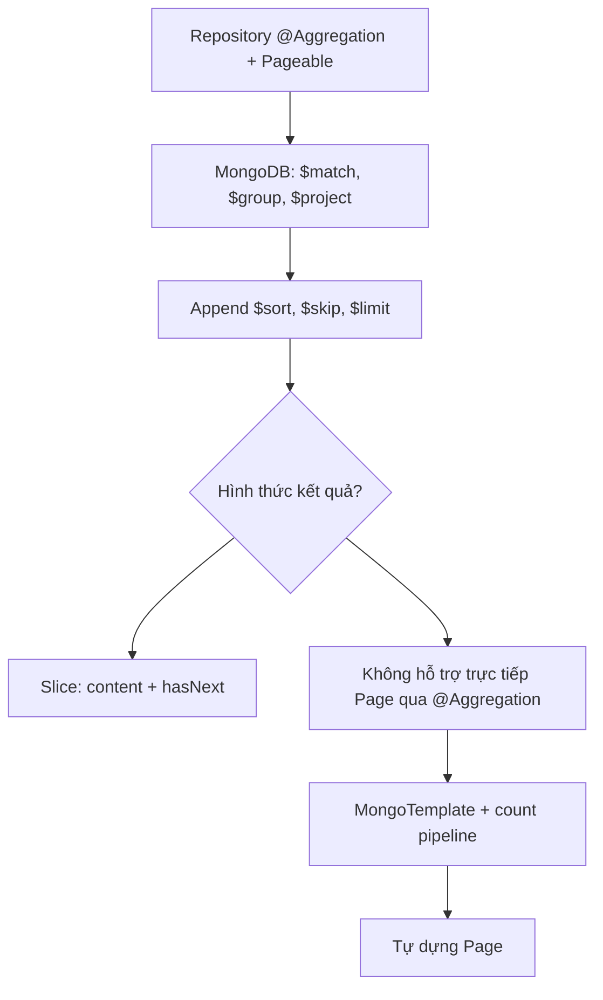
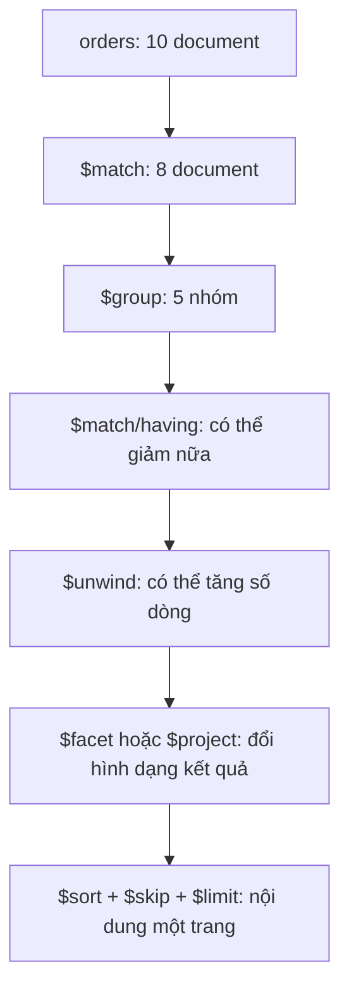
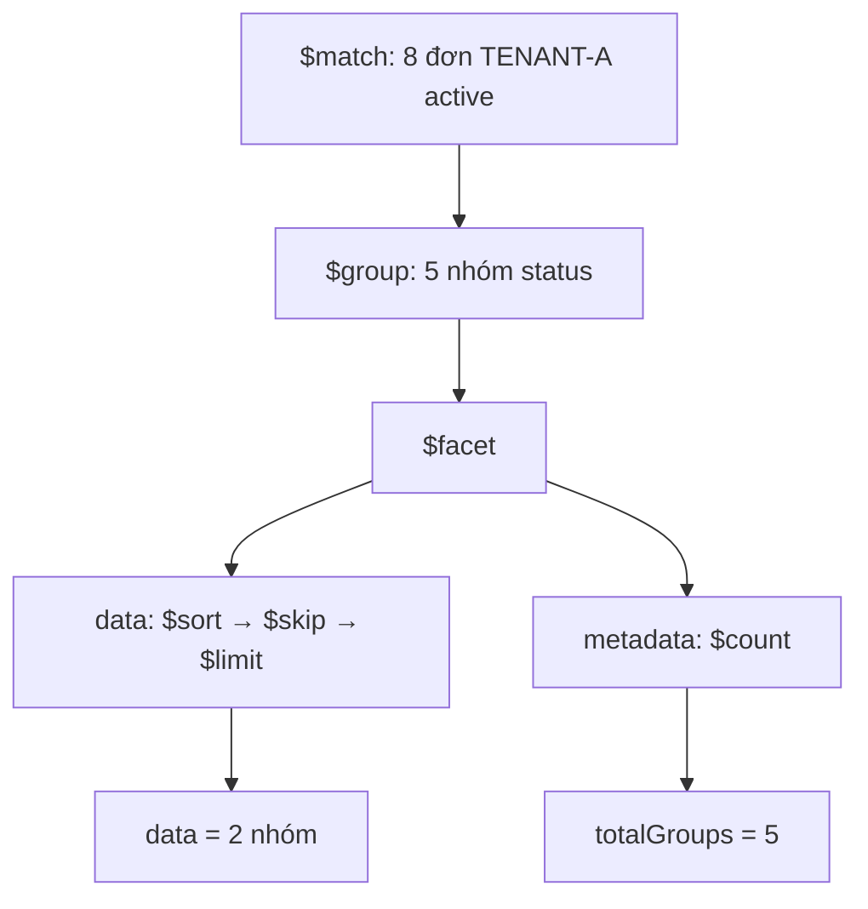

# Giới hạn Page và lựa chọn Slice cho @Aggregation

> **Chương:** Aggregation repository  
> **Module:** `SPRING_DATA_MONGODB` — kết nối, ánh xạ document và làm việc với MongoDB qua `MongoTemplate` hoặc repository; thực hành truy vấn, aggregation, index, transaction, reactive access, kiểm thử và chẩn đoán hiệu năng. Bài này tập trung vào **giới hạn của `Page` đối với repository `@Aggregation`**, cách phân trang an toàn bằng **`Slice` và `Pageable`**, cùng các phương án khi API cần **totalElements/totalPages** trên kết quả aggregation.

## 1. Tình huống: báo cáo có 5 nhóm nhưng collection có hàng triệu đơn

Hệ thống quản lý đơn hàng cho mỗi doanh nghiệp muốn liệt kê doanh thu theo trạng thái:

| Trạng thái | Số đơn | Tổng tiền (cent) |
| --- | ---: | ---: |
| CANCELLED | 1 | 2.500 |
| PAID | 3 | 30.000 |
| PENDING | 2 | 10.000 |
| REFUNDED | 1 | 7.000 |
| REVIEW | 1 | 1.500 |

Đây là **5 kết quả nhóm**, dù collection có **8 document đơn hàng** của tenant đang xét. Giao diện cho phép xem lần lượt **2 nhóm mỗi lượt**, với nút **Tải thêm**, hoặc có thể yêu cầu dòng “Trang 1/3”.

Muốn tổng hợp ở MongoDB thay vì tải mọi `Order` vào JVM, ta dùng pipeline:

```javascript
db.orders.aggregate([
  { $match: { tenantId: "TENANT-A", deleted: false } },
  {
    $group: {
      _id: "$status",
      orderCount: { $sum: 1 },
      grossCents: { $sum: "$amountCents" }
    }
  },
  {
    $project: {
      _id: 0,
      status: "$_id",
      orderCount: 1,
      grossCents: 1
    }
  },
  { $sort: { status: 1 } },
  { $skip: 0 },
  { $limit: 2 }
]);
```

Với dữ liệu mẫu bên dưới, output trang đầu là **CANCELLED**, **PAID**. `$skip` và `$limit` ở **sau `$group`** chọn **nhóm**, không phải chọn hai đơn đầu tiên để tính báo cáo.

### Kết luận cốt lõi trước khi viết Java

**Spring Data MongoDB không hỗ trợ `Page<T>` làm kiểu trả về trực tiếp của repository method dùng `@Aggregation`** theo tài liệu chính thức. **`Pageable` vẫn được hỗ trợ**: Spring Data có thể gắn `$sort`, `$skip`, `$limit` vào cuối pipeline và trả **`Slice<T>`**. `Slice` biểu đạt nội dung hiện tại và **có trang kế tiếp hay không**, nhưng **không cung cấp tổng số nhóm**. Nếu bắt buộc phải có `Page`, cần xây thêm chiến lược **đếm kết quả sau aggregation** bằng `MongoTemplate`, `$facet` hoặc một pipeline count riêng.



**Không nhầm:** giới hạn này áp dụng cho **repository `@Aggregation`**, không phải toàn bộ Spring Data. Finder repository thông thường như `findByStatus(String, Pageable)` có thể trả `Page<Order>` vì cơ chế count query khác.

## 2. Cơ sở dữ liệu mẫu: 8 đơn hợp lệ tạo 5 nhóm

Chỉ chạy trên **database test cô lập**; `drop()` xóa dữ liệu:

```javascript
db.orders.drop();

db.orders.insertMany([
  { _id: "A-001", tenantId: "TENANT-A", status: "PAID",
    deleted: false, amountCents: NumberLong(12000) },
  { _id: "A-002", tenantId: "TENANT-A", status: "PAID",
    deleted: false, amountCents: NumberLong(8000) },
  { _id: "A-003", tenantId: "TENANT-A", status: "PAID",
    deleted: false, amountCents: NumberLong(10000) },
  { _id: "A-004", tenantId: "TENANT-A", status: "PENDING",
    deleted: false, amountCents: NumberLong(4000) },
  { _id: "A-005", tenantId: "TENANT-A", status: "PENDING",
    deleted: false, amountCents: NumberLong(6000) },
  { _id: "A-006", tenantId: "TENANT-A", status: "CANCELLED",
    deleted: false, amountCents: NumberLong(2500) },
  { _id: "A-007", tenantId: "TENANT-A", status: "REFUNDED",
    deleted: false, amountCents: NumberLong(7000) },
  { _id: "A-008", tenantId: "TENANT-A", status: "REVIEW",
    deleted: false, amountCents: NumberLong(1500) },

  // Hai bản ghi này tuyệt đối không được lọt vào báo cáo TENANT-A.
  { _id: "B-001", tenantId: "TENANT-B", status: "PAID",
    deleted: false, amountCents: NumberLong(999000) },
  { _id: "A-009", tenantId: "TENANT-A", status: "PAID",
    deleted: true, amountCents: NumberLong(888000) }
]);
```

Khi có `$match: {tenantId:"TENANT-A", deleted:false}`, đúng **8 đơn** đi vào `$group`. Sau `$group`, còn **5 nhóm**. Kết quả đã sắp xếp:

```javascript
{ status: "CANCELLED", orderCount: 1, grossCents: NumberLong(2500) }
{ status: "PAID", orderCount: 3, grossCents: NumberLong(30000) }
{ status: "PENDING", orderCount: 2, grossCents: NumberLong(10000) }
{ status: "REFUNDED", orderCount: 1, grossCents: NumberLong(7000) }
{ status: "REVIEW", orderCount: 1, grossCents: NumberLong(1500) }
```

Phân biệt ba con số:

- **10 document trong collection** (8 active tenant A, 1 tenant B, 1 soft-deleted tenant A).
- **8 document qua `$match`**.
- **5 document qua `$group`**.

Khi UI hỏi “tổng số dòng của báo cáo theo trạng thái”, câu trả lời là **5**, **không phải 8 hoặc 10**.

## 3. Định nghĩa entity và projection DTO

### 3.1. Domain lưu trong collection orders

Ví dụ dùng Java 17+, Spring Data MongoDB và field tiền dạng long tính theo cent để phép tổng dễ kiểm chứng:

```java
package demo.orders;

import org.springframework.data.annotation.Id;
import org.springframework.data.mongodb.core.mapping.Document;

@Document(collection = "orders")
public record Order(
    @Id String id,
    String tenantId,
    String status,
    boolean deleted,
    long amountCents
) {}
```

**Lưu ý kiểu BSON:** dữ liệu mongosh đã seed với `NumberLong`; Spring Data ánh xạ `long` tương ứng. Nếu nghiệp vụ có nhiều loại tiền, nhiều chữ số sau dấu thập phân hoặc phép chia trung bình, cân nhắc `Decimal128`/`BigDecimal` và quy tắc làm tròn thay vì mặc định `long` phù hợp cho tất cả.

### 3.2. DTO cho kết quả sau $group

`$group` không trả lại một `Order`. Output có các field `status`, `orderCount` và `grossCents`:

```java
package demo.orders;

public record StatusTotals(
    String status,
    long orderCount,
    long grossCents
) {}
```

Nên tạo `StatusTotals.java` riêng. DTO read-only giúp tách schema báo cáo khỏi entity gốc và tránh vô tình `save` lại một document không đầy đủ.

Khi `@Aggregation` có `Pageable`/`Sort`, Spring Data áp dụng sort **trên output pipeline** và mapping theo **kiểu trả về**. Việc `$project` đổi `_id` thành `status` giúp sort theo tên `"status"` của DTO một cách rõ ràng.

## 4. Viết repository @Aggregation trả Slice

### 4.1. Interface triển khai

```java
package demo.orders;

import org.springframework.data.domain.Pageable;
import org.springframework.data.domain.Slice;
import org.springframework.data.mongodb.repository.Aggregation;
import org.springframework.data.mongodb.repository.MongoRepository;

public interface OrderReportRepository extends MongoRepository<Order, String> {

    @Aggregation(pipeline = {
        "{ '$match': { 'tenantId': ?0, 'deleted': false } }",
        "{ '$group': { '_id': '$status', " +
          "'orderCount': { '$sum': 1 }, " +
          "'grossCents': { '$sum': '$amountCents' } } }",
        "{ '$project': { '_id': 0, 'status': '$_id', " +
          "'orderCount': 1, 'grossCents': 1 } }"
    })
    Slice<StatusTotals> summarizeByStatus(
        String tenantId, Pageable pageable
    );
}
```

`org.springframework.data.mongodb.repository.Aggregation` là **annotation** dùng cho repository method. Đừng nhầm với **`org.springframework.data.mongodb.core.aggregation.Aggregation`**, class builder dùng trong `MongoTemplate`.

**`?0`** được framework bind vào tham số `tenantId`. Không nối chuỗi tenant ID trực tiếp vào JSON query. Điều quan trọng hơn cả escaping là lấy tenant ID từ **principal/security context đã xác thực**, không tin một giá trị client có thể giả mạo.

### 4.2. Gọi từ service

```java
import org.springframework.data.domain.PageRequest;
import org.springframework.data.domain.Slice;
import org.springframework.data.domain.Sort;

PageRequest request = PageRequest.of(
    0,
    2,
    Sort.by(Sort.Direction.ASC, "status")
);

Slice<StatusTotals> slice = orderReportRepository
    .summarizeByStatus("TENANT-A", request);

List<StatusTotals> items = slice.getContent();
boolean hasMore = slice.hasNext();
```

`orderReportRepository` là bean được inject vào service. Giả định test chỉ chứa dữ liệu mục 2 và không có ghi cạnh tranh, kết quả:

```text
slice.number          = 0
slice.size            = 2
slice.numberOfElements = 2
content statuses     = [CANCELLED, PAID]
slice.hasNext()      = true
```

Ví dụ `List` cần `import java.util.List;` trong service. Gọi trang thứ hai:

```java
Slice<StatusTotals> second = orderReportRepository.summarizeByStatus(
    "TENANT-A",
    PageRequest.of(1, 2, Sort.by("status").ascending())
);
// PENDING, REFUNDED; hasNext() = true
```

Trang thứ ba:

```java
Slice<StatusTotals> third = orderReportRepository.summarizeByStatus(
    "TENANT-A",
    PageRequest.of(2, 2, Sort.by("status").ascending())
);
// REVIEW; hasNext() = false
```

**PageRequest dùng index bắt đầu từ 0**, không phải 1. `PageRequest.of(1,2)` là nhóm thứ ba và thứ tư trong thứ tự đã chọn.

### 4.3. Dùng nextPageable thay vì tự cộng số trang

```java
Slice<StatusTotals> current =
    orderReportRepository.summarizeByStatus(
        "TENANT-A", PageRequest.of(0, 2, Sort.by("status"))
    );

while (true) {
    consume(current.getContent());
    if (!current.hasNext()) {
        break;
    }
    current = orderReportRepository.summarizeByStatus(
        "TENANT-A", current.nextPageable()
    );
}
```

`consume(...)` là hàm do ứng dụng định nghĩa để xử lý danh sách DTO, không phải method có sẵn của Spring Data. `nextPageable()` giữ sort/page size đã chọn; cần bảo đảm tenant/filter không đổi giữa các lời gọi.

## 5. Pageable được gắn vào cuối pipeline như thế nào?

Spring Data MongoDB tài liệu hóa rằng khi một repository method `@Aggregation` nhận `Pageable`, các thao tác **`$sort`, `$skip` và `$limit`** được **áp dụng sau các stage khai báo trong annotation**. Phần `$sort` có thể dùng mapping theo **kiểu DTO trả về**, không nhất thiết theo tên field ở entity gốc.

Pipeline minh họa:

```javascript
[
  { $match: { tenantId: "TENANT-A", deleted: false } },
  {
    $group: {
      _id: "$status",
      orderCount: { $sum: 1 },
      grossCents: { $sum: "$amountCents" }
    }
  },
  {
    $project: {
      _id: 0, status: "$_id",
      orderCount: 1, grossCents: 1
    }
  },
  { $sort: { status: 1 } },
  { $skip: 0 },
  { $limit: 2 }
]
```

Khi trả `Slice`, framework **có thể đọc dư một phần tử** để xác định `hasNext`. Vì vậy **đừng dùng ví dụ `$limit:2` như cam kết chính xác về số BSON document được server đọc trên mọi phiên bản**. Kiểm tra command monitoring nếu cần biết pipeline thực thi thực tế. Kết quả đưa ra cho người dùng vẫn giới hạn theo page size.

### 5.1. Sort trong Pageable thuộc output, không thuộc input

```java
Sort.by("status").ascending()
```

Ở đây `"status"` là field đã được `$project` từ `$_id`. Nếu pipeline chỉ group mà không project:

```javascript
{ $group: { _id: "$status", orderCount: { $sum: 1 } } }
```

thì output là `{_id:"PAID",orderCount:3}`, không còn field root `status`. Một sort sai tên có thể không có tác dụng như mong đợi. Spring Data có thể map property của result DTO sang `_id` khi DTO định nghĩa `@Id` thích hợp, nhưng phải **kiểm tra mapping trên phiên bản đang dùng**. Dễ kiểm soát hơn là `$project` sang field tên rõ ràng và test sort.

### 5.2. Đừng đặt $limit sớm rồi nghĩ Pageable sẽ cứu được

Phản ví dụ:

```java
@Aggregation(pipeline = {
    "{ '$match': { 'tenantId': ?0 } }",
    "{ '$limit': 10 }",
    "{ '$group': { '_id': '$status', 'orders': { '$sum': 1 } } }"
})
Slice<StatusTotals> incorrectTotals(String tenantId, Pageable page);
```

Vì `$limit:10` xuất hiện **trước group**, số liệu chỉ phản ánh **10 document nguồn đầu tiên được pipeline giữ**, không phải toàn bộ đơn của tenant. `Pageable` ở cuối chỉ có thể phân trang những nhóm đã bị tính sai.

Phản ví dụ khác:

```javascript
[
  { $group: { _id: "$status", orders: { $sum: 1 } } },
  { $limit: 3 },
  { $sort: { _id: 1 } }
]
```

Sort sau limit không thể khôi phục những nhóm đã bị loại **trước khi sort**. Nếu yêu cầu “3 nhóm nhiều đơn nhất”, phải group xong, sort theo `orders` giảm dần, rồi mới limit.

### 5.3. Sort phải đủ ổn định

Sort theo `status` của một `$group _id:"$status"` cho khóa riêng biệt nên không có tie giữa các nhóm cùng status. Nhưng nếu group theo `tenantId + status`, sort chỉ theo `orderCount` có thể khiến các nhóm cùng count đổi vị trí giữa lần gọi.

```javascript
{ $sort: { orderCount: -1, tenantId: 1, status: 1 } }
```

Các field tie-breaker phải thực sự có mặt trong **output** của group/project, và (nếu dùng `Pageable`) được biểu diễn qua kiểu DTO kết quả. Với báo cáo có nhiều nhóm cùng amount/count, hãy tạo sort tổng quát ổn định để hạn chế lặp/bỏ sót giữa các trang.

## 6. Slice trả những gì, và điều nó không biết

`org.springframework.data.domain.Slice<T>` chứa nội dung một lát cắt và metadata phân trang cơ bản:

| API | Có trong Slice? | Ý nghĩa |
| --- | :---: | --- |
| `getContent()` | Có | DTO của trang hiện tại. |
| `getNumber()` | Có | Index trang bắt đầu từ 0. |
| `getSize()` | Có | Page size. |
| `getNumberOfElements()` | Có | Số DTO thực tế ở trang này. |
| `hasNext()` | Có | Có thể còn trang sau. |
| `hasPrevious()` | Có | Có trang trước theo vị trí hiện tại. |
| `nextPageable()` | Có | Pageable cho lát cắt tiếp theo. |
| `getTotalElements()` | **Không** | Không biết tổng số kết quả. |
| `getTotalPages()` | **Không** | Không biết tổng số trang. |

Đối với UI chỉ có **Tải thêm**, `Slice` thường đủ. Nếu cần hiển thị `Trang 1/3`, danh sách số trang, hoặc cho phép nhảy tới trang cuối, phải có **thống kê total** ngoài content.

### 6.1. HasNext không phải bằng total

Giả sử page size = 2:

```text
Trang 0: [CANCELLED, PAID]     hasNext=true
Trang 1: [PENDING, REFUNDED]    hasNext=true
Trang 2: [REVIEW]               hasNext=false
```

`hasNext=true` chỉ cho biết còn **ít nhất một kết quả tiếp theo** theo cửa sổ hiện tại. Nó không tiết lộ còn **1 hay 10.000 nhóm**. Ngay cả khi đọc đủ ba trang, UI mới tự suy được số trang với **trạng thái dữ liệu tại những lần đọc**; đó không phải metadata tổng ban đầu.

### 6.2. Slice khác Stream

`Stream<StatusTotals>` cho phép đọc tuần tự qua cursor (cần đóng), nhưng không cung cấp `hasNext` ở cấp **các trang đã phân đoạn theo Pageable** theo cách `Slice`. Với dữ liệu lớn, cả hai phương pháp đều cần kiểm soát memory/cursor lifecycle; không dùng `List` tải toàn bộ nhóm nếu cardinality cao.

## 7. Vì sao @Aggregation không trả Page trực tiếp?

`Page<T>` đòi hỏi **content + tổng số phần tử trong toàn bộ tập kết quả phù hợp** để suy ra `totalPages`. Đối với finder đơn giản, Spring Data có thể xây count query trên filter. Nhưng với aggregation, **mỗi stage có thể thay đổi số document**:



Một phép `countDocuments({tenantId:"TENANT-A"})` đếm **document nguồn**, không đếm được tổng số **nhóm output** của pipeline. Trong pipeline có `$unwind`, `$lookup`, `$group` nhiều tầng, `$match` sau group hoặc `$facet`, không thể suy total chỉ bằng cách bỏ `$skip/$limit` rồi gọi countDocuments với filter đầu vào.

Vì vậy, tài liệu Spring Data MongoDB **không hỗ trợ `Page` return type trực tiếp cho repository `@Aggregation`**. Một method như sau là **phản ví dụ**:

```java
// KHÔNG hỗ trợ theo hợp đồng Spring Data MongoDB @Aggregation:
@Aggregation(pipeline = {
    "{ '$match': { 'tenantId': ?0 } }",
    "{ '$group': { '_id': '$status', 'orders': { '$sum': 1 } } }"
})
Page<StatusTotals> unsupported(String tenantId, Pageable pageable);
```

Đừng cố đổi `Slice<StatusTotals>` thành `Page<StatusTotals>` chỉ bằng cách sửa return type và kỳ vọng Spring Data tự tính đúng total sau các stage. Hai giải pháp phù hợp hơn:

1. **Chỉ cần nút “Tải thêm”:** giữ `Slice`, tránh count.
2. **Bắt buộc biết total:** tạo pipeline đếm kết quả group và dựng `Page` ở service, hoặc sử dụng `$facet` trên cùng pipeline tùy yêu cầu consistency và hiệu năng.

## 8. Cần Page thật: đếm số nhóm rồi tự dựng PageImpl

### 8.1. Đếm 5 nhóm, không phải 8 đơn

Muốn biết tổng số dòng của báo cáo `$group`, cần đếm **output của group**, không phải input của collection:

```javascript
db.orders.aggregate([
  { $match: { tenantId: "TENANT-A", deleted: false } },
  { $group: { _id: "$status" } },
  { $count: "totalGroups" }
]);
// { totalGroups: 5 }
```

`$count` trong ví dụ là một **pipeline stage**, không phải `orderCount` accumulator của `$group`. Các phép tính `$sum:1` và `$sum:"$amountCents"` không cần làm lại trong count pipeline **nếu** chúng không ảnh hưởng điều kiện lọc nhóm:

- Với báo cáo chỉ phân nhóm theo status, `$group: {_id:"$status"}` rồi `$count` là đủ.
- Nếu báo cáo còn lọc **nhóm có tổng doanh thu ít nhất 10.000**, phải giữ `$sum:"$amountCents"` và `$match:{grossCents:{$gte:10000}}` **trước `$count`**. Nếu bỏ stage đó, total sẽ sai.

### 8.2. MongoTemplate count pipeline và PageImpl

Ví dụ service dùng repository `Slice` làm content, `MongoTemplate` tính total:

```java
package demo.orders;

import org.bson.Document;
import org.springframework.data.domain.Page;
import org.springframework.data.domain.PageImpl;
import org.springframework.data.domain.Pageable;
import org.springframework.data.domain.Slice;
import org.springframework.data.mongodb.core.MongoTemplate;
import org.springframework.data.mongodb.core.aggregation.Aggregation;
import org.springframework.data.mongodb.core.query.Criteria;
import org.springframework.stereotype.Service;

import static org.springframework.data.mongodb.core.aggregation.Aggregation.*;

@Service
public class OrderReportService {
    private final OrderReportRepository repository;
    private final MongoTemplate template;

    public OrderReportService(OrderReportRepository repository,
                              MongoTemplate template) {
        this.repository = repository;
        this.template = template;
    }

    public Page<StatusTotals> statusPage(String tenantId, Pageable pageable) {
        // tenantId phải đến từ ngữ cảnh xác thực tin cậy.
        if (tenantId == null || tenantId.isBlank()) {
            throw new IllegalArgumentException("tenantId is required");
        }
        if (pageable.isUnpaged()) {
            throw new IllegalArgumentException("Pageable must be paged");
        }

        Slice<StatusTotals> slice =
            repository.summarizeByStatus(tenantId, pageable);

        Aggregation countGroups = newAggregation(
            match(Criteria.where("tenantId").is(tenantId)
                .and("deleted").is(false)),
            group("status"),
            count().as("totalGroups")
        );

        Document countResult = template.aggregate(
            countGroups, Order.class, Document.class
        ).getUniqueMappedResult();

        long totalGroups = countResult == null
            ? 0L
            : ((Number) countResult.get("totalGroups")).longValue();

        return new PageImpl<>(
            slice.getContent(), pageable, totalGroups
        );
    }
}
```

**Giới hạn của ví dụ:** service cố ý tạo hai lệnh database: **một lệnh cho content**, **một lệnh cho total**. Điều kiện bắt buộc (`tenantId` và `deleted=false`) phải **giống nhau** trong hai pipeline. Nếu thay đổi báo cáo, nên gom logic định nghĩa bộ lọc/aggregation ở một chỗ để tránh drift.

Đoạn `countResult == null ? 0L : ...` xử lý đúng trường hợp không có nhóm nào: `$count` trên tập rỗng có thể trả **không có document**, chứ không tự trả `{totalGroups:0}`.

Nếu source có thêm stage `$unwind`, `$lookup` hoặc `$match` sau group, count pipeline **phải mô phỏng đúng tất cả các stage làm thay đổi tập kết quả trước khi phân trang**. Chỉ đếm số khóa status trong ví dụ cơ bản là một trường hợp đơn giản.

### 8.3. Vấn đề consistency giữa content và total

Vì hai lệnh chạy riêng, một writer có thể thêm/xóa/đổi trạng thái đơn hàng **giữa** lúc đọc content và lúc count. Khi đó:

```text
Trước: 5 nhóm.
Lệnh content đọc 5 nhóm, trả trang đầu.
Writer thêm trạng thái mới, tạo nhóm thứ 6.
Lệnh count đọc 6 nhóm.
API trả content cũ và totalGroups = 6.
```

Đây không nhất thiết là lỗi framework; là tính chất **đọc ở nhiều thời điểm khác nhau**. Với dashboard, mức nhất quán này có thể chấp nhận. Với báo cáo kiểm toán, phải thiết kế read concern, snapshot/transaction hoặc dữ liệu báo cáo bất biến theo yêu cầu và topology MongoDB hỗ trợ.

### 8.4. PageImpl không tạo count giúp bạn

`new PageImpl<>(content, pageable, total)` chỉ **đóng gói** nội dung và total do bạn cung cấp. Nó không chạy query và không biết `$group`. Nếu truyền `countDocuments` của collection làm `total`, `PageImpl` vẫn có thể trả metadata sai nhưng không tự phát hiện lỗi nghiệp vụ.

Đừng dùng `PageableExecutionUtils.getPage(…)` với một supplier `countDocuments` ngây thơ. Supplier count phải phản ánh **đúng tập document sau aggregation**, và các tối ưu bỏ count phải được kiểm tra kỹ cho báo cáo dạng group.

## 9. Dùng $facet để lấy content và total trong một aggregation

`$facet` cho phép chạy nhiều nhánh con trên cùng dòng input của pipeline. Ta có thể **group một lần** rồi tách:

- Nhánh `data`: sort, skip, limit các **nhóm**.
- Nhánh `metadata`: count số **nhóm**.

```javascript
db.orders.aggregate([
  { $match: { tenantId: "TENANT-A", deleted: false } },
  {
    $group: {
      _id: "$status",
      orderCount: { $sum: 1 },
      grossCents: { $sum: "$amountCents" }
    }
  },
  {
    $project: {
      _id: 0,
      status: "$_id",
      orderCount: 1,
      grossCents: 1
    }
  },
  {
    $facet: {
      data: [
        { $sort: { status: 1 } },
        { $skip: 0 },
        { $limit: 2 }
      ],
      metadata: [
        { $count: "totalGroups" }
      ]
    }
  }
]);
```

Output có dạng:

```javascript
{
  data: [
    { status: "CANCELLED", orderCount: 1, grossCents: NumberLong(2500) },
    { status: "PAID", orderCount: 3, grossCents: NumberLong(30000) }
  ],
  metadata: [
    { totalGroups: 5 }
  ]
}
```

Để xây `Page`, đọc `data` làm content, `metadata[0].totalGroups` làm total. Khi không có group, `metadata` có thể là **mảng rỗng**, cần fallback 0.

### 9.1. Vì sao đặt facet sau group?

Vì câu hỏi UI là **“có bao nhiêu nhóm?”**, nhánh count phải đếm **kết quả sau group**:



Nếu tách facet **trước group**, mỗi nhánh phải thực hiện các stage cần thiết riêng. Nếu count branch chỉ dùng `$count` ngay sau `$match`, kết quả là **8 đơn** thay vì **5 nhóm**.

### 9.2. $facet không phải giải pháp miễn phí

Những đánh đổi:

- Dù page size nhỏ, nhánh `metadata` vẫn cần đếm đủ các nhóm.
- Stage `$facet` phải giữ output trong **một document BSON** với các array nhánh `data`/`metadata`; vẫn chịu giới hạn **16 MiB cho document kết quả**, cùng giới hạn bộ nhớ của facet.
- `$facet` có giới hạn memory riêng; **`allowDiskUse` không cho phép facet tùy ý spill ra disk** để vượt ràng buộc của chính stage này.
- Một lệnh aggregation không tự tạo snapshot nhất quán với những lệnh database khác; nếu yêu cầu consistency đặc biệt, vẫn cần xem xét read concern.
- Pipeline `$facet` trả **một document bọc hai array**, khác với kiểu `StatusTotals` trực tiếp; phải tạo DTO container hoặc đọc `Document` rồi ánh xạ có kiểm soát.

`$facet` phù hợp khi cần content và total đồng thời trong **một lần gọi aggregation**, dữ liệu output có kích thước được kiểm soát, và việc tính count đủ nhẹ theo SLA. Nó không thay thế `Slice` cho mọi API.

### 9.3. Vì sao không đặt @Aggregation facet rồi gắn Pageable?

Phản ví dụ:

```javascript
[
  { $match: { tenantId: "TENANT-A", deleted: false } },
  { $group: { _id: "$status" } },
  { $facet: { data: [/* ... */], metadata: [/* ... */] } },
  { $skip: 2 },
  { $limit: 2 }
]
```

`Pageable` của repository sẽ được thêm **sau `$facet`**, tức áp dụng lên **document chứa hai array**, thường chỉ có **một** document output — không phải lên các item trong array `data`. Muốn dùng facet đúng, hãy đặt `$sort/$skip/$limit` **bên trong nhánh `data`**; điều này thường phù hợp với `MongoTemplate`/Aggregation API và một service xử lý `Page` hơn là repository `@Aggregation` có `Pageable` gắn tự động.

## 10. Phân trang khi có $match sau group (“having”)

Giả sử màn hình chỉ liệt kê **nhóm trạng thái có tổng amount ít nhất 10.000 cent**. Đây là điều kiện **trên kết quả tổng hợp**, không phải điều kiện trên từng đơn:

```javascript
db.orders.aggregate([
  { $match: { tenantId: "TENANT-A", deleted: false } },
  {
    $group: {
      _id: "$status",
      orderCount: { $sum: 1 },
      grossCents: { $sum: "$amountCents" }
    }
  },
  { $match: { grossCents: { $gte: 10000 } } },
  { $project: { _id: 0, status: "$_id", orderCount: 1, grossCents: 1 } },
  { $sort: { status: 1 } },
  { $skip: 0 },
  { $limit: 2 }
]);
```

Trong dữ liệu mẫu, chỉ các nhóm **PAID (30.000)** và **PENDING (10.000)** đủ điều kiện: tổng số nhóm cần báo là **2**, không phải 5.

Count pipeline **đúng**:

```javascript
[
  { $match: { tenantId: "TENANT-A", deleted: false } },
  {
    $group: {
      _id: "$status",
      grossCents: { $sum: "$amountCents" }
    }
  },
  { $match: { grossCents: { $gte: 10000 } } },
  { $count: "totalGroups" }
]
```

Count pipeline **sai** sẽ bỏ `$match grossCents` ở sau group rồi đếm 5 nhóm. Trong nhiều hệ thống, đây là lỗi “trang cuối rỗng dù totalPages báo còn”.

### 10.1. $lookup, $unwind và $group nhiều tầng

Nếu pipeline có `$lookup` hoặc `$unwind` tạo nhiều dòng, rồi `$group` lại, mỗi stage có thể thay đổi **cardinality**. Count phải đặt sau tất cả stage xác định **tập kết quả cuối cùng**, trước các stage phục vụ pagination (`$sort` nếu không ảnh hưởng tập, `$skip`, `$limit`).

Không lấy tổng order ban đầu để tính số trang của báo cáo theo SKU, khách hàng, tháng, bucket hoặc leaderboard.

## 11. Sort ổn định và xử lý trang sâu

### 11.1. Sort theo metric cần tie-breaker

Ví dụ báo cáo top nhóm theo doanh thu:

```javascript
{
  $sort: {
    grossCents: -1,
    status: 1
  }
}
```

Với nhiều nhóm có cùng `grossCents`, `status` là khóa phụ để có thứ tự ổn định. Nếu khóa nhóm thực tế là cặp `(tenant, month)`, cần tie-breaker đủ phân biệt mọi group, thường là các field của khóa nhóm.

Thiếu sort hoặc chỉ sort theo metric có trùng giá trị dẫn đến khả năng **lặp/mất nhóm giữa hai trang** ngay cả khi dữ liệu không thay đổi, vì database không cam kết natural order của `$group`.

### 11.2. Slice vẫn sử dụng offset

`Slice` không có total nhưng `Pageable` vẫn gắn offset-based `$skip` ở cuối pipeline. Với `PageRequest.of(5000,20)`, offset là **100.000 nhóm**, không phải “bắt đầu hiệu quả từ nhóm tiếp theo”. Trên báo cáo group có cardinality cao:

- Server có thể phải xây nhiều nhóm trước khi sort.
- `$sort` có thể cần xử lý một lượng lớn output.
- `$skip` càng lớn càng tốn công bỏ qua kết quả.
- Mỗi request tiếp theo có thể phải chạy lại phần aggregate phía trước.

Chọn `Slice` giúp **tránh total count tự động**, nhưng **không đồng nghĩa loại bỏ chi phí offset**. Nếu cần duyệt hàng triệu nhóm, cân nhắc keyset/seek pagination được thiết kế riêng trên output có sort ổn định, hoặc bảng tổng hợp được materialize với index phù hợp.

### 11.3. Không giả định @Aggregation hỗ trợ Window như derived query

`Window<T>` và `ScrollPosition` là API scrolling hữu ích trong Spring Data, nhưng không được suy rằng chỉ cần đổi kiểu trả về `Slice<StatusTotals>` thành `Window<StatusTotals>` là mọi repository `@Aggregation` đều hỗ trợ scrolling/keyset.

Kiểm tra **Spring Data Commons + Spring Data MongoDB version** cùng capability của store module. Với aggregation report cần scrolling tùy biến, template query hoặc collection/materialized view báo cáo thường cho phép kiểm soát điều kiện keyset và index rõ hơn.

## 12. Projection và mapping: Pageable sort trên loại kết quả

Tài liệu Spring Data MongoDB lưu ý rằng `Sort` của repository aggregation có thể được **ánh xạ theo result type**, vì được áp dụng sau pipeline:

```java
@Aggregation(pipeline = {
    "{ '$group': { '_id': '$status', 'orders': { '$sum': 1 } } }",
    "{ '$project': { '_id': 0, 'status': '$_id', 'orders': 1 } }"
})
Slice<StatusCount> statuses(Pageable pageable);
```

DTO:

```java
public record StatusCount(String status, long orders) {}
```

Sort bằng:

```java
PageRequest.of(0, 20, Sort.by("status").ascending());
```

Vì `$project` đã tạo field `status`, sort không cần đoán rằng `status` nguồn vẫn ở root sau `$group`.

### 12.1. Khi output vẫn giữ _id

Một projection có property `@Id` ánh xạ `_id` có thể khiến `Sort.by("status")` được map thành `_id` trong các ví dụ của tài liệu. Nếu dùng DTO khác, mapping cũng thay đổi. Hãy kiểm tra **pipeline BSON thực thi** trong integration test, thay vì copy sort theo entity gốc và cho rằng sau `$group` vẫn đúng.

### 12.2. Không dùng DTO gốc để đọc output của group

`Order` có `tenantId`, `status`, `deleted` và `amountCents`. Group output có `status`, `orderCount`, `grossCents`. Nếu cố map sang `Order`, một số field có thể bị thiếu/null/0 và tạo entity không hoàn chỉnh. Dùng DTO riêng cho báo cáo, không `save` entity “đọc thiếu field” trở lại collection.

### 12.3. Projection khác $facet

`$project` làm gọn hoặc đổi tên field của từng **document kết quả**. `$facet` gói nhiều **array kết quả** vào một document output. Khi cần raw `AggregationResults` hoặc facet wrapper, hãy định nghĩa DTO phù hợp với hình dạng thực tế, không trộn `List<StatusTotals>` với `{data:[...], metadata:[...]}`.

## 13. Chọn List, Slice, Stream hay tự dựng Page?

| Nhu cầu | Cách làm | Đánh đổi |
| --- | --- | --- |
| Dashboard có tối đa 5–10 nhóm cố định | `@Aggregation` trả `List<DTO>` | Đơn giản; không nên dùng nếu group có hàng triệu khóa. |
| Nút **Tải thêm** | `@Aggregation` + `Pageable` trả `Slice<DTO>` | Có `hasNext`, tránh tự động count, vẫn có offset cost. |
| Bảng có tổng nhóm, tổng trang | `Slice` + count aggregation + `PageImpl` | Hai query, có thể lệch thời điểm đọc. |
| Content và total trong một pipeline | `MongoTemplate` + `$facet` | Dễ lấy cùng trong một operation, chú ý memory/output và mapping. |
| Xuất hàng loạt kết quả qua cursor | `Stream<DTO>`/`Flux<DTO>` tùy phiên bản | Cần quản lý cursor, bộ nhớ và thời gian xử lý. |
| Duyệt rất sâu, khóa nhóm nhiều | Materialized reporting collection/keyset tự thiết kế | Phức tạp hơn nhưng có thể index và query hiệu quả. |
| Filter và stage được dựng động | `MongoTemplate`/`ReactiveMongoTemplate` | Linh hoạt, cần tự quản lý projection/paging/count. |

### 13.1. Khi nào List là đủ?

Nếu aggregation chỉ group theo 3 trạng thái cố định, trả một `List<StatusTotals>` có thể đơn giản hơn `Slice`:

```java
@Aggregation(pipeline = {
    "{ '$match': { 'tenantId': ?0, 'deleted': false } }",
    "{ '$group': { '_id': '$status', 'orders': { '$sum': 1 } } }",
    "{ '$project': { '_id': 0, 'status': '$_id', 'orders': 1 } }"
})
List<StatusCount> groupAllStatuses(String tenantId);
```

Ví dụ có `$project` để DTO `StatusCount` nhận đúng `status` và `orders`. `List` không có metadata phân trang và có thể tải nhiều kết quả vào bộ nhớ nếu số nhóm lớn. Trong một interface Java thực tế, cần import `java.util.List` và khai báo DTO `StatusCount` ở phạm vi phù hợp.

### 13.2. Stream phải đóng cursor

```java
@Aggregation(pipeline = {
    "{ '$match': { 'tenantId': ?0, 'deleted': false } }",
    "{ '$group': { '_id': '$status', 'orders': { '$sum': 1 } } }",
    "{ '$project': { '_id': 0, 'status': '$_id', 'orders': 1 } }"
})
Stream<StatusCount> streamStatuses(String tenantId);
```

Sử dụng:

```java
try (Stream<StatusCount> stream =
         reportRepository.streamStatuses("TENANT-A")) {
    stream.forEach(this::writeRow);
}
```

`reportRepository` và `writeRow` là thành phần service do ứng dụng định nghĩa, ví dụ này cần import `java.util.stream.Stream`. `Stream` dùng cursor phía dưới, cần đóng bằng `try-with-resources`. Nếu pipeline group có memory pressure lớn ở server, stream output không tự làm `$group` nhẹ đi.

### 13.3. Vì sao không dùng $limit cứng trong annotation?

Một method `@Aggregation` có `{ '$limit': 20 }` cố định có thể phù hợp cho “top 20” **nếu đặt sau sort hợp lệ**. Nhưng nếu sau đó lại nhận `Pageable`, các quy tắc `$skip/$limit` bổ sung có thể khiến trang thứ hai rỗng, vì không còn đủ nhóm sau limit tĩnh. Với pagination có page size động, hãy để **Pageable điều khiển limit ở cuối pipeline**, không đặt giới hạn cứng không tương thích.

## 14. Reactive repository và phân trang aggregation

### 14.1. Không suy ra Mono<Page> từ Pageable

Reactive Spring Data MongoDB sử dụng `Flux`/`Mono`. Tài liệu MongoDB nói rõ **`Mono<Page<T>>` không được hỗ trợ như return type của reactive repository**. Và repository `@Aggregation` vốn không hỗ trợ `Page` trực tiếp ở bản imperative.

Một lựa chọn, tùy capability/version của reactive repository, là nhận các kết quả giới hạn bằng `Flux`:

```java
import org.springframework.data.domain.Pageable;
import org.springframework.data.mongodb.repository.Aggregation;
import org.springframework.data.mongodb.repository.ReactiveMongoRepository;
import reactor.core.publisher.Flux;

public interface ReactiveOrderReportRepository
        extends ReactiveMongoRepository<Order, String> {

    @Aggregation(pipeline = {
        "{ '$match': { 'tenantId': ?0, 'deleted': false } }",
        "{ '$group': { '_id': '$status', " +
          "'orderCount': { '$sum': 1 }, " +
          "'grossCents': { '$sum': '$amountCents' } } }",
        "{ '$project': { '_id': 0, 'status': '$_id', " +
          "'orderCount': 1, 'grossCents': 1 } }"
    })
    Flux<StatusTotals> summarizeByStatus(
        String tenantId, Pageable pageable
    );
}
```

Đoạn này cần đối chiếu hỗ trợ `@Aggregation` + `Pageable` ở **phiên bản Spring Data MongoDB/reactive cụ thể**. `Flux` không tự cung cấp `hasNext` như `Slice`; nếu muốn tự xác định còn dữ liệu, thiết kế over-fetch và tạo response riêng, hoặc chuyển sang `ReactiveMongoTemplate` để kiểm soát rõ `$skip/$limit`.

### 14.2. ReactiveMongoTemplate kiểm soát pipeline tường minh

```java
import static org.springframework.data.mongodb.core.aggregation.Aggregation.*;

import org.bson.Document;
import org.springframework.data.domain.PageRequest;
import org.springframework.data.domain.Pageable;
import org.springframework.data.domain.Sort;
import org.springframework.data.mongodb.core.aggregation.Aggregation;
import org.springframework.data.mongodb.core.query.Criteria;
import reactor.core.publisher.Flux;

Pageable pageable = PageRequest.of(0, 2, Sort.by("status").ascending());

Aggregation dataAggregation = newAggregation(
    match(Criteria.where("tenantId").is("TENANT-A")
        .and("deleted").is(false)),
    group("status")
        .count().as("orderCount")
        .sum("amountCents").as("grossCents"),
    project("orderCount", "grossCents")
        .and("_id").as("status")
        .andExclude("_id"),
    sort(Sort.Direction.ASC, "status"),
    skip(pageable.getOffset()),
    limit(pageable.getPageSize())
);

Flux<StatusTotals> contents = reactiveMongoTemplate.aggregate(
    dataAggregation, Order.class, StatusTotals.class
);
```

**Lưu ý:** `skip(pageable.getOffset())` nhận offset theo `long`, `limit(pageable.getPageSize())` theo size. Đoạn này chỉ trả **content đúng giới hạn**, chưa cung cấp `hasNext` hay total. Để có `hasNext`, đọc thêm một phần tử hoặc dùng cơ chế slicing hỗ trợ, rồi bỏ phần tử dư khỏi response.

### 14.3. Tự ghép content và count thành Mono<Page>

Nếu API reactive vẫn cần cả content và total:

```java
Aggregation countAggregation = newAggregation(
    match(Criteria.where("tenantId").is("TENANT-A")
        .and("deleted").is(false)),
    group("status"),
    count().as("totalGroups")
);

Mono<Long> totalGroups = reactiveMongoTemplate.aggregate(
    countAggregation, Order.class, Document.class
).next()
 .map(doc -> ((Number) doc.get("totalGroups")).longValue())
 .defaultIfEmpty(0L);

Mono<Page<StatusTotals>> page = Mono.zip(
    contents.collectList(),
    totalGroups
).map(tuple -> new PageImpl<>(
    tuple.getT1(), pageable, tuple.getT2()
));
```

Snippet này bổ sung cho phần reactive trước: cần import `reactor.core.publisher.Mono`, `org.springframework.data.domain.Page` và `PageImpl`; các biến `contents`/`pageable` thuộc cùng method/service. Nó **tự xây `Mono<Page<StatusTotals>>`** qua hai publisher, **không** phải khai báo repository return `Mono<Page>` được hỗ trợ tự động.

`Mono.zip` không tạo transaction snapshot chung cho hai phép đọc. Với một pageable chứa page size nhỏ, `contents.collectList()` gom một tập kết quả **đã giới hạn**; không áp dụng `collectList()` cho aggregation không giới hạn hàng triệu nhóm.

### 14.4. Backpressure không xóa memory pressure của $group

Reactive backpressure hỗ trợ điều phối việc tiêu thụ **output**. Server MongoDB vẫn có thể phải xử lý toàn bộ document đầu vào, sắp xếp và duy trì state của `$group` trước khi tạo nhóm. Nếu cardinality group cao, không cho rằng `Flux` hay `Mono` là giải pháp thay thế cho `$match`, index và thiết kế accumulator hợp lý.

Không gọi `block()` trên event loop để chuyển một reactive pipeline thành imperative, và không retry vô hạn một aggregation đắt đỏ khi có lỗi mạng.

## 15. Index và hiệu năng: tránh nghĩ Slice làm group miễn phí

### 15.1. Index giúp phần match, không tự tính total

Ví dụ báo cáo luôn lọc theo `tenantId`, `deleted`, nhóm theo `status`:

```javascript
db.orders.createIndex({
  tenantId: 1,
  deleted: 1,
  status: 1
});
```

Đây là **index ứng viên**. Nó có thể giúp tìm đúng document của tenant A và lọc deleted trước aggregation. Tuy nhiên:

- `$group` vẫn phải xác định các nhóm và tính `$sum`.
- `$sort` ở cuối sau group là sort **trên kết quả nhóm**, không luôn được index nguồn tối ưu trực tiếp.
- `Pageable` chỉ giới hạn **output cuối**, không mặc nhiên giới hạn document đầu vào.
- Count pipeline muốn biết tổng nhóm vẫn cần đi qua logic nhóm tương ứng.

Đừng tạo index chỉ vì một snippet khuyến nghị. Hãy xem workload, độ chọn lọc, số lượng index hiện có, chi phí ghi và `explain`.

### 15.2. Explain aggregation thay vì đoán

```javascript
db.orders.explain("executionStats").aggregate([
  { $match: { tenantId: "TENANT-A", deleted: false } },
  {
    $group: {
      _id: "$status",
      orderCount: { $sum: 1 },
      grossCents: { $sum: "$amountCents" }
    }
  },
  { $sort: { _id: 1 } },
  { $skip: 100 },
  { $limit: 20 }
]);
```

Theo server/version, kiểm tra những chỉ số khả dụng: `IXSCAN/COLLSCAN`, `totalKeysExamined`, `totalDocsExamined`, số group, bước sort và việc spill ra disk. Nếu chỉ có 5 nhóm như dữ liệu mẫu, `$skip:100` trả rỗng; nhưng khi group có hàng triệu khóa, skip sâu có thể rất tốn kém.

### 15.3. Memory và allowDiskUse

`$group` và `$sort` có thể cần nhiều RAM khi số lượng nhóm lớn. Với repository `@Aggregation`, Spring Data có `@Meta` để truyền tùy chọn aggregation như `allowDiskUse` trên phiên bản hỗ trợ:

```java
import org.springframework.data.mongodb.repository.Meta;

@Meta(allowDiskUse = "true")
@Aggregation(pipeline = {
    "{ '$match': { 'tenantId': ?0, 'deleted': false } }",
    "{ '$group': { '_id': '$status', 'orders': { '$sum': 1 } } }",
    "{ '$project': { '_id': 0, 'status': '$_id', 'orders': 1 } }"
})
List<StatusCount> reportWithDiskUseAllowed(String tenantId);
```

Method này đã có `$project` để ánh xạ đúng field `status`. `@Meta(allowDiskUse = "true")` **không chữa được pipeline sai logic**, không xóa chi phí sort, không biến `Page` thành supported return type và không loại bỏ giới hạn một BSON output document quá lớn.

### 15.4. Khi cần duyệt cực nhiều nhóm

Với aggregation theo customerId có hàng triệu nhóm, việc chạy lại `$group` cho từng trang có thể tạo nhiều tải hơn bản thân việc hiển thị UI. Cân nhắc:

- **Materialize báo cáo** vào collection riêng theo kỳ/tenant, với khóa nhóm ổn định và index cho sort/seek.
- Dùng `$merge`/job ETL cập nhật số liệu theo chiến lược nhất quán.
- Query thông thường trên collection báo cáo bằng `Page`/`Slice`/keyset thay vì tính lại group cho từng lượt tải.
- Đánh giá tính mới (freshness), trễ đồng bộ, lỗi retry và quyền truy cập.

Chỉ materialize khi có nhu cầu hiệu năng thật; với 5 trạng thái cố định, một lần `$group` trả `List` thường đơn giản hơn nhiều.

## 16. Phân quyền tenant, transaction và độ nhất quán

### 16.1. Tenant không phải tham số trang trí

`@Aggregation("{ '$match': { 'tenantId': ?0 } }")` chỉ an toàn nếu giá trị `?0` xuất phát từ **ngữ cảnh xác thực**, không phải một tenant do người dùng tùy ý gửi trong query param.

Nếu user A truyền `tenantId = TENANT-B` mà service không kiểm tra quyền, aggregation vẫn có thể đọc doanh thu tenant B. Query có parameter binding không đồng nghĩa đã có authorization.

**Không bao giờ bỏ tenant khỏi count pipeline** trong khi content pipeline có tenant. Khi đó total có thể vô tình tiết lộ mức độ hoạt động của toàn hệ thống dù content chỉ hiển thị tenant hiện tại.

### 16.2. Multi-document transaction và snapshot

Một aggregation không tự mở transaction, cũng không tự cố định tập kết quả giữa **nhiều request Slice**. Nếu trong lúc người dùng bấm “Tải thêm” một nhóm mới xuất hiện, offset-based pagination có thể lặp hoặc bỏ sót nhóm.

Với báo cáo tài chính cần độ nhất quán cao, có thể xem xét read concern/transaction/snapshot theo MongoDB topology, nhưng phải tính chi phí và giới hạn transaction. Với dashboard gần-real-time, có thể chấp nhận dữ liệu thay đổi và trình bày thời điểm cập nhật.

**Một `$facet` trong cùng một lệnh chỉ giải quyết bài toán lấy hai nhánh content/total từ cùng dòng đầu vào của pipeline; không tự cam kết snapshot bền vững qua nhiều HTTP request.**

### 16.3. Không đưa các input nguy hiểm vào $skip/$limit

Ở tầng API:

```java
int safeSize = Math.min(Math.max(requestedSize, 1), 100);
int safePage = Math.max(requestedPage, 0);

PageRequest page = PageRequest.of(
    safePage, safeSize, Sort.by("status").ascending()
);
```

Đây chỉ là ví dụ **giới hạn giá trị**; với phân trang sâu còn phải chặn hoặc tính toán chống overflow và áp SLA. Không cho client tùy ý sort theo field không có trong DTO output hoặc sort bằng biểu thức phức tạp chưa được kiểm duyệt.

## 17. Integration test: kiểm tra chính xác cả nội dung và hasNext

### 17.1. Phải có ít nhất 5 nhóm để test 3 Slice

Một test chỉ seed hai trạng thái PAID/PENDING sẽ không kiểm tra đúng việc phát hiện trang sau với page size=2. Bộ dữ liệu mục 2 tạo **5 nhóm** nên có thể kiểm tra:

| Slice | Pageable | Content statuses | `hasNext()` |
| --- | --- | --- | :---: |
| 0 | `PageRequest.of(0,2,sort)` | CANCELLED, PAID | true |
| 1 | `PageRequest.of(1,2,sort)` | PENDING, REFUNDED | true |
| 2 | `PageRequest.of(2,2,sort)` | REVIEW | false |
| 3 | `PageRequest.of(3,2,sort)` | Rỗng | false |

Một test content và count cũng phải khẳng định tenant B và order soft-deleted không xuất hiện trong báo cáo tenant A.

### 17.2. Lớp kiểm thử JUnit 5

Ví dụ sau phù hợp với Spring Boot 3.x, JUnit 5 và MongoDB test độc lập. Những phiên bản Spring Boot khác có thể thay đổi package `@DataMongoTest`; cần đối chiếu dependency thực tế. `@DataMongoTest` **không tự tạo MongoDB server** nếu chưa có Testcontainers hoặc test database phù hợp.

```java
package demo.orders;

import static org.assertj.core.api.Assertions.assertThat;

import java.util.List;
import org.junit.jupiter.api.BeforeEach;
import org.junit.jupiter.api.Test;
import org.springframework.beans.factory.annotation.Autowired;
import org.springframework.boot.test.autoconfigure.data.mongo.DataMongoTest;
import org.springframework.data.domain.Page;
import org.springframework.data.domain.PageRequest;
import org.springframework.data.domain.Slice;
import org.springframework.data.domain.Sort;
import org.springframework.data.mongodb.core.MongoTemplate;

@DataMongoTest
class OrderReportSliceTest {

    @Autowired OrderReportRepository repository;
    @Autowired MongoTemplate template;

    private final Sort sort = Sort.by("status").ascending();

    @BeforeEach
    void seed() {
        // CHỈ thực hiện trên MongoDB test cô lập.
        repository.deleteAll();
        repository.saveAll(List.of(
            new Order("A-001", "TENANT-A", "PAID", false, 12000L),
            new Order("A-002", "TENANT-A", "PAID", false, 8000L),
            new Order("A-003", "TENANT-A", "PAID", false, 10000L),
            new Order("A-004", "TENANT-A", "PENDING", false, 4000L),
            new Order("A-005", "TENANT-A", "PENDING", false, 6000L),
            new Order("A-006", "TENANT-A", "CANCELLED", false, 2500L),
            new Order("A-007", "TENANT-A", "REFUNDED", false, 7000L),
            new Order("A-008", "TENANT-A", "REVIEW", false, 1500L),
            new Order("B-001", "TENANT-B", "PAID", false, 999000L),
            new Order("A-009", "TENANT-A", "PAID", true, 888000L)
        ));
    }

    @Test
    void slicesAreBasedOnGroupedRows() {
        Slice<StatusTotals> first = repository.summarizeByStatus(
            "TENANT-A", PageRequest.of(0, 2, sort)
        );
        assertThat(first.getContent())
            .extracting(StatusTotals::status)
            .containsExactly("CANCELLED", "PAID");
        assertThat(first.hasNext()).isTrue();

        Slice<StatusTotals> second = repository.summarizeByStatus(
            "TENANT-A", first.nextPageable()
        );
        assertThat(second.getContent())
            .extracting(StatusTotals::status)
            .containsExactly("PENDING", "REFUNDED");
        assertThat(second.hasNext()).isTrue();

        Slice<StatusTotals> third = repository.summarizeByStatus(
            "TENANT-A", second.nextPageable()
        );
        assertThat(third.getContent())
            .extracting(StatusTotals::status)
            .containsExactly("REVIEW");
        assertThat(third.hasNext()).isFalse();
    }

    @Test
    void groupTotalsIgnoreOtherTenantAndDeletedOrders() {
        Slice<StatusTotals> first = repository.summarizeByStatus(
            "TENANT-A", PageRequest.of(0, 2, sort)
        );

        StatusTotals paid = first.getContent().stream()
            .filter(row -> row.status().equals("PAID"))
            .findFirst()
            .orElseThrow();

        assertThat(paid.orderCount()).isEqualTo(3L);
        assertThat(paid.grossCents()).isEqualTo(30000L);
    }

    @Test
    void customPageCountsGroupsNotSourceOrders() {
        OrderReportService service =
            new OrderReportService(repository, template);

        Page<StatusTotals> page = service.statusPage(
            "TENANT-A", PageRequest.of(0, 2, sort)
        );

        assertThat(page.getTotalElements()).isEqualTo(5L);
        assertThat(page.getTotalPages()).isEqualTo(3);
        assertThat(page.getContent())
            .extracting(StatusTotals::status)
            .containsExactly("CANCELLED", "PAID");
    }

    @Test
    void unknownTenantHasNoGroupAndNoTotal() {
        OrderReportService service =
            new OrderReportService(repository, template);

        Page<StatusTotals> page = service.statusPage(
            "TENANT-NOT-FOUND", PageRequest.of(0, 2, sort)
        );

        assertThat(page.getContent()).isEmpty();
        assertThat(page.getTotalElements()).isZero();
        assertThat(page.getTotalPages()).isZero();
    }
}
```

**Yêu cầu môi trường:** phải kết nối tới server MongoDB thử nghiệm độc lập, seed được 10 đơn và có đúng domain/repository/service đã mô tả. Chưa chạy code trong bài viết nghĩa là đây là mẫu integration test cần được compile và chạy trong dự án thực theo dependency đã chọn, không phải lời khẳng định nó đã qua test ở môi trường của bạn.

### 17.3. Test loại lỗi “countDocuments = 8”

Trong test `customPageCountsGroupsNotSourceOrders`, assertion `totalElements=5` bắt được lỗi service dùng:

```java
// PHẢN VÍ DỤ: đếm document trước group => 8 chứ không phải 5.
long wrongTotal = template.count(
    org.springframework.data.mongodb.core.query.Query.query(
        org.springframework.data.mongodb.core.query.Criteria
            .where("tenantId").is("TENANT-A")
            .and("deleted").is(false)
    ),
    Order.class
);
```

Nếu có một nhóm `status` chứa 100.000 đơn, số row group vẫn chỉ tăng **1**, không tăng 100.000. Test total phải bảo vệ đúng contract báo cáo.

### 17.4. Các kiểm thử bổ sung

| Kịch bản | Điều cần kiểm chứng |
| --- | --- |
| Group có một trạng thái duy nhất | Slice đầu chứa 1 row, `hasNext=false`. |
| Group có đúng page size nhóm | Không báo `hasNext=true` sai. |
| Group có page size + 1 nhóm | Slice đầu báo `hasNext=true`. |
| Không có dữ liệu sau match | Content rỗng, totalGroups=0. |
| Có hai nhóm cùng grossCents | Sort tie-breaker ngăn thứ tự bất định. |
| Tenant khác hoặc soft-delete | Không lọt vào content **lẫn count**. |
| `$match` sau group lọc tổng tiền | Count chỉ tính những nhóm qua điều kiện having. |
| Page index lớn hơn số trang | Content rỗng, total vẫn phản ánh toàn bộ nhóm. |
| Sort theo field không có trong DTO | Test bắt lỗi mapping/ordering. |
| Pipeline có `$unwind` | Count phải tính đúng đơn vị kết quả cuối. |
| Writer thay đổi dữ liệu giữa content và count | Xác định và ghi rõ chính sách consistency chấp nhận. |
| Dataset lớn | Đo query plan, count cost, skip và spill thật. |

### 17.5. Kiểm tra pipeline thực tế

Ở môi trường test có kiểm soát, dùng MongoDB command monitoring hoặc logs đã che dữ liệu nhạy cảm để kiểm tra:

- `$match` tenant/deleted vẫn có mặt.
- `$sort` được thêm **sau `$project`** trên field đúng.
- `$skip` có giá trị dựa trên `PageRequest`.
- `$limit` phù hợp cơ chế `Slice` của phiên bản.
- Count pipeline có `$group` và `$count` đúng thứ tự.

Đừng khẳng định số stage hoặc limit server thực thi chỉ từ source Java; Spring Data/driver có thể bổ sung chi tiết cho slicing. Kết quả logic phải được xác nhận bằng integration test.

## 18. Những lỗi thường gặp

| Triệu chứng | Nguyên nhân | Cách sửa |
| --- | --- | --- |
| `@Aggregation` return `Page<DTO>` không hoạt động | Hợp đồng repository aggregation không hỗ trợ Page. | Dùng `Slice` hoặc tự dựng `Page` với count aggregation. |
| Tổng trang là 4 dù chỉ có 2 nhóm | Đếm document nguồn thay vì số group output. | Count sau `$group` và mọi filter hậu-group. |
| Trang thứ hai rỗng bất ngờ | Đã có `$limit` hoặc `$skip` sai vị trí trong pipeline tĩnh. | Không giới hạn dữ liệu trước group; để Pageable áp vào output. |
| Sort theo status không đúng | Output chỉ có `_id` mà chưa project thành status. | `$project` alias rõ và sort theo output DTO. |
| Cùng một group xuất hiện ở hai trang | Sort thiếu tie-breaker hoặc dữ liệu đổi giữa request. | Sort ổn định và quyết định consistency policy. |
| `Slice.hasNext()` luôn false | Không đủ nhóm hoặc cấu hình/triển khai slicing sai. | Seed nhiều hơn page size, kiểm tra command trên MongoDB thật. |
| `Slice` chậm tại trang sâu | `$skip` lớn và các stage group/sort phải xử lý nhiều kết quả. | Keyset tùy biến/materialized report/index phù hợp. |
| `PageImpl` total sai | Supplier/count pipeline không có cùng filter/having. | Dùng pipeline count sao chép đúng những stage làm thay đổi tập group. |
| `Page` total và content không khớp | Hai query chạy ở thời điểm khác nhau. | Xác định SLA consistency; cân nhắc facet/snapshot. |
| Facet trả một document thay vì DTO row | `$facet` bao bọc các array `data` và `metadata`. | Ánh xạ facet wrapper/Document, không cast trực tiếp thành DTO. |
| Facet + Pageable ở cuối cho content rỗng | Pageable đang skip document facet bọc, không phải `data[]`. | Đặt skip/limit trong nhánh `data` qua template. |
| Count pipeline nhanh trong test nhưng chậm production | Nhiều nhóm/input, thiếu index hoặc accumulator lớn. | Đo explain, query profiler/metrics và cân nhắc pre-aggregation. |
| Dữ liệu tenant khác xuất hiện | Tenant ID từ client hoặc thiếu match ở một pipeline. | Lấy tenant từ security context, test cả content/count. |
| DTO bị sai field/null | Mapping sau group/project không trùng field trong record. | Dùng projection rõ và kiểm tra raw BSON. |
| Reactive return `Mono<Page>` không được framework xử lý | Không phải return type repository reactive hỗ trợ trực tiếp. | Dùng Flux/Mono từ template, tự zip content/count nếu cần. |

**Quy trình debug:** (1) xác định output mong muốn là **đơn hay nhóm**; (2) đọc pipeline `@Aggregation`; (3) kiểm tra `$match` và quyền tenant; (4) kiểm tra `$group/$project`; (5) xem sort/skip/limit được append; (6) so sánh `Slice.getContent` với dữ liệu thật; (7) xem count đã đếm nhóm chưa; (8) kiểm tra BSON, version và query plan.

## 19. Bài thực hành: API báo cáo doanh thu có Tải thêm và tổng trang

**Bối cảnh:** xây API dashboard đơn hàng theo tenant có hai chế độ: tải lần lượt các nhóm trạng thái và trả metadata trang cho bảng quản trị.

1. Tạo `Order`, `StatusTotals` và `OrderReportRepository` đúng mẫu ở mục 3–4.
2. Seed 10 document của mục 2, trong đó **8 active tenant A**, một tenant B và một soft-deleted tenant A.
3. Viết repository `@Aggregation` có `$match`, `$group`, `$project` và return `Slice<StatusTotals>` với `Pageable`.
4. Truy xuất page size 2, sort `status ASC`. Kiểm tra ba trang `[CANCELLED,PAID]`, `[PENDING,REFUNDED]`, `[REVIEW]` và `hasNext` tương ứng.
5. Thử đổi return type thành `Page<StatusTotals>` trong một nhánh thử nghiệm riêng, đọc tài liệu vì sao nó **không được hỗ trợ**; hoàn nguyên về Slice.
6. Viết một pipeline count có `$match` + `$group` theo status + `$count`, xác nhận **totalGroups=5**.
7. Dùng `OrderReportService`/`PageImpl` để tạo Page; kiểm tra totalPages=3 khi size=2.
8. Tạo pipeline `$facet` với nhánh `data` và `metadata`; xác minh metadata count=5, data chỉ có 2 nhóm.
9. Thêm điều kiện hậu-group `grossCents >= 10000`. Xác minh chỉ còn PAID và PENDING; count pipeline cũng phải trả **2**.
10. Thử sort theo `grossCents DESC, status ASC` để có tie-breaker; thay đổi code/DTO tương ứng.
11. Thử một page index vượt số nhóm, kiểm tra content rỗng nhưng tổng số nhóm không bị biến thành 0.
12. Giả lập việc thay đổi trạng thái đơn giữa hai lượt gọi Slice và giữa content/count; mô tả giới hạn nhất quán quan sát được.
13. Tạo index ứng viên cho `tenantId + deleted + status`; đo `explain("executionStats")` của aggregation và so sánh với filter không có index.
14. Viết bản reactive trả `Flux<StatusTotals>` đã giới hạn và tự ghép content/count thành `Mono<Page<StatusTotals>>` ở service khi cần.
15. Thiết kế test chắc chắn không gọi `deleteAll()` trên production; xác định Spring Boot và Spring Data MongoDB version đang dùng trước khi áp dụng.

### Câu hỏi tự kiểm tra

- Vì sao repository `@Aggregation` không hỗ trợ `Page` trực tiếp dù nhận `Pageable`?
- `Pageable` thêm những stage gì và được áp dụng tại vị trí nào của pipeline?
- `Slice.hasNext()` cho biết điều gì và không cho biết điều gì?
- Khi collection có 8 đơn và group theo status có 5 nhóm, `totalElements` của **báo cáo** là 8 hay 5?
- Vì sao `countDocuments` không đúng khi số kết quả đã thay đổi qua `$group`?
- Điều gì xảy ra nếu `$limit` đặt trước `$group`?
- Tại sao `$sort` sau `$project` phải dựa trên field của output DTO?
- Để biết tổng nhóm có `grossCents >= 10000`, count pipeline cần giữ stage nào?
- `$facet` giúp lấy content và total như thế nào, và có hạn chế bộ nhớ gì?
- Vì sao `@Aggregation` kèm Pageable sau `$facet` có thể skip nhầm document wrapper?
- `Slice` có hết chi phí offset khi page rất sâu không?
- Cần làm gì để ngăn hai trang có nhóm trùng khi sort theo chỉ số có tie?
- Vì sao hai query content và count có thể không cùng snapshot?
- Reactive repository có trực tiếp hỗ trợ `Mono<Page<...>>` hay không?
- Nếu báo cáo có hàng triệu nhóm, lúc nào nên materialize collection báo cáo thay vì tính lại aggregation?

## 20. Ghi nhớ và tài liệu đối chiếu

- **`@Aggregation` repository không hỗ trợ trực tiếp `Page<T>`**; **`Slice<T>` với `Pageable`** là cách được tài liệu Spring Data MongoDB mô tả.
- **`Pageable` bổ sung `$sort/$skip/$limit` sau pipeline**, do đó dữ liệu phân trang là output sau các stage đã khai báo. Sort được hiểu theo **result type**, nên kiểm tra `$group/$project`.
- **`Slice` có content và hasNext, không có totalElements/totalPages**. Phù hợp giao diện “Tải thêm”.
- **Tổng số trang của aggregation phải dựa trên số document output cuối cùng trước skip/limit**, không tự lấy số document nguồn bằng `countDocuments`.
- **Nếu cần `Page`**, tạo count aggregation đúng nghĩa và dựng `PageImpl` ở service; hoặc dùng `$facet` để lấy content và total trong một lệnh, có kiểm soát memory.
- **Đếm sau mọi `$group`/`$unwind` và filter hậu-group liên quan**. Nếu có điều kiện “having”, count pipeline cũng phải áp dụng nó.
- **Sort ổn định và tie-breaker** quan trọng để tránh lặp/mất nhóm giữa các trang. `Slice` vẫn là offset-based khi dùng `Pageable`.
- **Reactive `Flux` không tự cung cấp total**, và reactive repositories không hỗ trợ return `Mono<Page>` một cách tự động; cần composition ở service nếu thật sự cần Page.
- **Index, cardinality, memory và explain** vẫn quyết định hiệu năng của aggregation; page size nhỏ không làm stage `$group` tự nhẹ.
- **Tenant và quyền truy cập** phải có ở cả content lẫn count. Các lần đọc độc lập không tự có cùng snapshot.

Tài liệu chính thức để đối chiếu theo phiên bản trong dự án:

- [Spring Data MongoDB — MongoDB-specific Query Methods, Aggregation Methods](https://docs.spring.io/spring-data/mongodb/reference/mongodb/repositories/query-methods.html)
- [Spring Data MongoDB — Repository @Aggregation annotation](https://docs.spring.io/spring-data/mongodb/reference/api/java/org/springframework/data/mongodb/repository/Aggregation.html)
- [Spring Data Commons — Paging, Sorting và Slicing](https://docs.spring.io/spring-data/mongodb/reference/repositories/query-methods-details.html)
- [Spring Data Commons — Slice API](https://docs.spring.io/spring-data/commons/docs/current/api/org/springframework/data/domain/Slice.html)
- [Spring Data Commons — Page API](https://docs.spring.io/spring-data/commons/docs/current/api/org/springframework/data/domain/Page.html)
- [Spring Data MongoDB — Aggregation Framework Support](https://docs.spring.io/spring-data/mongodb/reference/mongodb/aggregation-framework.html)
- [MongoDB — $group stage](https://www.mongodb.com/docs/manual/reference/operator/aggregation/group/)
- [MongoDB — $facet stage](https://www.mongodb.com/docs/manual/reference/operator/aggregation/facet/)
- [MongoDB — $count stage](https://www.mongodb.com/docs/manual/reference/operator/aggregation/count/)
- [MongoDB — $skip stage](https://www.mongodb.com/docs/manual/reference/operator/aggregation/skip/)
- [MongoDB — $limit stage](https://www.mongodb.com/docs/manual/reference/operator/aggregation/limit/)
- [MongoDB — Aggregation Pipeline Limits](https://www.mongodb.com/docs/manual/core/aggregation-pipeline-limits/)
