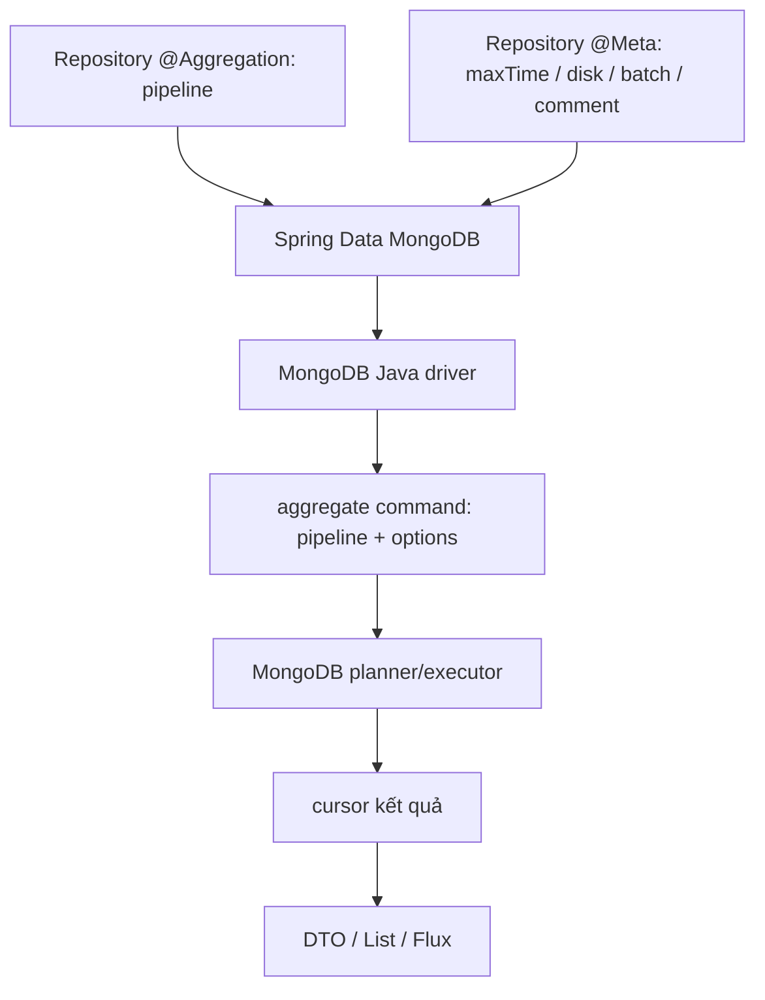
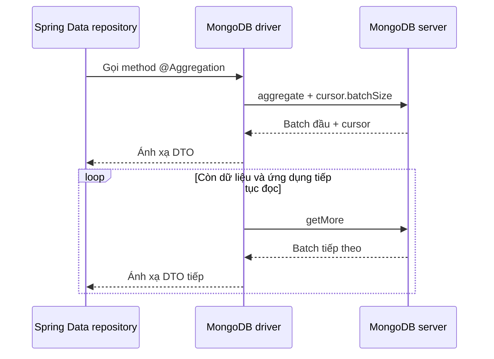

# @Meta, thời gian thực thi và tùy chọn tài nguyên

## 1. Vấn đề: pipeline đúng nhưng vẫn cần kiểm soát vận hành

Một pipeline aggregation có thể cho ra kết quả chính xác trên dữ liệu thử nhưng chạy rất lâu hoặc chiếm nhiều tài nguyên khi collection tăng trưởng. Các stage như `$group`, `$sort`, `$bucket` hoặc `$setWindowFields` có thể cần lưu trạng thái trung gian. Nếu truy vấn được gọi từ một HTTP API có giới hạn thời gian, việc để MongoDB xử lý vô hạn không phải lựa chọn an toàn.

Trong **Spring Data MongoDB**, repository hỗ trợ `@Aggregation` để khai báo pipeline trực tiếp tại một method. Annotation **`@Meta`** ở cùng method cho phép khai báo một số tùy chọn thực thi, chẳng hạn:

- `maxExecutionTimeMs`: giới hạn thời gian xử lý ở phía MongoDB.
- `allowDiskUse`: quyết định có cho phép stage đủ điều kiện ghi tạm ra đĩa khi cần hay không.
- `cursorBatchSize`: điều chỉnh kích thước batch do cursor trả về.
- `comment`: gắn nhãn truy vấn phục vụ phân tích và chẩn đoán.

Ví dụ một API báo cáo 20 SKU có doanh thu cao nhất trong tenant đang đăng nhập:

```java
@Meta(
    maxExecutionTimeMs = 3000,
    allowDiskUse = "true",
    cursorBatchSize = 50,
    comment = "report:top-paid-skus:v1"
)
@Aggregation(pipeline = {
    "{ '$match': { 'tenantId': ?0, 'status': 'PAID' } }",
    "{ '$group': { '_id': '$sku', " +
        "'revenueCents': { '$sum': '$amountCents' } } }",
    "{ '$sort': { 'revenueCents': -1, '_id': 1 } }",
    "{ '$limit': 20 }"
})
List<Document> topPaidSkus(String authorizedTenantId);
```

Ví dụ trên minh họa hình dạng repository method; phần sau cung cấp **entity, DTO, repository và test đầy đủ**, tránh phụ thuộc vào kiểu `Document` trong logic nghiệp vụ. Trong Spring Data MongoDB hiện hành, tham số `allowDiskUse` của annotation là **String**, nên viết `"true"` chứ không phải Boolean `true`.

**Ý chính:** `@Meta` điều khiển một số lựa chọn khi **thực thi** truy vấn. Nó không làm pipeline tự động sử dụng index, không làm biến mất CPU/RAM cần thiết, không phân quyền dữ liệu, không tự phân trang kết quả và không bảo đảm một giới hạn thời gian tuyệt đối tính từ lúc HTTP request đến lúc response trả xong.

Bài thuộc chương **Aggregation repository** của module **SPRING_DATA_MONGODB**, nơi chúng ta dùng Spring Data để kết nối, ánh xạ document, viết aggregation qua repository hoặc `MongoTemplate`, kiểm thử và chẩn đoán hiệu năng. Trọng tâm là dùng đúng `@Meta` và các giới hạn tài nguyên, hiểu sự khác nhau giữa tùy chọn server, driver và ứng dụng.

## 2. @Aggregation, @Meta và AggregationOptions khác nhau thế nào?

Ba khái niệm có vai trò riêng:

| Thành phần | Dùng ở đâu? | Nhiệm vụ |
| --- | --- | --- |
| `@Aggregation` | Repository method | Khai báo các stage của pipeline, binding tham số và kiểu kết quả |
| `@Meta` | Repository method hoặc annotation tổng hợp | Khai báo metadata/tùy chọn thực thi như thời gian, batch, comment và disk use |
| `AggregationOptions` | `MongoTemplate` / `ReactiveMongoTemplate` | Cấu hình tùy chọn thực thi cho pipeline được xây trong code |
| `Aggregation` DSL | `MongoTemplate` / `ReactiveMongoTemplate` | Dựng các stage theo API Java |
| `MongoDB aggregate command` | MongoDB server | Thực thi pipeline với các tùy chọn đã chuyển qua driver |



Nếu không dùng repository annotation, có thể dựng pipeline bằng `Aggregation.newAggregation(...)` và truyền `AggregationOptions`:

```java
AggregationOptions options = AggregationOptions.builder()
    .maxTime(Duration.ofSeconds(3))
    .allowDiskUse(true)
    .cursorBatchSize(50)
    .comment("report:top-paid-skus:v1")
    .build();

Aggregation pipeline = Aggregation.newAggregation(
    // Các AggregationOperation đã khai báo.
).withOptions(options);
```

Đây là **minh họa API options**; phần 10 sẽ cho pipeline Java thực tế. Việc import đúng cũng quan trọng:

```java
// Annotation dùng với repository method:
import org.springframework.data.mongodb.repository.Aggregation;
import org.springframework.data.mongodb.repository.Meta;

// Class/DSL dùng với MongoTemplate:
import org.springframework.data.mongodb.core.aggregation.AggregationOptions;
// org.springframework.data.mongodb.core.aggregation.Aggregation
```

Hai tên `Aggregation` ở hai package khác nhau. Tương tự, `org.springframework.data.mongodb.repository.Meta` là **annotation**, còn `org.springframework.data.mongodb.core.query.Meta` là **class chứa metadata ở tầng query**; không dùng nhầm import khi khai báo `@Meta`.

## 3. Entity và kết quả báo cáo mẫu

### 3.1. Entity của collection sales_events

Giả sử mỗi document ghi nhận một dòng bán hàng. Ví dụ lưu tiền bằng **số nguyên cent** để tiện cộng dồn mà không cần làm tròn Double.

```java
package example.sales;

import java.time.Instant;
import org.springframework.data.mongodb.core.mapping.Document;
import org.springframework.data.mongodb.core.mapping.FieldType;
import org.springframework.data.mongodb.core.mapping.MongoId;

@Document(collection = "sales_events")
public record SaleEvent(
    @MongoId(FieldType.STRING) String id,
    String tenantId,
    String sku,
    String status,
    int units,
    long amountCents,
    Instant createdAt
) {}
```

`@MongoId(FieldType.STRING)` chỉ định ID lưu dưới BSON String. Query/aggregation typed của Spring Data có thể ánh xạ tên Java `id` thành `_id`. Khi viết pipeline JSON trong `@Aggregation`, các field tham chiếu phải nhất quán với mapping thực tế.

### 3.2. DTO kết quả

```java
package example.sales;

public record SkuRevenueSummary(
    String sku,
    long orderCount,
    long unitsSold,
    long revenueCents
) {}
```

Đây là **read model** của pipeline. Nó không có `tenantId`, `status` hay `createdAt` của từng event. Không chuyển DTO này thành entity rồi gọi `save` như thể nó là document nguồn đầy đủ.

### 3.3. Dữ liệu thử có chủ đích

```javascript
db.sales_events.insertMany([
  {
    _id: "event-101", tenantId: "shop-01",
    sku: "A", status: "PAID",
    units: NumberInt("2"), amountCents: NumberLong("2000"),
    createdAt: ISODate("2026-11-19T10:00:00Z")
  },
  {
    _id: "event-102", tenantId: "shop-01",
    sku: "B", status: "PAID",
    units: NumberInt("3"), amountCents: NumberLong("6000"),
    createdAt: ISODate("2026-11-19T11:00:00Z")
  },
  {
    _id: "event-103", tenantId: "shop-01",
    sku: "A", status: "PAID",
    units: NumberInt("1"), amountCents: NumberLong("1200"),
    createdAt: ISODate("2026-11-20T09:00:00Z")
  },
  {
    _id: "event-104", tenantId: "shop-01",
    sku: "B", status: "PENDING",
    units: NumberInt("10"), amountCents: NumberLong("20000"),
    createdAt: ISODate("2026-11-20T10:00:00Z")
  },
  {
    _id: "event-201", tenantId: "shop-02",
    sku: "A", status: "PAID",
    units: NumberInt("30"), amountCents: NumberLong("30000"),
    createdAt: ISODate("2026-11-20T11:00:00Z")
  }
]);
```

Kết quả đúng cho `shop-01`, chỉ các event `PAID`:

| SKU | Số event | Tổng units | Doanh thu (cent) |
| --- | ---: | ---: | ---: |
| B | 1 | 3 | 6.000 |
| A | 2 | 3 | 3.200 |

`event-104` và `event-201` phải bị loại. Tenant phải do server xác định từ security context hoặc nguồn được ủy quyền; client tự gửi tên tenant không thay thế kiểm tra quyền.

## 4. Repository @Aggregation hoàn chỉnh

### 4.1. Pipeline trước khi gắn Meta

```java
package example.sales;

import java.util.List;
import org.springframework.data.mongodb.repository.Aggregation;
import org.springframework.data.mongodb.repository.MongoRepository;

public interface SaleEventRepository
        extends MongoRepository<SaleEvent, String> {

    @Aggregation(pipeline = {
        "{ '$match': { 'tenantId': ?0, 'status': 'PAID' } }",
        "{ '$group': { " +
            "'_id': '$sku', " +
            "'orderCount': { '$sum': 1 }, " +
            "'unitsSold': { '$sum': '$units' }, " +
            "'revenueCents': { '$sum': '$amountCents' } " +
        "} }",
        "{ '$project': { " +
            "'_id': 0, 'sku': '$_id', " +
            "'orderCount': 1, 'unitsSold': 1, 'revenueCents': 1 " +
        "} }",
        "{ '$sort': { 'revenueCents': -1, 'sku': 1 } }",
        "{ '$limit': 20 }"
    })
    List<SkuRevenueSummary> topPaidSkus(String tenantId);
}
```

`?0` là tham số method thứ nhất. `$match` lọc document trước khi `$group`; `$project` chuyển khóa nhóm `_id` thành `sku`, để tên field phù hợp DTO; `$sort` sắp xếp theo doanh thu và dùng `sku` phá hòa; `$limit` giới hạn **số nhóm SKU cuối**.

**Chú ý nghiệp vụ:** `orderCount` ở ví dụ thực chất là **số document sales event**, không tự nhiên là số đơn hàng duy nhất nếu một order có nhiều event. Nếu cần số order distinct, schema phải có order ID và pipeline phải định nghĩa phép đếm phù hợp. Tên metric nên được điều chỉnh theo domain; ở đây mỗi document giả định tương ứng một dòng event tính vào phép đếm.

### 4.2. Thêm @Meta vào cùng method

```java
package example.sales;

import java.util.List;
import org.springframework.data.mongodb.repository.Aggregation;
import org.springframework.data.mongodb.repository.Meta;
import org.springframework.data.mongodb.repository.MongoRepository;

public interface SaleEventRepository
        extends MongoRepository<SaleEvent, String> {

    @Meta(
        maxExecutionTimeMs = 3000,
        cursorBatchSize = 50,
        allowDiskUse = "true",
        comment = "report:top-paid-skus:v1"
    )
    @Aggregation(pipeline = {
        "{ '$match': { 'tenantId': ?0, 'status': 'PAID' } }",
        "{ '$group': { " +
            "'_id': '$sku', " +
            "'orderCount': { '$sum': 1 }, " +
            "'unitsSold': { '$sum': '$units' }, " +
            "'revenueCents': { '$sum': '$amountCents' } " +
        "} }",
        "{ '$project': { " +
            "'_id': 0, 'sku': '$_id', " +
            "'orderCount': 1, 'unitsSold': 1, 'revenueCents': 1 " +
        "} }",
        "{ '$sort': { 'revenueCents': -1, 'sku': 1 } }",
        "{ '$limit': 20 }"
    })
    List<SkuRevenueSummary> topPaidSkus(String authorizedTenantId);
}
```

Đây là **phiên bản cuối** của interface dùng trong các phần tiếp theo; hai đoạn cùng tên `SaleEventRepository` ở phần 4.1 và 4.2 là **hai phương án**, không được khai báo đồng thời trong cùng dự án.

Các tùy chọn được định nghĩa **tại method**. Nếu một repository có nhiều báo cáo với nhu cầu khác nhau, không nên áp cùng một cấu hình maxTime/disk/batch cho tất cả một cách máy móc.

## 5. maxExecutionTimeMs: giới hạn thời gian xử lý tại server

### 5.1. Cú pháp và ý nghĩa

```java
@Meta(maxExecutionTimeMs = 3000)
@Aggregation(pipeline = {
    "{ '$match': { 'status': 'PAID' } }",
    "{ '$group': { '_id': '$sku', 'n': { '$sum': 1 } } }"
})
List<SkuCount> counts();
```

`3000` có đơn vị **milliseconds**, tức khoảng ba giây. Spring Data chuyển giới hạn này thành tùy chọn thời gian MongoDB tương ứng, thường thấy ở lệnh `aggregate` dưới tên `maxTimeMS`:

```javascript
db.sales_events.aggregate(
  [
    { $match: { status: "PAID" } },
    { $group: { _id: "$sku", n: { $sum: 1 } } }
  ],
  { maxTimeMS: 3000 }
);
```

Nếu MongoDB xử lý vượt hạn mức ở điểm có thể ngắt, server có thể kết thúc thao tác và trả lỗi, thường gắn với **execution time limit**. Ứng dụng phải xử lý lỗi như một khả năng bình thường của báo cáo có timeout, không được trả kết quả trống rồi gắn nhãn “không có dữ liệu”.

### 5.2. Không phải đồng hồ treo tường của toàn HTTP request

Những khoảng thời gian khác nhau:

| Giới hạn | Phạm vi |
| --- | --- |
| `@Meta(maxExecutionTimeMs=...)` / MongoDB `maxTimeMS` | Giới hạn phía server cho thao tác được cấu hình; điểm ngắt theo cơ chế server |
| Connection timeout | Thời gian mở kết nối TCP tới server |
| Server selection timeout | Thời gian driver tìm server phù hợp topology |
| Socket/read timeout | Giới hạn chờ I/O mạng theo driver/cấu hình |
| HTTP request timeout | Mức thời gian chấp nhận ở gateway/API/client |
| Deadline nghiệp vụ end-to-end | Từ lúc nhận yêu cầu đến khi trả kết quả, có thể gồm cache, DB, mapping và JSON serialization |

**`maxTimeMS` không phải hard deadline toàn hệ thống**. Kết nối có thể mất thời gian chọn server trước khi lệnh bắt đầu, còn phía ứng dụng có thể tốn thời gian chuyển BSON sang Java DTO hoặc serialize JSON sau khi query hoàn tất. Việc ngắt ở server diễn ra tại các điểm kiểm tra ngắt, nên elapsed time quan sát được không phải luôn đúng bằng giá trị cấu hình.

Nếu ứng dụng phải đáp ứng trong một ngân sách thời gian cố định, thiết kế **phối hợp** các timeout và deadline giữa HTTP/service/driver/server. Tránh cấu hình HTTP timeout ngắn hơn mức chờ server một cách vô thức rồi để hàng loạt truy vấn tiếp tục tiêu tốn tài nguyên sau khi client ngắt kết nối.

### 5.3. Chọn maxExecutionTimeMs dựa trên đo lường

Không chọn `3000` chỉ vì ví dụ dùng ba giây. Quy trình thực tế:

1. Đo p50/p95/p99 latency của pipeline trên tập dữ liệu đại diện.
2. Xác định SLO/SLA của API và ngân sách dành riêng cho MongoDB.
3. Theo dõi tỷ lệ query bị ngắt do giới hạn thời gian.
4. Sửa query/index trước khi tăng giới hạn vô hạn.
5. Với báo cáo lớn có chủ đích, cân nhắc chạy bất đồng bộ theo workflow/job riêng có checkpoint và kiểm soát tài nguyên.

Thời gian cao không đồng nghĩa truy vấn cần thêm RAM hoặc disk use. Có khi vấn đề là `$match` không tận dụng index, `$sort` sai vị trí, hoặc `$group` đang xử lý quá nhiều document.

### 5.4. Default và giá trị không đặt

Trong API annotation hiện hành, `maxExecutionTimeMs` có giá trị mặc định `-1` thể hiện **không đặt giới hạn qua annotation**, không phải “server buộc chạy mãi”. Server/driver/cluster vẫn có các giới hạn khác.

Không dùng giá trị âm hoặc 0 một cách tùy ý để thể hiện một SLO; hãy đặt một số dương và kiểm tra cách framework/driver xử lý option trong phiên bản thực tế.

## 6. allowDiskUse: cho phép spill, không phải tối ưu miễn phí

### 6.1. Khi nào aggregation cần đĩa tạm?

Các stage như `$group` và `$sort` có thể cần tích lũy nhiều phần tử. Nếu dữ liệu đủ lớn, MongoDB có thể cần dùng file tạm trên đĩa cho một số stage hỗ trợ spill:

```javascript
db.sales_events.aggregate(
  [
    { $match: { tenantId: "shop-01", status: "PAID" } },
    {
      $group: {
        _id: "$sku",
        revenueCents: { $sum: "$amountCents" }
      }
    },
    { $sort: { revenueCents: -1 } }
  ],
  { allowDiskUse: true }
);
```

Trong repository:

```java
@Meta(allowDiskUse = "true")
@Aggregation(pipeline = {
    "{ '$group': { '_id': '$sku', 'revenue': { '$sum': '$amountCents' } } }",
    "{ '$sort': { 'revenue': -1 } }"
})
List<SkuRevenueOnly> totalRevenueBySku();
```

**Cho phép spill không có nghĩa pipeline luôn ghi đĩa**. Khi stage sử dụng bộ nhớ ít hoặc có plan hiệu quả, có thể không có spill. Nếu có spill, truy vấn thường dùng nhiều I/O, chiếm không gian tạm và tăng latency.

### 6.2. Phân biệt cho phép, cấm và theo mặc định server

Trong Spring Data MongoDB hiện hành, giá trị String của `@Meta.allowDiskUse` hỗ trợ những lựa chọn như:

| Giá trị annotation | Ý định |
| --- | --- |
| `allowDiskUse = "true"` hoặc `"allow"` | Cho phép disk use đối với stage hỗ trợ |
| `allowDiskUse = "false"` hoặc `"deny"` | Cấm disk use của thao tác theo cơ chế server |
| Không khai báo / chuỗi mặc định `""` | Không ép lựa chọn ở annotation, để chính sách mặc định của server/framework áp dụng |

Điểm quan trọng từ **MongoDB 6.0 trở đi**: tham số server `allowDiskUseByDefault` điều khiển chính sách mặc định cho những stage có thể spill khi dùng nhiều bộ nhớ. Nếu server đặt default cho phép, không khai báo `allowDiskUse` **không** có nghĩa chắc chắn cấm spill. Nếu server đặt default cấm, một lệnh có `allowDiskUse: true` có thể cho phép spill riêng cho lệnh đó.

Không suy diễn hành vi từ “giá trị mặc định của annotation” mà bỏ qua **MongoDB server version, cấu hình allowDiskUseByDefault và tùy chọn thực sự gửi xuống server**.

### 6.3. Một thay đổi API cần chú ý khi nâng phiên bản

Trên một số Spring Data MongoDB cũ, `@Meta.allowDiskUse` là **boolean**:

```text
Một số code cũ dùng cú pháp: allowDiskUse = true
```

Ở API Spring Data MongoDB hiện hành, thuộc tính là **String**:

```java
@Meta(allowDiskUse = "true")
```

Không sao chép cú pháp từ bài blog của phiên bản cũ mà không đối chiếu JavaDoc của BOM/dependency thật trong dự án. Cách viết `"true"` cũng cho phép phân biệt **không đặt**, **cho phép** và **cấm**.

### 6.4. Vì sao bật disk use có thể làm hệ thống chậm hơn?

Các nguyên nhân phổ biến:

- Stage phải ghi/đọc file tạm khi memory pressure cao.
- Nhiều aggregation đồng thời cạnh tranh cùng tài nguyên đĩa.
- Đĩa đầy hoặc I/O bị throttling dẫn đến lỗi/latency tăng.
- `$group` có quá nhiều nhóm, `$sort` sắp xếp kết quả rất lớn.
- Pipeline thiếu `$match` chọn lọc hoặc cố tạo báo cáo toàn lịch sử mỗi request.

**`allowDiskUse` là van an toàn tài nguyên cho những stage phù hợp, không phải thay thế tối ưu query.** Thường cần ưu tiên giảm số document đầu vào, cải thiện index, chọn chunk hoặc materialized summary.

### 6.5. Khi nào nên cấm disk use có chủ đích?

Với một số API đồng bộ có tài nguyên/latency nghiêm ngặt, chủ hệ thống có thể chọn:

```java
@Meta(allowDiskUse = "false")
```

Khi đó, truy vấn vượt giới hạn memory của stage có thể thất bại thay vì đổ dữ liệu tạm ra đĩa. Đây là một trade-off **fail fast theo tài nguyên** ở server, cần test và theo dõi lỗi. Đừng diễn đạt là “cấm disk use đảm bảo query luôn nhanh”.

## 7. cursorBatchSize: số bản ghi mỗi đợt, không phải giới hạn kết quả

### 7.1. Từ aggregation tới cursor

MongoDB thường trả kết quả aggregation qua một **cursor**. Driver có thể nhận batch ban đầu rồi gọi `getMore` để nhận batch tiếp theo khi ứng dụng tiêu thụ kết quả.



`@Meta(cursorBatchSize = 50)` đặt kích thước batch mong muốn. Nó **không** thay thế stage `$limit: 20`, cũng không phải số document tối đa mà repository method được quyền trả.

### 7.2. So sánh batch size và limit

| Tùy chọn | Đơn vị | Giải quyết |
| --- | --- | --- |
| `cursorBatchSize = 50` | Document/batch | Cách cursor nhận kết quả theo các đợt |
| `{$limit: 20}` | Document kết quả pipeline | Giới hạn **tổng số dòng kết quả** của pipeline |
| `Pageable`/`Slice` | Trang và thứ tự | API đọc theo trang, tùy cấu trúc repository/aggregation |
| HTTP response limit | Byte hoặc dòng theo ứng dụng | Hạn chế dữ liệu trả cho người gọi |

Batch size có thể bị chi phối bởi giới hạn message/BSON và cách driver/server trả batch. Vì thế **không nên coi mỗi batch luôn chính xác 50 dòng**. Giá trị trong `@Meta` hướng dẫn quá trình cấp dữ liệu, không quyết định mọi chi tiết I/O.

### 7.3. List vẫn giữ toàn bộ kết quả trong ứng dụng

Nếu method trả:

```java
List<SkuRevenueSummary> rows =
    repository.topPaidSkus("shop-01");
```

thì toàn bộ kết quả của method vẫn được materialize thành `List`. Dù cursor nhận từng batch, `List` có thể chiếm bộ nhớ theo **tổng số kết quả**, không theo `cursorBatchSize`.

Với báo cáo top 20, đây không phải vấn đề lớn. Nhưng với xuất hàng triệu dòng, cần xem phương án streaming, giới hạn đầu ra, phân trang đúng ngữ nghĩa hoặc kiến trúc job/export. `cursorBatchSize` tự nó **không** giải quyết OOM phía ứng dụng.

### 7.4. Chọn batch size theo dữ liệu

Batch nhỏ:

- Có thể giảm bộ nhớ đệm phía client cho một đợt.
- Nhưng tăng số lượt `getMore` và overhead mạng khi phải đọc nhiều dòng.

Batch lớn:

- Có thể giảm số lượt lấy dữ liệu.
- Nhưng một đợt có thể lớn về byte nếu document/DTO cồng kềnh.

Lựa chọn phụ thuộc **kích thước document, latency mạng, tốc độ tiêu thụ, giới hạn bộ nhớ và cơ chế streaming**. Số 50 trong ví dụ là minh họa; cần benchmark các giá trị phù hợp.

### 7.5. Batch size không làm pipeline nhóm dữ liệu trở thành streaming hoàn toàn

Một pipeline có `$group` hoặc `$sort` không được index hỗ trợ có thể phải tích lũy dữ liệu trung gian **trước khi xuất batch đầu**. Dù batch size là 1, MongoDB vẫn có thể tốn nhiều RAM/CPU/đĩa để tính ra kết quả đầu tiên.

Đừng dùng `cursorBatchSize = 1` như một cách thay thế tối ưu `$group` hoặc `$sort`.

## 8. comment: gắn nhãn để điều tra truy vấn

### 8.1. Dùng comment tĩnh, có ý nghĩa

```java
@Meta(comment = "report:top-paid-skus:v1")
```

MongoDB có thể ghi thông tin `comment` trong command/profiler/diagnostic logs, giúp phân biệt các query có cấu trúc gần giống nhau mà đến từ API khác nhau.

Một quy ước dễ tìm:

```text
<domain>:<query-purpose>:<version>

sales:top-paid-skus:v1
sales:daily-revenue:v2
inventory:low-stock-summary:v1
```

Với annotation, `comment` được đặt **cố định ở method**. Nếu cần correlation ID động ở mỗi request, cân nhắc logging/observability có kiểm soát ở tầng ứng dụng và công cụ driver; đừng vì cần trace mà đưa access token, email, tên khách hàng hoặc payload nhạy cảm vào comment.

### 8.2. Dùng comment khi profiler/slow query log

Ví dụ command MongoDB tương đương:

```javascript
db.sales_events.aggregate(
  [
    { $match: { tenantId: "shop-01", status: "PAID" } },
    { $group: { _id: "$sku", revenue: { $sum: "$amountCents" } } }
  ],
  { comment: "sales:top-paid-skus:v1" }
);
```

Khi quản trị viên kiểm tra slow operations, logs hoặc profiler (nếu được bật đúng môi trường và quyền), comment giúp liên hệ lệnh với một chức năng ứng dụng. Tuy nhiên, **comment không bảo đảm mỗi execution luôn xuất hiện trong profiler**: khả năng quan sát còn phụ thuộc sampling, cấu hình profiler/logging và tính năng môi trường MongoDB.

Không bật database profiling ở mức ghi mọi query trên production mà chưa cân nhắc tải, chi phí lưu log và dữ liệu nhạy cảm.

## 9. Khi phối hợp cả bốn tùy chọn

Đây là repository method cuối cùng từ phần 4:

```java
@Meta(
    maxExecutionTimeMs = 3000,
    allowDiskUse = "true",
    cursorBatchSize = 50,
    comment = "report:top-paid-skus:v1"
)
@Aggregation(pipeline = {
    "{ '$match': { 'tenantId': ?0, 'status': 'PAID' } }",
    "{ '$group': { '_id': '$sku', " +
        "'revenueCents': { '$sum': '$amountCents' } } }",
    "{ '$sort': { 'revenueCents': -1 } }",
    "{ '$limit': 20 }"
})
List<Document> topPaidSkus(String tenantId);
```

Về ý tưởng, các option đi cùng một MongoDB aggregation command:

```javascript
db.sales_events.aggregate(
  [
    { $match: { tenantId: "shop-01", status: "PAID" } },
    {
      $group: {
        _id: "$sku",
        revenueCents: { $sum: "$amountCents" }
      }
    },
    { $sort: { revenueCents: -1 } },
    { $limit: 20 }
  ],
  {
    maxTimeMS: 3000,
    allowDiskUse: true,
    cursor: { batchSize: 50 },
    comment: "report:top-paid-skus:v1"
  }
);
```

Mục đích phần này là đối chiếu **metadata với wire options**. Method dùng `List<Document>` chỉ để rút gọn pipeline trong ví dụ; bản production theo DTO đã có ở phần 4.2.

Tính độc lập của các tùy chọn:

- `maxTimeMS` hạn chế thời gian xử lý theo cơ chế server.
- `allowDiskUse` cho phép hoặc cấm spill khi stage đủ điều kiện cần tài nguyên.
- `cursor.batchSize` ảnh hưởng cách trả kết quả.
- `comment` phục vụ chẩn đoán.
- **Không tùy chọn nào tự thêm `$match` tenant, `$sort` chính xác hoặc `$limit` an toàn.**

Một method vẫn có thể chậm, lỗi memory hoặc trả sai dữ liệu nếu pipeline/điều kiện nghiệp vụ không phù hợp.

## 10. Tùy chọn tương đương khi dùng MongoTemplate

### 10.1. AggregationOptions

Khi pipeline cần lắp ráp động, `MongoTemplate` thường linh hoạt hơn một annotation dài:

```java
package example.sales;

import java.time.Duration;
import java.util.List;
import org.springframework.data.domain.Sort;
import org.springframework.data.mongodb.core.MongoTemplate;
import org.springframework.data.mongodb.core.aggregation.Aggregation;
import org.springframework.data.mongodb.core.aggregation.AggregationOptions;
import org.springframework.data.mongodb.core.query.Criteria;
import org.springframework.stereotype.Service;

@Service
public class SaleReportTemplateService {

    private final MongoTemplate template;

    public SaleReportTemplateService(MongoTemplate template) {
        this.template = template;
    }

    public List<SkuRevenueSummary> topPaidSkus(
            String authorizedTenantId) {

        if (authorizedTenantId == null ||
                authorizedTenantId.isBlank()) {
            throw new IllegalArgumentException(
                "tenantId không hợp lệ"
            );
        }

        AggregationOptions options = AggregationOptions.builder()
            .maxTime(Duration.ofSeconds(3))
            .allowDiskUse(true)
            .cursorBatchSize(50)
            .comment("report:top-paid-skus:template:v1")
            .build();

        Aggregation pipeline = Aggregation.newAggregation(
            Aggregation.match(
                Criteria.where("tenantId").is(authorizedTenantId)
                    .and("status").is("PAID")
            ),
            Aggregation.group("sku")
                .count().as("orderCount")
                .sum("units").as("unitsSold")
                .sum("amountCents").as("revenueCents"),
            Aggregation.project(
                "orderCount", "unitsSold", "revenueCents"
            ).and("_id").as("sku").andExclude("_id"),
            Aggregation.sort(
                Sort.by(
                    Sort.Order.desc("revenueCents"),
                    Sort.Order.asc("sku")
                )
            ),
            Aggregation.limit(20)
        ).withOptions(options);

        return template.aggregate(
            pipeline, SaleEvent.class, SkuRevenueSummary.class
        ).getMappedResults();
    }
}
```

Đoạn mã dùng **`SaleEvent.class` làm input type** để Spring Data áp dụng mapping entity khi phù hợp, và `SkuRevenueSummary.class` làm output type. Cần kiểm tra mapping ở dự án có `@Field`/custom converter vì tên field sau `$group` và `$project` không còn đồng nhất với schema nguồn.

### 10.2. Khác biệt giữa annotation và options builder

| Repository annotation | MongoTemplate |
| --- | --- |
| `@Meta(maxExecutionTimeMs = 3000)` | `.maxTime(Duration.ofSeconds(3))` |
| `@Meta(allowDiskUse = "true")` | `.allowDiskUse(true)` |
| `@Meta(cursorBatchSize = 50)` | `.cursorBatchSize(50)` |
| `@Meta(comment = "name")` | `.comment("name")` |

Lưu ý **khác kiểu tham số**: `allowDiskUse` của `@Meta` hiện hành dùng String, còn `AggregationOptions.Builder.allowDiskUse(...)` nhận boolean. Đây là khác biệt API hợp lệ, không phải mâu thuẫn.

### 10.3. Chọn API theo nhu cầu

Repository `@Aggregation` + `@Meta` phù hợp khi:

- Pipeline **cố định** và đơn giản;
- Tham số đầu vào ít, có thể bind an toàn;
- Cần một contract repository rõ ràng;
- Metadata thực thi là cấu hình tĩnh theo chức năng.

`MongoTemplate` + `AggregationOptions` phù hợp khi:

- Có nhiều filter/stage tùy chọn;
- Time budget/batch size cần cấu hình theo chính sách được kiểm soát;
- Cần thêm `hint`, collation, read concern hoặc tùy chọn ngoài phạm vi `@Meta`;
- Muốn tách các stage thành hàm riêng và viết integration test rõ ràng.

Không chọn một API chỉ vì ngắn hơn vài dòng; tính đúng, mapping, dễ kiểm thử và khả năng vận hành quan trọng hơn.

## 11. Streaming và reactive không xóa chi phí aggregation server

### 11.1. MongoTemplate.aggregateStream

Nếu kết quả lớn và không cần tạo `List`, Spring Data MongoDB cung cấp API streaming cho aggregation:

```java
import java.util.stream.Stream;
import org.springframework.data.mongodb.core.aggregation.Aggregation;

// 'pipeline' đã có AggregationOptions phù hợp.
try (Stream<SkuRevenueSummary> stream =
         template.aggregateStream(
             pipeline, SaleEvent.class, SkuRevenueSummary.class
         )) {
    stream.forEach(this::exportRow);
}
```

`exportRow` là hàm ứng dụng do developer cung cấp. Ví dụ trên là đoạn mã trong một service có `template` và `pipeline` sẵn; cần đóng stream/cursor khi không dùng nữa. Nếu quá trình export kéo dài, cần xử lý hủy request, lỗi mạng, thời gian chờ và resume strategy.

**Stream không làm `$group`/`$sort` không còn dùng bộ nhớ MongoDB.** Nó chỉ giúp phía ứng dụng không nhất thiết giữ toàn bộ kết quả đã nhận trong `List`.

### 11.2. ReactiveMongoTemplate và Flux

```java
import org.springframework.data.mongodb.core.ReactiveMongoTemplate;
import reactor.core.publisher.Flux;

// reactiveTemplate được inject từ Spring context.
Flux<SkuRevenueSummary> rows =
    reactiveTemplate.aggregate(
        pipeline, SaleEvent.class, SkuRevenueSummary.class
    );
```

Reactive I/O giúp tổ chức luồng dữ liệu/backpressure. Nhưng server vẫn phải xử lý các stage, và `collectList()` vẫn gom toàn bộ kết quả ở phía Java:

```java
Mono<List<SkuRevenueSummary>> all = rows.collectList();
```

Với top 20, việc gom list hợp lý; với hàng triệu nhóm, cần giới hạn, stream hoặc xây workflow export. Không gọi `block()` trong luồng WebFlux chỉ để biến publisher thành kết quả đồng bộ.

### 11.3. Reactive repository và @Meta

Reactive repositories có thể khai báo `@Aggregation` và `@Meta` ở method, theo chức năng Spring Data MongoDB hỗ trợ trong phiên bản dự án. Tuy nhiên **không suy ra** từ việc trả `Flux` rằng `maxExecutionTimeMs`, `cursorBatchSize` và `allowDiskUse` có thể bỏ qua: chúng vẫn là những ràng buộc về server/cursor.

Khi phối hợp timeout ở Reactor:

```java
Flux<SkuRevenueSummary> bounded =
    rows.timeout(Duration.ofSeconds(5));
```

Timeout của Reactor là timeout **trên publisher** theo quy tắc Reactor, không phải `maxTimeMS` do MongoDB áp dụng. Hủy subscription thường dẫn đến driver đóng/hủy công việc theo khả năng của stack, nhưng không nên coi đây là bảo đảm mọi server operation lập tức chấm dứt. Thiết kế deadline end-to-end với cả hai tầng khi thực sự cần.

## 12. @Meta có thay được index hoặc pipeline optimization không?

**Không.** Metadata không thay đổi bản chất truy vấn.

### 12.1. Đặt $match sớm và tận dụng index

Với:

```javascript
{ $match: { tenantId: "shop-01", status: "PAID" } }
```

index ứng viên:

```javascript
db.sales_events.createIndex(
  { tenantId: 1, status: 1, sku: 1 },
  { name: "by_tenant_status_sku" }
);
```

Nó có thể giúp hạn chế document đi vào pipeline nếu workload phù hợp. Nhưng vì `revenueCents` được tính **sau group**, sort theo tổng doanh thu thường không thể dùng trực tiếp index của event gốc như một `find().sort(...)` trên field đã lưu.

### 12.2. Giảm cardinality trước stage tốn tài nguyên

```javascript
[
  { $match: { tenantId: "shop-01", status: "PAID" } },
  { $group: { _id: "$sku", revenue: { $sum: "$amountCents" } } },
  { $sort: { revenue: -1 } },
  { $limit: 20 }
]
```

Đây là thứ tự hợp lý cho báo cáo top SKU. Nếu đặt `$limit: 20` **trước** `$group`, bạn chỉ tính trên 20 document đầu vào, làm sai nghĩa “top SKU của toàn bộ tập PAID”.

`$sort` theo field đã tính thường phải xem xét nhiều nhóm. Cho phép disk use có thể tránh một số lỗi memory, nhưng không thay đổi số phép cộng, số nhóm hoặc khối lượng dữ liệu nguồn phải xử lý.

### 12.3. Một số câu hỏi cần trả lời trước khi bật allowDiskUse

1. Có thật sự cần tính toàn lịch sử mỗi request không?
2. Query đã lọc tenant/trạng thái/khoảng ngày hợp lý chưa?
3. Có index phù hợp với `$match` và `$sort` đầu pipeline không?
4. Có stage `$unwind` làm nhân số document trung gian không?
5. Số nhóm `$group` có tăng cùng số user/item không?
6. Có thể tiền tổng hợp hoặc lưu snapshot theo ngày/tháng không?
7. Server có đủ disk I/O và không gian tạm cho các request đồng thời không?

Khi đó mới quyết định disk policy và time budget theo tải thật.

## 13. Monitoring: kiểm tra options thực sự đi xuống MongoDB

### 13.1. Đừng chỉ đọc annotation rồi suy ra runtime

Một annotation `@Meta` hợp lệ về cú pháp chưa chứng minh mọi option đã tới server. Có thể có khác biệt dependency version, proxy repository, loại method, kiểu result hoặc cấu hình driver.

Quy trình kiểm chứng:

1. Dùng integration test gọi repository thật.
2. Bật **MongoDB command monitoring** có kiểm soát ở môi trường test để thấy command `aggregate`.
3. Xác nhận command có `maxTimeMS`, `allowDiskUse`, `comment`, `cursor.batchSize` khi phù hợp.
4. Đối chiếu với profiler/slow query log nếu cần.
5. Kiểm tra kết quả DTO, thời gian và mức sử dụng tài nguyên.

Lưu ý log command có thể chứa pipeline và giá trị tenant/điều kiện nhạy cảm. Hãy giới hạn môi trường, redaction và thời gian lưu log.

### 13.2. Ví dụ CommandListener ở MongoDB driver

MongoDB Java driver cho phép quan sát lệnh được gửi:

```java
package example.sales;

import com.mongodb.event.CommandListener;
import com.mongodb.event.CommandStartedEvent;
import org.bson.Document;

public final class AggregationCommandObserver
        implements CommandListener {

    @Override
    public void commandStarted(CommandStartedEvent event) {
        if (!"aggregate".equals(event.getCommandName())) {
            return;
        }

        Document command = event.getCommand();
        // Chỉ ghi thông tin an toàn, không log toàn bộ dữ liệu nhạy cảm.
        System.out.println("hasMaxTime=" +
            command.containsKey("maxTimeMS"));
        System.out.println("hasComment=" +
            command.containsKey("comment"));
        System.out.println("hasCursor=" +
            command.containsKey("cursor"));
    }
}
```

Đoạn này là **observer minh họa**; nó chỉ chạy khi được đăng ký với `MongoClientSettings` của client dùng trong test/app. Không tự nhiên có log chỉ vì khai báo class. Trong dự án Spring Boot, cách đăng ký command listener phải tương thích phiên bản auto-configuration và nên chỉ bật ở môi trường kiểm thử.

Nếu cần xác nhận giá trị cụ thể:

```javascript
// Minh họa một aggregate command đã được gửi:
{
  aggregate: "sales_events",
  pipeline: [/* stages */],
  cursor: { batchSize: 50 },
  maxTimeMS: 3000,
  allowDiskUse: true,
  comment: "report:top-paid-skus:v1"
}
```

Đây là cấu trúc **minh họa**. Command thực tế còn có thể chứa `$db`, session metadata hoặc các option khác; chỉ dựa vào output do listener/profiler ở môi trường thực xác nhận.

### 13.3. Theo dõi vấn đề đúng loại

| Quan sát | Gợi ý điều tra |
| --- | --- |
| Lỗi max time thường xuyên | Index, cardinality, stage blocking và ngân sách thời gian |
| Profiler/diagnostic log báo usedDisk | Pipeline spill do nhu cầu memory; đo I/O và kích thước dữ liệu |
| Nhiều lượt getMore | Kích thước output/batch size và tốc độ consumer |
| Kết quả DTO nhiều và heap ứng dụng cao | `List` materialization, thiếu `$limit` hoặc export không streaming |
| Disk I/O tăng theo traffic báo cáo | Nhiều query được phép spill đồng thời |
| Không thấy comment | Xem command thực, cấu hình profiler/log hoặc path code không đi qua repository method mong đợi |
| Chậm trước khi có batch đầu | `$group`/`$sort` blocking hoặc index kém, không chỉ vì batch size |

Không kết luận vấn đề “server thiếu RAM” chỉ từ một timeout. Cần dữ liệu `explain("executionStats")`, metrics CPU/memory/disk, query planner và số document examined.

## 14. Kiểm thử tích hợp repository và @Meta

Một bộ test nên tách hai mục tiêu:

- **Tính đúng của pipeline:** cùng dữ liệu phải trả đúng các SKU, số event, tổng units và doanh thu.
- **Tùy chọn thực thi:** annotation có giá trị khai báo đúng và option thực sự được truyền xuống server; phần thứ hai cần command monitoring/integration test có cấu hình.

### 14.1. Test kết quả của repository

Ví dụ dùng JUnit 5 và Spring Boot `@DataMongoTest`:

```java
package example.sales;

import static org.junit.jupiter.api.Assertions.*;

import java.time.Instant;
import java.util.List;
import java.util.UUID;
import org.junit.jupiter.api.Test;
import org.springframework.beans.factory.annotation.Autowired;
import org.springframework.boot.test.autoconfigure.data.mongo.DataMongoTest;
import org.springframework.data.mongodb.core.MongoTemplate;

@DataMongoTest
class RepositoryAggregationMetaTest {

    @Autowired
    SaleEventRepository repository;

    @Autowired
    MongoTemplate template;

    @Test
    void paidSalesAreGroupedForAuthorizedTenant() {
        String suffix = UUID.randomUUID().toString();
        String tenant = "shop-" + suffix;
        Instant now = Instant.parse("2026-11-20T10:00:00Z");

        template.insertAll(List.of(
            new SaleEvent(
                "a1-" + suffix, tenant, "A", "PAID", 2, 2000L, now
            ),
            new SaleEvent(
                "b1-" + suffix, tenant, "B", "PAID", 3, 6000L, now
            ),
            new SaleEvent(
                "a2-" + suffix, tenant, "A", "PAID", 1, 1200L, now
            ),
            new SaleEvent(
                "pending-" + suffix, tenant, "B", "PENDING",
                10, 20000L, now
            ),
            new SaleEvent(
                "outside-" + suffix, "other-" + suffix,
                "A", "PAID", 30, 30000L, now
            )
        ));

        List<SkuRevenueSummary> result =
            repository.topPaidSkus(tenant);

        assertEquals(
            List.of(
                new SkuRevenueSummary("B", 1, 3, 6000),
                new SkuRevenueSummary("A", 2, 3, 3200)
            ),
            result
        );
    }
}
```

Test này xác minh pipeline có filter tenant/status, group, project và sort đúng; nó không tự chứng minh `allowDiskUse` hoặc `maxTimeMS` được gửi qua driver. Dữ liệu test quá nhỏ để gây spill/time limit, và điều đó **bình thường**.

`@DataMongoTest` chỉ chuẩn bị context phần MongoDB, không bảo đảm MongoDB server tự có sẵn. Có thể dùng Testcontainers MongoDB hoặc instance riêng và bảo đảm Spring Boot version tương thích. Bài hiện chỉ được soạn Markdown, chưa chạy build/Gradle hay integration test.

### 14.2. Test khai báo @Meta bằng reflection

Trong một test cùng module:

```java
import static org.junit.jupiter.api.Assertions.*;

import org.junit.jupiter.api.Test;
import org.springframework.data.mongodb.repository.Meta;

class RepositoryMetaContractTest {

    @Test
    void queryHasExpectedMetadata() throws Exception {
        Meta meta = SaleEventRepository.class
            .getMethod("topPaidSkus", String.class)
            .getAnnotation(Meta.class);

        assertNotNull(meta);
        assertEquals(3000L, meta.maxExecutionTimeMs());
        assertEquals(50, meta.cursorBatchSize());
        assertEquals("true", meta.allowDiskUse());
        assertEquals(
            "report:top-paid-skus:v1",
            meta.comment()
        );
    }
}
```

Reflection test chỉ xác minh **annotation có mặt và giá trị khai báo**. Muốn xác minh đường truyền xuống server, cần test có command listener hoặc nguồn quan sát tương đương. Đừng báo “runtime option verified” chỉ vì reflection test pass.

### 14.3. Test option forwarding qua command monitoring

Một integration test riêng có thể đăng ký `CommandListener` trước khi MongoDB client khởi tạo, rồi:

1. Gọi `repository.topPaidSkus(tenant)`.
2. Lọc command `aggregate` có `comment` tương ứng.
3. Assert `maxTimeMS == 3000`.
4. Assert `allowDiskUse == true`.
5. Assert `cursor.batchSize == 50` theo command quan sát.

Đây là **quy trình kiểm thử** chứ không phải một test hoàn chỉnh vì cấu hình client/auto-configuration phụ thuộc phiên bản Spring Boot. Với một hệ thống có nhiều MongoClient, listener phải được gắn đúng client mà repository sử dụng.

### 14.4. Không test timeout bằng cách ngủ một khoảng cố định

Một test mong `maxExecutionTimeMs=10` sẽ luôn ngắt khi chạy một pipeline nhỏ là rất không ổn định. Latency máy, số document, query plan, cơ chế server interrupt và cache có thể khác nhau.

Để test về **configuration**, xác minh option được gửi xuống server. Để test hành vi **timeout**, dùng workload kiểm soát được trong môi trường cô lập, chấp nhận tính phụ thuộc server và theo dõi error code/exception tương ứng. Không viết test ngủ `Thread.sleep(3000)` rồi mặc định truy vấn sẽ timeout đúng mốc.

## 15. @Meta tự định nghĩa và quy ước cho team

Spring Data MongoDB cho phép tạo annotation bao quanh `@Meta` để tái sử dụng chính sách:

```java
package example.sales;

import java.lang.annotation.ElementType;
import java.lang.annotation.Retention;
import java.lang.annotation.RetentionPolicy;
import java.lang.annotation.Target;
import org.springframework.data.mongodb.repository.Meta;

@Retention(RetentionPolicy.RUNTIME)
@Target(ElementType.METHOD)
@Meta(
    maxExecutionTimeMs = 3000,
    allowDiskUse = "true",
    cursorBatchSize = 50,
    comment = "report:bounded-aggregation:v1"
)
public @interface BoundedReportAggregation {
}
```

Rồi dùng ở repository method:

```java
@BoundedReportAggregation
@Aggregation(pipeline = {
    "{ '$match': { 'status': 'PAID' } }",
    "{ '$group': { '_id': '$sku', 'n': { '$sum': 1 } } }"
})
List<SkuCount> countPaidBySku();
```

Ý nghĩa:

- Giữ một chính sách **thời gian/tài nguyên** nhất quán cho một nhóm truy vấn.
- Giảm duplication của các giá trị metadata.
- Cho phép đọc ý định từ tên annotation thay vì nhiều tham số.

Hạn chế:

- Không phải mọi báo cáo có cùng chi phí hoặc SLO.
- Một annotation chung với `comment` cố định có thể khiến các report khác nhau **khó phân biệt** khi quan sát runtime.
- Khi cần comment riêng theo method, có thể đặt `@Meta` trực tiếp với tên duy nhất hoặc dùng chiến lược monitoring bên ngoài phù hợp.
- Không dựa vào nhiều `@Meta` xếp chồng/override khi chưa xác minh precedence và hạn chế annotation trong phiên bản Spring Data đang dùng.

Nếu đặt quy ước team, nên định nghĩa rõ: báo cáo online tối đa bao lâu, khi nào được spill, batch size mặc định theo dạng output, ai có quyền tăng hạn mức, và dashboard nào giám sát tỷ lệ timeout/spill.

## 16. Vấn đề bảo mật và ổn định khi chạy báo cáo

### 16.1. Meta không thay thế phân quyền

Một repository:

```java
@Meta(maxExecutionTimeMs = 1000)
@Aggregation("{ '$group': { '_id': '$tenantId', 'sum': { '$sum': '$amountCents' } } }")
List<TenantRevenue> revenueByAllTenants();
```

vẫn có thể lộ số liệu nhiều tenant nếu được gọi từ endpoint không có quyền tương ứng. Thêm giới hạn thời gian **không làm truy vấn an toàn về phân quyền**.

Trong API tenant-scoped, `$match` tenant bắt buộc phải nằm ở pipeline, và tenant ID cần đến từ cơ chế ủy quyền phía server. Đặt filter sau `$group` thường quá muộn để ngăn phép tính trên dữ liệu không được phép.

### 16.2. Giới hạn truy vấn do client điều khiển

Không nhận giá trị `maxExecutionTimeMs`, `allowDiskUse` hoặc `cursorBatchSize` vô hạn từ client rồi tạo query tùy ý. Những giá trị này có thể ảnh hưởng tài nguyên cluster.

Với endpoint có tham số báo cáo động, đặt **giới hạn phía server**:

```java
int topN = Math.min(Math.max(requestedTopN, 1), 100);
```

Tuy nhiên, `topN` chỉ giới hạn output cuối. Nếu một pipeline có cardinality lớn trước `$group`, `$limit` nhỏ vẫn có thể phải xử lý rất nhiều document. Cần cả kiểm soát input range, index, độ dài danh sách và concurrency.

### 16.3. Comment không chứa bí mật

Tránh:

```text
comment = "user-email:someone@example.com;token:..."
```

Vì command/profiler/log có thể ghi comment, hãy dùng nhãn kỹ thuật tĩnh, không phải thông tin người dùng. Nếu cần liên kết trace của request, dùng cơ chế observability có chính sách redaction/retention/permission phù hợp.

### 16.4. Khi client đã timeout nhưng truy vấn còn chạy

Một HTTP request có thể bị ngắt trước khi MongoDB kết thúc. Với báo cáo nặng, cần:

- Ràng buộc thời gian server và app có chủ đích.
- Xử lý cancellation qua driver/reactive subscriber theo khả năng thực tế.
- Giới hạn số báo cáo nặng chạy đồng thời.
- Dùng job/report snapshot với idempotency và cơ chế lấy kết quả sau nếu query thường xuyên dài.

Không tự động retry một aggregation nặng nhiều lần sau timeout; nếu mỗi lần retry lại khởi động một truy vấn đầy đủ, cluster có thể càng quá tải.

## 17. Lỗi thường gặp và cách khắc phục

| Triệu chứng | Nguyên nhân có thể | Hướng xử lý |
| --- | --- | --- |
| `@Meta(allowDiskUse = true)` không compile | API phiên bản hiện tại yêu cầu String | Dùng `"true"`, đối chiếu dependency/BOM |
| Truy vấn chạy lâu hơn maxExecutionTimeMs quan sát | Server limit không phải end-to-end deadline; interrupt points và network/mapping | Phối hợp timeout nhiều tầng, đo runtime |
| `List` vẫn làm Java heap tăng | Batch size không giới hạn tổng kết quả | Thêm `$limit`/streaming/pagination |
| `cursorBatchSize=50` nhưng batch ít hơn 50 | Kết quả ít, giới hạn byte hoặc hành vi server | Không assert mỗi batch đúng 50 |
| Bật allowDiskUse nhưng vẫn lỗi | Stage không hỗ trợ spill, giới hạn khác hoặc lỗi I/O/tài nguyên | Xem lỗi và giới hạn server, tối ưu pipeline |
| Bật allowDiskUse nhưng truy vấn chậm | Spill ra đĩa tăng I/O và concurrency | Lọc sớm, index, đo usedDisk/memory |
| Không khai báo allowDiskUse mà vẫn thấy usedDisk | MongoDB 6.0+ có server default cho phép | Kiểm tra `allowDiskUseByDefault` |
| Cấm disk use khiến query lỗi memory | Stage vượt giới hạn trong RAM | Cải thiện query, hoặc cân nhắc cho phép spill |
| Có comment nhưng không thấy trong profiler | Profiling/sampling/log chưa phù hợp | Xem command monitoring và cấu hình quan sát |
| Dữ liệu trả sai tenant | Metadata không thêm quyền truy cập | Dùng `$match` tenant được xác thực |
| `$limit` nhỏ nhưng query vẫn nặng | `$group`/`$sort` phải xử lý nhiều document trước limit | Giảm input/group cardinality, materialize |
| Dùng annotation sai package | Nhầm `@Meta` với class `query.Meta` | Dùng `org.springframework.data.mongodb.repository.Meta` |
| `@Aggregation` đọc DTO null field | `$group` tạo `_id` nhưng thiếu `$project` đổi tên | Kiểm tra output BSON, mapping và DTO |
| Reflection test pass nhưng command thiếu option | Chưa kiểm tra forwarding/runtime | Gắn CommandListener trong integration test |
| Tăng timeout mãi không hết chậm | Query thiếu index, dữ liệu tăng, pipeline chưa tối ưu | `explain` và benchmark workload |

### Quy trình chẩn đoán theo thứ tự

1. **Tính đúng:** xác nhận `$match`, `$group`, `$sort`, `$limit` và kiểu DTO.
2. **Tùy chọn:** xác nhận `@Meta` nằm đúng method và đúng import.
3. **Phiên bản:** đối chiếu JavaDoc `@Meta.allowDiskUse` và MongoDB server default.
4. **Command:** kiểm tra `aggregate` thực tế có `maxTimeMS`, `allowDiskUse`, `cursor.batchSize`, `comment`.
5. **Plan:** dùng `explain("executionStats")` và chỉ số examined, stage cardinality.
6. **Tài nguyên:** quan sát usedDisk, memory, I/O và concurrency.
7. **Client:** xem cách method trả `List`, `Stream` hoặc `Flux` và cơ chế hủy cursor.
8. **Timeout:** so sánh server time limit với network/client/request deadline.
9. **Bảo mật:** tenant filter, comment/log và giới hạn API được kiểm soát.

## 18. Bài tập thực hành

### Bài 1 — So sánh có và không có @Meta

Viết hai repository methods cùng pipeline top SKU, một method không khai báo `@Meta` và method kia có `maxExecutionTimeMs=3000`, `cursorBatchSize=50`, `allowDiskUse="true"`, `comment` tĩnh. Dùng command monitoring ở test để so sánh các option thực sự được gửi.

### Bài 2 — Timeout không phải số dòng kết quả

Tạo dữ liệu thử đủ lớn để `$group` cần xử lý nhiều record. Thử các mức `maxExecutionTimeMs` trong môi trường cô lập. Phân biệt lỗi do server time limit với network timeout; không viết test chỉ trông vào `Thread.sleep`.

### Bài 3 — Khi nào nên bật disk use?

Tạo aggregation `$group` + `$sort` trên nhiều SKU, so sánh chế độ allow/deny và cấu hình mặc định của server. Xem usedDisk, thời gian xử lý và I/O. Giải thích vì sao kết quả tùy data volume/topology/version và bật disk use không mặc nhiên nhanh hơn.

### Bài 4 — Batch size và $limit

Chạy pipeline trả 500 document với `cursorBatchSize=10`, sau đó thêm `$limit=20`. Quan sát số dòng nhận được và lượt getMore bằng listener. Giải thích tại sao batch size không thay thế giới hạn tổng output.

### Bài 5 — MongoTemplate.withOptions

Viết lại pipeline `SaleEventRepository.topPaidSkus` bằng `Aggregation.newAggregation` và `AggregationOptions.builder()`. So sánh kết quả DTO, tenant filter và các option command với phiên bản repository.

### Bài 6 — Reactive và hủy truy vấn

Chuyển báo cáo sang `ReactiveMongoTemplate` và `Flux<SkuRevenueSummary>`. So sánh `collectList` với tiêu thụ từng phần, thêm timeout của Reactor và giải thích vì sao nó không đồng nghĩa server maxTimeMS.

### Bài 7 — Annotation tái sử dụng

Tạo `@BoundedReportAggregation` bao quanh `@Meta`. Áp dụng trên hai methods có workload khác nhau, đo độ trễ và xác định có nên dùng cùng hạn mức không. Thiết kế quy ước comment để phân biệt từng report.

### Câu hỏi tự kiểm tra

- `@Aggregation` và `@Meta` đảm nhiệm hai phần việc khác nhau thế nào?
- Trong Spring Data MongoDB hiện hành, vì sao `@Meta(allowDiskUse = "true")` có dấu nháy?
- `maxExecutionTimeMs` có đồng nghĩa HTTP request sẽ kết thúc đúng mốc đó không?
- `allowDiskUse` có bắt MongoDB luôn ghi file tạm không?
- Vì sao server MongoDB 6.0+ có thể spill dù annotation không khai báo disk use?
- `cursorBatchSize=50` có giới hạn repository trả đúng 50 document không?
- Vì sao method trả `List` vẫn có thể gây heap lớn dù batch nhỏ?
- `$group`/`$sort` có thể chặn việc trả batch đầu tiên như thế nào?
- `comment` giúp điều tra slow query ra sao và có nguy cơ gì về log?
- Nên kiểm tra runtime options qua reflection hay command monitoring?
- `AggregationOptions` khác `@Meta` ở điểm nào?
- Vì sao một `$limit=20` sau `$group` không làm MongoDB chỉ phải đọc 20 document nguồn?
- Khi nào nên chọn materialized summary thay vì tiếp tục tăng timeout và bật disk use?

## Ghi nhớ

Với **Spring Data MongoDB repository aggregation**, `@Aggregation` diễn đạt **pipeline**, còn **`@Meta` điều chỉnh cách thực thi**. `maxExecutionTimeMs` là giới hạn phía MongoDB server, **không phải deadline toàn HTTP request**; `allowDiskUse` cho phép stage đủ điều kiện spill ra đĩa, **không tự tối ưu query**; `cursorBatchSize` điều chỉnh cách cursor lấy dữ liệu, **không giới hạn tổng kết quả**; và `comment` giúp chẩn đoán khi được ghi log/profiler đúng cách. Khi không dùng repository, các tùy chọn tương ứng nằm trong **`AggregationOptions`** của `MongoTemplate`. Hãy đối chiếu phiên bản API, bảo vệ tenant, kiểm tra command thực tế, tối ưu `$match`/index/stage order và đo timeout, memory, disk I/O trước khi đưa báo cáo nặng vào production.

## Tài liệu tham khảo

- [Spring Data MongoDB Reference — MongoDB-specific Query Methods, Repository Aggregations và @Meta](https://docs.spring.io/spring-data/mongodb/reference/mongodb/repositories/query-methods.html)
- [Spring Data MongoDB API — Repository Meta annotation](https://docs.spring.io/spring-data/mongodb/docs/current/api/org/springframework/data/mongodb/repository/Meta.html)
- [Spring Data MongoDB API — AggregationOptions.Builder](https://docs.spring.io/spring-data/mongodb/docs/current/api/org/springframework/data/mongodb/core/aggregation/AggregationOptions.Builder.html)
- [Spring Data MongoDB Reference — Aggregation Framework Support](https://docs.spring.io/spring-data/mongodb/reference/mongodb/aggregation-framework.html)
- [MongoDB Manual — aggregate command](https://www.mongodb.com/docs/manual/reference/command/aggregate/)
- [MongoDB Manual — Aggregation Pipeline Limits](https://www.mongodb.com/docs/manual/core/aggregation-pipeline-limits/)
- [MongoDB Manual — Aggregation Pipeline Optimization](https://www.mongodb.com/docs/manual/core/aggregation-pipeline-optimization/)
