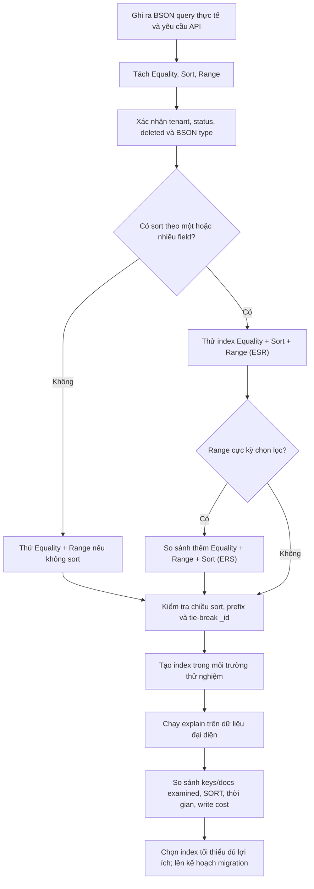

# Thiết kế chỉ mục theo điều kiện bằng, sắp xếp và khoảng giá trị

Trong ứng dụng dùng **Spring Data MongoDB**, truy vấn thường không chỉ tìm theo một field. Trang quản trị đơn hàng có thể cần **lọc theo tenant và trạng thái**, **sắp xếp theo thời gian mới nhất**, rồi chỉ lấy những đơn có **tổng tiền trong một khoảng**. Một index đơn trên `status` hoặc `totalAmount` có thể chưa đủ để hỗ trợ đồng thời bộ lọc và thứ tự kết quả.

MongoDB hỗ trợ **compound index** (chỉ mục ghép) với nhiều khóa có thứ tự. Việc chọn **field nào đứng trước**, **field nào đứng sau**, và **chiều tăng/giảm** có thể quyết định liệu query dùng index để đọc đúng phạm vi và trả dữ liệu đã sắp, hay phải quét nhiều khóa, đọc nhiều document và sắp xếp bổ sung.

Quy tắc khởi đầu được MongoDB khuyến nghị thường gọi là **ESR — Equality, Sort, Range**:

- **E — Equality:** các field so sánh bằng, chẳng hạn `tenantId = T1`, `status = PAID`, `deleted = false`.
- **S — Sort:** các field mà query cần sắp xếp, chẳng hạn `createdAt DESC, _id DESC`.
- **R — Range:** các field có điều kiện khoảng, chẳng hạn `totalAmount >= 100`.

ESR là **heuristic để thiết kế và đánh giá**, không phải quy tắc buộc mọi index phải tuân thủ bất kể workload. Nếu điều kiện range cực kỳ chọn lọc, một index theo thứ tự **Equality–Range–Sort (ERS)** có thể đáng thử, dù có thể khiến MongoDB phải sort kết quả sau khi lọc. Quyết định cuối cùng cần dựa trên **query shape, dữ liệu thực tế và `explain("executionStats")`**.

Bài thuộc chương **Chỉ mục** của module **SPRING_DATA_MONGODB**: dùng Spring Data MongoDB để kết nối, ánh xạ document và truy vấn qua repository/`MongoTemplate`, thực hành index, kiểm thử và chẩn đoán hiệu năng. Trọng tâm là **thiết kế compound index theo điều kiện bằng, sắp xếp và khoảng giá trị**, từ BSON query đến cách triển khai và kiểm chứng trong Java.

Sau khi học, bạn có thể:

1. Đọc một query MongoDB và phân loại các predicate thành equality, range và sort.
2. Giải thích tác động của **thứ tự field** và **hướng sort** trong compound index.
3. Đề xuất index theo ESR, so sánh với ERS khi điều kiện khoảng có tính chọn lọc cao.
4. Nhận diện trường hợp index hỗ trợ sort và trường hợp MongoDB cần stage `SORT`.
5. Thiết kế index cho truy vấn nhiều tenant, soft delete, phân trang và lọc thời gian.
6. Phân biệt compound index, partial index, multikey index và covered query.
7. Tạo index qua `mongosh`, annotation Spring Data hoặc `MongoTemplate.indexOps(...)`.
8. Kiểm tra kết quả truy vấn bằng integration test và đánh giá kế hoạch thực thi bằng `explain`.

## 1. Bài toán: lọc đơn hàng, sắp theo thời gian, chọn theo giá

Giả sử collection `orders_index_lab` có document:

```javascript
{
  _id: ObjectId("665f1f2a4b6c7d8e9f001234"),
  tenantId: "T1",
  status: "PAID",
  deleted: false,
  createdAt: ISODate("2026-11-20T10:00:00Z"),
  totalAmount: NumberDecimal("150.00"),
  customerId: "C-101"
}
```

Ứng dụng có endpoint:

```text
GET /orders?status=PAID&minAmount=100&sort=createdAt:desc&limit=20
```

Tenant **không được tin từ query string của client**; ví dụ service lấy `trustedTenantId` từ ngữ cảnh đã xác thực.

Truy vấn tương đương:

```javascript
db.orders_index_lab.find({
  tenantId: "T1",
  status: "PAID",
  deleted: false,
  totalAmount: { $gte: NumberDecimal("100.00") }
})
.sort({ createdAt: -1, _id: -1 })
.limit(20);
```

Phân loại:

| Thành phần | Field | Loại | Ý nghĩa |
| --- | --- | --- | --- |
| `tenantId: "T1"` | `tenantId` | Equality | Giới hạn phạm vi tenant |
| `status: "PAID"` | `status` | Equality | Chỉ lấy đơn đã thanh toán |
| `deleted: false` | `deleted` | Equality | Loại đơn đã xóa mềm |
| `sort({createdAt:-1,_id:-1})` | `createdAt`, `_id` | Sort | Mới nhất trước, tie-break bằng ID |
| `totalAmount: {$gte: 100}` | `totalAmount` | Range | Tổng tiền đạt ngưỡng |

Ứng viên theo ESR:

```javascript
db.orders_index_lab.createIndex(
  {
    tenantId: 1,
    status: 1,
    deleted: 1,
    createdAt: -1,
    _id: -1,
    totalAmount: 1
  },
  { name: "idx_orders_esr" }
);
```

Hình dung thứ tự khóa:

```text
tenantId  status  deleted  createdAt↓   _id↓   totalAmount↑
   E       E       E          S          S          R
```

Index có thể giúp định vị nhóm document của tenant/trạng thái/deleted, đọc theo thứ tự thời gian/ID mong muốn và xét thêm ngưỡng tiền. **Tuy nhiên**, vì điều kiện range ở cuối, query có thể phải duyệt nhiều entry chưa đạt ngưỡng trước khi đủ 20 kết quả. Đó là đánh đổi ESR cần được đo.

## 2. Compound index hoạt động theo thứ tự khóa

### 2.1. Không phải tập hợp field không có thứ tự

Hai index sau **không tương đương**:

```javascript
{ tenantId: 1, status: 1, createdAt: -1 }

{ createdAt: -1, status: 1, tenantId: 1 }
```

Ở index thứ nhất, MongoDB có thể định vị một vùng khóa có cùng `tenantId` và `status`, sau đó đọc `createdAt` theo thứ tự trong vùng ấy.

Ở index thứ hai, khóa được tổ chức ưu tiên `createdAt` trước. Để chỉ lấy một tenant/trạng thái, engine có thể phải xét nhiều khóa thuộc các tenant và trạng thái khác nhau hơn. Index vẫn có thể hữu ích cho workload khác, nhưng không thể coi nó tương đương index thứ nhất chỉ vì chứa cùng ba field.

### 2.2. Quy tắc tiền tố (*leftmost prefix*)

Với index:

```javascript
{ tenantId: 1, status: 1, createdAt: -1 }
```

Các query minh họa:

| Query | Khả năng tận dụng tổ chức khóa |
| --- | --- |
| `{tenantId:"T1"}` | Phù hợp prefix `tenantId` |
| `{tenantId:"T1",status:"PAID"}` | Phù hợp prefix hai field |
| `{tenantId:"T1",status:"PAID"}` + sort `createdAt DESC` | Có cơ hội dùng thứ tự index |
| `{status:"PAID"}` | Bỏ qua field đầu; không có cùng lợi thế giới hạn prefix |
| `{createdAt:{$gte:date}}` | Không có equality prefix; cần đo kế hoạch thực tế |
| `{tenantId:"T1",createdAt:{$gte:date}}` | Có thể dùng prefix tenant, nhưng status nằm giữa ảnh hưởng việc dùng bound/sort ở field sau |

Nói “không thỏa prefix” **không có nghĩa query chắc chắn không thể dùng index dưới mọi engine và phiên bản**. MongoDB planner có nhiều lựa chọn và tối ưu khác nhau. Quy tắc tiền tố giúp bạn **dự đoán khả năng sử dụng hiệu quả**, sau đó xác minh bằng explain.

### 2.3. Equality trước vì giúp khoanh vùng khóa

Với:

```javascript
{
  tenantId: "T1",
  status: "PAID",
  deleted: false
}
```

index:

```javascript
{ tenantId: 1, status: 1, deleted: 1, createdAt: -1 }
```

giữ các đơn khớp nhóm equality cùng nhau, giúp duyệt tiếp theo thứ tự thời gian.

Nếu query có equality trên cả ba field, thứ tự **tương đối** giữa các equality field thường có thể được thay đổi mà vẫn giữ mục tiêu ESR cho query cụ thể đó. Tuy nhiên, không nên chọn thứ tự tùy tiện:

- Nếu nhiều endpoint **chỉ lọc tenant** thì `tenantId` là prefix quan trọng.
- Nếu các endpoint khác lọc `tenantId + status` nhưng không lọc `deleted`, thứ tự `tenantId, status, deleted` có thể phục vụ tốt hơn index `tenantId, deleted, status` cho nhóm query ấy.
- Cardinality/độ chọn lọc, ràng buộc unique, partial filter và các query shape khác đều cần xét.
- Đừng tự suy ra “field có cardinality cao nhất phải luôn đứng đầu” khi equality đầy đủ đã giới hạn vùng và mục tiêu còn là sort/prefix.

### 2.4. Range khác equality như thế nào?

Một điều kiện:

```javascript
{ totalAmount: { $gte: NumberDecimal("100.00") } }
```

thường giới hạn một **khoảng khóa**, không xác định một giá trị duy nhất. Nếu đặt range trước các field sort:

```javascript
{ tenantId: 1, status: 1, deleted: 1, totalAmount: 1, createdAt: -1 }
```

engine có thể tìm phần tử trong khoảng tiền hiệu quả, nhưng các entry nằm ở **nhiều giá trị totalAmount khác nhau**. Thứ tự `createdAt` bên trong từng nhóm amount không tự tạo thành thứ tự `createdAt` toàn cục. Do đó sort theo createdAt thường cần bước xử lý bổ sung, tùy query và kế hoạch.

## 3. Quy tắc ESR: Equality → Sort → Range

### 3.1. Tại sao field sort thường đứng trước range?

Với một nhóm equality đã xác định (`tenantId/status/deleted`), ta muốn lấy 20 đơn mới nhất mà tổng tiền trên 100.

Index ESR:

```javascript
{
  tenantId: 1,
  status: 1,
  deleted: 1,
  createdAt: -1,
  _id: -1,
  totalAmount: 1
}
```

Trong vùng có cùng ba equality, các entry đã theo `createdAt DESC, _id DESC`. MongoDB có thể duyệt theo thứ tự ấy và loại những document chưa đạt amount. Nếu đủ điều kiện tối ưu, điều này giúp tránh một **blocking sort** riêng cho kết quả.

Với query có `limit(20)` và khá nhiều đơn vượt ngưỡng, engine có cơ hội dừng sau khi tìm đủ 20 kết quả mà không phải gom/sort toàn bộ tập ứng viên.

**Đánh đổi:** nếu rất ít đơn vượt ngưỡng, index ESR có thể phải duyệt rất nhiều entry để tìm đủ 20 hoặc duyệt hết nhóm. ESR có lợi thế thứ tự, không có nghĩa nó luôn kiểm tra ít khóa nhất.

**Một chi tiết quan trọng trong ví dụ:** `_id` là khóa duy nhất và đứng trước `totalAmount` trong index ESR để phục vụ tie-breaker của sort. Do đó `totalAmount` ở **sau `_id`** thường **không tạo được khoảng quét hiệu quả**; lợi ích của nó nếu có chủ yếu là có sẵn giá trị trong index để đánh giá filter/cover trong những kế hoạch thích hợp. Không nên mặc định index dài này tốt hơn phiên bản chỉ có equality + `createdAt` + `_id`. Hãy thử **cả index ngắn** và ERS, không chỉ hai ứng viên dài, rồi so sánh `totalKeysExamined`, `totalDocsExamined`, sort và chi phí ghi. Quy tắc ESR không đảm bảo field range cuối luôn giúp giảm số entry phải xét.

### 3.2. Khi nào thử ERS?

Index theo Equality → Range → Sort:

```javascript
{
  tenantId: 1,
  status: 1,
  deleted: 1,
  totalAmount: 1,
  createdAt: -1,
  _id: -1
}
```

Với điều kiện `totalAmount >= 100000` mà chỉ một phần rất nhỏ đơn hàng đạt, ERS có thể loại phần lớn dữ liệu ngay khi quét range. Engine sau đó xử lý sort trên một tập nhỏ hơn.

| Tình huống | ESR đáng thử | ERS đáng thử |
| --- | --- | --- |
| Lấy 20 đơn mới nhất, phần lớn đơn đạt ngưỡng | Có; có lợi thế đọc theo sort | Có thể tốn sort không cần thiết |
| Ngưỡng cực cao, chỉ ít đơn đạt | Có thể quét nhiều entry trước khi đủ kết quả | Có thể lọc bằng range rất hẹp |
| Không có `sort` | Không có nhu cầu đặt S trước R | Equality + Range thường là điểm xuất phát |
| Điều kiện range trùng field sort | Có thể tận dụng cùng một khóa | Không nhất thiết có lựa chọn ESR/ERS khác nhau |
| Query thay đổi sort liên tục | Một index cố định khó tối ưu mọi kiểu | Cân nhắc các query shape chính và số index hợp lý |

**Không có ngưỡng “range chọn lọc cao” cố định cho mọi collection.** Quyết định dựa trên số khóa/document thực sự xét, thời gian, memory/sort stage và mức tải ghi.

### 3.3. Range có thể nằm ngay trên field sort

Ví dụ tìm đơn PAID mới nhất trong khoảng thời gian:

```javascript
db.orders_index_lab.find({
  tenantId: "T1",
  status: "PAID",
  deleted: false,
  createdAt: {
    $gte: ISODate("2026-11-01T00:00:00Z"),
    $lt: ISODate("2026-12-01T00:00:00Z")
  }
})
.sort({ createdAt: -1, _id: -1 })
.limit(20);
```

Ở đây `createdAt` vừa là **range field** vừa là field sort chính. Index:

```javascript
{ tenantId: 1, status: 1, deleted: 1, createdAt: -1, _id: -1 }
```

có thể giới hạn khoảng thời gian trên cùng khóa đã được sắp theo `createdAt`, rồi dùng `_id` làm tie-breaker. Không cần cố thêm một bản sao `createdAt` vào compound index dưới hai vị trí “R” và “S” khác nhau.

## 4. Thứ tự sort và chiều của index

### 4.1. Chiều `1` và `-1`

Trong index:

```javascript
{ createdAt: -1, _id: -1 }
```

- `1` biểu thị thứ tự tăng dần theo khóa.
- `-1` biểu thị thứ tự giảm dần.
- Với một trường hợp có **chỉ một field sort**, MongoDB có thể quét index theo cả chiều thuận và ngược khi phù hợp.
- Với **nhiều field sort**, quan hệ giữa các chiều trên từng field quan trọng.

Ví dụ:

```javascript
db.orders_index_lab.createIndex(
  { tenantId: 1, price: 1, createdAt: -1 },
  { name: "idx_tenant_price_asc_created_desc" }
);
```

Nếu đã cố định `tenantId = "T1"`, index trên có thể phục vụ thứ tự:

```javascript
// Theo cùng chiều khai báo.
.sort({ price: 1, createdAt: -1 })

// Theo chiều đảo ngược của cả hai field.
.sort({ price: -1, createdAt: 1 })
```

Nhưng:

```javascript
// Không phải cùng mẫu chiều, cũng không phải đảo đồng thời.
.sort({ price: 1, createdAt: 1 })
```

không tự được phục vụ hoàn chỉnh bởi cùng thứ tự index ở trên. MongoDB có thể cần sort bổ sung hoặc chọn index khác.

### 4.2. Equality field không nhất thiết phải xuất hiện trong sort

Index:

```javascript
{ tenantId: 1, status: 1, createdAt: -1, _id: -1 }
```

Query:

```javascript
db.orders_index_lab.find({
  tenantId: "T1",
  status: "PAID"
})
.sort({ createdAt: -1, _id: -1 });
```

Hai field đầu được **cố định bằng equality**, nên sort trên các field kế tiếp có thể tận dụng thứ tự của index.

Ngược lại, nếu query chỉ có `tenantId = "T1"` nhưng **không cố định `status`**, index sắp xếp trước theo status và chỉ sau đó theo createdAt. Nó không đảm bảo thứ tự `createdAt DESC` **trên tất cả status**. Đây là lý do “bỏ qua một field giữa prefix và sort” thường làm mất khả năng dùng index sort toàn phần.

### 4.3. Thứ tự field trong `sort` phải phù hợp

Với:

```javascript
{ tenantId: 1, status: 1, createdAt: -1, _id: -1 }
```

query `sort({createdAt:-1,_id:-1})` có lợi thế rõ ràng sau khi cố định hai equality field. Query `sort({_id:-1,createdAt:-1})` không tương đương: thứ tự ưu tiên của hai khóa đảo nhau. Nếu API có nhiều kiểu sắp xếp, bạn cần xác định kiểu phổ biến và index tương ứng, không thể kỳ vọng một index hỗ trợ mọi thứ tự hoán vị.

### 4.4. Tại sao nên thêm `_id` làm tie-breaker?

Hai order có cùng `createdAt`:

```text
Order D: 2026-11-20T11:00:00Z
Order I: 2026-11-20T11:00:00Z
```

Nếu chỉ sort `createdAt DESC`, thứ tự giữa D và I **không được đảm bảo** qua mọi lần đọc hoặc khi planner thay đổi. Thêm `_id DESC`:

```javascript
.sort({ createdAt: -1, _id: -1 })
```

tạo một thứ tự xác định miễn `_id` là duy nhất. Điều này đặc biệt quan trọng với **pagination** khi cần tránh trùng hoặc bỏ sót record giữa hai trang.

**Lưu ý:** `_id` của MongoDB thường là ObjectId nhưng không nên diễn giải nó như “timestamp chính xác của nghiệp vụ”. Sắp xếp theo createdAt trước, dùng `_id` chỉ để phá hòa; ObjectId chứa một thành phần thời gian nhưng không thay thế field thời gian nghiệp vụ.

## 5. Phân trang: `skip/limit` và keyset pagination

### 5.1. `skip` có thể trở nên đắt với trang sâu

Truy vấn:

```javascript
db.orders_index_lab.find({
  tenantId: "T1",
  status: "PAID",
  deleted: false
})
.sort({ createdAt: -1, _id: -1 })
.skip(100000)
.limit(20);
```

có thể vẫn cần duyệt/bỏ qua lượng lớn entry trước khi trả 20 kết quả. Index phù hợp giúp tránh sort hoặc lọc rộng, nhưng **không làm chi phí bỏ qua trang sâu biến mất**. Với cursor-based API, hãy cân nhắc **keyset pagination**.

### 5.2. Cursor theo hai khóa `createdAt` và `_id`

Giả sử trang trước kết thúc ở:

```javascript
const lastCreatedAt = ISODate("2026-11-20T11:00:00Z");
const lastId = ObjectId("665f1f2a4b6c7d8e9f001234");
```

Để lấy những record **sau** cursor theo thứ tự giảm dần:

```javascript
db.orders_index_lab.find({
  tenantId: "T1",
  status: "PAID",
  deleted: false,
  $or: [
    { createdAt: { $lt: lastCreatedAt } },
    {
      createdAt: lastCreatedAt,
      _id: { $lt: lastId }
    }
  ]
})
.sort({ createdAt: -1, _id: -1 })
.limit(20);
```

Đây là điều kiện từ thứ tự từ điển trên cặp `(createdAt, _id)`:

```text
createdAt < lastCreatedAt
    OR
(createdAt = lastCreatedAt AND _id < lastId)
```

Tenant/status/deleted nằm **bên ngoài `$or`**, nên tất cả nhánh đều giữ cùng phạm vi. Nếu đưa tenant chỉ vào nhánh thứ nhất, nhánh còn lại có thể trả dữ liệu tenant khác — lỗi nghiêm trọng hơn sai hiệu năng.

Index:

```javascript
{
  tenantId: 1,
  status: 1,
  deleted: 1,
  createdAt: -1,
  _id: -1
}
```

là một ứng viên tốt để thử cho cursor query này. Nhưng hiệu quả thực tế của `$or`/range/cursor còn phụ thuộc planner; kiểm tra `explain` trên tập dữ liệu đại diện.

### 5.3. Cursor không phải snapshot bất biến

Keyset pagination giải quyết vấn đề hiệu suất trang sâu và thứ tự tie-breaker, nhưng **không tự đóng băng dữ liệu** giữa hai HTTP requests. Nếu một document mới được chèn hoặc field sort thay đổi giữa các lần đọc, kết quả vẫn có thể biến động theo hợp đồng dữ liệu. Cần quy định rõ consistency và điều kiện bất biến của khóa cursor; không mặc định một cursor bằng hai field tương đương transaction snapshot.

### 5.4. Khi thêm range `totalAmount` vào cursor

Bạn có thể thêm:

```javascript
totalAmount: { $gte: NumberDecimal("100.00") }
```

vào cùng filter cursor. Khi ấy, ESR index `tenantId/status/deleted/createdAt/_id/totalAmount` vẫn giữ cơ hội đọc theo thứ tự cursor, nhưng có thể xét nhiều record không đạt ngưỡng. ERS có thể lọc tiền sớm, đổi lại khả năng sort/cursor có thể kém hơn. Hãy đo cả `keysExamined` và thời gian truy vấn cho những trang thực sự được sử dụng.

## 6. Những query shape thường gặp và lựa chọn index

Không nên tạo index chỉ bằng cách nhìn danh sách field xuất hiện trong một API. Trước tiên hãy phân loại **query shape** (những cấu trúc filter/sort/lựa chọn trường có ý nghĩa tương tự).

| Query shape | Filter/sort | Index ứng viên |
| --- | --- | --- |
| Tra cứu đơn theo ID | `_id`, thêm tenant kiểm tra quyền | Index `_id` mặc định thường là điểm xuất phát |
| Danh sách mới nhất | `tenantId,status,deleted` + `createdAt↓,_id↓` | `{tenantId:1,status:1,deleted:1,createdAt:-1,_id:-1}` |
| Danh sách mới nhất và amount ≥ ngưỡng | Equality trên tenant/status/deleted, sort thời gian, range amount | ESR hoặc ERS để so sánh bằng explain |
| Danh sách trong khoảng ngày | Equality + createdAt range + sort createdAt↓,_id↓ | `{tenantId:1,status:1,deleted:1,createdAt:-1,_id:-1}` |
| Tìm theo tenant và customerId | Equality trên tenant/customerId | `{tenantId:1,customerId:1}` nếu workload chứng minh cần |
| Lọc khoảng tiền, **không sort** | Equality + amount range | `{tenantId:1,status:1,deleted:1,totalAmount:1}` |
| Sort theo amount↓, createdAt↓ | Equality + sort amount/createdAt | Index có cùng pattern sort sau equality |

Một index dài có thể hỗ trợ vài query shape thông qua prefix, nhưng **không phải “index càng nhiều field càng tốt”**. Thêm field làm index lớn hơn, tăng chi phí ghi và có thể làm workload khác dùng index khác hiệu quả hơn. Hãy ưu tiên số lượng nhỏ các index phục vụ những đường truy cập thực tế, sau đó quan sát truy vấn trước khi thêm index thứ hai, thứ ba.

## 7. Các điều kiện làm thay đổi cách áp dụng ESR

### 7.1. `$in` không nên được xem là equality thuần trong mọi trường hợp

```javascript
{
  tenantId: "T1",
  status: { $in: ["PAID", "SHIPPED"] }
}
```

`$in` diễn đạt nhiều giá trị. Với query có sort và index, MongoDB có thể dùng những chiến lược như xét nhiều khoảng khóa, sắp xếp/merge theo kế hoạch thực thi. Khi số phần tử trong `$in` lớn, hành vi tối ưu có thể khác và thay đổi theo phiên bản MongoDB.

Vì vậy, **không giả định `$in` luôn tương đương một `status = giá_trị_cố_định`** trong việc dùng index sort. Tránh hardcode một số lượng phần tử `$in` mang tính “ngưỡng bất biến”; đọc tài liệu đúng phiên bản và đo explain của query thực tế.

### 7.2. `$ne`, `$nin` và regex không tiền tố

Những điều kiện như:

```javascript
{ status: { $ne: "CANCELLED" } }
{ status: { $nin: ["CANCELLED", "FAILED"] } }
{ customerName: { $regex: "hoa", $options: "i" } }
```

thường không có tính chọn lọc/khoảng khóa đơn giản như một equality. Regex tìm “chứa ở bất kỳ vị trí” và case-insensitive có thể không tận dụng index B-tree hiệu quả như một so khớp prefix phù hợp. Những điều kiện này cần được đánh giá riêng, không máy móc đưa chúng vào nhóm E.

### 7.3. `$or` tạo nhiều nhánh

```javascript
{
  tenantId: "T1",
  deleted: false,
  $or: [
    { status: "PAID" },
    { totalAmount: { $gte: NumberDecimal("10000") } }
  ]
}
```

Hai nhánh có cấu trúc khác nhau. MongoDB có thể cần các index khác nhau để tối ưu từng nhánh hoặc chọn chiến lược khác. Đừng chỉ thiết kế một index ESR duy nhất cho cả `$or` mà không xem query plan.

**Bảo mật:** để điều kiện tenant và soft delete bên ngoài `$or` nếu chúng phải áp dụng cho toàn bộ query. Index không sửa được lỗi logic hoặc lỗi phân quyền trong predicate.

### 7.4. `$expr` so sánh hai field

```javascript
{ $expr: { $gt: ["$totalAmount", "$paidAmount"] } }
```

đánh giá hai giá trị thay đổi theo từng document, không tương đương một điều kiện amount > hằng số. Một index trên `totalAmount` không tự biến phép so sánh hai field thành một range liên tục đơn giản. Có thể dùng các equality khác để thu hẹp tập ứng viên, hoặc cân nhắc field dẫn xuất được cập nhật nhất quán nếu truy vấn này rất phổ biến.

## 8. Partial index cho dữ liệu xóa mềm

Nếu phần lớn endpoint chỉ đọc document chưa xóa mềm, bạn có thể cân nhắc **partial index** chỉ lưu entry của document đạt một điều kiện cố định, ví dụ `deleted = false`.

### 8.1. Index đầy đủ và partial index

Index đầy đủ:

```javascript
db.orders_index_lab.createIndex(
  {
    tenantId: 1,
    status: 1,
    deleted: 1,
    createdAt: -1,
    _id: -1
  },
  { name: "idx_orders_visible_full" }
);
```

Ứng viên partial index:

```javascript
db.orders_index_lab.createIndex(
  {
    tenantId: 1,
    status: 1,
    createdAt: -1,
    _id: -1
  },
  {
    name: "idx_orders_visible_partial",
    partialFilterExpression: { deleted: false }
  }
);
```

Với partial index, chỉ các document thỏa `deleted: false` được đưa vào index. Nếu lượng dữ liệu đã xóa mềm đáng kể, index này có thể nhỏ hơn và giảm chi phí lưu trữ/ghi so với index đầy đủ cùng mục tiêu đọc.

Tuy nhiên, **index chỉ chứa tập con** nên MongoDB không được dùng nó để trả kết quả không đầy đủ. Query phải chứa điều kiện phù hợp với partial filter (hoặc có các điều kiện ngụ ý rõ tập kết quả thuộc partial filter) thì planner mới có thể dùng nó một cách đúng đắn.

Ví dụ phù hợp:

```javascript
db.orders_index_lab.find({
  tenantId: "T1",
  status: "PAID",
  deleted: false
})
.sort({ createdAt: -1, _id: -1 });
```

Query **không** lọc `deleted`:

```javascript
db.orders_index_lab.find({
  tenantId: "T1",
  status: "PAID"
});
```

có thể cần cả record deleted=true và deleted=false, nên **không thể coi partial index chỉ chứa deleted=false là nguồn dữ liệu đầy đủ**.

### 8.2. Partial index không tự thêm điều kiện nghiệp vụ

Nếu service **quên** `deleted: false`, việc tạo partial index không làm MongoDB tự bổ sung điều kiện đó vào query. Partial index chỉ thay đổi tập entry lưu trong index và khả năng planner chọn index; nó **không thay thế bộ lọc quyền truy cập hoặc soft delete của ứng dụng**.

Khi lựa chọn partial index, kiểm tra cả các job đọc dữ liệu đã xóa, audit, khôi phục và công cụ quản trị. Chúng có thể cần index khác hoặc chấp nhận kế hoạch quét khác; không được sử dụng partial index như lý do làm mất khả năng truy vấn dữ liệu phục hồi.

### 8.3. Đừng tạo nhiều biến thể chỉ số trùng lặp

Nếu bạn đã có `idx_orders_visible_full`, một partial index gần giống có thể giúp một nhóm query nhưng cũng làm tăng overhead khi ghi document chưa xóa. Trước khi tạo cả hai:

1. Liệt kê query shape cần index đầy đủ và query shape chỉ đọc deleted=false.
2. Đo kích thước tập dữ liệu thuộc từng nhóm.
3. So sánh explain trên hệ thống thử nghiệm có dữ liệu đại diện.
4. Đánh giá chi phí cập nhật index và lưu trữ bổ sung.
5. Xem xét migration/gỡ bỏ index thừa theo quy trình vận hành.

Không tạo cả hai chỉ vì chúng được minh họa trong một tài liệu.

## 9. Collation và kiểu dữ liệu ảnh hưởng đến hiệu quả index

### 9.1. Index với collation đặc biệt

Giả sử tìm khách hàng theo tên không phân biệt hoa thường. MongoDB hỗ trợ **collation**, nhưng index có collation và query cần tương thích để sử dụng khả năng so sánh/sort theo quy tắc đó cho các field String.

Ví dụ minh họa:

```javascript
db.orders_index_lab.createIndex(
  { tenantId: 1, customerName: 1 },
  {
    name: "idx_tenant_customer_name_vi",
    collation: { locale: "vi", strength: 2 }
  }
);
```

Một query cần quy tắc đối chiếu phù hợp:

```javascript
db.orders_index_lab.find({
  tenantId: "T1",
  customerName: "hoa"
})
.collation({ locale: "vi", strength: 2 });
```

Index không được mặc định dùng cho mọi truy vấn string có một collation khác. Khi dùng index kết hợp field số và String, một số phần prefix không phải String có thể vẫn hữu ích theo điều kiện riêng, nhưng đừng giả định sort/equality chuỗi vẫn được tối ưu nếu collation không phù hợp.

**Lưu ý:** yêu cầu tìm tên người trong sản phẩm thường có quy tắc locale/chuẩn hóa riêng; không chọn một collation chỉ vì ví dụ. Kiểm tra semantics thực tế về dấu tiếng Việt, hoa thường, sức mạnh so sánh và phiên bản MongoDB.

### 9.2. Decimal128, Double và String

Với tiền tệ, những BSON values sau **khác bản chất**:

```javascript
{ totalAmount: NumberDecimal("100.00") }
{ totalAmount: 100.0 }
{ totalAmount: "100.00" }
```

Decimal128, Double và String không nên bị trộn không kiểm soát trong collection có query khoảng tiền. Đặc biệt, nếu tiền được lưu dưới String, filter `$gte: NumberDecimal("100")` không thể được coi là phép so sánh số học trên các chuỗi tiền đó.

MongoDB có các quy tắc so sánh/ordering của BSON type, còn Spring Data có converter/mapping riêng. Với `BigDecimal`, hãy quy định rõ target BSON type (chẳng hạn `FieldType.DECIMAL128`) và kiểm tra dữ liệu cũ trước khi đánh giá index range.

**Không xử lý sai schema bằng cách chỉ thêm index.** Nếu dữ liệu đã sai kiểu, một index được tạo rất nhanh vẫn không làm so sánh tiền đúng.

### 9.3. String ngày giờ không thay thế BSON Date

`createdAt` nên được lưu thành **BSON Date** (ví dụ ánh xạ Java `Instant`) khi ý nghĩa là thời điểm. Nếu một số document chứa String `"20/11/2026"` và số khác chứa BSON Date, sắp xếp/range theo ngày có thể cho kết quả sai về mặt nghiệp vụ.

Đồng thời, khi dùng ngày theo giờ địa phương, tính mốc UTC chính xác tại lớp ứng dụng rồi bind dưới kiểu Date/Instant. Tránh đưa một String không kèm timezone vào index query và mong MongoDB tự hiểu múi giờ nghiệp vụ.

## 10. Multikey index khi field là array

Nếu order có array `tags` hoặc `items`, index trên field array trở thành **multikey index** trong các trường hợp tương ứng.

```javascript
{
  tenantId: "T1",
  tags: ["priority", "fragile"],
  createdAt: ISODate("2026-11-20T10:00:00Z")
}
```

Ví dụ:

```javascript
db.orders_index_lab.createIndex(
  { tenantId: 1, tags: 1, createdAt: -1 },
  { name: "idx_tenant_tags_created" }
);
```

Một order có nhiều tag có thể đóng góp nhiều index entry. Index này có thể hữu ích khi lọc:

```javascript
db.orders_index_lab.find({
  tenantId: "T1",
  tags: "priority"
})
.sort({ createdAt: -1 });
```

Nhưng **không suy ra quy tắc ESR cho scalar áp dụng nguyên xi** khi một khóa là array:

- Multikey index tạo nhiều entry cho một document.
- Việc index có thể hỗ trợ sort khi có array phụ thuộc bounds và quan hệ field path; có những trường hợp vẫn cần blocking sort.
- MongoDB có giới hạn đối với **compound multikey index** khi nhiều field khóa là array ở cùng document.
- Index có thể làm tăng chi phí ghi khi thay đổi mảng dài.
- Covered queries với multikey có giới hạn, đặc biệt khi cần trả chính field array.

Nếu API chỉ lọc theo tenant/tag và sort theo thời gian, hãy đo query shape đó riêng. Không tự gán `tags` vào nhóm equality một cách vô điều kiện khi document có nhiều phần tử.

### 10.1. Array embedded document và `$elemMatch`

Với `items` là array của các object:

```javascript
items: [
  { sku: "BK-01", quantity: 3 },
  { sku: "PEN-01", quantity: 0 }
]
```

Nếu cần một **phần tử duy nhất** đồng thời có `sku = BK-01` và `quantity > 0`, query nên thể hiện rõ:

```javascript
db.orders_index_lab.find({
  tenantId: "T1",
  items: {
    $elemMatch: {
      sku: "BK-01",
      quantity: { $gt: 0 }
    }
  }
});
```

Việc dùng hai dotted predicates độc lập mà không `$elemMatch` có thể để điều kiện được thỏa bởi các **phần tử khác nhau** trong array. Đây là lỗi tính đúng đắn của query, không phải lỗi index; thêm compound multikey index không tự sửa logic `$elemMatch`.

## 11. Covered query và projection

Một query có thể gọi là **covered** khi MongoDB trả kết quả từ các index entry mà không cần đọc document nguồn, theo các điều kiện của query/index và phiên bản.

Ví dụ xét index:

```javascript
{ tenantId: 1, status: 1, createdAt: -1, _id: -1 }
```

Query chỉ trả các field trong index:

```javascript
db.orders_index_lab.find(
  { tenantId: "T1", status: "PAID" },
  { _id: 1, tenantId: 1, status: 1, createdAt: 1 }
)
.sort({ createdAt: -1, _id: -1 });
```

có khả năng được đáp ứng phần lớn hoặc toàn bộ từ index trong điều kiện phù hợp. Khi đọc explain, `totalDocsExamined = 0` là dấu hiệu quan trọng của kế hoạch covered query; không phải chỉ cần thấy `IXSCAN` là query đã covered.

Nếu projection thêm `customerName` mà field này **không có trong index**, engine thường cần lấy document thực để trả field đó. Nếu `_id` mặc định được trả nhưng không nằm trong index đang xét, nó cũng có thể làm mất covered behavior; chủ động định nghĩa projection.

**Đừng** biến mọi index thành “cover toàn bộ DTO” bằng cách thêm hàng chục field chỉ để tránh FETCH. Compound index quá rộng ảnh hưởng kích thước, bộ nhớ và hiệu năng ghi. Chỉ cân nhắc covered query cho workload nóng đã được đo.

## 12. Không đánh đồng index intersection với compound index

Giả sử đã có:

```javascript
{ tenantId: 1 }
{ status: 1 }
{ createdAt: -1 }
```

MongoDB có thể xem xét các chiến lược kế hoạch với một hoặc nhiều index tùy query. Nhưng ba index đơn **không tự đồng nghĩa** có một compound index:

```javascript
{ tenantId: 1, status: 1, createdAt: -1 }
```

Compound index lưu thứ tự khóa nhiều field **trong cùng một cấu trúc**, điều đặc biệt có giá trị khi query cần vừa equality prefix vừa sort theo khóa sau đó. Index intersection có chi phí/giới hạn riêng và không phải cách bảo đảm thứ tự sort tổng hợp. Dùng `explain` để xem planner thực sự làm gì.

## 13. Spring Data MongoDB: ánh xạ entity và tạo chỉ mục

Spring Data MongoDB cung cấp annotation để khai báo index trên entity và API `MongoTemplate.indexOps(...)` để quản lý index bằng Java. Nhưng **khai báo annotation không đồng nghĩa index đã tồn tại trên MongoDB**: việc tự động tạo index còn phụ thuộc cấu hình ứng dụng và phiên bản Spring Data.

### 13.1. Entity cho ví dụ

```java
import java.math.BigDecimal;
import java.time.Instant;
import org.bson.types.ObjectId;
import org.springframework.data.annotation.Id;
import org.springframework.data.mongodb.core.index.CompoundIndex;
import org.springframework.data.mongodb.core.mapping.Document;
import org.springframework.data.mongodb.core.mapping.Field;
import org.springframework.data.mongodb.core.mapping.FieldType;

@Document(collection = "orders_index_lab")
@CompoundIndex(
    name = "idx_orders_tenant_status_deleted_time_id",
    def = "{ 'tenantId': 1, 'status': 1, 'deleted': 1, " +
          " 'createdAt': -1, '_id': -1 }"
)
public class IndexedOrder {
    @Id
    private ObjectId id;

    private String labRun;
    private String tenantId;
    private String status;
    private boolean deleted;
    private String customerId;
    private Instant createdAt;

    @Field(targetType = FieldType.DECIMAL128)
    private BigDecimal totalAmount;

    protected IndexedOrder() {}

    public IndexedOrder(
            String labRun,
            String tenantId,
            String status,
            boolean deleted,
            String customerId,
            Instant createdAt,
            BigDecimal totalAmount) {
        this.labRun = labRun;
        this.tenantId = tenantId;
        this.status = status;
        this.deleted = deleted;
        this.customerId = customerId;
        this.createdAt = createdAt;
        this.totalAmount = totalAmount;
    }

    public ObjectId getId() { return id; }
    public String getLabRun() { return labRun; }
    public String getTenantId() { return tenantId; }
    public String getStatus() { return status; }
    public boolean isDeleted() { return deleted; }
    public String getCustomerId() { return customerId; }
    public Instant getCreatedAt() { return createdAt; }
    public BigDecimal getTotalAmount() { return totalAmount; }
}
```

`@CompoundIndex` mô tả compound index với field equality rồi sort. Ở annotation, `_id` là **tên BSON thật** của ID, còn `@Id ObjectId id` trong Java ánh xạ vào `_id`.

Đây là một lựa chọn index theo query shape hiển thị danh sách mới nhất; nếu hệ thống chủ yếu truy vấn range `totalAmount` cực chọn lọc, cần cân nhắc index ERS riêng hoặc thay lựa chọn thay vì tạo vô hạn index.

### 13.2. Vì sao dùng Decimal128 cho `BigDecimal`?

```java
@Field(targetType = FieldType.DECIMAL128)
private BigDecimal totalAmount;
```

Metadata này định hướng Spring Data lưu giá trị tiền thành BSON Decimal128, phù hợp khi query theo khoảng số tiền. Nếu chỉ khai báo Java `BigDecimal`, **không mặc định suy ra mọi dữ liệu BSON đều là Decimal128**: converter, metadata field và dữ liệu lịch sử có thể khác nhau.

Kiểm tra bằng raw driver trong integration test và `mongosh`:

```javascript
db.orders_index_lab.aggregate([
  {
    $group: {
      _id: { amountType: { $type: "$totalAmount" } },
      documents: { $sum: 1 }
    }
  }
]);
```

### 13.3. Chế độ tạo index bằng annotation

Spring Data có cơ chế **auto-index creation** có thể được bật/tắt theo cấu hình. Trong nhiều dòng phiên bản Spring Data MongoDB hiện đại, bạn **không nên trông chờ** index được tự tạo chỉ vì có `@CompoundIndex` nếu chưa bật cơ chế này.

Ví dụ property Spring Boot ở những phiên bản hỗ trợ:

```yaml
spring:
  data:
    mongodb:
      auto-index-creation: true
```

Property này phù hợp để minh họa hoặc ứng dụng có chính sách tạo index khi khởi động. Với production, thường nên quản lý index thông qua **migration/triển khai được kiểm soát**, vì một thay đổi index có thể tốn tài nguyên và ảnh hưởng cluster; không nên tự bật tạo index cho mọi entity mà chưa có kế hoạch.

**Kiểm tra phiên bản Spring Boot/Spring Data đang dùng** trước khi chép property và các annotation. Không chạy build tool ở bước soạn Markdown này; phần chạy/QA thuộc bước được điều phối sau.

### 13.4. Tạo index với `MongoTemplate.indexOps(...)`

Spring Data cung cấp:

```java
import org.springframework.data.domain.Sort;
import org.springframework.data.mongodb.core.MongoTemplate;
import org.springframework.data.mongodb.core.index.Index;

public class OrderIndexSetup {
    private final MongoTemplate template;

    public OrderIndexSetup(MongoTemplate template) {
        this.template = template;
    }

    public String ensureListIndex() {
        Index idx = new Index()
            .on("tenantId", Sort.Direction.ASC)
            .on("status", Sort.Direction.ASC)
            .on("deleted", Sort.Direction.ASC)
            .on("createdAt", Sort.Direction.DESC)
            .on("_id", Sort.Direction.DESC)
            .named("idx_orders_tenant_status_deleted_time_id");

        return template.indexOps(IndexedOrder.class)
            .ensureIndex(idx);
    }
}
```

`ensureIndex(...)` là thao tác quản lý index ở database; khác với việc tạo `Query` và chạy find. Nếu index cùng tên đã tồn tại nhưng có định nghĩa hoặc options không tương thích, thao tác có thể lỗi và cần xử lý như một **schema migration**, không đổi tên bừa để tạo thêm bản sao.

**Quan trọng:** trong một codebase thực, hãy chọn một cách quản lý index nhất quán. Ví dụ trên chỉ cho thấy API, không phải chỉ thị gọi `ensureListIndex()` ở mỗi HTTP request.

### 13.5. ERS index bằng `indexOps`

Để **thử nghiệm** hướng đặt range trước sort:

```java
import org.springframework.data.domain.Sort;
import org.springframework.data.mongodb.core.index.Index;

Index ers = new Index()
    .on("tenantId", Sort.Direction.ASC)
    .on("status", Sort.Direction.ASC)
    .on("deleted", Sort.Direction.ASC)
    .on("totalAmount", Sort.Direction.ASC)
    .on("createdAt", Sort.Direction.DESC)
    .on("_id", Sort.Direction.DESC)
    .named("idx_orders_ers");

String name = template.indexOps(IndexedOrder.class)
    .ensureIndex(ers);
```

Chỉ thực hiện đoạn này trong **phương thức/cấu hình quản lý index có `template` hợp lệ**. Nếu dùng cả index ESR và ERS trong lab, hãy nhớ hai index tiêu tốn không gian và cập nhật. Sau khi đo trên workload đại diện, ứng dụng production nên giữ index có lợi ích rõ ràng thay vì giữ tất cả ví dụ trong tài liệu.

### 13.6. Xác minh index thực sự tồn tại

Trong `mongosh`:

```javascript
db.orders_index_lab.getIndexes();
```

Hoặc qua Spring Data:

```java
var indexInfo = template.indexOps(IndexedOrder.class)
    .getIndexInfo();

for (var info : indexInfo) {
    System.out.println(info.getName());
}
```

`getIndexInfo()` cho biết metadata index mà MongoDB đang lưu. Không dùng log application “đã load entity có `@CompoundIndex`” làm bằng chứng index đã được tạo trên server.

## 14. Xây query bằng `MongoTemplate` và `Criteria`

### 14.1. Query danh sách mới nhất

```java
import java.util.List;
import org.springframework.data.domain.Sort;
import org.springframework.data.mongodb.core.MongoTemplate;
import org.springframework.data.mongodb.core.query.Criteria;
import org.springframework.data.mongodb.core.query.Query;

public List<IndexedOrder> recentPaidOrders(
        MongoTemplate template,
        String trustedTenantId,
        int limit) {

    if (trustedTenantId == null || trustedTenantId.isBlank()) {
        throw new IllegalArgumentException("Tenant không hợp lệ");
    }
    if (limit < 1 || limit > 100) {
        throw new IllegalArgumentException("Limit ngoài phạm vi");
    }

    Criteria scope = Criteria.where("tenantId")
        .is(trustedTenantId)
        .and("status").is("PAID")
        .and("deleted").is(false);

    Query query = Query.query(scope)
        .with(Sort.by(
            Sort.Order.desc("createdAt"),
            Sort.Order.desc("id")
        ))
        .limit(limit);

    return template.find(query, IndexedOrder.class);
}
```

`Sort.Order.desc("id")` dùng **Java property** của entity, được mapping sang BSON `_id` trong query dựa trên `IndexedOrder.class`. Ở raw `mongosh`, dùng `_id` trực tiếp. Đây là khác biệt cần nhớ khi so sánh đoạn Java với plan BSON.

### 14.2. Thêm range `totalAmount` nếu có ngưỡng

```java
import java.math.BigDecimal;

public List<IndexedOrder> recentPaidOrdersAtLeast(
        MongoTemplate template,
        String trustedTenantId,
        BigDecimal minimumAmount,
        int limit) {

    if (trustedTenantId == null || trustedTenantId.isBlank()) {
        throw new IllegalArgumentException("Tenant không hợp lệ");
    }
    if (minimumAmount == null || minimumAmount.signum() < 0) {
        throw new IllegalArgumentException("Ngưỡng tiền không hợp lệ");
    }
    if (limit < 1 || limit > 100) {
        throw new IllegalArgumentException("Limit ngoài phạm vi");
    }

    Query query = Query.query(
        Criteria.where("tenantId").is(trustedTenantId)
            .and("status").is("PAID")
            .and("deleted").is(false)
    );

    query.addCriteria(
        Criteria.where("totalAmount").gte(minimumAmount)
    );
    query.with(Sort.by(
        Sort.Order.desc("createdAt"),
        Sort.Order.desc("id")
    ));
    query.limit(limit);

    return template.find(query, IndexedOrder.class);
}
```

Spring Data bind `BigDecimal` theo mapping của `IndexedOrder.totalAmount`, có annotation Decimal128. Không tự chuyển `minimumAmount` sang String `"100.00"` khi mục tiêu là so sánh số; xác minh raw BSON trong test.

### 14.3. Query có thời gian bắt đầu/kết thúc

```java
import java.time.Instant;

public List<IndexedOrder> ordersInPeriod(
        MongoTemplate template,
        String trustedTenantId,
        Instant fromInclusive,
        Instant toExclusive,
        int limit) {

    if (trustedTenantId == null || trustedTenantId.isBlank()
            || fromInclusive == null || toExclusive == null
            || !fromInclusive.isBefore(toExclusive)
            || limit < 1 || limit > 100) {
        throw new IllegalArgumentException("Bộ lọc không hợp lệ");
    }

    Query query = Query.query(
        Criteria.where("tenantId").is(trustedTenantId)
            .and("status").is("PAID")
            .and("deleted").is(false)
            .and("createdAt")
                .gte(fromInclusive)
                .lt(toExclusive)
    )
    .with(Sort.by(
        Sort.Order.desc("createdAt"),
        Sort.Order.desc("id")
    ))
    .limit(limit);

    return template.find(query, IndexedOrder.class);
}
```

Khoảng `[fromInclusive, toExclusive)` giúp ghép các giai đoạn liên tiếp mà không trùng mốc cuối; không cần tự trừ một mili giây từ ngày kết thúc. Khi client gửi ngày theo múi giờ địa phương, service phải chuyển thành các `Instant` phù hợp trước khi gọi repository/template.

### 14.4. Repository derived query và phân trang

Khi query có điều kiện cố định, bạn có thể dùng repository:

```java
import org.bson.types.ObjectId;
import org.springframework.data.domain.Pageable;
import org.springframework.data.domain.Slice;
import org.springframework.data.mongodb.repository.MongoRepository;

public interface IndexedOrderRepository
        extends MongoRepository<IndexedOrder, ObjectId> {

    Slice<IndexedOrder> findByTenantIdAndStatusAndDeletedFalse(
        String tenantId,
        String status,
        Pageable pageable);
}
```

Service truyền `Pageable` với sort `createdAt DESC, id DESC` và page size được giới hạn. Nếu dùng `Page<IndexedOrder>`, API có thể cần truy vấn count để tính tổng số trang; đó là chi phí khác cần đánh giá. `Slice` tránh hợp đồng yêu cầu tổng số trang nhưng **vẫn có thể dùng offset/skip** theo `Pageable`; không tự biến thành keyset pagination.

Muốn keyset có cursor rõ ràng, dùng query với điều kiện cursor hoặc tính năng keyset phù hợp phiên bản Spring Data, và kiểm thử thứ tự/bounds. Không dùng tên method derived quá dài để che giấu một `$or` phân trang phức tạp.

## 15. Thực hành `mongosh`: thiết kế, tạo và so sánh index

Phần này dùng database thử nghiệm `spring_data_training` và collection `orders_index_lab`. Mỗi phiên tạo marker `labRun` cùng hai tenant ngẫu nhiên để cô lập dữ liệu. **Không thực hành trên production**, không xóa collection chung và không thay tên index đã được hệ thống khác quản lý.

### 15.1. Tạo bộ dữ liệu có điều kiện equality, sort, range

Mở `mongosh` trên MongoDB dành cho học tập:

```javascript
use spring_data_training

const orders = db.getCollection("orders_index_lab");
const labRun = "indexes-002-" + new ObjectId().toHexString();
const tenant1 = labRun + "-T1";
const tenant2 = labRun + "-T2";

function order(
  label, tenantId, status, deleted,
  createdAt, totalAmount, customerId
) {
  return {
    labRun: labRun,
    tenantId: tenantId,
    label: label,
    status: status,
    deleted: deleted,
    createdAt: ISODate(createdAt),
    totalAmount: NumberDecimal(totalAmount),
    customerId: customerId
  };
}

orders.insertMany([
  order("A", tenant1, "PAID", false,
        "2026-11-20T08:00:00Z", "40.00", "C-01"),
  order("B", tenant1, "PAID", false,
        "2026-11-20T09:00:00Z", "120.00", "C-02"),
  order("C", tenant1, "PAID", false,
        "2026-11-20T10:00:00Z", "220.00", "C-03"),
  order("D", tenant1, "PAID", false,
        "2026-11-20T11:00:00Z", "150.00", "C-04"),
  order("E", tenant1, "PAID", false,
        "2026-11-20T12:00:00Z", "70.00", "C-05"),
  order("F", tenant1, "NEW", false,
        "2026-11-20T13:00:00Z", "300.00", "C-06"),
  order("G", tenant1, "PAID", true,
        "2026-11-20T14:00:00Z", "350.00", "C-07"),
  order("H", tenant2, "PAID", false,
        "2026-11-20T15:00:00Z", "500.00", "C-08"),
  order("I", tenant1, "PAID", false,
        "2026-11-20T11:00:00Z", "180.00", "C-09"),
  order("J", tenant1, "PAID", false,
        "2026-11-20T06:00:00Z", "300.00", "C-10"),
  order("K", tenant1, "PAID", false,
        "2026-11-20T16:00:00Z", "90.00", "C-11")
]);

printjson({
  labRun: labRun,
  tenant1: tenant1,
  tenant2: tenant2
});

print(orders.countDocuments({ labRun: labRun }));
// Dự kiến: 11.
```

Giữ cùng phiên `mongosh` khi thực hiện các lệnh sau, vì `labRun`, `tenant1` và `tenant2` là biến JavaScript chỉ tồn tại trong session này.

### 15.2. Query equality + sort, chưa có range

```javascript
const visiblePaid = {
  labRun: labRun,
  tenantId: tenant1,
  status: "PAID",
  deleted: false
};

const byTime = { createdAt: -1, _id: -1 };

const sorted = orders.find(
  visiblePaid,
  { _id: 1, label: 1, createdAt: 1, totalAmount: 1 }
).sort(byTime).toArray();

printjson(sorted.map(d => d.label));
```

Những document được phép xuất hiện: **A, B, C, D, E, I, J, K**. F không PAID, G bị xóa mềm, H thuộc tenant2.

Theo thời gian, K ở 16:00 đứng đầu, E ở 12:00 tiếp theo, D và I cùng 11:00 rồi C ở 10:00, B ở 09:00, A ở 08:00, J ở 06:00. **Không đoán trước D hay I đứng trước**: vì cùng thời điểm, thứ tự của chúng do giá trị `_id` thực tế quyết định.

Kiểm tra logic bằng điều kiện:

```javascript
const expectedLabels = ["A", "B", "C", "D", "E", "I", "J", "K"];

const actualSorted = sorted.map(d => d.label).sort();

printjson({
  expectedLabels: expectedLabels,
  actualSorted: actualSorted,
  sameSet: JSON.stringify(expectedLabels) ===
           JSON.stringify(actualSorted)
});
// Dự kiến sameSet: true.
```

### 15.3. Thêm range amount và giới hạn kết quả

```javascript
const minAmount = NumberDecimal("100.00");

const paidAtLeast100 = {
  ...visiblePaid,
  totalAmount: { $gte: minAmount }
};

const selected = orders.find(
  paidAtLeast100,
  { _id: 1, label: 1, createdAt: 1, totalAmount: 1 }
).sort(byTime).toArray();

printjson(selected.map(d => d.label));
// Dự kiến gồm đúng năm nhãn: B, C, D, I, J.
// Hai nhãn D/I đều có createdAt 11:00 và được sắp bằng _id.
```

Ở đây A, E, K bị loại vì totalAmount dưới 100. F/G/H bị loại vì điều kiện equality. Kiểm tra số lượng:

```javascript
print(selected.length); // 5
```

Thử `limit(2)`:

```javascript
const firstTwo = orders.find(
  paidAtLeast100,
  { _id: 1, label: 1 }
).sort(byTime).limit(2).toArray();

printjson(firstTwo.map(d => d.label));
// Dự kiến hai phần tử là D và I, thứ tự do _id quyết định.
```

Nếu dùng ERS, MongoDB vẫn phải đảm bảo đúng tập và thứ tự này dù implementation query plan có thể khác.

### 15.4. Tạo ba index ứng viên trong lab

Để so sánh chiến lược, dùng **ba tên riêng của bài thực hành**:

```javascript
orders.createIndex(
  {
    tenantId: 1,
    status: 1,
    deleted: 1,
    createdAt: -1,
    _id: -1
  },
  { name: "lab_idx_002_equality_sort" }
);

orders.createIndex(
  {
    tenantId: 1,
    status: 1,
    deleted: 1,
    createdAt: -1,
    _id: -1,
    totalAmount: 1
  },
  { name: "lab_idx_002_esr" }
);

orders.createIndex(
  {
    tenantId: 1,
    status: 1,
    deleted: 1,
    totalAmount: 1,
    createdAt: -1,
    _id: -1
  },
  { name: "lab_idx_002_ers" }
);

printjson(orders.getIndexes()
  .filter(i => i.name.startsWith("lab_idx_002_")));
```

Chúng chỉ là ba **ứng viên phục vụ so sánh**, không phải khuyến nghị để giữ cả ba trong production. Index được tạo ở cấp collection, **không theo `labRun`**; chỉ sử dụng collection riêng cho lab hoặc có sự cho phép quản lý index nếu môi trường chia sẻ.

### 15.5. Dùng `explain("executionStats")` và `hint` có chủ đích

Không cần đoán planner sẽ chọn index nào. Đọc kế hoạch:

```javascript
const baselinePlan = orders.find(paidAtLeast100)
  .sort(byTime)
  .limit(2)
  .explain("executionStats");

printjson(baselinePlan);
```

Để so sánh từng ứng viên **trong lab**:

```javascript
const planEqualitySort = orders.find(paidAtLeast100)
  .sort(byTime)
  .limit(2)
  .hint("lab_idx_002_equality_sort")
  .explain("executionStats");

const planESR = orders.find(paidAtLeast100)
  .sort(byTime)
  .limit(2)
  .hint("lab_idx_002_esr")
  .explain("executionStats");

const planERS = orders.find(paidAtLeast100)
  .sort(byTime)
  .limit(2)
  .hint("lab_idx_002_ers")
  .explain("executionStats");

printjson({
  equalitySort: planEqualitySort.executionStats,
  esr: planESR.executionStats,
  ers: planERS.executionStats
});
```

Chỉ so sánh các chỉ số như `totalKeysExamined`, `totalDocsExamined`, `nReturned`, thời gian và việc có **blocking SORT** hay không. Hình dạng `winningPlan` có thể khác theo phiên bản/engine; tìm các stage tương ứng thay vì giả định luôn có đúng một key tên `SORT`.

**Cảnh báo về `hint`:** nó được dùng ở đây để buộc thử từng ứng viên, không phải lời khuyên hardcode `hint` trong mọi truy vấn production. Hint không phù hợp có thể làm query chậm hơn khi phân bố dữ liệu đổi. Sau khi thử, chạy lại query **không có hint** để quan sát kế hoạch MongoDB tự chọn.

### 15.6. Query thời gian vừa là range vừa là sort

```javascript
const windowQuery = {
  labRun: labRun,
  tenantId: tenant1,
  status: "PAID",
  deleted: false,
  createdAt: {
    $gte: ISODate("2026-11-20T09:00:00Z"),
    $lt: ISODate("2026-11-20T12:00:00Z")
  }
};

const inWindow = orders.find(
  windowQuery,
  { _id: 1, label: 1, createdAt: 1 }
).sort(byTime).toArray();

printjson(inWindow.map(d => d.label));
// Dự kiến: B, C, D và I (theo thời gian giảm, D/I theo _id).
```

Index `lab_idx_002_equality_sort` là một ứng viên cho query này vì cùng field `createdAt` vừa ràng buộc khoảng vừa quyết định thứ tự.

### 15.7. Sai tenant hoặc sai trạng thái không được lọt kết quả

```javascript
print(orders.countDocuments({
  ...paidAtLeast100,
  tenantId: tenant2
}));
// Dự kiến: 1 (document H của tenant2).

print(orders.countDocuments({
  ...paidAtLeast100,
  status: "NEW"
}));
// Dự kiến: 1 (document F).
```

Việc có document T2/NEW thỏa điều kiện range chứng minh vì sao filter equality là **điều kiện nghiệp vụ và bảo mật**, không chỉ là mẹo tối ưu. Khi truy vấn chính dùng tenant1/status=PAID, hai document này phải bị loại dù amount cao và thời gian mới.

### 15.8. Kiểm tra kiểu BSON

```javascript
const typeDistribution = orders.aggregate([
  { $match: { labRun: labRun } },
  {
    $group: {
      _id: {
        amountType: { $type: "$totalAmount" },
        createdType: { $type: "$createdAt" }
      },
      documentCount: { $sum: 1 }
    }
  }
]).toArray();

printjson(typeDistribution);
// Dự kiến một nhóm: decimal / date, documentCount=11.
```

Đây là kiểm tra dữ liệu, không phải một chỉ số tối ưu index. Index chỉ có ý nghĩa khi BSON type hỗ trợ đúng phép so sánh nghiệp vụ.

### 15.9. Dọn dữ liệu và quản lý index an toàn

```javascript
const beforeCleanup = orders.countDocuments({ labRun: labRun });
print("Số document thử sẽ xóa: " + beforeCleanup);

const removed = orders.deleteMany({ labRun: labRun });
printjson({ deletedCount: removed.deletedCount });

print(orders.countDocuments({ labRun: labRun })); // 0
```

Lệnh cleanup **chỉ xóa document theo marker của phiên**. Không dùng `deleteMany({})` hoặc `drop()` nếu collection có thể chứa dữ liệu người khác.

**Index là tài nguyên cấp collection:** xóa fixture không tự xóa các index `lab_idx_002_*`. Nếu dùng database/collection riêng cho bài học và có quyền quản trị, có thể xem xét gỡ các index thử sau khi đo; nếu collection chia sẻ, không tự xóa index khi chưa xác minh quyền sở hữu và tác động tới những người dùng khác.

## 16. Đọc `explain` theo mục tiêu nghiệp vụ

`explain("executionStats")` không chỉ để tìm chữ `IXSCAN`. Một kế hoạch dùng index vẫn có thể quét nhiều entry hoặc cần sort rất lớn.

### 16.1. Những chỉ số quan trọng

| Chỉ số/quan sát | Ý nghĩa | Câu hỏi cần trả lời |
| --- | --- | --- |
| `winningPlan` | Kế hoạch planner chọn | Index nào, có FETCH/SORT/scan không? |
| `executionStats.nReturned` | Số document thực sự trả về | Có đúng `limit` và hợp đồng query? |
| `totalKeysExamined` | Số entry index được duyệt | Index có loại dữ liệu đủ sớm không? |
| `totalDocsExamined` | Số document được đọc/kiểm tra | Có quét rất rộng để trả ít document không? |
| `executionTimeMillis` | Thời gian thực thi theo explain | Có ổn định trên dữ liệu/tải đại diện không? |
| Stage `SORT`/`IXSCAN`/`COLLSCAN` | Chi tiết đường thực thi | Có blocking sort hoặc collection scan không? |
| `indexBounds` (nếu có) | Khoảng khóa index được duyệt | Equality/range có được khai thác đúng không? |
| Metadata index | Key pattern và options | Index có đúng hướng, collation, partial filter? |

Các trường và vị trí của chúng có thể thay đổi theo MongoDB version và execution engine; không nên xây test brittle dựa vào một đường JSON cụ thể của `winningPlan` trong mọi môi trường.

### 16.2. Vì sao `nReturned` nhỏ chưa chắc query nhanh?

Ví dụ có 10 triệu order PAID trong T1, chỉ 100 order có amount ≥ 100000. Query lấy 10 order mới nhất trong nhóm amount đó.

- Index **ESR** có thể trả kết quả đã sắp, nhưng phải duyệt rất nhiều đơn PAID có amount quá thấp.
- Index **ERS** có thể chỉ quét những order trong range tiền rất hẹp, sau đó sort tập 100 record.
- Nếu có `limit(10)`, blocking sort có thể chỉ cần top-k logic trong một số kế hoạch, nhưng vẫn phải đánh giá đủ candidate.

Hãy so sánh **tổng chi phí**, không chỉ tiêu chí “tránh SORT bằng mọi giá”.

### 16.3. Vì sao `totalDocsExamined` cao chưa chắc lỗi index?

Nếu endpoint thực sự cần trả 20.000 document đầy đủ, việc đọc nhiều document có thể là cần thiết. Quan hệ giữa `docsExamined` và `nReturned` phụ thuộc projection, sort, filter, index coverage và business requirement.

Một query trả 20 document nhưng `docsExamined = 500000` cần điều tra; một query trả 500000 document và đọc 500000 document có thể đơn giản là API đang yêu cầu dữ liệu quá lớn. Khi đó nên xem lại pagination, projection và use case, không chỉ thứ tự index.

### 16.4. So sánh trong môi trường đại diện

Một thử nghiệm có ý nghĩa nên giữ ổn định:

1. Cùng câu query và cùng dữ liệu.
2. Cùng projection, sort, limit và collation.
3. Cùng mức dữ liệu đang thay đổi và tải đồng thời nếu có thể.
4. Ghi nhận số entry/document xét, stage sort, thời gian và kích thước index.
5. Đo nhiều lần, phân biệt cache nóng/lạnh và những biến động bình thường.
6. Kiểm tra cả workload **ghi** vì index có chi phí cập nhật khi document thay đổi.

`hint` giúp so sánh ứng viên ở môi trường thử, nhưng không thay thế kế hoạch MongoDB tự chọn cho production. Tránh thay index bằng cảm giác chỉ vì một lần chạy nhanh hơn vài mili giây trên mười một document.

### 16.5. Đừng đánh giá performance chỉ bằng `explain`

Ngoài explain, ứng dụng thực tế cần quan sát:

- Latency ở tầng service/API, bao gồm network và deserialization Java.
- CPU, I/O, cache và memory khi nhiều request đồng thời.
- Chi phí index builds/maintenance và replication.
- Chi phí ghi khi một document cập nhật các field được index.
- Lượng document trả về mạng, độ lớn DTO, tần suất phân trang sâu.

Đích cuối là **cải thiện SLA và tính đúng đắn của ứng dụng**, không phải tối đa hóa điểm số của một chỉ số trong explain.

## 17. Kiểm thử tích hợp Spring Data MongoDB

Để biết code Java đã phát sinh đúng BSON query và kết quả, cần test với MongoDB thực hoặc Testcontainers MongoDB. Unit test so sánh String trong `@CompoundIndex` chưa đủ kiểm tra Decimal128, mapping `@Id`, sort và các trường hợp tenant sai.

### 17.1. Ma trận ca kiểm thử

| Trường hợp | Điều kiện | Assert cần có |
| --- | --- | --- |
| Equality đúng | T1, PAID, deleted=false | Chỉ bản ghi thỏa cả ba |
| Sai tenant | H thuộc T2 nhưng cùng status và amount cao | Không nằm trong kết quả T1 |
| Sai trạng thái | F là NEW | Không nằm trong PAID |
| Đã xóa mềm | G có deleted=true | Không được trả |
| Range tiền | Amount ≥ 100 | B, C, D, I, J được trả |
| Amount đúng bằng ngưỡng | Amount=100, min=100 | Được trả bởi `$gte` |
| Sort thời gian | createdAt giảm | Bản ghi mới hơn đứng trước |
| Tie-break | D và I cùng thời gian | Thứ tự theo `_id DESC` |
| Khoảng ngày | `[from,to)` | Bao gồm mốc đầu, loại mốc cuối |
| Phân trang | Limit=2 | Đúng hai record đầu theo thứ tự |
| BSON tiền | `BigDecimal` | Raw BSON Decimal128 |
| Kiểu BSON sai | String thay Decimal128 | Được phát hiện, không xem là query tiền hợp lệ |
| Index tồn tại | Metadata server | `getIndexes()`/`indexOps.getIndexInfo()` đúng key |
| Query plan | Tập dữ liệu đủ lớn | So sánh ESR/ERS bằng explain, không assert cứng một plan trên dataset nhỏ |

### 17.2. Ví dụ `@DataMongoTest` và JUnit 5

Đoạn test dưới đây giả định project Spring Boot có kết nối đến **database test riêng**. Các import của `@DataMongoTest` và cách cấu hình môi trường test có thể khác theo phiên bản Spring Boot. Đưa entity `IndexedOrder` ở mục 13 vào source test/main phù hợp.

```java
import static org.junit.jupiter.api.Assertions.*;
import static com.mongodb.client.model.Filters.eq;

import java.math.BigDecimal;
import java.time.Instant;
import java.util.Comparator;
import java.util.List;
import java.util.Set;
import java.util.UUID;
import java.util.stream.Stream;
import org.bson.Document;
import org.bson.types.Decimal128;
import org.bson.types.ObjectId;
import org.junit.jupiter.api.Test;
import org.springframework.beans.factory.annotation.Autowired;
import org.springframework.boot.test.autoconfigure.data.mongo.DataMongoTest;
import org.springframework.data.domain.Sort;
import org.springframework.data.mongodb.core.MongoTemplate;
import org.springframework.data.mongodb.core.query.Criteria;
import org.springframework.data.mongodb.core.query.Query;

@DataMongoTest
class CompoundIndexQueryIntegrationTest {

    @Autowired
    MongoTemplate template;

    private IndexedOrder insert(
            String run, String tenant, String status,
            boolean deleted, String timestamp, String amount) {
        return template.insert(new IndexedOrder(
            run,
            tenant,
            status,
            deleted,
            "customer-" + run,
            Instant.parse(timestamp),
            new BigDecimal(amount)
        ));
    }

    private Query filter(
            String tenant, BigDecimal minimum, int limit) {
        Query query = Query.query(
            Criteria.where("tenantId").is(tenant)
                .and("status").is("PAID")
                .and("deleted").is(false)
        );
        if (minimum != null) {
            query.addCriteria(
                Criteria.where("totalAmount").gte(minimum)
            );
        }
        query.with(Sort.by(
            Sort.Order.desc("createdAt"),
            Sort.Order.desc("id")
        ));
        query.limit(limit);
        return query;
    }

    private void cleanup(String run) {
        template.remove(
            Query.query(Criteria.where("labRun").is(run)),
            IndexedOrder.class
        );
    }

    @Test
    void equalityRangeAndSortWorkTogether() {
        String run = UUID.randomUUID().toString();
        String tenant1 = run + "-T1";
        String tenant2 = run + "-T2";

        IndexedOrder a = insert(
            run, tenant1, "PAID", false,
            "2026-11-20T08:00:00Z", "40.00"
        );
        IndexedOrder b = insert(
            run, tenant1, "PAID", false,
            "2026-11-20T09:00:00Z", "120.00"
        );
        IndexedOrder c = insert(
            run, tenant1, "PAID", false,
            "2026-11-20T10:00:00Z", "220.00"
        );
        IndexedOrder d = insert(
            run, tenant1, "PAID", false,
            "2026-11-20T11:00:00Z", "150.00"
        );
        IndexedOrder i = insert(
            run, tenant1, "PAID", false,
            "2026-11-20T11:00:00Z", "180.00"
        );
        IndexedOrder j = insert(
            run, tenant1, "PAID", false,
            "2026-11-20T06:00:00Z", "300.00"
        );
        insert(
            run, tenant1, "NEW", false,
            "2026-11-20T13:00:00Z", "500.00"
        );
        insert(
            run, tenant1, "PAID", true,
            "2026-11-20T14:00:00Z", "500.00"
        );
        insert(
            run, tenant2, "PAID", false,
            "2026-11-20T15:00:00Z", "500.00"
        );

        try {
            List<IndexedOrder> result = template.find(
                filter(tenant1, new BigDecimal("100.00"), 100),
                IndexedOrder.class
            );

            Set<ObjectId> actualIds = result.stream()
                .map(IndexedOrder::getId)
                .collect(java.util.stream.Collectors.toSet());

            Set<ObjectId> expectedIds = Set.of(
                b.getId(), c.getId(), d.getId(),
                i.getId(), j.getId()
            );

            assertEquals(expectedIds, actualIds);
            assertFalse(actualIds.contains(a.getId()));

            Comparator<IndexedOrder> latestFirst =
                Comparator.comparing(IndexedOrder::getCreatedAt)
                    .thenComparing(IndexedOrder::getId)
                    .reversed();

            List<ObjectId> expectedOrder = Stream.of(
                    b, c, d, i, j
                )
                .sorted(latestFirst)
                .map(IndexedOrder::getId)
                .toList();

            assertEquals(
                expectedOrder,
                result.stream()
                    .map(IndexedOrder::getId)
                    .toList()
            );

            Document raw = template
                .getCollection("orders_index_lab")
                .find(eq("_id", b.getId()))
                .first();

            assertNotNull(raw);
            assertTrue(
                raw.get("totalAmount") instanceof Decimal128
            );
        } finally {
            cleanup(run);
        }
    }

    @Test
    void limitKeepsSortAndDoesNotLeakAnotherTenant() {
        String run = UUID.randomUUID().toString();
        String t1 = run + "-T1";
        String t2 = run + "-T2";

        IndexedOrder older = insert(
            run, t1, "PAID", false,
            "2026-11-20T08:00:00Z", "120.00"
        );
        IndexedOrder newer = insert(
            run, t1, "PAID", false,
            "2026-11-20T12:00:00Z", "120.00"
        );
        insert(
            run, t2, "PAID", false,
            "2026-11-20T15:00:00Z", "999.00"
        );

        try {
            List<IndexedOrder> one = template.find(
                filter(t1, new BigDecimal("100"), 1),
                IndexedOrder.class
            );
            assertEquals(1, one.size());
            assertEquals(newer.getId(), one.get(0).getId());
            assertNotEquals(older.getId(), one.get(0).getId());
        } finally {
            cleanup(run);
        }
    }
}
```

Trong test:

- Dữ liệu thử của T1/T2 được tạo với giá trị tenant riêng cho mỗi lần chạy.
- `Set` xác nhận **đúng tập ID**, còn assertion danh sách xác nhận **đúng thứ tự**.
- Hai record D và I cùng createdAt được sắp theo ObjectId thực tế, không đoán D luôn đứng trước I.
- Đọc raw `Document` xác nhận BigDecimal được lưu như Decimal128.
- Các document test được dọn theo marker trong `finally`.

**Đây là code hướng dẫn, chưa được chạy trong khi soạn bài.** Test không assert `winningPlan` phải luôn là một index cụ thể, vì MongoDB có thể chọn collection scan trên một fixture rất nhỏ. Để kiểm tra hiệu năng/index choice, sử dụng dữ liệu đại diện và thử explain riêng.

### 17.3. Kiểm tra metadata index trong integration test

Trong môi trường đã có quyền quản lý index và đã tạo index bằng migration hoặc `indexOps`:

```java
var names = template.indexOps(IndexedOrder.class)
    .getIndexInfo()
    .stream()
    .map(info -> info.getName())
    .toList();

assertTrue(
    names.contains("idx_orders_tenant_status_deleted_time_id")
);
```

Chỉ dùng assertion này nếu test **đã đảm bảo index được tạo** ở bước setup. Không khẳng định annotation `@CompoundIndex` tự động tạo index nếu auto-index creation bị tắt. Trên môi trường quản lý migration, hãy tạo index bằng bước migration test trước khi assert.

## 18. Lỗi thường gặp khi chọn compound index

| Hiện tượng | Nguyên nhân có thể | Cách khắc phục |
| --- | --- | --- |
| Index có đủ field nhưng query vẫn quét rộng | Thứ tự field không phù hợp với equality prefix/sort/range | Phân loại query shape, sắp lại khóa, đo explain |
| Có `IXSCAN` nhưng query vẫn chậm | `keysExamined` lớn hoặc nhiều `FETCH`/sort | Đọc toàn bộ executionStats, không chỉ stage name |
| ESR quét rất nhiều entry | Range quá chọn lọc, đứng sau sort | Thử ERS hoặc index ngắn/đường truy cập khác |
| ERS có stage `SORT` | Range nằm trước sort, không bảo toàn thứ tự sort tổng thể | Đo chi phí sort vs số entry giảm; thử ESR |
| Thêm `totalAmount` sau `_id` duy nhất mà không giảm quét | Khóa range nằm sau sort tie-breaker unique | Kiểm tra index ngắn; đừng giữ index dài nếu không lợi |
| Sort createdAt không dùng index dù có field đó | Một field đứng trước sort trong compound index chưa được cố định bằng equality | Đổi query hoặc thử index phù hợp query shape |
| Sort hai field sai chiều | Index có `{a:1,b:-1}` nhưng query sort `{a:1,b:1}` | Dùng cùng pattern hoặc đảo đồng thời cả hai chiều |
| Kết quả trang 1/2 trùng hoặc mất record | Sort createdAt không có khóa phụ ổn định | Thêm `_id` tie-breaker, cân nhắc keyset |
| Trang sâu chậm | `skip` vẫn phải duyệt/bỏ qua nhiều entry | Keyset/cursor nếu phù hợp UX |
| Query trả record tenant khác | Bộ lọc tenant thiếu hoặc nằm sai nhánh `$or` | Đặt tenant đáng tin cậy ở phạm vi chung |
| Partial index không được planner chọn | Query không ngụ ý `deleted=false` của partialFilter | Kiểm tra filter và metadata index |
| Tạo partial index xong API vẫn trả deleted=true | Index không tự thay thế điều kiện soft-delete | Thêm `deleted=false` vào query nghiệp vụ |
| `@CompoundIndex` xuất hiện trong code nhưng DB không có | Auto index creation không bật hoặc migration chưa chạy | Dùng `getIndexes`/`getIndexInfo` để xác minh và triển khai index |
| Index sai sau rename property | `@Field` hoặc schema đổi tên BSON | Kiểm tra key thực trong metadata, migration và test |
| Query String không dùng index collation dự kiến | Query collation khác index collation | Đồng bộ semantics collation |
| Query tiền có kết quả sai | BSON amount trộn String/Double/Decimal128 | Chuẩn hóa schema, kiểm tra raw BSON |
| Sort ngày bất thường | createdAt lưu String hoặc timezone xử lý sai | Dùng BSON Date, chuẩn hóa `Instant` |
| Index array làm tăng chi phí ghi | Multikey tạo nhiều entry, array lớn | Kiểm soát kích thước array và query shape |
| Hai dotted predicates trên array cho false positive | Các điều kiện khớp ở hai phần tử khác nhau | Dùng `$elemMatch` theo yêu cầu |
| Tạo nhiều index gần giống nhau | Mỗi thử nghiệm thêm một index và không review | Inventory index, đo lợi ích, quản lý gỡ index thừa |
| Test fail vì MongoDB chọn collection scan trên 11 document | Planner chọn kế hoạch rẻ cho dataset nhỏ | Test tính đúng đắn riêng; benchmark trên dữ liệu đại diện |
| Hint làm query production chậm sau thời gian | Hint buộc index dù phân bố dữ liệu thay đổi | Chỉ hint khi có cơ sở vận hành và quan sát lâu dài |

### 18.1. Lỗi logic phải được xử lý trước lỗi hiệu năng

Ví dụ:

```javascript
{
  $or: [
    { tenantId: "T1", status: "PAID" },
    { totalAmount: { $gte: NumberDecimal("10000") } }
  ]
}
```

Nhánh thứ hai có thể trả order của tenant khác. Không có compound index nào tự biết quyền truy cập của user để loại kết quả sai này. Trước khi tối ưu với ESR/ERS, hãy sửa filter thành một cấu trúc trong đó **tenant** và các điều kiện bắt buộc áp dụng cho mọi nhánh.

### 18.2. Không dùng index để che giấu schema kém chất lượng

Nếu `status` có nhiều kiểu giá trị, `deleted` đôi lúc thiếu, `createdAt` là String ở một phần dữ liệu và `totalAmount` trộn Decimal128/Double, thứ tự khóa không thể bảo đảm kết quả đúng nghiệp vụ.

Thiết kế index cần đi cùng:

- Quy tắc định dạng BSON field.
- Mapping Java có metadata rõ ràng.
- Validation ở đường ghi.
- Migration dữ liệu lịch sử khi cần.
- Integration test trên raw BSON.

## 19. Quy trình chọn index có thể lặp lại



### 19.1. Checklist trước khi tạo index trên production

1. **Query shape**: đã ghi đúng filter, sort, projection, limit và collation chưa?
2. **E**: các equality field nào được dùng trên tất cả endpoint? Thứ tự prefix phù hợp không?
3. **S**: query cần sort những field nào, theo chiều nào? Có cần `_id` để phá hòa không?
4. **R**: field range nào, mức chọn lọc thực tế ra sao? Có đang đặt sau một khóa unique không?
5. **ESR/ERS**: đã đo cả lợi ích sort và độ hẹp range thay vì dùng khẩu hiệu chưa?
6. **Partial/soft-delete**: query có đủ predicate ngụ ý partial filter không?
7. **Collation**: so sánh String có cùng semantics giữa index và query không?
8. **BSON**: tiền và thời gian đã lưu đúng kiểu chưa?
9. **Multikey**: có field array, giới hạn compound multikey/sort nào không?
10. **Pagination**: có query trang sâu, cursor và sort tie-breaker không?
11. **Chi phí ghi**: thêm index có ảnh hưởng insert/update/delete và replication không?
12. **Quản lý lifecycle**: ai tạo index, kiểm chứng, rollback hoặc gỡ index thừa?
13. **Bảo mật**: filter tenant và soft delete có chính xác không, kể cả trong `$or`?
14. **Đo đạc**: có `explain` và telemetry trên dataset/tải đại diện không?
15. **Kiểm thử**: có fixture chứng minh đúng tập dữ liệu trước khi đánh giá plan không?

## 20. Bài tập thực hành

**Bài 1 — Phân loại ESR.** Với query lọc `tenantId = T1`, `status = PAID`, sort `createdAt DESC`, amount `>= 100`, hãy ghi E/S/R tương ứng. Đề xuất index ESR và giải thích tác dụng của mỗi phần khóa.

**Bài 2 — Hoán đổi thứ tự.** So sánh index `{tenantId:1,status:1,createdAt:-1}` với `{createdAt:-1,status:1,tenantId:1}` cho query tenant+status equality, sort createdAt. Giải thích sự khác biệt về tổ chức prefix.

**Bài 3 — ESR hay ERS?** Dataset có 10 triệu order PAID của T1; chỉ 100 order có amount ≥ 100000. Query lấy 10 đơn mới nhất thỏa điều kiện. Đề xuất hai index ESR/ERS, xác định dữ liệu cần đo và giải thích vì sao không thể chọn chỉ qua tên quy tắc.

**Bài 4 — Khóa unique đứng trước range.** Trong index `{tenantId:1,status:1,createdAt:-1,_id:-1,totalAmount:1}`, giải thích vì sao totalAmount cuối thường không thu hẹp hiệu quả việc quét theo amount. So sánh với index ngắn kết thúc ở `_id`.

**Bài 5 — Sort hai chiều.** Với index `{tenantId:1,price:1,createdAt:-1}` và tenant equality, xem xét sort `{price:1,createdAt:-1}`, `{price:-1,createdAt:1}` và `{price:1,createdAt:1}`. Mẫu nào phù hợp thứ tự index hoặc chiều đảo của nó?

**Bài 6 — Range trùng sort.** Tìm order PAID trong khoảng `[2026-11-01,2026-12-01)` theo `createdAt DESC,_id DESC`. Đề xuất index và giải thích vì sao createdAt không cần xuất hiện hai lần.

**Bài 7 — Keyset pagination.** Viết query trang tiếp theo sau cursor `(lastCreatedAt,lastId)` với sort giảm dần. Đảm bảo tenant/status/deleted áp dụng cho cả hai nhánh OR. Thử với hai record có cùng timestamp.

**Bài 8 — Partial index.** Tạo index cho danh sách chưa xóa mềm bằng `partialFilterExpression: {deleted:false}`. Viết query có thể sử dụng index và query không đủ điều kiện để coi partial index là nguồn hoàn chỉnh.

**Bài 9 — Decimal128.** Lưu ba record với totalAmount lần lượt Decimal128, Double và String. Chạy truy vấn khoảng với Decimal128 và thống kê BSON type. Đề xuất migration để chuẩn hóa field, không chỉ tạo index mới.

**Bài 10 — Collation.** Tạo index compound tenant+customerName có collation cho chuỗi tiếng Việt. Thử query có và không có collation tương thích; so sánh explain và kết quả phân biệt hoa thường/dấu theo yêu cầu.

**Bài 11 — Array và `$elemMatch`.** Order có hai dòng: dòng A đúng SKU nhưng quantity=0, dòng B khác SKU nhưng quantity=5. Viết query tìm “một dòng cùng lúc đúng SKU và quantity > 0”. Giải thích vì sao hai dotted predicates độc lập có thể sai.

**Bài 12 — Covered query.** Với index `{tenantId:1,status:1,createdAt:-1,_id:-1}`, viết query/projection chỉ dùng các field đó. Chạy explain, kiểm tra `totalDocsExamined`; sau đó thêm `customerName` vào projection để xem tác động.

**Bài 13 — Spring Data annotation.** Viết entity `IndexedOrder` có `@CompoundIndex` cho tenant/status/deleted/createdAt/_id. Kiểm tra tên BSON của field `id` và việc bật/tắt auto-index creation. Xác nhận metadata index từ MongoDB, không chỉ từ annotation.

**Bài 14 — `MongoTemplate`.** Tạo `Query` với `Criteria`, `Sort` và `limit` cho danh sách PAID chưa xóa mềm, amount ≥ ngưỡng do client truyền. Giới hạn limit, lấy tenant từ context đã xác thực và kiểm tra raw BSON Decimal128.

**Bài 15 — Thử ba index.** Dùng bộ dữ liệu `mongosh` ở mục 15, tạo index equality+sort ngắn, ESR dài và ERS. Chạy cùng query và so sánh `explain("executionStats")` có và không có `hint`. Nêu vì sao 11 document không đủ để kết luận performance thực.

**Bài 16 — Negative test.** Tạo document T2 có amount rất cao, một document T1 NEW và một document T1 đã deleted. Chứng minh query T1/PAID/deleted=false không trả chúng dù sắp xếp và range đều thỏa.

**Bài 17 — Query shape review.** Ba endpoint: tra cứu theo ID; danh sách mới nhất theo tenant/status; báo cáo amount range không sort. Thiết kế bộ index nhỏ nhất có ích, nhận diện index nào đã có sẵn và index nào chỉ nên tạo sau khi đo.

**Bài 18 — Phân biệt correctness/performance.** Một query có stage `IXSCAN` nhưng trả dữ liệu tenant khác. Một query khác đúng nhưng quét 500.000 keys để trả 20 rows. Hãy phân loại lỗi logic/bảo mật và lỗi hiệu năng; đưa ra thứ tự xử lý.

**Bài 19 — Phân trang sâu.** So sánh `skip(100000).limit(20)` với keyset theo createdAt/_id. Giải thích tác động của concurrent inserts, thay đổi field sort và chi phí bỏ qua entry.

**Bài 20 — Vận hành index.** Đề xuất quy trình triển khai index mới cho collection lớn: xác định query shape, đo staging, xem chi phí build và tải ghi, tạo index theo migration, giám sát, kiểm tra query plan và rollback/gỡ index thừa với phê duyệt phù hợp.

## 21. Tổng kết

**ESR (Equality → Sort → Range)** là điểm khởi đầu mạnh khi thiết kế compound index cho truy vấn vừa lọc, vừa sắp, vừa có điều kiện khoảng. Đặt equality ở prefix giúp giới hạn vùng khóa; đặt các field sort theo đúng thứ tự và chiều giúp index có cơ hội trả kết quả đã được sắp; đặt range sau đó có thể giúp kiểm tra thêm điều kiện nhưng **không bảo đảm thu hẹp số entry cần duyệt**, nhất là khi range ở sau khóa duy nhất như `_id`.

**ERS (Equality → Range → Sort)** có thể là lựa chọn đáng thử khi điều kiện range cực kỳ chọn lọc và chi phí sort trên tập nhỏ chấp nhận được. Không nên chọn bằng cảm giác: so sánh **index ngắn, ESR và ERS** trên đúng filter/sort/projection/limit và dữ liệu đại diện, đọc `totalKeysExamined`, `totalDocsExamined`, stage sort và chi phí ghi.

Trong **Spring Data MongoDB**, có thể khai báo `@CompoundIndex`, tạo bằng `MongoTemplate.indexOps(...).ensureIndex(...)` hoặc quản lý qua migration; dù cách nào, cần kiểm tra metadata **index thực sự tồn tại** và BSON query thực tế được phát sinh. Với ứng dụng nhiều tenant, luôn giữ đúng filter tenant/soft delete, sắp xếp có tie-breaker, kiểm soát pagination, BSON Decimal128/Date, collation và array/multikey. **Index tăng hiệu năng truy vấn đúng; nó không sửa được điều kiện nghiệp vụ sai.**


