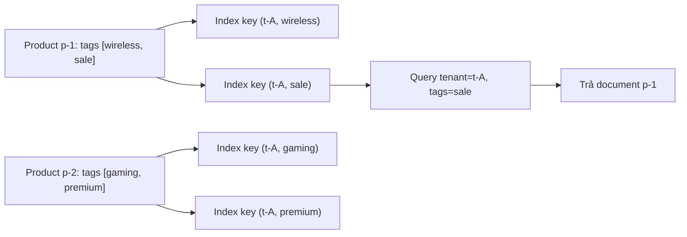

# Multikey index cho array và các giới hạn kết hợp

## 1. Khi nào một index MongoDB trở thành multikey?

Trong **Spring Data MongoDB**, một entity có thể chứa `List<String>`, `List<Integer>` hoặc danh sách subdocument để mô tả tag, điểm số, các dòng hàng trong đơn hoặc nhiều địa chỉ. Khi truy vấn “sản phẩm có tag `sale`” hay “đơn có một dòng hàng thỏa điều kiện”, MongoDB có thể sử dụng **multikey index** thay vì quét toàn bộ collection.

**Multikey index** là chỉ mục lưu khóa được sinh từ những giá trị thuộc **array**. MongoDB tự đánh dấu index là multikey khi trường được lập chỉ mục chứa mảng; **không có lệnh tạo index riêng tên `MULTIKEY`**.

Ví dụ:

```javascript
db.products.createIndex({ tags: 1 });
```

Nếu document có:

```json
{
  "_id": "p-1",
  "tags": ["wireless", "sale", "gaming"]
}
```

thì một document có thể đóng góp **nhiều index key**, tương ứng những giá trị khác nhau trong array. Các key vẫn chỉ về **cùng document**. Nếu mảng chứa giá trị trùng hệt nhau, MongoDB không nhất thiết tạo nhiều index entry giống nhau cho cùng document; điều này không làm array bị loại trùng trong BSON gốc.

**Bài học thuộc chương Chỉ mục của module `SPRING_DATA_MONGODB`**: kết nối và ánh xạ document với Spring Data MongoDB, thực hành `MongoTemplate`/repository, thiết kế query, index, aggregation, transaction, reactive access, kiểm thử và chẩn đoán hiệu năng.

Các câu hỏi cần trả lời:

- Multikey index hoạt động với array scalar và array subdocument như thế nào?
- Khi nào **compound index** có thể kết hợp array với các field thường?
- Vì sao một compound index trên **hai array độc lập** có thể bị từ chối?
- `$elemMatch` có liên quan gì đến **tính đúng** và **index bounds**?
- Unique, covered query, sort, hashed index và shard key bị giới hạn ra sao?
- Khai báo index bằng Spring Data MongoDB và kiểm chứng bằng `explain("executionStats")` như thế nào?

## 2. Hình dung cấu trúc index và cách truy vấn

Giả sử có ba sản phẩm:

```javascript
{
  _id: "p-1",
  tenant_id: "t-A",
  tags: ["wireless", "sale"]
}
{
  _id: "p-2",
  tenant_id: "t-A",
  tags: ["gaming", "premium"]
}
{
  _id: "p-3",
  tenant_id: "t-B",
  tags: ["sale", "accessory"]
}
```

Index:

```javascript
db.products.createIndex(
  { tenant_id: 1, tags: 1 },
  { name: "idx_products_tenant_tags" }
);
```

Một cách hình dung **không phải bản sao byte-level của B-tree**:

| Key logic trong compound index | Trỏ tới document |
| --- | --- |
| `("t-A", "sale")` | `p-1` |
| `("t-A", "wireless")` | `p-1` |
| `("t-A", "gaming")` | `p-2` |
| `("t-A", "premium")` | `p-2` |
| `("t-B", "accessory")` | `p-3` |
| `("t-B", "sale")` | `p-3` |

Truy vấn:

```javascript
db.products.find({
  tenant_id: "t-A",
  tags: "sale"
});
```

có thể dùng index để tìm một key tương ứng `("t-A","sale")`, thay vì đọc mọi document. Query vẫn trả **document**, không trả mỗi index entry; MongoDB loại kết quả trùng khi cần để một document không xuất hiện nhiều lần chỉ vì có nhiều giá trị array khớp.



**Đánh đổi:** array có nhiều phần tử thường sinh nhiều index key. Multikey index có thể giúp đọc nhanh hơn nhưng làm tăng dung lượng index, chi phí ghi và bảo trì khi mảng thay đổi.

## 3. Dataset xuyên suốt bài: tag, kênh bán, dòng hàng và điểm

Chúng ta dùng một collection `products` với **hai array độc lập** `tags` và `salesChannels`, thêm một array subdocument `items` và array số `scores`.

```javascript
db.products.insertMany([
  {
    _id: "p-1",
    tenant_id: "t-A",
    name: "Bộ thiết bị A",
    active: true,
    tags: ["wireless", "sale"],
    salesChannels: ["web", "retail"],
    items: [
      { sku: "KB-1", quantity: 1 },
      { sku: "MS-1", quantity: 5 }
    ],
    scores: [5, 99]
  },
  {
    _id: "p-2",
    tenant_id: "t-A",
    name: "Bộ thiết bị B",
    active: true,
    tags: ["gaming", "premium"],
    salesChannels: ["app"],
    items: [
      { sku: "KB-1", quantity: 4 },
      { sku: "HS-1", quantity: 2 }
    ],
    scores: [85]
  },
  {
    _id: "p-3",
    tenant_id: "t-B",
    name: "Bộ thiết bị C",
    active: false,
    tags: ["sale", "accessory"],
    salesChannels: ["web"],
    items: [
      { sku: "MS-1", quantity: 3 }
    ],
    scores: [70, 90]
  }
]);
```

Mỗi ví dụ có ý nghĩa rõ:

- `p-1` có tag `sale`, nhưng thuộc tenant `t-A`.
- `p-1` có một item `KB-1` quantity 1 và **item khác** `MS-1` quantity 5.
- `p-2` có **cùng một item** `KB-1` quantity 4.
- `p-1` có scores `[5, 99]`: một giá trị thấp và một giá trị cao, **không có điểm nào từ 80 đến 90**.
- `p-3` thuộc tenant khác; mọi query phục vụ khách tenant A phải loại nó qua filter bắt buộc.

**Thực hành chỉ trên database test.** Index được tạo trên collection hiện có ảnh hưởng chi phí ghi và có thể thất bại khi dữ liệu không hợp lệ; đừng chạy thử các index cố tình sai trên production.

## 4. Mô hình Java dùng Spring Data MongoDB

```java
import java.util.List;

import org.springframework.data.mongodb.core.mapping.Document;
import org.springframework.data.mongodb.core.mapping.Field;
import org.springframework.data.mongodb.core.mapping.FieldType;
import org.springframework.data.mongodb.core.mapping.MongoId;

@Document(collection = "products")
public record ProductDocument(
    @MongoId(FieldType.STRING)
    String id,

    @Field("tenant_id")
    String tenantId,

    String name,
    boolean active,
    List<String> tags,
    List<String> salesChannels,
    List<LineItem> items,
    List<Integer> scores
) {
    public record LineItem(
        String sku,
        int quantity
    ) {}
}
```

Ánh xạ cần chú ý:

| Java | BSON | Dùng trong ví dụ |
| --- | --- | --- |
| `id` | `_id` dạng string | Khóa chính document |
| `tenantId` | `tenant_id` | Filter tenant và prefix của compound index |
| `tags` | `tags` | Array scalar tạo multikey index |
| `salesChannels` | `salesChannels` | Array độc lập với `tags` |
| `items.sku` | `items.sku` | Thuộc array subdocument `items` |
| `items.quantity` | `items.quantity` | Thuộc **cùng** array `items` |
| `scores` | `scores` | Array số; ví dụ `$elemMatch` khoảng |

`@MongoId(FieldType.STRING)` làm ID có kiểu string nhất quán theo ý đồ bài học. Trong hệ thống thật, kiểm tra dữ liệu BSON: nếu một phần ID là ObjectId và phần khác là string, lookup/index có thể không trả kết quả như mong đợi.

Nếu model dùng `@Field("sales_channels")` thay tên BSON, phải đối chiếu tên thực tế khi tạo index bằng shell. Với Spring Data `IndexOperations`, dùng property path của entity và xác minh index được ánh xạ đúng.

## 5. Tạo multikey index trên array scalar

Index cơ bản trên tag:

```javascript
db.products.createIndex(
  { tags: 1 },
  { name: "idx_products_tags" }
);
```

MongoDB không yêu cầu khai báo `multikey: true`. Vì `tags` là array trong dữ liệu, index trở thành multikey.

Query một tag:

```javascript
db.products.find({ tags: "sale" });
```

MongoDB có thể trả `p-1` và `p-3`. Nếu dữ liệu chỉ dành cho `t-A`:

```javascript
db.products.find({
  tenant_id: "t-A",
  tags: "sale"
});
```

Kết quả chỉ có `p-1`. Nhưng index đơn `{tags:1}` có thể phải đọc ứng viên nhiều tenant rồi lọc; một **compound index** phù hợp với tenant và tag có thể hiệu quả hơn.

### 5.1. Array chứa scalar có nhiều kiểu BSON

```javascript
{ _id: "mixed", tags: ["sale", 42, null] }
```

BSON phân biệt string, number, null và các kiểu khác. Một ứng dụng mong đợi `List<String>` không nên lưu tùy tiện giá trị number hoặc object trong `tags`. Index không thực hiện validation dữ liệu giúp ứng dụng.

Nên có kiểm tra schema ở lớp ghi dữ liệu; nếu collection đã bị trộn kiểu, kiểm tra bằng `$type`/aggregation và có migration riêng.

### 5.2. Array trùng phần tử

```javascript
{
  _id: "duplicate-tags",
  tags: ["sale", "sale", "wireless"]
}
```

Multikey index không bảo đảm array gốc chỉ chứa một `"sale"`. Nó có thể khử key trùng ở **cấp index entry của document**, không sửa field BSON. Muốn duy trì tag như một tập hợp, dùng validation và thao tác `$addToSet` phù hợp; nhưng `$addToSet` cũng không tự xóa những bản sao trùng đã tồn tại.

## 6. Query trên array: equality, `$all` và exact array

Các kiểu điều kiện thường có ý nghĩa **khác nhau**:

| Filter | Ý nghĩa |
| --- | --- |
| `{tags:"sale"}` | Array có ít nhất một phần tử bằng `"sale"` |
| `{tags:{$in:["sale","gaming"]}}` | Có ít nhất một tag thuộc tập giá trị |
| `{tags:{$all:["sale","wireless"]}}` | Array chứa **cả hai giá trị**, không yêu cầu đúng thứ tự |
| `{tags:["wireless","sale"]}` | **Cả array** phải khớp thứ tự và nội dung theo semantics MongoDB |
| `{tags:{$size:2}}` | Array có đúng 2 phần tử |

Ví dụ:

```javascript
// p-1: có cả hai tag.
db.products.find({
  _id: "p-1",
  tags: { $all: ["sale", "wireless"] }
});

// Khớp toàn bộ array theo đúng thứ tự của p-1.
db.products.find({
  tags: ["wireless", "sale"]
});
```

**Giới hạn quan trọng:** multikey index có thể tìm ứng viên cho exact-array match dựa trên giá trị phần tử, nhưng **không đủ để chứng minh toàn bộ array có đúng thứ tự/cấu trúc**; MongoDB có thể phải FETCH document và kiểm tra array thực tế.

`$size` cũng không được giải quyết hiệu quả chỉ nhờ một multikey index thông thường. Nếu thường xuyên tìm mảng có độ dài chính xác, cân nhắc lưu `tagCount` được cập nhật nhất quán, đặt index cho field đó và kiểm thử đường ghi.

## 7. Compound multikey index: field thường kết hợp một array

Trong ứng dụng nhiều tenant, một compound index thường hữu ích hơn index chỉ trên array:

```javascript
db.products.createIndex(
  { tenant_id: 1, tags: 1 },
  { name: "idx_products_tenant_tags" }
);
```

Query:

```javascript
db.products.find({
  tenant_id: "t-A",
  tags: "sale"
});
```

Index có thể tận dụng cả `tenant_id` và `tags`. Đây là index multikey vì **một trong các field được lập chỉ mục chứa array**.

Một ví dụ khác:

```javascript
db.products.createIndex(
  { active: 1, tenant_id: 1, tags: 1 },
  { name: "idx_products_active_tenant_tags" }
);
```

Hãy chọn thứ tự field dựa trên **query thực tế**, độ chọn lọc, sort và prefix của compound index. Đừng tạo mọi biến thể nếu không có workload chứng minh lợi ích; mỗi index bổ sung tạo chi phí lưu trữ và cập nhật.

### 7.1. Leftmost prefix không biến mất khi có array

Với index `{tenant_id:1,tags:1}`, một truy vấn chỉ theo tenant có thể tận dụng prefix `tenant_id`. Ngược lại, query chỉ theo `tags` thường không tận dụng compound index hiệu quả bằng khi có prefix phù hợp, dù planner có quyền chọn kế hoạch khác tùy dữ liệu.

Nếu hầu hết endpoint luôn có filter tenant bắt buộc, đưa tenant vào prefix là một lựa chọn đáng thử, đồng thời giúp giảm quét ứng viên tenant khác. Tuy nhiên, **index không phải cơ chế phân quyền**: filter tenant vẫn phải xuất hiện trong query từ nguồn xác thực đáng tin cậy.

### 7.2. Index key expansion và chi phí

Một document có 50 tag có thể đóng góp nhiều key vào cùng index. Khi document có nhiều field scalar ngoài array, các giá trị scalar được kết hợp với phần tử array để tạo compound keys, không làm field scalar trở thành array.

Kiểm tra số index key thực tế bằng explain/metrics trên dữ liệu đại diện; không suy trực tiếp số key bằng `số document × độ dài array` trong mọi trường hợp vì trùng giá trị, missing field và quy tắc index cũng ảnh hưởng.

## 8. Giới hạn “parallel arrays”: không compound hai array độc lập

Đây là giới hạn trọng tâm của bài.

Giả sử document có **hai mảng độc lập**:

```javascript
{
  _id: "p-1",
  tags: ["wireless", "sale"],
  salesChannels: ["web", "retail"]
}
```

Đừng tạo một compound index như sau:

```javascript
// Không hợp lệ khi document đã có cả hai array độc lập:
db.products.createIndex(
  { tags: 1, salesChannels: 1 },
  { name: "idx_illegal_parallel_arrays" }
);
```

Với dữ liệu như `p-1`, MongoDB sẽ từ chối việc tạo compound multikey index này vì các indexed fields chứa **parallel arrays** trong cùng document.

Tình huống khác cũng nguy hiểm:

1. Collection hiện tại chưa có document nào chứa cả hai mảng nên index có thể được tạo thành công.
2. Sau đó ứng dụng insert/update một document khiến **cả `tags` và `salesChannels` đều là array**.
3. Thao tác ghi mới có thể **thất bại** vì vi phạm giới hạn compound multikey index đang tồn tại.

Đây không chỉ là một lỗi migration index; nó có thể trở thành **lỗi ghi ở production** sau khi schema phát triển.

### 8.1. Hiểu đúng phạm vi “một array”

Quy tắc của MongoDB đối với một compound multikey index là **mỗi document được lập chỉ mục không được chứa nhiều indexed array fields độc lập** trong cùng index.

Điều đó **không cấm** collection có nhiều array trong cùng document. Ví dụ sau hoàn toàn có thể tồn tại đồng thời:

```javascript
db.products.createIndex(
  { tenant_id: 1, tags: 1 },
  { name: "idx_tenant_tags" }
);

db.products.createIndex(
  { tenant_id: 1, salesChannels: 1 },
  { name: "idx_tenant_channels" }
);
```

Đây là **hai index riêng**; mỗi compound index chỉ tham chiếu một array. Với truy vấn kết hợp hai array, planner có thể chọn một đường truy cập rồi FETCH/filter, hoặc cân nhắc những chiến lược khác, nhưng không biến hai index riêng thành một compound index trên parallel arrays.

### 8.2. Có phải mọi cặp field con trong array cũng bị cấm?

Không. Nếu hai indexed paths xuất phát từ **cùng một array subdocument**, ví dụ `items.sku` và `items.quantity`, chúng chia sẻ **một đường array chung `items`**. Đây là trường hợp đặc biệt quan trọng sẽ được triển khai ở mục 9.

Không diễn giải giới hạn parallel arrays theo cách cấm mọi compound index có hai dotted paths đi qua cùng một mảng.

## 9. Compound index cho nhiều field trong cùng array subdocument

Một document có:

```javascript
{
  _id: "p-1",
  items: [
    { sku: "KB-1", quantity: 1 },
    { sku: "MS-1", quantity: 5 }
  ]
}
```

Có thể tạo compound index theo hai thuộc tính con của **cùng mảng `items`**:

```javascript
db.products.createIndex(
  {
    tenant_id: 1,
    "items.sku": 1,
    "items.quantity": 1
  },
  {
    name: "idx_products_tenant_items"
  }
);
```

Đây là một compound multikey index hợp lệ trong mô hình trên, không phải compound index trên hai array độc lập `tags` và `salesChannels`.

**Cần phân biệt hai vấn đề khác nhau:**

- **Index có được phép tạo không?** Có thể, vì các dotted paths dùng chung array `items`.
- **Query có dùng được bounds của hai field con cùng một phần tử không?** Điều đó phụ thuộc cách viết query, đặc biệt là `$elemMatch`.

### 9.1. Query với hai dotted predicates không bảo đảm cùng item

```javascript
db.products.find({
  tenant_id: "t-A",
  "items.sku": "KB-1",
  "items.quantity": { $gte: 3 }
});
```

Query này có thể khớp **p-1**:

- Phần tử đầu có `sku="KB-1"` nhưng `quantity=1`.
- Phần tử sau có `quantity=5` nhưng `sku="MS-1"`.

Hai điều kiện có thể được thỏa bởi **hai phần tử khác nhau** trong cùng array. Với `p-2`, cả hai điều kiện cũng đúng vì có item `KB-1` quantity 4.

Nếu nghiệp vụ muốn “**một dòng hàng** có SKU KB-1 và quantity ≥ 3”, query này chưa đúng.

### 9.2. Dùng `$elemMatch` để buộc cùng một phần tử

```javascript
db.products.find({
  tenant_id: "t-A",
  items: {
    $elemMatch: {
      sku: "KB-1",
      quantity: { $gte: 3 }
    }
  }
});
```

Theo dataset:

- `p-1` **không khớp**: không có một item `KB-1` quantity ≥3.
- `p-2` **khớp**: có item `KB-1` quantity 4.
- `p-3` bị loại vì tenant `t-B`.

`$elemMatch` làm rõ **ngữ nghĩa cùng phần tử**, không chỉ là mẹo tối ưu.

### 9.3. `$elemMatch` giúp compound bounds

Với index `{"items.sku":1,"items.quantity":1}`, hai key có đường chung `items`. MongoDB có thể **kết hợp index bounds** của `items.sku` và `items.quantity` nếu query dùng `$elemMatch` tại chính đường array chung đó:

```javascript
{
  items: {
    $elemMatch: {
      sku: "KB-1",
      quantity: { $gte: 3 }
    }
  }
}
```

Không có `$elemMatch` phù hợp, MongoDB có thể không kết hợp chặt được bounds hai khóa array; query vẫn có thể chạy, nhưng scan nhiều index key hoặc FETCH nhiều document hơn.

Nếu các dotted paths nằm sâu hơn và có **mảng lồng nhau**, vị trí `$elemMatch` phải phù hợp với **common array path** được index sử dụng. Một `$elemMatch` đặt ở đường cha khác không đương nhiên cho phép compound mọi bounds.

## 10. `$elemMatch` trên array scalar giúp giao hai bounds

`scores` của `p-1` là:

```json
[5, 99]
```

Giả sử muốn tìm **một điểm** trong khoảng từ 80 đến 90, bao gồm hai đầu.

Query không có `$elemMatch`:

```javascript
db.products.find({
  scores: { $gte: 80, $lte: 90 }
});
```

Với array, MongoDB có thể coi hai điều kiện là được thỏa bởi **hai phần tử khác nhau**:

- `99 >= 80`.
- `5 <= 90`.

Vì vậy `p-1` có thể khớp filter trên, dù **không có phần tử nào** nằm từ 80 đến 90.

Query đúng khi muốn **cùng một điểm** thỏa cả điều kiện:

```javascript
db.products.find({
  scores: {
    $elemMatch: {
      $gte: 80,
      $lte: 90
    }
  }
});
```

Theo dữ liệu ví dụ, `p-2` có score 85 và khớp; `p-1` không khớp. `p-3` có 90 nhưng thuộc tenant B nên hãy đặt filter tenant khi dùng trong API thực.

### 10.1. Tác động đến index bounds

Nếu đã tạo:

```javascript
db.products.createIndex(
  { scores: 1 },
  { name: "idx_products_scores" }
);
```

thì `$elemMatch` vừa cho **semantics cùng phần tử** vừa giúp MongoDB có thể **giao (intersect) index bounds**:

```text
scores >= 80  → [80, +∞)
scores <= 90  → (-∞, 90]
Giao hai bounds → [80, 90]
```

Không có `$elemMatch`, MongoDB không bảo đảm giao hai bounds của multikey index theo cách đó; index scan có thể dùng một trong các giới hạn rộng hơn.

**Chú ý:** `$elemMatch` không phải phép tối ưu bắt buộc cho mọi query trên array. Chỉ dùng khi điều kiện nghiệp vụ thực sự yêu cầu cùng một phần tử, rồi kiểm tra planner để biết hiệu quả.

## 11. Spring Data MongoDB: truy vấn scalar array và `$elemMatch`

### 11.1. Truy vấn tag đơn giản bằng `Criteria`

```java
import java.util.List;

import org.springframework.data.mongodb.core.MongoTemplate;
import org.springframework.data.mongodb.core.query.Criteria;
import org.springframework.data.mongodb.core.query.Query;

public List<ProductDocument> findByTag(
    MongoTemplate template,
    String trustedTenantId,
    String tag
) {
    if (trustedTenantId == null || trustedTenantId.isBlank()) {
        throw new IllegalArgumentException("Thiếu tenant");
    }

    Query query = Query.query(
        Criteria.where("tenantId").is(trustedTenantId)
            .and("tags").is(tag)
    );

    return template.find(query, ProductDocument.class);
}
```

`MongoTemplate` dùng metadata ánh xạ `tenantId` thành `tenant_id`; không cần viết raw BSON field khi dùng `Query` theo entity. Cần kiểm tra query plan thực tế và size kết quả; query trên array không tự giới hạn số document trả về.

### 11.2. Truy vấn một item với điều kiện cùng phần tử

```java
import org.springframework.data.mongodb.core.query.Criteria;
import org.springframework.data.mongodb.core.query.Query;

Criteria sameItem = Criteria.where("items").elemMatch(
    Criteria.where("sku").is("KB-1")
        .and("quantity").gte(3)
);

Query query = Query.query(
    new Criteria().andOperator(
        Criteria.where("tenantId").is("t-A"),
        sameItem
    )
);

List<ProductDocument> result =
    template.find(query, ProductDocument.class);
```

Dòng `elemMatch(...)` bảo đảm hai điều kiện trên `sku` và `quantity` áp dụng cho **một LineItem**. Khi kết quả được đọc thành `ProductDocument`, array `items` vẫn có thể chứa **mọi phần tử**; `$elemMatch` trong filter không có nghĩa response chỉ gồm item khớp.

Nếu API chỉ muốn phần tử khớp, phải dùng projection/aggregation riêng theo yêu cầu và xem các giới hạn của `$elemMatch` projection. Không nhầm **filter** với **projection**.

### 11.3. Repository derived query

Một repository có thể khai báo:

```java
import java.util.List;

import org.springframework.data.mongodb.repository.MongoRepository;

public interface ProductRepository
        extends MongoRepository<ProductDocument, String> {

    List<ProductDocument> findByTenantIdAndTags(
        String tenantId,
        String tag
    );
}
```

Đây là một query thuận tiện cho điều kiện tag đơn. Tuy nhiên, với nghiệp vụ cần **cùng subdocument** hoặc nhóm query động, `MongoTemplate`/`@Query` thường diễn đạt `$elemMatch` rõ hơn. Đừng suy rằng derived method với hai dotted paths tự chèn `$elemMatch` đúng semantics.

## 12. Tạo index bằng `IndexOperations`

Spring Data MongoDB có `IndexOperations` để tạo và kiểm tra index cho entity.

```java
import org.springframework.data.domain.Sort;
import org.springframework.data.mongodb.core.MongoTemplate;
import org.springframework.data.mongodb.core.index.Index;
import org.springframework.data.mongodb.core.index.IndexOperations;

public class ProductIndexProvisioner {

    private final MongoTemplate template;

    public ProductIndexProvisioner(MongoTemplate template) {
        this.template = template;
    }

    public void ensureIndexes() {
        IndexOperations indexes =
            template.indexOps(ProductDocument.class);

        // Compound index: tenant scalar + tags array.
        indexes.ensureIndex(
            new Index()
                .on("tenantId", Sort.Direction.ASC)
                .on("tags", Sort.Direction.ASC)
                .named("idx_products_tenant_tags")
        );

        // Hai dotted paths thuộc cùng array 'items'.
        indexes.ensureIndex(
            new Index()
                .on("tenantId", Sort.Direction.ASC)
                .on("items.sku", Sort.Direction.ASC)
                .on("items.quantity", Sort.Direction.ASC)
                .named("idx_products_tenant_items")
        );

        // Index scalar-array 'scores' riêng.
        indexes.ensureIndex(
            new Index()
                .on("scores", Sort.Direction.ASC)
                .named("idx_products_scores")
        );
    }
}
```

Khi tạo index qua `indexOps(ProductDocument.class)`, Spring Data sử dụng metadata mapping domain. Vì entity có `@Field("tenant_id")`, phải xác minh kết quả index thực tế chứa key BSON `tenant_id`.

Trong môi trường thật, **provision index như một bước triển khai có kiểm soát** và giám sát thời gian, tài nguyên, quyền truy cập, concurrency, dữ liệu hiện có. Không bắt buộc phải gọi `ensureIndexes()` mỗi lần xử lý một HTTP request.

### 12.1. Khai báo bằng annotation

Một phương án khác là dùng `@Indexed`/`@CompoundIndex`:

```java
import org.springframework.data.mongodb.core.index.CompoundIndex;
import org.springframework.data.mongodb.core.mapping.Document;

@Document(collection = "products")
@CompoundIndex(
    name = "idx_products_tenant_tags",
    def = "{'tenantId': 1, 'tags': 1}"
)
public record IndexedProductExample(
    String tenantId,
    java.util.List<String> tags
) {}
```

Đây là ví dụ **độc lập** về annotation, không phải entity dùng chung cho collection `products` ở các phần trước. Khi dùng `@Field` đổi tên BSON hoặc index có điều kiện, hãy kiểm tra index definition sau khi Spring Data resolve mapping.

**Quan trọng:** từ Spring Data MongoDB 3.0, tính năng **tự động tạo index từ annotation mặc định không bật**. Việc viết `@Indexed`/`@CompoundIndex` **không đồng nghĩa** mọi môi trường đã có index. Có thể bật cấu hình có chủ đích hoặc tạo index trong migration/bootstrap; kiểm tra phiên bản Spring Data và quy trình triển khai.

### 12.2. Tránh tạo index trùng

Nếu cả annotation và provisioner đều đảm nhận cùng index, cần thống nhất ownership. Những index có key giống nhau nhưng option khác nhau (unique, partial filter, collation, sparse) không nhất thiết tương đương. Đừng tạo nhiều index gần giống chỉ để xử lý mọi biến thể query.

## 13. Unique multikey index không bảo đảm duy nhất bên trong một array

MongoDB hỗ trợ **unique multikey index** với một ràng buộc quan trọng: tính duy nhất áp dụng cho **các document khác nhau**, không có nghĩa một array trong cùng document không được lặp phần tử.

Ví dụ collection `users`:

```javascript
db.users.createIndex(
  { emailAliases: 1 },
  { unique: true, name: "uniq_email_aliases" }
);
```

Một document:

```javascript
db.users.insertOne({
  _id: "u-1",
  emailAliases: [
    "a@example.test",
    "a@example.test"
  ]
});
```

Những phần tử trùng trong **cùng document** không nhất thiết vi phạm unique multikey index, vì index có thể chỉ giữ một khóa tương ứng cho document đó. Nhưng document **khác**:

```javascript
db.users.insertOne({
  _id: "u-2",
  emailAliases: ["a@example.test"]
});
```

sẽ gặp **duplicate key** nếu unique index đang áp dụng đúng như trên và document `u-1` đã tồn tại.

### 13.1. Không dùng unique trên tag thông thường

Nếu tạo `unique:true` trên `tags` cho danh mục sản phẩm, hai sản phẩm cùng tag `"sale"` sẽ xung đột. Đây thường là **sai thiết kế**, vì tag phải được tái sử dụng giữa nhiều sản phẩm.

Unique multikey phù hợp hơn khi một giá trị array có ý nghĩa **không được thuộc về hai document khác nhau**, chẳng hạn bí danh định danh toàn cục, và đã có chính sách xử lý trùng trong cùng document.

### 13.2. Unique không tự chuẩn hóa dữ liệu

`"A@Example.test"` và `"a@example.test"` có thể là hai giá trị khác nhau dưới simple collation. Nếu nghiệp vụ muốn phân biệt/không phân biệt hoa-thường, cần thiết kế canonicalization/collation của unique index, xử lý dữ liệu cũ và viết integration test. Không dùng unique index như bộ chuẩn hóa email hay Unicode tự động.

## 14. Covered query trên multikey index có điều kiện nghiêm ngặt

**Covered query** là query có thể được đáp ứng hoàn toàn từ index mà không phải FETCH document gốc. Multikey index **có thể** cover một số query, nhưng cần thỏa các điều kiện đặc biệt:

1. Query **không trả lại array field** trong projection.
2. Query **không dùng `$elemMatch`**.
3. Những field filter/projection cần thiết đều được index cover theo các quy tắc chung.
4. Tránh yêu cầu `_id` nếu index không chứa `_id`; thường projection `_id:0`.

Ví dụ:

```javascript
db.products.createIndex(
  {
    tenant_id: 1,
    tags: 1,
    name: 1
  },
  {
    name: "idx_products_tenant_tags_name"
  }
);
```

Query có khả năng covered:

```javascript
db.products.find(
  { tenant_id: "t-A", tags: "sale" },
  { _id: 0, name: 1 }
).explain("executionStats");
```

Vì projection chỉ cần `name` và không trả array `tags`, index có thể cover query nếu các điều kiện còn lại thỏa. Để xác minh, xem `totalDocsExamined` và plan: một covered query phù hợp thường có `totalDocsExamined: 0` và không cần FETCH document.

Query **không covered** theo điều kiện multikey:

```javascript
db.products.find(
  { tenant_id: "t-A", tags: "sale" },
  { _id: 0, tags: 1, name: 1 }
);
```

Vì projection trả lại **toàn bộ array `tags`**, index entries không đủ để dựng array nguyên bản với thứ tự và dữ liệu đúng. Tương tự, một query có `$elemMatch` không được coi là covered bởi multikey index theo các giới hạn MongoDB nêu ra.

**Không mặc định `IXSCAN` đồng nghĩa covered.** Một plan có thể dùng index để lọc rồi vẫn FETCH nhiều document.

## 15. Sort với multikey index: vì sao vẫn có thể dùng RAM?

Có index `{tags:1}` không có nghĩa query này luôn tránh sort:

```javascript
db.products.find({
  tags: "sale"
}).sort({ tags: 1 });
```

Sorting trên field thuộc array có những quy tắc riêng. Một query dùng multikey index có thể vẫn xuất hiện một **sort stage trong bộ nhớ** khi:

- Index bounds của các sort fields không phải toàn phạm vi `[MinKey, MaxKey]`.
- Có những bounds trên multikey-indexed field chia sẻ path prefix với sort pattern.
- Các yếu tố khác của query plan khiến index không thể phục vụ thứ tự yêu cầu.

Theo tài liệu MongoDB, để tránh in-memory sort trong trường hợp multikey, cần thỏa **cả hai điều kiện đặc biệt** về bounds và path prefix; chỉ có index chưa đủ.

### 15.1. Sort document khác sort phần tử của array

```javascript
db.products.find({
  tenant_id: "t-A"
}).sort({ scores: 1 });
```

Lệnh trên **sắp xếp các document kết quả**, không sắp xếp `scores` bên trong mỗi document. Không nhầm với `$sortArray` expression hoặc modifier `$sort` của `$push` khi cập nhật array.

Nếu cần lấy điểm cao nhất trong mỗi document rồi sort sản phẩm theo điểm đó, nên xác định metric rõ, có thể dùng một field materialized `maxScore` hoặc aggregation tính toán theo yêu cầu. Index lên toàn bộ `scores` không tự trở thành index trên `maxScore` nghiệp vụ.

### 15.2. Kiểm tra plan, không suy luận

```javascript
db.products.find({
  tags: "sale"
})
.sort({ tags: 1 })
.explain("executionStats");
```

Xem có `SORT`/sort stage hay không, số keys/documents đã đọc, chi phí và định dạng `indexBounds`. Quyết định sử dụng index nào phải dựa trên workload, không chỉ dựa tên `idx_products_tags`.

## 16. Các giới hạn kết hợp khác: hashed, shard key và `$expr`

### 16.1. Hashed index không thể là multikey

MongoDB **không hỗ trợ hashed multikey index**. Không dùng:

```javascript
// Không hợp lệ khi field được lập chỉ mục là array.
db.products.createIndex({
  tags: "hashed"
});
```

Nếu field ban đầu chưa chứa array, việc tạo hashed index có thể không lập tức phát hiện trường hợp tương lai; cần tránh schema thay đổi khiến indexed field trở thành array. Hashed index phù hợp cho những field scalar có mục tiêu cụ thể, không phải giải pháp thay thế cho multikey tags.

### 16.2. Multikey index không được dùng làm shard-key index

Không thể chọn một **multikey index** làm index trực tiếp cho shard key. Tuy nhiên, nếu shard-key fields là **prefix scalar** của một compound index, những field phía sau (không thuộc shard key) có thể khiến **compound index đó** trở thành multikey mà không tự biến shard key thành array.

Ví dụ ý tưởng:

```javascript
// Giả sử sharding theo tenant_id theo thiết kế được hỗ trợ.
// Compound index này có suffix array 'tags':
db.products.createIndex({
  tenant_id: 1,
  tags: 1
});
```

Đừng suy rằng một collection có shard key `tenant_id` luôn có thể shard/sort mọi query theo `tags` hiệu quả. Còn phải xét quy tắc sharding, routing, uniqueness và index requirements theo phiên bản MongoDB/cluster thực tế.

### 16.3. `$expr` không tận dụng multikey indexes theo cùng cơ chế

Theo giới hạn MongoDB, **`$expr` không hỗ trợ multikey indexes** cho những đường truy cập tương ứng. Nếu bạn chuyển một predicate đơn giản trên array sang biểu thức `$expr` động, đừng mặc định planner còn dùng multikey index như query equality thông thường.

Không có nghĩa toàn bộ mọi query chứa `$expr` chắc chắn không thể dùng **bất kỳ** index nào; cần xem từng phần filter và execution plan cụ thể.

## 17. Partial, sparse và collation kết hợp với array index

Multikey mô tả **cách index field array**; nó có thể xuất hiện cùng một số option index khác nếu MongoDB hỗ trợ tổ hợp đó.

### 17.1. Partial index để giảm số document được lập chỉ mục

Nếu chỉ cần truy vấn sản phẩm active:

```javascript
db.products.createIndex(
  { tenant_id: 1, tags: 1 },
  {
    name: "idx_active_tenant_tags",
    partialFilterExpression: {
      active: true
    }
  }
);
```

Index này chỉ chứa những document **thỏa partial filter** theo semantics MongoDB. Query muốn dùng nó cần có điều kiện đủ để planner chứng minh không bỏ sót document ngoài partial index:

```javascript
db.products.find({
  tenant_id: "t-A",
  active: true,
  tags: "sale"
});
```

Query không có `active:true` có thể không dùng partial index vì index không chứa các document inactive mà query có quyền trả về. Không ép hint vào partial index chỉ vì muốn “nhanh hơn”; phải kiểm tra tính đầy đủ của kết quả và server constraints.

### 17.2. Sparse không có nghĩa array duy nhất

Sparse index chủ yếu liên quan đến việc bỏ những document **thiếu field được lập chỉ mục**, theo quy tắc của từng loại index. Nó không chuyển một array thành set và không giải quyết duplicate trong array. Với nhiều điều kiện nghiệp vụ, **partial index** biểu đạt phạm vi rõ hơn sparse index nhưng cần quản lý predicate phù hợp.

### 17.3. Collation cho array string

Khi tag là string và muốn so sánh không phân biệt hoa/thường theo locale, index có thể được tạo với collation phù hợp:

```javascript
db.products.createIndex(
  { tenant_id: 1, tags: 1 },
  {
    name: "idx_tenant_tags_vi_casefold",
    collation: {
      locale: "vi",
      strength: 2
    }
  }
);
```

Query muốn tận dụng đầy đủ index cho so sánh/sort chuỗi cần có **collation tương thích**. Một regex với `i` không có cùng semantics và khả năng dùng index như equality với collation.

Trước khi dùng collation cho unique array string, cần xác định quy tắc chuẩn hóa nghiệp vụ và kiểm tra dữ liệu hiện có. Không mặc định strength thấp hơn luôn tốt hơn; các chữ cái tiếng Việt có thể bị gộp khác mong đợi.

## 18. Vì sao array lớn làm index đắt hơn?

Một index multikey có thêm nhiều keys khi document chứa nhiều giá trị khác nhau. Những hoạt động sau có thể làm tăng chi phí ghi:

- `$push` thêm một hoặc nhiều phần tử mới.
- `$pull` xóa giá trị khỏi mảng.
- `$addToSet` thêm phần tử chưa tồn tại.
- `$set` thay cả mảng hoặc thay field ảnh hưởng index.
- Thay đổi subdocument `items` làm keys của `items.sku`/`items.quantity` thay đổi.

Với array ngày càng lớn:

- Index có thể chiếm nhiều dung lượng hơn.
- Update một document có thể cần duy trì nhiều index key.
- Cùng một document bị nhiều writer cập nhật có thể trở thành điểm nóng.
- Document có giới hạn kích thước BSON thông thường **16 MiB**.
- Quét index có thể cần kiểm soát duplicate key/documents; không phải mọi index entry đều tương đương một document duy nhất.

### 18.1. Khi nào nên tách collection?

Một array nhỏ và có giới hạn như vài tag sản phẩm có thể phù hợp để embed. Nhưng các trường hợp sau cần cân nhắc collection con:

- Hàng triệu đơn/hoạt động gắn với một user.
- Dòng hàng của báo cáo lớn cần tìm kiếm độc lập.
- Lịch sử audit cần phân trang riêng theo thời gian.
- Các phần tử array có quyền truy cập hoặc vòng đời độc lập.
- Một trường hợp liên tục chạm giới hạn parallel arrays hay array update hotspot.

Ví dụ thay `items` dài vô hạn bằng collection `order_lines`:

```javascript
{
  _id: "line-1",
  orderId: "order-1",
  sku: "KB-1",
  quantity: 4
}
```

Khi đó index compound scalar:

```javascript
db.order_lines.createIndex({
  orderId: 1,
  sku: 1,
  quantity: 1
});
```

không có tính multikey nếu các field này đều là scalar. Đổi lại, nghiệp vụ cần kiểm soát quan hệ, truy vấn nhiều collection hoặc transaction khi có bất biến đa document.

## 19. Đọc `explain("executionStats")` để xác minh multikey thực tế

Một ví dụ:

```javascript
db.products.find({
  tenant_id: "t-A",
  tags: "sale"
})
.explain("executionStats");
```

Trong explain, tìm các thuộc tính tùy phiên bản/engine:

| Thuộc tính | Ý nghĩa |
| --- | --- |
| `winningPlan` | Kế hoạch planner chọn cho query |
| `IXSCAN` | Có dùng index scan |
| `COLLSCAN` | Có quét toàn collection |
| `indexName` | Index nào được sử dụng |
| `isMultiKey` | Index trong plan có là multikey không |
| `multiKeyPaths` | Những đường path nào đóng góp tính multikey |
| `indexBounds` | Dải khóa được quét, có compound/intersection không |
| `totalKeysExamined` | Số index keys xem xét |
| `totalDocsExamined` | Số document gốc được đọc |
| `SORT`/sort stage | Có sort ngoài index hay không |
| `FETCH` | Có đọc document gốc sau index scan |

Không phải mọi phiên bản MongoDB đều trình bày toàn bộ field ở cùng vị trí. Một số execution engine và dạng explain khác nhau làm hình dạng JSON thay đổi.

### 19.1. So sánh ba query trên cùng index

Thử trên dữ liệu đại diện:

```javascript
// A: Filter tag.
db.products.find({
  tenant_id: "t-A",
  tags: "sale"
}).explain("executionStats");

// B: Hai dotted predicates có thể ở hai phần tử khác nhau.
db.products.find({
  tenant_id: "t-A",
  "items.sku": "KB-1",
  "items.quantity": { $gte: 3 }
}).explain("executionStats");

// C: Một item phải thỏa cả hai; có thể compound bounds.
db.products.find({
  tenant_id: "t-A",
  items: {
    $elemMatch: {
      sku: "KB-1",
      quantity: { $gte: 3 }
    }
  }
}).explain("executionStats");
```

So sánh **cả kết quả nghiệp vụ lẫn indexBounds**. Không nên đánh giá rằng B “nhanh hơn” C nếu B đang trả **sai tập document** so với câu hỏi thực tế.

### 19.2. Dataset nhỏ không phải benchmark

Với ba sản phẩm, MongoDB có thể chọn `COLLSCAN` vì chi phí quét quá thấp. Điều đó không chứng minh multikey index vô dụng. Đánh giá trên dữ liệu và phân bố thực tế, warm/cold cache phù hợp, có số liệu p95/p99 và write throughput.

### 19.3. Hint phục vụ chẩn đoán, không thay thế planner

Có thể thử:

```javascript
db.products.find({
  tenant_id: "t-A",
  tags: "sale"
})
.hint("idx_products_tenant_tags")
.explain("executionStats");
```

Sau đó chạy **không hint** để so sánh. Một hint hard-code có thể làm query lỗi khi index chưa tồn tại hoặc giảm hiệu năng khi dữ liệu phân bố khác. Không deploy hint chỉ vì nhìn thấy `IXSCAN` trong một lần thử.

## 20. Kiểm thử tích hợp Spring Data MongoDB

Unit test mock repository không chứng minh MongoDB đã tạo index multikey, không kiểm tra `$elemMatch` hoặc giới hạn parallel arrays. Nên có integration test trên MongoDB thật, ví dụ với Testcontainers trong dự án Spring Boot.

### 20.1. Test điều kiện cùng một array element

```java
import static org.assertj.core.api.Assertions.assertThat;

import java.util.List;

import org.junit.jupiter.api.Test;
import org.springframework.beans.factory.annotation.Autowired;
import org.springframework.boot.test.autoconfigure.data.mongo.DataMongoTest;
import org.springframework.data.mongodb.core.MongoTemplate;
import org.springframework.data.mongodb.core.query.Criteria;
import org.springframework.data.mongodb.core.query.Query;

@DataMongoTest
class ProductMultikeyIntegrationTest {

    @Autowired MongoTemplate template;

    @Test
    void elemMatchRequiresSameLineItem() {
        template.insert(new ProductDocument(
            "mk-01",
            "mk-tenant",
            "Bộ A",
            true,
            List.of("sale", "wireless"),
            List.of("web", "retail"),
            List.of(
                new ProductDocument.LineItem("KB-1", 1),
                new ProductDocument.LineItem("MS-1", 5)
            ),
            List.of(5, 99)
        ));

        template.insert(new ProductDocument(
            "mk-02",
            "mk-tenant",
            "Bộ B",
            true,
            List.of("gaming", "premium"),
            List.of("app"),
            List.of(
                new ProductDocument.LineItem("KB-1", 4)
            ),
            List.of(85)
        ));

        Query dottedQuery = Query.query(
            Criteria.where("tenantId").is("mk-tenant")
                .and("items.sku").is("KB-1")
                .and("items.quantity").gte(3)
        );

        assertThat(
            template.find(dottedQuery, ProductDocument.class)
        )
            .extracting(ProductDocument::id)
            .containsExactlyInAnyOrder("mk-01", "mk-02");

        Query sameElementQuery = Query.query(
            new Criteria().andOperator(
                Criteria.where("tenantId").is("mk-tenant"),
                Criteria.where("items").elemMatch(
                    Criteria.where("sku").is("KB-1")
                        .and("quantity").gte(3)
                )
            )
        );

        assertThat(
            template.find(sameElementQuery, ProductDocument.class)
        )
            .extracting(ProductDocument::id)
            .containsExactly("mk-02");
    }
}
```

Test chứng minh **logic query**; để kiểm tra hiệu năng index còn phải **tạo index** và chạy `explain`. Với ID cố định, test cần database/collection riêng hoặc cleanup đúng các bản ghi. Không chạy trên dữ liệu dùng chung.

### 20.2. Test compound index đúng schema

Trong test hoặc giai đoạn provision index:

```java
import org.springframework.data.domain.Sort;
import org.springframework.data.mongodb.core.index.Index;

template.indexOps(ProductDocument.class).ensureIndex(
    new Index()
        .on("tenantId", Sort.Direction.ASC)
        .on("items.sku", Sort.Direction.ASC)
        .on("items.quantity", Sort.Direction.ASC)
        .named("idx_products_tenant_items")
);
```

Sau khi tạo, kiểm tra:

```javascript
db.products.getIndexes();

db.products.find({
  tenant_id: "mk-tenant",
  items: {
    $elemMatch: {
      sku: "KB-1",
      quantity: { $gte: 3 }
    }
  }
}).explain("executionStats");
```

Dùng `getIndexes()` để xác nhận **definition** của index, còn `explain` giúp biết **query có sử dụng index hay không**. Một index có thể tồn tại nhưng planner chọn cách khác.

### 20.3. Test thất bại với parallel arrays trên database riêng

Kịch bản cần được kiểm thử:

1. Tạo document có `tags` và `salesChannels` đều là array.
2. Thử `createIndex({tags:1,salesChannels:1})` trong collection test.
3. Xác nhận MongoDB từ chối tạo index vì parallel arrays.
4. Tạo hai index riêng trên từng array với tenant prefix, xác nhận thành công.
5. Trong collection **khác**, tạo compound index khi chưa có dữ liệu vi phạm; sau đó insert document có cả hai array và xác nhận thao tác ghi bị từ chối.

**Không hard-code message của MongoDB error** làm contract của test; message/error details có thể khác giữa các phiên bản. Dùng mã loại lỗi và kiểm tra trạng thái dữ liệu/index khi phù hợp.

### 20.4. Các case bổ sung

| Case | Điều cần xác minh |
| --- | --- |
| Scalar array tags | Query equality trả document chứa phần tử |
| Array trùng phần tử | BSON vẫn trùng; index không “sửa” dữ liệu |
| `$all` | Cần đủ phần tử, không cần đúng thứ tự |
| Exact array match | Phân biệt khớp cả array với khớp một phần tử |
| `$elemMatch` scalar range | `[5,99]` không khớp range 80–90 |
| `$elemMatch` subdocument | Hai điều kiện bắt buộc cùng item |
| Compound tenant+tags | Query đúng tenant, dùng index nếu plan phù hợp |
| Compound items.sku+quantity | Cho phép cùng array path |
| Parallel arrays | Index/insert/update vi phạm phải bị từ chối |
| Unique multikey | Không trùng giá trị giữa documents, có thể trùng trong một document |
| Covered query | Không project array, không `$elemMatch`, docs examined phù hợp |
| Sort array | Quan sát khi nào có in-memory SORT |
| Partial index | Query phải đáp ứng partial filter |
| Hashed array | Không được phép thành multikey |
| BSON field rename | `@Field` và index key khớp dữ liệu thực |
| Reactive query | Kết quả đúng, không block |
| Concurrent writes | Index maintenance và tính nguyên tử theo document |

## 21. Reactive access và cập nhật array

Trong ứng dụng WebFlux, `ReactiveMongoTemplate` hỗ trợ truy vấn cùng `Query`/`Criteria` nhưng trả `Flux<ProductDocument>`.

```java
import org.springframework.data.mongodb.core.ReactiveMongoTemplate;
import org.springframework.data.mongodb.core.query.Criteria;
import org.springframework.data.mongodb.core.query.Query;

import reactor.core.publisher.Flux;

public Flux<ProductDocument> findByTagReactive(
    ReactiveMongoTemplate template,
    String trustedTenantId,
    String tag
) {
    Query query = Query.query(
        Criteria.where("tenantId").is(trustedTenantId)
            .and("tags").is(tag)
    );
    query.limit(100);

    return template.find(query, ProductDocument.class);
}
```

Dù chạy reactive, MongoDB vẫn áp dụng quy tắc multikey, compound index, `$elemMatch` và parallel arrays như imperative. `Flux` không làm query thiếu index trở nên rẻ hơn. Tránh `block()` trên event loop WebFlux và tránh `collectList()` với kết quả không giới hạn.

### 21.1. Ghi array và index maintenance

```java
import org.springframework.data.mongodb.core.query.Update;

Update update = new Update()
    .addToSet("tags", "new-feature");
```

Khi dùng `MongoTemplate.updateFirst(...)` hoặc reactive equivalent, MongoDB phải cập nhật index keys liên quan nếu mảng thay đổi. `$addToSet` có thể tránh thêm giá trị trùng theo phép so sánh của MongoDB; nó không thay ràng buộc unique toàn collection.

Một update trên **một document** được MongoDB áp dụng nguyên tử, nhưng việc sửa nhiều document và collection không tự cùng transaction. Khi có nghiệp vụ cần bất biến đa document, cân nhắc `MongoTransactionManager`/`ReactiveMongoTransactionManager` theo stack và deployment; index không thay thế transaction.

## 22. Những sai lầm thường gặp

**Sai lầm 1 — “Phải khai báo `multikey:true` khi tạo index.”** Không. MongoDB xác định tự động từ giá trị array.

**Sai lầm 2 — “Một phần tử array là một document riêng.”** Không. Một document có thể sinh nhiều index entries nhưng query vẫn trả document.

**Sai lầm 3 — “Index trên `tags` sẽ loại tag trùng trong mảng.”** Không. Index dedup không đổi BSON array.

**Sai lầm 4 — “Compound index có thể có `tags` và `salesChannels` vì cả hai là mảng.”** Sai. Hai array độc lập trong cùng indexed document gây lỗi parallel arrays.

**Sai lầm 5 — “Đã có hai array trong entity thì không thể tạo multikey index nào.”** Không. Có thể tạo **nhiều index riêng**, mỗi index chứa một indexed array path.

**Sai lầm 6 — “`items.sku` và `items.quantity` luôn là parallel arrays bất hợp lệ.”** Không; chúng chia sẻ đường mảng `items` và có thể dùng compound index phù hợp.

**Sai lầm 7 — “Hai dotted predicates tự yêu cầu cùng subdocument.”** Không. Cần `$elemMatch` khi nghiệp vụ đòi một phần tử thỏa cả hai.

**Sai lầm 8 — “Array range query không `$elemMatch` luôn tìm một điểm trong khoảng.”** Không. Hai ràng buộc có thể do hai phần tử khác nhau thỏa.

**Sai lầm 9 — “Có multikey index thì query có `$elemMatch` luôn covered.”** Không. Covered query có hạn chế với `$elemMatch`.

**Sai lầm 10 — “Unique multikey không cho array chứa giá trị lặp.”** Sai. Ràng buộc unique áp dụng giữa các document theo index keys.

**Sai lầm 11 — “Index trên array tự giải quyết sort không tốn RAM.”** Không. Sort với multikey có điều kiện đặc biệt về bounds/path.

**Sai lầm 12 — “Index hashed là cách thay multikey khi array nhiều giá trị.”** Không. Hashed indexes không thể multikey.

**Sai lầm 13 — “Bất kỳ multikey index nào cũng dùng được làm shard key index.”** Không. Shard key có quy tắc riêng.

**Sai lầm 14 — “`@Indexed` luôn tự tạo index trên startup.”** Không mặc định ở những phiên bản Spring Data MongoDB hiện đại; cần quy trình tạo index rõ.

**Sai lầm 15 — “Thấy `IXSCAN` là query đã được tối ưu.”** Không. Còn cần xem indexBounds, FETCH, docs/keys examined, sort, kết quả đúng và p95/p99.

## 23. Bài thực hành tổng hợp

1. Tạo ba document mẫu gồm `tags`, `salesChannels`, `items` và `scores`.
2. Tạo index đơn `{tags:1}`, thử equality, `$in` và `$all`.
3. Tạo compound index `{tenant_id:1,tags:1}`; so sánh query có và không có tenant filter.
4. Tạo index hợp lệ `{tenant_id:1,"items.sku":1,"items.quantity":1}`.
5. Thử dotted query `items.sku="KB-1"` AND `items.quantity>=3`, quan sát `p-1` khớp dù sai ý nghĩa cùng item.
6. Thay bằng `items:{$elemMatch:{sku:"KB-1",quantity:{$gte:3}}}`, chỉ nhận `p-2` trong tenant A.
7. Tạo index `{scores:1}`; so sánh range có và không có `$elemMatch` với `[5,99]`.
8. Trong database test, thử tạo index trên `{tags:1,salesChannels:1}` và ghi nhận lỗi parallel arrays.
9. Tạo hai index riêng cho tags và salesChannels; chứng minh không bị giới hạn ở mức toàn collection.
10. Thử một unique multikey index trên collection `users` riêng; so sánh duplicate cùng document và duplicate giữa hai documents.
11. Thử covered query chỉ project field scalar, sau đó project array hoặc thêm `$elemMatch`.
12. Đo sort trên indexed array bằng `explain`; ghi nhận sort stage nếu có.
13. Thử partial index `active:true`, kiểm tra query thiếu active filter.
14. Tạo index qua `MongoTemplate.indexOps(...)`, kiểm tra `getIndexes()` và `multiKeyPaths` trong explain.
15. Chạy integration test Java với `Criteria.elemMatch(...)`.
16. Đo write latency khi array phát triển; cân nhắc collection con nếu dữ liệu không giới hạn.

## 24. Checklist cho production

| Kiểm tra | Câu hỏi |
| --- | --- |
| Array path | Field thực sự là array scalar hay array subdocument? |
| Compound fields | Có **hai indexed arrays độc lập** trong cùng document không? |
| Shared array path | Các dotted fields có cùng prefix array hợp lệ không? |
| Query semantics | Cần một phần tử thỏa tất cả predicate? Nếu có, dùng `$elemMatch` |
| Bounds | `indexBounds` đã kết hợp đúng điều kiện chưa? |
| Tenant/ACL | Filter bắt buộc nằm trong query, không phụ thuộc index? |
| Index prefix | Thứ tự compound keys phù hợp filter/sort không? |
| Unique | Ràng buộc áp dụng giữa documents; đã kiểm tra dữ liệu trùng? |
| Covered | Query không project array và không có `$elemMatch`? |
| Sort | Có `SORT` ngoài index hoặc memory pressure không? |
| Hashed/sharding | Có vi phạm giới hạn multikey của loại index không? |
| Partial/collation | Filter và collation của query có phù hợp index không? |
| Mapping | `@Field`, `@MongoId` và BSON field có khớp không? |
| Auto creation | Index được tạo qua migration/IndexOperations, không chỉ annotation? |
| Array growth | Index key expansion và chi phí ghi chấp nhận được? |
| Explain | Có `isMultiKey`, `multiKeyPaths`, `totalKeysExamined`, `totalDocsExamined`? |
| Monitoring | Có p95/p99 latency, index size, write rate và lỗi insert/index build? |
| Integration test | Đã test query cùng phần tử, parallel arrays, unique/covered/sort? |

## 25. Tài liệu chính thức

Multikey index là tính năng của MongoDB Server; Spring Data MongoDB cung cấp ánh xạ và API tạo index/truy vấn. Hãy kiểm tra **phiên bản MongoDB Server, Java Driver và Spring Data MongoDB** đang chạy, đặc biệt với explain engine, index options, tự động tạo index, sharding và cách build index trên collection đang có dữ liệu.

- [MongoDB Manual — Multikey Indexes](https://www.mongodb.com/docs/manual/core/indexes/index-types/index-multikey/)
- [MongoDB Manual — Multikey Index Bounds](https://www.mongodb.com/docs/manual/core/indexes/index-types/index-multikey/multikey-index-bounds/)
- [MongoDB Manual — Compound Indexes](https://www.mongodb.com/docs/manual/core/indexes/index-types/index-compound/)
- [MongoDB Manual — Query an Array](https://www.mongodb.com/docs/manual/tutorial/query-arrays/)
- [MongoDB Manual — Query an Array of Embedded Documents](https://www.mongodb.com/docs/manual/tutorial/query-array-of-documents/)
- [MongoDB Manual — Explain Results](https://www.mongodb.com/docs/manual/reference/explain-results/)
- [Spring Data MongoDB — Index Creation](https://docs.spring.io/spring-data/mongodb/reference/mongodb/mapping/mapping-index-management.html)
- [Spring Data MongoDB — IndexOperations API](https://docs.spring.io/spring-data/mongodb/reference/api/java/org/springframework/data/mongodb/core/index/IndexOperations.html)
- [Spring Data MongoDB — Criteria API](https://docs.spring.io/spring-data/mongodb/reference/api/java/org/springframework/data/mongodb/core/query/Criteria.html)

**Kết luận:** MongoDB **tự tạo multikey behavior khi index một array** và có thể dùng nó để tăng tốc tìm phần tử trong mảng. Compound index hữu ích khi kết hợp field scalar như tenant với một array, nhưng **không được index hai mảng độc lập trong cùng document**; nhiều field con thuộc **cùng array subdocument** lại có thể lập chỉ mục chung. `$elemMatch` vừa bảo đảm các điều kiện áp dụng cho **cùng phần tử**, vừa giúp MongoDB giao/kết hợp multikey index bounds khi có đúng đường array chung. Thiết kế đúng còn phải xét unique giữa documents, covered query, sort, hashed/shard-key restrictions, chi phí duy trì index và tăng trưởng array; luôn kiểm chứng bằng `explain("executionStats")` và integration test trên BSON thật.

