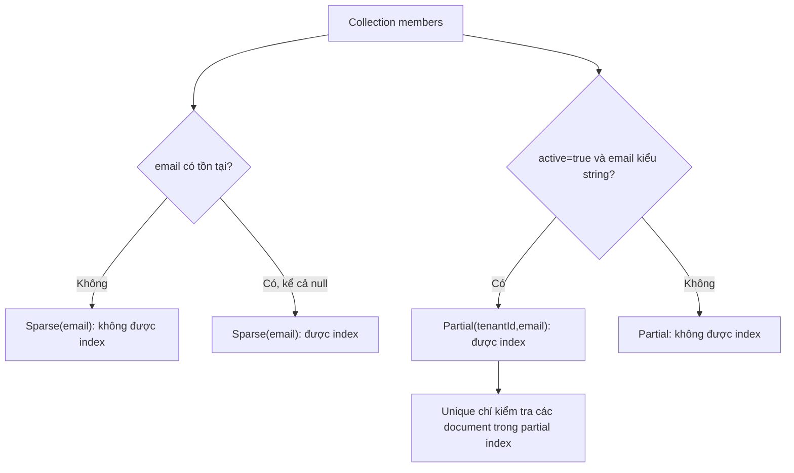

# Sparse index và partial index

> **Chương:** Chỉ mục  
> **Module:** `SPRING_DATA_MONGODB` — kết nối, ánh xạ document, thao tác MongoDB qua `MongoTemplate` hoặc repository, và thực hành thiết kế truy vấn, aggregation, index, transaction, reactive access, kiểm thử và chẩn đoán hiệu năng dữ liệu. Bài này tập trung vào **sparse index**, **partial index** và cách lựa chọn chúng cho dữ liệu có trường tùy chọn, xóa mềm và quy tắc unique theo điều kiện.

## 1. Bài toán thực tế: không phải document nào cũng có email

Một hệ thống SaaS lưu thành viên của nhiều doanh nghiệp trong collection `members`. Người dùng có thể đăng ký qua số điện thoại, chưa cung cấp email hoặc đã bị vô hiệu hóa (`active=false`). Ba yêu cầu thường xuất hiện:

1. Tìm nhanh các thành viên **có trường email** nhưng không cần index những document **thiếu** trường.
2. Bảo đảm **email của thành viên đang hoạt động không trùng trong cùng tenant**, nhưng vẫn cho phép email trùng giữa hai tenant và cho phép dùng lại email của tài khoản đã vô hiệu hóa.
3. Không tạo index lớn cho những document không được truy vấn thường xuyên, nhưng vẫn phải tránh làm các query trả **thiếu kết quả**.

Index thông thường `{email:1}` lưu index entry cả cho document không có `email` (dưới dạng khóa null). **Sparse index** thay đổi quy tắc đưa document vào index theo **sự tồn tại của indexed field**. **Partial index** dùng một **filter expression** để quyết định document nào nằm trong index, ví dụ `active:true` và `email` có kiểu BSON string.



**Điểm dễ nhầm nhất:** Sparse **không có nghĩa** “bỏ mọi giá trị null”. Trường `email: null` là **có tồn tại**, nên được đưa vào sparse index trên `email`; trường **không xuất hiện trong BSON** mới bị loại khỏi sparse index này. Với yêu cầu “chỉ email hợp lệ là chuỗi”, một partial filter dựa vào `$type:"string"` thường phù hợp hơn. Đó vẫn chỉ là điều kiện **kiểu dữ liệu**, không phải kiểm tra cú pháp email.

## 2. Bộ dữ liệu để thực nghiệm

Chỉ chạy những lệnh thay đổi dữ liệu dưới đây trên **MongoDB thử nghiệm cô lập**. `drop()` xóa toàn bộ collection `members`:

```javascript
db.members.drop();

db.members.insertMany([
  // Không có trường email.
  { _id: "U-001", tenantId: "TENANT-A", active: true,  displayName: "An" },
  // Có trường email, giá trị explicit BSON null.
  { _id: "U-002", tenantId: "TENANT-A", active: true,
    email: null, displayName: "Binh" },
  // Thành viên active với email dạng String.
  { _id: "U-003", tenantId: "TENANT-A", active: true,
    email: "ana@example.test", displayName: "Chi" },
  // Đã inactive: cố ý trùng email với U-003.
  { _id: "U-004", tenantId: "TENANT-A", active: false,
    email: "ana@example.test", displayName: "Dung" },
  { _id: "U-005", tenantId: "TENANT-A", active: true,
    email: "bob@example.test", displayName: "Ha" },
  // Email của tenant khác trùng U-003, vẫn là trường hợp hợp lệ nghiệp vụ.
  { _id: "U-006", tenantId: "TENANT-B", active: true,
    email: "ana@example.test", displayName: "Khanh" },
  // Chuỗi rỗng: vẫn là String, không phải missing/null.
  { _id: "U-007", tenantId: "TENANT-A", active: true,
    email: "", displayName: "Linh" },
  { _id: "U-008", tenantId: "TENANT-A", active: false,
    displayName: "Mai" },
  // Dữ liệu legacy sai kiểu: number.
  { _id: "U-009", tenantId: "TENANT-A", active: true,
    email: 42, displayName: "Nam" },
  // Explicit null thứ hai.
  { _id: "U-010", tenantId: "TENANT-A", active: false,
    email: null, displayName: "Oanh" }
]);
```

Với collection này:

| Document | `email` | Có field? | `active` | Sparse `{email:1}` | Partial `active=true AND email String` |
| --- | --- | :---: | :---: | :---: | :---: |
| U-001 | thiếu | Không | true | Không | Không |
| U-002 | null | Có | true | **Có** | Không |
| U-003 | "ana@example.test" | Có | true | Có | Có |
| U-004 | "ana@example.test" | Có | false | Có | Không |
| U-005 | "bob@example.test" | Có | true | Có | Có |
| U-006 | "ana@example.test" | Có | true | Có | Có |
| U-007 | "" | Có | true | Có | **Có** |
| U-008 | thiếu | Không | false | Không | Không |
| U-009 | 42 | Có | true | Có | Không |
| U-010 | null | Có | false | Có | Không |

**Số document:** collection có 10 document; sparse single-field `email` đưa 8 document có email field vào index; partial theo `active=true` và `email` kiểu string đưa 4 document vào. Đây là mô hình để giải thích, **không** phải cam kết mọi index thực tế luôn có đúng một physical entry cho mỗi document (multikey array có quy tắc khác).

**Quan trọng:** chưa tạo unique index trong bước seed này, vì U-003/U-004/U-006 cố ý trùng email và U-002/U-010 cùng chứa null. Các ví dụ unique được làm **riêng**, trên index có điều kiện phù hợp hoặc collection test riêng.

## 3. Sparse index là gì?

Sparse index chỉ chứa các document có **ít nhất một giá trị tại indexed field** theo quy tắc loại index. Với **single-field ascending/descending index** thông thường:

```javascript
db.members.createIndex(
  { email: 1 },
  { name: "ix_members_email_sparse", sparse: true }
);
```

Index trên không giữ document **thiếu hẳn `email`**, nhưng có giữ:

- `email: null` — field tồn tại dù giá trị null.
- `email: ""` — chuỗi rỗng.
- `email: 42` — giá trị số legacy.
- `email: "ana@example.test"` — chuỗi thường.

Sparse index **không kiểm tra định dạng**, không làm sạch field sai kiểu và không tự áp dụng điều kiện `active:true`.

### 3.1. So sánh với index thường

| Thuộc tính | Index thường `{email:1}` | Sparse `{email:1}` |
| --- | --- | --- |
| Document thiếu email | Có entry khóa null | **Không** được index |
| Document email=null | Có entry khóa null | **Có** entry khóa null |
| Document email="" | Có | Có |
| Document email dạng number | Có | Có |
| Điều kiện chọn document | Mọi document | Field email tồn tại |
| Sort toàn bộ collection | Có thể dùng nếu phù hợp | Thường **không** dùng nếu sẽ bỏ document thiếu field |
| Unique trên email | Missing/null bị ràng buộc unique | Missing được bỏ qua, explicit null **không** được bỏ qua |

MongoDB có một số loại index **sparse theo bản chất** (ví dụ text, geospatial với quy tắc riêng). Bài này chủ yếu nói về sparse **B-tree một field** và sẽ tách trường hợp compound ở mục 7, tránh suy quy tắc một field cho mọi index type.

### 3.2. Truy vấn có thể tận dụng sparse index

```javascript
db.members.find({
  email: { $exists: true }
}).explain("executionStats");
```

Truy vấn này **chủ động loại document thiếu `email`**, nên sparse index là một ứng viên phù hợp để tìm những document có field. Tuy nhiên `$exists:true` vẫn bao gồm `email:null` và `email:42`.

Một truy vấn bằng email thông thường:

```javascript
db.members.find({
  email: "ana@example.test"
}).explain("executionStats");
```

không cần các document thiếu email; sparse index **có thể được planner chọn**. Việc có được chọn thực tế hay không còn phụ thuộc dữ liệu, độ chọn lọc, index khác và phiên bản server.

### 3.3. Vì sao sort toàn collection không mặc định dùng sparse?

```javascript
db.members.find().sort({ email: 1 });
```

Query trên yêu cầu **tất cả document**, bao gồm U-001 và U-008 không có email. Nếu planner chỉ đọc sparse index, các document này sẽ biến mất và kết quả **không đầy đủ**. MongoDB tránh dùng sparse index cho query/sort khi việc sử dụng dẫn đến tập kết quả thiếu.

**Không cưỡng ép index sai bằng `hint()`:**

```javascript
// CHỈ MINH HỌA CẠM BẪY: làm mất các document không có email.
db.members.find()
  .sort({ email: 1 })
  .hint("ix_members_email_sparse");
```

`hint()` có thể ép MongoDB dựa vào sparse index, từ đó chỉ trả document đã được index. Đây là **thay đổi ý nghĩa kết quả quan sát được**, không chỉ là điều chỉnh tốc độ. Tương tự, `countDocuments({}, {hint:"ix_members_email_sparse"})` có thể đếm thiếu document; không dùng sparse hint để đếm toàn collection.

## 4. Partial index là gì?

Partial index chỉ đưa document vào index khi document thỏa **`partialFilterExpression`**. Biểu thức có thể chứa field không thuộc index key và có điều kiện khác việc field tồn tại.

Ví dụ index trên `email` nhưng chỉ chọn tài khoản active:

```javascript
db.members.createIndex(
  { email: 1 },
  {
    name: "ix_active_email_partial",
    partialFilterExpression: { active: true }
  }
);
```

**Cảnh báo:** nếu filter chỉ có `active:true`, mọi document active đều được index — **kể cả những document active thiếu email hoặc có email=null**. Trong partial index này, những document như U-001 và U-002 vẫn có entry cho `email` với khóa tương ứng null. Partial filter **không tự động loại null/missing của index key** khi filter không yêu cầu.

Muốn chỉ index email có kiểu String ở tài khoản active:

```javascript
db.members.createIndex(
  { email: 1 },
  {
    name: "ix_active_string_email",
    partialFilterExpression: {
      active: true,
      email: { $type: "string" }
    }
  }
);
```

Trên dataset mẫu, index này chứa `U-003`, `U-005`, `U-006`, `U-007`. Nó không bao gồm field missing, null, number hay tài khoản inactive.

**Giới hạn của `$type:"string"`:** nó chỉ là lọc kiểu BSON; giá trị `""` cũng là chuỗi và được đưa vào index. Nếu ứng dụng không chấp nhận email rỗng, phải áp quy tắc validation/normalization và có thể dùng biểu thức filter phù hợp để loại thêm, nhưng không phụ thuộc vào index để thay thế validation.

### 4.1. Các phép lọc partialFilterExpression thường gặp

Tùy phiên bản MongoDB, partial filter có thể dùng những nhóm toán tử được tài liệu hỗ trợ:

| Điều kiện | Ví dụ | Mục tiêu |
| --- | --- | --- |
| Equality | `{active:true}` | Chỉ tài khoản active |
| Field tồn tại | `{email:{$exists:true}}` | Bắt chước sparse cho một field |
| Loại BSON | `{email:{$type:"string"}}` | Chỉ email kiểu String |
| Range | `{score:{$gte:100}}` | Chỉ document vượt ngưỡng |
| Logical AND | `{$and:[{active:true},{tier:"GOLD"}]}` | Đồng thời hai predicate |
| Logical OR | `{$or:[{tier:"GOLD"},{tier:"PLATINUM"}]}` | Một trong nhiều trường hợp |
| Membership | `{status:{$in:["NEW","OPEN"]}}` | Một trong các trạng thái |
| Geo | `$geoWithin` / `$geoIntersects` | Phạm vi không gian theo index phù hợp |

Không suy rằng **mọi toán tử query** đều được dùng trong `partialFilterExpression`. Những ví dụ như `$ne`, `$nin`, `$regex`, `$expr` không nằm trong danh sách hỗ trợ chung của partial filter trong tài liệu MongoDB hiện hành; nếu muốn biểu đạt “email không rỗng” đừng tự viết `$ne:""` rồi kỳ vọng luôn tạo index được. Chọn biểu thức hợp lệ theo server version và kiểm tra lệnh `createIndex` thực tế.

### 4.2. Partial có thể làm những gì sparse không làm được?

```javascript
db.members.createIndex(
  { tenantId: 1, email: 1 },
  {
    name: "ix_active_members_by_tenant_email",
    partialFilterExpression: { active: true }
  }
);
```

Index có hai key `tenantId` và `email` nhưng filter nằm trên field `active` — field **không nhất thiết nằm trong key pattern**. Sparse không biểu đạt được trực tiếp ý nghĩa “chỉ index tài khoản active” khi `active` không phải quy tắc hiện diện của index keys.

### 4.3. Không gộp sparse và partial vào cùng index

MongoDB **không cho phép** đặt cả `sparse:true` lẫn `partialFilterExpression` trên một định nghĩa index:

```javascript
// SAI: hai options không thể cùng được khai báo.
db.members.createIndex(
  { email: 1 },
  {
    sparse: true,
    partialFilterExpression: { active: true }
  }
);
```

Với Spring Data MongoDB cũng vậy: không kết hợp `@Indexed(sparse=true, partialFilter=...)` hoặc `@CompoundIndex(sparse=true, partialFilter=...)`. **Chọn một cơ chế** theo điều kiện nghiệp vụ.

## 5. Bảng so sánh chọn index

| Tiêu chí | Sparse index | Partial index |
| --- | --- | --- |
| Quy tắc chọn document | Indexed field có mặt; compound có quy tắc riêng | Bất kỳ **filter hợp lệ** nào do `partialFilterExpression` định nghĩa |
| Loại bỏ explicit null? | **Không** nếu field tồn tại | **Có thể**, ví dụ lọc `$type:"string"` |
| Chọn active only? | Không trực tiếp theo giá trị active | Có, `{active:true}` |
| Chọn theo field khác index key | Không theo filter điều kiện | Có |
| Unique chỉ trên tập con | Có, nhưng tập con là document có key | Có, tập con theo filter nghiệp vụ |
| Query dùng index | Chỉ khi không làm mất document cần trả | Chỉ khi query bảo đảm kết quả nằm trong subset của filter |
| Index storage / write maintenance | Có thể giảm khi field nhiều document bị thiếu | Có thể giảm khi filter chọn ít document |
| Phối hợp sparse + partial trên một index | Không | Không |
| Nên dùng khi nào | Chỉ cần loại document **thiếu indexed field** | Cần chính sách **theo trạng thái, kiểu, tenant, range...** |

**Khuyến nghị chung:** partial index là công cụ linh hoạt hơn cho đa số bài toán lựa chọn subset. Sparse vẫn hữu ích khi quy tắc đơn giản chính là “field có tồn tại” và đã hiểu rõ semantics null, query coverage và phiên bản hệ thống.

## 6. Query planner có được dùng partial index hay không?

Đây là khác biệt quyết định hiệu năng và tính đúng đắn. Một partial index chỉ chứa một subset document. MongoDB **không sử dụng index đó cho query/sort nếu như vậy có thể bỏ sót document mà query yêu cầu**.

Giả sử index:

```javascript
db.members.createIndex(
  { tenantId: 1, email: 1 },
  {
    name: "ix_tenant_active_email",
    partialFilterExpression: { active: true }
  }
);
```

### 6.1. Query có điều kiện ngụ ý filter

```javascript
db.members.find({
  tenantId: "TENANT-A",
  active: true,
  email: "ana@example.test"
}).explain("executionStats");
```

Query chứa `active:true`, nên mọi document match query đều nằm trong subset `active:true` của partial index. Index `{tenantId:1,email:1}` là một **ứng viên hợp lệ** để tìm document theo hai key đó. Planner **có thể** chọn index này, không phải cam kết sẽ dùng trong mọi tình huống.

### 6.2. Query thiếu điều kiện partial filter

```javascript
db.members.find({
  tenantId: "TENANT-A",
  email: "ana@example.test"
}).explain("executionStats");
```

Query này muốn trả **cả thành viên active và inactive**; `U-004` cũng hợp lệ. Nếu chỉ dùng partial index active, query có thể **bỏ mất U-004** nên planner không thể dùng nó như một cách duy nhất để trả kết quả đầy đủ.

**Không thêm `active:true` chỉ để ép index được dùng nếu nghiệp vụ thực sự cần cả inactive**. Điều đó đổi chính sách dữ liệu, không còn tương đương query ban đầu.

### 6.3. Subset range

Một partial index lọc theo điểm:

```javascript
db.members.createIndex(
  { score: 1 },
  {
    name: "ix_score_gte_100",
    partialFilterExpression: { score: { $gte: 100 } }
  }
);
```

Query `{score:{$gte:150}}` là một subset hẹp hơn `{score:{$gte:100}}`, nên **có thể** dùng index. Query `{score:{$gte:50}}` yêu cầu cả điểm dưới 100, nên **không thể chỉ dựa vào index partial đó**.

**Lưu ý:** MongoDB ghi rõ rằng khả năng suy luận subset không giống nhau với mọi toán tử `partialFilterExpression`. Đối với các filter phức tạp, xác nhận bằng `explain()` trên đúng phiên bản server; đừng suy từ logic toán học thuần túy rằng planner chắc chắn nhận ra mọi tương đương.

### 6.4. Giải thích đúng explain

```javascript
db.members.find({
  tenantId: "TENANT-A",
  active: true,
  email: "bob@example.test"
}).explain("executionStats");
```

Quan sát `winningPlan` và các stage `IXSCAN` / `COLLSCAN` / `FETCH`, `indexName`, `totalKeysExamined`, `totalDocsExamined`, `nReturned`. Với dataset 10 document, planner có thể thích collection scan vì collection quá nhỏ; đó không phải bằng chứng partial index bị tạo sai.

Nếu index không được dùng, kiểm tra: (1) có index thật chưa, (2) query có hàm ý partial filter không, (3) field names có đúng BSON không, (4) thứ tự key compound có phù hợp query/sort không, (5) collation có khớp không, (6) dataset/cardinality có đủ để index được chọn không.

## 7. Unique sparse: nhiều document thiếu field nhưng null vẫn bị ràng buộc

### 7.1. Unique single-field index thông thường

```javascript
// Chỉ chạy trong một collection test mới, không dùng members đã seed.
db.profileSparseTest.drop();

db.profileSparseTest.createIndex(
  { email: 1 },
  { name: "ux_email_normal", unique: true }
);
```

Với **unique single-field index thông thường**, MongoDB tạo khóa null cho document thiếu `email` lẫn explicit `email:null`. Vì chỉ được có một khóa unique null, việc thêm **hai document không có email** có thể gây `E11000 duplicate key`. Đây là lý do phổ biến khiến một dự án có field optional không dùng được unique index đơn giản.

### 7.2. Unique sparse cho email tùy chọn

Tạo lại test collection để minh họa riêng:

```javascript
db.profileSparseTest.drop();

db.profileSparseTest.createIndex(
  { email: 1 },
  {
    name: "ux_email_sparse",
    unique: true,
    sparse: true
  }
);

// Hợp lệ: cả hai document đều thiếu field email.
db.profileSparseTest.insertMany([
  { _id: "P-1", displayName: "A" },
  { _id: "P-2", displayName: "B" }
]);

// Hợp lệ: explicit null đầu tiên.
db.profileSparseTest.insertOne({
  _id: "P-3", email: null
});
```

Nhưng:

```javascript
// DỰ KIẾN LỖI E11000: key null đã tồn tại từ P-3.
db.profileSparseTest.insertOne({
  _id: "P-4", email: null
});
```

**Unique sparse cho phép nhiều document thiếu email, nhưng không cho nhiều document có `email:null` ở index single-field đó.** Nếu mapper hoặc client lưu field absent dưới dạng explicit null, kết quả unique có thể khác với mong đợi.

Đừng dùng `{email:null}` để suy ngay document có field email: trong query MongoDB, equality với null có thể match cả **null** và **missing**. Khi muốn kiểm tra BSON, dùng `{email:{$exists:true}}` hoặc `{email:{$type:"null"}}` theo mục đích.

### 7.3. Sparse unique trên toàn collection không giải quyết unique theo tenant

Index:

```javascript
{ email: 1 } // unique:true, sparse:true
```

vẫn áp uniqueness của giá trị `email` **trên toàn collection**. Nó sẽ coi cùng chuỗi `"ana@example.test"` ở TENANT-A và TENANT-B là trùng, mặc dù nghiệp vụ có thể cho phép. Ngoài ra, email của user inactive vẫn chiếm một khóa unique, nên email đó **không thể được dùng lại** cho một thành viên khác chỉ vì user cũ đã inactive.

Nếu yêu cầu là unique **theo tenant, chỉ active và chỉ email string**, cần **compound unique partial index**, không chỉ unique sparse single-field.

## 8. Unique partial theo tenant, trạng thái và kiểu dữ liệu

Trên bộ dữ liệu `members` ở mục 2, tạo index:

```javascript
db.members.createIndex(
  { tenantId: 1, email: 1 },
  {
    name: "ux_tenant_active_string_email",
    unique: true,
    partialFilterExpression: {
      active: true,
      email: { $type: "string" }
    }
  }
);
```

Index này áp dụng unique đối với **cặp (tenantId, email)**, **chỉ** những document thỏa cả hai điều kiện:

- `active:true`;
- `email` là BSON string theo semantics của `$type`.

Trên dataset mẫu, index có thể xây thành công: U-003 là active của TENANT-A với `ana@example.test`, U-004 trùng email nhưng inactive nên **không nằm trong index**; U-006 dùng cùng email ở TENANT-B nên khóa ghép khác; U-002/U-010 null bị loại; U-001/U-008 missing bị loại; U-009 email number bị loại.

### 8.1. Trùng email cùng tenant active bị chặn

```javascript
// DỰ KIẾN LỖI E11000 trên ux_tenant_active_string_email.
db.members.insertOne({
  _id: "U-011",
  tenantId: "TENANT-A",
  active: true,
  email: "ana@example.test"
});
```

**Không cần gọi `existsByEmail(…)` trước khi insert để bảo đảm duy nhất.** Hai request đồng thời đều có thể đọc “email chưa tồn tại” rồi cùng ghi. MongoDB unique index là điểm ràng buộc đúng đắn ở cấp database; ứng dụng vẫn nên chủ động bắt lỗi duplicate và trả thông điệp nghiệp vụ phù hợp.

### 8.2. Inactive được dùng lại giá trị email

```javascript
// Hợp lệ: inactive document không tham gia unique partial index.
db.members.insertOne({
  _id: "U-012",
  tenantId: "TENANT-A",
  active: false,
  email: "ana@example.test"
});
```

Tuy nhiên, nếu sau đó cập nhật `U-012.active` từ `false` sang `true` trong khi U-003 đang active, MongoDB phải **thêm entry của U-012 vào partial index** và sẽ chặn update bằng lỗi duplicate key. Quy tắc unique áp dụng cả trong **insert lẫn update**, khi document đi vào/ra subset do thay đổi dữ liệu.

### 8.3. Trạng thái chuyển từ active sang inactive

```javascript
db.members.updateOne(
  { _id: "U-003", tenantId: "TENANT-A", active: true },
  { $set: { active: false } }
);
```

Sau update, U-003 không còn nằm trong unique partial index; một tài khoản **active mới** cùng tenant/email có thể được thêm, nếu không có tài khoản active nào khác trùng.

**Cần xem xét nghiệp vụ:** tài khoản inactive thật sự có cho phép giải phóng email không? Nếu bảo mật/đăng nhập đòi email gắn vĩnh viễn với một identity, việc tái sử dụng email có thể gây rủi ro. Index có thể thực thi quy tắc kỹ thuật, nhưng quy tắc đó phải được chấp thuận ở tầng domain.

### 8.4. String không đồng nghĩa email hợp lệ

`$type:"string"` cũng đưa `email:""` vào index. Nếu hai tài khoản active trong cùng tenant cùng có `email:""`, unique partial sẽ chặn tài khoản thứ hai. Để tránh:

- Chuẩn hóa input: trim, lowercase/canonicalization theo chính sách và loại giá trị rỗng.
- Khi không có email, **bỏ field** hoặc lưu một giá trị mà partial filter loại trừ, thay vì lưu chuỗi rỗng.
- Áp validation ở service và MongoDB schema validation nếu cần; index không kiểm chứng định dạng địa chỉ.
- Với email không phân biệt hoa/thường, cân nhắc **trường `normalizedEmail`** và unique index trên trường đó, hoặc collation phù hợp; không mặc định unique binary coi `"ANA@..."` và `"ana@..."` là trùng.

### 8.5. Unique partial không phải thay thế cho phân quyền

Index unique gồm `tenantId` giúp tránh trùng theo tenant, **không ngăn người dùng giả mạo tenantId trong request**. Truy vấn tìm email vẫn cần `tenantId` lấy từ principal/security context và điều kiện `active:true` nếu nghiệp vụ chỉ tìm user active.

## 9. Compound sparse: phải hiểu quy tắc khác single-field

Một sai lầm phổ biến là suy rằng sparse compound `{tenantId:1,email:1}` chỉ index document có **cả hai field**. Với **compound B-tree chỉ chứa khóa ascending/descending**, MongoDB index document khi có giá trị ở **ít nhất một field trong key pattern**.

### 9.1. Ví dụ đặc biệt dễ sai

```javascript
db.members.createIndex(
  { tenantId: 1, email: 1 },
  { name: "ix_compound_sparse", sparse: true }
);
```

Trong SaaS, hầu như document nào cũng có `tenantId`. Vì vậy **cả document thiếu email** như U-001/U-008 vẫn nằm trong compound sparse index, vì chúng có `tenantId`. Index này **không** đạt mục tiêu “chỉ index member có email”.

Đặt điều kiện rõ bằng partial:

```javascript
db.members.createIndex(
  { tenantId: 1, email: 1 },
  {
    name: "ix_compound_email_exists",
    partialFilterExpression: {
      email: { $exists: true }
    }
  }
);
```

Index trên chỉ chọn document có email field, **không cần tenantId tham gia filter**; tenantId vẫn là index key để truy vấn theo tenant.

### 9.2. Bảng khái niệm compound sparse

| Key pattern | Trường hợp document được index |
| --- | --- |
| `{email:1}`, sparse | Có email field, gồm null |
| `{tenantId:1,email:1}`, sparse; cả hai B-tree thường | Có **ít nhất một** trong hai field |
| Compound có geospatial key | Quy tắc đặc thù dựa vào field geospatial |
| Compound có text key | Quy tắc đặc thù dựa vào field text |

Vì sự khác nhau này, **đừng suy trực giác từ từ “sparse” sang tất cả compound index**. Với filter nghiệp vụ, partial index cho thấy ý định rõ ràng hơn.

## 10. Spring Data MongoDB: khai báo @Indexed

Spring Data MongoDB cung cấp annotation `org.springframework.data.mongodb.core.index.Indexed`:

### 10.1. Sparse trên property tùy chọn

```java
package demo.members;

import org.springframework.data.annotation.Id;
import org.springframework.data.mongodb.core.index.Indexed;
import org.springframework.data.mongodb.core.mapping.Document;

@Document(collection = "member_profiles")
public class MemberProfile {
    @Id
    private String id;

    @Indexed(name = "ix_contact_email_sparse", sparse = true)
    private String contactEmail;

    // Constructor/getter/setter tùy cách ánh xạ ứng dụng.
}
```

Index do metadata annotation mô tả tương đương về ý nghĩa:

```javascript
db.member_profiles.createIndex(
  { contactEmail: 1 },
  { name: "ix_contact_email_sparse", sparse: true }
);
```

Chỉ khai báo `@Indexed` **không có nghĩa** index chắc chắn tồn tại ngay khi ứng dụng chạy: **từ Spring Data MongoDB 3.0, automatic index creation mặc định bị tắt**. Cần chủ động bật khi phù hợp hoặc tạo index theo vòng đời migration/khởi tạo đã kiểm soát.

### 10.2. Unique partial với @Indexed

Khi chỉ có một field index key:

```java
package demo.members;

import org.springframework.data.annotation.Id;
import org.springframework.data.mongodb.core.index.Indexed;
import org.springframework.data.mongodb.core.mapping.Document;

@Document(collection = "members")
public class MemberByEmail {
    @Id
    private String id;

    private boolean active;

    @Indexed(
        name = "ux_active_string_email",
        unique = true,
        partialFilter = "{ 'active': true, 'email': { '$type': 'string' } }"
    )
    private String email;
}
```

Annotation này tạo index unique trên **`email`** cho các document active có email dạng String. **Đây là unique trên toàn collection cho email, không phải unique theo tenant.** Nếu yêu cầu tenant riêng, cần compound key.

`@Indexed.partialFilter` tồn tại trong Spring Data MongoDB 3.1+ theo API hiện hành; đừng sao chép code vào version cũ mà không kiểm tra. `sparse=true` và `partialFilter` **không được dùng chung**.

### 10.3. Composite unique partial với @CompoundIndex

```java
package demo.members;

import org.springframework.data.annotation.Id;
import org.springframework.data.mongodb.core.index.CompoundIndex;
import org.springframework.data.mongodb.core.mapping.Document;

@Document(collection = "members")
@CompoundIndex(
    name = "ux_tenant_active_string_email",
    def = "{ 'tenantId': 1, 'email': 1 }",
    unique = true,
    partialFilter = "{ 'active': true, 'email': { '$type': 'string' } }"
)
public class Member {
    @Id
    private String id;
    private String tenantId;
    private String email;
    private boolean active;

    protected Member() {}

    public Member(String id, String tenantId, String email, boolean active) {
        this.id = id;
        this.tenantId = tenantId;
        this.email = email;
        this.active = active;
    }

    public String getId() { return id; }
    public String getTenantId() { return tenantId; }
    public String getEmail() { return email; }
    public boolean isActive() { return active; }
}
```

Hai điểm cần nhớ:

1. `@CompoundIndex` được đặt trên **type `@Document`**, không phải field `email`.
2. `def` định nghĩa hai index keys, còn `partialFilter` xác định subset document. `unique=true` ràng buộc **cặp khóa** trong subset đó.

**Một dự án chỉ nên chọn một chiến lược tạo index tương ứng** (annotation được resolve lúc khởi tạo hoặc migration/programmatic). Đừng tạo cả annotation unique single-field và compound unique trên cùng collection nếu business chỉ cho phép unique theo tenant; chúng có semantics khác nhau và có thể xung đột.

### 10.4. BSON field alias trong index filter

Nếu entity định nghĩa:

```java
@Field("email_address")
private String email;
```

thì field thực tế là `email_address`. Với index definitions và `partialFilterExpression` viết ở dạng BSON/JSON raw, cần bảo đảm trường trong filter là **tên field MongoDB thực tế**, không dựa vào assumption rằng mọi raw `Document` đều tự được Spring Data remap:

```java
@CompoundIndex(
    name = "ux_tenant_email_active",
    def = "{ 'tenantId': 1, 'email_address': 1 }",
    unique = true,
    partialFilter = "{ 'active': true, 'email_address': { '$type': 'string' } }"
)
```

Metadata mapping của một số API có thể xử lý alias trong định nghĩa keys, nhưng **phải kiểm tra `getIndexes()` thực tế** trước khi kết luận filter đã dùng đúng BSON path. Nhất là với `PartialIndexFilter.of(Document)`, đừng phụ thuộc vào mapping của converter để biến tên Java thành BSON tên khác.

## 11. Tạo index bằng MongoTemplate và IndexOperations

Khi cần kiểm soát index theo môi trường/migration, dùng `MongoTemplate.indexOps(...)` và `Index` / `PartialIndexFilter`.

### 11.1. Tạo sparse index

```java
import org.springframework.data.domain.Sort;
import org.springframework.data.mongodb.core.index.Index;

String indexName = mongoTemplate.indexOps("member_profiles")
    .ensureIndex(
        new Index()
            .on("contactEmail", Sort.Direction.ASC)
            .named("ix_contact_email_sparse")
            .sparse()
    );
```

Lệnh trên cần `mongoTemplate` bean đã inject. `ensureIndex` yêu cầu MongoDB bảo đảm index tương ứng tồn tại; nếu collection đã có index cùng tên nhưng options khác, có thể gặp **index options conflict** thay vì âm thầm biến đổi existing index. Đừng xem nó là công cụ migration thay thế đầy đủ.

### 11.2. Tạo unique partial compound

```java
import org.bson.Document;
import org.springframework.data.domain.Sort;
import org.springframework.data.mongodb.core.index.Index;
import org.springframework.data.mongodb.core.index.PartialIndexFilter;

Index uniqueActiveEmail = new Index()
    .on("tenantId", Sort.Direction.ASC)
    .on("email", Sort.Direction.ASC)
    .named("ux_tenant_active_string_email")
    .unique()
    .partial(PartialIndexFilter.of(Document.parse(
        "{ 'active': true, 'email': { '$type': 'string' } }"
    )));

mongoTemplate.indexOps("members").ensureIndex(uniqueActiveEmail);
```

`PartialIndexFilter.of(Document)` cho phép truyền **filter raw**. Có thể dùng `PartialIndexFilter.of(CriteriaDefinition)` trên các phiên bản hỗ trợ, nhưng phải chú ý mapping field names. Không gọi `.sparse()` cùng `.partial(...)` trên cùng `Index`.

### 11.3. Spring Data tự tạo index có cần bật không?

Theo tài liệu Spring Data MongoDB, **automatic index creation bị tắt mặc định từ 3.0** để tránh phát sinh tác động không mong muốn đến vòng đời collection và hiệu năng khởi động. Trong dự án muốn bật bằng cấu hình:

```java
import org.springframework.context.annotation.Configuration;
import org.springframework.data.mongodb.config.AbstractMongoClientConfiguration;

@Configuration
public class MongoIndexConfig extends AbstractMongoClientConfiguration {

    @Override
    protected String getDatabaseName() {
        return "members_demo";
    }

    @Override
    public boolean autoIndexCreation() {
        return true;
    }

    // Cần cấu hình MongoClient/connection tương ứng với dự án thực.
}
```

**Đây là phương án cấu hình minh họa**, không phải file có thể chèn vào mọi ứng dụng Spring Boot đã có cấu hình `MongoClient`/`MongoTemplate`. Trong đa số dự án vận hành lâu dài, nên kiểm soát tạo/đổi index qua migration hoặc index initialization có chính sách rollout, vì unique index trên dữ liệu hiện hữu có thể thất bại khi tìm thấy duplicate.

Nếu dùng `@Indexed`/`@CompoundIndex`, cũng có thể dùng `MongoPersistentEntityIndexResolver` để resolve định nghĩa và `IndexOperations.ensureIndex` chủ động vào một thời điểm khởi tạo đã kiểm soát. Không gọi tạo index cho mỗi request HTTP.

### 11.4. Kiểm tra index đã tạo

```javascript
db.members.getIndexes();
```

Tìm các trường:

- `key`: key pattern như `{tenantId:1,email:1}`;
- `name`: tên index;
- `unique`: có bật hay không;
- `sparse`: có bật hay không;
- `partialFilterExpression`: filter chính xác do MongoDB lưu.

**Readback index catalog quan trọng hơn chỉ nhìn annotation Java**: annotation có thể đã viết đúng nhưng automatic index creation chưa bật, migration chưa chạy, hoặc index cũ tồn tại với options khác.

## 12. Dùng repository và MongoTemplate: query phải giữ đúng phạm vi partial

Index không tự bổ sung `active=true` vào truy vấn. Ứng dụng phải chủ động viết đúng điều kiện nghiệp vụ.

### 12.1. Repository method có điều kiện active rõ ràng

```java
package demo.members;

import java.util.Optional;
import org.springframework.data.mongodb.repository.MongoRepository;

public interface MemberRepository extends MongoRepository<Member, String> {

    Optional<Member> findByTenantIdAndEmailAndActiveTrue(
        String tenantId,
        String email
    );
}
```

Phương thức trên thường tạo predicate tương đương:

```javascript
{
  tenantId: "TENANT-A",
  email: "ana@example.test",
  active: true
}
```

Nó có phạm vi phù hợp với partial unique index `{tenantId:1,email:1}`, filter `{active:true,email:{$type:"string"}}` khi email là String có giá trị tương ứng. **Đừng chỉ dựa vào tên method để khẳng định planner chắc chắn chọn index**: query filter phải đủ điều kiện để planner suy ra subset và index phải phù hợp về key order, collation, data distribution.

### 12.2. Query bằng MongoTemplate

```java
import java.util.List;
import org.springframework.data.mongodb.core.query.Criteria;
import org.springframework.data.mongodb.core.query.Query;

Query query = Query.query(
    Criteria.where("tenantId").is("TENANT-A")
        .and("email").is("ana@example.test")
        .and("active").is(true)
);

List<Member> matches = mongoTemplate.find(query, Member.class);
```

Trong service thực tế, `tenantId` lấy từ security context đã xác thực; `email` phải được chuẩn hóa/validate. `MongoTemplate` mapping Java property names sang BSON qua converter của entity, nhưng raw index filter `PartialIndexFilter.of(Document)` cần field names đúng. Không lẫn hai ngữ cảnh.

### 12.3. Query theo active=false cần index khác nếu truy cập thường xuyên

```java
Query inactiveQuery = Query.query(
    Criteria.where("tenantId").is("TENANT-A")
        .and("active").is(false)
);
```

Partial index chỉ chứa active **không phải** công cụ cho query này. Nếu màn hình quản trị thường xem inactive members, có thể cần index thường hoặc partial index khác theo workload. **Không thêm `active=true` một cách giả tạo** chỉ để dùng index vì sẽ làm sai kết quả nghiệp vụ.

### 12.4. Đừng dùng exists() để thay unique constraint

```java
// Kiểm tra trước không loại bỏ race:
boolean alreadyExists = memberRepository
    .findByTenantIdAndEmailAndActiveTrue(
        "TENANT-A", "ana@example.test"
    )
    .isPresent();

// Một request khác có thể insert cùng email ngay sau bước exists.
// Database unique partial index vẫn là nơi chặn race.
```

Service nên bắt ngoại lệ duplicate sau ghi. Với Spring Data MongoDB, lỗi từ MongoDB thường được dịch sang `org.springframework.dao.DuplicateKeyException`; trên MongoDB Java Driver raw có thể là `com.mongodb.MongoWriteException` với mã lỗi duplicate key. Không nên tự động biến mọi `DuplicateKeyException` thành “email đã tồn tại” nếu collection có nhiều unique indexes; hãy có cách phân loại chính sách/error details phù hợp và an toàn.

## 13. Dữ liệu thiếu, explicit null, array và BSON type

### 13.1. Missing và null khác nhau ở cấp index

```javascript
db.members.find({ email: { $exists: false } }); // U-001 và U-008

db.members.find({ email: { $exists: true } });  // 8 document

db.members.find({ email: { $type: "null" } });  // U-002 và U-010

db.members.find({ email: null }); // Có thể match cả missing và explicit null
```

Khi chuyển dữ liệu cũ:

- `email` absent nghĩa là không có field.
- `email:null` nghĩa là có field với BSON Null.
- `email:""` nghĩa là có field với chuỗi rỗng.
- `email:42` là field numeric sai kiểu nếu email phải là String.

**Với sparse index**, absent bị loại còn explicit null được index. **Với partial `$type:"string"`**, null/absent/number bị loại, nhưng chuỗi rỗng được index. Đừng đánh đồng ba tình huống này thành “không có email”.

### 13.2. @Field và mapping null

Trong Spring Data MongoDB, việc property Java `email == null` được ghi thành field vắng hay BSON Null phụ thuộc đường ghi và cấu hình mapping/null handling. Đừng đoán. Hãy dùng:

```javascript
db.members.find(
  { _id: { $in: ["U-001", "U-002"] } },
  { email: 1 }
);
```

và raw BSON/Java Driver để kiểm chứng schema thật. Khi business rule phụ thuộc đúng vào missing vs null, cần quy ước mapping nhất quán, migration dữ liệu cũ và integration test với cả hai trường hợp.

### 13.3. Cảnh báo array với $type

Một field `email` có thể bị ghi sai thành array:

```javascript
{
  _id: "LEGACY-ARRAY",
  tenantId: "TENANT-A",
  active: true,
  email: ["ana@example.test", "other@example.test"]
}
```

Với query MongoDB, `$type:"string"` trên field array có thể match khi **một phần tử của array** là String; vì thế không được xem `partialFilterExpression:{email:{$type:"string"}}` là validator bảo đảm field **không phải array**. Các loại index đa khóa (`multikey`) có quy tắc unique riêng, bao gồm việc index nhiều giá trị từ một document.

Nếu domain yêu cầu email là **một String scalar**, hãy áp MongoDB JSON Schema validation và kiểm tra dữ liệu legacy, hoặc chuẩn hóa trước khi áp unique partial. Không để dữ liệu array sai schema lọt vào chỉ vì partial filter có `$type`.

## 14. Index theo vòng đời document: insert, update và xóa mềm

### 14.1. Thay đổi active làm thay đổi membership

```javascript
db.members.updateOne(
  { _id: "U-004", tenantId: "TENANT-A" },
  { $set: { active: true } }
);
```

Nếu vẫn tồn tại U-003 active với cùng email trong tenant A, MongoDB phải thêm U-004 vào unique partial index và sẽ **từ chối update** với `E11000`. Kết quả update không thể âm thầm tạo hai active accounts trùng khóa unique theo index.

Ngược lại, update `active:true → false` làm document không còn thỏa filter, nên index entry tương ứng không còn được duy trì cho document đó.

**Atomicity:** một thao tác update đối với một document được MongoDB xử lý nguyên tử ở cấp document. Nhưng workflow “vô hiệu hóa user cũ + kích hoạt user mới” gồm **hai document** là hai thao tác và không tự thành một transaction; nếu cần cả hai cùng commit, dùng transaction được topology hỗ trợ hoặc thiết kế quy trình chuyển quyền phù hợp.

### 14.2. Xóa mềm bằng deleted=false

Trong ứng dụng khác, có thể dùng cờ `deleted`:

```javascript
db.accounts.createIndex(
  { tenantId: 1, normalizedEmail: 1 },
  {
    name: "ux_live_email_per_tenant",
    unique: true,
    partialFilterExpression: {
      deleted: false,
      normalizedEmail: { $type: "string" }
    }
  }
);
```

Quy tắc: chỉ những account **đã được lưu rõ `deleted:false`** và có email chuẩn hóa kiểu String mới tham gia uniqueness. Document legacy thiếu field `deleted` sẽ **không** thỏa filter `deleted:false` (trừ các semantics đặc thù của query khác) và có thể bị loại khỏi ràng buộc unique, dù nghiệp vụ coi nó “chưa xóa”.

Trước khi bật index, hãy migration field trạng thái trên tất cả document cần tham gia. Nếu missing nghĩa là “chưa xóa” theo code cũ, filter cần được thiết kế/chuẩn hóa để không tạo lỗ hổng uniqueness.

### 14.3. Partial index không tự bổ sung deleted=false vào mọi query

```javascript
db.accounts.find({
  tenantId: "TENANT-A",
  normalizedEmail: "ana@example.test"
});
```

Nếu query trên muốn trả cả deleted account, nó **không thể dựa riêng** vào partial index chỉ chứa `deleted:false`. Muốn tìm active accounts, phải đưa `deleted:false` vào query. Index chỉ tối ưu và ràng buộc subset, không thay đổi mặc định dữ liệu được trả.

## 15. Partial TTL index và các giới hạn đặc thù

Partial index có thể kết hợp tính chất TTL theo những ràng buộc hỗ trợ của MongoDB. Ví dụ một collection phiên đăng nhập có field ngày hết hạn:

```javascript
db.sessions.createIndex(
  { expiresAt: 1 },
  {
    name: "ttl_expired_sessions",
    expireAfterSeconds: 0,
    partialFilterExpression: { state: "EXPIRED" }
  }
);
```

Chỉ những document thỏa filter `state:"EXPIRED"` nằm trong TTL index này. Khi timestamp `expiresAt` đã qua, MongoDB TTL monitor có thể dọn document theo lịch của server; **không cam kết xóa ngay thời điểm hết hạn**. TTL không thay thế kiểm tra session đã hết hạn trong auth logic.

Với **time-series collections**, partial TTL có giới hạn theo phiên bản và chỉ được dùng filter trên metadata field theo những rule được MongoDB hỗ trợ. Index TTL thường là single-field; không tự kết luận rằng mọi compound index có thể nhận `expireAfterSeconds`.

### 15.1. Các restriction quan trọng

Theo tài liệu MongoDB hiện hành, cần nhớ:

- Không dùng `sparse:true` đồng thời với `partialFilterExpression`.
- Không tạo **partial index trên `_id` index**.
- **Shard key index** không được định nghĩa là partial; các ràng buộc unique trên sharded collection còn cần xem xét **shard key prefix** và topology cụ thể.
- Nếu dùng **Client-Side Field Level Encryption** hoặc **Queryable Encryption**, partial filter không được tham chiếu field encrypted theo hạn chế MongoDB.
- Từ MongoDB 7.3, server ngăn tạo **equivalent partial indexes** trùng key và tương đương filter/collation theo định nghĩa của server. Không xem tạo nhiều index chỉ đổi tên là một chiến lược migration hợp lệ.
- Operator filter, index options, collation và các loại index đặc biệt phụ thuộc server version; xác minh thay vì áp dụng máy móc từ code mẫu.

### 15.2. Collation và email không phân biệt chữ

Unique index với default/simple collation có thể xem `"ANA@example.test"` và `"ana@example.test"` là **hai giá trị khác nhau**. Nếu business muốn coi là một email, có hai chiến lược:

1. Lưu `normalizedEmail` đã chuẩn hóa ở tầng ghi và unique trên field này.
2. Tạo index với collation phù hợp và bảo đảm query dùng collation tương thích (theo rule server).

Collation là yếu tố của cả unique comparison **và** query index selection. Đừng giả định thêm `ignoreCase` vào repository name hoặc `regex /i` tự dùng được mọi index đã có. Kiểm tra `getIndexes()` và `explain()` trong môi trường thực.

## 16. Tối ưu hiệu năng: nhỏ hơn không nhất thiết luôn nhanh hơn

### 16.1. Index entries và write amplification

Partial/sparse có thể giảm storage và chi phí duy trì index nếu một tỷ lệ lớn document bị loại. Nhưng mỗi lần thay `active`/`deleted`/`email` khiến document ra/vào filter, MongoDB phải cập nhật cấu trúc index phù hợp.

| Workload | Cân nhắc |
| --- | --- |
| 95% document thiếu email | Sparse email hoặc partial email-exists có thể tiết kiệm đáng kể. |
| Chỉ 5% user active | Partial active index có thể rất nhỏ nếu phần lớn inactive. |
| Hầu hết user active có email | Partial có thể không nhỏ hơn nhiều so với index thường. |
| Query thường xem cả active/inactive | Cần index hỗ trợ toàn bộ query, không chỉ partial active. |
| Active flag đổi liên tục | Index membership churn có thể làm write cost tăng. |
| Query theo tenant + email | Compound key thứ tự theo workload; partial filter phải phù hợp. |

Không mặc định partial index luôn nhanh hơn. Nếu query không chứng minh được filter, planner có thể không dùng index; nếu index key order không phù hợp, sort hoặc scan vẫn tốn chi phí.

### 16.2. Dùng explain và các chỉ số

```javascript
db.members.find({
  tenantId: "TENANT-A",
  active: true,
  email: "ana@example.test"
}).explain("executionStats");
```

Theo version, kiểm tra:

- `winningPlan` có `IXSCAN` hay `COLLSCAN`?
- `indexName` có đúng index dự kiến không?
- `totalKeysExamined`, `totalDocsExamined`, `nReturned` có hợp lý không?
- Có `FETCH` bổ sung do index không cover toàn bộ field cần đọc không?
- Với sort, có bước sort in-memory đáng kể không?

Kích thước index có thể xem từ `db.members.stats()`, `db.members.aggregate([{$indexStats:{}}])` hoặc công cụ monitoring phù hợp; đối chiếu phiên bản. `getIndexes()` chỉ cho thấy **định nghĩa index**, không thay thế số liệu hiệu năng thực.

### 16.3. Hạn chế hint

```javascript
// An toàn hơn là để planner chọn index từ query đúng nghiệp vụ.
db.members.find({
  active: true,
  tenantId: "TENANT-A",
  email: "bob@example.test"
});
```

`hint()` buộc server xem một index, có thể hữu ích để **chẩn đoán/so sánh** trong test. Nhưng với sparse/partial, hint không phù hợp có thể làm **kết quả không đầy đủ**. Đừng dùng một hint cứng để ép planner chọn partial index khi query muốn trả document nằm ngoài filter.

### 16.4. Aggregate có $match dùng partial index

```javascript
db.members.aggregate([
  { $match: { tenantId: "TENANT-A", active: true } },
  { $group: { _id: "$email", count: { $sum: 1 } } }
]);
```

Nếu partial index lọc `active:true` và key pattern phù hợp, phần `$match` đầu pipeline **có thể** tận dụng index. Nhưng `$group` vẫn phải tính aggregation state; index giảm input scan không đồng nghĩa toàn pipeline trở thành phép đọc không tốn tài nguyên.

## 17. Integration test với MongoDB thật: duplicate, missing và active

### 17.1. Nguyên tắc kiểm thử

Đừng chỉ unit test rằng builder `Index` chứa option `partialFilterExpression`; nó chưa chứng minh server đã tạo index và enforce unique. Một bộ test có ý nghĩa cần:

1. Tạo index bằng API Spring Data trên MongoDB **test**.
2. Seed document có **field missing**, **explicit null**, **email String**, **active true/false**.
3. Thử insert trùng key trong subset và **kỳ vọng bị MongoDB từ chối**.
4. Thử insert trùng email **ngoài subset** và khác tenant, kỳ vọng thành công.
5. Thử update khiến document **đi vào subset** và đụng unique, kỳ vọng thất bại.
6. Đọc `listIndexes()` và xác nhận index options thực tế.

### 17.2. JUnit 5 với @DataMongoTest

Ví dụ sau phù hợp về hình thức với Spring Boot 3.x, JUnit 5, AssertJ và Spring Data MongoDB tương ứng; các version Boot mới có thể thay đổi package annotation. MongoDB **phải được cấp riêng cho test** (ví dụ Testcontainers); `@DataMongoTest` không tự cung cấp server MongoDB.

```java
package demo.members;

import static org.assertj.core.api.Assertions.assertThat;
import static org.assertj.core.api.Assertions.assertThatThrownBy;

import java.util.ArrayList;
import java.util.List;
import com.mongodb.MongoWriteException;
import com.mongodb.client.MongoCollection;
import org.bson.Document;
import org.junit.jupiter.api.BeforeEach;
import org.junit.jupiter.api.Test;
import org.springframework.beans.factory.annotation.Autowired;
import org.springframework.boot.test.autoconfigure.data.mongo.DataMongoTest;
import org.springframework.data.domain.Sort;
import org.springframework.data.mongodb.core.MongoTemplate;
import org.springframework.data.mongodb.core.index.Index;
import org.springframework.data.mongodb.core.index.PartialIndexFilter;

@DataMongoTest
class MemberIndexIntegrationTest {

    @Autowired
    MongoTemplate mongoTemplate;

    @BeforeEach
    void cleanTestCollection() {
        // Chỉ chạy khi đã kết nối MongoDB TEST cô lập.
        mongoTemplate.dropCollection("members");
    }

    private MongoCollection<Document> members() {
        return mongoTemplate.getCollection("members");
    }

    private Document member(String id, String tenant,
                            boolean active, String email) {
        return new Document("_id", id)
            .append("tenantId", tenant)
            .append("active", active)
            .append("email", email);
    }

    @Test
    void uniquePartialOnlyConstrainsActiveStringEmailPerTenant() {
        mongoTemplate.indexOps("members").ensureIndex(
            new Index()
                .on("tenantId", Sort.Direction.ASC)
                .on("email", Sort.Direction.ASC)
                .named("ux_active_tenant_email")
                .unique()
                .partial(PartialIndexFilter.of(Document.parse(
                    "{ 'active': true, " +
                    "'email': { '$type': 'string' } }"
                )))
        );

        members().insertMany(List.of(
            member("A-ACTIVE", "A", true, "ana@example.test"),
            member("A-INACTIVE", "A", false, "ana@example.test"),
            member("B-ACTIVE", "B", true, "ana@example.test"),
            member("A-NULL-1", "A", true, null),
            member("A-NULL-2", "A", true, null),
            new Document("_id", "A-MISSING")
                .append("tenantId", "A")
                .append("active", true)
        ));

        // Cùng email + cùng tenant + active => unique violation.
        assertThatThrownBy(() -> members().insertOne(
            member("A-DUPLICATE", "A", true, "ana@example.test")
        )).isInstanceOf(MongoWriteException.class);

        // Đưa inactive document vào partial set cũng phải bị chặn.
        assertThatThrownBy(() -> members().updateOne(
            new Document("_id", "A-INACTIVE"),
            new Document("$set", new Document("active", true))
        )).isInstanceOf(MongoWriteException.class);

        Document savedInactive = members()
            .find(new Document("_id", "A-INACTIVE"))
            .first();
        assertThat(savedInactive).isNotNull();
        assertThat(savedInactive.getBoolean("active")).isFalse();

        List<Document> allIndexes =
            members().listIndexes().into(new ArrayList<>());
        Document target = allIndexes.stream()
            .filter(idx -> "ux_active_tenant_email"
                .equals(idx.getString("name")))
            .findFirst().orElseThrow();

        assertThat(target.getBoolean("unique")).isTrue();
        assertThat(target.get("partialFilterExpression")).isNotNull();
    }

    @Test
    void uniqueSparseExcludesMissingButNotExplicitNull() {
        mongoTemplate.indexOps("members").ensureIndex(
            new Index()
                .on("email", Sort.Direction.ASC)
                .named("ux_sparse_email")
                .sparse()
                .unique()
        );

        members().insertMany(List.of(
            new Document("_id", "MISSING-1"),
            new Document("_id", "MISSING-2"),
            new Document("_id", "NULL-1").append("email", null)
        ));

        // Document thiếu field email vẫn thêm được.
        members().insertOne(new Document("_id", "MISSING-3"));

        // Null có field => tham gia sparse unique index.
        assertThatThrownBy(() -> members().insertOne(
            new Document("_id", "NULL-2").append("email", null)
        )).isInstanceOf(MongoWriteException.class);
    }
}
```

**Tại sao dùng raw `Document` trong test?** Để bảo đảm phân biệt **field absent** với **field present = BSON null**. Một entity mapper có thể bỏ field null hoặc chuyển kiểu tùy cấu hình; raw seed chủ động kiểm tra chính semantics index trên server.

Test này **chưa được chạy trong bài viết**: hãy compile/chạy với đúng Spring Boot, driver và MongoDB server version của dự án. Không được chạy `dropCollection` trên production/shared database; nên dùng database/collection namespace test độc lập và dọn sau test.

### 17.3. Tách unit test annotation và integration test server

Unit test phù hợp để xác minh logic chọn tên index, trạng thái business và service validation. **Integration test** mới kiểm tra được:

- MongoDB có chấp nhận `partialFilterExpression` hay không.
- Unique index có build thành công trên dữ liệu hiện tại không.
- Duplicate key có bị chặn khi insert/update không.
- Kiểu BSON và null/missing có đúng như thiết kế không.
- Index catalog có đúng `key`, `name`, `unique` và `partialFilterExpression` không.
- Planner chọn index cho một query cụ thể hay không (cần explain trên dataset đại diện).

Đối với performance test, dataset 6–10 document là quá nhỏ để suy ra index có hiệu quả trong production.

## 18. Reactive access và việc tạo index không đồng bộ

`ReactiveMongoTemplate` có reactive index operations trong những phiên bản hỗ trợ:

```java
import org.bson.Document;
import org.springframework.data.domain.Sort;
import org.springframework.data.mongodb.core.index.Index;
import org.springframework.data.mongodb.core.index.PartialIndexFilter;
import reactor.core.publisher.Mono;

Index index = new Index()
    .on("tenantId", Sort.Direction.ASC)
    .on("email", Sort.Direction.ASC)
    .named("ux_active_tenant_email")
    .unique()
    .partial(PartialIndexFilter.of(Document.parse(
        "{ 'active': true, 'email': { '$type': 'string' } }"
    )));

Mono<String> created = reactiveMongoTemplate
    .indexOps("members")
    .ensureIndex(index);
```

`created` là publisher cho thao tác tạo/bảo đảm index tồn tại; **không tự thực thi nếu không được subscribe theo lifecycle ứng dụng**. Đừng gọi `created.subscribe()` fire-and-forget trong mỗi HTTP request rồi giả định index đã sẵn sàng trước một lệnh ghi phụ thuộc uniqueness. Với ràng buộc dữ liệu quan trọng, tốt hơn là tạo/migrate index **trước khi ứng dụng nhận traffic ghi**, có bước xác minh index catalog và kết quả migration.

Ví dụ query reactive có điều kiện tenant và active:

```java
import reactor.core.publisher.Flux;
import org.springframework.data.mongodb.core.query.Criteria;
import org.springframework.data.mongodb.core.query.Query;

Query filter = Query.query(
    Criteria.where("tenantId").is("TENANT-A")
        .and("active").is(true)
);

Flux<Member> activeMembers =
    reactiveMongoTemplate.find(filter, Member.class);
```

Reactive access **không thay đổi** semantics của sparse/partial index, không làm một query thiếu `active:true` tự dùng được active partial index, và không thay thế transaction/idempotency.

## 19. Quy trình đưa index vào môi trường vận hành

### 19.1. Trước khi tạo unique index

Không tạo unique index trên dữ liệu cũ mà chưa kiểm tra duplicate. Với quy tắc unique active email theo tenant, kiểm kê cặp trùng:

```javascript
db.members.aggregate([
  {
    $match: {
      active: true,
      email: { $type: "string" }
    }
  },
  {
    $group: {
      _id: {
        tenant: "$tenantId",
        email: "$email"
      },
      count: { $sum: 1 },
      ids: { $push: "$_id" }
    }
  },
  { $match: { count: { $gt: 1 } } },
  { $sort: { count: -1 } }
]);
```

Với production lớn, đừng `$push` hàng triệu ID vào một group: chỉ lấy sample/aggregate count hoặc chia batch, vì giới hạn 16 MiB BSON và memory. Kiểm tra **tenantId có bắt buộc/không null**, quy tắc normalizing email và trường `active` trên mọi document cần tham gia.

### 19.2. Kế hoạch migration an toàn

1. **Thống kê workload**: query nào cần active only, query nào cần tất cả account, truy vấn có filter tenant/index keys không?
2. **Kiểm kê schema**: số document thiếu email, email=null, email="", sai BSON type/array, thiếu active/deleted.
3. **Chốt business rule**: unique toàn hệ thống hay theo tenant, active/inactive có dùng lại email không, case-insensitive ra sao?
4. **Dọn dữ liệu**: normalize email, sửa duplicate và chuyển legacy status theo chính sách.
5. **Tạo index mới có tên rõ ràng**, chọn sparse hoặc partial; kiểm tra disk space, thời gian index build, replica lag/ảnh hưởng tải.
6. **Readback `getIndexes()`** và chạy integration tests lẫn `explain` trên query thực, kiểm tra duplicate behavior.
7. **Chuyển ứng dụng** sang query filter đúng và theo dõi metrics/errors.
8. Chỉ **xóa index cũ** sau khi xác nhận nó không còn được query/workload cần đến và có kế hoạch rollback.

Không trông chờ `ensureIndex` tự sửa một index đang tồn tại nếu `partialFilterExpression`/`unique`/`sparse` thay đổi. Có thể gặp `IndexOptionsConflict`, `IndexKeySpecsConflict` hoặc lỗi do dữ liệu duplicate; cách xử lý cần migration cụ thể và hiểu giới hạn server version.

### 19.3. Index mới không phải ràng buộc duy nhất

Unique partial index bảo vệ quy tắc khóa đối với những document **nằm trong filter**. Nếu filter bỏ các document dữ liệu legacy vì thiếu `active` hoặc `email` sai kiểu, những document đó **không chịu ràng buộc unique** như mong muốn. Cần kết hợp:

- MongoDB schema validation để giới hạn kiểu/field cần thiết.
- Validation, normalization, authorization ở service.
- Unique index đúng phạm vi.
- Integration test, kiểm kê dữ liệu cũ và giám sát vi phạm.

Không để application logic hiểu active theo một quy tắc, còn partial index lại hiểu active theo quy tắc khác.

## 20. Lỗi thường gặp và checklist chẩn đoán

| Hiện tượng | Nguyên nhân | Hướng khắc phục |
| --- | --- | --- |
| Unique sparse vẫn báo duplicate với nhiều email=null | Sparse giữ document có field null. | Dùng partial filter phù hợp hoặc đổi quy ước missing/null sau migration. |
| Unique thường báo lỗi với hai document không có email | Index thường index missing thành khóa null. | Dùng unique sparse/partial nếu email là optional theo nghiệp vụ. |
| Compound sparse vẫn index document thiếu email | Một field khác như tenantId có mặt, đủ điều kiện compound sparse. | Dùng partial `email:{$exists:true}` hoặc `$type:"string"`. |
| Partial index tạo được nhưng query không dùng | Query không bao gồm/ngụ ý filter hoặc planner chọn plan khác. | Kiểm tra query filter, `explain`, index keys, collation và workload. |
| Query sort toàn collection không dùng sparse | Sparse có thể bỏ document thiếu field. | Dùng index thường nếu cần toàn bộ kết quả; không ép hint sai. |
| `hint()` làm count nhỏ hơn số document thật | Cưỡng ép sparse/partial index chỉ chứa một subset. | Bỏ hint khi cần đếm toàn collection. |
| Index `active:true` nhưng vẫn có null email | Partial filter không nói email phải tồn tại/khác null. | Thêm điều kiện email phù hợp vào filter. |
| `$type:"string"` vẫn chấp nhận chuỗi rỗng | Chuỗi rỗng là BSON String. | Validation/normalization, không chỉ dựa vào type filter. |
| `$type:"string"` nhận field email kiểu array | Query `$type` có semantics trên phần tử array. | MongoDB JSON schema validation cho scalar String. |
| Tạo unique partial bị E11000 ngay lúc build | Dữ liệu trong subset đã có key trùng. | Kiểm kê/cleanup trước migration. |
| Thay inactive thành active bị duplicate | Document đi vào subset và va chạm unique key. | Xử lý conflict ở nghiệp vụ, không bỏ unique index. |
| `@Indexed` không tạo index trên DB | Auto index creation mặc định off hoặc resolver chưa chạy. | Kiểm tra `getIndexes()`, migration/khởi tạo. |
| Index theo `@Field` không match query | Tên field Java và BSON không khớp. | Readback raw `Document` và catalog index. |
| Duplicate email giữa hai tenant vẫn bị chặn | Đã tạo unique trên email đơn, không phải cặp tenant/email. | Compound unique index với tenant prefix theo business rule. |
| Email khác hoa/thường vẫn trùng theo người dùng nhưng DB cho phép | Binary collation không tự normalize. | Chuẩn hóa email hoặc collation thích hợp. |
| Index build làm production chậm | Dataset lớn, nhiều index entries, replica load. | Chạy migration có kiểm soát, đo và theo dõi rollback. |
| Index không bảo đảm uniqueness toàn cluster như mong đợi | Unique/shard key constraints trên sharded collection. | Rà lại topology và yêu cầu prefix shard key. |

**Quy trình debug 8 bước:** (1) đọc raw BSON; (2) xác định field missing/null/empty/type; (3) đọc `getIndexes()`; (4) kiểm tra key pattern và unique flag; (5) so sánh query predicate với partial filter; (6) xem `explain`; (7) thử insert/update thật trên MongoDB test; (8) rà tenant, normalization và schema validation.

## 21. Bài thực hành: email tùy chọn nhưng duy nhất khi active

**Đề bài:** hệ thống quản lý thành viên đa tenant có `tenantId`, `email` và `active`. Email không bắt buộc, nhưng khi có email String của một thành viên active thì phải duy nhất trong tenant đó.

1. Seed collection `members` theo 10 document mẫu ở mục 2. Kiểm tra số document missing, explicit null, chuỗi rỗng và sai kiểu.
2. Tạo sparse index `{email:1}`, so sánh query `email:{$exists:true}` với query `email:null`.
3. Đo `find().sort({email:1}).explain()`, sau đó thử `hint()` trên **test** và giải thích vì sao có thể mất U-001/U-008.
4. Trong collection riêng, tạo unique sparse email, insert nhiều document thiếu email và thử insert hai document email=null. Giải thích kết quả.
5. Tạo partial index `{email:1}` với filter `active:true`. Giải thích vì sao U-001/U-002 vẫn có thể nằm trong index.
6. Thay filter bằng `{active:true,email:{$type:"string"}}` và kiểm tra những document nào được index.
7. Tạo **unique compound partial** trên `{tenantId:1,email:1}`. Xác nhận U-003/U-004 (active/inactive) và U-003/U-006 (khác tenant) cùng tồn tại.
8. Thử insert U-011 active, TENANT-A, `ana@example.test`; test phải bắt lỗi duplicate. Thử update U-004 từ inactive thành active và xác minh bị chặn.
9. Ghi thêm `email:""` và `email:42`; giải thích type filter và thiết kế schema validation.
10. Xây entity `Member` với `@CompoundIndex(unique=true, partialFilter=...)`, kiểm tra `getIndexes()` để bảo đảm index thực sự được tạo.
11. Làm lại bằng `MongoTemplate.indexOps(...).ensureIndex` với `PartialIndexFilter.of(Document.parse(...))`.
12. Viết repository method `findByTenantIdAndEmailAndActiveTrue`; so sánh query có và không có `active:true` bằng `explain("executionStats")`.
13. Tạo compound sparse `{tenantId:1,email:1}` trên test và giải thích vì sao **missing email vẫn có index entry** khi tenantId có mặt.
14. Mô phỏng một dữ liệu legacy thiếu field active và thiết kế quy trình migration trước khi dùng unique partial index.
15. Viết JUnit integration test cho null/missing, unique violation, update membership, tenant khác và index catalog.
16. Đề xuất rollout production, chỉ ra rủi ro index build, duplicate existing data và kế hoạch rollback.

### Câu hỏi tự kiểm tra

- Vì sao sparse `{email:1}` vẫn index `email:null`?
- `email` bị thiếu khác `email:""` như thế nào?
- Vì sao unique sparse cho phép nhiều document thiếu email nhưng không cho nhiều explicit null ở single-field index?
- Partial index nào chỉ chọn active users có email kiểu String? Chuỗi rỗng có được chọn không?
- Nếu index key là `email` nhưng partial filter là `active:true`, user active thiếu email có nằm trong index không?
- Khi query không chứa `active:true`, liệu partial active index có thể đảm bảo kết quả đầy đủ không?
- Vì sao compound sparse `{tenantId:1,email:1}` không tương đương `email exists`?
- Unique compound partial giúp cho phép cùng email ở hai tenant như thế nào?
- Chuyển inactive → active có thể làm update thất bại vì lý do gì?
- `$type:"string"` có kiểm tra scalar String và định dạng email không?
- Tại sao không được khai báo `sparse=true` cùng `partialFilterExpression`?
- Khi `@Indexed` đã khai báo, có nên mặc định index tồn tại trên MongoDB không?
- `hint()` có thể làm kết quả đếm/sort sai trong trường hợp nào?
- Một ứng dụng đang sharded cần cân nhắc gì về unique index và shard key?
- Vì sao index nhỏ hơn không đảm bảo query nhanh hơn?

## 22. Ghi nhớ và nguồn tham khảo

- **Sparse index single-field** bỏ document **thiếu indexed field**, nhưng **không bỏ document có field = null**.
- **Partial index** chọn document bằng `partialFilterExpression`, có thể dùng status, type, existence hoặc range thay vì chỉ kiểm tra field tồn tại.
- **Không kết hợp `sparse:true` và `partialFilterExpression` trong một index**.
- **Unique sparse** chỉ ràng buộc các document có field; explicit null vẫn bị ràng buộc trong unique sparse single-field.
- **Unique partial** áp dụng ràng buộc duy nhất **chỉ trong subset được filter chọn**. Với multi-tenant, compound key phải chứa những trường xác định phạm vi uniqueness.
- **Compound sparse B-tree** có thể index document khi **ít nhất một** index key tồn tại; không phải lúc nào cũng có đủ mọi field.
- **Query phải ngụ ý filter của partial index** thì planner mới có thể dùng index mà không mất kết quả; ngay cả vậy, planner có thể chọn index khác. Đo bằng `explain`.
- **Field thiếu, explicit null, chuỗi rỗng, sai BSON type và array** phải được phân biệt, nhất là khi index bảo vệ dữ liệu.
- Trong Spring Data MongoDB, dùng `@Indexed(sparse=true)`, `@Indexed(partialFilter=...)`, `@CompoundIndex(partialFilter=...)` hoặc `IndexOperations.ensureIndex`; **auto index creation bị tắt mặc định từ 3.0**.
- **Đừng coi index là thay thế cho validation, authorization hay migration**. Trước khi đổi unique rule, kiểm kê dữ liệu, thử trong MongoDB test, xác minh catalog và lập kế hoạch triển khai.

Tài liệu chính thức để đối chiếu đúng phiên bản MongoDB/Spring Data của hệ thống:

- [MongoDB — Sparse Indexes](https://www.mongodb.com/docs/manual/core/index-sparse/)
- [MongoDB — Partial Indexes](https://www.mongodb.com/docs/manual/core/index-partial/)
- [MongoDB — Unique Indexes](https://www.mongodb.com/docs/manual/core/index-unique/)
- [MongoDB — Compound Indexes và Sparse Compound Indexes](https://www.mongodb.com/docs/manual/core/indexes/index-types/index-compound/)
- [MongoDB — Index Properties](https://www.mongodb.com/docs/manual/core/indexes/index-properties/)
- [MongoDB — Explain Results](https://www.mongodb.com/docs/manual/reference/explain-results/)
- [MongoDB — TTL Indexes](https://www.mongodb.com/docs/manual/core/index-ttl/)
- [Spring Data MongoDB — Index Creation](https://docs.spring.io/spring-data/mongodb/reference/mongodb/mapping/mapping-index-management.html)
- [Spring Data MongoDB — @Indexed API](https://docs.spring.io/spring-data/mongodb/docs/current/api/org/springframework/data/mongodb/core/index/Indexed.html)
- [Spring Data MongoDB — @CompoundIndex API](https://docs.spring.io/spring-data/mongodb/docs/current/api/org/springframework/data/mongodb/core/index/CompoundIndex.html)
- [Spring Data MongoDB — Index API](https://docs.spring.io/spring-data/mongodb/docs/current/api/org/springframework/data/mongodb/core/index/Index.html)
- [Spring Data MongoDB — PartialIndexFilter API](https://docs.spring.io/spring-data/mongodb/docs/current/api/org/springframework/data/mongodb/core/index/PartialIndexFilter.html)
