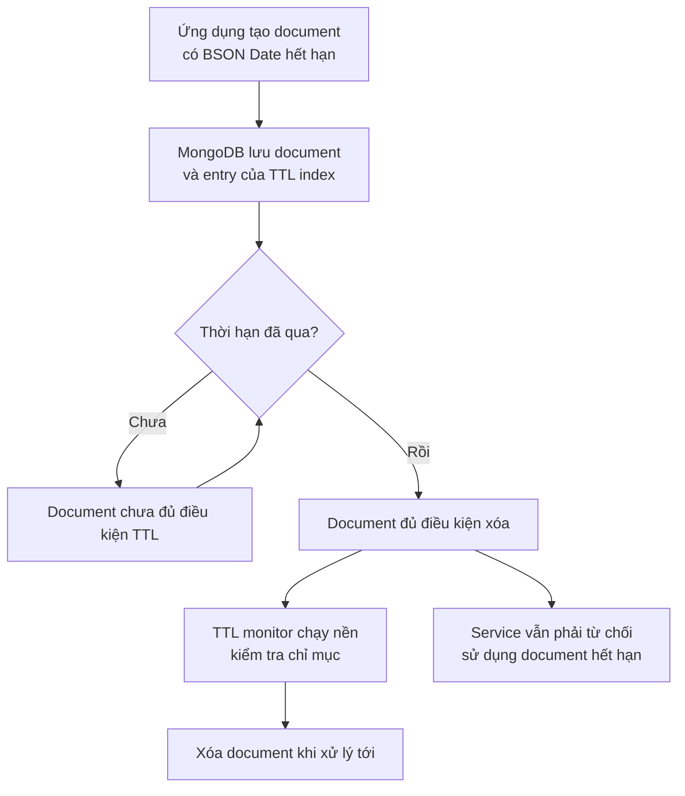

# TTL index và ý nghĩa xóa dữ liệu theo thời gian

## 1. TTL index giải quyết vấn đề gì?

Trong **Spring Data MongoDB**, một số loại dữ liệu chỉ cần tồn tại trong khoảng thời gian hữu hạn: phiên đăng nhập tạm, mã xác minh đã sử dụng, log kỹ thuật ngắn hạn, kết quả tính toán tạm, hoặc những sự kiện đã qua thời gian lưu giữ. Nếu dùng một job Java định kỳ để quét rồi gọi `deleteMany(...)`, ứng dụng phải tự lo việc chạy job, retry, phân tán nhiều instance và xử lý khi job bị bỏ lỡ.

**TTL (Time To Live) index** là một chỉ mục đặc biệt của MongoDB cho phép server **tự động xóa nguyên document** khi thời gian đủ điều kiện hết hạn. Ta vẫn phải thiết kế vòng đời dữ liệu, nhưng không cần ứng dụng gọi `delete` cho từng bản ghi đến hạn.

Ví dụ:

```javascript
db.temporary_sessions.createIndex(
  { expires_at: 1 },
  { name: "sessions_expire_at_ttl", expireAfterSeconds: 0 }
)
```

Nếu document có `expires_at = ISODate("2026-11-20T08:00:00Z")`, từ thời điểm đó MongoDB coi document **đủ điều kiện bị xóa**; một tiến trình TTL nền sẽ xử lý khi tới lượt. **Không có cam kết document biến mất chính xác lúc 08:00:00**. Ngay sau thời điểm đó, document có thể vẫn còn trong collection trong một khoảng thời gian.

> **Quy tắc quan trọng:** TTL là cơ chế *thu dọn dữ liệu theo thời gian*, **không phải cơ chế kiểm soát thời hạn bảo mật theo thời gian thực**. API xác thực phiên phải tự kiểm tra `expiresAt > now` và trạng thái thu hồi, kể cả khi TTL index đã tồn tại.

### Các khái niệm cần phân biệt

| Khái niệm | Ý nghĩa | Ai chịu trách nhiệm? |
| --- | --- | --- |
| **Hết hạn nghiệp vụ** | Phiên, vé, mã hoặc bản ghi không còn được sử dụng | Domain/service kiểm tra thời điểm, quyền và trạng thái |
| **Đủ điều kiện TTL** | Field BSON Date cộng `expireAfterSeconds` không còn lớn hơn thời gian hiện tại của server | MongoDB xác định |
| **Xóa vật lý document** | Document không còn được tìm thấy trong collection sau lệnh xóa của TTL monitor | Tiến trình TTL nền của MongoDB |
| **Lưu trữ/đối soát** | Dữ liệu cần được giữ để tuân thủ, điều tra hoặc audit | Chính sách nghiệp vụ riêng; không dựa chỉ vào TTL |
| **Giải phóng dung lượng vật lý** | File dữ liệu dùng ít disk hơn | Cơ chế quản lý storage; xóa document không bảo đảm file thu nhỏ tức thì |

Một TTL index có thể được dùng như index bình thường để hỗ trợ truy vấn theo field thời gian, nhưng mục tiêu chính trong bài này là **vòng đời xóa dữ liệu**. Cần hiểu **kiểu BSON**, **cách tính thời hạn**, **độ trễ**, **giới hạn cấu trúc index** và **cách cấu hình qua Spring Data MongoDB**.



## 2. Hai kiểu tính hết hạn: tuổi tương đối và thời điểm tuyệt đối

MongoDB dùng tùy chọn `expireAfterSeconds` (số giây) trên một index **đơn field**. Thời điểm document đủ điều kiện xóa là:

\[
\text{eligibleAt} = \text{indexedDate} + \text{expireAfterSeconds}
\]

### 2.1. Lưu trong 7 ngày kể từ lúc tạo

Đối với log kỹ thuật chỉ cần lưu 7 ngày, field `created_at` được lưu là BSON Date:

```javascript
db.debug_events.createIndex(
  { created_at: 1 },
  {
    name: "debug_events_7d_ttl",
    expireAfterSeconds: 7 * 24 * 60 * 60
  }
)
```

Document mẫu:

```javascript
db.debug_events.insertOne({
  _id: "EVT-1001",
  tenant_id: "SHOP-A",
  created_at: new Date(),
  level: "DEBUG",
  message: "Đã xử lý sự kiện thử nghiệm"
})
```

Document đủ điều kiện TTL khi `created_at + 604800 giây` đã qua. Đổi `expireAfterSeconds` của index sẽ **đổi chính sách thời gian áp dụng lên mọi document thuộc chỉ mục**. Các bản ghi đã cũ có thể lập tức đủ điều kiện xóa khi chính sách bị rút ngắn.

### 2.2. Mỗi document có một thời điểm hết hạn riêng

Phiên đăng nhập tạm có thể được cấp thời hạn 10 phút, 30 phút hoặc 2 giờ theo chính sách. Thay vì tạo nhiều TTL index, ứng dụng tính `expires_at` cho từng document và đặt **`expireAfterSeconds: 0`**:

```javascript
db.temporary_sessions.createIndex(
  { expires_at: 1 },
  { name: "sessions_expire_at_ttl", expireAfterSeconds: 0 }
)

db.temporary_sessions.insertMany([
  {
    _id: "SESSION-001",
    tenant_id: "SHOP-A",
    token_hash: "SHA256_EXAMPLE_001",
    created_at: ISODate("2026-11-20T07:00:00Z"),
    expires_at: ISODate("2026-11-20T07:30:00Z")
  },
  {
    _id: "SESSION-002",
    tenant_id: "SHOP-A",
    token_hash: "SHA256_EXAMPLE_002",
    created_at: ISODate("2026-11-20T07:00:00Z"),
    expires_at: ISODate("2026-11-20T09:00:00Z")
  }
])
```

Khi xét tại `2026-11-20T08:00:00Z`:

| Document | `expires_at` | Trạng thái nghiệp vụ | Trạng thái TTL |
| --- | --- | --- | --- |
| `SESSION-001` | 07:30 UTC | Hết hạn, **không được chấp nhận** | Đủ điều kiện xóa, có thể còn chờ monitor |
| `SESSION-002` | 09:00 UTC | Chưa hết hạn, nếu không bị thu hồi | Chưa đủ điều kiện xóa |

Những giá trị `token_hash` ở trên **chỉ là placeholder**, không phải hash mật mã hợp lệ. Trong ứng dụng thật, không ghi token bí mật ở dạng rõ; dùng bộ tạo token an toàn, lưu hash và kiểm tra với cơ chế xác thực được thiết kế đúng.

### 2.3. Chọn kiểu nào?

| Yêu cầu | Mô hình | TTL option |
| --- | --- | --- |
| Mọi debug event có thời hạn giữ 7 ngày | `created_at` | `expireAfterSeconds: 604800` |
| Mỗi phiên có giờ hết hạn khác nhau | `expires_at` | `expireAfterSeconds: 0` |
| Job tạm cần gia hạn thời gian tồn tại khi được thuê lại | `lease_expires_at` hoặc `expires_at` cập nhật có điều kiện | Thường `expireAfterSeconds: 0`, nhưng **không được dùng TTL thay lease logic** |
| Dữ liệu audit bắt buộc giữ tối thiểu theo luật/chính sách | Không mặc định xóa bằng TTL | Chính sách lưu giữ/archiving rõ ràng |
| Document phải bị chặn sử dụng đúng giây hết hạn | Filter nghiệp vụ theo thời gian | TTL có thể giúp dọn rác, **không đủ để chặn sử dụng** |

## 3. Điều kiện BSON: phải là Date hoặc array Date

TTL index chỉ có thể tính hết hạn từ field chứa **BSON Date** hoặc **array có phần tử BSON Date**. Trong Java, `Instant` hoặc `java.util.Date` thường được Spring Data MongoDB mapping sang BSON Date; trong `mongosh` dùng `ISODate(...)` hoặc `new Date(...)`.

### Các giá trị không phù hợp

```javascript
// Hợp lệ: BSON Date.
{ _id: "A", expires_at: ISODate("2026-11-20T08:00:00Z") }

// Không được TTL tính đúng: String chứa ngày.
{ _id: "B", expires_at: "2026-11-20T08:00:00Z" }

// Không được TTL tính đúng: số Unix milliseconds.
{ _id: "C", expires_at: 1795161600000 }

// Thiếu field -> không có mốc TTL để xóa.
{ _id: "D" }

// Null -> không có BSON Date để tính TTL.
{ _id: "E", expires_at: null }
```

Tạo TTL index thành công **không tự chuyển String/Long thành Date** và **không tự điền field còn thiếu**. Một hệ thống lưu epoch milliseconds dưới dạng `long` có thể tích lũy document mãi dù index được tạo đúng.

### Array Date và quy tắc ngày sớm nhất

Nếu field TTL là array có nhiều BSON Date, MongoDB sử dụng **ngày sớm nhất** trong các phần tử Date để xác định hết hạn:

```javascript
{
  _id: "A",
  expiry_candidates: [
    ISODate("2026-11-20T07:00:00Z"),
    ISODate("2026-11-21T07:00:00Z")
  ]
}
```

Với index `{ expiry_candidates: 1 }` và `expireAfterSeconds: 0`, document đủ điều kiện xóa từ **20/11 lúc 07:00 UTC**, **không đợi ngày 21/11**. Điều này dễ gây xóa sớm khi domain định nghĩa “giữ đến ngày muộn nhất”. Với thời điểm hết hạn, hãy ưu tiên **một field Date duy nhất** có ý nghĩa rõ ràng.

### Schema validation

Khi TTL phục vụ thu dọn dữ liệu bắt buộc, nên cân nhắc validator để bảo đảm field có kiểu Date:

```javascript
// Chỉ tạo trên database demo mới, không áp đặt lên dữ liệu cũ khi chưa kiểm tra.
db.createCollection("verified_sessions", {
  validator: {
    $jsonSchema: {
      bsonType: "object",
      required: ["expires_at"],
      properties: {
        expires_at: {
          bsonType: "date",
          description: "Phiên phải có mốc hết hạn kiểu BSON Date"
        }
      }
    }
  }
})
```

Ví dụ validator chỉ minh họa việc bắt buộc `expires_at` tồn tại và đúng BSON type; nó **không** tự kiểm tra rằng `expires_at` nằm trong tương lai hoặc quyền truy cập hợp lệ.

## 4. TTL không xóa tức thì: cơ chế monitor và hệ quả

TTL deletion được chạy bởi **tiến trình nền trên `mongod`**. Trong hoạt động bình thường, monitor kiểm tra định kỳ (thường khoảng **60 giây một vòng**) rồi thực hiện thao tác xóa các document đến hạn. Khi hệ thống bận hoặc có rất nhiều document hết hạn, độ trễ xóa có thể **vượt quá một phút**. Vì vậy:

- Đừng viết test `Thread.sleep(1000)` rồi yêu cầu document phải bị xóa.
- Đừng dùng `findById(...) != null` làm bằng chứng phiên còn hợp lệ.
- Đừng coi TTL như bộ định thời có SLA xóa chính xác từng giây.
- Đừng hiểu TTL như một lệnh *delete ngay lập tức* trên mọi node replica set.

Trong replica set, **primary** thực hiện TTL deletion; secondary **sao chép các thao tác xóa** qua replication, không tự chạy luồng xóa TTL độc lập để quyết định document nào cần biến mất. Vì vậy, lag hoặc failover có thể ảnh hưởng khi document thật sự không còn thấy từ từng read preference.

### Dòng thời gian minh họa

```text
07:30:00  expires_at của SESSION-001 đã đến hạn
07:30:01  API kiểm tra expires_at > now -> từ chối
07:30:05  Document có thể vẫn còn trong MongoDB
07:31:00  TTL monitor có thể bắt đầu xóa document
07:31:20  Khi hệ thống đang tải cao, việc xóa có thể còn đang xử lý
```

Đây là kịch bản minh họa, **không phải lịch chạy monitor được bảo đảm**. TTL không áp dụng logic “hết hạn thì callback Java chạy” hoặc gửi event nghiệp vụ đáng tin cậy đúng thời điểm; các luồng gửi thông báo, thu hồi quyền và audit phải có cơ chế riêng.

### TTL là xóa document, không phải xóa từng field

Một TTL index trên `expires_at` sẽ **xóa toàn bộ document** khi đến hạn, kể cả document còn có field khác:

```javascript
{
  _id: "SESSION-001",
  expires_at: ISODate("2026-11-20T07:30:00Z"),
  audit_note: "Cần đối soát"
}
```

Nếu `audit_note` phải được giữ, TTL trên document đó không phù hợp. Nên tách audit record sang một collection có retention policy riêng hoặc archive trước khi xóa. TTL **không** biết field nào được phép bỏ, field nào cần giữ.

## 5. Khai báo TTL index trên entity Spring Data MongoDB

Trong Java, một cách thuận tiện là đánh dấu field ngày bằng annotation `@Indexed` của Spring Data:

```java
package com.example.sessions;

import java.time.Instant;
import org.springframework.data.mongodb.core.index.Indexed;
import org.springframework.data.mongodb.core.mapping.Document;
import org.springframework.data.mongodb.core.mapping.Field;
import org.springframework.data.mongodb.core.mapping.FieldType;
import org.springframework.data.mongodb.core.mapping.MongoId;

@Document(collection = "temporary_sessions")
public class SessionTicket {

    @MongoId(FieldType.STRING)
    private String id;

    @Field("tenant_id")
    private String tenantId;

    @Field("account_id")
    private String accountId;

    @Indexed(name = "token_hash_unique", unique = true)
    @Field("token_hash")
    private String tokenHash;

    @Field("created_at")
    private Instant createdAt;

    @Indexed(name = "sessions_expire_at_ttl", expireAfter = "0s")
    @Field("expires_at")
    private Instant expiresAt;

    private boolean revoked;

    protected SessionTicket() {}

    public SessionTicket(
            String id,
            String tenantId,
            String accountId,
            String tokenHash,
            Instant createdAt,
            Instant expiresAt) {
        this.id = id;
        this.tenantId = tenantId;
        this.accountId = accountId;
        this.tokenHash = tokenHash;
        this.createdAt = createdAt;
        this.expiresAt = expiresAt;
        this.revoked = false;
    }

    public String getId() { return id; }
    public String getTenantId() { return tenantId; }
    public String getAccountId() { return accountId; }
    public String getTokenHash() { return tokenHash; }
    public Instant getCreatedAt() { return createdAt; }
    public Instant getExpiresAt() { return expiresAt; }
    public boolean isRevoked() { return revoked; }
}
```

Phân tích annotation:

| Annotation | Ý nghĩa |
| --- | --- |
| `@Document(collection = "temporary_sessions")` | Entity lưu ở collection `temporary_sessions` |
| `@MongoId(FieldType.STRING)` | `id` ánh xạ thành `_id` có BSON String; không tự chuyển mã dạng UUID thành ObjectId |
| `@Field("expires_at")` | Property Java `expiresAt` tương ứng field BSON `expires_at` |
| `@Indexed(expireAfter = "0s")` | Yêu cầu index TTL xóa theo chính giá trị `expires_at` |
| `@Indexed(unique = true)` trên `tokenHash` | Index duy nhất phục vụ một khóa tra cứu; **không phải TTL index** |

`@Indexed(expireAfter = "0s")` và tên index mô tả **định nghĩa mong muốn**. **Đặt annotation không đồng nghĩa index đã chắc chắn tồn tại trên MongoDB**. Cần bảo đảm cơ chế tạo index thực sự chạy và kiểm tra metadata từ collection.

### Tham số annotation có thay đổi theo phiên bản không?

Trong các nhánh Spring Data MongoDB hiện đại, `@Indexed(expireAfter = "10s")`, `"1d"` hoặc `"P2D"` là cách khai báo TTL dựa trên thời lượng. Thuộc tính cũ `expireAfterSeconds` vẫn gặp trong dự án trước đây, nhưng đã được đánh dấu deprecated ở một số nhánh mới; cần kiểm tra API của phiên bản Spring Data đang dùng trước khi chọn.

Ví dụ giữ log trong một ngày:

```java
@Indexed(name = "debug_event_1d_ttl", expireAfter = "1d")
@Field("created_at")
private Instant createdAt;
```

Điều này khác với `expireAfter = "0s"` trên `expiresAt`: cách đầu dùng **thời gian lưu cố định kể từ một field**, cách sau dùng **mốc hết hạn tuyệt đối đã tính trước trong từng document**.

### Index tự động có được tạo không?

Từ Spring Data MongoDB 3.x, cơ chế tự tạo index theo annotation mặc định **không bật**. Dự án có thể bật qua cấu hình phù hợp, nhưng với môi trường production nên xem việc tạo/sửa TTL index là **thay đổi schema được quản lý có kiểm soát**, vì tạo index trên dữ liệu cũ có thể khiến nhiều document bị xóa.

Một tùy chọn Spring Boot thường dùng là:

```properties
spring.data.mongodb.auto-index-creation=true
```

Chỉ bật sau khi kiểm tra phiên bản Boot đang chạy và chính sách triển khai. Đừng mặc định mọi service khởi động cùng lúc đều nên tự thay đổi index production. Với ứng dụng cần kiểm soát rollout, ưu tiên migration hoặc khởi tạo index có giám sát, sau đó xác nhận bằng `getIndexes()`.

### DTO và dữ liệu bí mật

`SessionTicket` là entity lưu trữ, không phải response HTTP. Không trả `tokenHash`, ID kỹ thuật hoặc các field nhạy cảm chỉ vì chúng nằm trên entity. Khi sử dụng TTL cho session/token, phải bảo đảm **chặn truy cập đã hết hạn ngay tại service** và đặt giới hạn thời gian thích hợp với loại token.

## 6. Tạo TTL index bằng `MongoTemplate.indexOps`

Trong một số dự án, nhóm vận hành không muốn annotation tự động tác động database ở mọi lần khởi động. Spring Data MongoDB cung cấp `IndexOperations` để tạo và kiểm tra index theo chủ đích.

### 6.1. Định nghĩa index bằng Java

```java
package com.example.sessions;

import java.time.Duration;
import org.springframework.data.domain.Sort;
import org.springframework.data.mongodb.core.MongoTemplate;
import org.springframework.data.mongodb.core.index.Index;
import org.springframework.stereotype.Component;

@Component
public class SessionIndexSetup {

    private final MongoTemplate mongoTemplate;

    public SessionIndexSetup(MongoTemplate mongoTemplate) {
        this.mongoTemplate = mongoTemplate;
    }

    public String ensureExpirationIndex() {
        Index ttl = new Index()
            .on("expiresAt", Sort.Direction.ASC)
            .expire(Duration.ZERO)
            .named("sessions_expire_at_ttl");

        // Trên Spring Data MongoDB 4.x thường dùng ensureIndex.
        // Xem phần lưu ý phiên bản dưới đây.
        return mongoTemplate.indexOps(SessionTicket.class)
            .ensureIndex(ttl);
    }
}
```

Với `indexOps(SessionTicket.class)`, Spring Data có ngữ cảnh entity để ánh xạ property Java `expiresAt` thành BSON `expires_at`. Để chắc chắn ứng dụng tạo đúng key, cần **kiểm tra metadata trên MongoDB** sau khi chạy; nhất là khi có custom converter hay đã tồn tại index trùng key khác options.

**Lưu ý API phiên bản:** `ensureIndex(IndexDefinition)` tồn tại trong nhiều phiên bản Spring Data MongoDB; các nhánh mới hơn đã giới thiệu `createIndex(IndexDefinition)` và có thể deprecated `ensureIndex`. Khi triển khai, dùng method thực sự được hỗ trợ trong phiên bản dự án. Ví dụ trên dùng `ensureIndex` để dễ áp dụng với nhiều dự án Spring Boot 3.x.

### 6.2. Vì sao không tạo index mỗi request?

Tạo và sửa index là thao tác quản trị schema; không nên gọi trong method xử lý đăng nhập/đọc token. Đặt nó trong **bước migration**, tác vụ khởi tạo được kiểm soát hoặc một hook startup đã xem xét tác động đến production. Nếu có nhiều instance cùng chạy, cần chiến lược điều phối rollout để tránh xung đột và thông báo sai khi index đang được tạo.

Đừng gọi `dropIndex(...)` rồi tạo lại mỗi lần deploy. Khoảng thời gian giữa hai thao tác có thể làm chính sách TTL bị gián đoạn, tăng chi phí index build và làm xóa dữ liệu sai khi cấu hình mới khác cũ.

### 6.3. Xác minh chỉ mục thực tế

Trong `mongosh`:

```javascript
db.temporary_sessions.getIndexes()
```

Tìm index có cấu hình tương đương:

```javascript
{
  v: 2,
  key: { expires_at: 1 },
  name: "sessions_expire_at_ttl",
  expireAfterSeconds: 0
}
```

Field `v`/thứ tự thuộc tính trong kết quả có thể khác theo server version; quan trọng là **key, name và expireAfterSeconds**. Có một index thường trên `expires_at` không đủ để MongoDB tự xóa document: phải có tùy chọn TTL.

Qua Java:

```java
import org.springframework.data.mongodb.core.index.IndexInfo;

for (IndexInfo info :
        mongoTemplate.indexOps(SessionTicket.class).getIndexInfo()) {
    System.out.println(
        info.getName() + " / " + info.getExpireAfter());
}
```

Ở những phiên bản có `IndexInfo.getExpireAfter()`, phương thức trả `Optional<Duration>`. Nếu không có trong nhánh đang dùng, hãy kiểm tra `db.collection.getIndexes()` trực tiếp hoặc API metadata tương ứng.

### 6.4. Hai nhu cầu index khác nhau

TTL index trên `expires_at` không tự làm truy vấn theo `token_hash` nhanh:

```javascript
// Phục vụ tự dọn:
{ expires_at: 1 }              // TTL, expireAfterSeconds: 0

// Phục vụ truy vấn xác thực nhanh:
{ token_hash: 1 }              // index riêng, có thể unique
```

TTL index **phải là index một field**. Không dùng kiểu sau và mong nó vừa xóa sau thời hạn vừa lọc nhanh theo token:

```javascript
// KHÔNG dùng làm TTL index.
db.temporary_sessions.createIndex(
  { token_hash: 1, expires_at: 1 },
  { expireAfterSeconds: 0 }
)
```

Compound index không hỗ trợ TTL; MongoDB không biến nó thành cơ chế tự xóa theo hai field. Dùng **hai index chuyên trách** khi các mẫu truy cập thật sự cần chúng.

## 7. Service xác thực phải kiểm tra hạn dùng, không chờ TTL

Giả sử token đã được chuyển thành **hash** ở tầng xác thực. API muốn lấy phiên còn hợp lệ của tenant, dựa trên ba điều kiện:

\[
\text{authorizedTenant} \land
\text{tokenHashMatch} \land
(\text{expiresAt} > \text{now}) \land
\neg \text{revoked}
\]

Ví dụ service:

```java
package com.example.sessions;

import java.time.Clock;
import java.util.Optional;
import org.springframework.data.mongodb.core.MongoTemplate;
import org.springframework.data.mongodb.core.query.Criteria;
import org.springframework.data.mongodb.core.query.Query;
import org.springframework.stereotype.Service;

@Service
public class SessionLookupService {

    private final MongoTemplate template;
    private final Clock clock;

    public SessionLookupService(
            MongoTemplate template, Clock clock) {
        this.template = template;
        this.clock = clock;
    }

    public Optional<SessionTicket> findUsable(
            String authorizedTenantId,
            String suppliedTokenHash) {

        if (authorizedTenantId == null
                || authorizedTenantId.isBlank()
                || suppliedTokenHash == null
                || suppliedTokenHash.isBlank()) {
            return Optional.empty();
        }

        Query condition = Query.query(
            Criteria.where("tenantId").is(authorizedTenantId)
                .and("tokenHash").is(suppliedTokenHash)
                .and("expiresAt").gt(clock.instant())
                .and("revoked").is(false)
        );

        return Optional.ofNullable(
            template.findOne(condition, SessionTicket.class)
        );
    }
}
```

`Criteria.where("expiresAt").gt(clock.instant())` bảo đảm một document dù **vẫn còn nằm trong collection sau khi hết hạn** cũng không được trả về như phiên hợp lệ. Dùng `Clock` do ứng dụng cấu hình (chẳng hạn `Clock.systemUTC()`) giúp test điều kiện biên mà không phải đợi TTL monitor.

Thời điểm hết hạn tuyệt đối thường được xử lý theo quy tắc: **tại đúng mốc `expiresAt`, phiên không còn hợp lệ**, vì phép lọc là `gt(now)` thay vì `gte(now)`. Trong hệ thống đa node cần đồng bộ đồng hồ và thiết kế skew/timeout theo yêu cầu; TTL monitor không sửa được lỗi đồng hồ của application server.

### Tạo một phiên mới

```java
import java.time.Clock;
import java.time.Duration;
import java.time.Instant;
import java.util.UUID;

Clock clock = Clock.systemUTC();
Instant now = clock.instant();
Instant expiresAt = now.plus(Duration.ofMinutes(30));

SessionTicket ticket = new SessionTicket(
    UUID.randomUUID().toString(),
    "SHOP-A",
    "ACCOUNT-42",
    "HASH_GENERATED_BY_AUTH_SUBSYSTEM",
    now,
    expiresAt
);

mongoTemplate.insert(ticket);
```

Ví dụ minh họa **thời điểm và entity mapping**, không phải mã triển khai bảo mật token hoàn chỉnh. `HASH_GENERATED_BY_AUTH_SUBSYSTEM` là chuỗi mẫu; ứng dụng thật phải tạo token ngẫu nhiên an toàn, băm/phân phối đúng cách, tránh lộ token gốc qua log, query hay telemetry.

### Hai câu hỏi khác nhau

`findUsable(...)` trả `Optional.empty()` khi token không hợp lệ/đã hết hạn. `db.temporary_sessions.findOne(...)` có thể vẫn tìm thấy document ở cùng thời điểm, vì TTL chưa kịp xóa. **Hai kết quả không mâu thuẫn**: service thực thi chính sách bảo mật, MongoDB đang dọn storage bất đồng bộ.

## 8. Gia hạn, thu hồi và hủy phiên: TTL không thay logic chuyển trạng thái

Trong một số ứng dụng, thời điểm hết hạn **có thể thay đổi**, ví dụ phiên hoạt động được gia hạn khi người dùng tiếp tục truy cập. TTL index trên `expires_at` sẽ dùng **giá trị Date hiện tại** của field trong document, không cố định vĩnh viễn thời điểm của lần insert đầu tiên.

### 8.1. Gia hạn với điều kiện bảo vệ

**Không nên** đọc session, kiểm tra còn hạn trong Java rồi update `expiresAt` chỉ theo ID. Một request khác có thể thu hồi session hoặc làm thời gian thay đổi giữa hai thao tác.

Nên đưa điều kiện của nghiệp vụ vào **filter của chính thao tác update**:

```java
package com.example.sessions;

import java.time.Clock;
import java.time.Duration;
import java.time.Instant;
import com.mongodb.client.result.UpdateResult;
import org.springframework.data.mongodb.core.MongoTemplate;
import org.springframework.data.mongodb.core.query.Criteria;
import org.springframework.data.mongodb.core.query.Query;
import org.springframework.data.mongodb.core.query.Update;
import org.springframework.stereotype.Service;

@Service
public class SessionRenewalService {

    private final MongoTemplate template;
    private final Clock clock;

    public SessionRenewalService(
            MongoTemplate template, Clock clock) {
        this.template = template;
        this.clock = clock;
    }

    public boolean renew(
            String authorizedTenantId,
            String sessionId,
            Duration extension) {

        if (authorizedTenantId == null
                || authorizedTenantId.isBlank()
                || sessionId == null || sessionId.isBlank()
                || extension == null
                || extension.isNegative()
                || extension.isZero()
                || extension.compareTo(Duration.ofHours(2)) > 0) {
            throw new IllegalArgumentException(
                "Yêu cầu gia hạn phiên không hợp lệ");
        }

        Instant now = clock.instant();
        Instant nextExpiry = now.plus(extension);

        Query condition = Query.query(
            Criteria.where("id").is(sessionId)
                .and("tenantId").is(authorizedTenantId)
                .and("expiresAt").gt(now)
                .and("revoked").is(false)
        );

        Update change = new Update()
            .set("expiresAt", nextExpiry);

        UpdateResult result =
            template.updateFirst(
                condition, change, SessionTicket.class);

        return result.getMatchedCount() == 1;
    }
}
```

Mẫu trên cho thấy **cập nhật có điều kiện**. Tuy nhiên, nó chỉ là một ví dụ giản lược: trong hệ thống thực, nếu hai request đồng thời gia hạn với các thời điểm khác nhau, lần ghi muộn có thể **rút ngắn** thời gian do request trước đã thiết lập. Nếu chính sách yêu cầu `expiresAt` **chỉ tăng**, hãy bổ sung điều kiện tương ứng hoặc dùng một update pipeline tính `max(currentExpiry, proposedExpiry)` có bảo đảm phù hợp.

Ngoài ra, cần giới hạn **thời hạn sống tuyệt đối** của một phiên (`absoluteExpiresAt`) để sliding renewal không kéo dài session vô hạn. Một TTL index trên `expiresAt` không tự thực thi giới hạn này; service phải kiểm tra theo chính sách.

**Cảnh báo cạnh tranh:** lệnh gia hạn có thể thành công đúng trước khi TTL monitor xóa document đã đến hạn do một trạng thái cũ, nhưng không nên thiết kế correctness dựa trên “cứ cập nhật nhanh sẽ cứu được”. Chỉ cho phép gia hạn phiên chưa hết hạn và xử lý trường hợp `matchedCount = 0` như một yêu cầu không còn hợp lệ.

### 8.2. Thu hồi không cần chờ TTL

Người dùng đăng xuất hoặc quản trị viên thu hồi quyền: ngay khi nghiệp vụ xác nhận thu hồi, **không được tiếp tục chấp nhận session**. Có thể:

- Đặt `revoked = true` và mọi truy vấn xác thực phải kiểm tra trạng thái.
- Xóa document trực tiếp khi không có lý do phải giữ.
- Dùng danh sách thu hồi hoặc token version ở tầng xác thực, tùy mô hình bảo mật.

Ví dụ:

```java
Query target = Query.query(
    Criteria.where("id").is(sessionId)
        .and("tenantId").is(authorizedTenantId)
);

Update revoke = new Update()
    .set("revoked", true);

mongoTemplate.updateFirst(target, revoke, SessionTicket.class);
```

Đây là thao tác **ghi nghiệp vụ**, không phải tác động của TTL. Nếu muốn dọn phiên đã thu hồi sớm, có thể đặt `expiresAt` về mốc đến hạn, nhưng vẫn phải **từ chối** sử dụng nó ngay lập tức; không đợi monitor.

### 8.3. Cập nhật ngày có thể thay đổi lịch xóa

| Thay đổi `expires_at` | Kết quả TTL dự kiến |
| --- | --- |
| Đẩy thời điểm sang tương lai | Document chưa đủ điều kiện xóa đến mốc mới |
| Đưa thời điểm về quá khứ | Document có thể được xóa ở vòng TTL kế tiếp |
| `$unset` field ngày | Không còn mốc Date để TTL xóa |
| Ghi đè bằng String | TTL không tính mốc thời gian đúng |
| Giữ Date nhưng đổi tenant/loại session | TTL tiếp tục áp dụng nếu index không có điều kiện partial |

Vì thế, không dùng `$unset("expiresAt")` như một cách “đóng băng giữ mãi” trừ khi **chính sách retention** cho phép và có audit rõ ràng. Một thao tác migration làm field ngày biến mất có thể gây rò rỉ dung lượng, lưu dữ liệu vượt thời hạn và vi phạm yêu cầu quản trị dữ liệu.

## 9. Partial TTL: chỉ xóa một nhóm document phù hợp

Không phải mọi document trong cùng collection đều có thời hạn lưu giống nhau. Ví dụ collection `event_logs` có loại sự kiện `DEBUG` cần giữ 24 giờ, còn `AUDIT` có chính sách riêng và không nên bị TTL 24 giờ xóa.

MongoDB hỗ trợ **partial TTL index** trên **collection thông thường**:

```javascript
db.event_logs.createIndex(
  { created_at: 1 },
  {
    name: "debug_only_24h_ttl",
    expireAfterSeconds: 24 * 60 * 60,
    partialFilterExpression: {
      retention_class: "DEBUG"
    }
  }
)
```

Thêm dữ liệu:

```javascript
db.event_logs.insertMany([
  {
    _id: "EVT-DEBUG-1",
    retention_class: "DEBUG",
    created_at: new Date(),
    summary: "Chẩn đoán thử nghiệm"
  },
  {
    _id: "EVT-AUDIT-1",
    retention_class: "AUDIT",
    created_at: new Date(),
    summary: "Tác vụ cần lưu giữ"
  }
])
```

Theo index này, chỉ document có `retention_class: "DEBUG"` mới đủ điều kiện xóa sau 24 giờ. Bản `AUDIT` không bị **chính TTL index này** xóa. Nếu collection có một TTL index khác áp dụng lên `AUDIT`, nó vẫn có thể bị xóa bởi index đó.

### Partial không biến TTL thành compound index

Đối tượng key vẫn chỉ có **`created_at: 1`**. Điều kiện `retention_class = DEBUG` là `partialFilterExpression` quyết định **document nào được đưa vào index**, không phải một field thứ hai của key. Vì thế, quy tắc TTL một field vẫn được giữ.

### Đừng dùng partial TTL như công tắc legal hold thiếu kiểm soát

Nếu một hồ sơ đang bị tranh chấp và phải giữ lại, việc đổi `retention_class` từ `DEBUG` sang `LEGAL_HOLD` chỉ có ý nghĩa **nếu thay đổi được ghi kịp trước khi TTL deletion xử lý document**. Không nên dựa vào một race giữa “nâng cấp trạng thái giữ” và “xóa nền”.

Với dữ liệu có nghĩa vụ lưu giữ pháp lý, nên tách collection/chính sách, áp kiểm soát truy cập và quy trình archive đáng tin cậy; **không dựa duy nhất vào partial TTL**. Việc xóa document ở collection chính cũng không đồng nghĩa bản sao trong backup, export, log và hệ thống khác được xóa theo.

### Hai loại retention ở cùng collection?

Có thể thiết kế partial TTL cho các nhóm sự kiện có retention khác nhau khi cấu trúc index và các phiên bản hỗ trợ phù hợp. Tuy nhiên, số index tăng, quy tắc dễ giao nhau và các migration sau này có thể gây xóa ngoài ý định. Trong một hệ thống lớn, **tách collection theo chính sách lưu giữ** thường giúp dễ audit, gán quyền, vận hành và giải thích hơn.

## 10. Giới hạn TTL index và những cấu hình không hợp lệ

### 10.1. TTL chỉ hỗ trợ index một field

```javascript
// Đúng: một field Date.
db.temporary_sessions.createIndex(
  { expires_at: 1 },
  { expireAfterSeconds: 0 }
)

// Sai kỳ vọng: TTL trên compound key.
db.temporary_sessions.createIndex(
  { tenant_id: 1, expires_at: 1 },
  { expireAfterSeconds: 0 }
)
```

**Compound index không hỗ trợ TTL**. Nếu một index có nhiều field, MongoDB không sử dụng `expireAfterSeconds` như mong đợi. Điều này khác partial TTL với một key và `partialFilterExpression`.

### 10.2. Không TTL trên `_id` và capped collection

TTL index không được tạo trên trường `_id`. Hãy lưu mốc ngày trong một field khác, ví dụ `created_at` hay `expires_at`. Cũng không dùng TTL index cho **capped collection**, vì nó có giới hạn riêng về xóa document.

### 10.3. Ngưỡng `expireAfterSeconds`

`expireAfterSeconds` là số giây nguyên không âm; MongoDB quy định giới hạn hợp lệ từ `0` đến `2147483647`. Giá trị `0` có ý nghĩa cụ thể: **hết hạn theo chính Date field**, không phải “tắt TTL”.

Không dùng giá trị âm, `NaN` hoặc String `"3600"` trong `db.collection.createIndex(...)` để diễn đạt thời gian sống; `expireAfterSeconds` trên MongoDB là số. Ở annotation Java, `expireAfter = "1h"` lại là chuỗi cấu hình được Spring Data parse thành thời lượng trước khi tạo index — **hai API có kiểu đầu vào khác nhau**.

### 10.4. Không thay TTL chỉ bằng gọi lại `createIndex`

Nếu đã có index `{expires_at:1}` nhưng nó **không có TTL option**, cố tạo thêm một index cùng key chỉ khác `expireAfterSeconds` thường sẽ xung đột options; không phải tạo được hai index hoàn toàn độc lập để thay nhau sử dụng.

Nếu đã có TTL index 7 ngày và muốn đổi thành 1 ngày, gọi lại `createIndex(...)` với cùng key và giá trị khác **không phải** quy trình thay đổi TTL chuẩn. Hãy dùng `collMod` khi phiên bản server hỗ trợ và đưa thay đổi vào migration có kiểm soát.

### 10.5. TTL trên time series collection là cơ chế liên quan nhưng khác biệt

Đối với collection **time series** của MongoDB, có thể cấu hình retention ở mức collection, ví dụ:

```javascript
db.createCollection("sensor_samples", {
  timeseries: {
    timeField: "recorded_at",
    metaField: "sensor_id",
    granularity: "hours"
  },
  expireAfterSeconds: 86400
})
```

MongoDB lưu các measurement trong cấu trúc bucket; việc hết hạn thường được xử lý theo **bucket** và có thể chỉ xóa bucket khi toàn bộ measurement trong đó đã đủ điều kiện. Không suy ra rằng từng measurement time series biến mất đúng 24 giờ sau timestamp.

Từ MongoDB **7.0**, một dạng **partial TTL trên time series collection** sử dụng key là `timeField` và bộ lọc dựa trên `metaField`; đó là quy tắc riêng, không được copy mọi partial TTL của collection thường sang time series mà không kiểm tra phiên bản/hạn chế.

Nếu mục tiêu chỉ là “lưu cảm biến trong 24 giờ”, đánh giá tính năng retention của time series collection trước khi tự dựng các index TTL trên model không phù hợp.

## 11. Migration TTL trên collection đã có dữ liệu

Việc bật TTL trên **collection mới rỗng** tương đối đơn giản. Việc bật hoặc rút ngắn TTL trên **collection có hàng triệu document** có thể tạo ra một lượng lớn thao tác xóa chỉ trong một khoảng thời gian ngắn.

### 11.1. Chuyển index thường thành TTL

Ví dụ collection `debug_events` đã tồn tại index thường trên `created_at`:

```javascript
db.debug_events.getIndexes()

// Ví dụ cấu hình cũ:
// { key: { created_at: 1 }, name: "created_at_1" }
```

Từ MongoDB **5.1**, có thể dùng `collMod` để thêm TTL option vào **index một field đang có**, thay vì drop rồi recreate:

```javascript
db.runCommand({
  collMod: "debug_events",
  index: {
    keyPattern: { created_at: 1 },
    expireAfterSeconds: 7 * 24 * 60 * 60
  }
})
```

Chỉ thực hiện sau khi xác nhận server version, quyền quản trị và loại index. Trên các bản cũ hơn, cần lên kế hoạch migration phù hợp; **không** tự động xóa index đang được các query khác dùng rồi tạo lại trong giờ cao điểm.

### 11.2. Đổi thời hạn hiện có bằng `collMod`

Giả sử TTL index hiện lưu 7 ngày, nhưng chính sách mới chỉ giữ 24 giờ:

```javascript
db.runCommand({
  collMod: "debug_events",
  index: {
    name: "debug_events_7d_ttl",
    expireAfterSeconds: 24 * 60 * 60
  }
})
```

Tên `debug_events_7d_ttl` trong ví dụ là tên index đã tồn tại, không phải một thao tác đổi tên. Cần kiểm tra `db.debug_events.getIndexes()` trước; nếu tên thực tế khác, thay bằng tên đang có.

`collMod` thay đổi TTL value **không nhất thiết rebuild index**, nhưng **các document từ 1 đến 7 ngày tuổi** lúc này có thể trở thành dữ liệu hết hạn, khiến TTL monitor phải xóa hàng loạt. Đây là một thay đổi **dữ liệu**, không chỉ thay đổi hiệu năng.

### 11.3. Ước lượng phạm vi xóa trước khi sửa

Một phép kiểm tra trên dữ liệu đại diện:

```javascript
const retentionSeconds = 24 * 60 * 60;
const cutoff = new Date(Date.now() - retentionSeconds * 1000);

db.debug_events.countDocuments({
  created_at: { $lte: cutoff }
})
```

Nếu có nhiều triệu document, bản thân câu đếm có thể tốn chi phí; hãy xem index, số liệu vận hành và dùng phương án ước lượng/điều tra phù hợp trước khi chạy trên production. Ngoài ra, phải kiểm tra **field sai kiểu/missing** vì những document đó có thể không bị TTL xóa mặc dù đã cũ về mặt nghiệp vụ.

Kế hoạch an toàn:

1. Xác nhận retention policy mới, yêu cầu pháp lý và danh mục dữ liệu cần **không được xóa**.
2. Kiểm kê kiểu BSON của field, index hiện tại, phiên bản server và lượng dữ liệu đủ điều kiện.
3. Backup/archive theo chính sách; kiểm thử khả năng khôi phục **trước** khi tạo TTL index có rủi ro xóa.
4. Nếu cần xóa lượng lớn tài liệu, cân nhắc **xóa theo những batch nhỏ** có kiểm soát trước khi giảm TTL, thay vì dồn tải cho một lần thay đổi.
5. Triển khai migration trong cửa sổ đã phê duyệt, theo dõi latency và tải ghi trên primary.
6. Xác minh `expireAfterSeconds`/key/partial filter sau migration, kiểm tra số document bị xóa và error metrics.
7. Có kế hoạch rollback chính sách tương lai; cần hiểu rằng **xóa TTL đã thực thi không thể hoàn tác chỉ bằng việc tăng lại TTL**.

### 11.4. Tăng TTL có làm document đã xóa trở lại không?

Không. Tăng `expireAfterSeconds` chỉ thay đổi thời điểm **các document còn tồn tại** đủ điều kiện xóa. Document đã bị xóa cần được khôi phục từ nguồn/backup hợp lệ, nếu chính sách cho phép, chứ không phải xuất hiện lại do sửa index.

### 11.5. Deployment không được tự âm thầm đổi retention

Nếu một bản code đổi annotation từ `@Indexed(expireAfter = "7d")` sang `"1d"`, không nên mặc định framework sẽ tự nâng cấp index production như mong muốn. Điều đó phụ thuộc vào cơ chế quản lý index, có thể gặp xung đột options và có rủi ro xóa dữ liệu. Đưa thay đổi TTL vào **migration có review**, kiểm tra trước–sau và ghi lại lý do nghiệp vụ.

## 12. Quan sát TTL monitor và chẩn đoán dữ liệu tồn đọng

### 12.1. Kiểm tra định nghĩa index

```javascript
db.temporary_sessions.getIndexes()
```

Hỏi ba câu:

- Index đúng **field BSON** `expires_at` chưa?
- Có `expireAfterSeconds: 0` (hoặc retention seconds mong muốn) chưa?
- Có partial filter không, và document cần xóa có thật sự thỏa filter đó không?

Một index cùng tên nhưng field khác, hoặc cùng field nhưng không có TTL option, không đáp ứng yêu cầu dọn dữ liệu như trong thiết kế.

### 12.2. Tìm document đã quá hạn nhưng còn tồn tại

```javascript
const now = new Date();

db.temporary_sessions.find(
  { expires_at: { $lte: now } },
  { _id: 1, expires_at: 1, tenant_id: 1 }
).sort({ expires_at: 1 }).limit(20)
```

Đây là cách **quan sát backlog TTL** tại thời điểm truy vấn, không chứng minh TTL monitor bị hỏng chỉ vì tìm thấy document hết hạn. Cần xem thời gian monitor chạy, tải hệ thống và số document đang chờ. Tránh in token hash hoặc dữ liệu nhạy cảm vào console/log khi điều tra production.

### 12.3. Thống kê của `serverStatus`

Trên các phiên bản có metric tương ứng và với quyền phù hợp:

```javascript
const ttl = db.serverStatus().metrics.ttl;
printjson(ttl);

// Có thể có:
// ttl.deletedDocuments
// ttl.passes
// ttl.subPasses
```

`deletedDocuments` đếm các document mà TTL monitor đã xóa; `passes` và `subPasses` liên quan vòng kiểm tra/xóa. **Những bộ đếm này cần được diễn giải theo phiên bản server và thường tích lũy từ lúc process khởi động**. Muốn đo throughput xóa, lấy chênh lệch giữa các lần scrape; không hiểu một số đếm lớn là lỗi ngay lập tức.

`serverStatus` và `currentOp` thường cần quyền quản trị/giám sát thích hợp; không cấp quyền cao cho tài khoản ứng dụng chỉ để hiển thị một biểu đồ.

### 12.4. Metric nên theo dõi

| Metric | Ý nghĩa vận hành |
| --- | --- |
| `ttl_expired_documents_estimate` | Số document đã đủ điều kiện nhưng còn tồn tại tại thời điểm lấy mẫu |
| `ttl_oldest_expired_age_seconds` | Độ trễ của document hết hạn lâu nhất còn trong collection |
| `metrics.ttl.deletedDocuments` delta | Tốc độ TTL monitor xóa document |
| `metrics.ttl.passes` và `subPasses` | Tiến trình monitor |
| `write_latency_p95/p99` | TTL delete có đang cạnh tranh tài nguyên với ghi nghiệp vụ? |
| `storage_used_bytes` và fragmentation | Xóa nhiều document có giúp giảm nhu cầu storage thực tế không? |
| `replication_lag` | Độ trễ khi secondary áp dụng xóa từ primary |
| `session_rejected_expired_count` | API có thực sự từ chối phiên quá hạn, độc lập với TTL? |

Một TTL index vẫn có thể được query planner dùng như index thường, nhưng **`explain("executionStats")` của `find` không đo chính xác độ trễ TTL deletion**. Dùng explain để đánh giá kế hoạch truy vấn, còn backlog/metrics để đánh giá chính sách thu dọn.

### 12.5. Xóa document khác với thu hồi dung lượng tệp

Sau khi TTL xóa số lượng lớn document, MongoDB có thể tái sử dụng những vùng trống bên trong storage engine mà **không giảm tức thì dung lượng file trên filesystem**. Không lấy kích thước tệp không đổi làm bằng chứng TTL không chạy. Để quyết định compact, archive hoặc thay đổi mô hình dữ liệu, phải tham khảo hướng dẫn storage/version và cân nhắc tác động lên hệ thống thật.

## 13. Kiểm thử TTL index và logic hết hạn đúng cách

TTL có hai tầng hành vi cần kiểm thử riêng:

1. **Phần quyết định của ứng dụng:** tại một thời điểm cho trước, document đã hết hạn có bị từ chối **ngay** không?
2. **Phần thu dọn của MongoDB:** index có đúng `key` và `expireAfterSeconds` không, và khi monitor chạy thì các document đủ điều kiện có được xóa không?

Việc trộn hai kiểm thử rồi dùng `Thread.sleep(1000)` dễ tạo test chập chờn. TTL monitor chạy bất đồng bộ nên **không có SLA xóa trong một giây**. Có thể kiểm tra metadata và chính sách nghiệp vụ trong một suite chạy nhanh, còn thử xóa vật lý như một bài **integration test môi trường riêng**, có polling timeout đủ dài.

### 13.1. Mẫu `@DataMongoTest` kiểm tra cấu hình và quyền sử dụng

Ví dụ này dùng Java 17+, Spring Boot 3.x, `@DataMongoTest`, `MongoTemplate`, `SessionTicket` và `SessionLookupService` ở các mục trước. MongoDB test phải được cấu hình để kết nối tới **database hoàn toàn cô lập**, có phiên bản server hỗ trợ TTL.

Mẹo để test không phải chờ TTL: đặt **đồng hồ nghiệp vụ giả** ở tương lai cách thời gian hiện tại của MongoDB một khoảng an toàn. Sau đó document có thể **hết hạn đối với service** nhưng **chưa đến hạn đối với TTL server**, giúp kiểm tra ranh giới truy cập một cách xác định.

```java
package com.example.sessions;

import java.time.Clock;
import java.time.Duration;
import java.time.Instant;
import java.time.ZoneOffset;
import java.util.ArrayList;
import java.util.Date;
import java.util.List;
import org.bson.Document;
import org.junit.jupiter.api.BeforeEach;
import org.junit.jupiter.api.Test;
import org.springframework.beans.factory.annotation.Autowired;
import org.springframework.boot.test.autoconfigure.data.mongo.DataMongoTest;
import org.springframework.data.domain.Sort;
import org.springframework.data.mongodb.core.MongoTemplate;
import org.springframework.data.mongodb.core.index.Index;

import static org.assertj.core.api.Assertions.assertThat;

@DataMongoTest
class SessionTtlIntegrationTest {

    @Autowired
    MongoTemplate template;

    SessionLookupService lookup;

    private static Document session(
            String id,
            String tenant,
            String tokenHash,
            Instant expires,
            boolean revoked) {
        return new Document("_id", id)
            .append("tenant_id", tenant)
            .append("account_id", "ACCOUNT-42")
            .append("token_hash", tokenHash)
            .append("created_at", Date.from(
                expires.minus(Duration.ofHours(1))))
            .append("expires_at", Date.from(expires))
            .append("revoked", revoked);
    }

    @BeforeEach
    void setUpIsolatedDatabase() {
        // CHỈ test database riêng: câu lệnh này xóa toàn collection.
        template.getCollection("temporary_sessions")
            .deleteMany(new Document());

        template.indexOps(SessionTicket.class).ensureIndex(
            new Index()
                .on("expiresAt", Sort.Direction.ASC)
                .expire(Duration.ZERO)
                .named("sessions_expire_at_ttl"));

        Instant appNow =
            Instant.now().plus(Duration.ofDays(30));
        Clock applicationClock =
            Clock.fixed(appNow, ZoneOffset.UTC);

        template.getCollection("temporary_sessions")
            .insertMany(List.of(
                session("EXPIRED-APP", "SHOP-A", "HASH-A",
                    appNow.minus(Duration.ofMinutes(1)), false),
                session("VALID", "SHOP-A", "HASH-B",
                    appNow.plus(Duration.ofMinutes(30)), false),
                session("REVOKED", "SHOP-A", "HASH-C",
                    appNow.plus(Duration.ofMinutes(30)), true),
                session("OTHER-TENANT", "SHOP-B", "HASH-D",
                    appNow.plus(Duration.ofMinutes(30)), false)
            ));

        lookup = new SessionLookupService(
            template, applicationClock);
    }

    @Test
    void ttlIndexIsSingleDateFieldWithZeroSeconds() {
        List<Document> specs = template
            .getCollection("temporary_sessions")
            .listIndexes()
            .into(new ArrayList<>());

        Document ttl = specs.stream()
            .filter(index -> "sessions_expire_at_ttl"
                .equals(index.getString("name")))
            .findFirst()
            .orElseThrow();

        Document key = ttl.get("key", Document.class);
        assertThat(key).containsEntry("expires_at", 1);
        assertThat(key).hasSize(1);

        Number seconds =
            (Number) ttl.get("expireAfterSeconds");
        assertThat(seconds.longValue()).isZero();
    }

    @Test
    void expiredSessionIsRejectedBeforeTtlRemovesIt() {
        // Document vẫn còn vì BSON Date còn ở tương lai so với
        // đồng hồ server, nhưng đã quá hạn theo Clock của service.
        long stored = template
            .getCollection("temporary_sessions")
            .countDocuments(new Document(
                "_id", "EXPIRED-APP"));

        assertThat(stored).isEqualTo(1L);
        assertThat(lookup.findUsable("SHOP-A", "HASH-A"))
            .isEmpty();
    }

    @Test
    void usableSessionRequiresCorrectTenantAndNotRevoked() {
        assertThat(lookup.findUsable("SHOP-A", "HASH-B"))
            .isPresent();

        assertThat(lookup.findUsable("SHOP-A", "HASH-C"))
            .isEmpty();

        assertThat(lookup.findUsable("SHOP-A", "HASH-D"))
            .isEmpty();
    }
}
```

**Cảnh báo nghiêm trọng:** `deleteMany(new Document())` sẽ xóa mọi session trong collection của database mà test đang kết nối. Không dùng mẫu setup này trên production hoặc database dùng chung. `@DataMongoTest` **không tự tạo và xác minh một MongoDB cô lập trong mọi cấu hình**; nếu cần, hãy dùng Testcontainers hoặc hạ tầng test chuyên dụng.

Phép kiểm tra với `appNow = Instant.now().plus(30 ngày)` được thiết kế để **không** để TTL monitor xóa trước các fixture trong điều kiện đồng hồ server bình thường. Nó cố tình tách **đồng hồ nghiệp vụ giả** khỏi đồng hồ MongoDB thật nhằm kiểm tra đúng chính sách truy cập, không chứng minh cơ chế xóa nền.

### 13.2. Kiểm thử xóa vật lý: polling thay vì sleep cố định

Một bài test riêng chạy với MongoDB thật nên:

1. Tạo TTL index hợp lệ trên collection test.
2. Insert document có `expires_at` đã qua **theo đồng hồ server**.
3. Kiểm tra metadata của index.
4. Poll database theo chu kỳ, có timeout đủ dài, thay vì sleep cố định 1–2 giây.
5. Chỉ kết luận “TTL deletion hoạt động trên môi trường test này” khi document thật sự biến mất.

Ví dụ ý tưởng với thư viện Awaitility (test phải cài thêm dependency của Awaitility nếu muốn sử dụng):

```java
import static org.awaitility.Awaitility.await;

// Chỉ trong test riêng, sau khi đã tạo TTL index:
template.getCollection("temporary_sessions").insertOne(
    new Document("_id", "PAST-EXPIRY")
        .append("expires_at", Date.from(
            Instant.now().minus(Duration.ofMinutes(10)))));

await()
    .pollInterval(Duration.ofSeconds(2))
    .atMost(Duration.ofMinutes(3))
    .until(() -> template.getCollection("temporary_sessions")
        .countDocuments(new Document("_id", "PAST-EXPIRY")) == 0);
```

Ngay cả 3 phút cũng **không phải thời gian xóa bảo đảm** dưới mọi tải/cấu hình. Vì vậy test này nên nằm trong suite tích hợp hạ tầng riêng, có điều kiện môi trường, log lý do timeout và không trở thành điều kiện correctness duy nhất của chức năng xác thực.

### 13.3. Những ca nên bổ sung

| Ca kiểm thử | Điều cần xác nhận |
| --- | --- |
| `expiresAt == now` | Service từ chối vì dùng `gt(now)` |
| `expiresAt > now` | Service chấp nhận khi đúng tenant/token và chưa revoked |
| Document bị revoked | Service từ chối dù `expiresAt` còn tương lai |
| Sai tenant | Không trả document của tenant khác |
| `expires_at` thiếu, null hoặc String | Bị validator/logic ứng dụng phát hiện; không trông mong TTL xử lý |
| Một document đã hết hạn theo app nhưng chưa bị monitor xóa | Service vẫn từ chối |
| TTL index không có `expireAfterSeconds` | Test metadata phải thất bại |
| TTL index sai tên BSON | Test metadata phải phát hiện |
| Partial TTL chỉ áp dụng một retention class | Document ngoài filter không bị index đó xóa |
| Gia hạn có race với thu hồi | Conditional update không phục hồi session đã revoked |
| Thay đổi retention bằng migration | Xác minh số document đủ điều kiện và index option đúng |

### 13.4. Không dùng kiểm thử xóa TTL làm “đồng hồ hệ thống”

Một suite có thể thấy document biến mất sau 2 giây trên máy A nhưng sau 80 giây trên máy B. Sự khác biệt đó không tự chứng minh một máy sai. Correctness của session phải dựa vào **timestamp + policy** tại thời điểm API phục vụ; TTL chỉ đảm nhiệm thu dọn trong giới hạn tài nguyên và lịch server.

## 14. Reactive access: TTL vẫn được xử lý trên MongoDB

Ứng dụng sử dụng `spring-boot-starter-data-mongodb-reactive` có thể đọc session qua `ReactiveMongoTemplate`. TTL index vẫn hoạt động ở **server MongoDB**, bất kể ứng dụng đang dùng imperative hay reactive API.

```java
package com.example.sessions;

import java.time.Clock;
import org.springframework.data.mongodb.core.ReactiveMongoTemplate;
import org.springframework.data.mongodb.core.query.Criteria;
import org.springframework.data.mongodb.core.query.Query;
import org.springframework.stereotype.Service;
import reactor.core.publisher.Mono;

@Service
public class ReactiveSessionLookupService {

    private final ReactiveMongoTemplate template;
    private final Clock clock;

    public ReactiveSessionLookupService(
            ReactiveMongoTemplate template, Clock clock) {
        this.template = template;
        this.clock = clock;
    }

    public Mono<SessionTicket> findUsable(
            String authorizedTenantId, String suppliedTokenHash) {

        if (authorizedTenantId == null
                || authorizedTenantId.isBlank()
                || suppliedTokenHash == null
                || suppliedTokenHash.isBlank()) {
            return Mono.empty();
        }

        Query query = Query.query(
            Criteria.where("tenantId").is(authorizedTenantId)
                .and("tokenHash").is(suppliedTokenHash)
                .and("expiresAt").gt(clock.instant())
                .and("revoked").is(false)
        );

        return template.findOne(query, SessionTicket.class);
    }
}
```

Khi không có phiên hợp lệ, `findOne` trả `Mono.empty()`; nó không chờ TTL monitor hoàn tất. Không gọi `block()` trong đường xử lý request reactive chỉ để lấy kết quả đồng bộ.

Reactive `IndexOperations` cũng có API tạo/đọc index (ở nhiều nhánh Spring Data):

```java
import java.time.Duration;
import org.springframework.data.domain.Sort;
import org.springframework.data.mongodb.core.index.Index;
import reactor.core.publisher.Mono;

Index index = new Index()
    .on("expiresAt", Sort.Direction.ASC)
    .expire(Duration.ZERO)
    .named("sessions_expire_at_ttl");

Mono<String> indexCreated =
    reactiveMongoTemplate.indexOps(SessionTicket.class)
        .ensureIndex(index);
```

Đây chỉ là ví dụ **chuẩn bị schema**, không phải đoạn code phải chạy ở mỗi request. `Mono` cần được subscribe trong quy trình khởi tạo có kiểm soát để thao tác thực sự được gửi; phiên bản Spring Data mới có thể cung cấp API `createIndex(...)` thay cho `ensureIndex(...)`. Nếu việc tạo index thuộc migration của hạ tầng, không cần service reactive tự tạo index.

**Reactive không thay đổi hai điều cốt lõi:**

1. Chính sách truy cập vẫn phải kiểm tra `expiresAt > now`, `revoked` và tenant.
2. MongoDB vẫn xóa bất đồng bộ; sự tồn tại của `Mono<SessionTicket>`/`Flux<SessionTicket>` không tạo SLA xóa theo giây.

## 15. TTL trong hệ thống thật: retention, audit và quyền riêng tư

Đây là những khác biệt dễ bị bỏ qua khi triển khai TTL cho dữ liệu nghiệp vụ:

### TTL là retention ở collection, không phải một quy trình xóa hoàn chỉnh

Một TTL index xóa document trong collection được gắn chỉ mục. Nó **không tự xử lý**:

- Dữ liệu đã được sao chép sang analytics warehouse, search index hoặc cache.
- Log ứng dụng có chứa thông tin tương tự.
- Bản sao lưu, snapshot, export hoặc hệ thống archival.
- Các event nghiệp vụ cần phát trước/sau khi xóa.
- Yêu cầu pháp lý về giữ tối thiểu, xóa theo yêu cầu hoặc legal hold.

Không coi TTL là bằng chứng mọi bản sao dữ liệu đã bị loại bỏ. Với dữ liệu nhạy cảm, cần chính sách retention và xóa đồng bộ qua các hệ thống, cơ chế kiểm tra và quyền truy cập phù hợp.

### Không dùng TTL để thay thế cơ chế session invalidation

Mã đăng nhập, mã khôi phục tài khoản và phiên đều cần có bước xác nhận trạng thái hợp lệ trong chính request. Nếu chờ TTL xóa document để quyết định “token còn dùng được hay không”, có thể tồn tại cửa sổ cho phép sử dụng token quá hạn. Trường hợp này còn nghiêm trọng hơn khi dữ liệu được đọc từ secondary có replication lag.

### Không dùng TTL trực tiếp cho dữ liệu có trạng thái nghiệp vụ phức tạp

Một order vẫn đang giao, một payment cần đối soát, hay một nhiệm vụ đang được retry không nên biến mất chỉ vì một field Date đủ cũ. Với các document đó, cần **state machine**, quyết định chuyển trạng thái có điều kiện, lưu audit và chính sách archive. Nếu cần TTL, hãy áp nó lên một **collection dữ liệu phụ/tạm** hoặc sau khi dữ liệu đã vào trạng thái được phép xóa.

### Xác định timezone và nguồn đồng hồ

MongoDB BSON Date đại diện thời điểm tuyệt đối. Trong Java, `Instant` là lựa chọn rõ ràng khi lưu mốc hết hạn. Tránh lưu `LocalDateTime` thiếu timezone rồi tự chuyển thành String, vì dễ gây khác biệt giữa service, server và người dùng. Khi input là “hết hạn cuối ngày ở múi giờ X”, ứng dụng phải chuyển thời điểm cuối ngày theo **timezone nghiệp vụ cụ thể** sang `Instant` trước khi lưu.

### Thời hạn lưu giữ có thể thay đổi theo chính sách

Ví dụ:

- Debug log: 7 ngày.
- Session: 30 phút kể từ cấp hoặc từ lần gia hạn gần nhất theo policy.
- Mã OTP: 5 phút, nhưng phải **từ chối** ngay khi quá hạn hoặc đã dùng.
- Audit giao dịch: có thể cần thời gian dài, không dùng TTL ngắn.

Các thời hạn này **chỉ là ví dụ thiết kế**, không phải khuyến nghị pháp lý hoặc chính sách mặc định. Thời hạn thật phải được quyết định từ rủi ro, sản phẩm, bảo mật và quy định áp dụng.

## 16. Bảng lỗi thường gặp và cách chẩn đoán

| Triệu chứng | Nguyên nhân có thể | Cách xử lý |
| --- | --- | --- |
| Đã gắn `@Indexed` nhưng document không bị xóa | Chưa bật tạo index/migration chưa chạy | Kiểm tra `getIndexes()`, quy trình tạo index thực tế |
| Index có `expires_at` nhưng không xóa | Index thường, thiếu `expireAfterSeconds` | Tạo/chuyển sang TTL bằng quy trình phù hợp |
| TTL không xóa document có giá trị ngày String | Field không phải BSON Date | Migration/validation về BSON Date |
| Field thiếu hoặc null lưu mãi | Không có mốc thời gian hợp lệ | Kiểm tra schema, bắt buộc field khi cần |
| Document bị xóa sớm hơn ngày mong đợi | Field TTL là array Date, lấy giá trị sớm nhất | Dùng một Date tường minh cho deadline |
| Document hết hạn vẫn tìm thấy | TTL monitor chạy nền, có độ trễ | API lọc `expiresAt > now`; quan sát backlog |
| Xóa dữ liệu vào thời điểm không mong đợi | Lưu timestamp sai timezone hoặc nhầm giây/mili giây | Dùng `Instant`/BSON Date, test điều kiện biên |
| TTL xóa cả document có ghi chú cần lưu | TTL không biết bảo vệ field quan trọng | Tách audit/retention trước khi bật TTL |
| Upsert tạo document thiếu field hết hạn | Đường ghi không đảm bảo `expires_at` | Schema validation, test mọi đường tạo document |
| Index compound `{tenant_id, expires_at}` không xóa | TTL chỉ hỗ trợ index một field | TTL index riêng trên `expires_at` |
| Cấu hình TTL trên `_id` | Không được hỗ trợ | Tạo field Date khác |
| Đổi annotation TTL nhưng retention không đổi | Index trên server chưa được sửa | Migration `collMod`; kiểm tra index option |
| Giảm TTL làm MongoDB chậm | Rất nhiều document cũ đồng loạt đủ điều kiện xóa | Ước lượng backlog, xóa theo batch có kiểm soát, theo dõi tải |
| TTL không xóa nhóm có `retention_class = AUDIT` | Partial TTL chỉ áp dụng nhóm phù hợp | Kiểm tra `partialFilterExpression` và chính sách |
| Không thấy disk space giảm ngay | Storage engine tái sử dụng vùng trống | Theo dõi storage/fragmentation, không suy TTL thất bại |
| Secondary vẫn thấy document cũ | Replication lag hoặc read preference | Hiểu quy trình primary TTL delete và replication |
| Test pass trên máy này, fail trên máy khác | Kiểm tra xóa trong 1 giây hoặc môi trường thiếu TTL monitor | Test quyền truy cập bằng Clock, poll TTL riêng |
| Session đã thu hồi nhưng còn được chấp nhận | Truy vấn không lọc `revoked=false` | Áp điều kiện trạng thái trong query xác thực |
| Gia hạn phiên rồi bị rút ngắn ngoài ý định | Hai update cạnh tranh, dùng thời điểm mới nhất của caller | Thiết kế CAS/version hoặc phép max phù hợp |
| Script migration tạo index thất bại do trùng options | Index có cùng key với options khác đã tồn tại | Kiểm kê index, dùng `collMod` khi hỗ trợ |

### Quy trình điều tra ngắn

1. Kiểm tra database/collection đúng môi trường.
2. Kiểm tra `getIndexes()`: đúng key, name, `expireAfterSeconds` và partial filter.
3. Kiểm tra document BSON: Date hay String/Long, field có tồn tại không?
4. Tính mốc hết hạn theo công thức `date + seconds`, không nhầm thời điểm user và MongoDB.
5. Nếu đã đến hạn, kiểm tra trạng thái monitor, backlog, write load và replication.
6. Nếu tính năng xác thực vẫn cho phép truy cập, sửa điều kiện nghiệp vụ ngay; **đừng chờ sửa TTL monitor**.
7. Với thay đổi retention, rà soát dữ liệu sẽ bị xóa và kế hoạch archive/rollback.

## 17. Bài tập thực hành và đáp án

### Bài tập 1. Hết hạn sau bảy ngày

**Câu hỏi:** Collection `debug_events` lưu `created_at` dưới BSON Date và phải giữ 7 ngày. Viết lệnh tạo TTL index.

**Đáp án:**

```javascript
db.debug_events.createIndex(
  { created_at: 1 },
  { expireAfterSeconds: 604800 }
)
```

Document đủ điều kiện xóa sau `created_at + 604800 giây`. MongoDB dọn ở vòng TTL nền, không bảo đảm đúng giây đó.

### Bài tập 2. Mỗi token có thời hạn khác nhau

**Câu hỏi:** Session A hết hạn lúc 09:00, session B hết hạn lúc 10:30. Có cần hai TTL index không?

**Đáp án:** Không. Mỗi document lưu `expires_at` là BSON Date riêng; tạo một TTL index `{ expires_at: 1 }` với `expireAfterSeconds: 0`. Các mốc được xác định từ dữ liệu của chính document.

### Bài tập 3. String timestamp có dùng TTL được không?

```javascript
{ _id: "ONE", expires_at: "2026-11-20T08:00:00Z" }
```

**Câu hỏi:** Vì field chứa một chuỗi ISO 8601, MongoDB có tự xóa đúng hạn không?

**Đáp án:** Không. Đó là BSON String, không phải BSON Date. Cần lưu một giá trị `ISODate(...)`/`Date` và migration đúng kiểu trước khi dựa vào TTL.

### Bài tập 4. Compound TTL

```javascript
db.temporary_sessions.createIndex(
  { tenant_id: 1, expires_at: 1 },
  { expireAfterSeconds: 0 }
)
```

**Câu hỏi:** Đây có phải TTL index hợp lệ để xóa session theo tenant không?

**Đáp án:** Không. TTL index phải là **single-field index** trên Date field. Dùng `{ expires_at: 1 }` có TTL; nếu cần tối ưu query tenant, thêm index khác theo workload, không cố gắn TTL vào compound key.

### Bài tập 5. Document đã quá hạn vẫn còn

**Câu hỏi:** Token hết hạn lúc 12:00:00 nhưng 12:00:10 `findById` vẫn trả document. Có phải TTL lỗi không? Service có nên chấp nhận token?

**Đáp án:** Chưa chắc TTL lỗi; monitor xóa bất đồng bộ và có thể trễ. **Service phải từ chối token** vì `expiresAt <= now`, bất kể document còn lưu.

### Bài tập 6. Array Date

Một document chứa:

```javascript
expiry_candidates: [
  ISODate("2026-11-20T07:00:00Z"),
  ISODate("2026-11-23T07:00:00Z")
]
```

**Câu hỏi:** Với `expireAfterSeconds: 0`, nó đủ điều kiện xóa từ ngày nào?

**Đáp án:** Từ ngày **20/11**, vì TTL dùng **Date sớm nhất** trong array, không chờ ngày 23/11.

### Bài tập 7. TTL index annotation

**Câu hỏi:** Thêm `@Indexed(expireAfter = "0s")` trên `Instant expiresAt` rồi deploy có bảo đảm production đã có TTL index chưa?

**Đáp án:** Chưa. Tự tạo index phụ thuộc cấu hình và quy trình Spring Data. Cần migration/index setup đúng phiên bản, rồi xác minh `getIndexes()`, key BSON `expires_at` và `expireAfterSeconds: 0`.

### Bài tập 8. Partial TTL

Một collection chứa event `DEBUG` và `AUDIT`. Chỉ `DEBUG` cần xóa sau 24 giờ. **Câu hỏi:** thiết kế thế nào?

**Đáp án:** Có thể dùng partial TTL trên `created_at` với `partialFilterExpression: { retention_class: "DEBUG" }` và `expireAfterSeconds: 86400`. Đảm bảo audit không bị index TTL khác xóa và chính sách lưu giữ của audit được quản lý riêng.

### Bài tập 9. Rút ngắn thời gian lưu

**Câu hỏi:** Đổi TTL từ 30 ngày xuống 2 ngày bằng `collMod` có rủi ro gì?

**Đáp án:** Nhiều document từ 2 đến 30 ngày tuổi có thể lập tức **đủ điều kiện xóa**, khiến primary chịu tải delete lớn. Cần kiểm kê, archive/backup, xóa từng batch trước khi đổi khi phù hợp và theo dõi hệ thống.

### Bài tập 10. Kiểm thử xác thực đúng thời hạn

**Câu hỏi:** Vì sao không nên yêu cầu `MongoTemplate.findById(...)` trả null đúng 1 giây sau `expiresAt`?

**Đáp án:** TTL monitor không có SLA xóa theo giây. Hãy dùng `Clock` cố định và query kiểm tra `expiresAt > now` để test quyền truy cập; kiểm thử xóa nền riêng bằng polling có timeout đủ dài.

### Bài tập 11. Thu hồi quyền

**Câu hỏi:** Người dùng nhấn “Đăng xuất tất cả thiết bị”. Có nên chỉ đặt thời điểm TTL và chờ document biến mất?

**Đáp án:** Không. Phải thay đổi trạng thái thu hồi hoặc xóa session/ngắt quyền ngay theo cơ chế xác thực; TTL chỉ hỗ trợ dọn document về sau.

### Bài tập 12. Dữ liệu có yêu cầu audit

**Câu hỏi:** Một document vừa chứa token tạm thời vừa chứa log audit buộc giữ một năm. Có nên đặt TTL 30 phút lên document đó?

**Đáp án:** Không. TTL xóa **toàn bộ document**; nên tách token tạm sang collection TTL và audit sang collection/chính sách lưu phù hợp, có quyền truy cập và lưu giữ theo quy định áp dụng.

## 18. Checklist triển khai TTL index

1. **Xác định bản chất dữ liệu.** Nó thật sự được phép xóa vật lý khi quá hạn chưa? Có audit/legal hold/backup cần xử lý không?
2. **Chọn mô hình thời gian.** Thời lượng tương đối từ `createdAt` hay thời điểm tuyệt đối `expiresAt`?
3. **Lưu BSON Date.** Dùng `Instant`/`Date` với mapping rõ ràng, không dùng String hay epoch number như Date.
4. **Tạo TTL index một field.** Không ghép tenant hoặc ID vào chính TTL key; kiểm tra `expireAfterSeconds` hợp lệ.
5. **Xác minh index thực tế.** Annotation không đủ; xem `getIndexes()` và field name BSON.
6. **Đảm bảo quyền truy cập có kiểm tra thời hạn.** Session/OTP/token phải bị từ chối ngay khi hết hạn, độc lập với monitor.
7. **Định nghĩa cách gia hạn/thu hồi.** Tránh race, không gia hạn phiên đã hết hạn hoặc đã revoked; có thời hạn sống tuyệt đối khi cần.
8. **Kiểm soát document thiếu hoặc sai kiểu.** Schema validation và test trên tất cả đường insert/upsert.
9. **Thận trọng với array Date.** TTL chọn Date sớm nhất; cân nhắc field deadline duy nhất.
10. **Cân nhắc partial TTL.** Chỉ áp lên nhóm dữ liệu có chính sách phù hợp, không dùng như legal hold thiếu kiểm soát.
11. **Có kế hoạch migration.** Dự báo lượng expired docs trước khi tạo hoặc giảm TTL, backup/archive và thử ở staging.
12. **Giám sát độ trễ xóa.** Theo dõi expired backlog, deletedDocuments, passes/subPasses, latency ghi và replication lag.
13. **Không suy xóa document là giải phóng disk ngay.** Đo storage engine/fragmentation đúng chỉ số.
14. **Kiểm thử tách bạch.** Logic application dùng `Clock`; TTL deletion test dùng MongoDB thật + polling, không sleep đúng giây.
15. **Không lạm dụng TTL cho transaction data.** Dữ liệu nhiều trạng thái cần logic nghiệp vụ và retention policy riêng.
16. **Kiểm tra server/Spring Data version.** Đặc biệt migration `collMod` từ non-TTL, API `@Indexed`/`IndexOperations` và time series.

## 19. Tài liệu tham khảo

Các tài liệu gốc nên đối chiếu khi triển khai hoặc nâng phiên bản MongoDB/Spring Data:

1. **MongoDB Manual — TTL Indexes:** https://www.mongodb.com/docs/manual/core/index-ttl/
2. **MongoDB Manual — Expire Data from Collections by Setting TTL:** https://www.mongodb.com/docs/manual/tutorial/expire-data/
3. **MongoDB Manual — Time Series Indexes:** https://www.mongodb.com/docs/manual/core/timeseries/timeseries-index/
4. **Spring Data MongoDB — Index Creation:** https://docs.spring.io/spring-data/mongodb/reference/mongodb/mapping/mapping-index-management.html
5. **Spring Data MongoDB — Index and Collection Management:** https://docs.spring.io/spring-data/mongodb/reference/mongodb/template-collection-management.html
6. **Spring Data MongoDB — `@Indexed` API:** https://docs.spring.io/spring-data/data-mongodb/docs/current/api/org/springframework/data/mongodb/core/index/Indexed.html

Khi một tài liệu “current” mô tả API mới hơn phiên bản đang dùng, hãy chọn trang tham chiếu theo đúng release của dự án, không sao chép vô điều kiện method hay thuộc tính đã bị deprecated/đổi tên.

## 20. Kết luận

**TTL index** là cách MongoDB thu dọn **toàn bộ document** theo thời gian dựa trên một field **BSON Date** và `expireAfterSeconds`. Hai mô hình phổ biến là **xóa sau một số giây kể từ thời điểm gốc** và **xóa theo deadline riêng của từng document** với `expireAfterSeconds: 0`. Trong Spring Data MongoDB, có thể khai báo bằng `@Indexed(expireAfter = "...")` hoặc chủ động tạo/kiểm tra index qua `MongoTemplate.indexOps(...)`.

Điều quan trọng nhất không phải cú pháp `createIndex` mà là **ý nghĩa xóa dữ liệu theo thời gian**: MongoDB chạy TTL deletion **bất đồng bộ**, có thể trễ và chỉ tự dọn storage chứ không tự áp chính sách bảo mật, phân quyền, audit hoặc retention đa hệ thống. Vì vậy, **logic nghiệp vụ phải từ chối document đã hết hạn ngay**, đồng thời index được quản lý bằng migration an toàn, schema Date chuẩn, kiểm thử tích hợp và các metric quan sát phù hợp. Dùng TTL cho dữ liệu thật sự tạm thời; không dùng nó để thay thế một quy trình xóa hoặc lưu giữ có yêu cầu nghiệp vụ/pháp lý phức tạp.
