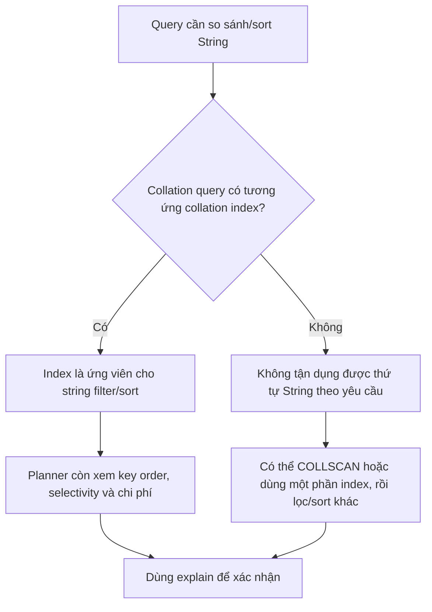
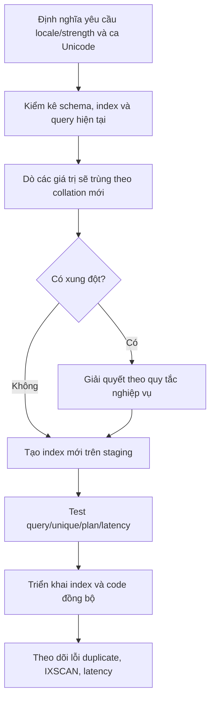

# Collation của index và điều kiện truy vấn tương ứng

## 1. Bài toán: index tồn tại nhưng truy vấn vẫn chậm hoặc trả kết quả khác

Trong **Spring Data MongoDB**, chỉ mục (index) giúp MongoDB giảm số document phải quét khi lọc hoặc sắp xếp. Tuy nhiên, đối với **giá trị String**, việc có index trên đúng tên field chưa đủ. MongoDB còn cần biết **quy tắc so sánh chuỗi** của truy vấn và của index.

Giả sử hệ thống quản lý khách hàng có:

```javascript
{
  _id: "customer-101",
  tenantId: "tenant-01",
  displayName: "An",
  active: true
}
```

Người dùng tìm `"an"` và mong tìm được cả `"An"` lẫn `"AN"`. Một index thông thường có kiểu so sánh **simple/binary** sẽ không tự thực hiện yêu cầu đó. Nếu thêm `collation` cho truy vấn để bỏ qua chữ hoa/chữ thường nhưng index không có collation phù hợp, MongoDB có thể **không dùng phần so sánh chuỗi của index theo cách mong muốn**. Khi collection lớn, sự khác biệt này tác động trực tiếp đến độ trễ.

Ngoài ra, cùng một điều kiện:

```javascript
{ tenantId: "tenant-01", displayName: "an" }
```

có thể trả kết quả khác nhau giữa:

- Truy vấn dùng **simple collation**: so sánh chuỗi theo mã nhị phân.
- Truy vấn dùng **`locale: "en", strength: 2`**: so sánh không phân biệt hoa/thường nhưng vẫn phân biệt dấu.
- Truy vấn dùng **`locale: "en", strength: 1`**: có thể bỏ qua cả hoa/thường và dấu.

**Mục tiêu bài học** thuộc chương **Chỉ mục** của module **SPRING_DATA_MONGODB**: hiểu collation của MongoDB, thiết kế index và truy vấn có quy tắc so sánh tương ứng, sử dụng `MongoTemplate`/repository, xác minh bằng `explain` và kiểm thử, cũng như nhận diện các bẫy của unique index, regex, compound index và dữ liệu tiếng Việt.

## 2. Collation là gì?

**Collation** mô tả cách MongoDB so sánh và sắp xếp String theo quy tắc ngôn ngữ (*locale*) và các lựa chọn phụ. Nó được dùng trong những thao tác phù hợp như:

- So sánh bằng, lớn hơn/nhỏ hơn của String.
- `sort` theo tên, mã hoặc các field chuỗi.
- Một số phép grouping và so sánh trong aggregation.
- Xác định tính duy nhất của **unique index** trên khóa chuỗi.
- Thứ tự của các khóa String được lưu trong index có collation.

MongoDB sử dụng cơ chế collation dựa trên ICU; kết quả cụ thể có thể phụ thuộc **locale**, cấu hình và phiên bản ICU/server. Vì vậy phải kiểm thử với dữ liệu thực tế, nhất là tên người và tiếng Việt có dấu.

### 2.1. Những thuộc tính thường gặp

| Thuộc tính | Ý nghĩa | Ví dụ |
| --- | --- | --- |
| `locale` | Quy tắc ngôn ngữ hoặc `"simple"` | `"en"`, `"vi"`, `"simple"` |
| `strength` | Cấp độ phân biệt ký tự khi so sánh | `1`, `2`, `3` |
| `caseLevel` | Xét khác biệt chữ hoa/thường ở cấp riêng | `true` hoặc `false` |
| `caseFirst` | Thứ tự hoa/thường khi cấp so sánh xét case | `"upper"`, `"lower"`, `"off"` |
| `numericOrdering` | So các dãy chữ số trong String theo giá trị số | `true` hoặc `false` |
| `alternate` | Cách xử lý một số ký tự như khoảng trắng/dấu câu | `"non-ignorable"`, `"shifted"` |
| `maxVariable` | Nhóm ký tự chịu ảnh hưởng khi `alternate=shifted` | `"space"`, `"punct"` |
| `backwards` | Cách xử lý so sánh dấu ở một số ngôn ngữ | `true` hoặc `false` |
| `normalization` | Tùy chọn kiểm tra chuẩn hóa Unicode | `true` hoặc `false` |

Không cần cấu hình mọi tham số. Hãy chọn **ít thuộc tính đủ để diễn đạt yêu cầu**, đặt chúng nhất quán ở index và query, rồi xác minh hiệu quả.

### 2.2. Ba mức strength thường dùng

Đối với phần lớn nhu cầu so sánh tên:

| Strength | Ý nghĩa khái quát | Minh họa |
| --- | --- | --- |
| `1` — primary | Thường bỏ qua khác biệt chữ hoa/thường và dấu | `"cafe"` và `"café"` có thể được coi tương đương |
| `2` — secondary | Phân biệt dấu, thường không phân biệt chữ hoa/thường | `"Cafe"` ≈ `"cafe"`; `"cafe"` khác `"café"` |
| `3` — tertiary | Phân biệt thêm hoa/thường | `"Cafe"` khác `"cafe"` |

Đây là **quy tắc điển hình**, không phải một bảng ánh xạ Unicode cố định cho mọi ngôn ngữ. Các tùy chọn như `caseLevel` có thể làm thay đổi hành vi dù `strength` giữ nguyên. Khi cần quy tắc cho tiếng Việt, hãy xem `locale: "vi"` và kiểm thử các cặp từ có/không có dấu, chữ hoa/thường, các dấu kết hợp.

### 2.3. "simple" không phải một tên ngôn ngữ

`locale: "simple"` yêu cầu so sánh nhị phân theo byte/BSON, khác với collation ngôn ngữ. Ví dụ:

```javascript
{ locale: "simple" }
```

Với so sánh bình thường theo simple collation, `"An"` không bằng `"an"`. Đây là nguyên nhân một index thông thường không tự làm cho truy vấn tên không phân biệt hoa/thường.

**Phân biệt:** một field BSON String khác với số thực sự kiểu Number. Việc cấu hình collation không biến String `"10"` thành BSON Int32/Int64 và không sửa dữ liệu nguồn.

## 3. Dữ liệu mẫu và kết quả cần đạt

Tạo một collection thử không đặt default collation riêng:

```javascript
db.customer_directory.insertMany([
  {
    _id: "c-101",
    tenantId: "tenant-01",
    displayName: "An",
    active: true
  },
  {
    _id: "c-102",
    tenantId: "tenant-01",
    displayName: "an",
    active: true
  },
  {
    _id: "c-103",
    tenantId: "tenant-01",
    displayName: "Ân",
    active: true
  },
  {
    _id: "c-104",
    tenantId: "tenant-02",
    displayName: "AN",
    active: true
  },
  {
    _id: "c-105",
    tenantId: "tenant-01",
    displayName: "Bình",
    active: false
  }
]);
```

Yêu cầu:

1. Chỉ tìm trong `tenant-01`.
2. Khi nhập `"AN"`, tìm được **c-101** và **c-102** vì không phân biệt hoa/thường.
3. Không tự động gộp **Ân** với **An** vì bài này chọn phân biệt dấu.
4. Không tìm thấy khách hàng `c-104` thuộc tenant khác.
5. Có thể dùng index phù hợp để lọc/sắp xếp hiệu quả trên collection lớn.

Quy tắc collation ví dụ:

```javascript
{ locale: "en", strength: 2 }
```

Chọn `"en"` để minh họa case-insensitive rõ ràng. Nếu sản phẩm có yêu cầu sắp tên tiếng Việt theo quy tắc ngôn ngữ Việt Nam, nên đánh giá `"vi"` cùng strength và các tùy chọn tương ứng, không mặc định rằng collation tiếng Anh cho thứ tự tên tiếng Việt đúng nghiệp vụ.

**Lưu ý dữ liệu thử:** nếu collection đã có **unique index case-insensitive** trên tên, hai document `"An"` và `"an"` trong cùng tenant không thể cùng tồn tại. Ở phần này chỉ tạo **index không unique**; phần về unique index sẽ dùng collection riêng.

## 4. Tạo index có collation tường minh

### 4.1. mongosh: index theo tenant và tên

```javascript
db.customer_directory.createIndex(
  { tenantId: 1, displayName: 1 },
  {
    name: "ix_tenant_name_en_s2",
    collation: {
      locale: "en",
      strength: 2
    }
  }
);
```

Index được sắp theo hai khóa:

- `tenantId` đứng trước để giới hạn phạm vi tenant.
- `displayName` đứng sau để hỗ trợ so sánh/sắp tên theo đúng collation khi các điều kiện phù hợp.

**Quan trọng:** collation của index áp dụng cho **mọi khóa kiểu String trong index**, bao gồm cả `tenantId`. Không chỉ riêng `displayName` mới bị ảnh hưởng. Nếu `tenantId` là chuỗi có phân biệt hoa/thường về nghiệp vụ, phải lưu tenant ID ở dạng chuẩn hóa, chọn schema/index khác hoặc đánh giá ảnh hưởng một cách rõ ràng.

### 4.2. Truy vấn khớp collation của index

```javascript
db.customer_directory.find(
  {
    tenantId: "tenant-01",
    displayName: "AN"
  }
).collation({
  locale: "en",
  strength: 2
});
```

Theo quy tắc của fixture, kết quả gồm `c-101` và `c-102`. Index `ix_tenant_name_en_s2` là một **ứng viên hợp lệ** để MongoDB dùng cho so sánh String theo collation này.

Không nên viết:

```javascript
// Collection mặc định simple: truy vấn này có so sánh nhị phân.
db.customer_directory.find({
  tenantId: "tenant-01",
  displayName: "AN"
});
```

rồi mong kết quả không phân biệt hoa/thường chỉ vì đã tạo một index case-insensitive. **Tạo index không tự thay đổi ngữ nghĩa của query** nếu collection/query đang dùng một collation khác.

### 4.3. So sánh ba truy vấn

| Truy vấn | Collation của query | Kết quả dự kiến với `displayName="AN"` |
| --- | --- | --- |
| Không khai báo trên collection default simple | `simple` | Không tìm thấy `"An"` hay `"an"` |
| Ghi rõ `locale: "en", strength: 2` | Không phân biệt hoa/thường, phân biệt dấu | `c-101`, `c-102` |
| Ghi rõ `locale: "en", strength: 1` | Thường không phân biệt cả hoa/thường và dấu | Có thể khớp thêm `"Ân"` |

Với `strength: 1`, vì semantics khác strength 2, MongoDB không mặc nhiên được sử dụng index `en_s2` cho **phần tìm kiếm String** theo quy tắc khác đó. Dù có cùng locale, **không có nghĩa hai collation tương thích hoàn toàn**.

## 5. Quy tắc cốt lõi: query và index phải dùng collation tương ứng

MongoDB chỉ có thể dùng **thứ tự khóa String** của một index để đáp ứng phép so sánh/sắp xếp String nếu quy tắc so sánh của query tương ứng với collation của index.



**Lưu ý hai lớp điều kiện:**

1. **Tương thích collation** là điều kiện quan trọng để index hỗ trợ **so sánh/sort chuỗi**.
2. **Được optimizer chọn dùng** còn phụ thuộc thứ tự khóa, tính chọn lọc, loại predicate, sort, index khác và thống kê thực tế.

Vì vậy “collation khớp” **không bảo đảm planner sẽ chọn `IXSCAN`**, và “collation khác” **không luôn đồng nghĩa chỉ có `COLLSCAN`**.

### 5.1. Query không khai báo collation lấy quy tắc từ đâu?

Trong MongoDB, một thao tác không chỉ định collation thường **kế thừa default collation của collection**. Nếu collection được tạo không có collation đặc biệt, mặc định thường là simple.

Tình huống:

```text
Collection default: simple
Index: en strength 2
Query không collation: simple
=> Query không tự áp dụng en strength 2 chỉ vì index tồn tại.
```

Ngược lại:

```text
Collection default: en strength 2
Index không khai báo collation riêng: kế thừa collection default
Query không collation: kế thừa collection default
=> Hai bên có thể tương ứng mà không cần nêu lại từng query.
```

Đừng suy đoán collection default qua tên index. Hãy kiểm tra collection options, danh sách index và filter thực sự được gửi.

### 5.2. Truy vấn so sánh chuỗi và query sắp xếp

Collation ảnh hưởng cả equality lẫn sort:

```javascript
db.customer_directory.find({
  tenantId: "tenant-01"
}).collation({
  locale: "en",
  strength: 2
}).sort({
  displayName: 1,
  _id: 1
});
```

Sắp xếp `displayName` theo collation ngôn ngữ có thể khác sắp nhị phân. Với các tên được xem là tương đương ở strength 2, khóa `_id` phụ giúp thứ tự ổn định. **Không kỳ vọng collation tự tạo thứ tự duy nhất cho những String được xem là bằng nhau**.

Sort hiệu quả còn phụ thuộc thứ tự khóa index. Index `{tenantId:1, displayName:1}` có thể hỗ trợ điều kiện tenant và sort theo displayName; nếu bắt buộc sort thêm theo `_id`, hãy kiểm tra plan và cân nhắc index có `_id` làm khóa tiếp theo khi workload cần.

## 6. Collection default collation và index override

### 6.1. Tạo collection có default collation

```javascript
db.createCollection("customers_default_en", {
  collation: {
    locale: "en",
    strength: 2
  }
});
```

Khi collection có default collation này:

```javascript
db.customers_default_en.createIndex({
  tenantId: 1,
  displayName: 1
});
```

Index thông thường không khai báo collation riêng sẽ sử dụng default collation của collection theo quy tắc MongoDB. Query không khai báo collation riêng cũng kế thừa default đó.

Ưu điểm: ít phải lặp cấu hình khi toàn bộ collection dùng cùng một cách so sánh chuỗi.

Nhược điểm: có thể ảnh hưởng **những truy vấn khác** chưa từng được thiết kế cho so sánh không phân biệt case, cũng như các index/unique constraint trên field String khác.

### 6.2. Override về simple cho một thao tác

```javascript
db.customers_default_en.find({
  displayName: "An"
}).collation({
  locale: "simple"
});
```

Query này yêu cầu so sánh nhị phân thay cho default collection. Khi đó, một index kế thừa `en strength 2` không thể được xem là có cùng thứ tự so sánh String với query simple.

### 6.3. Thay default collation không phải update một option tùy ý

Default collation được quyết định lúc tạo collection và không nên coi là một option có thể sửa trực tiếp trên collection đang chứa dữ liệu bằng một lệnh index đơn giản. Nếu cần thay chiến lược toàn collection, hãy lập kế hoạch tạo collection phù hợp/migrate, điều chỉnh index và kiểm thử tương thích.

Mặt khác, **tạo một index có collation riêng trên collection default simple** hoàn toàn là cách hợp lệ khi chỉ một hoặc vài truy vấn cần quy tắc đặc biệt.

### 6.4. Xem thông tin collection và index thật

```javascript
db.getCollectionInfos({
  name: "customer_directory"
});

db.customer_directory.getIndexes();
```

Kiểm tra trường `options.collation` của collection nếu có, và `collation` của từng index. Chú ý một index được tạo với collation kế thừa có thể có metadata đầy đủ hơn các option bạn nhập ban đầu; cần xét những giá trị thực sự quan trọng như `locale`, `strength` và `numericOrdering`.

## 7. Compound index: điểm ngoại lệ khi collation không khớp

Một câu trả lời đơn giản “collation khác thì MongoDB không thể dùng index” **không hoàn toàn chính xác**.

MongoDB có thể dùng **phần tiền tố của compound index** cho các điều kiện trên field không phải String, dù phần so sánh String cần collation khác.

### 7.1. Ví dụ có khóa tiền tố kiểu số

```javascript
db.events_by_region.createIndex(
  { regionId: 1, customerName: 1 },
  {
    name: "ix_region_name_en_s2",
    collation: { locale: "en", strength: 2 }
  }
);
```

Query dùng collation simple:

```javascript
db.events_by_region.find({
  regionId: NumberInt("7"),
  customerName: "An"
}).collation({
  locale: "simple"
});
```

Collation của query không tương ứng với index cho **`customerName`**. Tuy nhiên, MongoDB vẫn có thể dùng prefix `regionId` **kiểu số** để thu hẹp phạm vi rồi kiểm tra `customerName` theo quy tắc simple bằng bước khác. Không thể mặc định phần sort/filter chuỗi sau đó được index xử lý tối ưu.

Nếu toàn bộ key prefix đều là String, collation khác có thể ảnh hưởng ngay từ field đầu. Với index `{tenantId:1, displayName:1}` ở phần 4, **`tenantId` cũng là String**, nên không có ngoại lệ “tiền tố kiểu số” đó.

### 7.2. Đổi collation không sửa được thứ tự key

Một index:

```javascript
{ tenantId: 1, displayName: 1, createdAt: -1 }
```

không nhất thiết đáp ứng tốt một query:

```javascript
db.customer_directory.find({
  tenantId: "tenant-01"
}).sort({
  createdAt: -1
});
```

vì `displayName` nằm giữa `tenantId` và `createdAt` trong index. Dù collation đã khớp, các quy tắc **equality–sort–range (ESR)** và cách planner sử dụng compound index vẫn quan trọng.

Khi tối ưu, phải xem **cả key pattern và collation**, không chỉ một trong hai.

## 8. Hai index cùng key pattern nhưng khác collation

Một collection có thể cần tìm chính xác theo binary cho thao tác kỹ thuật, đồng thời tìm không phân biệt hoa/thường cho giao diện.

MongoDB cho phép tạo các index có cùng key pattern nhưng **khác collation**, với tên riêng để phân biệt:

```javascript
db.customer_directory.createIndex(
  { tenantId: 1, displayName: 1 },
  {
    name: "ix_tenant_name_simple",
    collation: { locale: "simple" }
  }
);

db.customer_directory.createIndex(
  { tenantId: 1, displayName: 1 },
  {
    name: "ix_tenant_name_en_s2",
    collation: { locale: "en", strength: 2 }
  }
);
```

Ví dụ giả định các index chưa tồn tại hoặc đã được quản lý sao cho tên không trùng; nếu đã tạo `ix_tenant_name_en_s2` ở phần 4, **không cần tạo lại**.

| Truy vấn | Index ứng viên |
| --- | --- |
| Equality/sort String với `locale: "simple"` | `ix_tenant_name_simple` |
| Equality/sort String với `locale: "en", strength: 2` | `ix_tenant_name_en_s2` |

Lợi ích: nhiều kiểu truy vấn có index phù hợp.

Chi phí: mỗi index chiếm dung lượng, tăng công việc ghi, tạo index phải đọc dữ liệu và cạnh tranh tài nguyên. Không tạo hai bản “chỉ để chắc ăn” khi một loại query không tồn tại trong workload.

## 9. Unique index với collation: định nghĩa "trùng" thay đổi

### 9.1. Đăng nhập không phân biệt chữ hoa/chữ thường

Giả sử username trong mỗi tenant phải duy nhất mà không phân biệt case:

```javascript
db.user_accounts.createIndex(
  { tenantId: 1, username: 1 },
  {
    name: "uk_tenant_username_en_s2",
    unique: true,
    collation: { locale: "en", strength: 2 }
  }
);
```

Sau đó:

```javascript
db.user_accounts.insertOne({
  _id: "u-101",
  tenantId: "tenant-01",
  username: "Admin"
});

db.user_accounts.insertOne({
  _id: "u-102",
  tenantId: "tenant-01",
  username: "admin"
});
// Có thể nhận E11000 duplicate key vì cùng key theo collation.
```

Unique constraint ở đây không chỉ theo byte của `username`. Nó dùng **quy tắc so sánh của index**, nên `"Admin"` và `"admin"` trong cùng tenant bị coi là một khóa.

### 9.2. Strength quyết định cả dấu

- Với `strength: 2`, `"cafe"` và `"café"` thường là hai giá trị **khác nhau**.
- Với `strength: 1`, chúng có thể được coi **trùng nhau** theo locale tương ứng.
- Với `caseLevel: true`, khác biệt hoa/thường có thể lại được xét ở strength thấp.

Không thể quyết định một unique collation chỉ bằng câu “bỏ qua case”. Hãy liệt kê rõ các ví dụ nghiệp vụ cần coi là cùng một tên, đặc biệt nếu username chứa Unicode, ký tự tiếng Việt, dấu câu và số.

### 9.3. Compound index ảnh hưởng cả tenantId

Unique index `{tenantId:1, username:1}` có collation `en strength 2` cũng coi `tenantId` dưới quy tắc String đó. Chẳng hạn `"Tenant-A"` và `"tenant-a"` có thể được xem là cùng một tenant key ở index.

Nếu tenant ID phải so sánh **nhị phân nghiêm ngặt**, hãy dùng ID canonical ổn định (ví dụ UUID biểu diễn nhất quán), kiểu BSON phù hợp hoặc thiết kế tách discriminator để không vô tình đổi ý nghĩa danh tính tenant.

### 9.4. Migration cần kiểm tra trùng trước khi tạo unique index

Nếu collection hiện đã chứa `"Admin"` và `"admin"` trong cùng tenant, việc tạo unique index có collation không phân biệt case có thể **thất bại**. Quy trình:

1. Sao lưu và chọn môi trường staging.
2. Xác định chính sách tên trùng, bao gồm dấu/case và locale.
3. Dò nhóm dữ liệu trùng theo chính sách dự kiến.
4. Giải quyết xung đột nghiệp vụ có kiểm soát.
5. Tạo unique index với tên/collation rõ ràng.
6. Đưa read và write logic vào cùng hợp đồng so sánh.
7. Chạy integration tests cạnh tranh ghi và kiểm tra duplicate key.

**Không tự xóa một tài khoản chỉ vì hai username trở thành bằng nhau khi thay collation**. Việc hợp nhất tài khoản có thể ảnh hưởng quyền và dữ liệu liên quan; cần quy trình nghiệp vụ.

## 10. numericOrdering: số bên trong String khi sắp xếp

Khi ứng dụng lưu mã như:

```javascript
[
  { _id: "p1", code: "item2" },
  { _id: "p2", code: "item10" },
  { _id: "p3", code: "item3" }
]
```

sort chuỗi thông thường thường sắp `item10` trước `item2`. Tùy chọn:

```javascript
{
  locale: "en",
  strength: 2,
  numericOrdering: true
}
```

cho phép so sánh **dãy chữ số bên trong String theo thứ tự số** trong những trường hợp được hỗ trợ. Khi đó `item2` có thể đứng trước `item3` rồi đến `item10`.

### 10.1. Index và query phải cùng numericOrdering

```javascript
db.products.createIndex(
  { code: 1 },
  {
    name: "ix_code_numeric_en_s2",
    collation: {
      locale: "en",
      strength: 2,
      numericOrdering: true
    }
  }
);

db.products.find().sort({
  code: 1
}).collation({
  locale: "en",
  strength: 2,
  numericOrdering: true
});
```

Nếu query không có `numericOrdering: true`, dù locale/strength trùng, **quy tắc sắp xếp String không còn hoàn toàn tương ứng**. Không nên chỉ so `locale` khi kiểm tra tương thích index.

### 10.2. Giới hạn của numericOrdering

`numericOrdering` không phải một bộ parser số tổng quát:

- Không đổi field String thành BSON Number.
- Các chuỗi biểu diễn dấu âm, số thập phân, dấu phân cách, ký hiệu khoa học có thể không theo quy tắc số học mà người dùng mong muốn.
- Các chuỗi nhiều chữ số có giới hạn xử lý theo ICU/MongoDB.

Với giá trị thực sự là quantity, amount hoặc ngày tháng, **lưu đúng kiểu BSON**. Dùng numericOrdering cho **mã dạng chuỗi có phần số**, không dùng nó để che một schema lưu toàn bộ số bằng String.

## 11. $regex không tương đương equality có collation

Một bẫy phổ biến là tạo index case-insensitive rồi dùng regex:

```javascript
db.customer_directory.find({
  displayName: { $regex: "^an", $options: "i" }
}).collation({
  locale: "en",
  strength: 2
});
```

MongoDB `$regex` không xử lý so sánh theo collation giống equality/sort. **Case-insensitive index thường không cải thiện `$regex` với option `i` theo cách người đọc kỳ vọng**, vì `$regex` không collation-aware.

Phân biệt mục tiêu:

| Nhu cầu | Hướng nên đánh giá |
| --- | --- |
| Tìm tên bằng đúng một chuỗi, bỏ qua case | Equality + collation, index tương ứng |
| Sắp xếp tên theo ngôn ngữ | Sort + collation, index tương ứng |
| Prefix search có case-sensitive | Index/simple/prefix regex phù hợp, đo explain |
| Contains/fuzzy/full-text search | Công cụ search phù hợp hoặc trường chuẩn hóa có index |
| Tên có dấu, Unicode, gợi ý tìm kiếm | Thiết kế analyzer, normalization và search UX riêng |

Nếu muốn prefix search không phân biệt case và cần hiệu năng ổn định, có thể dùng **field tìm kiếm đã được chuẩn hóa** (`nameSearchKey`) với index phù hợp, rồi chạy prefix search theo key; nhưng phải có quy tắc tạo key nhất quán cho dữ liệu mới/cũ và kiểm thử Unicode. Tên hiển thị vẫn nên giữ bản gốc.

Không khẳng định collation của MongoDB sẽ làm `$regex` trở thành một engine tìm kiếm ngôn ngữ đầy đủ.

## 12. Spring Data MongoDB: tạo index collation bằng IndexOperations

### 12.1. Entity mẫu

```java
package example.directory;

import org.springframework.data.mongodb.core.mapping.Document;
import org.springframework.data.mongodb.core.mapping.FieldType;
import org.springframework.data.mongodb.core.mapping.MongoId;

@Document(collection = "customer_directory")
public record CustomerEntry(
    @MongoId(FieldType.STRING) String id,
    String tenantId,
    String displayName,
    boolean active
) {}
```

Class dùng `String` cho tên khách hàng và `tenantId`; `@MongoId(FieldType.STRING)` làm rõ ID lưu BSON String.

### 12.2. Khai báo cùng một Collation cho index

```java
package example.directory;

import org.springframework.data.domain.Sort;
import org.springframework.data.mongodb.core.MongoTemplate;
import org.springframework.data.mongodb.core.index.Index;
import org.springframework.data.mongodb.core.query.Collation;
import org.springframework.data.mongodb.core.query.Collation.ComparisonLevel;
import org.springframework.stereotype.Component;

@Component
public class CustomerIndexManager {

    private final MongoTemplate template;

    public CustomerIndexManager(MongoTemplate template) {
        this.template = template;
    }

    public String ensureNameIndex() {
        Collation caseInsensitive =
            Collation.of("en")
                .strength(ComparisonLevel.secondary());

        Index index = new Index()
            .on("tenantId", Sort.Direction.ASC)
            .on("displayName", Sort.Direction.ASC)
            .named("ix_tenant_name_en_s2")
            .collation(caseInsensitive);

        return template.indexOps(CustomerEntry.class)
            .ensureIndex(index);
    }
}
```

`IndexOperations.ensureIndex` tạo index nếu chưa có index tương ứng và trả thông tin tên index theo API hiện hành. Ở môi trường production, việc chạy DDL **không nên tùy tiện được kích hoạt trên mọi HTTP request**. Quản lý index bằng migration/deployment có kiểm soát, đánh giá dữ liệu hiện có và quyền tạo index.

Nếu index cũ **cùng tên nhưng khác cấu hình** đã tồn tại, không giả định `ensureIndex` tự sửa collation của index đó. Phải kiểm tra lỗi/conflict, lập kế hoạch thay index khi cần.

### 12.3. Khi ứng dụng có Spring Data auto-index creation

Spring Data MongoDB có cơ chế xử lý index từ annotation khi được bật và cấu hình phù hợp, nhưng **đừng phụ thuộc mù quáng** vào việc application startup tự tạo mọi index. Chính sách auto-index creation thay đổi theo phiên bản/cấu hình, và tạo index lớn lúc khởi động dịch vụ có thể gây tải.

Với collation chuyên biệt, ví dụ trên tạo index tường minh là lựa chọn dễ kiểm chứng. Trong hệ thống vận hành nghiêm ngặt, nên đưa index definition vào migration, theo dõi tiến trình build và quản lý tên index nhất quán.

## 13. Query trong MongoTemplate phải dùng collation tương ứng

### 13.1. Service truy vấn tên không phân biệt case

```java
package example.directory;

import java.util.List;
import org.springframework.data.domain.Sort;
import org.springframework.data.mongodb.core.MongoTemplate;
import org.springframework.data.mongodb.core.query.Collation;
import org.springframework.data.mongodb.core.query.Collation.ComparisonLevel;
import org.springframework.data.mongodb.core.query.Criteria;
import org.springframework.data.mongodb.core.query.Query;
import org.springframework.stereotype.Service;

@Service
public class CustomerSearchService {

    private final MongoTemplate template;

    public CustomerSearchService(MongoTemplate template) {
        this.template = template;
    }

    public List<CustomerEntry> findByName(
            String authorizedTenantId,
            String requestedName) {

        if (authorizedTenantId == null
                || authorizedTenantId.isBlank()) {
            throw new IllegalArgumentException(
                "tenantId không hợp lệ"
            );
        }
        if (requestedName == null
                || requestedName.isBlank()
                || requestedName.length() > 100) {
            throw new IllegalArgumentException(
                "Tên tìm kiếm không hợp lệ"
            );
        }

        Collation caseInsensitive =
            Collation.of("en")
                .strength(ComparisonLevel.secondary());

        Query query = Query.query(
            Criteria.where("tenantId").is(authorizedTenantId)
                .and("displayName").is(requestedName)
        );
        query.collation(caseInsensitive);
        query.with(Sort.by(
            Sort.Order.asc("displayName"),
            Sort.Order.asc("id")
        ));
        query.limit(100);

        return template.find(query, CustomerEntry.class);
    }
}
```

Trong ví dụ này:

- `Criteria` định nghĩa filter tenant và tên.
- `query.collation` đặt **cùng locale/strength** như index.
- `Sort` sắp theo tên và ID; `id` được ánh xạ thành `_id` khi dùng typed `Query`.
- `limit(100)` giới hạn số document trả về cho API.
- Tenant ID phải lấy từ cơ chế xác thực/ủy quyền server-side; validation chuỗi không tự tạo phân quyền.

**Một giới hạn thiết kế:** `limit(100)` chỉ giới hạn output, không chứng minh MongoDB chỉ đọc đúng 100 key/document. Với filter ít chọn lọc và index không phù hợp, vẫn có thể phải quét nhiều dữ liệu. Đánh giá bằng `explain`.

### 13.2. Tái sử dụng cấu hình để tránh index/query lệch nhau

Việc viết `Collation.of("en").strength(ComparisonLevel.secondary())` ở hai nơi dễ bị sửa lệch. Một cách tổ chức:

```java
package example.directory;

import org.springframework.data.mongodb.core.query.Collation;
import org.springframework.data.mongodb.core.query.Collation.ComparisonLevel;

public final class DirectoryCollations {

    private DirectoryCollations() {}

    public static Collation displayName() {
        return Collation.of("en")
            .strength(ComparisonLevel.secondary());
    }
}
```

Sau đó trong index manager và search service đều gọi `DirectoryCollations.displayName()`. Khi đổi locale/strength, cần **migration index đồng bộ**, không chỉ sửa code query; index cũ lưu thứ tự khóa theo collation cũ.

### 13.3. So sánh typed query và raw query

Typed `Query` sử dụng mapping metadata của `CustomerEntry` để diễn giải tên field khi phù hợp. Trong raw MongoDB driver/`Document`, cần dùng đúng tên BSON.

Ví dụ dùng:

```javascript
db.customer_directory.find({
  _id: "c-101"
});
```

chứ không tự giả định raw BSON có field `id`. Nếu entity dùng `@Field("display_name")`, index và query được khai báo bằng API Spring Data có thể được ánh xạ theo metadata, còn một raw `Document` tự xây phải dùng `display_name` thực sự.

## 14. Repository @Query và collation

Khi truy vấn được dùng nhiều và có hợp đồng cố định, Spring Data MongoDB repository có thể khai báo collation trên query annotation:

```java
package example.directory;

import java.util.List;
import org.springframework.data.mongodb.repository.MongoRepository;
import org.springframework.data.mongodb.repository.Query;

public interface CustomerEntryRepository
        extends MongoRepository<CustomerEntry, String> {

    @Query(
        value = "{ 'tenantId': ?0, 'displayName': ?1 }",
        collation = "{ 'locale': 'en', 'strength': 2 }"
    )
    List<CustomerEntry> findNameIgnoringCase(
        String tenantId,
        String displayName
    );
}
```

Trong các phiên bản Spring Data MongoDB hỗ trợ thuộc tính `@Query.collation`, cách này đưa collation vào query repository. Ví dụ vẫn cần **index cùng collation** nếu muốn tối ưu trường hợp filter String; annotation không tự tạo index.

Nếu phiên bản đang dùng hỗ trợ truyền `Collation` như một special parameter hoặc cấu hình collation theo method khác, cần đối chiếu JavaDoc/dependency thật trước khi áp dụng. Với yêu cầu động phức tạp, `MongoTemplate` thường minh bạch hơn.

### 14.1. Không dùng equalsIgnoreCase trong Java để thay truy vấn

Không nên tải toàn bộ customer về rồi gọi:

```java
// Không phù hợp khi collection lớn:
allCustomers.stream()
    .filter(c -> c.displayName().equalsIgnoreCase(queryName))
    .toList();
```

Vừa tốn mạng/heap, vừa dùng **quy tắc Java** có thể khác ICU collation của MongoDB, nhất là với Unicode. Nếu nghiệp vụ dùng collation trên DB, hãy định nghĩa cùng chuẩn so sánh ở những nơi cần quyết định duy nhất/đối chiếu tên.

### 14.2. Truy vấn quyền truy cập vẫn do service kiểm soát

`@Query(collation=...)` không chứng minh người gọi có quyền với `tenantId` truyền vào. Service phải cung cấp tenant ID đã được xác thực/ủy quyền; chỉ thị collation là **ngữ nghĩa so sánh**, không phải security boundary.

## 15. Aggregation và collation cũng phải được thiết kế cùng index

Collation không chỉ áp dụng cho `find`. Aggregation cũng có thể nhận collation:

```javascript
db.customer_directory.aggregate(
  [
    { $match: { tenantId: "tenant-01" } },
    { $sort: { displayName: 1, _id: 1 } },
    {
      $project: {
        _id: 0,
        id: "$_id",
        displayName: 1
      }
    }
  ],
  { collation: { locale: "en", strength: 2 } }
);
```

Khi pipeline có `$match`/`$sort` đủ sớm, MongoDB có thể dùng index có collation phù hợp, tùy query plan. Một stage `$group` theo String cũng sử dụng quy tắc so sánh của aggregation ở những trường hợp thích hợp; các tên được collation coi tương đương có thể nằm chung một group.

### 15.1. Spring Data AggregationOptions

```java
import org.springframework.data.domain.Sort;
import org.springframework.data.mongodb.core.aggregation.Aggregation;
import org.springframework.data.mongodb.core.aggregation.AggregationOptions;
import org.springframework.data.mongodb.core.query.Collation;
import org.springframework.data.mongodb.core.query.Collation.ComparisonLevel;
import org.springframework.data.mongodb.core.query.Criteria;

Collation nameCollation = Collation.of("en")
    .strength(ComparisonLevel.secondary());

AggregationOptions options = AggregationOptions.builder()
    .collation(nameCollation)
    .build();

Aggregation pipeline = Aggregation.newAggregation(
    Aggregation.match(
        Criteria.where("tenantId").is(authorizedTenantId)
    ),
    Aggregation.sort(Sort.by(
        Sort.Order.asc("displayName"),
        Sort.Order.asc("id")
    )),
    Aggregation.project("displayName")
        .and("id").as("id")
).withOptions(options);

var result = template.aggregate(
    pipeline, CustomerEntry.class, CustomerNameRow.class
);
```

Với DTO:

```java
package example.directory;

public record CustomerNameRow(
    String id,
    String displayName
) {}
```

Đoạn pipeline là ví dụ dùng trong service đã có `template` và `authorizedTenantId`. Khi dùng typed aggregation, hãy kiểm tra cách Spring Data ánh xạ `id`/`_id` qua `project`; nếu output DTO thiếu ID, điều chỉnh projection theo BSON thực tế. `withOptions(options)` gắn collation với aggregation command, không thêm index.

### 15.2. Tính đúng của $group theo tên

Ví dụ:

```javascript
db.customer_directory.aggregate(
  [
    { $match: { tenantId: "tenant-01" } },
    {
      $group: {
        _id: "$displayName",
        count: { $sum: 1 }
      }
    }
  ],
  { collation: { locale: "en", strength: 2 } }
);
```

Các giá trị `"An"` và `"an"` có thể được coi cùng một nhóm dưới collation strength 2. Tuy nhiên, **giá trị chuỗi đại diện** trong `_id` của group không nên được coi là một key chuẩn hóa bền vững cho nghiệp vụ. Nếu cần một khóa báo cáo ổn định, hãy dùng ID hoặc search key được chuẩn hóa rõ ràng.

## 16. explain: cách xác minh index được dùng thật

### 16.1. Hai query để so sánh

Query khớp collation:

```javascript
db.customer_directory.find({
  tenantId: "tenant-01",
  displayName: "AN"
}).collation({
  locale: "en",
  strength: 2
}).explain("executionStats");
```

Query không khớp:

```javascript
db.customer_directory.find({
  tenantId: "tenant-01",
  displayName: "AN"
}).collation({
  locale: "simple"
}).explain("executionStats");
```

Với index `ix_tenant_name_en_s2`, query đầu có collation phù hợp cho string filter; query thứ hai yêu cầu ngữ nghĩa khác. **Planner có thể chọn những plan khác nhau**, phụ thuộc index còn lại, kích thước collection và dữ liệu.

### 16.2. Đọc executionStats đúng cách

| Trường / dấu hiệu | Câu hỏi cần trả lời |
| --- | --- |
| `winningPlan` | Query thực sự chọn plan nào? |
| `IXSCAN` | Có sử dụng index scan không, là index nào? |
| `COLLSCAN` | Có quét collection không? |
| `FETCH` | Có cần đọc document để kiểm tra predicate/cung cấp field không? |
| `SORT` | Có bước sort riêng thay vì tận dụng thứ tự index không? |
| `totalKeysExamined` | Bao nhiêu khóa index được xét? |
| `totalDocsExamined` | Bao nhiêu document được đọc/kiểm tra? |
| `nReturned` | Bao nhiêu document được trả? |
| `executionTimeMillis` | Thời gian thống kê của execution trên server, có giới hạn diễn giải khi benchmark |

Một plan có `IXSCAN` **không nhất thiết đã sử dụng được phần String của index tối ưu**; có thể chỉ dùng prefix kiểu số hoặc quét nhiều key rồi lọc. Ngược lại, trên collection cực nhỏ, MongoDB có thể chọn `COLLSCAN` rẻ hơn dù index được thiết kế đúng.

Không kết luận từ một lần chạy trên năm document thử. Benchmark trên số lượng và phân bố dữ liệu đại diện, ghi nhận query shape, index hiện hữu và phiên bản MongoDB.

### 16.3. Index hint và giới hạn

`hint` có thể buộc planner cân nhắc một index cụ thể, nhưng nó **không làm thay đổi quy tắc so sánh chuỗi** của query. Ép một index collation khác có thể dẫn đến quét nhiều dữ liệu hoặc sort riêng; không coi `hint` là cách sửa sự không khớp.

Nếu query chậm, ưu tiên tìm hiểu **vì sao query/index collation khác**, rồi mới cân nhắc hint trong những tình huống đã đo rõ.

## 17. Kiểm thử tích hợp: đúng kết quả và đúng metadata index

Một test đủ tốt nên xác minh cả:

1. **Ngữ nghĩa:** query với strength 2 thực sự match tên khác hoa/thường, không match tenant khác.
2. **Index:** index được tạo có `locale`, `strength` và key pattern như dự định.
3. **Execution:** trên dữ liệu đủ lớn, `explain` cho thấy plan phù hợp với workload. Phần này nên là performance test riêng, không ép unit test luôn phải chọn `IXSCAN`.

### 17.1. Test slice cho MongoDB

```java
package example.directory;

import static org.junit.jupiter.api.Assertions.*;

import java.util.ArrayList;
import java.util.List;
import java.util.Set;
import java.util.UUID;
import java.util.stream.Collectors;
import org.bson.Document;
import org.junit.jupiter.api.Test;
import org.springframework.beans.factory.annotation.Autowired;
import org.springframework.boot.test.autoconfigure.data.mongo.DataMongoTest;
import org.springframework.context.annotation.Import;
import org.springframework.data.domain.Sort;
import org.springframework.data.mongodb.core.MongoTemplate;
import org.springframework.data.mongodb.core.index.Index;
import org.springframework.data.mongodb.core.query.Collation;
import org.springframework.data.mongodb.core.query.Collation.ComparisonLevel;
import org.springframework.data.mongodb.core.query.Criteria;
import org.springframework.data.mongodb.core.query.Query;

@DataMongoTest
@Import(CustomerSearchService.class)
class CustomerCollationIndexTest {

    @Autowired
    MongoTemplate template;

    @Autowired
    CustomerSearchService service;

    private void ensureIndex() {
        template.indexOps(CustomerEntry.class).ensureIndex(
            new Index()
                .on("tenantId", Sort.Direction.ASC)
                .on("displayName", Sort.Direction.ASC)
                .named("ix_tenant_name_en_s2")
                .collation(
                    Collation.of("en")
                        .strength(ComparisonLevel.secondary())
                )
        );
    }

    @Test
    void equalityUsesCaseInsensitiveComparisonWithinTenant() {
        ensureIndex();
        String suffix = UUID.randomUUID().toString();
        String tenant = "t-" + suffix;

        template.insertAll(List.of(
            new CustomerEntry("a-" + suffix, tenant, "An", true),
            new CustomerEntry("b-" + suffix, tenant, "an", true),
            new CustomerEntry("c-" + suffix, tenant, "Ân", true),
            new CustomerEntry(
                "d-" + suffix, "other-" + suffix, "AN", true
            )
        ));

        List<CustomerEntry> found =
            service.findByName(tenant, "AN");

        Set<String> ids = found.stream()
            .map(CustomerEntry::id)
            .collect(Collectors.toSet());

        assertEquals(
            Set.of("a-" + suffix, "b-" + suffix),
            ids
        );
    }

    @Test
    void simpleComparisonDoesNotIgnoreCase() {
        ensureIndex();
        String suffix = UUID.randomUUID().toString();
        String tenant = "t-" + suffix;

        template.insert(new CustomerEntry(
            "only-" + suffix, tenant, "An", true
        ));

        Query query = Query.query(
            Criteria.where("tenantId").is(tenant)
                .and("displayName").is("an")
        );
        query.collation(
            Collation.of("simple")
        );

        assertTrue(
            template.find(query, CustomerEntry.class)
                .isEmpty()
        );
    }

    @Test
    void indexMetadataContainsExpectedCollation() {
        ensureIndex();

        List<Document> indexes =
            template.getCollection("customer_directory")
                .listIndexes()
                .into(new ArrayList<>());

        Document target = indexes.stream()
            .filter(index ->
                "ix_tenant_name_en_s2".equals(
                    index.getString("name")
                ))
            .findFirst()
            .orElseThrow();

        Document collation = target.get(
            "collation", Document.class
        );
        assertNotNull(collation);
        assertEquals("en", collation.getString("locale"));
        assertEquals(2, collation.getInteger("strength"));
    }
}
```

Các test này dùng chung collection thử nhưng tạo ID và tenant riêng theo UUID để tránh đụng dữ liệu test khác. Nếu cùng một test suite có index trùng tên nhưng định nghĩa khác, `ensureIndex` sẽ gặp xung đột; hãy sử dụng database test cô lập hoặc quản lý migration/index fixture nhất quán.

**Không mặc định `@DataMongoTest` tự khởi chạy MongoDB.** Dự án cần cấu hình instance MongoDB test hoặc Testcontainers tương thích với phiên bản Spring Boot; môi trường test cũng phải hỗ trợ collation. Đây là ví dụ tài liệu, chưa thực thi build hoặc test ở giai đoạn viết bài.

### 17.2. Kiểm thử unique index với tập dữ liệu riêng

Một test khác có thể tạo `user_accounts_test` với:

```javascript
db.user_accounts_test.createIndex(
  { tenantId: 1, username: 1 },
  {
    name: "uk_tenant_username_en_s2",
    unique: true,
    collation: { locale: "en", strength: 2 }
  }
);
```

Sau khi insert `username:"Admin"`, thử insert `username:"admin"` cùng tenant và assert lỗi duplicate key. Thử thêm cùng username dưới tenant khác và kiểm tra có được phép theo compound key. Khi viết test concurrent insert, xác minh ràng buộc ở MongoDB chứ không chỉ kiểm tra `existsBy...` trước khi ghi — precheck không chặn được race.

### 17.3. Kiểm thử tiếng Việt và Unicode

Tạo fixture gồm:

```text
An / an / AN
Ân / ân
Hoa / Hòa / Hoà
Đức / đức / Duc
Tên có khoảng trắng đầu/cuối
Tên dựng sẵn Unicode và tên có combining marks
```

Chạy với `locale: "vi"`, từng strength và các tùy chọn cần thiết. Ghi lại tập kết quả equality và thứ tự sort. Không suy ra toàn bộ hành vi tiếng Việt từ hai tên ASCII hoặc chỉ đổi locale thành `"vi"` mà không test.

## 18. Thay đổi collation trong hệ thống đang chạy

Đổi quy tắc so sánh một field String là **thay đổi hợp đồng dữ liệu**, không đơn thuần là tối ưu query.

### 18.1. Những thay đổi có thể phá tính đúng

Nếu trước đây username phân biệt hoa/thường:

```text
User A: "Alice"
User B: "alice"
```

sau khi chuyển sang unique index case-insensitive, hai username trở thành cùng một khóa. Việc tạo index mới có thể thất bại, còn các API tìm kiếm theo username có thể trả nhiều hơn một bản ghi nếu chưa áp uniqueness phù hợp.

Với tên khách hàng, việc gộp các tên khác case có thể hợp lý để tìm kiếm, nhưng **không nhất thiết hợp lý để xác định danh tính tài khoản**. Tách rõ:

- Field hiển thị: `displayName`, có thể không unique.
- Field đăng nhập: `username`/`loginId`, cần quy tắc uniqueness rõ ràng.
- ID bản ghi: `_id`, dùng cho tham chiếu và cập nhật.

### 18.2. Quy trình migration có kiểm soát



Các bước nên có:

1. Chốt quy tắc so sánh với product/security: hoa/thường, dấu, ký tự số và locale.
2. Kiểm tra collection default, mọi index cùng key pattern, query repository/`MongoTemplate` và các raw driver calls.
3. Dò dữ liệu trùng dưới collation mới trước khi tạo **unique index**.
4. Tạo index mới với **tên rõ ràng**, tránh ghi đè/hủy index cũ khi chưa sẵn sàng.
5. Chạy explain/performance test với query và sort thật.
6. Cập nhật tất cả đường đọc/ghi và input validation đồng bộ.
7. Theo dõi E11000, sai số kết quả tìm kiếm, query plan và áp lực ghi.
8. Khi không còn phụ thuộc index cũ, mới lên lịch loại bỏ với quy trình rollback phù hợp.

**Không tự đổi default collation của collection trong production theo một thao tác bất ngờ**. Đây có thể là một migration dữ liệu/ứng dụng có ảnh hưởng rộng hơn một API.

## 19. Sai lầm thường gặp và cách chẩn đoán

| Triệu chứng | Nguyên nhân có thể | Cách xử lý |
| --- | --- | --- |
| Đã tạo index case-insensitive nhưng `find` vẫn không match `"An"` với `"an"` | Query đang dùng simple/default khác collation index | Đặt `query.collation` tương ứng hoặc chọn collection default đúng |
| Query có collation nhưng không dùng index | Collation/index khác, key order không hợp hoặc planner thấy scan rẻ hơn | Đọc `getIndexes`, `explain` và đánh giá workload |
| `strength: 1` trả thêm tên có dấu | Strength 1 có thể bỏ qua phân biệt dấu | Dùng strength 2 nếu muốn phân biệt dấu |
| `strength: 2` vẫn phân biệt case | `caseLevel` hoặc cấu hình khác tác động; locale/version khác | Xác nhận toàn bộ collation và test cụ thể |
| Sort theo tên thiếu ổn định | Nhiều tên tương đương dưới collation | Thêm khóa phá hòa ổn định như ID |
| Unique index tạo thất bại | Dữ liệu có khóa trùng theo collation mới | Dò và giải quyết xung đột trước migration |
| Username ở tenant khác bị coi trùng | `tenantId` cũng là String chịu collation, hoặc schema ID không chuẩn | Chuẩn hóa tenant ID và rà lại compound keys |
| `numericOrdering` không sắp như số thập phân/âm | Tùy chọn chỉ hỗ trợ một số kiểu dãy chữ số trong String | Lưu numeric field đúng kiểu BSON |
| Regex `i` vẫn chậm dù có case-insensitive index | `$regex` không collation-aware như equality | Chọn chiến lược search/index phù hợp |
| Hai index cùng key pattern báo trùng tên | MongoDB sinh tên mặc định giống nhau | Đặt tên riêng cho từng collation |
| Aggregation group gộp tên ngoài dự kiến | Collation của aggregation quyết định equality String | Dùng ID/key chuẩn hoặc collation đúng |
| Index có đúng locale nhưng sort vẫn chậm | Strength/option khác hoặc sort không phù hợp key pattern | Đối chiếu tất cả option và plan |
| `@Indexed` không tạo index lúc startup | Auto-index creation/migration không cấu hình như dự kiến | Kiểm tra startup/indexOps, dùng migration được kiểm soát |
| Tên tiếng Việt sắp sai nghiệp vụ | Dùng locale khác hoặc không test dấu/Unicode | Kiểm thử `locale:"vi"` và quy tắc sản phẩm |
| Hệ thống ghi vào document khác tenant | Nhầm collation với authorization | Xác thực tenant server-side và filter bắt buộc |

### Checklist điều tra nhanh

1. Xem **giá trị BSON String thật**: có khoảng trắng, dấu, Unicode normalization hay khác kiểu không?
2. Xem default collation của collection, không giả định mặc định luôn simple.
3. Xem `getIndexes()`: key pattern, tên, unique và collation đầy đủ.
4. Xem **query/aggregation command thực tế**: có collation hay không, khác locale/strength/numericOrdering không?
5. Nếu có sort, kiểm tra sort keys và index key order.
6. Nếu query có regex, đừng áp quy tắc equality collation cho regex.
7. Dùng `explain("executionStats")` và đọc số keys/documents examined, sort stage.
8. Với unique index, test dữ liệu trùng và tình huống ghi đồng thời.
9. Kiểm tra security/tenant; collation không phải cơ chế phân quyền.
10. Chỉ sau khi đã xác minh tính đúng mới cân nhắc thêm/bỏ index hoặc đổi schema.

## 20. Bài tập thực hành

### Bài 1 — Simple và strength 2

Tạo collection với `"An"`, `"an"` và `"Ân"` trong cùng tenant. Chạy query tìm `"AN"` không collation và với `{locale:"en",strength:2}`. So sánh kết quả, rồi dùng `explain` xem index được cân nhắc.

### Bài 2 — Index lệch collation

Tạo index `en strength 2` nhưng chạy query `en strength 1`, sau đó query `simple`. Kiểm tra sự khác nhau về kết quả tìm kiếm và execution plan. Giải thích tại sao có cùng field name/index key pattern vẫn chưa đủ.

### Bài 3 — Collection default và override

Tạo collection có default `en strength 2`. Tạo index không nêu collation. Chạy query không nêu collation rồi override `simple`. Dự đoán kết quả và index khả dụng, xác nhận bằng `getCollectionInfos` và `getIndexes`.

### Bài 4 — Compound prefix

Tạo index `{regionId:1,customerName:1}` có collation `en strength 2`; `regionId` là Int32. Chạy query `regionId=7` và tìm tên theo simple collation. Giải thích trường hợp optimizer còn có thể dùng prefix numeric, và vì sao phần String không tương thích.

### Bài 5 — Unique username

Tạo unique index `{tenantId:1,username:1}` với `en strength 2`. Thử chèn `"Admin"` và `"admin"` cùng tenant, rồi chèn dưới tenant khác. Kiểm tra lỗi duplicate key và phân tích ảnh hưởng lên chính `tenantId`.

### Bài 6 — Numeric ordering

Lưu `"item2"`, `"item10"`, `"item3"` trong một collection. So sánh sort theo simple và `numericOrdering:true`. Tạo index tương ứng, kiểm tra `explain`. Thử chuỗi số thập phân để nhận diện giới hạn.

### Bài 7 — Spring Data integration test

Viết entity `CustomerEntry`, index manager `IndexOperations`, service `Query.collation` và JUnit test như phần 17. Đọc metadata index, kiểm tra tên khác case cùng tenant, tên có dấu và tenant khác.

### Bài 8 — So sánh equality với regex

Với index `en strength 2`, so sánh query `displayName == "an"` với `{$regex:"^an",$options:"i"}`. Quan sát plan và thời gian trên dữ liệu thử lớn. Đề xuất giải pháp prefix search nếu chức năng gợi ý tên bắt buộc có latency thấp.

### Bài 9 — Tên tiếng Việt

Chạy `locale:"vi"` với strength 1/2/3 trên bộ dữ liệu `Hoa`, `Hòa`, `Hoà`, `Ân`, `An`, `Đức`, `Duc` và các biến thể viết hoa. Ghi lại tập equality và sort thực tế, đề xuất chính sách phù hợp ứng dụng.

### Câu hỏi tự kiểm tra

- Collation của index được dùng cho mục đích gì ngoài sort?
- Tạo một index `strength:2` có tự làm mọi query trên collection bỏ qua case không?
- Nếu query không khai báo collation, nó kế thừa từ đâu?
- `strength:1` và `strength:2` khác nhau về dấu thế nào?
- Nếu query và index cùng `locale:"en"` nhưng khác `numericOrdering`, có nên coi chúng hoàn toàn tương thích không?
- Tại sao MongoDB vẫn có thể dùng prefix kiểu số của một compound index khi collation String khác?
- Hai index cùng key pattern nhưng khác collation có thể cùng tồn tại không? Điều kiện đặt tên?
- Vì sao unique index case-insensitive có thể thất bại ngay lúc tạo trên dữ liệu đã có?
- Collation của compound index có ảnh hưởng `tenantId` nếu tenantId là String không?
- `$regex` với `i` có dùng index collation như equality không?
- `cursorBatchSize` hay `limit` có thay đổi logic collation không?
- Vì sao cần khóa phá hòa khi sắp tên được xem tương đương?
- Để chứng minh index hiệu quả, cần đọc gì trong `explain("executionStats")`?
- Khi nào nên chọn `locale:"vi"` thay vì `"en"`?

## Ghi nhớ

**Collation là một phần của hợp đồng so sánh String và của định nghĩa index MongoDB.** Muốn dùng index hiệu quả cho equality/sort chuỗi, **query phải dùng collation tương ứng với index**, đồng thời key pattern và query plan phải phù hợp. Nếu query không nêu collation, nó thường kế thừa default của collection; index riêng có collation khác **không tự đổi nghĩa truy vấn**. Strength, locale, caseLevel và numericOrdering có thể làm thay đổi cả tập kết quả, thứ tự sắp xếp và tính duy nhất của unique index. Compound index đôi khi vẫn hỗ trợ prefix **không phải String** dù collation khác, nhưng không nên hiểu đó là hỗ trợ đầy đủ phần String. Với **Spring Data MongoDB**, dùng `IndexOperations`/`Index.collation(...)` khi tạo index và `Query.collation(...)`, `@Query(collation=...)` hoặc `AggregationOptions.collation(...)` khi truy vấn; luôn xác minh raw BSON, metadata index, `explain` và integration test với dữ liệu Unicode/tenant thực tế.

## Tài liệu tham khảo

- [MongoDB Manual — Collation](https://www.mongodb.com/docs/manual/reference/collation/)
- [MongoDB Manual — Indexes and Collation](https://www.mongodb.com/docs/manual/core/index-case-insensitive/)
- [MongoDB Manual — Collation and Index Use](https://www.mongodb.com/docs/manual/reference/collation/#collation-and-index-use)
- [MongoDB Manual — Unique Indexes](https://www.mongodb.com/docs/manual/core/index-unique/)
- [MongoDB Manual — Query Plans and Explain](https://www.mongodb.com/docs/manual/reference/explain-results/)
- [Spring Data MongoDB Reference — Index Creation](https://docs.spring.io/spring-data/mongodb/reference/mongodb/mapping/mapping-index-management.html)
- [Spring Data MongoDB Reference — Collations](https://docs.spring.io/spring-data/mongodb/reference/mongodb/collation.html)
- [Spring Data MongoDB API — Collation](https://docs.spring.io/spring-data/mongodb/docs/current/api/org/springframework/data/mongodb/core/query/Collation.html)
- [Spring Data MongoDB API — Index](https://docs.spring.io/spring-data/mongodb/docs/current/api/org/springframework/data/mongodb/core/index/Index.html)
