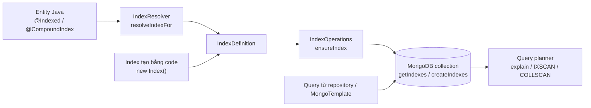
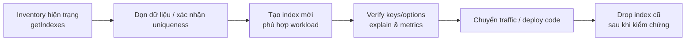

# `IndexOperations`, `IndexResolver` và quản lý chỉ mục bằng mã

Trong một ứng dụng **Spring Data MongoDB**, việc đặt annotation `@Indexed` hoặc `@CompoundIndex` lên entity chỉ mới diễn tả **ý định thiết kế chỉ mục**. MongoDB Server chỉ dùng được index khi index đã **thực sự tồn tại** trong collection với đúng field, thứ tự, kiểu và các option cần thiết. Vì thế, xây hệ thống ổn định đòi hỏi hiểu ba tầng riêng biệt: **metadata trên entity**, **cơ chế tạo/kiểm tra index trong Spring Data** và **quản lý thay đổi index ở môi trường triển khai**.

Hai API trọng tâm là:

- **`IndexOperations`**: làm việc với index của **một collection**, bao gồm tạo/đảm bảo tồn tại bằng `ensureIndex(...)`, liệt kê thông tin qua `getIndexInfo()` và xóa index bằng `dropIndex(...)` khi có kế hoạch.
- **`IndexResolver`** (thường dùng `MongoPersistentEntityIndexResolver`): đọc metadata index từ entity có các annotation như `@Indexed`, `@CompoundIndex`, `@TextIndexed` hoặc các loại annotation được framework hỗ trợ, rồi tạo danh sách `IndexDefinition` để đưa cho `IndexOperations` thực thi.

Bài thuộc chương **Chỉ mục** của module `SPRING_DATA_MONGODB`. Module thực hành kết nối và ánh xạ MongoDB, truy vấn qua `MongoTemplate` hoặc repository, aggregation, index, transaction, reactive access, kiểm thử và chẩn đoán hiệu năng dữ liệu. Trong bài này, trọng tâm là **quản lý index bằng mã có kiểm soát**, chứ không chỉ thêm annotation và hy vọng index tự xuất hiện.

Sau bài, bạn có thể:

1. Phân biệt **khai báo**, **tạo trên server**, **kiểm tra tồn tại**, **thay đổi** và **xóa** index.
2. Dùng `MongoTemplate.indexOps(...)` để tạo index đơn, compound, unique và TTL.
3. Dùng `IndexResolver` để chuyển annotation từ entity thành những `IndexDefinition` cụ thể.
4. Hiểu vì sao **auto-index creation không nên được xem là migration schema hoàn chỉnh**, nhất là ở production.
5. Viết bước bootstrap/migration idempotent, phát hiện index drift và xử lý duplicate key hoặc option conflict.
6. Đo query plan bằng `explain("executionStats")` và kiểm thử index thật với MongoDB test instance.

## 1. Bản đồ trách nhiệm: annotation, Spring Data và MongoDB Server



Các bước có ý nghĩa khác nhau:

| Bước | Cơ chế | Điều được đảm bảo |
| --- | --- | --- |
| Khai báo | `@Indexed`, `@CompoundIndex` trong class Java | Metadata thiết kế; **chưa chứng minh index tồn tại trên server** |
| Phân giải | `IndexResolver.resolveIndexFor(Entity.class)` | Sinh `IndexDefinition` theo mapping/annotation của entity |
| Tạo/đảm bảo | `IndexOperations.ensureIndex(definition)` | Yêu cầu MongoDB tạo index nếu cần, hoặc xử lý trường hợp đã tồn tại tương thích |
| Kiểm tra | `IndexOperations.getIndexInfo()`, `db.collection.getIndexes()` | Biết collection hiện có những index nào |
| Sử dụng | MongoDB query planner | Index **có thể** được chọn nếu phù hợp query, sort, thống kê dữ liệu |
| Thay đổi | Migration được kiểm soát | Không được giả định index cũ tự đổi keys/options khi annotation thay |

Một endpoint `findByTenantIdAndSku(...)` trả đúng dữ liệu **không có nghĩa** MongoDB đã dùng index. Với collection nhỏ, `COLLSCAN` vẫn có thể trả kết quả nhanh; chỉ `explain`/profiling trên dữ liệu đại diện mới giúp xác nhận chiến lược thực thi.

### 1.1. Index là tài nguyên vật lý, không phải “bản sao” của Java field

Index có **key pattern** (ví dụ `{tenantId:1, sku:1}`), tên, các option như `unique`, `sparse`, `partialFilterExpression`, TTL, collation và những đặc điểm khác tùy loại index. Cùng một field Java có thể tham gia nhiều index; ngược lại, một index compound có thể gồm nhiều field và thứ tự giữa chúng rất quan trọng.

Lợi ích của index phải cân với chi phí: RAM/storage, cập nhật index khi insert/update/delete, thời gian build và ảnh hưởng tới workload ghi. **Không tạo index cho mọi field một cách máy móc**.

## 2. Mô hình ví dụ: tìm sản phẩm trong nhiều tenant

Giả sử collection `catalogProducts` phục vụ các truy vấn:

- Đọc một sản phẩm theo `tenantId + sku`.
- Liệt kê sản phẩm đang bán theo `tenantId + status`, sort `createdAt DESC`.
- Dọn bản ghi tạm hết hạn dựa trên trường `expiresAt`.
- Tìm kiếm theo bộ lọc động của một số field tùy ứng dụng.

Document mẫu:

```javascript
{
  _id: "P-101",
  tenantId: "T-A",
  sku: "BK-001",
  name: "Sakura Notebook",
  status: "ACTIVE",
  createdAt: ISODate("2026-11-01T10:00:00Z"),
  expiresAt: null
}
```

Đối với dữ liệu đa tenant, SKU chỉ cần unique **trong tenant**. Một unique index chỉ trên `sku` có thể khiến tenant T-B không được dùng SKU `BK-001` đã có ở tenant T-A. Ngược lại, một index compound unique `{tenantId:1, sku:1}` diễn đạt đúng hơn yêu cầu này.

### 2.1. Entity khai báo metadata index

```java
import java.time.Instant;
import org.springframework.data.annotation.Id;
import org.springframework.data.mongodb.core.index.CompoundIndex;
import org.springframework.data.mongodb.core.index.CompoundIndexes;
import org.springframework.data.mongodb.core.mapping.Document;

@Document(collection = "catalogProducts")
@CompoundIndexes({
@CompoundIndex(
        name = "ux_catalog_tenant_sku",
        def = "{ 'tenantId': 1, 'sku': 1 }",
        unique = true
),
@CompoundIndex(
        name = "ix_catalog_tenant_status_created",
        def = "{ 'tenantId': 1, 'status': 1, 'createdAt': -1 }"
)
})
public class CatalogProduct {
    @Id
    private String id;

    private String tenantId;
    private String sku;
    private String name;
    private String status;
    private Instant createdAt;
    private Instant expiresAt;

    protected CatalogProduct() {}

    public CatalogProduct(
            String id, String tenantId, String sku,
            String name, String status, Instant createdAt
    ) {
        this.id = id;
        this.tenantId = tenantId;
        this.sku = sku;
        this.name = name;
        this.status = status;
        this.createdAt = createdAt;
    }

    public String getId() { return id; }
    public String getTenantId() { return tenantId; }
    public String getSku() { return sku; }
    public String getName() { return name; }
    public String getStatus() { return status; }
    public Instant getCreatedAt() { return createdAt; }
    public Instant getExpiresAt() { return expiresAt; }
    public void setExpiresAt(Instant expiresAt) {
        this.expiresAt = expiresAt;
    }
}
```

Ở đây hai `@CompoundIndex` khai báo:

| Tên | Key pattern | Mục đích |
| --- | --- | --- |
| `ux_catalog_tenant_sku` | `{tenantId:1,sku:1}` | Chống trùng SKU trong cùng tenant |
| `ix_catalog_tenant_status_created` | `{tenantId:1,status:1,createdAt:-1}` | Lọc tenant/status và hỗ trợ sort ngày tạo mới nhất trong pattern phù hợp |

Đây là **metadata**, chưa phải bằng chứng index đã có trên MongoDB Server. Tên index có thể thay đổi khi đổi annotation; **không tự suy rằng framework sẽ xóa index cũ**.

### 2.2. Đừng trộn `@Id` và business key

Trường `@Id` được map sang `_id` và MongoDB tạo index unique trên `_id` cho collection thông thường. Index `{tenantId,sku}` bảo vệ một ràng buộc **khác** là mã hàng trong tenant.

Trong ví dụ này, `@Id String` được dùng cho sự đơn giản của entity. Với các chuỗi 24 ký tự hexadecimal, Spring Data có thể ánh xạ `String` sang BSON `ObjectId` tùy cấu hình; ứng dụng dùng ID String có quy tắc cụ thể có thể chọn `@MongoId` để kiểm soát cách biểu diễn. Việc tạo index không tự khắc phục sự không nhất quán giữa String và ObjectId trong query.

## 3. `IndexOperations`: API để quản lý index của collection

Spring Data MongoDB cung cấp `IndexOperations` qua `MongoTemplate.indexOps(...)`:

```java
import org.springframework.data.mongodb.core.MongoTemplate;
import org.springframework.data.mongodb.core.index.IndexOperations;

// template đã được inject vào service/configuration.
IndexOperations byEntity =
        template.indexOps(CatalogProduct.class);

IndexOperations byCollection =
        template.indexOps("catalogProducts");
```

**Khác biệt nên để ý:** `indexOps(CatalogProduct.class)` gắn với metadata entity/mapping; `indexOps("catalogProducts")` thao tác theo tên collection cụ thể. Khi entity dùng `@Field` đổi tên BSON hoặc có collection name tùy biến, nên ưu tiên đường **typed** hoặc xác minh key pattern thật trước khi tạo index.

Những thao tác thường dùng:

| Method | Vai trò | Lưu ý |
| --- | --- | --- |
| `ensureIndex(IndexDefinition)` | Đảm bảo một index definition tồn tại, trả về tên index | Không phải migration tự động thay cấu hình index đã tồn tại |
| `getIndexInfo()` | Liệt kê index hiện có | Dùng để kiểm tra hậu triển khai và test |
| `dropIndex(String)` | Xóa index theo tên | Chỉ thực hiện trong migration có kiểm soát |
| `dropAllIndexes()` | Xóa các index không phải `_id` được phép xóa | Rất nguy hiểm trên production |

### 3.1. Tạo index đơn bằng `Index`

```java
import org.springframework.data.domain.Sort;
import org.springframework.data.mongodb.core.index.Index;

String indexName = template.indexOps(CatalogProduct.class)
        .ensureIndex(new Index()
                .on("status", Sort.Direction.ASC)
                .named("ix_catalog_status"));

System.out.println(indexName);
```

Đây là ví dụ kỹ thuật, không phải khuyến nghị tạo thêm index status-only cho mọi collection. Nếu gần như mọi truy vấn đều bắt buộc có tenant, index `{tenantId,status,createdAt}` thường đáng đánh giá hơn index `{status}` với độ chọn lọc kém.

`ensureIndex` là một **yêu cầu tới MongoDB Server**; cần kết nối, quyền tạo index và server hỗ trợ. Nếu có lỗi xác thực, duplicate key hoặc option conflict, thao tác có thể ném exception thay vì âm thầm thành công.

### 3.2. Tạo compound unique index bằng mã

```java
import org.springframework.data.domain.Sort;
import org.springframework.data.mongodb.core.index.Index;
import org.springframework.data.mongodb.core.index.IndexOperations;

IndexOperations indexOps =
        template.indexOps(CatalogProduct.class);

String name = indexOps.ensureIndex(
        new Index()
                .on("tenantId", Sort.Direction.ASC)
                .on("sku", Sort.Direction.ASC)
                .unique()
                .named("ux_catalog_tenant_sku"));
```

Code trên thể hiện cùng key/option với `@CompoundIndex` ở entity. **Không cần vừa resolver annotation vừa tạo thêm cùng một index bằng mã ở mọi nơi**; hãy chọn một nguồn định nghĩa chính, hoặc kiểm tra hai nguồn luôn đồng bộ. Nếu khác tên/options, có thể phát sinh index trùng chức năng, conflict hoặc migration ngoài dự tính.

### 3.3. Tạo index phục vụ filter và sort

```java
indexOps.ensureIndex(
        new Index()
                .on("tenantId", Sort.Direction.ASC)
                .on("status", Sort.Direction.ASC)
                .on("createdAt", Sort.Direction.DESC)
                .named("ix_catalog_tenant_status_created"));
```

Thứ tự field được chọn theo query mẫu:

```javascript
db.catalogProducts.find({
  tenantId: "T-A",
  status: "ACTIVE"
}).sort({ createdAt: -1 }).limit(20);
```

MongoDB có thể sử dụng prefix của compound index và đáp ứng sort trong nhiều tình huống, nhưng việc có index chưa có nghĩa planner **luôn** chọn nó. Collation, range predicate, độ chọn lọc, projection và các index cạnh tranh có thể ảnh hưởng kế hoạch thực thi. Hãy dùng `explain` để kiểm tra.

## 4. Đọc danh sách index hiện có với `getIndexInfo()`

Sau khi chạy `ensureIndex`, phải xác nhận **server có index đúng thiết kế**, thay vì chỉ dựa vào việc method không ném lỗi.

```java
import java.util.List;
import org.springframework.data.mongodb.core.index.IndexInfo;
import org.springframework.data.mongodb.core.index.IndexOperations;

IndexOperations indexOps =
        template.indexOps(CatalogProduct.class);

List<IndexInfo> indexes = indexOps.getIndexInfo();
for (IndexInfo info : indexes) {
    System.out.printf(
            "name=%s, unique=%s, keys=%s%n",
            info.getName(),
            info.isUnique(),
            info.getIndexFields()
    );
}
```

Danh sách thường bao gồm `_id_`, và các index do ứng dụng hoặc những tác nhân khác tạo. Thông tin `IndexInfo` phụ thuộc version Spring Data MongoDB; nếu cần đối chiếu toàn bộ option hiếm như `partialFilterExpression`, collation, TTL, hidden index hoặc wildcard projection, nên kiểm tra **BSON raw** bằng `getIndexes()` ở MongoDB.

Ví dụ trong `mongosh`:

```javascript
db.catalogProducts.getIndexes();
```

Kết quả minh họa rút gọn:

```javascript
[
  { v: 2, key: { _id: 1 }, name: "_id_" },
  {
    v: 2,
    key: { tenantId: 1, sku: 1 },
    name: "ux_catalog_tenant_sku",
    unique: true
  },
  {
    v: 2,
    key: { tenantId: 1, status: 1, createdAt: -1 },
    name: "ix_catalog_tenant_status_created"
  }
]
```

`v` là phiên bản định dạng index ở server, không phải version entity. Các trường option có thể khác tùy loại index/phiên bản MongoDB. **Không kiểm tra mỗi tên index** rồi kết luận đủ; hai index trùng tên nhưng khác key/option là cấu hình không hợp lệ hoặc đang drift.

### 4.1. Xây bước kiểm tra index ở startup/health check

Với môi trường nghiêm ngặt, sau migration có thể đọc index metadata và xác minh các điều kiện tối thiểu:

```java
boolean hasUniqueSkuKey = template
        .indexOps(CatalogProduct.class)
        .getIndexInfo()
        .stream()
        .anyMatch(info ->
                "ux_catalog_tenant_sku".equals(info.getName())
                && info.isUnique());

if (!hasUniqueSkuKey) {
    throw new IllegalStateException(
            "Thiếu unique index tenant + SKU");
}
```

Đây chỉ là **kiểm tra sơ bộ**. Nó chưa đối chiếu key pattern chính xác. Với kiểm toán cấu hình production, hãy so đầy đủ **name + keys + order + unique + TTL + partial filter + collation** khi các option ấy quan trọng. Nếu nhận thấy drift, không tự động xóa index bằng một nhánh `if` thiếu kiểm soát.

### 4.2. `dropIndex` và `dropAllIndexes`: chỉ dùng theo kế hoạch

```java
// Ví dụ chỉ dành cho migration được phê duyệt hoặc database test riêng.
IndexOperations ops = template.indexOps(CatalogProduct.class);

ops.dropIndex("ix_catalog_status");

// KHÔNG chạy trong ứng dụng production đang phục vụ:
// ops.dropAllIndexes();
```

Xóa index có thể khiến query chuyển từ `IXSCAN` sang `COLLSCAN`, làm tăng latency hoặc load server. Với **unique index**, xóa còn bỏ luôn ràng buộc chống dữ liệu trùng. Không xóa chỉ vì code hiện tại không còn annotation: index có thể đang phục vụ một service/job khác.

Trong môi trường production, việc loại bỏ index cần: xác nhận index không còn được dùng, đo query plan sau khi vô hiệu hóa hoặc thử trên môi trường phù hợp, có kế hoạch rollback và quản lý quyền DDL riêng.

## 5. `IndexResolver`: biến annotation thành `IndexDefinition`

`IndexOperations` thực thi hành động trên collection, còn `IndexResolver` chịu trách nhiệm **đọc thông tin từ mapping metadata** để biết cần tạo index nào.

Một implementation thông dụng là `MongoPersistentEntityIndexResolver`:

```java
import org.springframework.data.mongodb.core.index.IndexResolver;
import org.springframework.data.mongodb.core.index.MongoPersistentEntityIndexResolver;
import org.springframework.data.mongodb.core.index.IndexOperations;
import org.springframework.data.mongodb.core.MongoTemplate;

IndexResolver resolver = new MongoPersistentEntityIndexResolver(
        template.getConverter().getMappingContext()
);

IndexOperations operations =
        template.indexOps(CatalogProduct.class);

resolver.resolveIndexFor(CatalogProduct.class)
        .forEach(operations::ensureIndex);
```

Hàm `resolveIndexFor(CatalogProduct.class)` duyệt metadata entity và trả về những `IndexDefinition` tương ứng với annotation được framework hiểu. Sau đó `ensureIndex` mới yêu cầu MongoDB tạo index trên collection thật.

**Điểm cần nhớ:** chỉ gọi `resolveIndexFor(...)` **không tạo index**. Resolver không thay thế `MongoTemplate`/driver và không tự chạy migration.

### 5.1. `IndexResolver` mang lại lợi ích gì?

| Khi không dùng resolver | Khi dùng resolver |
| --- | --- |
| Phải tự viết `new Index().on(...)` cho từng annotation | Có thể tận dụng metadata `@Indexed`/`@CompoundIndex` |
| Dễ quên đổi code bootstrap khi entity đổi tên field | Resolver dựa trên mapping metadata |
| Khó áp dụng nhất quán cho nhiều entity | Có thể tổ chức registry class cần tạo index |
| Metadata annotation và index tạo bằng code có thể lệch nhau | Giảm việc khai báo trùng, nhưng **không tự giải quyết migration drift** |

Resolver cũng không đọc “mọi nhu cầu index” từ query thực tế. Nó không thể suy ra rằng một `MongoTemplate.aggregate(...)` rất chậm cần index mới. Những index chỉ được tạo bằng Java code, migration hoặc công cụ DB vẫn cần quản lý riêng.

### 5.2. Annotation cần đặt trên entity được scan/mapping

Spring Data MongoDB sử dụng metadata từ những loại entity được mapping. Nếu một class không được framework nhận diện, annotation của nó có thể không được xử lý như mong muốn. Hãy dùng `@Document(collection = "...")`, cấu hình entity scanning, và xác định rõ những entity nào tham gia index initialization.

Với `Map`/field không có cấu trúc cố định, resolver không thể đoán trước mọi key động; các thuộc tính trong Map có thể **không được index tự động**. Nếu thật sự cần index các khóa linh hoạt, cần xác định chiến lược `@WildcardIndexed` hoặc một index wildcard được tạo rõ ràng; nó có giới hạn hiệu năng/storage riêng.

### 5.3. Phân biệt `@Indexed` và `@CompoundIndex`

Ví dụ:

```java
import org.springframework.data.mongodb.core.index.CompoundIndex;
import org.springframework.data.mongodb.core.index.Indexed;
import org.springframework.data.mongodb.core.mapping.Document;

@Document(collection = "inventoryItems")
@CompoundIndex(
        name = "ux_tenant_sku",
        def = "{'tenantId': 1, 'sku': 1}",
        unique = true
)
class InventoryItem {
    String tenantId;
    String sku;

    @Indexed(name = "ix_inventory_status")
    String status;
}
```

`@Indexed` trên `status` thường tạo index **một field**; `@CompoundIndex` trên class tạo **index gồm nhiều field theo thứ tự nêu trong `def`**. Chúng **không tự gộp lại thành một index duy nhất**. Nếu workload chủ yếu là `tenantId + status`, một index chỉ trên status có thể không hữu ích bằng một compound index phù hợp.

### 5.4. Những annotation index khác

Spring Data MongoDB hỗ trợ các kiểu metadata index khác tùy phiên bản, ví dụ:

| Annotation | Tình huống | Điều cần kiểm tra |
| --- | --- | --- |
| `@Indexed` | Field đơn, unique, sparse, TTL theo cấu hình | Kiểu field và options thực tế trên server |
| `@CompoundIndex` / `@CompoundIndexes` | Query nhiều field, unique business key | Thứ tự field, tên index, option |
| `@TextIndexed` / `@TextScore` | Text search theo text index | Ngôn ngữ, stemming, một text index/collection theo giới hạn server |
| `@GeoSpatialIndexed` | Dữ liệu vị trí, truy vấn không gian | Loại index 2d/2dsphere và GeoJSON đúng |
| `@WildcardIndexed` | Các field động, schema linh hoạt | Chi phí index và phạm vi wildcard |
| `@HashIndexed` | Hashed index theo field phù hợp | Không nhầm hashed index với sort/range index |

**Không giả định mọi annotation được hỗ trợ y hệt giữa các phiên bản**. Cấu hình index là contract với MongoDB Server, cần test tính tương thích khi đổi Spring Data hoặc driver.

## 6. Tại sao annotation không tự tạo index trong mọi ứng dụng?

Từ **Spring Data MongoDB 3.0**, **automatic index creation mặc định bị tắt**. Việc annotate entity không đảm bảo MongoDB có index ngay sau application startup. Đây là lựa chọn quan trọng vì index có tác động vật lý đến dữ liệu và hoạt động triển khai.

Một số dự án Spring Boot cho phép cấu hình tính năng tự tạo index qua property tương ứng, ví dụ với những phiên bản Boot hỗ trợ:

```properties
spring.data.mongodb.auto-index-creation=true
```

Hoặc, khi cấu hình Spring Data MongoDB bằng `AbstractMongoClientConfiguration`, có thể ghi đè:

```java
@Override
protected boolean autoIndexCreation() {
    return true;
}
```

**Không sao chép đồng thời nhiều cách cấu hình** nếu chúng chồng lấn hoặc bị một configuration khác ghi đè. Hãy kiểm tra phiên bản Spring Boot/Spring Data và đường cấu hình MongoDB thật của dự án.

### 6.1. Khi nào auto-index có ích?

Trong prototype, local development hoặc test suite, tự tạo index theo annotation giúp giảm thao tác thủ công và phát hiện nhanh unique constraint. Nhưng ở production:

- Build index trên collection lớn có thể mất đáng kể thời gian và tài nguyên.
- Nhiều instance ứng dụng cùng khởi động và cùng đòi tạo index.
- Index cũ có keys/options khác **không được tự sửa an toàn** khi đổi annotation.
- Cần quyền createIndex trong account runtime, làm tăng phạm vi quyền.
- Nếu build thất bại, ứng dụng có thể khởi động lỗi đúng lúc cần scale out.

Vì vậy, **index migration có kiểm soát** thường phù hợp hơn cho production có dữ liệu lớn, SLA cao hoặc nhiều service cùng dùng collection.

### 6.2. Auto-index không thay thế schema/index migration

Giả sử phiên bản đầu có:

```javascript
{ tenantId: 1, sku: 1 }
```

Sau đó ứng dụng muốn thêm `unique: true` hoặc đổi key pattern sang:

```javascript
{ tenantId: 1, status: 1, sku: 1 }
```

Việc sửa annotation không chứng minh index đang tồn tại đã được thay. MongoDB có thể từ chối tạo index trùng tên khác key/option; unique index mới còn có thể thất bại nếu dữ liệu hiện có trùng.

Migration phải kiểm tra hiện trạng, dữ liệu trùng và phụ thuộc query, sau đó quyết định tạo index mới, chuyển ứng dụng sang dùng nó, rồi mới bỏ index cũ ở thời điểm phù hợp.

### 6.3. Index không tự tái tạo sau khi collection bị drop/re-create

Nếu một collection bị drop và sau đó được tạo lại khi ứng dụng vẫn chạy, những index không phải `_id` có thể không còn. Spring Data không đảm bảo tự phát hiện và phục hồi đầy đủ index chỉ vì entity vẫn có annotation. Việc tạo index nên là **quy trình quản lý deployment** hoặc một bước bootstrap/health check được thiết kế rõ.

Trong test tích hợp có thao tác xóa collection, cần bảo đảm tạo lại index **trước khi kiểm tra unique constraint**, hoặc tránh drop collection mà chỉ xóa document test.

## 7. Bootstrap index minh bạch trong Spring Boot

Khi muốn **quản lý việc tạo index qua mã** nhưng không bật auto-index cho mọi entity, có thể định nghĩa một bước `ApplicationRunner` hoặc migration riêng. Ví dụ tối giản dưới đây chỉ bảo đảm index **cho một danh sách entity được lựa chọn**, thay vì vô tình tạo mọi index annotation có trong classpath.

### 7.1. Bootstrap từ `IndexResolver`

```java
import org.springframework.boot.ApplicationRunner;
import org.springframework.context.annotation.Bean;
import org.springframework.context.annotation.Configuration;
import org.springframework.data.mongodb.core.MongoTemplate;
import org.springframework.data.mongodb.core.index.IndexOperations;
import org.springframework.data.mongodb.core.index.IndexResolver;
import org.springframework.data.mongodb.core.index.MongoPersistentEntityIndexResolver;

@Configuration
public class CatalogIndexBootstrap {

    @Bean
    ApplicationRunner createCatalogIndexes(
            MongoTemplate template
    ) {
        return args -> {
            IndexResolver resolver =
                    new MongoPersistentEntityIndexResolver(
                            template.getConverter().getMappingContext());

            IndexOperations operations =
                    template.indexOps(CatalogProduct.class);

            resolver.resolveIndexFor(CatalogProduct.class)
                    .forEach(operations::ensureIndex);
        };
    }
}
```

**Thứ tự thực thi:** Spring Boot tạo `MongoTemplate`, runner nhận template, resolver đọc annotation, và `IndexOperations` gọi MongoDB Server. Runner chạy trước khi ứng dụng báo hoàn thành quá trình startup theo mô hình Spring Boot thông dụng, nhưng **không được coi nó là một bước migration production được điều phối giữa nhiều replica**.

Nếu cần index cho nhiều entity:

```java
import java.util.List;

List<Class<?>> entityTypes = List.of(
        CatalogProduct.class,
        InventoryItem.class
);

IndexResolver resolver = new MongoPersistentEntityIndexResolver(
        template.getConverter().getMappingContext());

for (Class<?> type : entityTypes) {
    IndexOperations ops = template.indexOps(type);
    resolver.resolveIndexFor(type).forEach(ops::ensureIndex);
}
```

Đây là **đoạn code đặt trong runner/configuration** có `template` và `InventoryItem` đã được khai báo. Không nên tự tìm tất cả class trong package theo kiểu không kiểm soát rồi mở rộng DDL mỗi lần thêm entity. Nếu index chỉ được phép tạo bởi một process migration, hãy đặt code resolver này trong tool/migration thay vì runtime của tất cả API instances.

### 7.2. Bootstrap từ `Index` programmatic

Nếu yêu cầu index có điều kiện triển khai hoặc không muốn dùng annotation:

```java
import org.springframework.boot.ApplicationRunner;
import org.springframework.context.annotation.Bean;
import org.springframework.context.annotation.Configuration;
import org.springframework.data.domain.Sort;
import org.springframework.data.mongodb.core.MongoTemplate;
import org.springframework.data.mongodb.core.index.Index;
import org.springframework.data.mongodb.core.index.IndexOperations;

@Configuration
public class ExplicitCatalogIndexBootstrap {

    @Bean
    ApplicationRunner createExplicitIndexes(
            MongoTemplate template
    ) {
        return args -> {
            IndexOperations ops =
                    template.indexOps(CatalogProduct.class);

            ops.ensureIndex(new Index()
                    .on("tenantId", Sort.Direction.ASC)
                    .on("sku", Sort.Direction.ASC)
                    .unique()
                    .named("ux_catalog_tenant_sku"));

            ops.ensureIndex(new Index()
                    .on("tenantId", Sort.Direction.ASC)
                    .on("status", Sort.Direction.ASC)
                    .on("createdAt", Sort.Direction.DESC)
                    .named("ix_catalog_tenant_status_created"));
        };
    }
}
```

**Chọn một chiến lược thống nhất**: nếu app đã chạy resolver annotation, không cần thêm runner programmatic tạo lại đúng index đó. Hai ví dụ trên mô tả **hai lựa chọn khác nhau**, không nên bật cả hai khi chưa xác minh chúng trùng định nghĩa tuyệt đối.

### 7.3. Vì sao không tự động gọi `dropIndex` mỗi lần startup?

Ví dụ anti-pattern:

```java
// KHÔNG áp dụng:
ops.dropIndex("ix_catalog_tenant_status_created");
ops.ensureIndex(newDefinition);
```

Trong khoảng giữa drop và create, query có thể trở nên rất chậm; nếu create thất bại, index đã mất. Nhiều replica cùng chạy đoạn này có thể tạo race condition hoặc sự cố DDL. Thêm nữa, đổi index có thể ảnh hưởng dữ liệu trùng và các truy vấn của phiên bản ứng dụng chưa được cập nhật.

**Bootstrap an toàn** thường chỉ tạo/index bảo đảm các index đã được thống nhất trong schema hiện tại. **Thay đổi hoặc xóa** index nên là một migration riêng có điều phối, giám sát và khả năng khôi phục.

## 8. `ensureIndex` không phải “sửa index cũ”

Tên method dễ khiến người đọc hiểu rằng nếu đã có index cùng tên, framework sẽ sửa key hoặc options để khớp định nghĩa mới. Không nên dựa vào giả định đó.

MongoDB Server nhận yêu cầu tạo index; tùy index hiện có, server có thể báo:

- **Index tương thích đã tồn tại:** lệnh tạo/đảm bảo index có thể hoàn tất mà không cần build lại.
- **Tên giống nhưng key pattern/options khác:** lỗi kiểu **IndexOptionsConflict** hoặc tương đương.
- **Key pattern trùng nhưng option unique/partial/collation khác:** có thể xảy ra conflict hoặc tạo index khác tên tùy loại khác biệt, quy tắc MongoDB version và cách đặt tên.
- **Tạo unique index khi có dữ liệu trùng:** build thất bại vì ràng buộc unique không thể được thỏa.
- **Không có quyền DDL:** lỗi xác thực/phân quyền, không liên quan cú pháp Java.

### 8.1. Một kịch bản drift thường gặp

Ở phiên bản V1:

```javascript
db.catalogProducts.createIndex(
  { tenantId: 1, sku: 1 },
  { name: "ux_catalog_tenant_sku" }
);
// V1: NON-UNIQUE.
```

Đến V2, team đổi annotation hoặc `new Index()` để có `unique = true`:

```java
new Index()
    .on("tenantId", Sort.Direction.ASC)
    .on("sku", Sort.Direction.ASC)
    .unique()
    .named("ux_catalog_tenant_sku");
```

Đừng cho rằng việc khởi động V2 sẽ tự chuyển index non-unique V1 thành unique V2. Trước hết phải:

1. Phát hiện index cũ với `getIndexes()`.
2. Tìm các nhóm `tenantId + sku` bị trùng.
3. Dọn/trộn dữ liệu theo quy tắc nghiệp vụ **được phê duyệt**.
4. Lập kế hoạch thay index có xét downtime, tải server và phiên bản ứng dụng.
5. Tạo index unique mới theo khả năng của MongoDB Server và phương án migration.
6. Xác minh index metadata sau thay đổi, chạy lại integration/EXPLAIN tests.

### 8.2. Kiểm tra duplicate trước khi bật unique

Trong MongoDB:

```javascript
db.catalogProducts.aggregate([
  {
    $group: {
      _id: { tenantId: "$tenantId", sku: "$sku" },
      count: { $sum: 1 },
      ids: { $push: "$_id" }
    }
  },
  { $match: { count: { $gt: 1 } } }
]);
```

Đây là phép rà soát ví dụ. Với collection rất lớn, gom mọi `ids` vào một mảng có thể tốn bộ nhớ; chỉ dùng phương án lưu ID khi batch đã giới hạn, hoặc chỉ group/count trước rồi drill down từng nhóm. Khi duplicate được phát hiện, đừng tự xóa document không xác định “bản nào là chính” vì có thể làm mất dữ liệu kinh doanh.

### 8.3. Quy trình expand–verify–contract

Một phương án migration có thể chia làm:



Nếu key pattern cũ/mới không thể cùng tồn tại theo quy tắc server hoặc ràng buộc unique cần nâng cấp tại chỗ, kế hoạch phải điều chỉnh phù hợp; không áp dụng expand–contract máy móc.

Với nhiều app instances, **một migration job có lock/coordination rõ ràng** thường phù hợp hơn việc mỗi instance tự drop/create. Account chạy migration có thể có quyền quản lý index, còn app runtime chỉ cần quyền truy cập dữ liệu theo nguyên tắc tối thiểu.

## 9. Unique, sparse và partial index: đừng nhầm tính duy nhất có điều kiện

### 9.1. Unique compound index theo tenant

```javascript
db.catalogProducts.createIndex(
  { tenantId: 1, sku: 1 },
  {
    unique: true,
    name: "ux_catalog_tenant_sku"
  }
);
```

Với các document:

```javascript
{ _id: "P-101", tenantId: "T-A", sku: "BK-001" }
{ _id: "P-102", tenantId: "T-B", sku: "BK-001" }
```

hai dòng **không trùng unique compound key** vì tenant khác. Nhưng dòng thứ ba `{tenantId:"T-A", sku:"BK-001"}` sẽ vi phạm ràng buộc.

**Dữ liệu thiếu field:** unique index trên những field có thể vắng mặt có quy tắc lưu/so khớp giá trị null và missing theo MongoDB. Không tự coi unique compound index là validator bắt buộc mọi document phải có SKU. Nếu nghiệp vụ yêu cầu `tenantId` và `sku` không bao giờ thiếu, hãy **validate ở Java và ở schema/server khi phù hợp**.

### 9.2. Sparse index

Một sparse index có thể bỏ qua document thiếu field được index. Nhưng **sparse không đồng nghĩa “chỉ index document active”**, và hành vi với null/missing cần được xác minh theo loại index.

Ví dụ:

```javascript
db.catalogProducts.createIndex(
  { externalCode: 1 },
  {
    sparse: true,
    unique: true,
    name: "ux_external_code_sparse"
  }
);
```

Thích hợp khi `externalCode` **thực sự optional**, không phải khi mọi tenant có thể dùng cùng externalCode nhưng cần unique trong tenant. Trường hợp đó phải thiết kế key/predicate đúng scope.

### 9.3. Partial index

Giả sử chỉ các sản phẩm `status:"ACTIVE"` mới cần unique SKU trong tenant. Một **partial unique index** có thể diễn đạt:

```javascript
db.catalogProducts.createIndex(
  { tenantId: 1, sku: 1 },
  {
    name: "ux_active_catalog_tenant_sku",
    unique: true,
    partialFilterExpression: { status: "ACTIVE" }
  }
);
```

Index này chỉ bao phủ những document thỏa `status:"ACTIVE"`. Khi status chuyển từ DRAFT sang ACTIVE, server sẽ kiểm tra unique constraint tại thao tác ghi.

Một cách tạo programmatic bằng Spring Data MongoDB ở những phiên bản hỗ trợ:

```java
import org.springframework.data.domain.Sort;
import org.springframework.data.mongodb.core.index.Index;
import org.springframework.data.mongodb.core.index.PartialIndexFilter;
import org.springframework.data.mongodb.core.query.Criteria;

Index activeUnique = new Index()
        .on("tenantId", Sort.Direction.ASC)
        .on("sku", Sort.Direction.ASC)
        .unique()
        .partial(PartialIndexFilter.of(
                Criteria.where("status").is("ACTIVE")))
        .named("ux_active_catalog_tenant_sku");

template.indexOps(CatalogProduct.class)
        .ensureIndex(activeUnique);
```

**Hai mô hình unique phải được chọn nhất quán:** nếu đã có `ux_catalog_tenant_sku` không điều kiện, tạo thêm index partial không tự nới lỏng unique toàn phần; index cũ vẫn sẽ từ chối duplicate ở trạng thái DRAFT. Không áp cả hai rồi kỳ vọng partial index ghi đè quy tắc của index cũ.

**Query planner:** partial index có thể không được chọn cho query không có predicate phù hợp với filter của index, vì nó không chứa đủ document để trả kết quả chính xác. Unique constraint và chiến lược phục vụ query là hai mục đích liên quan nhưng không đồng nhất.

### 9.4. Collation có thể thay đổi ý nghĩa unique

Một unique index String dùng collation phân biệt/chưa phân biệt case theo cấu hình có thể khiến `"bk-001"` và `"BK-001"` được coi là trùng hoặc không trùng. Nếu nghiệp vụ yêu cầu so SKU không phân biệt case, phải thống nhất **chuẩn hóa dữ liệu, collation của index và query**, rồi test trên MongoDB Server.

Không cho rằng `@Indexed(unique = true)` tự đảm bảo mọi quy tắc Unicode/case-folding mong muốn; nó chỉ yêu cầu unique theo semantics thực của index.

## 10. TTL index: quản lý vòng đời dữ liệu bằng index

Một số document tạm có thời điểm hết hạn, ví dụ mã xác minh, dữ liệu cache hay session. MongoDB có **TTL index** để xóa document theo một trường BSON Date và số giây hết hạn.

### 10.1. TTL theo thời điểm hết hạn tuyệt đối

Ví dụ collection `temporaryTokens`:

```javascript
{
  _id: "token-101",
  ownerId: "USER-1",
  expiresAt: ISODate("2026-11-20T10:00:00Z")
}
```

Nếu `expiresAt` đã là thời điểm hết hạn tuyệt đối, tạo TTL index với `expireAfterSeconds:0`:

```javascript
db.temporaryTokens.createIndex(
  { expiresAt: 1 },
  {
    name: "ttl_temporary_tokens_expires_at",
    expireAfterSeconds: 0
  }
);
```

Một cách tương đương bằng `IndexOperations`:

```java
import java.time.Duration;
import org.springframework.data.domain.Sort;
import org.springframework.data.mongodb.core.index.Index;

template.indexOps("temporaryTokens").ensureIndex(
        new Index()
                .on("expiresAt", Sort.Direction.ASC)
                .expire(Duration.ZERO)
                .named("ttl_temporary_tokens_expires_at"));
```

Với các phiên bản Spring Data không có overload `expire(Duration)`, hãy đối chiếu API của phiên bản đang dùng; các overload dựa trên số và `TimeUnit` có thể được hỗ trợ. **Không tự đổi `Duration.ZERO` thành một khoảng dương** vì đó là thay đổi ngữ nghĩa: thời gian hết hạn được tính từ ngày trong document cộng khoảng TTL.

### 10.2. TTL không xóa đúng tại mili-giây hết hạn

MongoDB TTL monitor chạy nền, nên document có thể **tồn tại thêm một khoảng thời gian** sau mốc `expiresAt`. Không dùng TTL như cơ chế bảo mật duy nhất để quyết định token còn dùng được hay không.

Để xác thực token, vẫn phải kiểm tra:

```java
if (!Instant.now().isBefore(token.getExpiresAt())) {
    throw new IllegalStateException("Token đã hết hạn");
}
```

TTL chủ yếu dùng để **dọn vật lý dữ liệu**. Đối với nghiệp vụ nhạy cảm, giờ hệ thống, race condition, đồng bộ thời gian và chính sách thu hồi token vẫn phải được xử lý ở tầng ứng dụng.

### 10.3. TTL không giống index compound đa trường

TTL index thông thường dựa trên **một trường Date** và có giới hạn về kiểu index/option; không giả định rằng một index compound `{tenantId:1, expiresAt:1}` sẽ vừa hỗ trợ query tenant vừa tự hoạt động như TTL. Nếu cần dọn dữ liệu theo expiry, tạo TTL index đúng yêu cầu server và đánh giá thêm index phục vụ query khi cần.

Index TTL cũng không tự xử lý các document có `expiresAt` là String hoặc dữ liệu không phải BSON Date đúng kỳ vọng. Hãy kiểm tra `$type` trong `mongosh` hoặc converter khi mapping `Instant`.

### 10.4. Điều gì xảy ra khi đổi TTL?

Đổi chính sách giữ dữ liệu từ 30 ngày sang 7 ngày là **thay đổi sản phẩm/vận hành**, không chỉ sửa annotation. Tùy version MongoDB, việc thay option TTL của index có thể có cơ chế chuyên biệt như `collMod`. Phải xác minh với phiên bản server và migration script thực tế, tính đến nguy cơ nhiều document hết hạn đột ngột sau khi rút ngắn thời gian lưu.

Không dùng `dropIndex` rồi tạo lại TTL index trên production nếu chưa đánh giá độ tải, rủi ro xóa dữ liệu và kế hoạch khôi phục.

## 11. Wildcard, text, hashed và geospatial index: biết giới hạn resolver

`IndexResolver` giúp xử lý nhiều annotation nhưng vẫn cần hiểu **loại index** và **cách query sử dụng nó**.

### 11.1. Wildcard index cho dữ liệu động

Giả sử product có:

```javascript
{
  _id: "P-DYNAMIC-1",
  tenantId: "T-A",
  attributes: {
    color: "blue",
    size: "M",
    material: "cotton"
  }
}
```

Nếu `attributes` là một `Map<String,Object>` với key động, resolver không thể biết trước tất cả đường dẫn như `attributes.color` hay `attributes.material`. MongoDB hỗ trợ wildcard index:

```javascript
db.catalogProducts.createIndex(
  { "attributes.$**": 1 },
  { name: "ix_catalog_attributes_wildcard" }
);
```

Spring Data có `@WildcardIndexed` cho các trường hợp thích hợp:

```java
import java.util.Map;
import org.springframework.data.mongodb.core.index.WildcardIndexed;
import org.springframework.data.mongodb.core.mapping.Document;

@Document("dynamicCatalog")
class DynamicCatalogItem {
    private String tenantId;

    @WildcardIndexed
    private Map<String, Object> attributes;
}
```

Ví dụ chỉ minh họa metadata. **Wildcard không thay thế index compound đặc thù** cho các truy vấn thường xuyên; nó có thể lớn và không tối ưu cho mọi pattern filter/sort. Hãy đo `explain` với workload thực. Ngoài ra, metadata index của `Map` cần test trên version Spring Data hiện dùng vì mapping key động và index resolution có quy tắc riêng.

### 11.2. Text index

Text index phục vụ tìm kiếm từ ngữ theo quy tắc MongoDB text search. Ví dụ:

```java
import org.springframework.data.mongodb.core.index.TextIndexed;
import org.springframework.data.mongodb.core.mapping.Document;

@Document("articles")
class Article {
    @TextIndexed(weight = 2)
    String title;

    @TextIndexed
    String body;
}
```

Nếu dùng `IndexResolver`, metadata `@TextIndexed` được phân giải thành text index phù hợp theo hỗ trợ của framework. Nhưng MongoDB có quy tắc về số text index trên collection, ngôn ngữ, stemming và điểm relevance. **Không dùng nhiều annotation rồi tưởng server sẽ có nhiều text index độc lập** nếu server không cho phép.

Text search truyền thống, regex QBE và MongoDB Search đều có semantics, khả năng ranking và index riêng; chọn đúng công cụ trước khi tạo index.

### 11.3. Hashed index và geospatial index

Hashed index hữu ích cho một số trường hợp equality/sharding và có giới hạn riêng; nó không có cùng khả năng range scan hoặc sort như B-tree index ascending/descending. Geo index như `2dsphere` yêu cầu tọa độ/GeoJSON đúng định dạng và query không gian phù hợp.

`IndexOperations` và `IndexResolver` có thể làm việc với các định nghĩa tương ứng trong API Spring Data; nhưng không dùng hashed hay geo index chỉ vì “có annotation”. Cần xác nhận hệ thống dùng đúng kiểu index với MongoDB Server version và query thật.

## 12. `getIndexes()`, `explain()` và kiểm chứng index có được dùng

Một index xuất hiện trong `getIndexes()` chưa chắc được query planner chọn. Ví dụ truy vấn thật:

```javascript
db.catalogProducts.find({
  tenantId: "T-A",
  status: "ACTIVE"
})
.sort({ createdAt: -1 })
.limit(20)
.explain("executionStats");
```

Quan sát:

- `winningPlan` hoặc kế hoạch tương ứng theo phiên bản server.
- `IXSCAN`, `COLLSCAN`, `FETCH`, `SORT` hoặc những stage trong engine mới.
- `totalKeysExamined` và `totalDocsExamined` so với `nReturned`.
- Có phải server dùng index `ix_catalog_tenant_status_created` như giả thuyết không.
- Đã có sort chặn/blocking hoặc scan quá nhiều key/document không.

Đừng dùng một lần `explain` trên bốn document để kết luận index mới tốt. Trên dữ liệu nhỏ, `COLLSCAN` có thể là quyết định hợp lý của planner; cần đo trên tập đủ đại diện, với phân phối tenant, status, độ lớn document và số lượng bản ghi gần production.

### 12.1. Phân biệt index phục vụ equality, range và sort

Ví dụ query:

```javascript
db.catalogProducts.find({
  tenantId: "T-A",
  status: "ACTIVE",
  createdAt: {
    $gte: ISODate("2026-11-01T00:00:00Z")
  }
}).sort({ createdAt: -1 });
```

Một index compound `{tenantId:1, status:1, createdAt:-1}` có thể phục vụ các equality predicate đầu tiên và range/sort trên createdAt trong điều kiện phù hợp. Tuy nhiên, khi query bỏ `status` hoặc sort theo field khác, index có thể không còn đáp ứng tốt. Đó là lý do index design phải bắt đầu từ **query workload**, không bắt đầu từ số field của entity.

### 12.2. Kiểm tra input mapping `@Field`

Nếu entity khai báo:

```java
import org.springframework.data.mongodb.core.mapping.Field;

@Field("created_at")
private Instant createdAt;
```

hãy xác minh index được tạo theo field BSON đúng như `created_at`. Với `IndexResolver`, metadata mapping thường được áp dụng cho annotation; với index programmatic, phải kiểm tra đường typed và phiên bản framework. Nếu tạo index bằng `mongosh` thì phải dùng **tên BSON thật**, không phải Java property name.

### 12.3. Đừng dùng `hint` để che thiết kế index chưa được đo

MongoDB cho phép hint một index cho query trong những trường hợp nhất định; Spring Data cũng cung cấp tùy chọn hint trong API truy vấn phù hợp. Nhưng ép planner dùng một index cũ có thể khiến truy vấn chậm hơn sau khi dữ liệu thay đổi hoặc server nâng cấp.

Chỉ sử dụng hint khi có bằng chứng benchmark/planner rõ và có cơ chế theo dõi; **không đặt hint như cách “sửa” một `COLLSCAN` mà chưa hiểu predicate và các index hiện tại**.

## 13. Quy trình migration index an toàn ở production

Với ứng dụng có nhiều replica và nhiều collection, một quy trình có kiểm soát nên tách rõ:

| Giai đoạn | Ai thực hiện | Bằng chứng hoàn thành |
| --- | --- | --- |
| Thiết kế | Team ứng dụng + DB owner | Query workload, index spec, lựa chọn key/order/options |
| Dữ liệu chuẩn bị | Migration/data job | Không còn duplicate vi phạm unique, schema hợp lệ |
| Triển khai | Migration runner có quyền DDL | Lệnh create/collMod/drop đúng kế hoạch, log kết quả |
| Kiểm chứng | DB owner/CI integration | `getIndexes()` khớp index spec, test unique/TTL |
| Đánh giá hiệu năng | QA/performance | `explain`/metrics trên dữ liệu đại diện |
| Chuyển lưu lượng | Deploy/traffic orchestration | App version mới dùng index, không vượt SLA |
| Dọn dẹp | Migration sau khi xác nhận | Index cũ được loại bỏ có kiểm soát |

### 13.1. Vì sao cần version hóa index migration?

Code application chạy nhiều lần khi scale/restart. Một migration có version (ví dụ `V12_add_unique_tenant_sku`) có thể kiểm tra/ghi nhận **đã áp dụng hay chưa**, và ngăn hai job thực thi những thay đổi nguy hiểm cùng lúc.

**Version hóa ở đây là quy trình của ứng dụng**, không phải `@Version` trên MongoDB entity. Một hệ thống migration có thể do công cụ chuyên dụng hoặc job nội bộ quản lý; điều quan trọng là quy tắc lock, idempotency, log, rollback và kiểm tra dữ liệu trước DDL.

### 13.2. Runtime application cần quyền gì?

Nếu ứng dụng chỉ truy vấn/lưu dữ liệu, cấp quyền tạo/xóa index cho runtime không phải lúc nào cũng cần. Với production có chính sách phân quyền chặt:

- Migration account có quyền DDL ở phạm vi được phê duyệt.
- Runtime account có quyền CRUD cần thiết.
- Startup của ứng dụng **kiểm tra** index quan trọng (nếu quyền đủ) nhưng không tự drop/create.
- Nếu phát hiện thiếu index unique bắt buộc, hệ thống quyết định fail-fast hoặc cảnh báo/không nhận traffic theo chính sách, thay vì ghi dữ liệu không an toàn.

Không ghi URI MongoDB với password vào log migration hoặc tài liệu. Dùng secrets/configuration phù hợp và chính sách quay vòng khóa.

### 13.3. Triển khai zero-downtime không phải lúc nào cũng chỉ cần “tạo trước, xóa sau”

Nếu chuyển từ index non-unique sang unique, phải xử lý dữ liệu trùng và đảm bảo writer mới/old không tiếp tục tạo duplicate trong lúc migration. Nếu đổi collation hoặc partial filter, có thể thay đổi ý nghĩa query và ràng buộc.

Vì vậy cần phối hợp **phiên bản API**, **schema/validation**, **migration** và **traffic**. Không khẳng định mọi thay đổi index có thể rollback đơn giản; một số thay đổi đã ảnh hưởng dữ liệu hoặc làm nhiều document bị TTL xóa.

## 14. Kiểm thử tích hợp: đừng chỉ mock `IndexOperations`

Unit test mock có thể xác nhận code gọi `ensureIndex(...)`, nhưng **không chứng minh** MongoDB tạo đúng index, unique constraint có hiệu lực, TTL option đã được lưu hay một annotation được `IndexResolver` phân giải đúng.

Nên có integration test với **MongoDB Server thật nhưng cô lập**, ví dụ Testcontainers và `@DataMongoTest` trong Spring Boot 3.x. Test sử dụng `CatalogProduct` đã định nghĩa ở phần 2.

### 14.1. Test resolver thực thi index annotation

```java
import static org.assertj.core.api.Assertions.assertThat;

import java.util.List;
import org.junit.jupiter.api.BeforeEach;
import org.junit.jupiter.api.Test;
import org.springframework.beans.factory.annotation.Autowired;
import org.springframework.boot.test.autoconfigure.data.mongo.DataMongoTest;
import org.springframework.data.mongodb.core.MongoTemplate;
import org.springframework.data.mongodb.core.index.IndexInfo;
import org.springframework.data.mongodb.core.index.IndexOperations;
import org.springframework.data.mongodb.core.index.IndexResolver;
import org.springframework.data.mongodb.core.index.MongoPersistentEntityIndexResolver;
import org.springframework.data.mongodb.core.query.Query;

@DataMongoTest
class CatalogIndexIntegrationTest {

    @Autowired
    MongoTemplate template;

    @BeforeEach
    void setUp() {
        // Chỉ trong MongoDB test riêng; remove document, KHÔNG drop collection.
        template.remove(new Query(), CatalogProduct.class);

        IndexResolver resolver = new MongoPersistentEntityIndexResolver(
                template.getConverter().getMappingContext());

        IndexOperations operations =
                template.indexOps(CatalogProduct.class);

        resolver.resolveIndexFor(CatalogProduct.class)
                .forEach(operations::ensureIndex);
    }

    @Test
    void annotationsResolveToActualServerIndexes() {
        List<IndexInfo> indexes = template
                .indexOps(CatalogProduct.class)
                .getIndexInfo();

        assertThat(indexes)
                .anySatisfy(i -> {
                    assertThat(i.getName())
                            .isEqualTo("ux_catalog_tenant_sku");
                    assertThat(i.isUnique()).isTrue();
                })
                .anySatisfy(i ->
                        assertThat(i.getName()).isEqualTo(
                                "ix_catalog_tenant_status_created"));
    }
}
```

`getIndexInfo()` xác nhận index xuất hiện; test nên kiểm tra thêm **key order** và các option quan trọng bằng raw index specification ở những tính năng yêu cầu tính chính xác cao. Với test này, hai annotation cần được framework scan/mapping đúng; nếu version annotation không phù hợp hoặc collection dùng converter đặc biệt, test sẽ giúp phát hiện bất đồng.

**Quan trọng:** `@DataMongoTest` chỉ cấu hình test slice; không tự bảo đảm có MongoDB Server trên mọi máy. Dự án phải cấu hình URI của MongoDB test instance (có thể Testcontainers), credentials và database cô lập. Không dùng collection thật vì `template.remove(new Query(), ...)` sẽ xóa tất cả document trong collection đích.

### 14.2. Test unique constraint ở MongoDB Server

Trong cùng class test, thêm các method sau (imports được đặt tại đầu file Java thật):

```java
import static org.assertj.core.api.Assertions.assertThat;
import static org.assertj.core.api.Assertions.assertThatThrownBy;

import java.time.Instant;
import org.junit.jupiter.api.Test;
import org.springframework.dao.DuplicateKeyException;

@Test
void duplicateSkuInSameTenantIsRejected() {
    Instant now = Instant.parse("2026-11-01T10:00:00Z");

    template.insert(new CatalogProduct(
            "IDX-1", "T-A", "BK-001",
            "Notebook A", "ACTIVE", now));

    assertThatThrownBy(() -> template.insert(new CatalogProduct(
            "IDX-2", "T-A", "BK-001",
            "Notebook duplicate", "ACTIVE", now)))
            .isInstanceOf(DuplicateKeyException.class);
}

@Test
void sameSkuAcrossTwoTenantsIsAllowed() {
    Instant now = Instant.parse("2026-11-01T10:00:00Z");

    template.insert(new CatalogProduct(
            "IDX-3", "T-A", "BK-001",
            "Notebook A", "ACTIVE", now));
    template.insert(new CatalogProduct(
            "IDX-4", "T-B", "BK-001",
            "Notebook B", "ACTIVE", now));

    assertThat(template.findAll(CatalogProduct.class))
            .hasSize(2);
}
```

Các test chứng minh tính unique **do MongoDB Server enforce**, không phải do Java `if (!exists(...))`. Nếu hai request cùng gọi `exists` rồi insert, unique index vẫn là lớp bảo vệ chống race. Ứng dụng nên translate duplicate key thành lỗi nghiệp vụ phù hợp, không trả stack trace cho client.

Test `sameSkuAcrossTwoTenantsIsAllowed` giả định dữ liệu của mỗi test đã được dọn trong `@BeforeEach`. Nếu chạy test **song song với database chung**, hai test có thể va chạm ID/SKU; dùng DB riêng theo suite hoặc kiểm soát song song.

### 14.3. Test `ensureIndex` chạy nhiều lần

`ensureIndex` được thiết kế để yêu cầu đảm bảo index tương thích, vì vậy với một index giống hệt, lời gọi lặp thường không tạo index mới:

```java
import static org.assertj.core.api.Assertions.assertThat;

import org.junit.jupiter.api.Test;
import org.springframework.data.domain.Sort;
import org.springframework.data.mongodb.core.index.Index;
import org.springframework.data.mongodb.core.index.IndexOperations;

@Test
void ensuringTheSameDefinitionAgainIsSafe() {
    IndexOperations operations =
            template.indexOps(CatalogProduct.class);

    Index definition = new Index()
            .on("tenantId", Sort.Direction.ASC)
            .on("sku", Sort.Direction.ASC)
            .unique()
            .named("ux_catalog_tenant_sku");

    String first = operations.ensureIndex(definition);
    String second = operations.ensureIndex(definition);

    assertThat(first).isEqualTo("ux_catalog_tenant_sku");
    assertThat(second).isEqualTo(first);
}
```

Đây **không** phải bằng chứng rằng mọi thay đổi key/options sẽ được tự migrate. Hãy bổ sung test conflict trên test database riêng nếu application thật có chiến lược đổi index name/options. Tránh dùng `dropAllIndexes` chỉ để ép một test chạy lại từ đầu trên collection chia sẻ.

### 14.4. Đọc raw index specifications bằng driver

Khi cần kiểm tra options mà `IndexInfo` không trình bày đầy đủ:

```java
import java.util.ArrayList;
import java.util.List;
import org.bson.Document;

List<Document> rawIndexes = template
        .getCollection("catalogProducts")
        .listIndexes()
        .into(new ArrayList<>());

rawIndexes.forEach(doc -> {
    String name = doc.getString("name");
    Document keyPattern = doc.get("key", Document.class);
    Object unique = doc.get("unique");
    System.out.printf(
            "%s => key=%s, unique=%s%n",
            name, keyPattern, unique);
});
```

Đây là đọc metadata từ **MongoDB Java Driver** trực tiếp, không thay đổi index. Trong production, nên xử lý/log an toàn và kiểm tra cả `partialFilterExpression`, `expireAfterSeconds`, `collation` hoặc loại index khi chúng thuộc hợp đồng schema.

### 14.5. Kiểm thử TTL mà không chờ TTL monitor

Không nên viết unit/integration test dựa vào `Thread.sleep(60_000)` rồi khẳng định một document chắc chắn biến mất: TTL monitor có lịch chạy nền và timing không phù hợp test xác định. Tốt hơn:

1. Tạo index TTL trên collection test riêng.
2. Đọc `getIndexes()`/`listIndexes()` để xác minh `expireAfterSeconds` và key `expiresAt`.
3. Kiểm tra quy tắc hết hạn trong service bằng clock có thể inject/fake.
4. Nếu cần end-to-end TTL deletion, chạy một integration test riêng có timeout đủ rộng và không xem thời điểm xóa chính xác là SLA bảo mật.

Tính đúng đắn của token hết hạn phải đến từ điều kiện `Instant.now() >= expiresAt`, không chỉ từ việc TTL đã vật lý xóa document.

## 15. Test query planner và đo hiệu năng index

Không thể xác nhận index dùng đúng chỉ bằng kiểm tra `getIndexInfo()`. Cần quan sát **query thật**:

```javascript
// Query theo business key.
db.catalogProducts.find({
  tenantId: "T-A",
  sku: "BK-001"
}).explain("executionStats");

// Query feed sản phẩm theo trạng thái và thời gian.
db.catalogProducts.find({
  tenantId: "T-A",
  status: "ACTIVE"
}).sort({ createdAt: -1 })
  .limit(20)
  .explain("executionStats");
```

### 15.1. Ghi nhận baseline trước và sau migration

Một checklist metrics:

| Chỉ số | Ý nghĩa | Cần cảnh giác khi |
| --- | --- | --- |
| `nReturned` | Số document được trả | Kết quả khác trước migration |
| `totalDocsExamined` | Số document được xem xét | Tăng rất nhiều so với `nReturned` |
| `totalKeysExamined` | Số index keys được duyệt | Quét quá rộng theo tenant/status |
| `IXSCAN`/`COLLSCAN` | Chiến lược đọc dữ liệu | Query quan trọng phải quét collection lớn |
| Sort stage/chi phí sort | Có cần sort ngoài index | Sort tốn bộ nhớ/đĩa hoặc latency tăng |
| Latency p50/p95/p99 | Trải nghiệm thực của ứng dụng | Tail latency tăng sau khi thêm index |
| Insert/update throughput | Chi phí index khi ghi | Build thêm index làm chậm write đáng kể |
| Disk/RAM | Chi phí lưu index | Cache bị ảnh hưởng do nhiều index |

**Thêm index có thể làm đọc nhanh hơn nhưng ghi chậm hơn.** Nếu ứng dụng có khối lượng write lớn, phải đo cả insert/update/delete, không chỉ một truy vấn find.

### 15.2. Prefix của compound index

Index `{tenantId:1, status:1, createdAt:-1}` được thiết kế cho các truy vấn có tenant + status. Một query chỉ lọc `tenantId` có thể dùng prefix đầu; nhưng query chỉ lọc `createdAt` thường **không khai thác hiệu quả toàn bộ index theo cách tương tự**.

Nếu một endpoint sort theo `priceVnd` mà index chỉ có `createdAt`, MongoDB có thể cần sort bổ sung. Không coi chỉ mục compound là “index cho mọi field có mặt trong nó” bất kể thứ tự.

### 15.3. Khi query thực tế dùng regex hoặc text search

Equality theo `sku` có thể tận dụng unique index; nhưng `name CONTAINING ignoreCase` thường thành regex không neo đầu, có thể không dùng B-tree index hiệu quả. Đừng tạo index `name:1` và mong mọi dạng regex sẽ nhanh.

Với yêu cầu text search, tìm kiếm gần đúng hoặc đánh giá ngữ nghĩa, cần chiến lược search riêng (normalized field, MongoDB Search hoặc công cụ khác tùy deployment). Việc tạo index phải bắt đầu từ **predicate/query shape**, không phải mong muốn “tìm kiếm nhanh hơn” chung chung.

## 16. Chẩn đoán lỗi khi quản lý index bằng mã

| Triệu chứng | Nguyên nhân thường gặp | Cách kiểm tra/khắc phục |
| --- | --- | --- |
| Có `@Indexed` nhưng `getIndexes()` không có index | Auto-index tắt, entity chưa được mapping, resolver chưa chạy | Kiểm tra cấu hình và gọi `IndexResolver` + `ensureIndex` theo kế hoạch |
| `resolveIndexFor(...)` trả ít index hơn mong đợi | Annotation sai vị trí, dynamic Map, entity không thuộc mapping context | Xem metadata đúng class/field, cần `@WildcardIndexed` cho trường hợp phù hợp |
| `ensureIndex(...)` ném lỗi trùng tên/option | Index cũ khác key pattern/unique/partial/collation | Đọc `getIndexes()`, lập migration; không tự drop lúc startup |
| Tạo unique index thất bại | Dữ liệu hiện có trùng hoặc field thiếu/null theo quy tắc unique | Rà duplicate, chuẩn hóa schema rồi tạo lại có kiểm soát |
| Insert hai SKU cùng tenant vẫn thành công | Unique index thực không tồn tại, sai field hoặc partial filter không bao phủ | Kiểm tra server metadata và test duplicate key |
| Mọi SKU của tenant khác bị từ chối | Unique index chỉ có `sku` thay vì `tenantId+sku` | Sửa business key/index thông qua migration |
| TTL annotation có nhưng dữ liệu không bị xóa | Index TTL chưa tồn tại, BSON Date sai, TTL monitor chạy nền, chính sách expired sai | Xem `expireAfterSeconds`, `$type`, kiểm tra thời gian hiện tại |
| Dữ liệu hết hạn nhưng vẫn đọc được trong thời gian ngắn | TTL không phải xóa tức thời | Service phải kiểm tra expiry trước khi trả dữ liệu |
| Có compound index nhưng find vẫn COLLSCAN | Dữ liệu nhỏ, query không theo prefix, collation khác, planner chọn index khác | `explain` trên dữ liệu đại diện, phân tích filter/sort |
| Query theo `@Field` bị chậm hoặc không khớp | Index tạo theo tên property thay vì BSON field thực | Kiểm tra key pattern raw, mapping và typed indexOps |
| Tạo nhiều index trùng công dụng | Dùng cả annotation resolver và manual definition không thống nhất | Chọn một nguồn spec, inventory index đã tồn tại |
| Startup API chậm khi deploy | Mọi replica cùng build index lớn | Chuyển DDL sang migration job, điều phối theo deployment |
| Bản deploy mới bị lỗi index conflict | Index schema drift giữa các môi trường | Chạy preflight metadata/migration trước khi nhận traffic |
| Mất ràng buộc unique sau khi test hoặc reset collection | Đã drop/re-create collection | Tạo lại index trong setup, tránh drop collection tùy tiện |
| Index tăng mạnh dung lượng hoặc làm chậm ghi | Tạo quá nhiều index không dùng, wildcard lớn | Đo index usage/metrics, loại dần index thừa theo quy trình |
| Partial index không được query planner dùng | Query không ngụ ý partial predicate hoặc option không khớp | Xem query shape, điều kiện filter và explain |
| Unique không phân biệt case không hoạt động như mong muốn | Collation/chuẩn hóa SKU không đồng nhất | Đặt rule rõ, test hai giá trị khác case trên server |

### 16.1. Quy trình xử lý khi `ensureIndex` báo conflict

1. **Không tự xóa index cũ ngay lập tức.** Xem lỗi đang nói tới tên trùng, key trùng, option khác, hay duplicate document.
2. Gọi `db.catalogProducts.getIndexes()` hoặc đọc driver metadata để lấy index thực.
3. So sánh **key pattern**, chiều ASC/DESC, unique, TTL, partial filter, collation và tên giữa server với spec mong muốn.
4. Kiểm tra index cũ đang phục vụ query nào, có còn service phiên bản cũ cần nó không.
5. Nếu thay unique, rà dữ liệu trùng và các lệnh ghi có thể tiếp tục tạo duplicate.
6. Viết migration với thứ tự hành động và rollback rõ; không chỉnh code boot để tự drop/create mỗi lần.
7. Triển khai trên môi trường staging có dữ liệu đại diện, rồi đo `explain` và write latency.
8. Sau production migration, xác minh lại `getIndexes()` và test ràng buộc, không chỉ nhìn trạng thái “job success”.

### 16.2. Quy trình xử lý khi query không dùng index

1. Lấy query MongoDB **thực** (field name, filter, sort, collation, limit, projection), không chỉ Java repository method.
2. Chạy `explain("executionStats")` để xem winning plan và số document/key đã xét.
3. Xác minh index hiện có có prefix phù hợp các equality/range/sort không.
4. Kiểm tra query có dùng regex, text search, array, collation hoặc partial predicate làm thay đổi khả năng dùng index không.
5. Đối chiếu cardinality/dữ liệu: đôi khi planner chọn `COLLSCAN` hợp lý với dữ liệu rất nhỏ.
6. Đánh giá index mới trên môi trường test với workload và write throughput đại diện.
7. Nếu thêm index, chạy lại test correctness và latency; **đừng đánh đổi quyền truy cập/tenant filter chỉ để có IXSCAN**.

### 16.3. Phân biệt “index không có” với “index có nhưng không được dùng”

Hai trường hợp dẫn đến cách xử lý khác:

```text
getIndexes() KHÔNG có index mong đợi
  → xem bootstrap / resolver / migration / permission

getIndexes() CÓ index mong đợi
  → xem query shape / prefix / collation / planner / thống kê dữ liệu
```

Nếu không phân biệt hai tình huống, một team có thể liên tục gọi `ensureIndex` (không giải quyết query shape), hoặc liên tục thêm index mới (không sửa được bootstrap metadata).

## 17. Bài tập: lập quy trình index cho hệ thống đơn hàng

Một ứng dụng lưu collection `orders`:

```javascript
{
  _id: "O-101",
  tenantId: "SHOP-A",
  orderNo: "2026-001",
  status: "PAID",
  createdAt: ISODate("2026-11-01T10:00:00Z"),
  expiresAt: null
}
```

Các yêu cầu:

1. Mã `orderNo` chỉ unique **trong tenant**.
2. Màn hình vận hành đọc đơn `tenantId + status`, sort `createdAt DESC`, phân trang.
3. Đơn nháp tạm có `expiresAt` và cần dọn theo thời điểm hết hạn.
4. Index được khai báo bằng annotation trong entity, nhưng production **không bật auto index creation**.
5. App có nhiều replica; không cho tất cả replica tự xóa/tạo index khi deploy.
6. Phải có integration test chứng minh unique và metadata index hoạt động.

### 17.1. Hãy thiết kế index spec

Một phương án:

| Tên | Key pattern | Options | Mục đích |
| --- | --- | --- | --- |
| `ux_orders_tenant_no` | `{tenantId:1,orderNo:1}` | `unique:true` | Chống trùng orderNo trong tenant |
| `ix_orders_tenant_status_created` | `{tenantId:1,status:1,createdAt:-1}` | Thường non-unique | Feed theo tenant/status và thời gian |
| `ttl_orders_expires` | `{expiresAt:1}` | `expireAfterSeconds:0` | Dọn các document có expiry hợp lệ |

**Điểm cần phản biện:** TTL xóa **toàn document** sau khi `expiresAt` đến hạn. Nếu đơn PAID không bao giờ được xóa, đảm bảo business rule không đặt `expiresAt` cho đơn cần giữ; hoặc tách **temporary checkout drafts** ra collection riêng. Đừng bật TTL trên collection chứa dữ liệu pháp lý/kế toán nếu chưa được phê duyệt chính sách lưu trữ.

### 17.2. Viết annotation cho unique và query index

```java
import java.time.Instant;
import org.springframework.data.annotation.Id;
import org.springframework.data.mongodb.core.index.CompoundIndex;
import org.springframework.data.mongodb.core.index.CompoundIndexes;
import org.springframework.data.mongodb.core.mapping.Document;

@Document("orders")
@CompoundIndexes({
    @CompoundIndex(
            name = "ux_orders_tenant_no",
            def = "{'tenantId': 1, 'orderNo': 1}",
            unique = true),
    @CompoundIndex(
            name = "ix_orders_tenant_status_created",
            def = "{'tenantId': 1, 'status': 1, 'createdAt': -1}")
})
class OrderDocument {
    @Id String id;
    String tenantId;
    String orderNo;
    String status;
    Instant createdAt;
    Instant expiresAt;
}
```

Với TTL, hãy quyết định dùng annotation phù hợp version Spring Data hoặc một index programmatic/migration rõ ràng. Nếu quy tắc giữ dữ liệu thay đổi thường xuyên, quản lý TTL bằng migration riêng thường giúp review và kiểm toán tốt hơn.

### 17.3. Viết resolver cho entity và TTL riêng

Một runner/migration minh họa:

```java
import java.time.Duration;
import org.springframework.data.domain.Sort;
import org.springframework.data.mongodb.core.index.Index;
import org.springframework.data.mongodb.core.index.IndexResolver;
import org.springframework.data.mongodb.core.index.MongoPersistentEntityIndexResolver;

IndexResolver resolver = new MongoPersistentEntityIndexResolver(
        template.getConverter().getMappingContext());

var operations = template.indexOps(OrderDocument.class);
resolver.resolveIndexFor(OrderDocument.class)
        .forEach(operations::ensureIndex);

operations.ensureIndex(new Index()
        .on("expiresAt", Sort.Direction.ASC)
        .expire(Duration.ZERO)
        .named("ttl_orders_expires"));
```

Đoạn code này chạy bên trong migration/runner có `template` đã cấu hình. Nó chủ động tách **metadata từ annotation** và **TTL spec bằng mã**. Tuy nhiên, nếu production đã tồn tại index TTL khác hoặc index khác schema, nó vẫn cần bước preflight/migration như ở mục 8 và 13.

### 17.4. Thử các tình huống biên

Trên MongoDB test riêng, thử:

- Hai order cùng `orderNo` trong tenant SHOP-A phải bị **DuplicateKeyException**.
- Hai order cùng `orderNo` nhưng khác tenant được phép nếu hợp đồng không cấm.
- Lệnh `getIndexes()` có đúng ba index cần thiết ngoài `_id_`, keys/options đúng.
- Test filter `tenantId + status` và sort `createdAt DESC` bằng `explain`.
- Với TTL, kiểm tra metadata và **quy tắc expiry của application**; không dùng ngủ một số giây ngắn rồi tin server chắc chắn đã xóa.
- Nếu collection bị reset hoàn toàn, index phải được tái tạo trong test setup trước khi chạy test unique.
- Nếu annotation đổi options, test migration conflict phải phát hiện rõ thay vì âm thầm bỏ qua.

### 17.5. Câu hỏi thảo luận

**Câu 1:** Có nên tạo riêng index `{tenantId:1}` khi đã có `{tenantId:1,status:1,createdAt:-1}`?

Không có đáp án chung. Index compound có prefix `tenantId` nhưng có thể lớn hơn index đơn; nếu workload chỉ lọc tenant rất thường xuyên, cần đo trade-off. Không tạo cả hai chỉ vì “nhiều index thì nhanh”.

**Câu 2:** Nếu sau deploy code `@CompoundIndex(unique=true)` nhưng một request vẫn insert trùng thành công, bug nằm ở đâu?

Cần kiểm tra **index trên server đã tồn tại và đúng unique chưa**. Annotation không phải bảo đảm runtime khi auto-index tắt. Nếu index là partial, cũng phải xem document có thuộc partial filter không.

**Câu 3:** Nếu gặp IndexOptionsConflict ở production, có nên `dropAllIndexes` rồi khởi động lại?

**Không.** Cần so spec cũ/mới và chạy migration có kiểm soát; `dropAllIndexes` có thể phá hiệu năng và ràng buộc unique.

**Câu 4:** Sau khi tạo index, `COLLSCAN` còn xuất hiện có phải lỗi không?

Không nhất thiết. Planner có thể thấy collection nhỏ hoặc index không phù hợp query. Phải xem `explain`, dữ liệu và mục tiêu hiệu năng.

## 18. Checklist quản lý index bằng mã trước khi đưa lên production

1. **Đã xuất phát từ query workload chưa?** Không index mọi field theo thói quen.
2. **Đã xác định business key và tenant scope chưa?** Unique theo `tenantId + sku/orderNo` nếu nghiệp vụ yêu cầu.
3. **Index spec có tên, keys, thứ tự và option rõ không?** Review cả unique/TTL/partial/collation.
4. **Đang dùng annotation hay programmatic definitions?** Tránh khai báo trùng không đồng bộ.
5. **`IndexResolver` đã nhận đúng entity/mapping chưa?** Kiểm tra resolver và nested/dynamic field.
6. **`IndexOperations.ensureIndex` có thật sự được gọi trên collection đúng không?** Không nhầm metadata với index vật lý.
7. **Auto-index creation được cấu hình có chủ đích chưa?** Không mặc định production tự tạo index.
8. **Đã kiểm tra index hiện trạng bằng `getIndexInfo()/getIndexes()` chưa?** Đối chiếu đầy đủ option.
9. **Có drift giữa server và code không?** Lên migration thay vì tự drop/create lúc startup.
10. **Unique index có build được trên dữ liệu hiện có không?** Rà duplicate và kiểm soát writer.
11. **TTL có nguy cơ xóa dữ liệu cần giữ không?** Kiểm tra field Date và chính sách retention.
12. **Partial index có đúng predicate cần enforced không?** Không nhầm filter của index với filter mọi query.
13. **Có cần wildcard/text/geo/hashed thật không?** Chọn theo query và đo storage/write cost.
14. **Migration có coordination/rollback và quyền DDL tối thiểu không?** Không để mọi replica tự quản lý DDL nguy hiểm.
15. **Đã test trên MongoDB thật chưa?** Unique, mapping `@Field`, idempotent ensure, TTL metadata và duplicate key.
16. **Đã kiểm tra `explain("executionStats")` chưa?** Cả query correctness, keys/docs examined và sort.
17. **Đã đo write throughput sau khi thêm index chưa?** Index có chi phí ghi và tài nguyên.
18. **Đã có giám sát index drift/health check chưa?** Không chờ lỗi dữ liệu mới biết mất unique index.

**Quy tắc ghi nhớ:** **`IndexResolver` đọc *định nghĩa* index từ metadata entity; `IndexOperations` tác động lên *index thực* trong MongoDB.** `ensureIndex` không phải migration tự động sửa mọi index cũ, `@Indexed` không chứng minh index đã tồn tại, và một index có trong `getIndexes()` không bảo đảm query planner sẽ sử dụng nó. Quản lý index có trách nhiệm phải kết hợp **spec rõ, tạo có kiểm soát, kiểm tra raw metadata, đo `explain`, integration test và quy trình migration an toàn**.

### Tài liệu tham khảo chính thức

- [Spring Data MongoDB — Index Creation](https://docs.spring.io/spring-data/mongodb/reference/mongodb/mapping/mapping-index-management.html): cấu hình auto-index, `IndexResolver`, `MongoPersistentEntityIndexResolver` và các annotation index.
- [Spring Data MongoDB — `IndexOperations` API](https://docs.spring.io/spring-data/mongodb/docs/current/api/org/springframework/data/mongodb/core/index/IndexOperations.html): `ensureIndex`, `getIndexInfo`, `dropIndex` và các phương thức quản lý chỉ mục.
- [Spring Data MongoDB — `IndexResolver` API](https://docs.spring.io/spring-data/mongodb/docs/current/api/org/springframework/data/mongodb/core/index/IndexResolver.html): phân giải index definition từ entity metadata.
- [Spring Data MongoDB — `Index` API](https://docs.spring.io/spring-data/mongodb/docs/current/api/org/springframework/data/mongodb/core/index/Index.html): builder cho index keys, unique, TTL và partial.
- [MongoDB — Indexes](https://www.mongodb.com/docs/manual/indexes/): nguyên tắc index, compound/wildcard/text và đánh đổi hiệu năng.
- [MongoDB — Create Indexes](https://www.mongodb.com/docs/manual/reference/method/db.collection.createIndex/): index keys/options và lỗi khi tạo index.
- [MongoDB — Unique Indexes](https://www.mongodb.com/docs/manual/core/index-unique/): ràng buộc unique và hành vi với null/missing.
- [MongoDB — Partial Indexes](https://www.mongodb.com/docs/manual/core/index-partial/): partialFilterExpression và điều kiện query phù hợp.
- [MongoDB — TTL Indexes](https://www.mongodb.com/docs/manual/core/index-ttl/): thời gian hết hạn, monitor và giới hạn TTL.
- [MongoDB — Explain Results](https://www.mongodb.com/docs/manual/reference/explain-results/): đọc query plan và execution stats.
