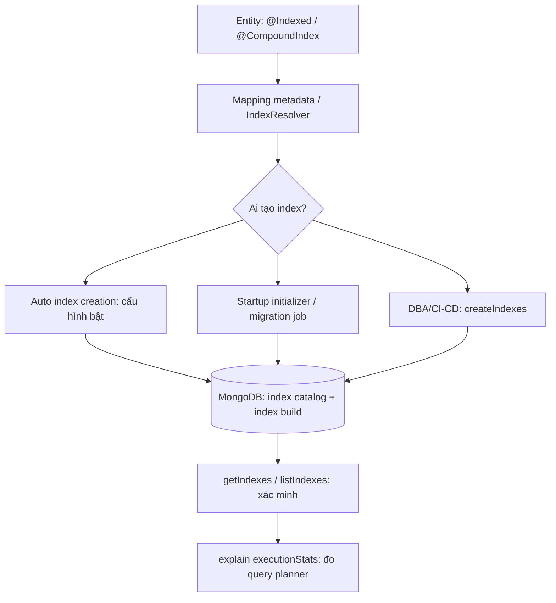
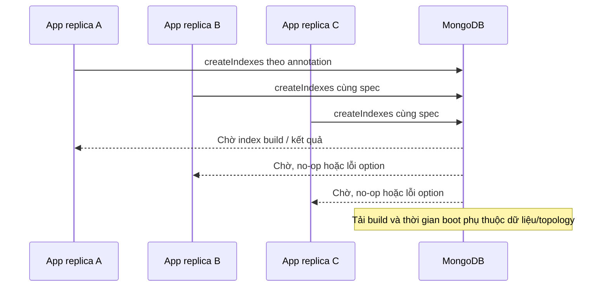
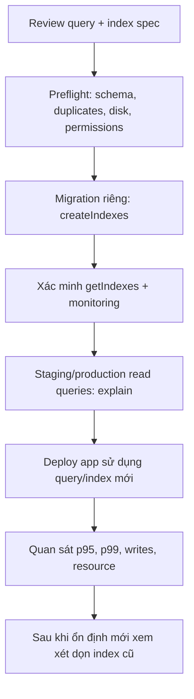

# Tạo chỉ mục tự động: cấu hình tường minh và kiểm soát lúc triển khai

Trong **Spring Data MongoDB**, annotation như `@Indexed` hoặc `@CompoundIndex` cho phép khai báo **ý định thiết kế index** ngay bên cạnh entity. Nhưng **khai báo không đồng nghĩa index đã tồn tại trên MongoDB Server**. Để index thực sự được tạo, ứng dụng cần bật cơ chế auto-index hoặc thực hiện một bước tạo index tường minh qua `MongoTemplate`, `IndexOperations`, mongosh hay công cụ migration.

Đây là một quyết định kiến trúc, không chỉ một cờ cấu hình. Tạo index trên collection đang có hàng triệu document có thể tiêu tốn CPU, RAM, đĩa, I/O và làm giảm thông lượng ghi; với **unique index**, index build có thể thất bại vì dữ liệu đã trùng. Nếu để mọi instance ứng dụng tự thay đổi index khi khởi động, rollout có thể biến thành một đợt tạo index ngoài kế hoạch.

Bài thuộc chương **Chỉ mục** của module **SPRING_DATA_MONGODB**: sử dụng Spring Data MongoDB kết nối, ánh xạ document, thao tác bằng `MongoTemplate`/repository và thực hành thiết kế query, aggregation, index, transaction, reactive access, kiểm thử cũng như chẩn đoán hiệu năng. Trọng tâm ở đây là **cấu hình index tự động một cách tường minh**, **chọn lúc triển khai để tạo index**, và **kiểm chứng index thật thay vì chỉ tin annotation**.

## 1. Phân biệt khai báo, tạo và sử dụng index

Ba việc này độc lập:

1. **Khai báo**: Java entity hoặc migration mô tả index mong muốn: field, hướng sort, unique, TTL, partial filter, collation và tên.
2. **Tạo**: một tác nhân có quyền gọi lệnh MongoDB `createIndexes`; server thực sự xây index và quản lý commit theo topology.
3. **Sử dụng**: MongoDB query planner xem xét index khi thực thi query; có index không có nghĩa planner luôn chọn nó.



Một annotation không thể tự giải quyết data duplicates, quyền của database user hay thời điểm thích hợp để tạo index. Ngược lại, một index do DBA tạo có thể hoạt động **dù entity hoàn toàn không có `@Indexed`**.

| Điều thấy trong code | Điều có thể kết luận | Điều chưa thể kết luận |
| --- | --- | --- |
| `@Indexed` trên property | Code khai báo index | Server đã có index |
| `auto-index-creation=true` | Framework được phép tự tạo index theo metadata | Mọi index đang cần đều đã tạo thành công |
| `IndexOperations.createIndex(...)` trả thành công | Lệnh tạo/đảm bảo index tương ứng đã được xử lý | Truy vấn sẽ dùng index ấy |
| `db.collection.getIndexes()` có spec mong muốn | Index đã có trong catalog collection được kiểm tra | Query plan nào là tối ưu |
| `explain("executionStats")` cho query thực tế | Cách query được thực thi với dữ liệu và cấu hình ấy | Mọi workload sẽ có cùng hiệu năng |

## 2. Mặc định từ Spring Data MongoDB 3.0: auto-index tắt

Theo tài liệu Spring Data MongoDB, từ **3.0** tính năng tự tạo index cho entity `@Document` **bị tắt mặc định**. Để dùng, phải **bật rõ ràng**.

Lý do: Spring Data không thể tự kiểm soát đầy đủ **vòng đời collection và ảnh hưởng hiệu năng**. Auto-index xảy ra khi framework biết đến các entity ban đầu lúc ứng dụng khởi động và khi một loại entity được truy cập lần đầu trong quá trình chạy, chứ không phải một migration engine liên tục so sánh mọi index với mọi bản triển khai.

Các hệ quả:

- Có annotation mà **không bật auto-index** và **không chạy migration** → index mong muốn có thể **không tồn tại**.
- Bật auto-index trong phát triển/test → framework có thể cố tạo index khi mapping entity được nhận diện.
- Có một collection bị **drop rồi recreate trong lúc ứng dụng đang chạy** → không được bảo đảm rằng auto-index tự chạy lại để tạo đủ index.
- Thêm/sửa annotation khi rollout → nếu auto-index đang bật, mỗi instance có thể gửi các thao tác tạo index lúc boot.
- Chuyển từ phiên bản Spring Data cũ sang 3.x trở lên → phải kiểm tra lại chính sách index; không được dựa vào default cũ.

**Kết luận ngắn:** annotation là **định nghĩa mong muốn**; việc tạo index trên production nên có **chủ sở hữu và bước triển khai rõ ràng**.

## 3. Entity mẫu: khai báo compound index theo access pattern

Giả sử collection `orders` lưu dữ liệu đa tenant. Hai truy vấn thường gặp:

1. Đọc một đơn bằng `tenantId + orderKey`, và **mỗi tenant không được trùng orderKey**.
2. Liệt kê đơn theo `tenantId + status`, sắp `createdAt` giảm dần.

Entity:

```java
import java.time.Instant;
import org.bson.types.ObjectId;
import org.springframework.data.annotation.Id;
import org.springframework.data.mongodb.core.index.CompoundIndex;
import org.springframework.data.mongodb.core.mapping.Document;
import org.springframework.data.mongodb.core.mapping.Field;

@Document(collection = "orders")
@CompoundIndex(
    name = "ux_orders_tenant_order_key",
    def = "{'tenant_id': 1, 'order_key': 1}",
    unique = true
)
@CompoundIndex(
    name = "ix_orders_tenant_status_created",
    def = "{'tenant_id': 1, 'status': 1, 'created_at': -1}"
)
public class OrderRecord {
    @Id
    private ObjectId id;

    @Field("tenant_id")
    private String tenantId;

    @Field("order_key")
    private String orderKey;

    private String status;

    @Field("created_at")
    private Instant createdAt;

    public OrderRecord() {}

    public OrderRecord(
            ObjectId id, String tenantId, String orderKey,
            String status, Instant createdAt) {
        this.id = id;
        this.tenantId = tenantId;
        this.orderKey = orderKey;
        this.status = status;
        this.createdAt = createdAt;
    }

    public ObjectId getId() { return id; }
    public String getTenantId() { return tenantId; }
    public String getOrderKey() { return orderKey; }
    public String getStatus() { return status; }
    public Instant getCreatedAt() { return createdAt; }
}
```

Hai annotation dùng **tên field BSON** trong `def`. Vì entity có `@Field("tenant_id")`, `@Field("order_key")` và `@Field("created_at")`, luôn kiểm tra **index key thực được resolver tạo ra** và `getIndexes()`, đặc biệt khi kết hợp cách đặt tên Java với custom field-naming strategy.

Kỳ vọng index tương ứng:

```javascript
db.orders.createIndex(
  { tenant_id: 1, order_key: 1 },
  {
    name: "ux_orders_tenant_order_key",
    unique: true
  }
);

db.orders.createIndex(
  { tenant_id: 1, status: 1, created_at: -1 },
  { name: "ix_orders_tenant_status_created" }
);
```

`unique` ở compound index thứ nhất định nghĩa quy tắc **không trùng cặp tenant–orderKey**, không cấm hai tenant khác nhau cùng sử dụng `orderKey="ORD-001"`.

**Không tạo index chỉ vì một field xuất hiện trong entity.** Mỗi index phải có query, invariant hoặc ràng buộc TTL/geospatial cụ thể mà nó phục vụ.

## 4. @Indexed một field và các annotation liên quan

Nếu cần index cho một field riêng, có thể khai báo:

```java
import org.springframework.data.mongodb.core.index.Indexed;
import org.springframework.data.mongodb.core.mapping.Document;

@Document("session_tokens")
class SessionToken {
    @Indexed(name = "ux_session_token_hash", unique = true)
    String tokenHash;

    @Indexed(name = "ix_session_expires_at", expireAfter = "0s")
    java.time.Instant expiresAt;
}
```

Đây là **ví dụ minh họa collection riêng**: `tokenHash` được kiểm tra unique toàn collection; `expiresAt` dùng TTL với thời điểm tuyệt đối. Không lưu token bí mật thô trong index; phải thiết kế cách băm và chính sách bảo mật phù hợp.

Một số annotation/index metadata thường gặp:

| Annotation/tùy chọn | Mục đích | Rủi ro khi tự tạo trên production |
| --- | --- | --- |
| `@Indexed` | Index một field; `unique`, `partialFilter`, TTL, collation tùy API | Khác option/index cũ, unique conflict |
| `@CompoundIndex` | Index nhiều field theo một thứ tự khóa | Sai thứ tự field, index không phù hợp query |
| `@TextIndexed` | Index text search kiểu MongoDB | Khác biệt cấu hình text index/collation, ngôn ngữ |
| `@GeoSpatialIndexed` | Index geospatial | Dữ liệu/GeoJSON không hợp lệ |
| `@WildcardIndexed` | Wildcard index cho trường động | Tăng kích thước/chi phí ghi |
| `@Indexed(expireAfter="0s")` | TTL theo giá trị Date | Xóa dữ liệu về sau; không phải cache hint vô hại |

Cẩn trọng với annotation trên **embedded object**. Tên index có thể được prefix theo property path của document cha; `IndexResolver` cần mapping context đúng để sinh ra spec. Map-like properties với khóa động thường bị resolver bỏ qua, trừ khi khai báo wildcard index phù hợp.

**Các thuộc tính annotation có thể thay đổi theo phiên bản.** Trên Spring Data MongoDB mới, `@Indexed(expireAfter="...")` được ưu tiên; `expireAfterSeconds` đã bị deprecate từ 4.4. Tương tự, cờ `background` cũ không còn là chiến lược kiểm soát index build trên MongoDB hiện đại.

## 5. Bật auto-index trong Spring Boot

Trên Spring Boot có auto-config Spring Data MongoDB và property được hỗ trợ:

```yaml
spring:
  data:
    mongodb:
      auto-index-creation: true
```

Đây là **cấu hình opt-in**. Đặt vào profile dành cho development hoặc integration test có thể thuận tiện khi database test mới và nhỏ.

Ví dụ tách profile:

```yaml
# application-dev.yml
spring:
  data:
    mongodb:
      auto-index-creation: true
```

```yaml
# application-prod.yml
spring:
  data:
    mongodb:
      auto-index-creation: false
```

Nhưng **đừng sao chép mù quáng profile này**: cả staging và production phải tuân theo chính sách deployment của tổ chức. `false` không có nghĩa index được tạo bằng cách khác; nếu không có migration, production có thể bị thiếu index.

Những lưu ý:

- Property `spring.data.mongodb.auto-index-creation` được liệt kê trong tài liệu Spring Boot 3.x và 4.x. Một số cấu hình kết nối MongoDB đã đổi tên qua các đời Boot; phải đối chiếu **đúng phiên bản Boot** đang chạy.
- Khi ứng dụng tự khai báo `AbstractMongoClientConfiguration`, `MongoMappingContext` hoặc bean MongoTemplate/MongoDatabaseFactory khác, cần kiểm tra property có thực sự điều khiển **mapping context đang dùng** không.
- Một file YAML có `true` nhưng profile không được kích hoạt hoặc bị environment override vẫn có thể không bật được auto-index.
- Nếu có nhiều MongoTemplate/database factory, chính sách index cho từng context phải được xác định rõ.

**Đọc effective configuration**, không kết luận chỉ từ file cấu hình có trong repository.

## 6. Bật auto-index bằng Java configuration

Trong cấu hình kế thừa `AbstractMongoClientConfiguration`, có thể override:

```java
import org.springframework.context.annotation.Configuration;
import org.springframework.data.mongodb.config.AbstractMongoClientConfiguration;

@Configuration
public class MongoConfig extends AbstractMongoClientConfiguration {

    @Override
    protected String getDatabaseName() {
        return "orders_dev";
    }

    @Override
    public boolean autoIndexCreation() {
        return true;
    }

    // Các method cấu hình MongoClient cần thiết khác
    // phụ thuộc phiên bản Spring Data/configuration hiện hành.
}
```

Đây là **minh họa cách override**; không nên đồng thời định nghĩa một Mongo config thủ công và mong Spring Boot auto-config vẫn hoạt động hệt như trước. Khi thay cấu hình nền, hãy kiểm tra bean được Spring sử dụng, entity scanning, converters và MongoDatabaseFactory.

Ví dụ trên **bật auto-index**, không tự tạo index trước khi mọi thành phần khác có thể đọc database. Nếu yêu cầu “index đã sẵn sàng trước khi nhận traffic”, một rollout có migration tách biệt và readiness gate rõ ràng an toàn hơn.

## 7. Vì sao không nên tùy tiện bật auto-index trên production?

Trên production, app thường có nhiều replicas, nhiều collection đang có dữ liệu, và lượng ghi lớn.

Khi một phiên bản code thêm index mới rồi rollout đồng thời:



Nếu index cùng spec đã tồn tại, server có thể xử lý yêu cầu như một thao tác không cần tạo lại. **Nhưng đó không phải lý do để mọi replica sở hữu việc migration index.** Khi index chưa tồn tại, build tốn tài nguyên, có thể phải chờ commit quorum hoặc thất bại vì dữ liệu trùng. Ứng dụng mới có thể chưa sẵn sàng trong thời gian build, hoặc bị lỗi lúc khởi động tùy cơ chế gọi và xử lý exception.

Các rủi ro cần quản lý:

- Chi phí CPU, I/O, disk/memory của index build trên collection nhiều triệu document.
- Write throughput giảm khi build dưới tải ghi cao.
- Unique constraint chỉ có hiệu lực khi index được commit thành công; dữ liệu trùng có thể được tạo ngay trong quá trình build.
- Timeout, mất node, commit quorum, lỗi thiếu dung lượng đĩa hoặc index options xung đột.
- User ứng dụng có quyền `createIndex` quá rộng trên database production.
- Không có bước review thứ tự **tạo index trước – deploy code sử dụng – xóa index cũ sau**.

**Khuyến nghị production:** dùng một bước **index migration/DBA job** có lịch, quyền, log và kiểm chứng riêng; app vận hành với quyền tối thiểu và cấu hình auto-index có chủ đích.

## 8. Lựa chọn giữa auto-index, initializer và migration ngoài ứng dụng

| Cách làm | Khi phù hợp | Giới hạn |
| --- | --- | --- |
| Auto-index theo annotation | Dev/test, ứng dụng nhỏ đã chấp nhận startup side effects | Bị ràng buộc vào lifecycle entity; khó điều phối build lớn |
| `ContextRefreshedEvent` + `IndexResolver` | Startup initializer có thể kiểm soát loại entity/index nào cần tạo | Event chạy sau context refresh, chưa chắc trước mọi truy cập DB |
| `IndexOperations.createIndex(...)` tường minh | Một initializer hoặc migration job Java có thứ tự/quan sát tốt | Cần code quản lý tiến trình/lỗi/quyền |
| mongosh/driver `createIndex(s)` trong pipeline triển khai | Production schema migration, index lớn/unique, quyền và runbook riêng | Phải quản lý drift với annotation/code |
| DBA-managed changes | Hệ thống có quy trình quản trị database nghiêm ngặt | Cần versioned spec, handoff và kiểm tra rollout |

Không có một cách đúng cho mọi đội. Điều quan trọng là **một môi trường phải có một chính sách nhất quán**, và người phụ trách biết index mới sẽ được tạo **khi nào, bởi ai, trên database nào**.

## 9. IndexResolver: chuyển annotation thành index definition

Spring Data cung cấp `IndexResolver` để đọc metadata như `@Indexed`, `@CompoundIndex`, `@TextIndexed`, `@GeoSpatialIndexed` và `@WildcardIndexed`.

Ví dụ dùng `MongoPersistentEntityIndexResolver`:

```java
import org.springframework.data.mongodb.core.MongoTemplate;
import org.springframework.data.mongodb.core.index.IndexResolver;
import org.springframework.data.mongodb.core.index.MongoPersistentEntityIndexResolver;

IndexResolver resolver = new MongoPersistentEntityIndexResolver(
    mongoTemplate.getConverter().getMappingContext()
);

var definitions = resolver.resolveIndexFor(OrderRecord.class);
```

`definitions` chứa các `IndexDefinition` mà framework suy ra từ annotation trên `OrderRecord` và embedded types liên quan. Đây là bước **đọc metadata**, chưa gọi MongoDB để xây index.

Khi muốn tạo, dùng `IndexOperations` từ **cùng MongoTemplate và cùng entity type**:

```java
import org.springframework.data.mongodb.core.index.IndexDefinition;
import org.springframework.data.mongodb.core.index.IndexOperations;

IndexOperations indexOps = mongoTemplate.indexOps(OrderRecord.class);

for (IndexDefinition definition : definitions) {
    indexOps.createIndex(definition); // Spring Data MongoDB 4.5+
}
```

**Phân biệt phiên bản:**

- Trên Spring Data MongoDB **4.5+**, `IndexOperations.createIndex(IndexDefinition)` là API được khuyến nghị.
- Trên Spring Data MongoDB **cũ hơn 4.5** (ví dụ một số dự án 3.x/4.4), dùng `indexOps.ensureIndex(definition)`.
- `ensureIndex` đã được đánh dấu **deprecated for removal từ 4.5**, nên không nên dạy nó là lựa chọn duy nhất cho code mới.

`createIndex` bảo đảm index với định nghĩa phù hợp được tạo nếu chưa có; nó **không tự “sửa mọi drift”** khi index cùng tên có options khác. Cần xử lý xung đột bằng migration rõ ràng.

## 10. Khởi tạo index sau ContextRefreshedEvent

Spring Data gợi ý `ContextRefreshedEvent` làm một thời điểm phù hợp khi muốn dùng `IndexResolver` vì mapping/application context đã khởi tạo xong:

```java
import org.springframework.context.event.ContextRefreshedEvent;
import org.springframework.context.event.EventListener;
import org.springframework.data.mongodb.core.MongoTemplate;
import org.springframework.data.mongodb.core.index.IndexDefinition;
import org.springframework.data.mongodb.core.index.IndexOperations;
import org.springframework.data.mongodb.core.index.IndexResolver;
import org.springframework.data.mongodb.core.index.MongoPersistentEntityIndexResolver;
import org.springframework.stereotype.Component;

@Component
public class OrderIndexInitializer {
    private final MongoTemplate template;

    public OrderIndexInitializer(MongoTemplate template) {
        this.template = template;
    }

    @EventListener(ContextRefreshedEvent.class)
    public void createIndexes() {
        IndexResolver resolver =
            new MongoPersistentEntityIndexResolver(
                template.getConverter().getMappingContext()
            );

        IndexOperations ops = template.indexOps(OrderRecord.class);

        for (IndexDefinition definition :
                resolver.resolveIndexFor(OrderRecord.class)) {
            ops.createIndex(definition);
        }
    }
}
```

Ví dụ giả định Spring Data MongoDB **4.5+**. Với phiên bản cũ hãy thay đúng lời gọi sang `ensureIndex`. Nó minh họa **initializer cho một entity có chủ đích**, không phải một migration đầy đủ.

**Hai cảnh báo vận hành:**

1. `ContextRefreshedEvent` bảo đảm Spring context đã hoàn chỉnh, **không bảo đảm chưa có bean hoặc luồng nào khác truy cập MongoDB**. Nếu index là điều kiện trước mọi truy cập, dùng migration trước deploy/khởi động hoặc bảo vệ readiness.
2. Nếu mọi replica đều đăng ký listener này, mỗi replica có thể cùng yêu cầu tạo index. Trên production nên giới hạn initializer bằng profile/feature flag hoặc chạy trong **một job triển khai riêng**.

Nếu cần quét tất cả mapping entities, có thể lặp `mappingContext.getPersistentEntities()` và **chỉ chọn những class có `@Document`**. Nhưng không nên tạo hàng loạt mọi index vô điều kiện nếu đội chưa review tổng tác động tới collection, quyền và storage.

## 11. Programmatic index không phụ thuộc annotation

Khi không muốn để annotation quyết định thay đổi production, có thể tạo index bằng Java trực tiếp.

```java
import org.springframework.data.domain.Sort;
import org.springframework.data.mongodb.core.MongoTemplate;
import org.springframework.data.mongodb.core.index.Index;

public class OrdersIndexMigration {
    private final MongoTemplate template;

    public OrdersIndexMigration(MongoTemplate template) {
        this.template = template;
    }

    public String createTenantOrderKey() {
        Index key = new Index()
            .on("tenantId", Sort.Direction.ASC)
            .on("orderKey", Sort.Direction.ASC)
            .unique()
            .named("ux_orders_tenant_order_key");

        return template.indexOps(OrderRecord.class).createIndex(key);
    }
}
```

Khi `indexOps(OrderRecord.class)` dùng converter/mapping context của entity, property names `tenantId` và `orderKey` phải ánh xạ tới BSON keys `tenant_id` và `order_key`. Xác nhận bằng `getIndexes()` vì custom converters/field naming có thể thay đổi kết quả.

**Không tự động gọi method này trên mọi request.** Đây là bước schema/index management, thích hợp trong migration hoặc initializer được kiểm soát.

Trong hệ thống lớn, một migration versioned có thể giữ cả **spec mong đợi**, **mã migration**, **thời điểm deploy**, **kết quả/rollback plan**, giúp review và truy vết tốt hơn chỉ dựa vào annotation.

## 12. Tạo index bằng mongosh trong một deployment job

Chạy các lệnh sau trên **database được xác nhận đúng**:

```javascript
// 1. Trước khi tạo, quan sát index hiện tại.
db.orders.getIndexes();

// 2. Tạo unique compound index cho khóa nghiệp vụ.
db.orders.createIndex(
  { tenant_id: 1, order_key: 1 },
  {
    name: "ux_orders_tenant_order_key",
    unique: true
  }
);

// 3. Tạo index phục vụ list/sort.
db.orders.createIndex(
  { tenant_id: 1, status: 1, created_at: -1 },
  { name: "ix_orders_tenant_status_created" }
);

// 4. Kiểm tra lại.
db.orders.getIndexes();
```

Các thao tác có cùng spec đã tồn tại thường không xây lại index. Nhưng nếu **cùng tên mà key/options khác**, server có thể trả lỗi xung đột thay vì “âm thầm cập nhật” index. Khi đổi unique/partial/collation hoặc key pattern, cần migration riêng.

Có thể dùng lệnh `createIndexes` để gửi nhiều index specs, điều chỉnh `writeConcern` hoặc `commitQuorum` theo topology:

```javascript
db.runCommand({
  createIndexes: "orders",
  indexes: [
    {
      key: { tenant_id: 1, status: 1, created_at: -1 },
      name: "ix_orders_tenant_status_created"
    }
  ],
  comment: "schema-change-2026-orders-index"
});
```

`comment` giúp truy vết command khi hạ tầng hỗ trợ. Các tùy chọn quorum và write concern phải theo chính sách vận hành; **không giảm quorum tùy tiện để build hoàn tất nhanh** mà chưa hiểu tính an toàn của replica set.

## 13. Dữ liệu trùng: bước bắt buộc trước khi tạo unique index

Nếu `orders` đã có các document trùng `(tenant_id,order_key)`, unique index sẽ **không build thành công**.

Truy vấn phát hiện trùng trước khi thay đổi:

```javascript
db.orders.aggregate([
  {
    $group: {
      _id: {
        tenant: "$tenant_id",
        orderKey: "$order_key"
      },
      duplicates: { $sum: 1 },
      oneId: { $first: "$_id" }
    }
  },
  { $match: { duplicates: { $gt: 1 } } },
  { $sort: { duplicates: -1 } },
  { $limit: 20 }
]);
```

Kiểm tra những dòng thiếu/null khóa nghiệp vụ:

```javascript
db.orders.find({
  $or: [
    { tenant_id: null },
    { order_key: null }
  ]
}).limit(20);
```

Trong MongoDB, phép so sánh `field: null` cũng có thể khớp **field thiếu**. Unique compound index còn có các quy tắc về null/missing, nên **nhiều document cùng tenant thiếu order_key có thể xung đột**.

Quy trình xử lý:

1. Lấy số lượng duplicates và thống kê các case null/missing.
2. Xác định khóa nào là hợp lệ và chính sách repair; không chọn “giữ record đầu” nếu chưa hiểu tham chiếu/đơn hàng đã thanh toán.
3. Ngăn writers mới tạo duplicates (validation và quy trình ghi), đặc biệt trong thời gian index đang build.
4. Làm sạch dữ liệu theo kế hoạch kiểm toán.
5. Tạo unique index, xác nhận index build đã commit.
6. Chạy lại phép kiểm tra duplicates, thử insert duplicate trên test để chứng minh constraint.

**Một unique index không phải công cụ xóa trùng tự động.** Không dùng flag `dropDups` cũ; MongoDB hiện đại không hỗ trợ hành vi tự xóa record trùng lúc tạo unique index.

## 14. Index build là hoạt động có chi phí vận hành

MongoDB hiện đại dùng quy trình index build tối ưu: nắm collection lock độc quyền trong thời gian ngắn ở đầu/cuối build, và cho phép các thao tác đọc/ghi xen kẽ trong phần lớn thời gian. Nhưng “không khóa toàn bộ database suốt quá trình” **không đồng nghĩa không ảnh hưởng ứng dụng**.

Các yếu tố cần giám sát:

- Số document và kích thước BSON phải scan để xây index.
- RAM, temporary files/disk, CPU và I/O của node.
- Write load đồng thời; mỗi lần insert/update có thể phải cập nhật index đang build.
- Replica set/sharded cluster: index build trên các thành viên có dữ liệu, commit quorum trước khi index sẵn sàng.
- Dung lượng đĩa và lỗi disk pressure, nhất là khi hệ thống gần giới hạn.
- Thời gian chờ khi một voting member không sẵn sàng.
- Một số cấu hình cho phép nhiều index builds đồng thời; nhiều job cùng lúc có thể làm giảm throughput đáng kể.

```javascript
// Quan sát hoạt động hiện tại, chỉ đọc:
db.currentOp();

// Quan sát thông số phiên bản/server phù hợp:
db.version();
db.adminCommand({ buildInfo: 1 }).version;
```

Trong MongoDB 4.2+ với quy trình build tối ưu, tùy chọn `background` của `createIndexes` không còn thay đổi cách build và có thể bị server bỏ qua. Đừng dạy `background:true` là giải pháp thần kỳ để tránh tác động production.

**Lập kế hoạch capacity và cửa sổ triển khai** cho index lớn. Có thể chia index migration theo collection và theo mức ưu tiên thay vì yêu cầu một deployment ứng dụng xây tất cả index mới cùng lúc.

## 15. Một kế hoạch rollout an toàn: expand, verify, switch, contract

Với hệ thống có nhiều instance ứng dụng, đề xuất:



### Trước deploy

- Review query quan trọng, filter/sort, cardinality và query planner.
- Chụp metadata `getIndexes()`/`listIndexes`, số document, dung lượng index cũ.
- Preflight unique duplicates, null/missing, collation và sharding constraints.
- Xác minh backup, rollback plan, quyền của migration user.
- Đặt lịch, giới hạn concurrency và giám sát tải server.

### Trong deploy

- Chạy **một** job tạo index, không để tất cả app replicas cùng sở hữu migration.
- Kiểm tra build hoàn tất/commit, không chỉ command đã gửi.
- So sánh index catalog với spec mong muốn.
- Khi index sẵn sàng, deploy application code mới hoặc mở traffic qua readiness gate.
- Nếu build lỗi, giữ app version cũ hoặc rollback app release theo runbook.

### Sau deploy

- Đo query latency và `explain("executionStats")`.
- Theo dõi insert/update latency và index storage.
- Kiểm tra duplicate key errors bất thường sau khi unique index có hiệu lực.
- Chỉ xóa index cũ trong một thay đổi riêng, sau khi chắc không còn query hoặc phiên bản code cũ phụ thuộc.

**Mở rộng trước, thu hẹp sau** giúp tránh ứng dụng chạy với index chưa sẵn sàng hoặc bị mất index đang dùng.

## 16. Kiểm tra drift: index đã có nhưng sai spec

`db.orders.getIndexes()` cho phép xem tên, key, unique, partial filter, collation, TTL và những options khác tùy index.

```javascript
db.orders.getIndexes().forEach(ix => {
  printjson({
    name: ix.name,
    key: ix.key,
    unique: ix.unique,
    expireAfterSeconds: ix.expireAfterSeconds,
    partialFilterExpression: ix.partialFilterExpression,
    collation: ix.collation,
    hidden: ix.hidden
  });
});
```

Một index bị drift có thể có:

- Cùng tên nhưng thiếu field trong compound key.
- Key đúng nhưng `unique` không được bật.
- TTL khác mong đợi.
- Partial filter không đúng điều kiện.
- Collation khác khiến so sánh chuỗi và query planner thay đổi.
- Index đã bị drop trong một tác vụ khác.
- Index tồn tại ở **database khác** hoặc collection khác với tên giống nhau.

`createIndex`/`ensureIndex` **không phải cơ chế migration tự sửa mọi drift**. Nếu options/key khác, server có thể báo lỗi `IndexOptionsConflict`/`IndexKeySpecsConflict` hoặc cần một chiến lược thay thế cụ thể.

**Không chạy `dropIndex` tự động chỉ để chữa xung đột**. Việc drop có thể gây query regression, mất constraint unique hoặc ảnh hưởng dữ liệu trong thời gian tạo lại. Đòi hỏi review riêng và rollback plan.

## 17. Index đặc biệt: TTL, partial, sparse và collation

### TTL

Với `@Indexed(expireAfter="0s")` trên `expiresAt`, TTL index dùng trường Date để xác định lúc document có thể bị xóa. MongoDB TTL monitor chạy nền nên **không hứa xóa chính xác vào từng mili giây**.

```javascript
db.session_tokens.createIndex(
  { expires_at: 1 },
  { name: "ix_sessions_expires_at", expireAfterSeconds: 0 }
);
```

Trong Java nếu property `expiresAt` không gắn `@Field("expires_at")` mà chỉ có tên `expiresAt`, BSON key thực sẽ khác. Phải thống nhất mapping! Với sample ở mục 4, property có tên `expiresAt` và chưa có `@Field`; vì vậy mẫu mongosh `expires_at` trên chỉ đúng nếu bạn **bổ sung `@Field("expires_at")`** hoặc cấu hình field naming strategy tương ứng. Không âm thầm trộn hai schema.

**TTL tác động trực tiếp đến dữ liệu**, không chỉ query performance. Đặt `expireAfterSeconds=0` nhầm trên các đơn hàng có hạn lưu trữ có thể khiến dữ liệu bị xóa theo lịch.

### Partial và sparse

Partial index chỉ index những document khớp `partialFilterExpression`, có thể giảm chi phí khi chỉ quan tâm một tập con có chủ đích. Unique partial index chỉ ràng buộc uniqueness trên **những document đáp ứng filter**.

```javascript
db.orders.createIndex(
  { tenant_id: 1, order_key: 1 },
  {
    name: "ux_active_orders_tenant_key",
    unique: true,
    partialFilterExpression: { status: "ACTIVE" }
  }
);
```

Đây là **ví dụ thay thế** cho unique index toàn bộ dữ liệu: không tạo cả hai vào cùng collection mà chưa làm rõ quy tắc nghiệp vụ; một index toàn bộ vẫn chặn các duplicates ngoài `ACTIVE`.

`@Indexed` và `@CompoundIndex` có `partialFilter`, nhưng không kết hợp `sparse=true` với `partialFilter` trong cùng annotation: API không cho phép cách kết hợp đó. Nếu query không mang điều kiện tương thích với partial filter, planner có thể không dùng index ấy.

### Collation

Index có collation khác có thể so sánh chữ hoa/thường/dấu theo quy tắc ngôn ngữ. Unique index theo collation có thể khiến `"Abc"` và `"abc"` bị coi là trùng trong một cấu hình nhưng khác nhau trong cấu hình khác.

Khi query cần dùng index đó, collation của query phải phù hợp. Đừng tạo index collation mới và giả định mọi derived repository query tự áp dụng collation chính xác.

## 18. Sharding, unique constraints và phạm vi tenant

Trên sharded collection, quy tắc unique index phụ thuộc **shard key** và kiểu index/server. Không thể giả định một unique compound index bất kỳ có hiệu lực toàn cluster theo ý muốn.

Ví dụ mô hình đã shard theo `tenant_id`; một unique index `{tenant_id:1,order_key:1}` thường phù hợp hơn index chỉ có `{order_key:1}`, nhưng phải kiểm tra các ràng buộc sharding cụ thể (prefix shard key, hashed shard keys, version server).

Các điểm cần xác minh:

- Index spec có tương thích shard key và kiểu shard (range/hashed) không?
- Tất cả các shard có index đồng nhất sau build không?
- Data duplicates có nằm trên một hoặc nhiều shards?
- Commit quorum/lock và tiến trình build có được giám sát trên đúng deployment không?
- Unique constraint phải là **per-tenant** hay **global**?

Không deploy một annotation `@Indexed(unique=true)` trên `orderKey` rồi nghĩ nó tự tạo một ràng buộc đúng cho mọi tenant trên sharded cluster. Thiết kế key/index/shard phải được review cùng nhau.

## 19. Collection bị drop/recreate lúc runtime

Một giới hạn đặc biệt của auto-index: Spring Data tạo index cho mapping entities được nhận diện ở startup hoặc lần truy cập đầu, **không theo dõi mãi vòng đời collection**.

Giả sử:

```javascript
db.orders.drop();
db.createCollection("orders");
db.orders.getIndexes(); // Có thể chỉ thấy _id_.
```

Ứng dụng còn chạy với mapping context đã khởi tạo từ trước. **Không được giả định các index annotation lập tức được tạo lại**. Một request sau đó dùng repository có thể đọc/ghi trên collection mới mà thiếu index.

Giải pháp:

1. Hạn chế `drop` collection production; quyền drop nên tách khỏi app user.
2. Nếu môi trường test chủ động drop, chạy **schema/index initialization** lại hoặc tạo database test mới cho mỗi run.
3. Nếu ứng dụng có tác vụ thực sự phải recreate collection, gọi migration/init riêng sau bước recreate và trước khi cho traffic dùng collection.
4. Có kiểm tra index drift theo lịch hoặc trong deployment pipeline, không chỉ ở startup.

Trong production, một collection bị xóa ngoài ý muốn là **sự cố cần recovery**, không phải lý do để bật auto-index và tin rằng mọi thứ tự hồi phục.

## 20. IndexOperations.getIndexInfo và xác minh từ Spring

Ngoài mongosh, code có thể kiểm tra index catalog:

```java
import java.util.List;
import org.springframework.data.mongodb.core.MongoTemplate;
import org.springframework.data.mongodb.core.index.IndexInfo;

List<IndexInfo> infos =
    mongoTemplate.indexOps(OrderRecord.class).getIndexInfo();

for (IndexInfo info : infos) {
    System.out.println(info.getName());
}
```

Khi cần xác minh options một cách độc lập, có thể đọc native `listIndexes`:

```java
import java.util.ArrayList;
import org.bson.Document;

List<Document> raw = mongoTemplate.getCollection("orders")
    .listIndexes(Document.class)
    .into(new ArrayList<>());

for (Document index : raw) {
    System.out.println(index.toJson());
}
```

`listIndexes` là **quan sát read-only**; không biến code này thành công cụ tự sửa index trong production. Khi so sánh index mong muốn và index thực, hãy kiểm tra **key + options**, không chỉ tìm một cái tên trùng.

**Đừng hiển thị connection credentials hoặc raw data nhạy cảm trong log.** Index metadata thường không chứa dữ liệu record, nhưng tên index/collection vẫn có thể là thông tin vận hành cần bảo vệ.

## 21. explain: có index vẫn cần chứng minh query dùng nó

Ví dụ query list đơn theo tenant/status, sort mới nhất:

```javascript
db.orders.find({
  tenant_id: "T1",
  status: "PAID"
})
.sort({ created_at: -1 })
.limit(30)
.explain("executionStats");
```

Với index:

```javascript
{ tenant_id: 1, status: 1, created_at: -1 }
```

Query planner **có thể** dùng index để lọc equality và phục vụ sort, nhưng cần đo:

- `IXSCAN` hay `COLLSCAN`?
- Có stage `SORT` tốn bộ nhớ không?
- `totalKeysExamined` và `totalDocsExamined` so với `nReturned`?
- Index nào là `winningPlan`?
- Độ trễ trên dữ liệu đủ lớn, p95/p99 khi concurrency thực?
- Sau khi thêm index, write latency, disk và cache pressure thay đổi thế nào?

Một index build thành công không bảo đảm **mọi query** hoặc mọi dữ liệu đều nhanh hơn. MongoDB query planner lựa chọn theo selectivity/cost và phiên bản server; index còn gây chi phí ở đường ghi.

Dùng `explain` trên production nên tuân thủ chính sách vận hành, tránh những truy vấn quá rộng gây tải. Với kế hoạch index migration, ưu tiên staging có dữ liệu đại diện và quan sát production sau rollout.

## 22. Đừng dùng hidden index như một nút hoàn tác tuyệt đối

MongoDB hỗ trợ **hidden index** trên các phiên bản phù hợp để kiểm tra ảnh hưởng tới query planner khi một index không được cân nhắc:

```javascript
// Ví dụ minh họa: chỉ thao tác nếu đã có kế hoạch/được duyệt.
db.orders.hideIndex("ix_orders_tenant_status_created");

// Khôi phục khả năng được planner xem xét:
db.orders.unhideIndex("ix_orders_tenant_status_created");
```

Hidden index **vẫn được duy trì khi có writes và vẫn chiếm dung lượng**. Nó cũng **vẫn thực thi uniqueness** nếu là unique index, nên không thể dùng `hideIndex` để “tạm tắt” constraint.

Tính năng này hữu ích cho thử nghiệm trước khi drop một index phục vụ truy vấn, nhưng **không thay thế rollback plan** khi đổi unique, TTL, partial/collation hoặc shard-dependent index.

## 23. Quyền của account và cách cô lập migration

Không nhất thiết application user ở production cần quyền tạo/drop index. Có thể tách:

| Vai trò | Quyền chính | Ví dụ thao tác |
| --- | --- | --- |
| Runtime application | Đọc/ghi trên collection cần thiết | Repository CRUD, MongoTemplate query/update |
| Index migration job | Quyền `createIndex`/`listIndexes` trên collection cụ thể | Chạy change set có kiểm soát |
| DBA/operator | Theo dõi build, can thiệp khẩn cấp, quản lý schema | currentOp, index build diagnostics |
| CI/staging test | Tạo index trên database test cô lập | Tự động hóa integration test |

Quyền thực tế cần thiết phụ thuộc cách triển khai, existing collection và thao tác. Với `$out` hoặc migration có drop/rename, quyền còn rộng hơn; không gom tất cả vào runtime app chỉ để tiện.

**Trong prod nên tắt auto-index nếu runtime user không có quyền tạo index và migration đã chịu trách nhiệm**. Nếu bật auto-index nhưng user bị chặn, startup hoặc truy cập entity có thể phát sinh exception; không được âm thầm bỏ qua rồi tuyên bố index đã sẵn sàng.

## 24. Integration test: từ annotation đến index thật

Một test có giá trị cần kiểm tra **MongoDB index catalog**, không chỉ tìm annotation trên Java class. Ví dụ với Spring Boot test slice và MongoDB test thật (ví dụ Testcontainers):

```java
import static org.assertj.core.api.Assertions.assertThat;

import java.time.Instant;
import java.util.ArrayList;
import org.bson.Document;
import org.bson.types.ObjectId;
import org.junit.jupiter.api.Test;
import org.springframework.beans.factory.annotation.Autowired;
import org.springframework.boot.test.autoconfigure.data.mongo.DataMongoTest;
import org.springframework.data.mongodb.core.MongoTemplate;
import org.springframework.data.mongodb.core.index.IndexDefinition;
import org.springframework.data.mongodb.core.index.IndexOperations;
import org.springframework.data.mongodb.core.index.IndexResolver;
import org.springframework.data.mongodb.core.index.MongoPersistentEntityIndexResolver;

@DataMongoTest(properties =
    "spring.data.mongodb.auto-index-creation=false")
class OrderIndexMetadataIntegrationTest {
    @Autowired MongoTemplate template;

    @Test
    void explicitlyCreatesAnnotatedIndexesAndChecksRawSpec() {
        // Dành cho MongoDB test cô lập, không gọi trên prod.
        template.insert(new OrderRecord(
            new ObjectId(), "test-T1", "ORD-001",
            "NEW", Instant.now()
        ));

        IndexResolver resolver = new MongoPersistentEntityIndexResolver(
            template.getConverter().getMappingContext()
        );

        IndexOperations ops = template.indexOps(OrderRecord.class);
        for (IndexDefinition definition :
                resolver.resolveIndexFor(OrderRecord.class)) {
            ops.createIndex(definition); // Spring Data >= 4.5.
        }

        var indexes = template.getCollection("orders")
            .listIndexes(Document.class)
            .into(new ArrayList<>());

        assertThat(indexes).anySatisfy(index -> {
            assertThat(index.getString("name"))
                .isEqualTo("ux_orders_tenant_order_key");
            assertThat(index.getBoolean("unique")).isTrue();
            Document keys = index.get("key", Document.class);
            assertThat(keys).containsEntry("tenant_id", 1)
                            .containsEntry("order_key", 1);
        });

        assertThat(indexes).anySatisfy(index -> {
            assertThat(index.getString("name"))
                .isEqualTo("ix_orders_tenant_status_created");
            Document keys = index.get("key", Document.class);
            assertThat(keys).containsEntry("tenant_id", 1)
                            .containsEntry("status", 1)
                            .containsEntry("created_at", -1);
        });
    }
}
```

Điều test chứng minh:

- Annotation được resolver đọc đúng.
- IndexOperations thực sự gửi lệnh tạo index.
- BSON index key và `unique` đúng như spec đã review.
- Cấu hình `auto-index-creation=false` không cản **tạo index tường minh**.

**Lưu ý:** trong một môi trường test có custom mapping/bean, property của `@DataMongoTest` phải thật sự đi vào context đang dùng. Test mẫu giả định MongoDB instance/test database phù hợp; không chạy trên database dùng chung. Nếu project dùng Spring Data trước 4.5, đổi lời gọi `createIndex` thành `ensureIndex` theo API thực tế.

## 25. Kiểm thử unique index với dữ liệu trùng và lỗi build

Một bài test khác nên kiểm tra MongoDB server thực sự từ chối duplicate:

```java
import static org.assertj.core.api.Assertions.assertThatThrownBy;

import org.bson.Document;
import org.bson.types.ObjectId;
import com.mongodb.MongoCommandException;
import com.mongodb.client.MongoCollection;

void verifyDuplicateDataBlocksIndexBuild(MongoTemplate template) {
    String collection = "orders_unique_test_" + new ObjectId().toHexString();
    MongoCollection<Document> raw = template.getCollection(collection);

    raw.insertOne(new Document("_id", new ObjectId())
        .append("tenant_id", "T1")
        .append("order_key", "ORD-DUP"));

    raw.insertOne(new Document("_id", new ObjectId())
        .append("tenant_id", "T1")
        .append("order_key", "ORD-DUP"));

    assertThatThrownBy(() -> raw.createIndex(
        new Document("tenant_id", 1).append("order_key", 1),
        new com.mongodb.client.model.IndexOptions()
            .name("ux_test_tenant_order_key")
            .unique(true)
    )).isInstanceOf(MongoCommandException.class);
}
```

Đây là **helper cho integration test** chứ chưa phải một test method độc lập với `@Test`. Khi tích hợp vào JUnit 5, tạo MongoTemplate test và gọi helper trong test đã kiểm soát database. Driver có thể ném exception thuộc nhóm MongoDB khác theo phiên bản/path; production test nên kiểm tra **Mongo error code 11000/duplicate key** hoặc MongoCommandException tương ứng, thay vì dựa hoàn toàn vào thông điệp tiếng Anh.

Một test có thể chứng minh “index build thất bại vì duplicates” trên database test. Sau đó phải dọn dữ liệu trùng hoặc tạo một collection test sạch, rồi khẳng định unique index tạo thành công và chặn duplicate inserts mới.

**Không thực hiện thao tác cố ý tạo dữ liệu trùng trên collection production.**

## 26. Các ca test cấu hình và lifecycle cần bổ sung

Ngoài việc tạo index từ annotation, hãy viết test:

1. **Default tắt:** trên database mới, khởi động context không bật auto-index; xác minh annotation không đủ để tạo index; chú ý index `_id_` mặc định không được tính là index annotation.
2. **Opt-in:** trên database mới và profile bật `auto-index-creation=true`, khởi động context rồi xác minh index annotation có trong `listIndexes`.
3. **IndexResolver:** resolver sinh đúng compound key, name, unique và TTL/partial options theo cấu hình.
4. **Duplicate preflight:** hai document trùng cặp tenant/orderKey khiến unique index build thất bại.
5. **Index migration idempotency:** chạy lại cùng spec không tạo duplicate index và không làm mất dữ liệu.
6. **Index drift:** cùng tên nhưng khác spec/options phải báo xung đột; **không tự drop index** trong test khởi động.
7. **Collection recreated:** drop/recreate trên database test, kiểm tra index biến mất và chạy initializer riêng để tái tạo.
8. **TTL:** kiểm tra catalog `expireAfterSeconds`, không test xóa “chính xác sau 1 giây” do TTL monitor bất đồng bộ.
9. **Multi-tenant unique:** cùng orderKey ở T1/T2 hợp lệ, trùng trong T1 bị từ chối.
10. **Index use:** `explain` với filter/sort thực sự để đánh giá query plan, không suy luận từ tên index.
11. **Rollback release:** một app version cũ vẫn chạy khi index mới tồn tại; chỉ drop index cũ sau khi đổi code.
12. **Permissions:** runtime application user không có quyền tạo index vẫn hoạt động khi migration đã chuẩn bị index và auto-index bị tắt.

Các ca test liên quan index và drop/recreate cần **database test cô lập**. Nếu nhiều test cùng chạy một database/collection, kết quả có thể phụ thuộc thứ tự test, rất khó chẩn đoán.

## 27. Lỗi phổ biến và cách khắc phục

| Sai lầm | Hậu quả | Cách xử lý |
| --- | --- | --- |
| Thấy `@Indexed` nên tin index đã có | Query chậm hoặc unique chưa thực thi | Xem `getIndexes`/`listIndexes` trên đúng database |
| Quên mặc định tắt từ Spring Data 3.0 | Không tạo index khi nâng version | Bật tường minh hoặc chạy migration |
| Bật auto-index prod trên mọi replicas | Build ngoài kế hoạch khi startup | Một migration job riêng, app không tự quản lý schema |
| Dùng `ensureIndex` như API chuẩn mới | API deprecated từ 4.5 | Ưu tiên `createIndex` trên phiên bản mới |
| Tạo unique index khi dữ liệu đã trùng | Index build thất bại | Preflight duplicates và migration dữ liệu |
| Tin unique index tự loại trùng | Sai nghiêm trọng về dữ liệu | Không dùng `dropDups`; repair có kiểm toán |
| Cùng tên index nhưng thay key/options rồi gọi lại | Lỗi xung đột hoặc drift | Versioned migration, review replacement |
| Dùng tên Java field trong raw mongosh sai BSON schema | Index lên field sai | Đối chiếu `@Field`, raw BSON và catalog |
| Bật `background:true` để tránh tải production | Option bị server hiện đại bỏ qua | Theo dõi/tối ưu quy trình index build |
| Tin `ContextRefreshedEvent` chắc chắn trước mọi DB access | Có race với bean/traffic khác | Migration trước traffic, readiness gate |
| Collection bị drop/recreate trong runtime | Index annotation không tự phục hồi | Reinitialize hoặc recovery runbook |
| TTL như cache hint vô hại | MongoDB thực sự xóa document | Review TTL/retention và test |
| Partial index nhưng query không có filter tương ứng | Planner có thể bỏ index | Kiểm tra query/filter và explain |
| Hidden index là xóa tạm constraint unique | Unique vẫn được thực thi | Không dùng hidden để tắt constraint |
| Runtime user không có quyền createIndex nhưng auto bật | Lỗi startup/index creation | Tách migration permissions và app runtime |
| Tạo index chỉ theo cảm giác | Tốn dung lượng, chậm writes | Query-driven index, đo explain và production metrics |

## 28. Bài tập tự kiểm tra

**1.** Spring Data MongoDB bắt đầu mặc định tắt auto-index từ phiên bản nào?  
**Đáp án:** từ **3.0**.

**2.** Có `@CompoundIndex` nhưng `getIndexes` không có index ấy. Điều này có mâu thuẫn không?  
**Đáp án:** không. Annotation là metadata; auto-index có thể tắt hoặc quá trình tạo chưa chạy/thất bại.

**3.** Bật auto-index qua Spring Boot thế nào?  
**Đáp án:** với các phiên bản Boot hỗ trợ property, đặt `spring.data.mongodb.auto-index-creation=true`.

**4.** API nào thay cho `IndexOperations.ensureIndex` từ Spring Data 4.5?  
**Đáp án:** `IndexOperations.createIndex(IndexDefinition)`.

**5.** `ContextRefreshedEvent` có bảo đảm index tạo trước mọi bean khác truy cập MongoDB không?  
**Đáp án:** không; event đến khi context đã refresh, các thành phần khác có thể đã truy cập database.

**6.** Vì sao nên dọn duplicates trước khi tạo unique index?  
**Đáp án:** MongoDB kiểm tra existing và concurrent writes; duplicates có thể làm build thất bại.

**7.** Tạo unique compound index `{tenant_id:1,order_key:1}` có cấm T1 và T2 dùng cùng orderKey không?  
**Đáp án:** không. Chỉ cấm cặp đầy đủ bị trùng.

**8.** Index bị drop khi app đang chạy có tự tạo lại ngay không?  
**Đáp án:** không được bảo đảm. Cần migration/initializer/recovery riêng.

**9.** `createIndex` chạy thành công có bảo đảm `find` dùng index không?  
**Đáp án:** không; query planner quyết định, cần đo bằng `explain("executionStats")`.

**10.** Hidden unique index còn chặn duplicate không?  
**Đáp án:** có. Hidden index vẫn duy trì trên writes và vẫn thực thi uniqueness.

**11.** Một TTL index có thể làm gì ngoài tối ưu truy vấn?  
**Đáp án:** MongoDB sẽ xóa những document đến hạn theo cơ chế TTL bất đồng bộ.

**12.** Khi deploy index mới trên production nhiều replicas, chiến lược nào dễ kiểm soát?  
**Đáp án:** migration/index build riêng trước khi mở phiên bản app cần index, xác minh catalog và plan, sau đó chỉ dọn index cũ ở release sau.

## 29. Bài thực hành và tài liệu chính thức

**Bài thực hành:** với MongoDB development/test riêng, tạo `OrderRecord` có hai `@CompoundIndex` như ví dụ. Bắt đầu bằng `auto-index-creation=false`; tạo document nhưng chưa chạy initializer và quan sát `getIndexes`. Sau đó chạy `IndexResolver` kết hợp `IndexOperations` để tạo index, đối chiếu BSON keys/unique trong `listIndexes`. Thử lại với `auto-index-creation=true` trên một database mới. Tạo hai đơn có cùng cặp tenant/orderKey để kiểm tra lỗi unique index; kiểm tra một cặp T1/T2 cùng orderKey vẫn hợp lệ. Cuối cùng đo query list theo tenant/status/createdAt bằng `explain("executionStats")`, xem ảnh hưởng tới write throughput và thử tình huống drop/recreate collection **trong database test**.

**Tài liệu tham khảo chính thức:**

- [Spring Data MongoDB — Index Creation](https://docs.spring.io/spring-data/mongodb/reference/mongodb/mapping/mapping-index-management.html).
- [Spring Data MongoDB — IndexOperations API](https://docs.spring.io/spring-data/mongodb/reference/api/java/org/springframework/data/mongodb/core/index/IndexOperations.html).
- [Spring Data MongoDB — Indexed annotation](https://docs.spring.io/spring-data/mongodb/reference/api/java/org/springframework/data/mongodb/core/index/Indexed.html).
- [Spring Data MongoDB — CompoundIndex annotation](https://docs.spring.io/spring-data/mongodb/reference/api/java/org/springframework/data/mongodb/core/index/CompoundIndex.html).
- [Spring Boot — Application properties](https://docs.spring.io/spring-boot/appendix/application-properties/).
- [MongoDB — Index Builds on Populated Collections](https://www.mongodb.com/docs/manual/core/index-creation/).
- [MongoDB — Create an Index](https://www.mongodb.com/docs/manual/core/indexes/create-index/).
- [MongoDB — createIndexes command](https://www.mongodb.com/docs/manual/reference/command/createindexes/).

**Kết luận:** trong Spring Data MongoDB, **index annotation không đồng nghĩa index được tạo**. Auto-index đã **tắt mặc định từ 3.0**; có thể bật bằng cấu hình rõ ràng hoặc dùng `IndexResolver` và `IndexOperations` để tạo index chủ động. Với production, một **migration được lập kế hoạch riêng** thường kiểm soát tốt hơn startup auto-index: preflight duplicates/schema, tạo index một lần, xác minh raw catalog, đo `explain`, rồi mới rollout code và dọn index cũ sau khi ổn định. Đối với index có ràng buộc unique, TTL, partial/collation hoặc trên sharded cluster, hãy coi thay đổi index là **thay đổi schema và hành vi dữ liệu**, không chỉ là một cách tăng tốc truy vấn.

