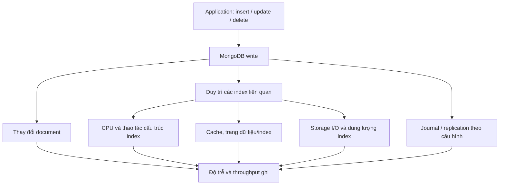
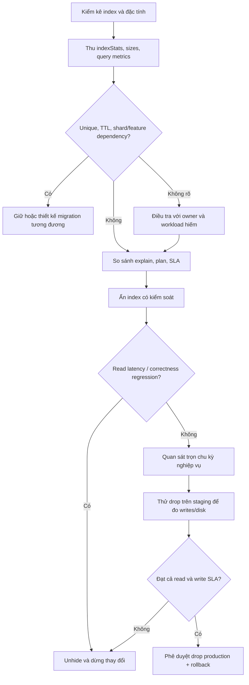

# Đánh giá chi phí ghi, dung lượng và chỉ mục không được sử dụng

## 1. Bài toán: index giúp đọc nhanh nhưng không miễn phí

Một dịch vụ đơn hàng ban đầu chỉ có 4 index. Sau nhiều lần tối ưu truy vấn, đội phát triển bổ sung thêm index cho trạng thái, thời điểm cập nhật, SKU, mã sự kiện và nhiều tổ hợp trường. Truy vấn đọc một số màn hình nhanh hơn, nhưng tốc độ ghi đơn hàng giảm, kích thước lưu trữ tăng, cache kém hiệu quả và thời gian bảo trì index dài hơn. Một vài index có vẻ không được truy vấn nào sử dụng.

Đặt câu hỏi «index nào đang không được dùng?» là cần thiết, nhưng chưa đủ. Cần trả lời đồng thời:

1. **Lợi ích đọc:** Index hỗ trợ query shape, sort, uniqueness, TTL hoặc một ràng buộc nào?
2. **Chi phí ghi:** Insert, update và delete phải bảo trì thêm bao nhiêu cấu trúc chỉ mục?
3. **Chi phí tài nguyên:** Index đang chiếm bao nhiêu dung lượng lưu trữ, bộ nhớ cache và I/O?
4. **Tín hiệu sử dụng:** Một index ít được chọn trong khoảng quan sát có thật sự thừa không?
5. **Rủi ro loại bỏ:** Nếu ẩn hoặc xóa index, workload hiếm, tác vụ định kỳ và bất biến dữ liệu có bị ảnh hưởng?
6. **Cách chứng minh:** Làm sao so sánh trước/sau bằng cùng workload và có đường rollback?

Bài thuộc chương **Chỉ mục** trong module **SPRING_DATA_MONGODB**. Phạm vi module là sử dụng Spring Data MongoDB để kết nối và ánh xạ document, thao tác qua `MongoTemplate` hoặc repository, thiết kế query, aggregation, index, transaction, reactive access, kiểm thử và chẩn đoán hiệu năng dữ liệu. Nội dung tập trung vào **đánh giá chi phí/giá trị của index**, không phải chỉ hướng dẫn cú pháp tạo index.

Sau bài học, bạn có thể:

- Giải thích **write amplification** và áp lực lên cache/index maintenance.
- Đọc `db.collection.stats()`, `getIndexes()`, `$indexStats` và `explain("executionStats")` đúng ngữ nghĩa.
- Phân biệt **không được query planner sử dụng** với **không có chức năng nghiệp vụ**.
- Tạo bảng đánh giá index dựa trên truy vấn, dung lượng, chi phí ghi và mức độ rủi ro.
- Dùng **hidden index** để thử loại khỏi query planner, đồng thời hiểu nó **vẫn tiêu tốn tài nguyên ghi và lưu trữ**.
- Lập quy trình giảm index an toàn, có đo lường, phê duyệt, thời gian quan sát và rollback.
- Kiểm thử cơ chế quản lý index của Spring Data MongoDB, bao gồm `@Indexed`, `@CompoundIndex`, `IndexOperations` và vấn đề tạo lại index sau deploy.

> Thông tin về tính năng quản trị, quyền truy cập, hành vi của query planner, tài nguyên và độ khả dụng của từng loại index phụ thuộc MongoDB server, topology, FCV và Spring Data/driver version. Các ví dụ thay đổi index là thao tác **quản trị có ảnh hưởng**: không chạy trên production nếu chưa có kế hoạch được phê duyệt.

## 2. Ví dụ xuyên suốt: collection orders nhiều index

### 2.1. Cấu trúc BSON

```javascript
{
  _id: "ord-101",
  tenantId: "tenant-a",
  externalKey: "partner-evt-001",
  status: "READY_TO_SHIP",
  customerId: "customer-17",
  items: [
    { sku_code: "BOOK-A", quantity: 2 },
    { sku_code: "BOOK-B", quantity: 1 }
  ],
  amount_vnd: NumberLong("350000"),
  createdAt: ISODate("2026-11-10T08:00:00Z"),
  updatedAt: ISODate("2026-11-20T03:00:00Z"),
  expiresAt: ISODate("2027-02-20T03:00:00Z")
}
```

Đây là một **document ví dụ**, không yêu cầu thêm dữ liệu vào production. Trong hệ thống, các thao tác thông dụng gồm:

| Workload | Filter / hành vi | Tần suất giả định |
| --- | --- | --- |
| Xem đơn theo ID | `{_id, tenantId}` | Rất nhiều |
| Hàng đợi giao hàng | `{tenantId, status}` sort `createdAt DESC, _id DESC` | Nhiều |
| Nhận sự kiện đối tác | Upsert theo `{tenantId, externalKey}` | Nhiều |
| Tìm đơn của khách | `{tenantId, customerId}` | Trung bình |
| Tìm đơn chứa SKU | `{"items.sku_code": ...}` cùng tenant | Thấp |
| Báo cáo tháng | Lọc khoảng `createdAt` và trạng thái | Theo lịch |
| Đối soát cuối quý | Truy vấn trường chuyên biệt | Rất hiếm nhưng quan trọng |
| Thay trạng thái/updatedAt | Update trên document | Nhiều |
| Xóa dữ liệu hết hạn | TTL theo `expiresAt` nếu policy cho phép | Tự động |

Tần suất trong bảng chỉ để minh họa. Trước khi quyết định bỏ index thật, phải có số liệu thực tế theo **đỉnh tải**, ngày cuối tháng, cuối quý và những job hiếm.

### 2.2. Bộ index giả định

```javascript
// Các lệnh dưới đây minh họa thiết kế;
// chỉ thực thi trong môi trường thực hành đã kiểm soát.
db.orders.createIndex(
  { tenantId: 1, externalKey: 1 },
  { unique: true, name: "uk_orders_tenant_external" }
);

db.orders.createIndex(
  { tenantId: 1, status: 1, createdAt: -1, _id: -1 },
  { name: "ix_orders_tenant_status_recent" }
);

db.orders.createIndex(
  { tenantId: 1, customerId: 1 },
  { name: "ix_orders_tenant_customer" }
);

db.orders.createIndex(
  { tenantId: 1, status: 1 },
  { name: "ix_orders_tenant_status" }
);

db.orders.createIndex(
  { "items.sku_code": 1, tenantId: 1 },
  { name: "ix_orders_item_sku_tenant" }
);

db.orders.createIndex(
  { updatedAt: 1 },
  { name: "ix_orders_updated_at" }
);
```

Collection còn có index `_id_` mặc định trong mô hình collection thông dụng. Có thể có index TTL cho `expiresAt` nếu thực sự muốn document bị xóa tự động sau thời hạn. **Không tự thêm TTL vào đơn hàng có yêu cầu lưu trữ pháp lý**: chính sách lưu dữ liệu phải được xác nhận trước.

Index `ix_orders_tenant_status` có vẻ trùng prefix với `ix_orders_tenant_status_recent`, còn `ix_orders_updated_at` có thể ít được dùng. Tuy nhiên, **chưa thể xóa index nào chỉ từ việc nhìn tên hoặc cùng prefix**.

## 3. Index trong MongoDB tiêu tốn những gì?

Với storage engine WiredTiger thông dụng, các index biểu diễn cấu trúc tra cứu có tổ chức, được duy trì bên cạnh dữ liệu collection.



Chi phí không nằm ở một biến duy nhất:

| Tài nguyên | Vì sao index ảnh hưởng |
| --- | --- |
| CPU | Tìm vị trí key, bảo trì cấu trúc, so sánh/collation và tính các key mới |
| RAM/cache | Trang index tranh không gian cache với data và các index khác |
| Disk | Index chiếm dung lượng riêng, có thể được nén; index càng rộng/đa giá trị càng có thể lớn |
| Disk I/O | Trang bị đọc/ghi, flush và eviction; tác động phụ thuộc working set |
| Write latency | Write phải làm công bảo trì index cần thiết bên cạnh thay đổi document |
| Write throughput | Khi CPU/I/O/cache là nút thắt, thêm index có thể giảm số ghi xử lý mỗi giây |
| Replication | Secondary cũng phải xử lý thay đổi dữ liệu và duy trì index tương ứng |
| Vận hành | Index build, backup, restore, migration và triển khai có thêm chi phí |

Không có công thức «mỗi index làm write chậm đúng X%». Ảnh hưởng phụ thuộc kích thước key, workload, field nào bị sửa, cache hit, dữ liệu phân bố, index uniqueness/multikey/partial và khả năng phần cứng.

## 4. Write amplification: insert, update, delete

### 4.1. Insert

Khi tạo document mới, MongoDB phải thêm những khóa index phù hợp. Nếu có 8 index ngoài `_id_` và document thỏa điều kiện của cả 8, insert có thể làm công bảo trì ở nhiều cấu trúc. Nhưng số key và chi phí **không nhất thiết bằng số index**:

- Một multikey index trên array có thể cần xử lý nhiều giá trị.
- Partial index chỉ chứa document thỏa filter.
- Sparse index có quy tắc riêng về field missing.
- Index có các kiểu key phức tạp hoặc collation có chi phí khác nhau.
- Nén, locality, cache và phân bố key quyết định I/O thực tế.

### 4.2. Update

Một update đổi `status` từ NEW sang PAID phải bảo trì những index mà key/index membership của document bị ảnh hưởng, chẳng hạn index chứa `status`. Nếu chỉ đổi `updatedAt`, index `ix_orders_updated_at` sẽ phát sinh công bảo trì liên quan.

```javascript
db.orders.updateOne(
  {
    _id: "ord-101",
    tenantId: "tenant-a",
    status: "READY_TO_SHIP"
  },
  {
    $set: {
      status: "SHIPPED",
      updatedAt: new Date()
    }
  }
);
```

Một index không chứa trường vừa sửa không có nghĩa mọi ảnh hưởng đều bằng 0 (ví dụ thay đổi kích thước document, cache/transaction overhead), nhưng **index key không đổi thường tránh được công thay key trực tiếp** so với index có trường đó.

### 4.3. Delete

Delete document phải gỡ các key tương ứng khỏi những index đang chứa document đó. Một thao tác xóa số lượng lớn có thể gây tải cả dữ liệu lẫn index. TTL index còn **chủ động thúc đẩy xóa** những document hết hạn theo chính sách, nên không được coi là «thừa» chỉ vì không phục vụ truy vấn ứng dụng.

### 4.4. Upsert và bulk writes

Upsert có **nhánh insert** và **nhánh update**. Chi phí index của hai nhánh có thể rất khác nhau; nên đo tách biệt. Với `bulkWrite(...)`, gom nhiều thao tác có thể giảm một số overhead mạng/round trip nhưng **không bỏ qua bảo trì index**. Nếu các write cùng sửa trường indexed, chi phí đó vẫn tồn tại.

## 5. Khi nào index chiếm nhiều dung lượng bất thường?

### 5.1. Index rộng và compound key

Một index compound:

```javascript
{ tenantId: 1, status: 1, createdAt: -1, _id: -1 }
```

có thể lớn hơn index hẹp trên `{tenantId: 1, status: 1}`. Tuy nhiên, kích thước thực không chỉ tính bằng tổng số byte của từng field nhân số record: WiredTiger có các kỹ thuật nén, cấu trúc trang và metadata. **Phải đo**, không suy ra chính xác từ schema.

### 5.2. Multikey index trên array

```javascript
db.orders.createIndex(
  { "items.sku_code": 1, tenantId: 1 },
  { name: "ix_orders_item_sku_tenant" }
);
```

Vì `items.sku_code` nằm trong array, đây là **multikey index** trong mô hình dữ liệu trên. Một document nhiều SKU có thể sinh nhiều khóa index; MongoDB có quy tắc xử lý trùng key trong cùng document và giới hạn multikey riêng, nên **không mặc định số key index bằng đúng số phần tử array**.

Với một đơn có hàng trăm dòng sản phẩm, chi phí tạo và cập nhật multikey index có thể đáng kể. Nếu luồng ghi thường xuyên chỉnh sửa danh sách items, đo riêng nhóm document có array lớn.

### 5.3. Wildcard, text, geo và các kiểu đặc biệt

Index kiểu wildcard, text, geospatial, hashed hoặc compound/multikey có cấu trúc và mục đích khác nhau. Không đánh giá chúng chỉ bằng «key càng ít càng tốt» hoặc một tỷ lệ kích thước cố định. Các index đặc biệt có thể phục vụ query không thể dùng index B-tree đơn giản tương đương.

### 5.4. Data skew và key dài

String dài, array dài, giá trị phân bố không đều và tăng trưởng dữ liệu có thể ảnh hưởng index size lẫn cache locality. Thử nghiệm trên dữ liệu test vài trăm document không đủ để suy ra hành vi ở collection hàng triệu document.

## 6. Đo dung lượng: db.collection.stats() và các đơn vị

### 6.1. Thu thập snapshot chỉ đọc

```javascript
const stats = db.orders.stats();

printjson({
  count: stats.count,
  size: stats.size,
  storageSize: stats.storageSize,
  totalIndexSize: stats.totalIndexSize,
  indexSizes: stats.indexSizes,
  nindexes: stats.nindexes
});
```

Các trường quan trọng:

| Trường | Ý nghĩa thực hành |
| --- | --- |
| `count` | Số document theo số liệu thống kê collection |
| `size` | Dung lượng dữ liệu logic được thống kê, không đồng nhất với bytes on disk |
| `storageSize` | Dung lượng lưu trữ collection data do storage engine phân bổ |
| `totalIndexSize` | Tổng dung lượng index được thống kê cho collection |
| `indexSizes` | Map tên index → dung lượng của index |
| `nindexes` | Số index trên collection |

Những giá trị dung lượng trong kết quả không scale thường được biểu diễn bằng **byte**. Khi dùng `scale` trong lệnh stats, kiểm tra đơn vị trả về và `scaleFactor` trước khi làm phép tính. Các trường có thể thay đổi cách báo cáo tùy server/storage engine, và số liệu giữa các lần quan sát có thể biến động do workload.

### 6.2. Chuyển index size ra MiB cho báo cáo

```javascript
const s = db.orders.stats();
const toMiB = bytes => bytes / (1024 * 1024);

const rows = Object.entries(s.indexSizes || {})
  .map(([name, bytes]) => ({
    name,
    mib: Number(toMiB(bytes).toFixed(2))
  }))
  .sort((a, b) => b.mib - a.mib);

printjson(rows);
```

`Object.entries` ở đây là JavaScript của mongosh, không phải MongoDB aggregation operator. Khi chạy công cụ vận hành trên môi trường ít quyền, tài khoản phải có quyền phù hợp để xem thống kê.

### 6.3. Các tỷ lệ hữu ích nhưng phải hiểu giới hạn

```javascript
const s = db.orders.stats();

const indexToDataStorage =
  s.storageSize > 0
    ? s.totalIndexSize / s.storageSize
    : null;

printjson({ indexToDataStorage });
```

Nếu tỷ lệ bằng `0.75`, có thể nói tổng index size được báo cáo bằng **75% storageSize của collection data** tại thời điểm đo. **Không** nói «index chiếm 75% toàn bộ dung lượng MongoDB» — còn journal, files, replica, oplog, backup và overhead khác.

So sánh tỷ lệ theo thời gian có ích, nhưng **phải đi kèm số tuyệt đối**: tỷ lệ giảm có thể chỉ do data tăng rất nhanh, chứ không phải index hiệu quả hơn.

### 6.4. totalIndexSize không phải RAM đang dùng

Index có thể nằm một phần trong cache, một phần trên disk. `totalIndexSize` không phải «RAM mà index đang chiếm». Đo RAM/cache pressure cần thêm metrics của WiredTiger, page faults/evictions, cache bytes, disk I/O và ứng dụng; số liệu tùy deployment.

### 6.5. Đánh giá tăng trưởng

Thu thập cùng các trường theo ngày/tuần hoặc trước/sau deploy để thấy:

- Index nào tăng nhanh nhất.
- Tốc độ tăng theo số document và kích thước array.
- Có index mới tạo làm tăng dung lượng đột biến.
- Có index chiếm nhiều bytes nhưng truy vấn hưởng lợi rất ít.
- Có thời gian index build hoặc data migration làm số liệu tạm thời khác bình thường.

Tỷ lệ bytes/index không tự chứng minh index thừa; nó chỉ là **một chiều chi phí**.

## 7. Đo mức sử dụng: $indexStats

### 7.1. Cú pháp đúng

```javascript
db.orders.aggregate([
  { $indexStats: {} }
]);
```

`$indexStats` trả thống kê truy cập cho các index. Trong output thông dụng có:

```javascript
{
  name: "ix_orders_tenant_status_recent",
  key: { tenantId: 1, status: 1, createdAt: -1, _id: -1 },
  host: "mongo-node.example:27017",
  accesses: {
    ops: NumberLong("12345"),
    since: ISODate("2026-11-01T00:00:00Z")
  },
  spec: {
    name: "ix_orders_tenant_status_recent",
    key: { tenantId: 1, status: 1, createdAt: -1, _id: -1 }
  }
}
```

Đây là **output minh họa, không phải kết quả đo thật**. `accesses.ops` phản ánh số operations do người dùng kích hoạt đã sử dụng index theo quy tắc thống kê, không phải số document trả về, số index keys scanned, số writes bảo trì index hay QPS.

### 7.2. Trường quan trọng

| Field | Cách hiểu |
| --- | --- |
| `name` | Tên index |
| `key` | Key pattern của index |
| `host` | Node `mongod` gắn với số liệu |
| `accesses.ops` | Số operations sử dụng index trong khoảng thống kê trên node |
| `accesses.since` | Thời điểm bắt đầu khoảng đếm |
| `spec` | Toàn bộ định nghĩa index gồm options liên quan |
| `shard` | Thông tin shard khi có trong output sharded cluster |

### 7.3. $indexStats phải là stage đầu

```javascript
// HỢP LỆ: $indexStats là stage đầu, sau đó project/sort.
db.orders.aggregate([
  { $indexStats: {} },
  {
    $project: {
      _id: 0,
      host: 1,
      name: 1,
      ops: "$accesses.ops",
      since: "$accesses.since"
    }
  },
  { $sort: { ops: 1, name: 1 } }
]);
```

Không đặt `$match` trước `$indexStats` để lọc document trong collection. `$indexStats` cung cấp **metadata về index**, không xử lý luồng document đơn hàng như `$match` nghiệp vụ. Stage này **không được dùng trong transaction**; các quyền quan sát/monitoring phải phù hợp với deployment.

### 7.4. Vì sao ops = 0 chưa đủ?

Một index báo `accesses.ops = 0` có thể do:

1. Workload chỉ chạy cuối tháng/quý và chưa xuất hiện.
2. Counter vừa reset sau restart, drop/recreate hoặc thay đổi metadata index.
3. Quan sát một secondary/primary không phục vụ nhóm truy vấn đó.
4. Truy vấn chạy trên shard/node khác.
5. Index giữ unique constraint hoặc TTL, không phải để phục vụ read query.
6. Truy vấn hiếm dùng `hint` hoặc chạy bởi pipeline định kỳ.
7. Query optimizer chọn index khác trong khoảng quan sát nhưng index này vẫn là phương án tốt cho nhóm dữ liệu/parameter đặc biệt.
8. Index đã bị **hidden** và không còn có thể được planner chọn.

Đó là lý do «không được sử dụng» phải gắn với **cửa sổ quan sát**, **node**, **workload thực tế** và **vai trò ràng buộc dữ liệu**.

### 7.5. Counter reset và phạm vi đo

Theo cách MongoDB thu thập, `$indexStats` có các giới hạn:

- Counter reset khi `mongod` restart, index bị drop rồi tạo lại hoặc một số thao tác `collMod` làm đổi index.
- Số liệu theo **node/host**, không tự tổng hợp đủ mọi node trong một replica set hay cluster.
- Không bao gồm một số internal operations như TTL deletion, tác vụ replication và hoạt động nội bộ của sharding.
- Không dùng `ops` như tổng số đọc hay tổng số ghi của collection.

Nếu một index đang làm nhiệm vụ TTL mà `ops=0`, điều đó **không chứng minh TTL không chạy**. Nếu cần đủ bức tranh của cluster, lấy số liệu ở các node/shard phù hợp với quyền monitoring và vai trò đọc/ghi của chúng.

### 7.6. Tính chênh lệch ops giữa hai lần quan sát

Để đo tần suất sử dụng, thu hai snapshot với cùng `host + index name`:

```text
Snapshot A: ops=200, since=2026-11-01T00:00Z, 10:00Z
Snapshot B: ops=260, since=2026-11-01T00:00Z, 11:00Z

Delta ops = 260 - 200 = 60 operations/giờ (trong ví dụ)
```

Chỉ phép trừ khi `since` nhất quán và counter không reset. Nếu B có `since` mới, baseline phải được thiết lập lại. Với nhiều host, không cộng bừa các counter có thời gian quan sát khác nhau rồi coi là QPS toàn cụm.

## 8. Kết hợp indexStats và indexSizes thành danh sách ứng viên

Một snapshot đọc riêng:

```javascript
const sizes = db.orders.stats().indexSizes;
const usage = db.orders.aggregate([
  { $indexStats: {} }
]).toArray();

const inventory = usage.map(x => ({
  host: x.host,
  name: x.name,
  accesses: x.accesses?.ops,
  since: x.accesses?.since,
  sizeMiB: sizes?.[x.name] == null
    ? null
    : Number((sizes[x.name] / (1024 * 1024)).toFixed(2)),
  unique: x.spec?.unique === true,
  expireAfterSeconds: x.spec?.expireAfterSeconds,
  partialFilterExpression: x.spec?.partialFilterExpression,
  hidden: x.spec?.hidden === true
}));

printjson(inventory);
```

Lệnh này chủ yếu dùng cho **môi trường standalone hoặc khảo sát có kiểm soát**. Trong deployment sharded/replica, `indexSizes` và `$indexStats` có thể không cùng phạm vi node/đơn vị tổng hợp; cần có pipeline monitoring được thiết kế để so sánh cùng scope. Không ghép một con số size tổng hợp với một counter duy nhất rồi kết luận tỷ lệ lợi ích toàn cụm.

### 8.1. Bảng đánh giá giả định

| Index | Size giả lập | Reads sử dụng/kỳ giả lập | Vai trò | Xếp loại ban đầu |
| --- | ---: | ---: | --- | --- |
| `_id_` | 80 MiB | Rất nhiều | Định danh | Giữ |
| `uk_orders_tenant_external` | 115 MiB | Ít | Chặn trùng khóa nghiệp vụ | Giữ |
| `ix_orders_tenant_status_recent` | 165 MiB | Rất nhiều | Queue/sort | Giữ và đo |
| `ix_orders_tenant_customer` | 95 MiB | Trung bình | Tra cứu khách | Đo thêm |
| `ix_orders_tenant_status` | 75 MiB | Ít | Có khả năng trùng prefix | Ứng viên kiểm tra |
| `ix_orders_item_sku_tenant` | 310 MiB | Thấp | Tra cứu theo SKU | Ứng viên kiểm tra kỹ |
| `ix_orders_updated_at` | 90 MiB | 0 trong kỳ | Có thể chỉ là di sản | Ứng viên kiểm tra kỹ |

**Tất cả số MiB và tần suất ở bảng đều là dữ liệu giả lập**, không được dùng làm quyết định vận hành thực tế. «Ứng viên kiểm tra» **không đồng nghĩa «an toàn để drop»**.

## 9. Query planner: chỉ số ops không nói hết hiệu quả

Một index có thể được dùng rất nhiều nhưng không mang lại lợi ích tương xứng, chẳng hạn index có độ chọn lọc thấp khiến nhiều document vẫn phải được đọc.

### 9.1. Explain cho một query shape

```javascript
db.orders.find({
  tenantId: "tenant-a",
  status: "READY_TO_SHIP"
})
  .sort({ createdAt: -1, _id: -1 })
  .limit(20)
  .explain("executionStats");
```

Quan sát các thông tin tùy phiên bản server:

| Thông tin | Ý nghĩa |
| --- | --- |
| `winningPlan` / query plan | Index hoặc collection scan và các bước xử lý |
| `IXSCAN` | Có index scan trong plan |
| `COLLSCAN` | Có collection scan |
| `totalKeysExamined` | Khối lượng index keys được duyệt |
| `totalDocsExamined` | Số document được xem xét |
| `nReturned` | Số document trả ra |
| SORT/blocking stage | Server có cần tự sắp xếp ngoài index không? |
| `executionTimeMillis` | Số đo của lần explain, không phải p95/p99 production |

Index `ix_orders_tenant_status_recent` có thể phục vụ filter và sort, giúp giảm công. Một index chỉ chứa `status` có thể tìm rất nhiều record trước khi lọc tenant, nên số ops cao chưa có nghĩa hiệu quả tốt.

### 9.2. explain không thay thế metrics production

`explain("executionStats")` cho một lần thử trên một bộ tham số không biểu diễn toàn bộ phân bố tải. Nó cũng có thể tác động cách optimizer thu thập/hiển thị plan và không phản ánh đầy đủ network/mapping của Java.

Kết hợp với:

- Logs/slow query profiler hoặc công cụ monitoring có sample phù hợp.
- Metrics latency p50/p95/p99 theo **query shape**.
- Tần suất query, số documents/keys examined và số document trả ra.
- Workload theo tenant lớn/nhỏ, trạng thái phổ biến/hiếm.
- Query ở primary/secondary và các lô batch định kỳ.

Không bật profiler ghi toàn bộ production operations ở mức cao mà không đánh giá chi phí, quyền truy cập và dữ liệu nhạy cảm có thể xuất hiện trong logs.

### 9.3. Hint trong phép thử có kiểm soát

```javascript
db.orders.find({
  tenantId: "tenant-a",
  status: "READY_TO_SHIP"
})
  .sort({ createdAt: -1, _id: -1 })
  .hint("ix_orders_tenant_status_recent")
  .limit(20)
  .explain("executionStats");
```

`hint(...)` giúp thử một kế hoạch có index cụ thể, nhưng buộc planner theo index và có thể làm hiệu năng xấu nếu áp dụng rộng. Dùng để **thử nghiệm**, không đưa hint vào code production chỉ dựa vào một bộ test.

Nếu index được hidden, query planner không thể dùng nó để hỗ trợ truy vấn và hint đến hidden index bị hạn chế/không hợp lệ; cần unhide trong môi trường thử nghiệm hoặc dùng bản sao staging phù hợp.

## 10. Chỉ mục trùng lặp và tiền tố compound

### 10.1. Hai index có cùng prefix

Giả sử có:

```javascript
// A
{ tenantId: 1, status: 1 }

// B
{ tenantId: 1, status: 1, createdAt: -1, _id: -1 }
```

Index B có prefix `tenantId, status` và **có thể** phục vụ nhiều equality query từng dùng A. Nhưng:

- B lớn hơn, có thể làm tăng cache/I/O so với A.
- A có thể có options khác như collation, partial/unique.
- Một số query shape chạy nhanh hơn với A do số key hoặc dữ liệu.
- Hệ thống có hint/query setting hoặc nhiệm vụ vận hành phụ thuộc tên A.
- Điều kiện filter/sort/projection có thể ảnh hưởng lựa chọn thực tế của planner.

Vì vậy, chỉ kết luận **A là ứng viên trùng lặp**, chưa kết luận A là vô dụng. So sánh plan và latency của query phụ thuộc, rồi ẩn A nếu phù hợp để thử.

### 10.2. Index không trùng chỉ vì chứa cùng field

```javascript
{ tenantId: 1, status: 1 }
{ status: 1, createdAt: -1 }
```

Hai index này có cùng field `status` nhưng **khác key order và prefix**. Query chỉ lọc status có thể tận dụng index thứ hai rõ hơn; query lọc tenant và status có thể ưu tiên index thứ nhất. Không xóa một index chỉ vì nhìn thấy trường giống nhau.

### 10.3. Unique và partial có nghĩa khác

```javascript
// Ràng buộc toàn bộ collection theo cặp key.
db.orders.createIndex(
  { tenantId: 1, externalKey: 1 },
  { unique: true, name: "uk_orders_tenant_external" }
);

// Minh họa index chỉ chứa nhóm trạng thái cần theo dõi.
db.orders.createIndex(
  { tenantId: 1, createdAt: -1 },
  {
    name: "ix_orders_active_recent",
    partialFilterExpression: {
      status: { $in: ["NEW", "READY_TO_SHIP"] }
    }
  }
);
```

Index partial có thể giảm dung lượng/bảo trì so với index toàn phần nếu chỉ những document thỏa điều kiện được index. Nhưng query muốn dùng partial index thường phải có điều kiện phù hợp để MongoDB không trả thiếu dữ liệu.

**Quan trọng:** Giới hạn cú pháp `partialFilterExpression` và các operator được phép phụ thuộc server/version; cần kiểm tra index definition được server chấp nhận trong topology thực tế. Không giả định partial index là thay thế tự động cho một unique index bảo vệ bất biến trên toàn bộ collection.

## 11. Index không phục vụ đọc vẫn có thể thiết yếu

### 11.1. Unique index

```javascript
db.orders.createIndex(
  { tenantId: 1, externalKey: 1 },
  { unique: true, name: "uk_orders_tenant_external" }
);
```

Giả sử truy vấn ứng dụng luôn tìm đơn theo `_id`; `$indexStats` của unique index báo ops = 0. Index đó vẫn có thể chặn hai upsert đồng thời tạo cùng khóa nghiệp vụ. Nếu xóa, database mất một **bất biến duy nhất** mà service đang phụ thuộc.

Không thay unique index bằng «trong Java đã kiểm tra exists trước insert» vì nhiều request cạnh tranh có thể vượt qua cùng một lần kiểm tra.

### 11.2. TTL index

```javascript
// Chỉ là ví dụ cho collection lưu dữ liệu có chính sách hết hạn.
db.event_archive.createIndex(
  { expiresAt: 1 },
  { expireAfterSeconds: 0, name: "ttl_event_archive" }
);
```

TTL index hỗ trợ MongoDB xóa document hết hạn theo chính sách. Thao tác xóa nội bộ do TTL có thể **không được tính vào accesses.ops** như truy vấn do người dùng kích hoạt. Xóa TTL index có thể khiến dữ liệu hết hạn **không còn tự được dọn**.

Không đưa TTL vào collection `orders` chỉ vì có `expiresAt` nếu hợp đồng lưu giữ dữ liệu chưa cho phép. Đánh giá công năng, SLA dọn dẹp và yêu cầu retention trước khi chỉnh index.

### 11.3. Index bắt buộc hoặc phục vụ topology

Index `_id_` mặc định, ràng buộc unique, shard-key/index yêu cầu bởi topology và các index phục vụ feature đặc thù không được đối xử như một index thường chỉ dựa trên read count. Quy định chính xác về index/shard key khác nhau theo phiên bản MongoDB; cần đối chiếu trước thay đổi.

### 11.4. Query rất hiếm nhưng có SLA cao

Một index chỉ được dùng khi chạy quy trình đối soát cuối năm có thể có `ops=0` trong ba tháng đầu theo dõi. Nếu bỏ, batch cuối năm có thể chạy từ vài phút thành nhiều giờ. Cần lập danh sách job theo chu kỳ và người sở hữu thay vì chỉ xem tuần vừa qua.

## 12. Hidden index: thử loại khỏi planner trước khi drop

### 12.1. Ý nghĩa chính xác

**Hidden index** không được query planner dùng để hỗ trợ truy vấn. Nó cho phép giả lập tình huống «planner không có index này» mà chưa phá hủy cấu trúc index vật lý.

```javascript
// Lệnh quản trị: chỉ chạy sau khi được phê duyệt.
db.orders.hideIndex("ix_orders_updated_at");

// Kiểm tra định nghĩa, trong đó hidden: true khi đang ẩn.
db.orders.getIndexes();

// Hoàn tác trạng thái ẩn.
db.orders.unhideIndex("ix_orders_updated_at");
```

Tính năng và yêu cầu FCV của hidden indexes phải được xác minh theo MongoDB server đang dùng. Không dùng `hideIndex`/`unhideIndex` trên production ngoài cửa sổ thay đổi được giám sát.

### 12.2. Điều hidden index **không** làm

| Hành vi | Index visible | Index hidden |
| --- | --- | --- |
| Query planner có thể chọn để phục vụ truy vấn | Có | **Không** |
| Giữ chiếm dung lượng lưu trữ | Có | **Có** |
| Tiếp tục được bảo trì khi write | Có | **Có** |
| Unique constraint còn hiệu lực | Có nếu unique | **Có nếu unique** |
| TTL behavior còn hoạt động | Có nếu TTL | **Có nếu TTL** |
| Có thể unhide nhanh mà không rebuild? | Không áp dụng | **Có**, vì index vẫn tồn tại |

Do đó, **hidden index dùng để đánh giá ảnh hưởng lên đọc**, không phải để đo đầy đủ **lợi ích giảm write amplification hoặc giải phóng dung lượng**.

### 12.3. Vì sao hide có thể làm số liệu $indexStats reset?

Việc thay đổi định nghĩa/trạng thái hidden qua `collMod` có thể reset thống kê index. Không so sánh `ops` trước/sau hide như một counter liên tục nếu `accesses.since` đã thay đổi. Hãy lưu snapshot và tạo baseline mới.

### 12.4. Test trước/sau hide

```text
Baseline:
  Index visible
  → Query plan, p95 latency, CPU, docs examined

Thử nghiệm:
  Hide ứng viên
  → Chạy lại các query shape phụ thuộc
  → Kiểm tra query plan mới + SLA

Nếu regression:
  Unhide ngay theo runbook

Nếu không regression:
  Tiếp tục quan sát đủ một chu kỳ nghiệp vụ
  → Mới cân nhắc drop có phê duyệt
```

Với index độc đáo và query hiếm, phải có synthetic/representative test chủ động; không chỉ quan sát dashboard 30 phút rồi kết luận an toàn.

## 13. Drop index là thay đổi thực, không phải thao tác cleanup vô hại

### 13.1. Tác động khi drop

Xóa index có thể:

- Giải phóng dung lượng index tương ứng (cách cập nhật storage metrics/khả năng tái sử dụng space tùy engine).
- Giảm bảo trì index cho các write tiếp theo.
- Thay đổi các query plan có thể chọn.
- Phá một ràng buộc unique/TTL hoặc khả năng phục vụ feature.
- Khiến query hiếm rơi về index kém phù hợp hoặc COLLSCAN.
- Buộc phải rebuild index nếu cần rollback sau khi đã xóa.

Vì thế, **drop không phải rollback tức thì như unhide**.

### 13.2. Cú pháp quản trị, không chạy tùy tiện

```javascript
// Ví dụ lệnh có tác động: cần phê duyệt và runbook.
db.orders.dropIndex("ix_orders_updated_at");
```

Chỉ thực hiện sau khi:

1. Xác định rõ index name và collection/database.
2. Đã kiểm tra uniqueness/TTL/sharding/feature dependencies.
3. Đã thử hide và quan sát workload đủ dài.
4. Có backup/config index definition để có thể dựng lại.
5. Có kế hoạch giám sát và thời điểm rollback/recreate.
6. Team chịu trách nhiệm nghiệp vụ đã đồng ý.

### 13.3. Rollback sau drop không phải chỉ cần một click

Nếu query bị regression sau drop, cần tái tạo index:

```javascript
// Chỉ minh họa index thông thường, phải dùng đúng spec đã lưu.
db.orders.createIndex(
  { updatedAt: 1 },
  { name: "ix_orders_updated_at" }
);
```

Index build trên collection lớn có thể dùng nhiều CPU/I/O, gây contention, cần theo dõi tiến độ và tài nguyên. Nếu index bị drop là unique, dữ liệu trùng có thể đã phát sinh; tạo lại unique có thể thất bại. **Đây là lý do không dùng drop để thử nghiệm lần đầu**.

## 14. Thử nghiệm hiệu năng ghi để đo lợi ích thật

### 14.1. Tách workload insert/update/delete

Không nên tổng hợp chung một con số «1000 writes/second» khi 95% là update metadata và chỉ 5% là insert.

Một ma trận đo:

| Workload | Mục đích | Index có thể gây khác biệt |
| --- | --- | --- |
| Insert document mới | Chi phí thêm key cho index | Hầu hết index áp dụng |
| Update `updatedAt` | Chi phí index thời gian cập nhật | Index chứa `updatedAt` |
| Update `status` | Chi phí compound indexes có status | `ix_orders_tenant_status_*` |
| Thêm/bớt `items` | Chi phí multikey | `ix_orders_item_sku_tenant` |
| Delete nhiều document | Chi phí gỡ key index | Các index chứa document |
| Upsert miss | Tạo document/index keys mới | Như insert và lookup |
| Upsert hit | Sửa fields theo update | Tùy index key thay đổi |

### 14.2. Baseline và phép thử có thể so sánh

```text
Staging dữ liệu đại diện:

A. Bộ index hiện có
   → warm-up
   → đo insert/update/delete p50/p95/p99, ops/s, CPU, I/O

B. Bản staging tương đương, đã DROP index ứng viên
   → warm-up như A
   → chạy cùng workload, cùng phân bố dữ liệu, cùng clients
   → so sánh metrics

C. Khôi phục index baseline nếu cần
   → đo lại để loại bớt nhiễu do biến động môi trường
```

**Lưu ý:** Hide index ở B không thay thế drop khi mục đích là đo giảm **chi phí ghi**: hidden index vẫn được bảo trì. Thử drop chỉ nên diễn ra trên staging hoặc môi trường production được phê duyệt sau đánh giá rủi ro.

### 14.3. Chỉ số đo có ích

| Metric | Giải thích |
| --- | --- |
| `writes/s` hoặc document updates/s | Throughput thực |
| p50/p95/p99 latency ghi | Độ trễ theo phân vị, phân loại insert/update/delete |
| CPU utilization | Có nghẽn CPU do index maintenance không? |
| Disk read/write IOPS và latency | I/O thêm do cache miss/page flush |
| WiredTiger cache usage/evictions | Index có làm working set vượt cache không? |
| Replication lag | Secondary có theo kịp workload không? |
| Index build/disk growth | Chi phí vận hành ngoài request |
| Query p95/p99 sau thay đổi | Đảm bảo không đánh đổi quá mức cho đọc |
| Error rate / duplicate-key | Không phá business invariant |

### 14.4. So sánh đúng đơn vị

Ví dụ kết quả **giả lập**:

| Chỉ số | Trước | Sau bỏ một index trên staging | Diễn giải |
| --- | ---: | ---: | --- |
| Update `updatedAt` p95 | 26 ms | 19 ms | Thử nghiệm cho thấy cải thiện trong workload này |
| Insert p95 | 35 ms | 32 ms | Cải thiện thấp hơn |
| Throughput updates/s | 1.200 | 1.450 | Cần đo lặp và sai số |
| Read query p95 | 42 ms | 115 ms | Regression **không thể bỏ qua** |
| Index storage | 920 MiB | 830 MiB | Giảm theo số liệu mô phỏng |

Không phải vì writes tốt hơn mà drop luôn đúng: read regression trong bảng có thể vượt SLA. Cần đánh giá tổng thể và lặp phép đo; không lấy số giả lập này làm kỳ vọng cho dự án.

## 15. Tính ROI của index: chi phí và lợi ích cùng thời điểm

Một index hợp lý nếu giá trị nó đem lại lớn hơn chi phí duy trì **trong các ràng buộc SLA và nghiệp vụ**. Không nên quy đổi mọi thứ về một «điểm số index» duy nhất khi chưa có dữ liệu phù hợp.

### 15.1. Câu hỏi với một index ứng viên

```text
Index = ix_orders_tenant_status

Query nào cần nó?
  - Query hàng đợi theo tenant/status?
  - Count theo status?
  - Báo cáo định kỳ?

Index khác có thể thay thế?
  - ix_orders_tenant_status_recent?
  - Plan khác có nhanh gần bằng không?

Chi phí:
  - Số MiB index?
  - Write nào cập nhật key?
  - Cache pressure?

Ràng buộc:
  - Unique/TTL/partial/collation?
  - Hint/query setting?

Kết luận:
  - Giữ, tối ưu, hide thử hay đề xuất drop?
```

### 15.2. Tác động trên các tenant khác nhau

Một index có thể rất hiệu quả cho tenant lớn, nhưng ít khác biệt với tenant nhỏ. Nếu chỉ thử `tenant-a` có 20 đơn, có thể kết luận sai trên tenant có hàng triệu đơn. Test với dữ liệu có distribution gần thực tế.

### 15.3. Query bị chậm do thiếu index hay do pipeline?

Nếu pipeline có `$unwind`, `$group` hoặc `$sort` trên giá trị mới tính, thêm index trên field gốc không chắc giảm được chi phí downstream. Kiểm tra plan và stage cấp aggregation; đôi khi cần đổi query shape, projection hoặc read model thay vì tạo thêm index.

## 16. Spring Data MongoDB: quản lý index có kỷ luật

Spring Data MongoDB hỗ trợ metadata trên domain class và API quản lý index.

### 16.1. Entity với @CompoundIndex

```java
package com.example.orders.persistence;

import java.time.Instant;
import org.springframework.data.mongodb.core.index.CompoundIndex;
import org.springframework.data.mongodb.core.mapping.Document;
import org.springframework.data.mongodb.core.mapping.FieldType;
import org.springframework.data.mongodb.core.mapping.MongoId;

@Document(collection = "orders")
@CompoundIndex(
    name = "ix_orders_tenant_status_recent",
    def = "{ 'tenantId': 1, 'status': 1, 'createdAt': -1, '_id': -1 }"
)
public record OrderDocument(
    @MongoId(FieldType.STRING) String id,
    String tenantId,
    String status,
    Instant createdAt,
    Instant updatedAt
) {}
```

`@CompoundIndex` mô tả index dự kiến trên entity. **Nó không chứng minh index đã tồn tại trên MongoDB**: điều đó còn phụ thuộc cấu hình tự tạo index, vòng đời collection và quy trình deployment.

### 16.2. Auto-index creation không phải mặc định luôn bật

Ở các thế hệ Spring Data MongoDB hiện đại, auto index creation **không tự bật theo mặc định** (chủ động opt-in theo cấu hình, thay đổi từ Spring Data MongoDB 3.0). Khi bật, nó có thể tạo những index đã khai báo cho entity ở các thời điểm được framework xử lý.

Với production, thường nên có **quy trình quản lý/migration index được kiểm soát** thay vì mỗi instance ứng dụng đồng loạt tự tạo lại index tại startup. Index build trên collection lớn có thể ảnh hưởng tải và cần quyền quản trị riêng.

Một annotation chưa bị xóa khỏi code có thể khiến index được tạo lại theo cơ chế tự động nếu bạn vừa drop nó trong database mà quên thay đổi deployment/index-management policy. Vì vậy, thay đổi index phải đi cùng **source of truth** và kế hoạch release.

### 16.3. @Indexed, @CompoundIndex và các mục tiêu khác

| API/annotation | Mục đích |
| --- | --- |
| `@Indexed` | Index đơn giản trên property, có options tùy loại |
| `@CompoundIndex` | Định nghĩa compound index |
| `@TextIndexed` | Hỗ trợ định nghĩa text index |
| `@WildcardIndexed` | Wildcard index cho mô hình phù hợp |
| `IndexOperations` | Quản lý, inspect và đảm bảo index bằng API |
| `IndexResolver` | Trích xuất index definitions từ mapping metadata |

Không coi annotation là nơi quản trị index duy nhất nếu hệ thống có migration scripts, Atlas UI hoặc tooling riêng; hai nguồn phải được đồng bộ để tránh index được tạo lại hoặc khác options.

## 17. IndexOperations: inspect, ensureIndex và khác biệt với stats

### 17.1. Đọc danh sách index qua Spring Data

```java
import java.util.List;
import org.springframework.data.mongodb.core.MongoOperations;
import org.springframework.data.mongodb.core.index.IndexInfo;

public final class OrderIndexInspector {
    private final MongoOperations mongo;

    public OrderIndexInspector(MongoOperations mongo) {
        this.mongo = mongo;
    }

    public List<IndexInfo> configuredIndexes() {
        return mongo.indexOps(OrderDocument.class).getIndexInfo();
    }
}
```

`getIndexInfo()` giúp xem các index được khai báo **thực tế trong collection** theo API và metadata của Spring Data. Nhưng nó **không phải** API thống kê `accesses.ops` hoặc metric p95 của query. Để đánh giá sử dụng, cần `$indexStats` và monitoring tương ứng.

### 17.2. Định nghĩa index bằng Java

```java
import org.springframework.data.domain.Sort;
import org.springframework.data.mongodb.core.index.Index;

String name = mongo.indexOps(OrderDocument.class).ensureIndex(
    new Index()
        .on("tenantId", Sort.Direction.ASC)
        .on("status", Sort.Direction.ASC)
        .on("createdAt", Sort.Direction.DESC)
        .on("id", Sort.Direction.DESC)
        .named("ix_orders_tenant_status_recent")
);
```

Ở đây `mongo` là `MongoOperations` được inject trong một component chuyên quản lý index. Với entity mapping, property Java `id` tương ứng BSON `_id`; hãy kiểm chứng resulting index key qua `getIndexInfo()` hoặc `db.orders.getIndexes()` trong version thật.

**Không chạy `ensureIndex(...)` tùy tiện trong request handler.** Nó là thao tác schema/index management, cần tổ chức trong migration/startup path được kiểm soát, tránh nhiều instance cùng tranh tạo và thay đổi resource của production ngoài dự kiến.

### 17.3. Kiểm tra chỉ mục bằng mongosh

```javascript
db.orders.getIndexes();
```

Đối chiếu `name`, `key` và các options như `unique`, `partialFilterExpression`, `collation`, `expireAfterSeconds` hoặc `hidden`. Hai index có key giống nhau nhưng options khác có thể phục vụ mục đích khác.

### 17.4. Không tự xóa index từ code khi thấy ops=0

Trong ứng dụng chạy production, repository hoặc custom adapter **không nên tự gọi dropIndex** mỗi lần quan sát counter bằng 0. Các phép đo và phê duyệt phải nằm trong quy trình vận hành có nhân sự chịu trách nhiệm, giới hạn quyền và rollback.

## 18. Lấy $indexStats từ driver trong ứng dụng quản trị

Nếu cần tích hợp thống kê vào một job monitoring có quyền phù hợp, có thể sử dụng MongoDB Java driver:

```java
import java.util.ArrayList;
import java.util.List;
import org.bson.Document;
import com.mongodb.client.MongoCollection;

// mongoTemplate là bean dùng cho database đang theo dõi;
// đoạn code chỉ dùng trong công cụ quản trị đã được cấp quyền.
MongoCollection<Document> orders =
    mongoTemplate.getCollection("orders");

List<Document> usage = orders.aggregate(
    List.of(new Document("$indexStats", new Document()))
).into(new ArrayList<>());

for (Document row : usage) {
    Document accesses = row.get("accesses", Document.class);
    System.out.println(
        row.getString("name") + ": " +
        (accesses == null ? "n/a" : accesses.get("ops"))
    );
}
```

Không dùng driver command này trên mọi request API của người dùng. `$indexStats` có quyền truy cập/điều kiện server riêng, phải là **stage đầu** và không chạy trong transaction. Dữ liệu monitoring cần dùng account/role phù hợp và lưu timestamp/host để suy luận đúng.

Trong module SPRING_DATA_MONGODB, `MongoTemplate` là lựa chọn phù hợp để lấy collection handle khi thực sự cần driver-level API; không tạo MongoClient mới cho mỗi lần đo. Với reactive stack, dùng driver/ReactiveMongoOperations tương thích và publisher phù hợp thay vì chặn event loop bằng driver đồng bộ.

## 19. Partial, sparse và giới hạn chi phí bảo trì

### 19.1. Partial index

Nếu chỉ 5% đơn đang ở trạng thái cần xử lý, index partial có thể chứa ít document hơn:

```javascript
db.orders.createIndex(
  { tenantId: 1, createdAt: -1 },
  {
    name: "ix_active_orders_by_tenant",
    partialFilterExpression: { status: "READY_TO_SHIP" }
  }
);
```

Đánh đổi:

- Ít index entries hơn cho những document ngoài predicate.
- Query phải có điều kiện phù hợp để planner dùng index mà không bỏ sót dữ liệu.
- Update chuyển trạng thái vào/ra tập partial vẫn cần thêm/gỡ index key.
- Nếu phân bố trạng thái thay đổi, index size/write cost cũng thay đổi.

### 19.2. Sparse index

Sparse index chỉ ghi entry cho document có field được index theo semantics riêng. Nó không tương đương hoàn toàn với partial index trong mọi trường hợp, đặc biệt với `null`, compound fields và query coverage. Không đổi index thường sang sparse chỉ để giảm size mà chưa kiểm tra truy vấn có còn đầy đủ kết quả.

### 19.3. TTL index

TTL là công cụ **retention**, không chỉ công cụ tối ưu truy vấn. TTL index tự phục vụ dọn dẹp, nên dù làm tăng chi phí lưu trữ/ghi, nó có thể tiết kiệm lượng data lâu dài. Đánh giá cả chi phí TTL deletes, lịch hoạt động và yêu cầu pháp lý thay vì chỉ nhìn số ops.

### 19.4. Khi tối ưu thành phản tác dụng

Nếu lập nhiều partial indexes cho từng trạng thái, tổng chi phí có thể vẫn lớn; update trạng thái có thể chuyển một document từ index này sang index khác. Không cho rằng «partial» luôn rẻ hơn một compound index dùng chung, mà phải đo workload.

## 20. Production workflow: đánh giá rồi mới bỏ index

Một quyết định an toàn là quy trình có bước, bằng chứng và người chịu trách nhiệm.



### 20.1. Bước 1: xác định owner và inventory

Đối với mỗi index ghi lại:

| Field inventory | Ví dụ |
| --- | --- |
| Database/collection | `commerce.orders` |
| Name/key/options | `ix_orders_updated_at` / `{updatedAt:1}` |
| Dung lượng | Giá trị đo ở cùng thời điểm/node |
| Access operations | `ops`, `since`, `host` |
| Query owners | API quản lý đơn, batch đối soát, dashboard |
| Business invariant | unique, TTL, retention, tenant |
| Trạng thái | Giữ / Điều tra / Hidden test / Đề xuất drop |
| Kế hoạch rollback | Unhide hoặc recreate với spec đã lưu |

### 20.2. Bước 2: đủ cửa sổ quan sát

Một tuần chỉ đủ khi workload thật sự lặp lại theo tuần. Nếu có job tháng, quý hoặc ngày lễ, cần quan sát hoặc test chủ động. Sau restart, đối chiếu `accesses.since`. Khi nhiều replica, phải xem nhóm node thực sự phục vụ read traffic.

### 20.3. Bước 3: thử read degradation bằng hidden index

Giám sát nhóm query có thể dùng index đó: p95/p99, query plan, docs examined, CPU, I/O, error rate và đặc biệt workload hiếm. Có rollback unhide rõ ràng.

### 20.4. Bước 4: đo write cost trên staging khi index đã drop

Ẩn index không giảm maintenance. Muốn đo **lợi ích giảm write overhead**, phải có một môi trường staging tương đương mà index đã bị loại khỏi cấu trúc, rồi chạy cùng workload.

### 20.5. Bước 5: rollout và verify

Trước khi deploy, đối chiếu source-of-truth: annotations, Spring auto-index, migration scripts, Terraform/Atlas tooling và quyền. Theo dõi sau thay đổi qua nhiều kỳ; sẵn sàng rollback nếu query load hoặc consistency bất thường.

## 21. Replica sets, sharding và read preference

### 21.1. Các node có workload khác nhau

Primary thường nhận writes và có thể phục vụ reads; secondary có thể phục vụ nhóm read workloads riêng tùy cấu hình. `$indexStats` là theo node, nên primary báo ops=0 không có nghĩa secondary không dùng index. Hãy xác định read preference và lượng request thực tế.

### 21.2. Index trên sharded collections

Sharded cluster có thể phân bố dữ liệu và queries không đều. Cần xem stats theo shard/node, không lấy một counter đại diện tất cả. Một số unique indexes có ràng buộc liên quan đến shard key hoặc cấu hình collection; **không thay đổi trước khi kiểm chứng** server version, shard key, routing và hệ thống migration.

### 21.3. Secondary lag

Writes cần được áp dụng trên replica members, cùng việc duy trì index tương ứng. Index dư có thể góp phần tăng chi phí áp dụng dữ liệu trên secondary. Tuy nhiên, replication lag còn bị ảnh hưởng bởi network, disk, CPU, transactions, oplog và các tác vụ khác; phải phân tích đồng thời, không quy mọi lag cho index.

### 21.4. Chỉ mục phục vụ query ở node ít được giám sát

Một job báo cáo chạy ở secondary theo lịch hiếm có thể dùng index không thấy trên dashboard primary. Đây là ví dụ tại sao ra quyết định dựa trên phạm vi node và lịch workload là bắt buộc.

## 22. Kiểm thử chức năng và đo benchmark bằng Spring Data

### 22.1. Kiểm tra index thực tồn tại

Khung JUnit 5:

```java
import static org.junit.jupiter.api.Assertions.*;
import java.util.List;
import org.junit.jupiter.api.Test;
import org.springframework.data.mongodb.core.MongoOperations;
import org.springframework.data.mongodb.core.index.IndexInfo;

class IndexContractIntegrationTest {
    MongoOperations mongo; // Inject từ MongoDB test context.

    @Test
    void uniqueIndexMustExist() {
        List<IndexInfo> info =
            mongo.indexOps(OrderDocument.class).getIndexInfo();

        assertTrue(info.stream().anyMatch(
            index -> index.getName()
                .equals("uk_orders_tenant_external")
                && index.isUnique()
        ));
    }
}
```

Đây là **khung test** cần test context, fixture index/migration và injection. Test không pass chỉ vì có `@CompoundIndex` trong source; nó kiểm tra metadata index **đã tồn tại thật** trên MongoDB test.

### 22.2. Kiểm thử uniqueness dưới concurrency

Seed một collection test có unique index `{tenantId:1,externalKey:1}`, cho hai worker cạnh tranh insert/upsert cùng khóa. Kỳ vọng không tồn tại hai record logic trùng; ứng dụng phải có chiến lược xử lý duplicate-key/retry. Không dựa vào một lần chạy tuần tự để kết luận đã kiểm tra race.

### 22.3. Benchmark không phải unit test

Benchmark về CPU, index cache, write throughput và p99 latency cần:

1. MongoDB topology/phiên bản gần production.
2. Tập dữ liệu tương đương về số document và phân bố keys/arrays.
3. Thử nhiều client, warm-up và số lần đo đủ giảm nhiễu.
4. So sánh index sets trên môi trường độc lập hoặc reset về baseline.
5. Không chạy concurrent benchmark gây nguy cơ cho production.

Integration test chứng minh **đúng chức năng**; benchmark chứng minh **đặc tính hiệu năng với workload đã thử**, không phải bảo đảm mọi môi trường.

### 22.4. Đọc stats bằng Spring Data hay mongosh?

Cho các phép đánh giá vận hành như `$indexStats`, `collStats`, `explain`, dashboard MongoDB Atlas và MongoDB server metrics, dùng công cụ monitoring phù hợp thường hiệu quả hơn là nhét mọi phép phân tích vào repository business.

Ứng dụng chỉ nên sở hữu test về invariant index và query correctness. Việc quyết định drop cần kết hợp DBA/SRE và business owner.

## 23. Các tình huống chẩn đoán phổ biến

| Triệu chứng | Nguyên nhân khả dĩ | Hành động phù hợp |
| --- | --- | --- |
| Writes chậm sau deploy index mới | Bảo trì key và cache/I/O tăng | So sánh workload/index stats/disk metrics trước-sau |
| Dung lượng index gần bằng data | Nhiều index/rộng/multikey | Kiểm kê `indexSizes` và nhóm query |
| `$indexStats.ops=0` | Chưa gặp query, counter reset, node khác | Xem `since`/`host` và lịch workload |
| Index ops=0 nhưng chặn duplicate | Unique index có tác dụng write-side | Không drop nếu chưa thay invariant |
| Index ops=0 nhưng dữ liệu tự hết hạn | TTL deletion không tính như user query | Không drop TTL nếu policy cần cleanup |
| Hide xong writes không nhanh hơn | Hidden index vẫn được bảo trì | Đo write cost bằng drop trên staging |
| Hide làm query p99 tăng mạnh | Planner mất đường index tốt | Unhide, điều tra query shape |
| Hai index cùng prefix | Có thể trùng một phần | Test planner/size/latency, không xóa vội |
| Thêm index nhưng explain vẫn COLLSCAN | Filter, sort, collation hoặc selectivity không khớp | Đọc winningPlan và query shape |
| Index trước đó «không dùng» được dùng cuối tháng | Quan sát thiếu chu kỳ | Ghi nhận job định kỳ và SLA |
| Index tự xuất hiện lại sau deploy | Auto-index/migration tạo lại | Đồng bộ source of truth |
| Unique index build thất bại | Dữ liệu trùng tồn tại | Kiểm kê, giải quyết theo nghiệp vụ trước khi tạo |
| Index size không bằng RAM | Storage size và cache usage là hai khái niệm khác | Đọc WiredTiger cache metrics |
| Sau drop secondary lag đổi khác | Replica và workload thay đổi | Đo lag, I/O, CPU, version và snapshot |
| Một tenant lớn chậm, tenant nhỏ nhanh | Data skew/index selectivity | Benchmark theo tenant/parameter |
| Sort báo dùng bộ nhớ lớn | Index không hỗ trợ sort hoặc stage đổi schema | Tối ưu query/index/pipeline |
| Drop index gây COLLSCAN | Query phụ thuộc index nhưng chưa được nhận diện | Recreate hoặc rollback theo runbook |
| Dung lượng không giảm theo dự đoán | Nén, allocation/free space, stats scope | Kiểm tra storage engine và metric phù hợp |
| Permission denied trên $indexStats | Role monitoring chưa đủ | Dùng account được cấp quyền, không nâng quyền app tùy tiện |

### 23.1. Quy trình chẩn đoán ngắn

```text
1. Xác định writes nào chậm và mốc deploy.
                     ↓
2. Đọc getIndexes(), stats().indexSizes, totalIndexSize.
                     ↓
3. Đọc $indexStats với host/since, nhiều node nếu cần.
                     ↓
4. Map index → query shape + ràng buộc unique/TTL.
                     ↓
5. Explain những query phụ thuộc, kiểm tra SLA.
                     ↓
6. Hide thử trong môi trường được phê duyệt.
                     ↓
7. Đo drop trên staging cho lợi ích ghi/dung lượng.
                     ↓
8. Đề xuất giữ/loại với chứng cứ và rollback.
```

## 24. Bài thực hành có lời giải

### Bài 1 — Index không được truy vấn vẫn phải giữ?

**Đề bài:** Index `{tenantId:1,externalKey:1}` có `unique:true`, `accesses.ops=0` suốt một tuần. Có nên drop?

**Lời giải:** Không thể kết luận. Unique index có thể chặn hai insert/upsert đồng thời tạo record trùng khóa. Read count không phản ánh ràng buộc write-side. Trước khi đề xuất thay đổi, phải xác nhận business invariant và khả năng thay thế bằng ràng buộc tương đương; thông thường nên giữ unique index cần thiết.

### Bài 2 — Phân biệt indexSizes và bộ nhớ

**Đề bài:** `stats().totalIndexSize` bằng 800 MiB. Có nghĩa index đang chiếm đúng 800 MiB RAM không?

**Lời giải:** Không. Đây là thống kê dung lượng lưu trữ index, không phải lượng trang index đang hiện diện trong WiredTiger cache. Để biết cache pressure phải xem thêm cache usage/evictions và I/O.

### Bài 3 — Tính tỷ lệ index/data storage

**Đề bài:** `totalIndexSize=600 MiB`, `storageSize=900 MiB`. Tỷ lệ là bao nhiêu và được diễn giải thế nào?

**Lời giải:** `600/900≈0,667`, nghĩa là index size được báo cáo bằng khoảng **66,7%** dung lượng lưu trữ collection data ở cùng snapshot/scope. Không gọi đó là 66,7% «toàn bộ disk của MongoDB» vì còn các thành phần khác.

### Bài 4 — Vì sao hidden index không cải thiện writes?

**Đề bài:** Team hide index `ix_orders_updated_at` nhưng p95 update timestamp vẫn gần như cũ. Có bất thường không?

**Lời giải:** Không nhất thiết. Hidden index chỉ bị loại khỏi query planner, **vẫn nhận key maintenance khi write**, còn chiếm disk và cache. Muốn đo lợi ích giảm write cost, so sánh index set có/không có index bằng phép thử **drop trên staging**, không dùng hide làm đại diện.

### Bài 5 — Hai index cùng prefix

**Đề bài:** Có A = `{tenantId:1,status:1}` và B = `{tenantId:1,status:1,createdAt:-1,_id:-1}`. Có chắc A thừa?

**Lời giải:** Chưa chắc. B có thể phục vụ nhiều query từng dùng A, nhưng A nhỏ hơn hoặc có options/plan khác. Kiểm tra key/options, query usage trên đủ node/chu kỳ, explain/latency, rồi thử hide A có rollback.

### Bài 6 — Đọc $indexStats sau restart

**Đề bài:** Thứ Hai index có ops=10.000; thứ Ba chỉ còn ops=2 nhưng `since` thay từ Chủ nhật sang sáng thứ Ba. Có phải workload dùng index giảm 99,98%?

**Lời giải:** Không. Counter đã reset hoặc bắt đầu kỳ thống kê mới. Không so sánh hai giá trị tích lũy với `since` khác nhau; tạo baseline mới và đo delta trong khoảng có cùng thời điểm bắt đầu, trên đúng host.

### Bài 7 — TTL có ops=0

**Đề bài:** TTL index của collection event_archive có `accesses.ops=0`. Có thể bỏ để tiết kiệm disk không?

**Lời giải:** Không nếu yêu cầu retention vẫn cần xóa dữ liệu hết hạn. TTL deletions là hoạt động nội bộ không được đọc count như user query. Drop index có thể làm mất hành vi TTL, khiến dữ liệu tích tụ.

### Bài 8 — Vì sao multikey index đắt?

**Đề bài:** Document có array `items` hàng trăm SKU, index trên `items.sku_code`. Điều gì xảy ra khi thêm nhiều phần tử?

**Lời giải:** Multikey index phải duy trì những key liên quan đến các giá trị array. Chi phí/size có thể tăng theo độ lớn và phân bố array, nhưng không nhất thiết đúng một key cho mỗi phần tử vì quy tắc dedup/compound. Đo representative dataset, insert/update của array dài và index size.

### Bài 9 — Đo p95 writes sau khi bỏ index

**Đề bài:** Cần biết bỏ index trên `updatedAt` có giúp cập nhật timestamp nhanh hơn không. Team chỉ thử hide index. Đã đủ chưa?

**Lời giải:** Chưa. Hiding không loại write maintenance. Cần benchmark trên staging có cùng dataset, client concurrency và workload, với bộ index A và bộ B đã thật sự drop index; so sánh p95/p99, throughput, CPU, I/O và đồng thời đảm bảo SLA đọc.

### Bài 10 — Quản lý index qua Spring Data

**Đề bài:** Team drop index trong database nhưng giữ `@CompoundIndex` và bật auto-index trong ứng dụng. Điều gì có thể xảy ra sau startup/deploy?

**Lời giải:** Framework/migration có thể tạo lại index theo cấu hình. Phải đồng bộ annotation, migration source of truth và release plan; kiểm tra index thật bằng `getIndexInfo()`/`getIndexes()`. Không coi metadata annotation là số liệu về usage.

### Bài 11 — Index used nhiều nhưng query vẫn chậm

**Đề bài:** `$indexStats` cho index status có `ops` rất cao, nhưng truy vấn hàng đợi p99 chậm. Cần xem gì?

**Lời giải:** Đọc `explain("executionStats")` và profiler/metrics theo query shape: selectivity, keys/docs examined, blocking sort, giới hạn tenant, paging, cache, sort/collation. Số lượt dùng index cao không chứng minh index tạo plan hiệu quả.

### Bài 12 — Quy trình loại index an toàn

**Đề bài:** Một index báo ops gần 0, size 400 MiB. Hãy mô tả các bước trước khi drop trên production.

**Lời giải:** Kiểm kê key/options/owner; kiểm tra unique, TTL và topology; thu usage đủ node/thời gian, include batch hiếm; đối chiếu query plans và metrics; hide thử có rollback; đo write/disk bằng drop trên staging; review SLA/permission; phê duyệt cửa sổ production; lưu index spec để recreate; giám sát sau thay đổi. `ops≈0` và `400 MiB` chỉ là tín hiệu điều tra.

## 25. Checklist trước khi quyết định giữ hoặc xóa index

| Câu hỏi review | Bằng chứng cần có |
| --- | --- |
| Index tên gì, key và options nào? | `getIndexes()`/`IndexInfo` |
| Index có unique constraint không? | `spec.unique` và business invariant |
| Index có TTL hay chính sách retention không? | `expireAfterSeconds` và owner |
| Có phụ thuộc shard key/topology không? | Kiểm tra metadata và server version |
| Đo usage ở node nào, trong bao lâu? | `host`, `since`, `ops` |
| Counter có reset giữa các snapshot không? | So `since` |
| Đã xem đủ read traffic ở secondary/shard? | Thống kê mọi node liên quan |
| Đã tính các batch hiếm/cuối kỳ? | Workload inventory, lịch jobs |
| Index chiếm bao nhiêu disk? | `indexSizes`/`totalIndexSize` |
| Index làm tăng cache pressure thật không? | Cache/evictions/I/O metrics |
| Field indexed có bị update nhiều không? | Write workload phân loại |
| Có multikey/partial/sparse/compound? | Index spec và BSON samples |
| Index có thể được index khác thay thế? | Query shape, explain, SLA |
| Có index trùng prefix nhưng options khác? | So sánh definitions, không chỉ key |
| Đã thử hide chưa? | Read metrics trước/sau, rollback unhide |
| Có hiểu hide vẫn tốn write/disk không? | Staging drop benchmark riêng |
| Có baseline p50/p95/p99 và throughput không? | A/B measurements nhiều lần |
| Có quan sát errors/duplicate-key không? | Functional/invariant tests |
| Có kế hoạch recreate sau drop? | Index spec, downtime/IO plan |
| Có nguồn tạo index trong Spring Data? | Annotation/auto-index/migration |
| Có quyền và thời điểm thay đổi phù hợp? | Approval và change window |
| Có dashboard hậu triển khai? | Query latency, write rate, size, lag |
| Có xác nhận trên MongoDB version thực tế? | Test/đối chiếu tài liệu official |

## 26. Tài liệu tham khảo và điểm cần nhớ

Các nguồn chính thức để đối chiếu cú pháp/giới hạn theo đúng phiên bản deployment:

- MongoDB: [`$indexStats` aggregation stage](https://www.mongodb.com/docs/manual/reference/operator/aggregation/indexstats/).
- MongoDB: [Hidden indexes](https://www.mongodb.com/docs/manual/core/index-hidden/).
- MongoDB: [Collection statistics](https://www.mongodb.com/docs/manual/reference/method/db.collection.stats/).
- MongoDB: [Index properties](https://www.mongodb.com/docs/manual/core/indexes/index-properties/).
- Spring Data MongoDB: [Index creation and management](https://docs.spring.io/spring-data/mongodb/reference/mongodb/mapping/mapping-index-management.html).

### Ghi nhớ

1. **Index tăng tốc một số truy vấn nhưng có chi phí ghi, lưu trữ và cache.** Không thêm index chỉ vì có một field thường xuất hiện trong filter.
2. **`$indexStats.accesses.ops` là tín hiệu sử dụng index để phục vụ operations trên từng node**, không phải số write maintenance hay chứng cứ đầy đủ về tính không cần thiết.
3. **`db.collection.stats().indexSizes`/`totalIndexSize` đo dung lượng index**, không phải lượng RAM index đang dùng; cần thêm metrics cache và I/O.
4. **Unique, TTL và ràng buộc topology có giá trị dù read usage rất thấp**. Không xóa dựa trên ops=0.
5. **Hidden index loại index khỏi query planner nhưng vẫn duy trì trên write và vẫn chiếm dung lượng.** Dùng hide để đánh giá rủi ro read, không dùng nó để đo đầy đủ lợi ích giảm writes.
6. **Index trùng prefix chỉ là ứng viên giảm bớt**, phải so sánh options, query plan, latency và workload hiếm trước khi loại.
7. **Spring Data annotation/indexOps và công cụ quản trị phải có source of truth thống nhất**, nếu không index vừa xóa có thể được tạo lại.
8. Quyết định an toàn cần **số liệu theo chu kỳ, phép thử có kiểm soát, rollback, ownership và approval**. Khi bài học chuyển sang QA chuyên môn sau bước viết, cần đối chiếu phiên bản và workload thực tế trước khi áp dụng production.
