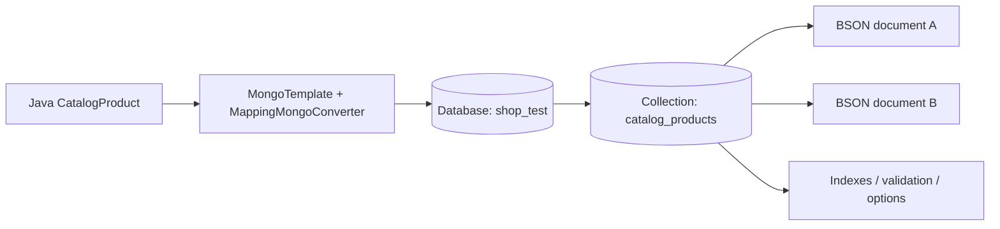
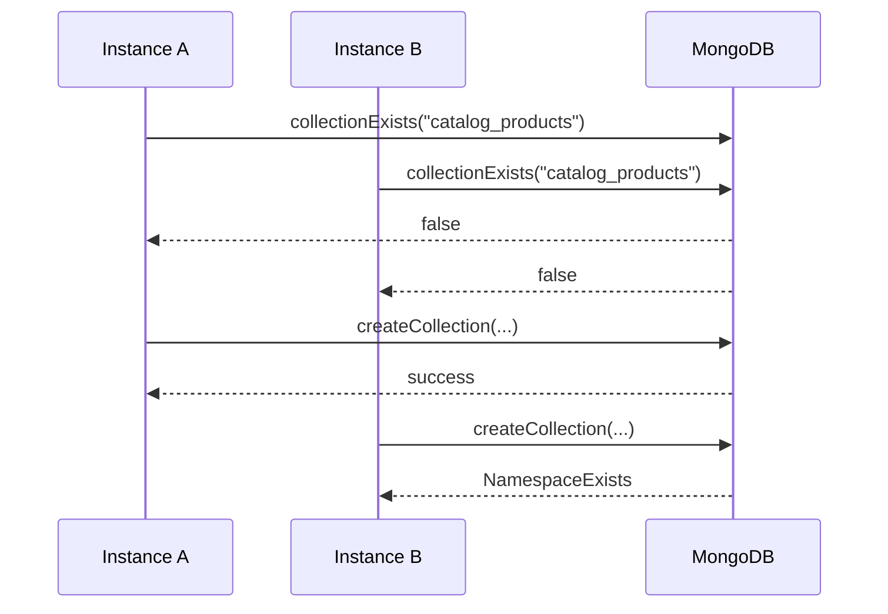
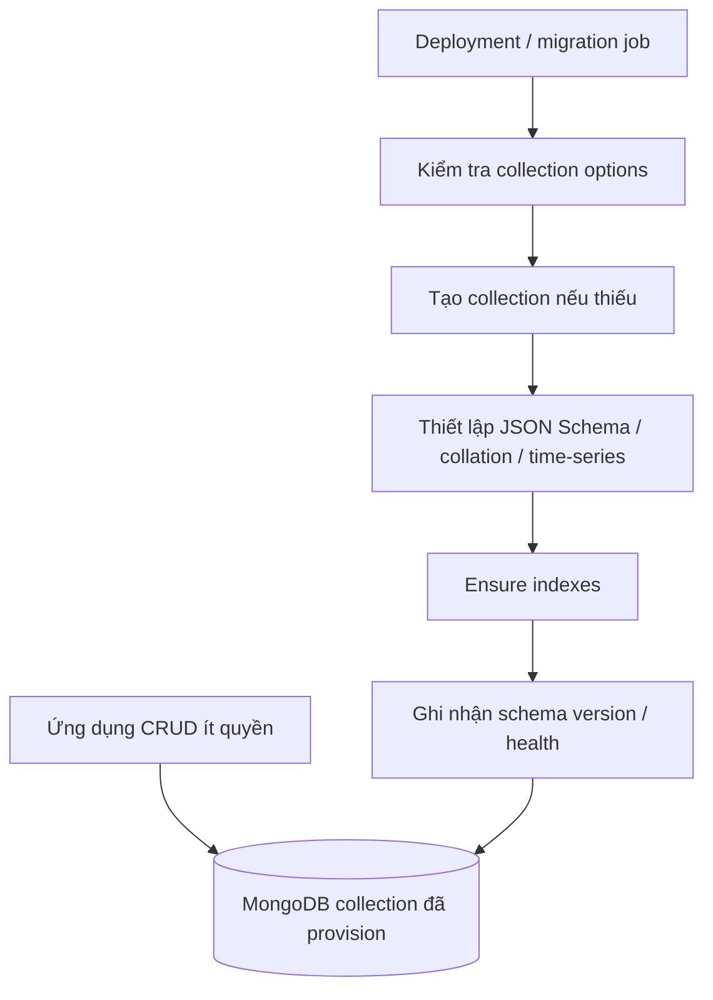

# Tạo, kiểm tra và xóa collection bằng template

Trong MongoDB, **collection** là nơi lưu các BSON document của một miền dữ liệu, ví dụ `catalog_products`, `orders` hoặc `sensor_readings`. Spring Data MongoDB cho phép truy cập collection bằng repository, nhưng khi cần quản lý **vòng đời collection** — tạo sớm với tùy chọn schema, kiểm tra tồn tại, lấy metadata hoặc xóa collection thử nghiệm — bạn cần các phương thức của **`MongoTemplate`** (hoặc `ReactiveMongoTemplate`).

Bài thuộc chương **Collection và schema** của module `SPRING_DATA_MONGODB`. Module tập trung vào kết nối MongoDB, ánh xạ document và thao tác dữ liệu qua `MongoTemplate`/repository, kết hợp truy vấn, aggregation, index, transaction, reactive access, kiểm thử và chẩn đoán hiệu năng. Ở đây, trọng tâm không phải CRUD của một document, mà là quản lý **collection và cấu hình của collection**. Tạo hay xóa collection có tác động rộng đến dữ liệu, index, validator và các ứng dụng cùng sử dụng database.

> **Nguyên tắc vận hành:** `collectionExists(...)` là phép **kiểm tra**; `createCollection(...)` là lệnh **tạo collection**; `getCollection(...)` trả **driver handle** chứ không chứng minh namespace đã có; `dropCollection(...)` là thao tác **phá hủy** toàn bộ collection cùng các index. Không dùng `dropCollection` để xóa vài bản ghi hoặc dọn dữ liệu tenant.

## 1. Mục tiêu học tập

Sau bài này, bạn có thể:

1. Phân biệt **database**, **collection**, **document**, schema ánh xạ Java và schema validator của server.
2. Giải thích khi nào MongoDB tạo collection **ngầm định** và khi nào phải gọi `createCollection`.
3. Dùng `MongoTemplate.collectionExists(Class)` và `collectionExists(String)` để kiểm tra namespace đúng database.
4. Dùng `getCollectionNames()` để liệt kê collection và hiểu giới hạn của việc liệt kê.
5. Phân biệt `getCollection(String)` với `createCollection(String)` về tính hiện hữu.
6. Tạo collection theo `@Document` hoặc theo tên rõ ràng và hiểu ảnh hưởng của ánh xạ tên.
7. Tạo collection với `CollectionOptions`: capped, collation, JSON Schema validation và time-series.
8. Biết collection creation **không đồng nghĩa** với tạo mọi secondary index từ entity.
9. Phân biệt `dropCollection` với `remove`/`deleteAll` và biết điều gì bị mất khi drop.
10. Nhận diện race condition của mẫu **check-then-create**, lỗi quyền và trường hợp namespace đã tồn tại.
11. Viết luồng provisioning an toàn, có quyền phù hợp, kiểm tra metadata và rollback thích hợp.
12. Sử dụng API tương ứng của `ReactiveMongoTemplate` với `Mono`/`Flux`.
13. Viết integration test vòng đời collection với **tên ngẫu nhiên và database test riêng**, không làm hại dữ liệu thật.
14. Đánh giá lựa chọn quản lý schema/index bằng migration và kiểm chứng qua MongoDB server.

## 2. Collection, document và schema: ba lớp cần phân biệt

Một MongoDB database có nhiều collection; một collection có các BSON documents. Java entity được ánh xạ vào collection qua Spring Data MongoDB.



| Khái niệm | Ví dụ | Vai trò |
| --- | --- | --- |
| Database | `shop_test` | Phạm vi namespace, quyền, cấu hình kết nối |
| Collection | `catalog_products` | Nhóm documents có mục đích nghiệp vụ chung |
| Document | `{_id:"P-1",sku_code:"BK-1"}` | Một bản ghi BSON |
| Java entity | `CatalogProduct` | Model Java do Spring Data ánh xạ |
| `@Document` | `@Document("catalog_products")` | Metadata chọn collection cho entity |
| JSON Schema validator | `$jsonSchema` | Ràng buộc dữ liệu **tại MongoDB server** |
| Index | `{sku_code:1}` | Tối ưu truy vấn và/hoặc cưỡng chế uniqueness |

**MongoDB là cơ sở dữ liệu có schema linh hoạt, không phải “không có schema”.** Các document cùng collection có thể có cấu trúc khác nhau, nhưng doanh nghiệp vẫn cần hợp đồng dữ liệu, validation, migration và index phù hợp.

**`@Document` không đồng nghĩa với lệnh `db.createCollection`.** Nó khai báo ánh xạ domain. Chỉ khi ứng dụng thực sự tạo collection bằng API quản lý hoặc ghi dữ liệu theo cơ chế MongoDB, collection mới xuất hiện; đừng suy rằng quét class/entity khi Spring Boot khởi động đã tạo đầy đủ collection và index.

## 3. Entity xuyên suốt: Product và @Document

Sử dụng record cho domain đơn giản:

```java
package dev.learning.catalog;

import org.springframework.data.annotation.Id;
import org.springframework.data.mongodb.core.mapping.Document;
import org.springframework.data.mongodb.core.mapping.Field;

@Document("catalog_products")
public record CatalogProduct(
    @Id String id,
    @Field("sku_code") String sku,
    String name,
    String category,
    @Field("price_cents") long priceCents) {
}
```

Dữ liệu BSON tương ứng:

```javascript
{
  _id: "P-100",
  sku_code: "BK-JAVA",
  name: "Java Guide",
  category: "BOOK",
  price_cents: NumberLong("350000")
}
```

Với domain class này:

- `mongoTemplate.insert(product)` chọn tên collection dựa vào `@Document`.
- `mongoTemplate.collectionExists(CatalogProduct.class)` kiểm tra collection suy ra từ class, ở database đang kết nối.
- `mongoTemplate.createCollection(CatalogProduct.class)` tạo collection theo metadata entity.
- `mongoTemplate.dropCollection(CatalogProduct.class)` **xóa nguyên collection tương ứng**, không chỉ xóa những document cùng class.
- `mongoTemplate.createCollection("other_name")` thao tác theo tên rõ ràng, không mặc định đổi thành `catalog_products`.

Nếu dùng nhiều entity class cùng trỏ về một collection, **drop theo một class vẫn xóa tất cả documents của collection ấy**, kể cả documents do entity khác tạo.

### 3.1. Đừng coi tên Java property là tên BSON

`sku` được lưu thành `sku_code` do `@Field`, còn `id` thường được map sang `_id`. Khi tạo index bằng typed `IndexOperations`, Spring Data có thể áp dụng mapping; khi làm lệnh driver hoặc `mongosh` raw, phải dùng **tên BSON thực**.

Phần **collection name** cũng có thể lấy từ `@Document`/naming strategy. Với API nhận `String collectionName`, chuỗi ấy là tên collection được truyền vào — không được tự động coi `CatalogProduct` là tên collection nếu chưa kiểm chứng.

## 4. Các phương thức quản lý collection quan trọng

`MongoOperations`/`MongoTemplate` cung cấp những method chính:

| API | Return type (synchronous) | Hành vi |
| --- | --- | --- |
| `collectionExists(String)` | `boolean` | Kiểm tra namespace theo tên |
| `collectionExists(Class<T>)` | `boolean` | Kiểm tra tên được suy ra từ entity |
| `getCollectionNames()` | `Set<String>` | Liệt kê tên collections trong DB |
| `getCollection(String)` | `MongoCollection<Document>` | Lấy **handle của driver**; namespace có thể chưa tồn tại |
| `createCollection(String)` | `MongoCollection<Document>` | Tạo uncapped collection theo tên |
| `createCollection(Class<T>)` | `MongoCollection<Document>` | Tạo collection theo entity metadata |
| `createCollection(String, CollectionOptions)` | `MongoCollection<Document>` | Tạo collection với options |
| `createCollection(Class<T>, CollectionOptions)` | `MongoCollection<Document>` | Tạo theo entity với options |
| `dropCollection(String)` | `void` | Xóa toàn collection theo tên |
| `dropCollection(Class<T>)` | `void` | Xóa toàn collection suy ra từ entity |
| `indexOps(Class/String)` | `IndexOperations` | Quản lý secondary indexes riêng |

Các method quản lý collection **không trả số documents bị xóa** như một `DeleteResult`. `dropCollection` không được dùng như một lệnh `deleteMany` có điều kiện.

Một số phiên bản Spring Data 5.x còn hỗ trợ `createCollection(Class, Function<CollectionOptions, CollectionOptions>)` để tùy biến options suy ra từ annotation; khi xây project cần kiểm tra API đúng version Spring Data BOM đang dùng.

## 5. Tạo collection theo entity class

Ví dụ đơn giản:

```java
import com.mongodb.client.MongoCollection;
import org.bson.Document;
import org.springframework.data.mongodb.core.MongoTemplate;

MongoCollection<Document> created =
    mongoTemplate.createCollection(CatalogProduct.class);
```

Đối với entity ở mục 3, lệnh tạo collection tương ứng `catalog_products`.

Sau đó:

```java
boolean exists =
    mongoTemplate.collectionExists(CatalogProduct.class);

// Khi createCollection thành công, trong database được truy cập:
assert exists;
```

**Không lặp câu `createCollection` trên namespace đã tồn tại** mà nghĩ nó tương đương “đảm bảo tồn tại”. MongoDB có thể trả lỗi **NamespaceExists**. Nếu hệ thống muốn create-if-missing, cần kiểm tra và xử lý tranh chấp đồng thời như phần sau.

### 5.1. Hàm tạo theo class có suy ra options gì?

Tài liệu `MongoOperations` hiện hành cho biết `createCollection(Class)` có thể suy options từ metadata `@Document` và `@TimeSeries`, ví dụ **collation**, time field/meta/granularity/expireAfter của time-series. Nhưng những options nâng cao như **JSON schema validator** và **encryption** không tự được suy ra chỉ từ entity class; phải khai báo qua `CollectionOptions`/customizer hoặc quản lý collection riêng.

Không nhầm “entity mapping cho CRUD” với “schema validator đã được bật trên MongoDB”.

### 5.2. Collection có được tạo sẵn chỉ vì @Document không?

Không nên giả định vậy. Một collection thông thường trong MongoDB có thể được tạo **ngầm định khi lần đầu ghi** (chẳng hạn khi insert vào namespace chưa tồn tại). Điều này thuận tiện cho demo nhưng không đủ khi ứng dụng cần cấu hình:

- Validation được server kiểm soát.
- Collation mặc định của collection.
- Capped collection.
- Time-series collection.
- Một số tính năng bảo mật/encryption.
- Quy trình tạo index hoặc quyền provisioning có thể kiểm soát.

Khi cần options đặc biệt, **tạo rõ ràng trước khi ghi** và kiểm tra namespace đã có options đúng.

## 6. Tạo collection theo tên string

```java
String name = "catalog_product_imports";

MongoCollection<Document> collection =
    mongoTemplate.createCollection(name);
```

Ở đây tên thực **chính xác là** `catalog_product_imports`. Không có `@Document` nào của `CatalogProduct` được dùng để đổi tên tự động.

Các cách chọn tên:

| Gọi method | Tên đích |
| --- | --- |
| `createCollection(CatalogProduct.class)` | `catalog_products` theo `@Document` |
| `createCollection("catalog_products")` | Chuỗi `catalog_products` |
| `createCollection("catalog_product_imports")` | Chuỗi `catalog_product_imports` |
| `dropCollection(CatalogProduct.class)` | `catalog_products` |
| `dropCollection("catalog_product_imports")` | `catalog_product_imports` |

**Khi tên động do người dùng ảnh hưởng**, không nối trực tiếp `tenantId` hoặc input tùy ý thành collection name. Hãy dùng quy tắc naming, whitelist/validation, chính sách quota/permission và giới hạn namespace. Thông thường, đa tenant sử dụng một collection có field `tenant_id` và index phù hợp thay vì tự tạo collection cho mỗi request.

## 7. Kiểm tra collection tồn tại

Hai dạng phổ biến:

```java
boolean byName =
    mongoTemplate.collectionExists("catalog_products");

boolean byType =
    mongoTemplate.collectionExists(CatalogProduct.class);
```

Nếu hai overload cùng nhắm `catalog_products` trên **cùng database**, chúng có kết quả logic tương đương.

**Phân biệt:** kiểm tra collection tồn tại **không** chứng minh:

- Collection có dữ liệu.
- Collection có đúng validator mong muốn.
- Collection có index unique/TTL.
- Collection là loại thường hay time-series.
- Caller có quyền ghi/xóa collection đó.
- Namespace sẽ còn tồn tại ở lệnh tiếp theo.

Nếu mục tiêu là kiểm tra **có document khớp query**, dùng `mongoTemplate.exists(Query, Class)` hoặc repository query, không dùng `collectionExists`.

### 7.1. Kiểm tra không làm phát sinh collection

```java
String name = "lifecycle_demo_missing";

boolean exists = mongoTemplate.collectionExists(name);
// Nếu namespace chưa được tạo, exists == false.
```

Đây là phép đọc metadata; không phải tạo collection. Khi xác minh test, tạo namespace **ngẫu nhiên** để bảo đảm không trùng và chạy trong database test.

### 7.2. Tồn tại không phải trạng thái bất biến

Giữa `collectionExists(name)` và `createCollection(name)` hoặc `dropCollection(name)` có thể có một instance khác quản lý namespace. Đây là **check-then-act race**; không thể biến hai lệnh thành một thao tác tạo collection nguyên tử chỉ bằng cách đặt `synchronized` trong một service JVM.

## 8. Liệt kê collection bằng getCollectionNames

```java
import java.util.Set;

Set<String> names = mongoTemplate.getCollectionNames();

if (names.contains("catalog_products")) {
    // Namespace này hiện nằm trong tập tên mà driver trả về.
}
```

`getCollectionNames()` là cách thuận tiện khi cần hiển thị tình trạng database hoặc kiểm tra sơ bộ danh sách. Nhưng:

- Chỉ phản ánh **database** mà `MongoTemplate` đang kết nối, không phải mọi database trong cluster.
- Danh sách có thể có collection đặc biệt hoặc namespace do hệ thống dùng tùy quyền và phiên bản server.
- Danh sách có thể thay đổi ngay sau khi được lấy.
- Quyền database user có thể giới hạn khả năng liệt kê.
- Không nên gọi liên tục trên từng request nóng chỉ để xem entity tồn tại.

Nếu chỉ cần biết **một** collection có tồn tại hay không, dùng `collectionExists`; nếu cần metadata loại/options, phải kiểm tra `listCollections`.

### 8.1. Không dùng listing để định nghĩa đường ghi

Một ví dụ nguy hiểm:

```java
// KHÔNG làm như cách điều phối nghiệp vụ quan trọng:
if (mongoTemplate.getCollectionNames().contains(name)) {
    mongoTemplate.dropCollection(name);
}
```

Danh sách chỉ là snapshot tạm thời; hơn nữa, quyền xóa namespace không nên gắn vào logic đọc danh sách. Việc drop phải dựa trên **ý định quản trị rõ ràng và xác nhận đúng đích**, không phải “nếu thấy thì xóa”.

## 9. getCollection(String) là driver handle, không phải create

```java
import com.mongodb.client.MongoCollection;
import org.bson.Document;

String name = "catalog_product_imports";
MongoCollection<Document> handle =
    mongoTemplate.getCollection(name);
```

`getCollection` trả **`MongoCollection<Document>`** của MongoDB Java Driver. Nó không giống `createCollection`:

- Có thể lấy handle khi namespace **chưa tồn tại** ở server.
- Việc có handle Java **không** có nghĩa server đã tạo collection.
- Collection có thể được tạo khi thực hiện thao tác ghi đầu tiên được MongoDB hỗ trợ trên namespace còn thiếu.
- Đọc qua handle trên collection chưa có thường cho kết quả rỗng, nhưng không được dùng sự kiện ấy thay thế kiểm tra namespace/validator.
- `getCollection` thao tác ở tầng driver; tên field trong `Document`/`Filters` là **BSON names**, không tự áp dụng đầy đủ mapping Java như `MongoTemplate.find(Query, CatalogProduct.class)`.

Ví dụ minh họa:

```java
String name = "import_staging";

MongoCollection<Document> handle =
    mongoTemplate.getCollection(name);

boolean exists = mongoTemplate.collectionExists(name);

// Nếu chưa có lệnh tạo/ghi thành công nào khác, exists vẫn có thể false.
```

Nếu cần đảm bảo collection tồn tại **trước** khi tạo index/validator, gọi `createCollection` và xử lý trường hợp namespace đã tồn tại. Nếu chỉ cần truy cập một collection hiện hữu, dùng handle; nếu cần CRUD typed, ưu tiên `MongoTemplate` với entity class.

## 10. Tạo nếu chưa tồn tại: hiểu race condition

Một ví dụ phổ biến:

```java
String name = "catalog_products";

if (!mongoTemplate.collectionExists(name)) {
    mongoTemplate.createCollection(name);
}
```

**Đúng để minh họa logic**, nhưng **không an toàn như một cơ chế provisioning đồng thời**:



Cả hai tiến trình đều có thể đọc `false`. Chỉ một lần tạo namespace thành công, lần còn lại nhận lỗi namespace đã tồn tại.

### 10.1. Cách xử lý trong hệ thống production

Các hướng phù hợp:

1. **Provisioning/migration một lần** trước khi nhiều instance phục vụ traffic. Phân quyền tạo/xóa namespace cho account vận hành thay vì mọi service instance.
2. Nếu có nhiều instance chạy initializer, dùng cơ chế đồng bộ/migration coordinator đã được dự án chọn và coi thao tác tạo là **có thể bị cạnh tranh**.
3. Khi nhận đúng lỗi namespace-exists, **đọc lại metadata/options** để chắc chắn collection được tạo bởi tiến trình khác với cấu hình tương thích. Không bắt mọi exception rồi mặc nhiên coi là thành công.
4. Nếu collection tồn tại nhưng là **view/capped/time-series** hoặc validator sai, không được bỏ qua và tiếp tục ghi như thể đúng schema.

### 10.2. Không dùng check-then-create như distributed lock

`synchronized` chỉ ngăn race trong một JVM, không xử lý nhiều pod/instance. Một query `collectionExists` cũng không đặt lock trên namespace cho các thao tác tiếp theo. Với hệ thống yêu cầu tính xác định, hãy tách vòng đời schema khỏi request runtime.

## 11. CollectionOptions: vì sao cần tạo có cấu hình?

`CollectionOptions` cho phép mô tả cấu hình tạo collection, ví dụ:

| Option | Mục tiêu | Cần lưu ý |
| --- | --- | --- |
| `capped()` | Giới hạn dung lượng collection dạng capped | Cần đặt `size(long)` |
| `size(long)` | Dung lượng byte cho capped collection | Không phải giới hạn document BSON đơn lẻ |
| `maxDocuments(long)` | Số document mục tiêu giới hạn | Áp dụng phù hợp với capped; không thay quota logic |
| `collation(Collation)` | Thiết lập quy tắc so sánh chuỗi mặc định | Index và query có collation liên quan |
| `schema(MongoJsonSchema)` | Bật validator dạng JSON Schema | Tên field cần khớp BSON thật |
| `strictValidation()` | Áp validation chặt khi ghi | Phụ thuộc MongoDB server/version |
| `warnOnValidationError()` | Ghi cảnh báo thay vì chặn writes sai | Không tương đương cưỡng chế schema |
| `timeSeries(String timeField)` | Tạo time-series collection | Cần server hỗ trợ, field thời gian đúng |

Ví dụ khởi tạo:

```java
import org.springframework.data.mongodb.core.CollectionOptions;

CollectionOptions options = CollectionOptions.empty();
```

`CollectionOptions` sử dụng các method fluent tạo options mới/tùy biến; nên gán hoặc chain giá trị trả về. **Options chỉ áp dụng ở thời điểm tạo**, không phải cách chắc chắn để sửa mọi setting của một collection đã tồn tại.

### 11.1. Tạo capped collection

```java
CollectionOptions cappedOptions = CollectionOptions.empty()
    .capped()
    .size(8L * 1024 * 1024)
    .maxDocuments(50_000L);

mongoTemplate.createCollection(
    "catalog_event_buffer_test",
    cappedOptions
);
```

Ý nghĩa: collection capped có dung lượng cấu hình khoảng 8 MiB và giới hạn số document mong muốn. Capped collections có semantics vòng đời/ghi đặc thù, không phù hợp cho mọi business entity. `size` là điều kiện quan trọng khi cấu hình capped; `maxDocuments` không thay nó.

**Không dùng capped collection như thay thế vô điều kiện cho TTL index**: capped giới hạn theo không gian lưu trữ, còn TTL xóa tài liệu theo điều kiện thời gian; hai mô hình dữ liệu/retention rất khác nhau.

### 11.2. Cần tái cấu hình collection đang có?

Không nên thử:

```java
if (mongoTemplate.collectionExists("catalog_products")) {
    mongoTemplate.createCollection(
        "catalog_products", CollectionOptions.empty().capped().size(12345));
}
```

Lệnh tạo lại namespace đã tồn tại **không phải migration**. Để thay validator/index/options hỗ trợ chỉnh sửa, xem API `collMod`/index operations của MongoDB, quyền, giới hạn theo version và quy trình migration an toàn. Nhiều đặc tính như chuyển collection thường thành time-series hoặc capped không thể đạt được chỉ bằng `createCollection`.

## 12. Schema validation: ánh xạ Java khác validator server

Với `CatalogProduct`, `@Field("sku_code")` cho biết Java property `sku` được lưu trong BSON field `sku_code`. Tuy nhiên, **`@Document`/`@Field` không tự bật JSON Schema validator trên server**.

Muốn server từ chối document thiếu SKU hoặc có SKU sai kiểu, tạo collection với `MongoJsonSchema`:

```java
import org.springframework.data.mongodb.core.CollectionOptions;
import org.springframework.data.mongodb.core.schema.MongoJsonSchema;
import org.springframework.data.mongodb.core.schema.JsonSchemaProperty;

MongoJsonSchema schema = MongoJsonSchema.builder()
    .required("sku_code")
    .properties(
        JsonSchemaProperty.string("sku_code")
    )
    .build();

CollectionOptions options = CollectionOptions.empty()
    .schema(schema)
    .strictValidation()
    .failOnValidationError();

mongoTemplate.createCollection(
    "catalog_products_validated",
    options
);
```

Lệnh này tạo **một collection mới theo tên tường minh** có validator `sku_code`, không phải tự gắn validator cho `catalog_products` đã tồn tại.

BSON tương đương về ý tưởng:

```javascript
db.createCollection("catalog_products_validated", {
  validator: {
    $jsonSchema: {
      type: "object",
      required: ["sku_code"],
      properties: {
        sku_code: { type: "string" }
      }
    }
  },
  validationLevel: "strict",
  validationAction: "error"
});
```

**Lưu ý BSON/JSON Schema:** Các ví dụ Spring Data `MongoJsonSchema` dùng kiểu JSON-schema `type:"string"` theo DSL; MongoDB còn có `bsonType` để ràng buộc BSON-specific types. Với số `long`/`Decimal128`, cần chọn schema và converter đúng kiểu dữ liệu thực, không sao chép type Java sang schema một cách máy móc.

### 12.1. Validator kiểm tra dữ liệu trên server

Giả sử đã tạo collection `catalog_products_validated`:

```javascript
// Hợp lệ: SKU là string.
db.catalog_products_validated.insertOne({
  _id: "P-101",
  sku_code: "BK-001",
  name: "Book"
});

// Không hợp lệ: thiếu sku_code.
db.catalog_products_validated.insertOne({
  _id: "P-102",
  name: "Without SKU"
});

// Không hợp lệ: sku_code là số.
db.catalog_products_validated.insertOne({
  _id: "P-103",
  sku_code: 123
});
```

Hai lệnh cuối dự kiến bị từ chối với validation error nếu server dùng `validationAction:"error"` và quyền ghi không bypass validation. Trong ứng dụng, cần bắt lỗi write thích hợp và trả thông báo nghiệp vụ an toàn; đừng đưa toàn bộ chi tiết schema hoặc BSON nhạy cảm ra API.

### 12.2. strict và warn khác nhau

- `strictValidation()`: mức áp dụng validation với các lần ghi; không phải hành động chuyển đổi/migrate dữ liệu cũ.
- `failOnValidationError()`: yêu cầu chặn những write không thỏa validator (tương ứng hành động error).
- `warnOnValidationError()`: cho phép write sai nhưng ghi cảnh báo; **không dùng như đảm bảo dữ liệu luôn hợp lệ**.
- Khi cập nhật validator cho collection đã có, document cũ có thể không tự được sửa hay quét/loại; ứng dụng cần kế hoạch migration và kiểm tra dữ liệu tồn tại.

Các phiên bản MongoDB mới có thêm tùy chọn validation, nhưng khi viết tài liệu/ứng dụng phải đối chiếu server đang chạy. `strict`/`moderate` và các action `error`/`warn` là nền tảng phổ biến; không giả định mọi mode mới có mặt trên tất cả phiên bản.

### 12.3. Bắt buộc dùng tên BSON trong schema

Sai về ý tưởng khi dữ liệu dùng `sku_code` nhưng schema kiểm tra `sku`:

```javascript
{
  $jsonSchema: {
    required: ["sku"],
    properties: { sku: { bsonType: "string" } }
  }
}
```

Validator này không khớp với tên BSON do `@Field("sku_code")` tạo ra. Hãy xác minh raw BSON trước khi deploy validator. Collection options được đặt ở server; chúng không nhận metadata Java property của `MongoTemplate.find(...)` để tự sửa field name.

## 13. Collation và các tùy chọn đặc biệt khi tạo

**Collation** định nghĩa các quy tắc so sánh/sắp xếp chuỗi theo locale, ký tự có dấu, hoa/thường và mức strength. Collection có thể có **default collation**; query/index có thể chỉ định collation riêng.

```java
import org.springframework.data.mongodb.core.CollectionOptions;
import org.springframework.data.mongodb.core.query.Collation;

CollectionOptions options = CollectionOptions.empty()
    .collation(Collation.of("en"));

mongoTemplate.createCollection(
    "catalog_product_labels_test", options
);
```

Khi sử dụng MongoDB với tiếng Việt, việc xác định locale và strength cần được thử nghiệm trên dữ liệu có dấu, cách sắp xếp Unicode và quy tắc kinh doanh. **Đừng suy rằng đặt một collation bất kỳ sẽ làm tìm kiếm substring, full-text search hoặc regex tự được index hóa tối ưu.**

Các vấn đề cần kiểm tra:

- Default collation của collection có thể ảnh hưởng query/sort không chỉ định collation.
- Một index được tạo với collation khác có thể không dùng được cho mọi query có quy tắc so sánh khác.
- Unique index dựa trên chuỗi có thể có semantics uniqueness khác theo collation; kiểm tra cẩn thận trước khi bật.
- `@Document` có thể mô tả metadata collation trên entity tùy phiên bản Spring Data, nhưng **collection thực** vẫn phải được tạo đúng options.
- Collection đã tồn tại với collation khác **không được âm thầm thay đổi** chỉ bằng cách gọi `createCollection` lại.

## 14. Time-series collection: cần tạo đúng loại trước khi ghi

MongoDB hỗ trợ **time-series collections** để lưu chuỗi phép đo, sự kiện theo thời gian. Loại collection này có cơ chế lưu trữ và giới hạn riêng, khác với collection thường.

Tạo bằng `CollectionOptions`:

```java
import org.springframework.data.mongodb.core.CollectionOptions;

mongoTemplate.createCollection(
    "sensor_readings_test",
    CollectionOptions.timeSeries("recorded_at")
);
```

`"recorded_at"` phải là **tên BSON field** dùng làm time field trong documents. Với cách gọi theo **String collectionName**, không dựa vào Java property mapping để tự đổi `recordedAt` thành `recorded_at`.

Một document thử:

```javascript
db.sensor_readings_test.insertOne({
  _id: "READ-1",
  sensor_id: "SENSOR-A",
  recorded_at: ISODate("2026-11-20T08:00:00Z"),
  temperature: 27.5
});
```

Cần xác định **server MongoDB hỗ trợ time-series** và các ràng buộc của phiên bản đang chạy. Đặc biệt:

- Time-series collection phải được **tạo như time-series**, không phải tạo regular collection rồi hy vọng insert chuyển loại.
- Các thao tác update/delete/index có giới hạn riêng tùy phiên bản MongoDB.
- Time-series có cơ chế TTL/expireAfter trên phép đo theo chính sách retention; không đánh đồng nó với TTL index cho collection thường.
- Không thể áp các tính năng schema validation thông thường cho time-series theo cùng cách như một collection thường trong các phiên bản MongoDB liên quan.
- Khi dùng `@TimeSeries` trên entity, Spring Data có thể suy thời gian/meta/granularity/retention để tạo collection theo class; cần kiểm tra annotation/API trong phiên bản đang dùng.

Ví dụ `mongoTemplate.createCollection(SensorReading.class)` có thể lấy metadata `@TimeSeries` nếu được định nghĩa đúng. Nhưng `@Document` đơn thuần không phải `@TimeSeries`.

## 15. Kiểm tra metadata thật: collection type, options và validator

`collectionExists` chỉ cho biết có namespace, **không xác minh cấu hình**. Để kiểm tra details như capped, validator, collation hoặc time-series, dùng lệnh `listCollections` của MongoDB.

Trong `mongosh` trên **đúng database**:

```javascript
db.getCollectionInfos({ name: "catalog_products" });
```

Kết quả có thể chứa:

```javascript
[
  {
    name: "catalog_products",
    type: "collection",
    options: {
      // collation, validator, capped, timeseries... nếu được cấu hình
    },
    info: { /* metadata từ server */ }
  }
]
```

Object trên là **hình dạng minh họa**, không phải output đầy đủ/cố định cho mọi MongoDB version.

### 15.1. Đọc metadata qua MongoTemplate.executeCommand

`MongoTemplate` có phương thức `executeCommand(Document)`:

```java
import java.util.List;
import org.bson.Document;

String expectedName = "catalog_products";

Document command = new Document("listCollections", 1)
    .append("filter", new Document("name", expectedName));

Document response = mongoTemplate.executeCommand(command);

Document cursor = response.get("cursor", Document.class);
List<Document> infos =
    cursor.getList("firstBatch", Document.class);

if (infos.isEmpty()) {
    throw new IllegalStateException(
        "Collection chưa tồn tại: " + expectedName);
}

Document metadata = infos.get(0);
String type = metadata.getString("type");
Document options = metadata.get("options", Document.class);
```

Với filter tên collection chính xác, kết quả tối đa một namespace hợp lệ cùng tên trong database. Khi xử lý API driver tổng quát không có filter hoặc result lớn, lệnh `listCollections` có thể dùng cursor nhiều batch; ví dụ trên chỉ nhắm một tên cụ thể.

Phân biệt:

- `collectionExists(name)`: kiểm tra nhanh có namespace.
- `getCollectionNames()`: lấy tập tên.
- `executeCommand(listCollections)`: xem **type/options** chi tiết.
- `getCollection(name)`: lấy handle để thao tác qua driver, không xem options.

### 15.2. Không lộ metadata cho người dùng không có quyền

`listCollections` yêu cầu quyền metadata phù hợp. Một API công khai không nên trả toàn bộ collection names, schema, encryption options hoặc tên các dataset nội bộ. Đưa việc kiểm tra metadata vào **health/admin/migration service có phân quyền**, không thành endpoint tùy ý.

## 16. Index là phần khác của vòng đời collection

**Tạo collection không đồng nghĩa với tạo các secondary indexes mà ứng dụng cần.**

Ví dụ SKU phải duy nhất:

```java
import org.springframework.data.domain.Sort;
import org.springframework.data.mongodb.core.index.Index;

String indexName = mongoTemplate.indexOps(CatalogProduct.class)
    .ensureIndex(
        new Index()
            .on("sku", Sort.Direction.ASC)
            .unique()
    );
```

Với `indexOps(CatalogProduct.class)`, Spring Data biết metadata entity `@Field("sku_code")`, nên đường index theo property `sku` có thể được ánh xạ sang field BSON `sku_code`.

Dùng tên collection trực tiếp:

```java
String name = "catalog_product_imports";

String indexName = mongoTemplate.indexOps(name)
    .ensureIndex(
        new Index()
            .on("sku_code", Sort.Direction.ASC)
    );
```

Ở overload `indexOps(String)`, không có entity class để suy `@Field`; dùng **tên BSON thực**.

### 16.1. Xem indexes đang có

```java
import java.util.List;
import org.springframework.data.mongodb.core.index.IndexInfo;

List<IndexInfo> indexes =
    mongoTemplate.indexOps(CatalogProduct.class)
        .getIndexInfo();

for (IndexInfo index : indexes) {
    System.out.println(index.getName());
}
```

Mọi collection MongoDB thông thường có index `_id` mặc định; các index khác cần được khai báo và duy trì theo chính sách. Spring Data từ các phiên bản 3.x mặc định **không tự động tạo secondary indexes từ mọi annotation** trừ khi được cấu hình phù hợp; không dựa vào annotation `@Indexed` để kết luận index đã có thực trên server.

### 16.2. Tránh “mỗi lần start đều drop và tạo lại”

Một anti-pattern:

```java
// TUYỆT ĐỐI KHÔNG LÀM TRONG STARTUP THÔNG THƯỜNG:
mongoTemplate.dropCollection(CatalogProduct.class);
mongoTemplate.createCollection(CatalogProduct.class);
mongoTemplate.indexOps(CatalogProduct.class)
    .ensureIndex(new Index().on("sku", Sort.Direction.ASC));
```

Code trên làm mất **tất cả dữ liệu hiện hữu** và indexes trước khi tạo lại. Tạo index nên là thay đổi có kiểm soát; xóa collection chỉ phù hợp với môi trường thử nghiệm cô lập hoặc một quy trình vận hành rõ ràng đã được phê duyệt.

## 17. Xóa collection: dropCollection không phải deleteMany

`dropCollection` xóa **namespace** ở MongoDB, gồm dữ liệu và các indexes liên quan. Nó không nhận `Criteria`, `Query` hoặc tenant scope.

```java
// XÓA TOÀN BỘ collection tương ứng với @Document:
mongoTemplate.dropCollection(CatalogProduct.class);

// XÓA TOÀN BỘ collection theo tên:
mongoTemplate.dropCollection("catalog_product_imports");
```

**Đây là ví dụ API, không phải hướng dẫn chạy lệnh trực tiếp trên database đang chứa dữ liệu thật.**

So sánh:

| Thao tác | Mục tiêu | Sau thao tác |
| --- | --- | --- |
| `remove(Query, Class)` | Xóa document thỏa filter | Collection/index/validator vẫn còn |
| `remove(new Query(), Class)` | Xóa toàn bộ document thuộc entity collection | Namespace, index, options còn |
| `repository.deleteAll()` | Xóa dữ liệu entity repository | Không phải lệnh drop collection |
| `dropCollection(Class)` | Xóa toàn bộ collection suy ra từ entity | Dữ liệu + indexes + cấu hình namespace mất |
| `dropCollection(String)` | Xóa toàn bộ collection theo tên | Tương tự, theo namespace được chọn |

Nếu cần xóa **chỉ dữ liệu một tenant**:

```java
import org.springframework.data.mongodb.core.query.Criteria;
import org.springframework.data.mongodb.core.query.Query;

// Chỉ dùng khi đã có quyết định xóa dữ liệu tenant hợp lệ:
Query onlyTenant = Query.query(
    Criteria.where("tenantId").is(authorizedTenantId));

var result = mongoTemplate.remove(
    onlyTenant, CatalogProduct.class);
```

Ví dụ trên giả định entity chứa `tenantId` và MongoDB lưu cùng một collection multi-tenant. **Entity `CatalogProduct` ở mục 3 chưa có property tenantId**; trong ứng dụng thực phải định nghĩa tenant field trước khi dùng query như trên. Không sao chép mã xóa tenant nếu schema không có field tenant hoặc nếu quyền xóa không được xác nhận.

### 17.1. Drop xóa cả index

Giả sử collection có unique index `sku_code`. Sau `dropCollection`:

- Document sản phẩm không còn.
- Unique index không còn.
- Schema validator/collation/capped/time-series options gắn với namespace cũng không còn theo collection đã drop.
- Nếu tạo lại bằng `createCollection(name)` không có options, collection mới **không tự lấy lại mọi cấu hình cũ**.
- Ứng dụng có thể ghi dữ liệu sai schema hoặc trùng SKU nếu quên khôi phục validator/index.

Để khôi phục cấu hình, cần tái thực thi **schema migration, collection options và index definitions** đã được quản lý bằng mã/manifest tin cậy.

### 17.2. Drop và dữ liệu liên kết

Các collection khác có thể lưu tham chiếu đến ID trong collection bị xóa. MongoDB không tự kiểm soát foreign key như RDBMS cho những tham chiếu ứng dụng tự thiết kế; drop collection nguồn có thể tạo các tham chiếu dangling ở collection khác.

Với sharding, transaction, change streams hoặc các hệ thống replication/backup, drop còn có tác động vận hành rộng hơn. Không coi đây là “xóa nhanh bảng trống” vô hại.

## 18. Thiết kế quy trình drop an toàn

**Trong production, API gọi drop phải nằm sau cơ chế kiểm soát vận hành**, không được gọi trực tiếp từ một endpoint user.

Một checklist tối thiểu trước khi phê duyệt:

1. Xác nhận **đúng cluster, database và collection name**.
2. Xác nhận **owner** của collection và rằng nó không được service khác dùng chung.
3. Chứng minh collection có thể xóa: mục đích, dữ liệu, retention, nghĩa vụ pháp lý.
4. Xác nhận backup/snapshot có thể khôi phục, thời gian khôi phục và ảnh hưởng tới người dùng.
5. Dừng hoặc phối hợp writers, consumers, change streams, dashboards liên quan.
6. Ghi lại options, index definitions và số document **để audit**, không nhầm con số này với xác nhận rollback.
7. Thực thi lệnh bằng account có quyền và quy trình phê duyệt riêng.
8. Kiểm tra post-condition và theo dõi lỗi ứng dụng sau thao tác.
9. Có runbook khôi phục **data + schema + index**, không chỉ tạo lại namespace trống.

Nếu cần xóa dữ liệu thử nghiệm tự tạo, dùng **namespace ngẫu nhiên và riêng biệt** trong database test. Không dùng `dropCollection(CatalogProduct.class)` trong test khi class map tới collection có thể được chia sẻ giữa các tests.

### 18.1. Không coi drop là rollback đơn giản

Một lệnh `dropCollection` không phải “undo” của `createCollection` trên một collection đã nhận ghi. Không mặc định transaction sẽ bảo vệ hoặc hoàn tác thao tác DDL kiểu này trong mọi cấu hình; xử lý theo giới hạn MongoDB server/topology đang dùng.

Việc tạo lại collection **không khôi phục dữ liệu cũ**. Cần backup/point-in-time restore hoặc chiến lược riêng được vận hành hỗ trợ.

## 19. Lỗi, quyền hạn và chẩn đoán

Một số lỗi điển hình:

| Triệu chứng | Nguyên nhân cần kiểm tra | Hướng xử lý |
| --- | --- | --- |
| `collectionExists=false` dù đã có dữ liệu ở nơi khác | Kết nối nhầm database/cluster/tenant | Kiểm tra URI, database name, credentials |
| `createCollection` báo namespace exists | Collection/view đã tồn tại; race của nhiều instance | Kiểm tra loại/options, không catch toàn bộ lỗi |
| `createCollection` bị unauthorized | Account thiếu quyền tạo collection | Phân quyền provisioning riêng |
| `getCollection` trả handle nhưng `collectionExists=false` | Handle không tạo namespace ngay | Dùng `collectionExists`/metadata |
| Insert đầu tiên tạo regular collection | Không provision options trước ghi | Migration tạo collection với options |
| Schema validator từ chối write | Sai BSON field/type, dữ liệu nhập không hợp lệ | Đối chiếu schema và raw BSON |
| `@Field` đúng trong Java nhưng validator vẫn sai | Validator dùng tên raw BSON khác | Sửa validator/migration theo BSON |
| Không thấy unique index | Chưa chạy index migration, auto-index không bật | `indexOps().getIndexInfo()` và ensureIndex có kiểm soát |
| `dropCollection` làm ứng dụng lỗi hàng loạt | Xóa namespace đang được dùng | Khôi phục, điều tra caller, siết quyền |
| Collection có tên giống nhưng sai loại | View, capped, time-series khác kỳ vọng | Đọc `listCollections` options/type |
| Không thể tạo index unique | Dữ liệu đã trùng | Dọn dữ liệu/migration có kiểm soát |
| Thay collection options không hiệu lực | Dùng createCollection trên namespace sẵn có | `collMod` hoặc migration đúng loại |
| Test làm mất dữ liệu | Dùng tên cố định hoặc DB dùng chung | Test database riêng + tên UUID + chỉ drop tài nguyên tự tạo |

### 19.1. Spring Data exception translation

`MongoTemplate` có cơ chế chuyển các lỗi MongoDB Driver thành hệ ngoại lệ truy cập dữ liệu của Spring, ví dụ lỗi trùng khóa, quyền, cấu hình và lỗi command. Không nên:

```java
try {
    mongoTemplate.createCollection("catalog_products");
} catch (Exception ignored) {
    // SAI: không biết lỗi do đã có hay lỗi quyền/mất kết nối.
}
```

Cách đúng là phân loại lỗi được phép bỏ qua (nếu thật sự chỉ là namespace đã có), sau đó xác minh metadata/options và propagate những lỗi còn lại. Trong một hệ thống migration, thường tốt hơn để **fail startup/deployment** thay vì phục vụ traffic với schema không chắc chắn.

## 20. ReactiveMongoTemplate: cùng vòng đời, khác kiểu trả về

Các phương thức reactive tương ứng:

| Đồng bộ | Reactive |
| --- | --- |
| `collectionExists(name) → boolean` | `collectionExists(name) → Mono<Boolean>` |
| `getCollectionNames() → Set<String>` | `getCollectionNames() → Flux<String>` |
| `getCollection(name) → MongoCollection<Document>` | `getCollection(name) → Mono<MongoCollection<Document>>` |
| `createCollection(name) → MongoCollection<Document>` | `createCollection(name) → Mono<MongoCollection<Document>>` |
| `dropCollection(name) → void` | `dropCollection(name) → Mono<Void>` |

Ví dụ **kiểm tra và tạo**:

```java
import reactor.core.publisher.Mono;

String testName = "reactive_lifecycle_test";

Mono<Void> createIfMissing =
    reactiveMongoTemplate.collectionExists(testName)
        .flatMap(exists -> exists
            ? Mono.empty()
            : reactiveMongoTemplate.createCollection(testName).then());
```

Đoạn trên chỉ là publisher; **không có thao tác nào được bảo đảm đã chạy** nếu chưa có subscription. Nó vẫn có **race check-then-create** khi nhiều subscriber/instance cùng khởi tạo.

Kiểm tra sau khi tạo:

```java
Mono<Boolean> existsAfter =
    createIfMissing.then(
        reactiveMongoTemplate.collectionExists(testName));
```

Trong ứng dụng reactive, không gọi `block()` tùy tiện trong event loop. Hãy compose publisher với luồng startup/migration hoặc service phù hợp.

Xóa theo reactive API, **chỉ trên namespace test do ứng dụng sở hữu**:

```java
Mono<Void> dropOwnedTestCollection =
    reactiveMongoTemplate.dropCollection(testName);
```

Việc đặt publisher vào biến **không làm nó trở nên an toàn**: khi có subscriber, toàn collection sẽ bị drop. Đối với production, cơ chế phê duyệt và quyền độc lập vẫn bắt buộc.

## 21. Integration test: tạo, kiểm tra, xóa đúng collection test

**Nguyên tắc test:** database MongoDB dùng riêng cho thử nghiệm (URI test/Testcontainers phù hợp), tên collection tạo bằng UUID, chỉ drop **namespace do test hiện hành tự tạo thành công**, không xóa collection tên cố định của module.

### 21.1. Test vòng đời thuần MongoTemplate

```java
package dev.learning.catalog;

import static org.assertj.core.api.Assertions.assertThat;

import java.util.UUID;
import org.bson.Document;
import org.junit.jupiter.api.Test;
import org.springframework.beans.factory.annotation.Autowired;
import org.springframework.boot.test.context.SpringBootTest;
import org.springframework.data.mongodb.core.MongoTemplate;
import com.mongodb.client.MongoCollection;

@SpringBootTest
class CollectionLifecycleIntegrationTest {

    @Autowired MongoTemplate template;

    private static String testName() {
        return "lesson_lifecycle_"
            + UUID.randomUUID().toString().replace("-", "");
    }

    @Test
    void createsChecksAndDropsOnlyOwnedCollection() {
        String name = testName();
        boolean created = false;

        try {
            assertThat(template.collectionExists(name)).isFalse();

            MongoCollection<Document> handle =
                template.getCollection(name);

            assertThat(handle.getNamespace().getCollectionName())
                .isEqualTo(name);

            // Chỉ lấy handle không tạo collection trên server.
            assertThat(template.collectionExists(name)).isFalse();

            template.createCollection(name);
            created = true;

            assertThat(template.collectionExists(name)).isTrue();
            assertThat(template.getCollectionNames()).contains(name);

            template.dropCollection(name);
            created = false;

            assertThat(template.collectionExists(name)).isFalse();
        } finally {
            // Không xóa namespace khác: chỉ dọn khi chính test đã tạo.
            if (created && template.collectionExists(name)) {
                template.dropCollection(name);
            }
        }
    }
}
```

Test này minh họa:

- `getCollection` là handle, không phải create.
- `createCollection` làm namespace tồn tại thật.
- `getCollectionNames` có chứa tên mới trong database test.
- `dropCollection` xóa namespace.
- Cleanup có guard `created` để không đụng tài nguyên test không sở hữu.

**Lưu ý an toàn:** biến `created` chỉ là guard cục bộ trong test. Nó **không giải quyết tất cả race** nếu người khác cố tình tái sử dụng đúng tên UUID hiếm gặp hoặc cùng kết nối vào database không phải test; cần cách ly database và quyền trước tiên.

### 21.2. Test JSON Schema validator

Trong **cùng class** `CollectionLifecycleIntegrationTest`, thêm method:

```java
@Test
void validatorRejectsIncorrectBsonType() {
    String name = testName();
    boolean created = false;

    try {
        var schema = org.springframework.data.mongodb.core.schema
            .MongoJsonSchema.builder()
            .required("sku_code")
            .properties(
                org.springframework.data.mongodb.core.schema
                    .JsonSchemaProperty.string("sku_code"))
            .build();

        var options = org.springframework.data.mongodb.core
            .CollectionOptions.empty()
            .schema(schema)
            .strictValidation()
            .failOnValidationError();

        template.createCollection(name, options);
        created = true;

        var collection = template.getCollection(name);

        collection.insertOne(
            new Document("_id", "VALID-" + UUID.randomUUID())
                .append("sku_code", "BOOK-1"));

        org.assertj.core.api.Assertions.assertThatThrownBy(
            () -> collection.insertOne(
                new Document("_id", "INVALID-" + UUID.randomUUID())
                    .append("sku_code", 42)
            )
        ).isInstanceOf(com.mongodb.MongoWriteException.class);

    } finally {
        if (created && template.collectionExists(name)) {
            template.dropCollection(name);
        }
    }
}
```

Đoạn này dùng **driver handle** nên lỗi validation write thường là `MongoWriteException`. Nếu ghi qua `MongoTemplate`, lỗi có thể được dịch sang exception của Spring Data; trong test thực tế có thể assert error code/message cụ thể và kiểm tra hành vi đúng với phiên bản server.

Cố ý truyền `sku_code:42` (number) thay vì string để chứng minh validator thực sự hoạt động. Test không dùng production và chỉ drop tên duy nhất do test tạo.

### 21.3. Test index bị mất sau drop

Có thể mở rộng một test riêng:

```java
import org.springframework.data.domain.Sort;
import org.springframework.data.mongodb.core.index.Index;

String name = testName();
boolean created = false;

try {
    template.createCollection(name);
    created = true;

    String indexName = template.indexOps(name)
        .ensureIndex(
            new Index().on("sku_code", Sort.Direction.ASC).unique()
        );

    assertThat(template.indexOps(name).getIndexInfo())
        .anySatisfy(info ->
            assertThat(info.getName()).isEqualTo(indexName));

    template.dropCollection(name);
    created = false;

    assertThat(template.collectionExists(name)).isFalse();

    // Index và namespace đều đã bị drop;
    // khi tạo namespace mới phải chạy index migration lại.
} finally {
    if (created && template.collectionExists(name)) {
        template.dropCollection(name);
    }
}
```

Đây là **đoạn minh họa đặt trong test method đã có import và field template**. Không chạy nó ở bean startup.

### 21.4. Test mapping theo class mà không drop collection thật

Nếu chỉ muốn xác minh `@Document`:

```java
@Test
void entityUsesDeclaredCollectionName() {
    assertThat(template.getCollectionName(CatalogProduct.class))
        .isEqualTo("catalog_products");
}
```

Method này chỉ kiểm tra metadata và **không tạo hoặc xóa** collection thật. Đặt trong test class có `template` và `assertThat`.

## 22. Test thông tin schema và quyền

Các test bổ sung đáng có:

| Tình huống | Kỳ vọng |
| --- | --- |
| Tạo collection bằng class với `@Document` | Tên DB namespace đúng `catalog_products` trong DB test |
| Tạo collection bằng string | Tên được dùng nguyên, không nhầm tên entity |
| Kiểm tra collection chưa có | `collectionExists=false`, getCollectionNames không chứa tên |
| Chỉ gọi `getCollection` | Namespace vẫn chưa được tạo |
| Create rồi create lại | Có lỗi namespace exists, không phải “create idempotent” |
| Insert có validator hợp lệ | Ghi thành công |
| Insert sai kiểu/thiếu field required | Bị từ chối khi validationAction=error |
| Tạo capped/options | `listCollections` phản ánh options mong đợi |
| Tạo time-series | Metadata type/options đúng; phiên bản server hỗ trợ |
| Index có sau ensureIndex | `getIndexInfo()` chứa index name |
| Drop rồi kiểm tra | Namespace biến mất, các index đi cùng bị xóa |
| Không có quyền create/drop | Lỗi quyền rõ ràng, không bị swallow |
| Hai initializer cùng create | Chỉ một tạo thành công, bên còn lại phải xử lý namespace exists |
| Database test nhầm URI | Guard cấu hình phải fail, không cho drop |
| Collection theo tenant | Không cho phép tenant bất kỳ đặt tên namespace |
| Schema migration | Tái triển khai tạo index/validator không xóa dữ liệu hiện hữu |

Không cần một test tích hợp phải thực thi **drop** trên collection sản xuất để chứng minh API đúng. Ưu tiên namespace ngẫu nhiên test-only và kiểm soát database URI ở cấu hình test.

## 23. Vận hành: provisioning, backup, migrations và observability

### 23.1. Tách trách nhiệm quản lý schema khỏi CRUD

Một kiến trúc phổ biến:



Mục tiêu:

- **Migration/provisioner** có quyền quản lý collection, schema và indexes.
- **Ứng dụng runtime** chủ yếu có quyền đọc/ghi document cần thiết, không mặc định có quyền drop.
- Thay đổi cấu hình collection được review, kiểm thử và phát hành cùng code/version.
- Khi thiếu collection hoặc sai schema trong production, **fail fast** thay vì tự drop/create để “sửa”.

### 23.2. Health check không chỉ là collectionExists

`collectionExists("catalog_products")=true` chỉ cho biết namespace tồn tại. Một health check kỹ hơn có thể kiểm tra:

1. Kết nối đúng database và có quyền tối thiểu.
2. Collection type/options: thường hay capped/time-series, validator, collation.
3. Indexes bắt buộc (unique, TTL, compound).
4. Schema version hoặc migration status.
5. Quyền read/write phù hợp nhưng không cấp quyền drop nếu không cần.
6. Khả năng query/update thực tế ở mức an toàn theo môi trường.

**Tránh health check tự sửa/xóa collection**. Health check nên read-only hoặc giới hạn thao tác được phép; không phát sinh migration trên mỗi request.

### 23.3. Sao lưu và khôi phục

Backup/restore đúng nghĩa cần bảo toàn cả:

- Documents.
- Collection options và validation rules.
- Index definitions.
- Những ràng buộc liên quan đến time-series/capped/encrypted collections.
- Tham chiếu và tiến trình phụ thuộc dữ liệu.

Đừng gọi “backup đã có” khi chưa kiểm tra cách phục hồi thực tế và RPO/RTO. Việc drop tác động tới nghiệp vụ đang ghi, nguồn change stream, job background và dashboard; cần runbook.

### 23.4. Chẩn đoán chi phí

Tạo/xóa collection là **DDL**, không phải truy vấn nghiệp vụ mỗi request. Theo dõi:

- Số collections và indexes của mỗi database.
- Collection options/type có lệch với bản migration dự kiến không.
- Schema validation failures và lỗi duplicate key.
- Thời gian index builds/migrations, tài nguyên đĩa.
- Thao tác drop bất thường, actor, quyền và audit trail.
- Tỷ lệ lỗi application sau deployment/schema change.

Đừng tạo collection mới cho từng HTTP request, từng truy vấn hay từng user nhỏ lẻ mà chưa đánh giá namespace overhead và chi phí quản trị.

## 24. So sánh API với thao tác mongosh

| Spring Data | MongoDB/mongosh tương ứng | Cảnh báo |
| --- | --- | --- |
| `collectionExists("x")` | Kiểm tra `db.getCollectionInfos({name:"x"})` | Không bảo đảm options đúng |
| `getCollectionNames()` | `db.getCollectionNames()` | Liệt kê metadata theo quyền |
| `getCollection("x")` | `db.getCollection("x")` / driver handle | Không tự chứng minh namespace đã có |
| `createCollection("x")` | `db.createCollection("x")` | Có thể lỗi nếu đã tồn tại |
| `createCollection("x", options)` | `db.createCollection("x", options)` | Options phải đúng server/version |
| `indexOps(...).ensureIndex(...)` | `db.x.createIndex(...)` | Index là bước riêng |
| `dropCollection("x")` | `db.x.drop()` | **Xóa dữ liệu và index** |
| `remove(query, Entity.class)` | `db.x.deleteMany(filter)` | Không drop collection |

Bảng này mô tả **ý nghĩa** tương ứng; Spring Data còn làm exception translation, mapping tên class/field và các thao tác phản ứng khác theo cấu hình.

## 25. Những câu hỏi nên đặt ra trước khi quản lý collection

1. Đây có phải database **test, staging hay production**?
2. Collection đã tồn tại thật chưa, và cùng tên đó đang là collection hay view?
3. Tên được suy ra từ `@Document` hay truyền literal?
4. Có cần **validator, collation, capped, time-series** ngay khi tạo không?
5. Nếu đã tồn tại nhưng options khác kỳ vọng, kế hoạch migration là gì?
6. Secondary indexes đã được tạo và kiểm tra chưa?
7. Có instance khác đang chạy initializer/DDL cùng lúc không?
8. Account runtime có thực sự cần quyền `createCollection`/`dropCollection`?
9. Dữ liệu có đang được worker, job, stream hay dashboard sử dụng không?
10. Có backup/restore được thử nghiệm nếu dự định drop không?
11. Nếu test tạo collection, tên có **duy nhất** và cleanup chỉ xóa tài nguyên test đã tạo không?
12. Phân quyền tenant dựa trên field/query hay đang bị mô hình hóa bằng collection name không kiểm soát?
13. Có raw BSON/JSON schema/`@Field` alias nào cần đối chiếu không?
14. Lỗi tạo/xóa đã được log/audit và chuyển thành phản hồi vận hành hữu ích chưa?

## 26. Bài tập thực hành

**Bài 1 — Tên theo @Document.** Với `@Document("catalog_products")`, viết `getCollectionName(CatalogProduct.class)`, `collectionExists(CatalogProduct.class)` và dự đoán namespace được kiểm tra.

**Bài 2 — Handle khác create.** Lấy `getCollection("demo_x")` rồi gọi `collectionExists("demo_x")` trước khi có ghi. Giải thích vì sao handle không bảo đảm collection đã tồn tại.

**Bài 3 — Create/readback.** Dùng tên UUID trong database test, gọi `createCollection(name)` rồi kiểm tra bằng `collectionExists(name)` và `getCollectionNames()`.

**Bài 4 — Check-then-create race.** Mô tả hai instance cùng đọc false rồi cùng tạo. Vì sao `synchronized` trong một JVM không giải quyết được? Thiết kế initializer/migration có kiểm tra options.

**Bài 5 — Capped.** Dùng `CollectionOptions.empty().capped().size(8*1024*1024L)`, kiểm tra metadata; so sánh capped retention với TTL.

**Bài 6 — Schema.** Tạo validator bắt buộc `sku_code` là string, insert hai document hợp lệ/sai kiểu. Giải thích vai trò của `@Field` với BSON schema.

**Bài 7 — Collation.** Tạo collection với default collation, thử sort chuỗi có hoa/thường và dấu trong database test; so với collation khác.

**Bài 8 — Time-series.** Tạo collection `sensor_readings_test` với `timeField="recorded_at"`. Kiểm tra metadata và nêu một số giới hạn so với collection thường.

**Bài 9 — Index.** Sau khi tạo collection, thêm unique index `sku_code`; kiểm tra bằng `indexOps(name).getIndexInfo()`. Nếu drop/recreate, điều gì xảy ra với index?

**Bài 10 — Xóa dữ liệu hay drop.** Cho collection có 100 documents thuộc hai tenant, viết query xóa 10 documents tenant-a mà **không drop collection**. So sánh với `dropCollection`.

**Bài 11 — Reactive.** Viết `Mono<Void>` chỉ tạo collection nếu chưa có rồi `Mono<Boolean>` kiểm tra lại. Giải thích subscription, race condition và vì sao không gọi `block()` trong event loop.

**Bài 12 — Production readiness.** Thiết kế runbook để tạo validator/index cho collection đã tồn tại mà không xóa documents. Cần những bước xác minh, backup, kế hoạch rollback nào?

**Bài 13 — Integration test an toàn.** Viết test dùng tên UUID, ghi nhận cờ `created`, chỉ drop collection do chính test tạo trong `finally`. Kiểm tra không được dùng production URI.

## 27. Checklist hoàn thành và tài liệu chính thức

Trước khi triển khai:

- [ ] Xác định đúng database, cluster, namespace, quyền và owner.
- [ ] Phân biệt entity mapping, collection namespace và JSON Schema server.
- [ ] Biết `@Document` không tự động đồng nghĩa collection đã được provision.
- [ ] Dùng `collectionExists` để kiểm tra; `getCollectionNames` để liệt kê; `listCollections` để đọc options.
- [ ] Không coi `getCollection` là thao tác tạo hay chứng minh tồn tại.
- [ ] Dùng `createCollection(Class)` hoặc `createCollection(String)` đúng tên mong muốn.
- [ ] Định nghĩa validator, collation, capped/time-series options **trước ghi đầu tiên** nếu cần.
- [ ] Nếu collection đã tồn tại, **không tạo lại** để “chỉnh options”.
- [ ] Xử lý check-then-create race; đừng swallow lỗi quyền/mất kết nối.
- [ ] Xem raw BSON khi viết JSON Schema validator có `@Field`/converter.
- [ ] Tạo và xác minh secondary indexes bằng `indexOps`/migration.
- [ ] Không để runtime user có quyền drop không cần thiết.
- [ ] Không dùng `dropCollection` thay cho delete có filter.
- [ ] Có backup/runbook và approval nếu thực sự phải drop.
- [ ] Test dùng database riêng, namespace UUID và chỉ cleanup tài nguyên test sở hữu.
- [ ] Phân biệt reactive publisher với thao tác đã được subscribe.
- [ ] Xác minh metadata options/type/index sau provisioning.
- [ ] Theo dõi schema validation failures, migration errors và các thao tác DDL.
- [ ] Không coi trạng thái `WRITTEN` của tài liệu là đã qua Content QA hoặc đã publish.

### Nguồn tài liệu chính thức

1. [Spring Data MongoDB — Index and Collection Management](https://docs.spring.io/spring-data/mongodb/reference/mongodb/template-collection-management.html): `getCollectionNames`, `collectionExists`, `createCollection`, `dropCollection`, index, time-series.
2. [Spring Data MongoDB — MongoOperations Javadoc](https://docs.spring.io/spring-data/mongodb/docs/current/api/org/springframework/data/mongodb/core/MongoOperations.html): các overload quản lý collection.
3. [Spring Data MongoDB — MongoTemplate Javadoc](https://docs.spring.io/spring-data/mongodb/docs/current/api/org/springframework/data/mongodb/core/MongoTemplate.html): `getCollectionName`, `getCollection`, `executeCommand`.
4. [Spring Data MongoDB — CollectionOptions Javadoc](https://docs.spring.io/spring-data/mongodb/docs/current/api/org/springframework/data/mongodb/core/CollectionOptions.html): capped, size, schema, collation, time-series.
5. [Spring Data MongoDB — MongoJsonSchema Javadoc](https://docs.spring.io/spring-data/mongodb/docs/current/api/org/springframework/data/mongodb/core/schema/MongoJsonSchema.html): builder/schema properties.
6. [Spring Data MongoDB — ReactiveMongoOperations Javadoc](https://docs.spring.io/spring-data/mongodb/docs/current/api/org/springframework/data/mongodb/core/ReactiveMongoOperations.html): reactive collection lifecycle.
7. [MongoDB Manual — Create Collections](https://www.mongodb.com/docs/manual/core/databases-and-collections/): tạo ngầm định so với tạo tường minh.
8. [MongoDB Manual — create Command](https://www.mongodb.com/docs/manual/reference/command/create/): namespace và create options.
9. [MongoDB Manual — listCollections Command](https://www.mongodb.com/docs/manual/reference/command/listCollections/): metadata collection type/options, quyền.
10. [MongoDB Manual — db.collection.drop()](https://www.mongodb.com/docs/manual/reference/method/db.collection.drop/): xóa collection, index và hệ quả.
11. [MongoDB Manual — Schema Validation](https://www.mongodb.com/docs/manual/core/schema-validation/): JSON Schema/validation actions/levels.
12. [MongoDB Manual — Modify Schema Validation](https://www.mongodb.com/docs/manual/core/schema-validation/update-schema-validation/): `collMod` với collection hiện hữu.
13. [MongoDB Manual — Time Series Collections](https://www.mongodb.com/docs/manual/core/timeseries/timeseries-procedures/): tạo time-series và cấu hình.
14. [MongoDB Manual — Time Series Limitations](https://www.mongodb.com/docs/manual/core/timeseries/timeseries-limitations/): giới hạn so với regular collection.
15. [MongoDB Manual — Indexes](https://www.mongodb.com/docs/manual/indexes/): indexes, unique và quản trị.
16. [MongoDB Manual — Database Security](https://www.mongodb.com/docs/manual/core/authorization/): quyền truy cập namespace và vận hành.

**Kết luận:** `MongoTemplate` cho phép quản lý rõ ràng vòng đời collection: **`collectionExists` để kiểm tra**, **`getCollectionNames` để liệt kê**, **`createCollection` để tạo với options cần thiết**, và **`dropCollection` để xóa toàn namespace**. `getCollection` chỉ trả handle, không thay thế kiểm tra tồn tại. Khi thiết kế Spring Data MongoDB, phải phân biệt `@Document`/field mapping với JSON Schema validator và index ở server; xử lý race của check-then-create; dành quyền tạo/xóa cho quy trình provisioning, migration hoặc test được cách ly. Một lần drop không chỉ xóa document mà còn làm mất indexes/options, vì vậy tuyệt đối không dùng nó như một cách dọn dữ liệu thông thường.

