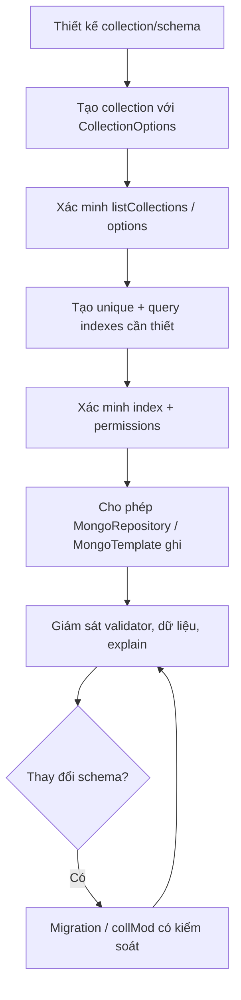

# CollectionOptions và các tùy chọn cần có trước khi ghi dữ liệu

## 1. Bối cảnh: vì sao phải quyết định trước lần insert đầu tiên?

Trong **Spring Data MongoDB**, `MongoTemplate` và `MongoRepository` thường có thể ghi vào collection chưa tồn tại: MongoDB tự tạo collection thông thường ở lần ghi đầu. Cơ chế này tiện cho ví dụ nhỏ, nhưng dễ làm hệ thống production mất cơ hội cấu hình **collection đúng loại và đúng chính sách** ngay từ đầu.

Mini Commerce có các tập dữ liệu với yêu cầu khác nhau:

- `products`: catalog hàng hóa, cần định dạng BSON giá tiền ổn định, validation và khóa SKU duy nhất.
- `customers`: dữ liệu liên hệ, cần kiểm soát schema, quyền truy cập và chính sách bảo vệ thông tin cá nhân.
- `orders`: bản ghi giao dịch dài hạn, **không được tự động xóa bản cũ chỉ vì hết dung lượng**.
- `product_metrics`: các phép đo theo thời gian, phù hợp với time-series collection và chính sách retention.
- `diagnostic_events`: dữ liệu tạm thời có giới hạn lưu trữ, có thể cân nhắc capped collection hoặc collection thường với TTL.

Nếu một worker chạy `repository.save(product)` trước khi bộ khởi tạo collection thực thi, `products` có thể đã trở thành collection thông thường **không có validator/collation mong đợi**. Lúc này việc gọi lại `createCollection(..., CollectionOptions)` không đồng nghĩa MongoDB sẽ bổ sung cấu hình mong muốn cho collection hiện hữu.

Đây là lý do đề mục **CollectionOptions và các tùy chọn cần có trước khi ghi dữ liệu** thuộc chương **Collection và schema** của `SPRING_DATA_MONGODB`. Ta học cách thiết kế, tạo, kiểm tra và vận hành collection trước khi dữ liệu nghiệp vụ đi vào, rồi liên hệ với mapping, repository, query/index, aggregation, transaction, reactive access và kiểm thử.

### Mục tiêu

Sau bài học, bạn có thể:

1. Phân biệt tạo collection **tường minh** bằng `MongoTemplate.createCollection(...)` với để MongoDB tạo ngầm khi ghi.
2. Dùng `CollectionOptions.empty()` và các phép cấu hình trả về **options mới** cho validator, collation, capped và time series.
3. Viết `MongoJsonSchema` đúng **BSON field name**, kiểu tiền Decimal128 và ràng buộc tối thiểu.
4. Phân biệt `validationLevel` (strict/moderate/off) và `validationAction` (error/warn), nhận biết thời điểm validator được áp dụng.
5. Biết lúc nào dùng **capped collection**, lúc nào chọn **TTL index** hoặc **time-series collection**.
6. Chọn default collation và hiểu ảnh hưởng lên truy vấn, sort, unique index.
7. Tạo unique, TTL và compound index bằng **IndexOperations** thay vì tưởng chúng đều là `CollectionOptions`.
8. Thiết kế quy trình bootstrap idempotent, kiểm tra option hiện hữu, migration có kiểm soát và tránh race với application startup.
9. Kiểm thử metadata collection bằng `listCollections`, kiểm thử validation bằng BSON thật và dùng `explain` để đánh giá index.
10. Nhận biết những trường hợp phụ thuộc phiên bản MongoDB, sharding, transaction, encryption hoặc reactive driver.

**Điều kiện thực hành:** Java 17+, Spring Boot có `spring-boot-starter-data-mongodb`, MongoDB đang chạy, biết `@Document`, `@Id`, `@Field`, `MongoTemplate`, `MongoRepository` và BSON. Ví dụ tập trung trên API đồng bộ; phần reactive dùng `ReactiveMongoTemplate`.

## 2. CollectionOptions giải quyết những gì?

`CollectionOptions` thuộc package:

```java
import org.springframework.data.mongodb.core.CollectionOptions;
```

Nó là **mô tả các tùy chọn lúc tạo collection**. Đối tượng options của Spring Data **không phải collection đang tồn tại** và không phải bộ điều khiển schema migration tự động.

| Tùy chọn / cơ chế | Mục đích | Ví dụ Mini Commerce | Cần quyết định trước khi ghi? |
| --- | --- | --- | --- |
| Collection thường | Lưu document không giới hạn dung lượng do capped | `products`, `customers`, `orders` | Nên khai báo rõ nếu cần options bổ sung |
| `schema(...)` / `validator(...)` | Validation ở mức database | SKU, giá, tồn kho, trạng thái | **Nên**, trước khi có dữ liệu sai |
| `strictValidation()` / `moderateValidation()` | Chọn phạm vi kiểm tra document | Chống bản ghi giá sai kiểu | **Nên**, tùy chiến lược migration |
| `failOnValidationError()` / `warnOnValidationError()` | Từ chối hay ghi cảnh báo | Triển khai thử validator | **Nên**, có kế hoạch rollout |
| `collation(...)` | Quy tắc so sánh chuỗi mặc định | Tìm/sort tên hàng hóa | **Có**: default collection collation không đổi sau tạo |
| `capped().size(...).maxDocuments(...)` | Bộ đệm dung lượng hữu hạn | Diagnostic events | **Có**: chọn collection type và size |
| `timeSeries(...)` / `@TimeSeries` | Collection tối ưu đo lường theo thời gian | `product_metrics` | **Có**: phải tạo time-series trước insert |
| Change stream pre/post images | Lưu trước/sau thay đổi cho change streams | Theo dõi một số thay đổi cần thiết | Chọn lúc tạo hoặc cấu hình riêng qua `collMod` |
| Queryable encryption | Chính sách mã hóa field dựa trên hệ thống khóa | Trường nhạy cảm có yêu cầu đặc biệt | Phải thiết kế cùng bảo mật và server/driver phù hợp |
| Unique/TTL/compound indexes | Ràng buộc duy nhất, retention, tối ưu query | SKU unique, phiên giỏ hàng TTL | **Tạo qua IndexOperations**, không chỉ từ CollectionOptions |
| Shard key / clustered collection / view | Thiết kế cơ sở dữ liệu nâng cao | Tập dữ liệu phân mảnh hoặc báo cáo | Phụ thuộc lệnh quản trị/server, không giả định mọi tùy chọn có DSL |

### 2.1. Phân biệt DDL và DML



- **DDL**: tạo collection, đổi validator, tạo index, chọn collation/time series/capped.
- **DML**: insert, save, update, delete.

Một lần insert thành công không chứng minh collection được cấu hình đúng. Hãy xem tạo schema là một công việc **độc lập và có thể xác minh** trong quá trình triển khai.

## 3. Tạo collection tường minh bằng MongoTemplate

### 3.1. API cần phân biệt

Các overload thường gặp:

```java
// Tên collection cố định, tùy chọn mặc định:
mongoTemplate.createCollection("products");

// Dựa trên @Document của entity:
mongoTemplate.createCollection(Product.class);

// Với options tường minh:
mongoTemplate.createCollection(
    Product.class,
    CollectionOptions.empty());

// Dùng tên collection và options:
mongoTemplate.createCollection(
    "products",
    CollectionOptions.empty());
```

Đây là **những cách gọi thay thế nhau**, không phải bốn lệnh cần chạy liên tiếp. Mỗi lệnh `createCollection` dùng trên một collection chưa tồn tại. Tên collection từ `Product.class` được lấy theo mapping metadata như `@Document(collection = "products")`.

Trong Spring Data MongoDB hiện đại, `createCollection(Class)` còn có khả năng **suy ra** collation từ `@Document` và cấu hình time-series từ `@TimeSeries`. Tuy vậy, **validator/schema và các option mã hóa hoặc change stream đặc biệt không tự xuất hiện từ domain class**; cần cung cấp `CollectionOptions` thích hợp.

### 3.2. Các method trả CollectionOptions mới

```java
CollectionOptions base = CollectionOptions.empty();

CollectionOptions capped = base
    .capped()
    .size(1_048_576L)
    .maxDocuments(1_000L);
```

Các modifier của `CollectionOptions` được thiết kế theo kiểu **tạo instance mới với cấu hình mới**. Tránh giả định:

```java
CollectionOptions options = CollectionOptions.empty();
options.capped(); // Kết quả trả về bị bỏ qua.

// options không chắc đã mang capped=true!
mongoTemplate.createCollection("diagnostic_events", options);
```

Cách đúng là **gán biến trả về** hoặc chain rồi truyền vào `createCollection`. Tương tự đối với `schema`, `collation`, `size` và `strictValidation`.

### 3.3. Vì sao kiểm tra collectionExists vẫn chưa đủ?

```java
if (!mongoTemplate.collectionExists("products")) {
    mongoTemplate.createCollection(
        "products", CollectionOptions.empty());
}
```

Đoạn này giúp bootstrap đơn giản, nhưng trong môi trường nhiều instance có **race**: hai instance cùng nhìn thấy collection chưa tồn tại rồi cùng gọi `createCollection`. Ngoài ra, `collectionExists("products") == true` chỉ cho biết **tên đã tồn tại**, không chứng minh collection có validator/index/collation đúng.

Với production, nên dùng migration/khởi tạo schema do một chủ thể sở hữu, có phân quyền DDL rõ ràng và kiểm tra metadata sau tạo. Không che đi mọi ngoại lệ “NamespaceExists” rồi cho ứng dụng ghi mà **không đối chiếu options**.

## 4. Mini Commerce Product: ánh xạ Java và BSON

Ta bắt đầu với một collection thông thường `products`, không phải time-series hay capped.

```java
package com.example.minicommerce.domain;

import java.math.BigDecimal;
import org.springframework.data.annotation.Id;
import org.springframework.data.mongodb.core.mapping.Document;
import org.springframework.data.mongodb.core.mapping.Field;
import org.springframework.data.mongodb.core.mapping.FieldType;

@Document(collection = "products")
public class Product {

    @Id
    private String id;
    private String sku;
    private String name;
    private boolean active;
    private int stock;

    @Field(name = "unit_price", targetType = FieldType.DECIMAL128)
    private BigDecimal price;

    public Product() {}

    public Product(String id, String sku, String name,
                   boolean active, int stock, BigDecimal price) {
        this.id = id;
        this.sku = sku;
        this.name = name;
        this.active = active;
        this.stock = stock;
        this.price = price;
    }

    public String getId() { return id; }
    public void setId(String id) { this.id = id; }
    public String getSku() { return sku; }
    public void setSku(String sku) { this.sku = sku; }
    public String getName() { return name; }
    public void setName(String name) { this.name = name; }
    public boolean isActive() { return active; }
    public void setActive(boolean active) { this.active = active; }
    public int getStock() { return stock; }
    public void setStock(int stock) { this.stock = stock; }
    public BigDecimal getPrice() { return price; }
    public void setPrice(BigDecimal price) { this.price = price; }
}
```

Trong BSON:

| Property Java | BSON field | BSON type dự kiến |
| --- | --- | --- |
| `id` | `_id` | String hoặc ObjectId tùy định dạng ID/mapping |
| `sku` | `sku` | String |
| `name` | `name` | String |
| `active` | `active` | Bool |
| `stock` | `stock` | Int32 |
| `price` | `unit_price` | Decimal128 |

Nếu sử dụng `@Id String`, framework có thể chuyển String tương thích ObjectId thành ObjectId; ví dụ/test dùng ID có tiền tố chữ không giống hex ObjectId để tránh nhập nhằng. Với khóa quan trọng, kiểm tra raw BSON sau mapping.

**Không viết validator với Java property `price` rồi kỳ vọng MongoDB hiểu `@Field("unit_price")`.** Validator chạy ở server trên BSON thực, nên quy tắc phải nhắm tới `unit_price`.

## 5. JSON Schema validation trước dữ liệu đầu tiên

MongoDB hỗ trợ validation thông qua trường `validator` của collection, thường dùng `$jsonSchema`. Spring Data cung cấp `MongoJsonSchema` và `CollectionOptions.schema(schema)`.

### 5.1. Schema dự kiến cho products

```javascript
{
  $jsonSchema: {
    bsonType: "object",
    required: ["sku", "name", "unit_price", "stock", "active"],
    properties: {
      sku: {
        bsonType: "string",
        minLength: 1
      },
      name: {
        bsonType: "string",
        minLength: 1
      },
      unit_price: {
        bsonType: "decimal",
        description: "Giá tiền phải lưu dưới BSON Decimal128"
      },
      stock: {
        bsonType: "int",
        minimum: 0
      },
      active: {
        bsonType: "bool"
      }
    }
  }
}
```

Schema này:

- Bắt buộc những field chính **phải tồn tại**.
- Không chấp nhận `unit_price` dạng String hoặc Double; phải là BSON Decimal128.
- Yêu cầu `stock` là BSON Int32 không âm.
- Chấp nhận những field khác vì chưa đặt `additionalProperties: false`.

Lưu ý `required` chỉ kiểm tra **tồn tại field**; ràng buộc kiểu và nội dung ở `properties`. Nếu yêu cầu giá không âm, có thể bổ sung `minimum: 0` cho `unit_price`. Trong hệ thống thật, xác thực độ dài SKU, loại tiền, category, ràng buộc logic và quyền ghi còn cần ở tầng nghiệp vụ.

### 5.2. Tạo schema qua MongoJsonSchema.of(Document)

```java
import org.bson.Document;
import org.springframework.data.mongodb.core.CollectionOptions;
import org.springframework.data.mongodb.core.MongoTemplate;
import org.springframework.data.mongodb.core.schema.MongoJsonSchema;

public void createProductsWithValidator(MongoTemplate template) {

    MongoJsonSchema schema = MongoJsonSchema.of(
        Document.parse("""
            {
              "bsonType": "object",
              "required": [
                "sku", "name", "unit_price", "stock", "active"
              ],
              "properties": {
                "sku": {
                  "bsonType": "string",
                  "minLength": 1
                },
                "name": {
                  "bsonType": "string",
                  "minLength": 1
                },
                "unit_price": { "bsonType": "decimal" },
                "stock": {
                  "bsonType": "int",
                  "minimum": 0
                },
                "active": { "bsonType": "bool" }
              }
            }
            """));

    CollectionOptions options = CollectionOptions.empty()
        .schema(schema)
        .strictValidation()
        .failOnValidationError();

    // Chỉ chạy khi products chưa tồn tại và đã được
    // điều phối bởi job migration/bootstrap.
    template.createCollection(Product.class, options);
}
```

Đây là **method minh họa dùng trong migration**: không gọi nó trên mọi HTTP request và không xóa `products` hiện hữu để “dọn đường”. JSON schema nhận **BSON field names**, cụ thể là `unit_price`, không phải Java `price`.

Trong Spring Data, `MongoJsonSchema.builder()` cũng xây được schema theo Java DSL; khi muốn xuất phát từ entity metadata có `MongoJsonSchemaCreator`. Nhưng schema sinh tự động **không biết mọi quy tắc nghiệp vụ** như “SKU duy nhất”, “giá hợp lệ theo loại tiền”, “một đơn phải có ít nhất một OrderLine”. Cần review schema cuối trước khi sử dụng.

### 5.3. Tương đương lệnh MongoDB

```javascript
db.createCollection("products", {
  validator: {
    $jsonSchema: {
      bsonType: "object",
      required: ["sku", "name", "unit_price", "stock", "active"],
      properties: {
        sku: { bsonType: "string", minLength: 1 },
        name: { bsonType: "string", minLength: 1 },
        unit_price: { bsonType: "decimal" },
        stock: { bsonType: "int", minimum: 0 },
        active: { bsonType: "bool" }
      }
    }
  },
  validationLevel: "strict",
  validationAction: "error"
});
```

Chỉ dùng lệnh `createCollection` nếu collection chưa tồn tại. Đừng đồng thời chạy lệnh `mongosh` và `MongoTemplate.createCollection` cho cùng tên trên một database.

## 6. ValidationLevel và ValidationAction không giống nhau

Đây là hai quyết định **độc lập**:

| Setting | Giá trị | Ý nghĩa |
| --- | --- | --- |
| `validationLevel` | `strict` | Kiểm tra document khi insert và update theo validator |
| `validationLevel` | `moderate` | Kiểm tra insert và update document hiện tại đang hợp lệ; không dùng validator để chặn update đối với document cũ đang không hợp lệ |
| `validationLevel` | `off` | Tắt kiểm tra validator |
| `validationAction` | `error` | Từ chối write vi phạm validation |
| `validationAction` | `warn` | Cho phép write nhưng ghi warning về vi phạm |

Spring Data:

```java
CollectionOptions enforce =
    CollectionOptions.empty()
        .schema(schema)
        .strictValidation()
        .failOnValidationError();

CollectionOptions observe =
    CollectionOptions.empty()
        .schema(schema)
        .strictValidation()
        .warnOnValidationError();

CollectionOptions transitional =
    CollectionOptions.empty()
        .schema(schema)
        .moderateValidation()
        .failOnValidationError();
```

`schema` trong đoạn trên là `MongoJsonSchema` đã tạo. Đây là **ba lựa chọn thay thế**, không phải thứ tự gọi để thay đổi collection đã tồn tại.

### 6.1. Validation chỉ áp dụng khi write

Nếu collection đang có document sai schema trước khi áp dụng validator mới, MongoDB không tự duyệt và xóa/sửa tất cả document cũ ngay khi gọi `collMod`. Document cũ cần được **đánh giá/migration riêng**, và validation được kiểm tra khi thao tác insert/update thích hợp diễn ra.

`strict` có thể làm update trên document legacy thất bại vì document vẫn không hợp lệ. `moderate` hữu ích cho rollout có dữ liệu cũ chưa hợp lệ, nhưng **không có nghĩa quy tắc dữ liệu đã được thi hành hoàn toàn**.

### 6.2. Dùng warn để quan sát trước khi cưỡng chế

Một lộ trình migration cho collection hiện hữu:

1. Kiểm kê BSON types và giá trị hiện tại.
2. Xây schema mới trên test/staging, xác minh tất cả writer.
3. Bật `validationAction: "warn"` nếu muốn quan sát vi phạm trong giai đoạn chuyển tiếp.
4. Di chuyển/backfill dữ liệu legacy.
5. Chuyển sang `validationAction: "error"` với level phù hợp.
6. Giám sát lỗi ghi và có kế hoạch rollback **cấu hình** nếu cần.

Đừng dùng `warn` như một cơ chế bảo vệ tính đúng đắn: nó **không từ chối** document sai schema.

### 6.3. Bypass validation không phải quy trình bình thường

MongoDB có các đường write dùng `bypassDocumentValidation` cho mục đích được cấp quyền đặc biệt. Vì vậy validator là **lớp bảo vệ dữ liệu**, không phải cơ chế phân quyền và cũng không thay thế service validation. Hãy giới hạn quyền để importer/migration không vô tình bỏ qua quy tắc.

## 7. CollectionOptions không tạo unique index cho SKU

`$jsonSchema` kiểm tra hình dạng/kiểu field; nó **không bảo đảm một SKU duy nhất trên toàn collection**. Cần unique index riêng:

```java
import org.springframework.data.domain.Sort.Direction;
import org.springframework.data.mongodb.core.index.Index;

template.indexOps(Product.class)
    .ensureIndex(
        new Index().on("sku", Direction.ASC).unique());
```

Hoặc `mongosh`:

```javascript
db.products.createIndex({ sku: 1 }, { unique: true });
```

Nếu business key là `(tenantId, sku)`, chỉ số duy nhất nên phản ánh **đúng phạm vi tenant**:

```javascript
db.products.createIndex(
  { tenant_id: 1, sku: 1 },
  { unique: true }
);
```

Không tạo unique `sku` toàn hệ thống nếu mỗi cửa hàng được phép có cùng SKU.

### 7.1. Thứ tự tạo validator và index

Với collection mới:

```text
createCollection(schema + collation)
    -> ensureIndex(unique business key)
    -> inspect listCollections/listIndexes
    -> cho phép importer và repository ghi dữ liệu
```

Với collection đã có dữ liệu, thêm unique index có thể **thất bại vì giá trị trùng**; phải xử lý duplicates trước. Đừng dựa vào code `existsBySku(...)` trước `insert` để thay thế unique constraint, vì hai request có thể cùng vượt qua kiểm tra.

### 7.2. @Indexed không đồng nghĩa index đã tồn tại

Entity có thể dùng `@Indexed(unique = true)` nhưng index chỉ thực sự tồn tại khi hạ tầng tạo index đã được kích hoạt/điều phối. Spring Data MongoDB hiện đại **không mặc định tự tạo index cho mọi entity trong mọi trường hợp**; `autoIndexCreation` cần cấu hình rõ và cân nhắc trên production.

Với deployment có yêu cầu chặt chẽ, một migration/index job có chủ sở hữu và bước kiểm tra `listIndexes` là lựa chọn dễ kiểm soát hơn.

## 8. Capped collection: giữ tối đa một vùng dung lượng

Capped collection có giới hạn **size theo bytes**, và có thể có thêm giới hạn `maxDocuments`. Khi đầy, MongoDB tự giải phóng dữ liệu cũ để dành chỗ cho dữ liệu mới, tương tự bộ đệm vòng.

Phù hợp cho một số loại log/diagnostic tạm thời; **không phù hợp** với `orders` hoặc lịch sử thanh toán bắt buộc lưu đủ.

### 8.1. Tạo capped bằng CollectionOptions

```java
CollectionOptions options = CollectionOptions.empty()
    .capped()
    .size(4L * 1024 * 1024)
    .maxDocuments(10_000L);

template.createCollection("diagnostic_events", options);
```

Tương đương:

```javascript
db.createCollection("diagnostic_events", {
  capped: true,
  size: 4 * 1024 * 1024,
  max: 10000
});
```

**Cần `size`** khi bật capped; `maxDocuments` chỉ là giới hạn phụ. Nếu chạm giới hạn dung lượng trước, document cũ có thể bị loại trước khi chạm số lượng `max`. Đừng xem `maxDocuments=10000` là lời hứa collection luôn có đúng 10.000 document.

### 8.2. Giới hạn nghiệp vụ và kỹ thuật

- Dữ liệu cũ bị loại để nhường chỗ: **không có retention theo thời gian chính xác**.
- Capped collection không hỗ trợ sharding và không được dùng ghi trong transaction.
- Không thích hợp với các update khiến document lớn lên, hoặc workload ghi nhiều cạnh tranh mạnh.
- Có thể sử dụng **tailable cursor** cho luồng log append-only; đây là mô hình khác với change stream.
- Nếu cần xóa theo `expiresAt`, giữ đủ lịch sử trong khoảng thời gian và có khả năng query/scale linh hoạt, **TTL index trên collection thường** thường thích hợp hơn.

Không dùng capped để lưu sự kiện tài chính/audit bắt buộc lưu trữ mà có nguy cơ bị tự động ghi đè.

## 9. TTL cho collection thường: tạo index riêng

Giả sử `cart_reservations` có `expiresAt` là BSON Date. Muốn một reservation hết hạn theo thời điểm ghi trên document:

```javascript
db.cart_reservations.createIndex(
  { expiresAt: 1 },
  { expireAfterSeconds: 0 }
);
```

Trong Spring Data:

```java
import java.time.Duration;
import org.springframework.data.domain.Sort.Direction;
import org.springframework.data.mongodb.core.index.Index;

template.indexOps("cart_reservations")
    .ensureIndex(
        new Index()
            .on("expiresAt", Direction.ASC)
            .expire(Duration.ZERO));
```

### 9.1. Vì sao không dùng CollectionOptions.expireAfter cho mọi collection?

`expireAfterSeconds` ở lệnh **tạo collection** chỉ áp dụng cho các loại được server hỗ trợ như **time-series** và **clustered collection** có điều kiện, không phải “tự động TTL mọi regular collection”.

Với collection thường `cart_reservations`, retention theo một field BSON Date là **TTL index**. Nếu muốn document hết hạn sau 24 giờ kể từ `createdAt`, index field đó với `expireAfterSeconds: 86400`. Nếu muốn hết hạn đúng `expiresAt`, sử dụng `expireAfterSeconds: 0`.

### 9.2. TTL không phải đồng hồ giao dịch chính xác

MongoDB xóa TTL bằng một tiến trình nền; document có thể còn trong collection sau thời điểm hết hạn. Do đó:

- Query/reservation service vẫn phải kiểm tra `expiresAt > now` khi quyết định sản phẩm còn được giữ chỗ.
- TTL không tự hủy một Order đã chốt hoặc hoàn lại stock theo quy trình nghiệp vụ.
- Không dùng TTL như cam kết “document biến mất chính xác ở giây T”.

## 10. Collation: quyết định trước khi tạo collection

**Collation** quy định cách so sánh/sắp xếp chuỗi theo locale và các tùy chọn case/accent/numeric ordering.

Ví dụ:

```java
import org.springframework.data.mongodb.core.query.Collation;

CollectionOptions options = CollectionOptions.empty()
    .collation(Collation.of("vi"));

template.createCollection("catalog_names", options);
```

Tương đương:

```javascript
db.createCollection("catalog_names", {
  collation: { locale: "vi" }
});
```

### 10.1. Điểm cần nhớ

- Default collation của collection có tác dụng với các operation không tự chỉ định collation khác.
- Index mới thường **kế thừa collation mặc định** của collection nếu index không chỉ định khác.
- Query muốn tận dụng index cho phép so sánh/sort chuỗi theo collation cần phù hợp với collation của index.
- **Không thay default collation của collection đã tồn tại** bằng cách gọi lại `createCollection` hoặc `collMod` thông thường. Đổi default có thể cần tạo collection mới và migration.
- Case/accent sensitivity phụ thuộc `strength` và các cài đặt. `locale:"vi"` **không đồng nghĩa** bất kỳ chuỗi tiếng Việt nào cũng được coi như nhau.

### 10.2. Collation và unique index

Giả sử ứng dụng muốn `sku` là mã định danh phân biệt đúng các ký tự, nhưng `name` dùng collation tiếng Việt cho sort. Một collection default collation có thể làm **index trên sku kế thừa quy tắc không mong muốn**.

Giải pháp:

- Định nghĩa business key canonical như `skuNormalized` (do service validate).
- Tạo unique index với collation phù hợp cho SKU, có thể là `simple` (binary).
- Dùng collation tiếng Việt khi truy vấn/tạo index cho `name`.
- Kiểm tra hành vi trùng SKU gồm chữ hoa/chữ thường qua integration test.

Không dùng collation như một giải pháp tự động chuẩn hóa chữ có dấu/không dấu cho mọi nghiệp vụ. Đặc biệt, MongoDB `$regex` không được tối ưu chỉ nhờ index collation case-insensitive; nếu cần search prefix/contains, phải thiết kế index hoặc search riêng.

## 11. Time-series collection: thiết kế trước phép đo đầu tiên

Mini Commerce có `product_metrics` với phép đo định kỳ:

```javascript
{
  recorded_at: ISODate("2026-11-20T02:00:00Z"),
  source: {
    tenantId: "shop-a",
    sku: "KBD-001"
  },
  viewed_count: 45,
  inventory_snapshot: 10
}
```

Đây là dữ liệu đo lường có `timeField` và metadata ổn định; phù hợp để cân nhắc time-series collection. `Product` và `Order` bình thường **không phải** time-series chỉ vì chúng có `createdAt`.

### 11.1. MongoDB createCollection

```javascript
db.createCollection("product_metrics", {
  timeseries: {
    timeField: "recorded_at",
    metaField: "source",
    granularity: "minutes"
  },
  expireAfterSeconds: 30 * 24 * 60 * 60
});
```

- `timeField` bắt buộc, phải là **BSON Date** hợp lệ.
- `metaField` có thể chứa object mô tả series (tenant, SKU), nên ổn định theo thời gian.
- `granularity` gần với nhịp thu thập dữ liệu; `seconds`, `minutes`, `hours` tùy bản server.
- `expireAfterSeconds` khai báo retention theo phép đo; quá trình dọn có độ trễ.

MongoDB hỗ trợ time-series từ **5.0**, các tùy chọn nâng cao như bucket span/rounding có thêm yêu cầu phiên bản. Đừng chọn cấu hình bucket bằng số cứng không kiểm tra tính tương thích/nhịp dữ liệu.

### 11.2. Spring Data CollectionOptions.timeSeries

```java
import java.time.Duration;
import org.springframework.data.mongodb.core.CollectionOptions;

CollectionOptions options = CollectionOptions.timeSeries(
    "recorded_at",
    ts -> ts
        .metaField("source")
        .expireAfter(Duration.ofDays(30)));

template.createCollection("product_metrics", options);
```

Overload `timeSeries(timeField, optionsFunction)` và `TimeSeriesOptions.expireAfter(Duration)` có mặt trong các dòng Spring Data MongoDB mới hơn (ví dụ **4.4+**). Với phiên bản cũ, có thể dùng `CollectionOptions.timeSeries("recorded_at")` hoặc cấu hình time-series tương ứng rồi dùng driver nếu cần TTL tại create.

Nếu muốn đặt `granularity` tường minh, dùng `CollectionOptions.TimeSeriesOptions.granularity(GranularityDefinition)` với loại trong package `org.springframework.data.mongodb.core.timeseries` phù hợp phiên bản dự án. Không trộn `granularity` và cấu hình span/rounding xung đột.

### 11.3. Annotation @TimeSeries

```java
import java.time.Instant;
import org.springframework.data.annotation.Id;
import org.springframework.data.mongodb.core.mapping.TimeSeries;

@TimeSeries(
    collection = "product_metrics",
    timeField = "recordedAt",
    metaField = "source")
public class ProductMetric {
    @Id
    String id;
    Instant recordedAt;
    String source;
    int viewedCount;
}
```

Đây là **ví dụ entity thay thế**, không nhất thiết trùng 100% schema BSON của `product_metrics` ở phần trước (trong đó `source` là object và `recorded_at` là field snake_case). Nếu ánh xạ lại theo entity, hãy khai báo `@Field`/metadata phù hợp hoặc đổi ví dụ dữ liệu tương ứng; **không** tự suy đoán tên field.

`@TimeSeries` cho phép `createCollection(ProductMetric.class)` suy cấu hình time-field/meta-field. Annotation `expireAfter` ở các Spring Data mới hỗ trợ thời lượng như `"30d"`; cần kiểm tra phiên bản khi dùng. Nếu collection đã được tạo ngầm trước đó như collection thường, thêm `@TimeSeries` vào class **không tự chuyển collection hiện hữu** thành time-series.

### 11.4. Những giới hạn time-series quan trọng

- Time-series không hỗ trợ mọi hành vi của collection thường; trong tài liệu MongoDB hiện hành, **schema validation rules không được hỗ trợ cho time-series**.
- Không được giả định có index `_id` mặc định như collection thường; chính sách index của time-series khác và phụ thuộc phiên bản.
- Index unique không được hỗ trợ trên time-series theo cùng cách collection thường.
- Các kiểu update, transaction write, change streams hoặc MongoDB Search có hạn chế riêng; **không chọn time-series cho Product/Order giao dịch** nếu cần các tính năng đó.
- Dữ liệu metric đến muộn, timeField không đúng kiểu, metadata bị thay đổi quá nhiều hoặc TTL quá ngắn đều ảnh hưởng chất lượng dữ liệu.

**Không kết hợp** `CollectionOptions.timeSeries(...)` với `schema(...)` trong ví dụ rồi mặc định server chấp nhận; phải đối chiếu giới hạn collection type.

## 12. Change stream pre/post images trước khi ghi

Nếu nghiệp vụ cần quan sát phiên bản **trước và sau** khi document thay đổi, MongoDB hỗ trợ `changeStreamPreAndPostImages` trên collection (yêu cầu server **6.0+**).

Trong Spring Data MongoDB có shortcut:

```java
CollectionOptions options =
    CollectionOptions.emitChangedRevisions();

template.createCollection("audited_catalog_changes", options);
```

API này bật cấu hình collection cho **change stream pre/post images**; nó **không thay** cơ chế audit trail, outbox hoặc retention của nghiệp vụ. Phải có replica set/sharded topology và quyền phù hợp để sử dụng change streams. Pre/post images gây thêm chi phí lưu trữ và có chính sách retention; chỉ bật khi thật sự cần.

Nếu collection đã tồn tại, MongoDB cho phép một số cấu hình pre/post image qua `collMod`. Không chạy `createCollection` lần nữa rồi tưởng cấu hình đã được áp dụng.

## 13. Options nâng cao: encryption, clustered collection, sharding

`CollectionOptions` trong những dòng Spring Data mới còn có hỗ trợ tùy chọn cho **encrypted fields** và change stream. MongoDB server `create` command có thể nhận thêm `clusteredIndex`, `storageEngine` và các option chuyên biệt.

Các quyết định này phụ thuộc:

- Phiên bản MongoDB, feature compatibility version và driver.
- Cách quản lý khóa mã hóa và quyền truy cập key vault.
- Cấu trúc field được phép mã hóa/truy vấn.
- Topology replica set, sharded cluster và chiến lược shard key.
- Quy trình backup/restore, migration và quan sát hiệu năng.

Không copy một ví dụ `encryptedFields` hoặc clustered index vào mọi collection. Nếu cần, lập thiết kế riêng và đối chiếu tài liệu sản phẩm/phiên bản. **`@Encrypted` hay một annotation Java không tự bảo đảm mã hóa đang hoạt động** nếu thiếu cấu hình client-side encryption/key management thích hợp.

### 13.1. View không phải collection ghi bình thường

MongoDB còn cho phép tạo **view** dựa trên pipeline. View là một abstraction đọc, không phải nơi có thể tự do `repository.save(...)` như collection thường. Đừng nhầm `CollectionOptions` tạo collection với các tùy chọn view; view và materialized reports có quy tắc riêng.

## 14. Khởi tạo collection an toàn qua nhiều môi trường

Đây là một vấn đề vận hành quan trọng hơn cú pháp Java.

### 14.1. Anti-pattern: tạo ngầm rồi cấu hình muộn

```text
Ứng dụng instance A khởi động
  -> endpoint nhận Product đầu tiên
  -> MongoDB tự tạo products (mặc định)

Instance B sau đó chạy:
  -> createCollection("products", CollectionOptions có validator)
  -> không cập nhật validator mong muốn trên collection đã tồn tại
```

Kết quả: dữ liệu có thể đã được ghi mà không trải qua validation mong muốn. Nếu có tranh chấp khởi tạo, đừng che ngoại lệ rồi tiếp tục ghi.

### 14.2. Quy trình bootstrap khuyến nghị

1. Chạy migration/bootstrap **trước** khi mở endpoints hoặc bắt đầu consumer/import job.
2. Xác nhận collection chưa tồn tại; nếu chưa, tạo với options đã duyệt.
3. Nếu đã tồn tại, đọc metadata để kiểm tra **collection type, validator, collation, time-series/capped**.
4. Xác nhận indexes có mặt, không lỗi build index hoặc vi phạm unique.
5. Ghi lại schema version và kết quả migration ở một cơ chế quản lý migration có chủ sở hữu.
6. Nếu cấu hình không khớp, **fail fast hoặc chuyển sang quy trình migration có phê duyệt**; không drop/recreate tùy tiện.
7. Chỉ khi schema/index đã ở trạng thái chấp nhận được mới cho phép API ghi/consumer hoạt động.

### 14.3. Kiểm tra metadata từ mongosh

```javascript
db.getCollectionInfos({ name: "products" });

db.getCollection("products").getIndexes();
```

Đối với collection vừa tạo bằng `CollectionOptions`, kiểm tra:

- `options.validator.$jsonSchema` có đúng trường BSON không?
- `options.validationLevel` và `options.validationAction` có như thiết kế không?
- `options.collation` có đúng locale/strength không?
- `options.capped`/`options.size`/`options.max` có phù hợp không?
- `options.timeseries`/`options.expireAfterSeconds` có đúng cho time-series không?
- Unique, TTL và query indexes có được tạo riêng chưa?

Đừng chỉ dùng `collectionExists(...)` để coi là bước verify đủ.

### 14.4. Tạo collection rồi chạy index migration

```java
import org.springframework.data.domain.Sort.Direction;
import org.springframework.data.mongodb.core.CollectionOptions;
import org.springframework.data.mongodb.core.MongoTemplate;
import org.springframework.data.mongodb.core.index.Index;
import org.springframework.data.mongodb.core.schema.MongoJsonSchema;

public void bootstrapCatalog(
        MongoTemplate template, MongoJsonSchema schema) {

    if (!template.collectionExists(Product.class)) {
        template.createCollection(
            Product.class,
            CollectionOptions.empty()
                .schema(schema)
                .strictValidation()
                .failOnValidationError());
    }

    // Phải kiểm tra options thật của collection hiện hữu ở
    // bước riêng; đoạn này không thể làm drift detection.

    template.indexOps(Product.class).ensureIndex(
        new Index().on("sku", Direction.ASC).unique());
}
```

Đây là **skeleton** cho môi trường một chủ thể khởi tạo. Trong production phải bổ sung đồng bộ giữa instance, kiểm tra drift và xử lý lỗi migration. Việc index operation có vẻ idempotent **không có nghĩa** có thể tự thay một index cùng tên nhưng khác định nghĩa mà không lập kế hoạch.

## 15. Thay đổi schema trên collection đã tồn tại

MongoDB có lệnh `collMod` cho một số thay đổi, như validator/validationLevel/validationAction và một số cấu hình TTL/time-series/change-stream tùy phiên bản.

Ví dụ **mang tính vận hành, không chạy trực tiếp trên production khi chưa rà soát**:

```javascript
db.runCommand({
  collMod: "products",
  validationLevel: "moderate",
  validationAction: "warn"
});
```

Lệnh này giả định collection đã có một validator phù hợp. Nó **không tự cài** JSON Schema nếu chưa có và không tự xác minh dữ liệu cũ.

Muốn cập nhật validator:

```javascript
db.runCommand({
  collMod: "products",
  validator: {
    $jsonSchema: {
      bsonType: "object",
      required: ["sku", "name"],
      properties: {
        sku: { bsonType: "string" },
        name: { bsonType: "string" }
      }
    }
  },
  validationLevel: "strict",
  validationAction: "error"
});
```

Đây là **schema minh họa đơn giản**, không được dùng để vô tình làm yếu validator `products` toàn diện ở phần 5. Khi thay validator, MongoDB sẽ áp dụng **định nghĩa mới** theo lệnh, nên migration cần gửi **toàn bộ** quy tắc mong muốn, không chỉ một mảnh và tưởng server tự merge. Trước khi bật strict/error, thống kê và backfill document cũ.

### 15.1. Cấu hình không thể sửa tại chỗ

- Default collation của collection **không đổi sau tạo** bằng `collMod` thông thường.
- Chuyển collection thường thành time-series/capped có các quy tắc đặc biệt, không đơn giản là gọi lại `CollectionOptions.timeSeries(...)`.
- Thay clustered index/shard key hoặc encryption options có thể cần thao tác quản trị/migration chuyên biệt.
- Đổi schema kiểm tra kiểu giá từ String/Double sang Decimal128 cần **chuyển dữ liệu thực**.

Nếu phải tạo collection mới và copy dữ liệu: lập kế hoạch dual-read/dual-write (nếu cần), batch migration, kiểm tra checksum/count, đồng bộ index và cutover có rollback. Đừng drop collection cũ trước khi chứng minh dữ liệu mới đầy đủ.

## 16. Quyền truy cập và an toàn dữ liệu

Thông thường, application runtime không cần có quyền cao nhất để tự tạo/drop mọi collection. Tách các vai trò:

| Vai trò | Quyền nên xem xét |
| --- | --- |
| Migration/bootstrap | Quyền tạo/sửa collection và index trong phạm vi được duyệt |
| API nghiệp vụ | Quyền đọc/ghi đúng collection, hạn chế DDL |
| Import/catalog job | Quyền ghi và upsert theo business key, phải chịu validator |
| Report/analytics | Quyền đọc/projection, không tự tạo collection ghi |
| Security/admin | Quản lý encryption keys, auditing, phân quyền |

`CollectionOptions` không bảo vệ mọi quy tắc truy cập. Validator không thay thế authorization, còn collation không làm dữ liệu “an toàn hơn” chỉ vì case-insensitive.

Trong hệ thống multi-tenant, cần filter `tenantId` (khi lưu), unique index theo tenant, và kiểm tra permission ở service. Nếu collection chung chứa nhiều tenant, tạo collection đúng một lần cho toàn database; **không** để client truyền tên collection tùy ý vào `createCollection(String)`.

## 17. Transaction, lifecycle và collection creation

- `MongoTemplate.createCollection(...)` là **thao tác quản trị/DDL**, không phải entity `save`.
- Không kỳ vọng `BeforeSaveCallback`, `@LastModifiedDate` hay optimistic locking chạy khi tạo collection.
- Transaction MongoDB có quy tắc riêng đối với DDL và topology; nên chạy schema migration ngoài luồng transaction nghiệp vụ, trước khi nhận traffic.
- Schema validation áp dụng khi raw driver, `MongoTemplate`, repository hay bulk write gửi dữ liệu đến server, trừ các trường hợp quyền bypass/validation level khác.
- Capped và time-series có hạn chế transaction write; không đưa hai loại collection này vào luồng `placeOrder` cần atomicity nhiều document nếu không xác minh hỗ trợ.

Với luồng tạo Order và giảm stock của nhiều Product, transaction vẫn là quyết định **của nghiệp vụ**; việc định nghĩa collection đúng chỉ là nền tảng, không biến nhiều thao tác ghi thành all-or-nothing.

## 18. ReactiveMongoTemplate: tạo collection là publisher

Nếu dùng `spring-boot-starter-data-mongodb-reactive`, thao tác tạo collection trả publisher:

```java
import org.springframework.data.mongodb.core.CollectionOptions;
import reactor.core.publisher.Mono;
import com.mongodb.reactivestreams.client.MongoCollection;
import org.bson.Document;

CollectionOptions options = CollectionOptions.empty()
    .schema(schema)
    .strictValidation()
    .failOnValidationError();

Mono<MongoCollection<Document>> created =
    reactiveMongoTemplate.createCollection(
        "products_reactive_test", options);
```

`reactiveMongoTemplate` được inject và `schema` là `MongoJsonSchema` như phần 5. Việc tạo thật diễn ra khi publisher được subscribe. Không gọi `block()` trong event-loop WebFlux; đưa schema bootstrap vào startup/migration flow có điều phối và phải chờ kết quả **trước khi nhận write traffic**.

Reactive MongoDB vẫn phải đối diện các vấn đề giống imperative:

- Nếu collection đã tồn tại, `createCollection` không tự merge options.
- Validator/collation/time-series do MongoDB server xử lý.
- Cần kiểm tra indexes sau tạo, có reactive `indexOps(...).ensureIndex(...)`.
- Bootstrap reactive chạy song song nhiều instance vẫn có race nếu không điều phối.

## 19. Integration test: validator thật và metadata collection

Unit test kiểm tra method tạo `CollectionOptions` chỉ chứng minh **cấu trúc Java**, không chứng minh MongoDB nhận BSON schema hay từ chối dữ liệu sai. Cần dùng MongoDB thật hoặc Testcontainers.

Test sau dùng **tên collection ngẫu nhiên trong database test** để tránh đụng `products` đang có. Nó kiểm tra strict/error, BSON Decimal128, schema metadata và cleanup.

### 19.1. Test hoàn chỉnh

```java
package com.example.minicommerce;

import static org.junit.jupiter.api.Assertions.*;

import java.math.BigDecimal;
import java.util.UUID;

import com.mongodb.MongoWriteException;
import com.mongodb.client.MongoCollection;
import com.mongodb.client.model.Filters;

import org.bson.Document;
import org.bson.types.Decimal128;
import org.junit.jupiter.api.Test;
import org.springframework.beans.factory.annotation.Autowired;
import org.springframework.boot.test.context.SpringBootTest;
import org.springframework.data.mongodb.core.CollectionOptions;
import org.springframework.data.mongodb.core.MongoTemplate;
import org.springframework.data.mongodb.core.schema.MongoJsonSchema;

@SpringBootTest
class CollectionOptionsIntegrationTest {

    @Autowired
    MongoTemplate template;

    @Test
    void strictSchemaAcceptsDecimal128AndRejectsInvalidWrites() {
        String collection = "lesson29_schema_" +
            UUID.randomUUID().toString().replace("-", "");

        MongoJsonSchema schema = MongoJsonSchema.of(
            Document.parse("""
                {
                  "bsonType": "object",
                  "required": [
                    "sku", "name", "active",
                    "stock", "unit_price"
                  ],
                  "properties": {
                    "sku": { "bsonType": "string" },
                    "name": { "bsonType": "string" },
                    "active": { "bsonType": "bool" },
                    "stock": {
                      "bsonType": "int", "minimum": 0
                    },
                    "unit_price": { "bsonType": "decimal" }
                  }
                }
                """));

        CollectionOptions options = CollectionOptions.empty()
            .schema(schema)
            .strictValidation()
            .failOnValidationError();

        try {
            template.createCollection(collection, options);
            assertTrue(template.collectionExists(collection));

            MongoCollection<Document> raw =
                template.getCollection(collection);

            raw.insertOne(new Document("_id", "ok-1")
                .append("sku", "KBD-TEST")
                .append("name", "Bàn phím")
                .append("active", true)
                .append("stock", 5)
                .append("unit_price",
                    new Decimal128(
                        new BigDecimal("129900.00"))));

            Document saved = raw.find(
                Filters.eq("_id", "ok-1")).first();
            assertNotNull(saved);
            assertTrue(saved.get("unit_price")
                instanceof Decimal128);

            MongoWriteException invalid =
                assertThrows(MongoWriteException.class,
                    () -> raw.insertOne(
                        new Document("_id", "bad-1")
                            .append("sku", "BAD-TEST")
                            .append("name", "Sai kiểu giá")
                            .append("active", true)
                            .append("stock", 5)
                            .append("unit_price", "129900.00")));

            // DocumentValidationFailure thường dùng code 121.
            assertEquals(121, invalid.getCode());

            Document info = template.execute(
                db -> db.listCollections()
                    .filter(Filters.eq("name", collection))
                    .first());
            assertNotNull(info);

            Document metadata = info.get(
                "options", Document.class);
            assertNotNull(metadata);
            assertEquals("strict",
                metadata.getString("validationLevel"));
            assertEquals("error",
                metadata.getString("validationAction"));

            Document validator = metadata.get(
                "validator", Document.class);
            assertNotNull(validator);
            assertTrue(validator.containsKey("$jsonSchema"));
        } finally {
            // Chỉ dọn collection TEST được tạo trong method.
            if (template.collectionExists(collection)) {
                template.dropCollection(collection);
            }
        }
    }
}
```

Điều kiện test:

- MongoDB có hỗ trợ JSON Schema validation, user test có quyền create/drop collection.
- Không dùng database production cho `@SpringBootTest`.
- Phải có acknowledged writes để nhận exception phù hợp.
- Dùng `raw MongoCollection<Document>` để kiểm tra server validator **không phụ thuộc mapper entity**.
- Mã lỗi 121 là mã lỗi validation phổ biến của MongoDB; khi đi qua `MongoTemplate.insert(...)`, exception có thể được Spring dịch thành loại thuộc `DataAccessException`. Vì thế test chủ động dùng raw driver.

### 19.2. Test schema cho data migration

Nếu đang thêm validator vào collection đã có dữ liệu, cần hai nhóm test:

1. **Dữ liệu mới:** mọi đường ghi (repository, template, raw driver, bulk) bị chặn khi sai schema và `validationAction=error`.
2. **Dữ liệu cũ:** document legacy nào không hợp lệ? Khi cập nhật chúng dưới `strict`/`moderate` sẽ xảy ra điều gì?

Không chỉ kiểm tra `createCollection` chạy không lỗi; phải assert cả **BSON field names, BSON types và hành vi update**.

### 19.3. Kiểm tra capped và time-series metadata

Trong test tách biệt:

```java
String cappedName = "lesson29_capped_test";
if (!template.collectionExists(cappedName)) {
    template.createCollection(cappedName,
        CollectionOptions.empty()
            .capped().size(4096L).maxDocuments(5));
}

Document info = template.execute(
    db -> db.listCollections()
        .filter(Filters.eq("name", cappedName))
        .first());

assertNotNull(info);
Document options = info.get("options", Document.class);
assertEquals(true, options.getBoolean("capped"));
```

Đoạn này là **thân test**; cần tên collection riêng/cô lập, import và cleanup trong `finally`. Đừng assert rằng sau đúng 5 insert capped nhất định có đúng 5 document: giới hạn `size` có thể làm nó loại sớm hơn. Với time-series, kiểm tra `options.timeseries.timeField` và `expireAfterSeconds` thay vì giả định time-series có `_id` index như collection thường.

## 20. Truy vấn và chẩn đoán hiệu năng sau khi tạo collection

Một collection được tạo đúng schema **chưa chắc truy vấn đã nhanh**.

### 20.1. Query filter sản phẩm

```java
import java.math.BigDecimal;
import org.springframework.data.mongodb.core.query.Query;
import org.springframework.data.mongodb.core.query.Criteria;

Query expensive = Query.query(
    Criteria.where("active").is(true)
        .and("price")
        .gte(new BigDecimal("100000.00")));

var products = template.find(expensive, Product.class);
```

Nhờ mapping `Product.class`, property `price` được chuyển sang BSON `unit_price`, còn raw `mongosh` phải viết field thực:

```javascript
db.products.find({
  active: true,
  unit_price: {
    $gte: NumberDecimal("100000.00")
  }
});
```

Nếu thường lọc `active` và range `unit_price`, đánh giá index phù hợp:

```javascript
db.products.createIndex({
  active: 1,
  unit_price: 1
});
```

Đây là **ứng viên index**, không bắt buộc cho mọi workload. Càng nhiều index thì càng tốn RAM/storage và chi phí ghi.

### 20.2. Explain

```javascript
db.products.find({
  active: true,
  unit_price: {
    $gte: NumberDecimal("100000.00")
  }
}).explain("executionStats");
```

Quan sát:

- `winningPlan`: index scan hay collection scan.
- `totalKeysExamined` và `totalDocsExamined`.
- `nReturned` so với số document phải đọc.
- Chi phí sort và độ trễ ở dataset đại diện.

Index không làm validator nhanh hơn về bản chất; schema validation phải kiểm tra dữ liệu ghi theo luật. Capped/time-series/collation cũng ảnh hưởng chiến lược query/index khác nhau, nên benchmark trên đúng loại collection.

## 21. Ma trận quyết định cho Mini Commerce

| Dữ liệu | Collection type / options chính | Index / ràng buộc thêm | Điều tránh |
| --- | --- | --- | --- |
| `products` | Regular, schema strict/error, Decimal128 | Unique `sku` hoặc `tenant+sku`, index giá/status | Capped làm mất hàng hóa |
| `customers` | Regular, schema & security | Unique key phù hợp, index email nếu yêu cầu | Coi schema validation là authorization |
| `orders` | Regular, thời gian lưu theo chính sách | Index customer/status/placedAt, unique order ID | TTL/capped xóa giao dịch hợp lệ |
| `cart_reservations` | Regular | TTL index trên BSON Date và filter hiệu lực | Dùng TTL làm đồng hồ nghiệp vụ chính xác |
| `product_metrics` | Time-series, timeField/metaField/retention | Index hợp lệ theo giới hạn time-series | Unique/schema validator thông thường trên time-series |
| `diagnostic_events` | Capped hoặc regular + TTL theo mục đích | Index đơn giản phục vụ tìm log | Coi capped là kho lưu audit không mất dữ liệu |
| `catalog_changes` | Regular, có thể bật pre/post images | Index theo operation ID; outbox nếu cần | Nhầm pre/post image với audit trail vĩnh viễn |

## 22. Những lỗi thường gặp

| Dấu hiệu | Nguyên nhân | Cách xử lý |
| --- | --- | --- |
| Validator không xuất hiện dù có code tạo | Collection đã tự được tạo trước | Kiểm tra metadata; chạy migration `collMod` hoặc tạo mới có kiểm soát |
| `createCollection` ném lỗi namespace exists | Nhiều instance đồng thời hoặc chạy lại job | Điều phối bootstrap, kiểm tra options thay vì nuốt lỗi |
| `CollectionOptions.capped()` không có tác dụng | Bỏ qua object trả về | Chain hoặc gán instance mới |
| Collection tạo được nhưng SKU trùng | Schema không tạo unique index | `IndexOperations.ensureIndex(unique)` |
| Giá `BigDecimal` bị validator từ chối | BSON thực là String/Double, schema yêu cầu Decimal128 | `@Field(targetType=DECIMAL128)`, migrate dữ liệu |
| Schema dùng `price` không kiểm tra `unit_price` | Dùng Java property thay BSON key | Kiểm tra `@Field` và raw BSON |
| `validationAction=warn` vẫn cho ghi sai | Warn chỉ log | Chuyển error sau khi làm sạch dữ liệu |
| `moderate` chưa chặn cập nhật legacy sai | Validator không cưỡng chế update trên document cũ không hợp lệ | Migration, strict/error khi sẵn sàng |
| Thêm strict validator làm nhiều save thất bại | Document legacy không hợp lệ hoặc full replacement thiếu required field | Kiểm kê/bổ sung dữ liệu trước |
| `@Indexed` nhưng không có index thật | Chưa bật index creation/chưa chạy migration | Kiểm tra `listIndexes` |
| Capped ít document hơn `maxDocuments` | Chạm `size` trước | Size là giới hạn chính |
| Capped làm mất Order cũ | Dùng sai collection type | Regular collection + retention chính sách |
| TTL xóa chậm | TTL monitor chạy nền | Query phải kiểm tra thời điểm hết hạn |
| Dùng `expireAfterSeconds` cho regular collection khi create | Tùy chọn này không tạo TTL trên mọi collection thường | Tạo TTL index riêng |
| Collation khác kỳ vọng | Chọn locale/strength/index collation sai | Test so sánh/sort/unique và query/index |
| Muốn đổi default collation tại chỗ | Default collation không đổi sau create | Migration sang collection mới |
| Time-series tạo ra thành regular | Đã insert trước khi `@TimeSeries`/options được áp dụng | Tạo time-series tường minh trước write |
| Time-series validator không hoạt động | Loại collection không hỗ trợ schema validation rules | Validate ở nguồn ghi, thiết kế lại nếu cần |
| Time-series thiếu `_id` index | Chính sách index khác regular | Đọc docs version và tạo index được phép |
| Change stream không có pre-image | Chưa bật option/server không phù hợp | Kiểm tra server, collection metadata, retention |
| CI test lỗi create/drop | User thiếu quyền hoặc dùng database chung | Dùng database riêng, cấp quyền test đúng |
| API ghi trước migration hoàn tất | Bootstrap chưa làm rào chắn sẵn sàng | Schema migration trước traffic/consumers |
| Thêm `collMod` làm giảm validation | Validator mới thay bản cũ không đầy đủ | Review toàn bộ schema, test, rollback plan |

## 23. Bài tập thực hành

**Bài 1 — Collection thường có validator.** Tạo `products` trên database test bằng `CollectionOptions.empty().schema(...).strictValidation().failOnValidationError()`. Thử insert giá Decimal128 hợp lệ, rồi insert giá dạng String; kiểm tra server từ chối.

**Bài 2 — Kiểm tra sự khác nhau giữa Java và BSON.** Dùng `@Field("unit_price")` trên property `price`. Viết schema sai field `price`, kiểm tra tại sao không bảo vệ đúng dữ liệu; sửa sang `unit_price` và test raw driver.

**Bài 3 — Rollout validator.** Trên collection test có dữ liệu legacy, dùng `validationAction: "warn"`, ghi nhận vi phạm; làm sạch dữ liệu rồi chuyển `strict/error` bằng `collMod`. Giải thích mức độ rủi ro mỗi giai đoạn.

**Bài 4 — Unique index.** Tạo `{tenant_id:1,sku:1}` unique trên dữ liệu test. Gửi hai insert cùng tenant/SKU để thấy duplicate key; thử cùng SKU ở tenant khác nếu schema cho phép.

**Bài 5 — Capped.** Tạo `diagnostic_events` với `size` và `maxDocuments`. Insert nhiều event, quan sát document cũ bị loại; giải thích vì sao loại collection này không hợp với `orders`.

**Bài 6 — TTL.** Tạo collection `cart_reservations` thường với `expiresAt`, index TTL `expireAfterSeconds: 0`. Kiểm tra ứng dụng vẫn phải lọc `expiresAt > now` trước khi quyết định giữ chỗ hợp lệ.

**Bài 7 — Collation.** Tạo collection test có `Collation.of("vi")` và một collection dùng simple collation. Chèn tên tiếng Việt có dấu/case khác nhau, so sánh thứ tự sort và index, không suy diễn từ một ví dụ nhỏ.

**Bài 8 — Time-series.** Tạo `product_metrics` bằng `CollectionOptions.timeSeries(...)`, insert BSON Date và metadata, kiểm tra `getCollectionInfos`. Thử so sánh với một regular collection và nêu các giới hạn time-series.

**Bài 9 — Bootstrap idempotent.** Viết migration chỉ tạo collection khi chưa tồn tại, sau đó **đối chiếu validator/collation/index**. Giả lập hai instance cùng khởi động và thiết kế cách tránh race.

**Bài 10 — Kiểm thử và hiệu năng.** Chạy integration test dùng collection ngẫu nhiên, kiểm tra metadata + validation error. Thêm index cho truy vấn giá/status, dùng `explain("executionStats")` trên dataset đủ lớn.

**Bài mở rộng — Reactive và change streams.** Dùng `ReactiveMongoTemplate.createCollection(...)` và bảo đảm publisher được subscribe trước traffic. Nếu deployment hỗ trợ, tìm hiểu cấu hình pre/post images và so sánh với giải pháp outbox có retention riêng.

### Câu hỏi tự kiểm tra

1. Vì sao không nên để MongoDB luôn tạo collection ngầm trong production?
2. `CollectionOptions.empty()` là gì, tại sao phải giữ object trả về từ `capped()`/`schema()`?
3. Tại sao gọi `createCollection` lần nữa không phải migration validator?
4. `validationLevel` và `validationAction` độc lập thế nào?
5. Khi nào chọn `strict`, `moderate` hoặc `warn`?
6. Vì sao `$jsonSchema.required` không thay unique index?
7. BSON field nào phải dùng cho `Product.price` ánh xạ bằng `@Field("unit_price")`?
8. Vì sao `size` quan trọng hơn `maxDocuments` với capped collection?
9. TTL index trên collection thường khác retention `expireAfterSeconds` của time-series thế nào?
10. Default collation tác động tới index và có thể đổi sau tạo hay không?
11. `@TimeSeries` có tự chuyển collection thường đã tồn tại thành time-series không?
12. Tại sao không nên áp dụng schema validator thường cho time-series?
13. Cách xác minh options đã được server áp dụng thực sự là gì?
14. Làm thế nào tránh bootstrap DDL race giữa nhiều instance?
15. Collection type/options có tự thay thế transaction hoặc phân quyền không?

**Kết quả mong đợi:** người học biết **thiết kế collection trước lần ghi đầu**, khai báo `CollectionOptions` đúng ngữ nghĩa, áp dụng schema validation và collation có chủ đích, phân biệt capped/time-series/regular với TTL/index, và triển khai bootstrap có xác minh metadata. Nền tảng này giúp Spring Data MongoDB ghi/đọc/aggregation/reactive ổn định hơn, giảm lỗi dữ liệu khó sửa khi production đã có dữ liệu lớn.

## Tài liệu tham khảo

- [Spring Data MongoDB — Index and Collection Management](https://docs.spring.io/spring-data/mongodb/reference/mongodb/template-collection-management.html): `MongoTemplate.createCollection`, `IndexOperations` và `@TimeSeries`.
- [Spring Data MongoDB — CollectionOptions API](https://docs.spring.io/spring-data/mongodb/docs/current/api/org/springframework/data/mongodb/core/CollectionOptions.html): capped, size, validation, collation, time-series, change stream và encryption options.
- [Spring Data MongoDB — MongoOperations API](https://docs.spring.io/spring-data/mongodb/docs/current/api/org/springframework/data/mongodb/core/MongoOperations.html): `createCollection`, `collectionExists`, `getCollection` và `indexOps`.
- [Spring Data MongoDB — JSON Schema](https://docs.spring.io/spring-data/mongodb/reference/mongodb/mapping/mapping-schema.html): `MongoJsonSchema`, schema generation, alias và validation.
- [Spring Data MongoDB — TimeSeries Annotation](https://docs.spring.io/spring-data/mongodb/docs/current/api/org/springframework/data/mongodb/core/mapping/TimeSeries.html): `timeField`, `metaField`, granularity và retention.
- [MongoDB Manual — create Collection Command](https://www.mongodb.com/docs/manual/reference/command/create/): danh sách options, collation, validator, time-series, capped và version.
- [MongoDB Manual — collMod Command](https://www.mongodb.com/docs/manual/reference/command/collmod/): thay đổi validator, validation action/level và một số cấu hình collection.
- [MongoDB Manual — Schema Validation](https://www.mongodb.com/docs/manual/core/schema-validation/): nguyên tắc validation BSON và triển khai validator.
- [MongoDB Manual — Capped Collections](https://www.mongodb.com/docs/manual/core/capped-collections/): giới hạn dung lượng, ghi đè document cũ và hạn chế.
- [MongoDB Manual — Time Series Collections](https://www.mongodb.com/docs/manual/core/timeseries/timeseries-procedures/): tạo time-series, retention và time/meta field.
- [MongoDB Manual — Time Series Limitations](https://www.mongodb.com/docs/manual/core/timeseries/timeseries-limitations/): transaction, schema validation và index limitations.
- [MongoDB Manual — TTL Indexes](https://www.mongodb.com/docs/manual/core/index-ttl/): expiration trên trường BSON Date, dọn nền và lưu ý vận hành.
- [MongoDB Manual — Explain Results](https://www.mongodb.com/docs/manual/reference/explain-results/): kiểm tra query planner, index và thống kê hiệu năng.
