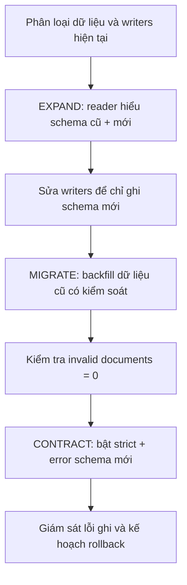
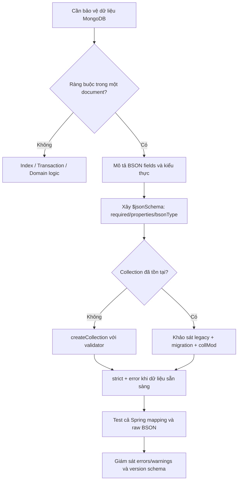

# JSON Schema, validator và ràng buộc kiểu BSON trong Spring Data MongoDB

## 1. Vì sao MongoDB cần schema validation?

MongoDB lưu dữ liệu dưới dạng **BSON document**. Hai document trong cùng collection có thể có những field khác nhau, thiếu field hoặc dùng các kiểu BSON khác nhau. Tính linh hoạt này hữu ích khi phát triển nhanh, nhưng nếu không có hợp đồng dữ liệu, ứng dụng có thể gặp lỗi khó phát hiện:

- `total_cents` của đơn hàng A là BSON Int64, đơn hàng B lại là chuỗi `"25000"`.
- `created_at` có document lưu BSON Date, document khác lưu chuỗi ISO 8601.
- `status` bị gõ nhầm thành `"PIAD"` nhưng vẫn được ghi thành công.
- `items` đôi khi là array, đôi khi lại là một object đơn.
- Code của một service cũ ghi document thiếu `tenant_id`, tạo nguy cơ lộ dữ liệu nếu truy vấn không bảo vệ đúng.

Trong module **SPRING_DATA_MONGODB**, ứng dụng Java thường sử dụng `@Document`, `@Field`, `MongoTemplate`, repository và các converter để ánh xạ entity thành BSON. **Java mapping không tự bảo đảm rằng mọi đường ghi vào MongoDB đều tuân thủ cùng một cấu trúc**: một ứng dụng khác, script `mongosh`, job import, raw driver hoặc phiên bản service cũ vẫn có thể ghi dữ liệu khác kỳ vọng.

MongoDB hỗ trợ **collection validator**, trong đó `$jsonSchema` là công cụ phổ biến để mô tả các yêu cầu về field và kiểu BSON ngay tại database. Khi thao tác ghi chịu kiểm tra validation, server có thể từ chối document không thỏa schema.

```text
Ứng dụng Spring Data / raw driver / script import
                  |
                  v
         MongoDB collection
                  |
                  v
        Collection validator
          ($jsonSchema)
                  |
          +-------+-------+
          |               |
        Hợp lệ         Không hợp lệ
          |               |
          v               v
      Ghi được      "error" -> từ chối
                    "warn"  -> cảnh báo, vẫn cho ghi
```

**Mục tiêu bài học:** hiểu sự khác nhau giữa JSON Schema và BSON type, tạo validator trên collection, kiểm soát `required`/`null`/`array`/`object`, áp dụng schema bằng `createCollection` hoặc `collMod`, kết nối với Spring Data MongoDB và kiểm thử các cập nhật thực tế.

### 1.1. Bốn lớp ràng buộc cần phân biệt

| Cơ chế | Nằm ở đâu? | Bảo vệ điều gì? | Giới hạn |
|---|---|---|---|
| Java type, constructor, domain logic | Ứng dụng | Tạo object đúng kiểu, quy tắc nghiệp vụ | Không kiểm soát raw driver hay ứng dụng khác |
| Bean Validation (`@NotNull`, `@Min`, …) | Ứng dụng Spring/Java | Kiểm tra object khi được gọi đúng đường validation | Không phải MongoDB collection validator |
| MongoDB `$jsonSchema` validator | Database collection | Hình dạng document, sự có mặt và kiểu field khi ghi | Không thay thế uniqueness, foreign key hay toàn bộ nghiệp vụ |
| Unique/partial/TTL/index khác | Database | Ràng buộc uniqueness hoặc hỗ trợ truy vấn/vòng đời | Mỗi loại index có semantics riêng, không thay `$jsonSchema` |

Một hệ thống nghiêm túc có thể **kết hợp cả bốn lớp**, thay vì chọn một lớp rồi giả định những lớp còn lại là thừa.

## 2. Dữ liệu mẫu và hợp đồng cần bảo vệ

### 2.1. Collection orders

Ta xây một ứng dụng quản lý đơn hàng. Mỗi document cần:

- `tenant_id`: String không rỗng, bắt buộc.
- `status`: một trong `NEW`, `PAID`, `CANCELLED`, bắt buộc.
- `total_cents`: BSON Int64 (`long`), không âm.
- `created_at`: BSON Date, bắt buộc.
- `items`: array không rỗng của các object `{sku, quantity, unit_price_cents}`.
- `note`: tùy chọn; nếu có, chấp nhận String hoặc BSON null.

Một document hợp lệ:

```javascript
{
  _id: "ORD-101",
  tenant_id: "T-A",
  status: "PAID",
  total_cents: NumberLong(25000),
  created_at: ISODate("2026-01-15T08:30:00Z"),
  items: [
    {
      sku: "SKU-BOOK",
      quantity: NumberInt(2),
      unit_price_cents: NumberLong(12500)
    }
  ],
  note: "Thanh toán thành công"
}
```

**Quan trọng:** `NumberLong(25000)` trong `mongosh` biểu thị BSON **Int64**; `NumberInt(2)` biểu thị BSON **Int32**; `ISODate(...)` biểu thị BSON **Date**. Số và ngày trông tương tự nhau khi in ra JSON nhưng **kiểu BSON được lưu mới là thứ validator kiểm tra**.

### 2.2. Những document tưởng đúng nhưng không hợp lệ

```javascript
// Sai: total_cents là String thay vì BSON Int64.
{
  _id: "ORD-102",
  tenant_id: "T-A",
  status: "PAID",
  total_cents: "25000",
  created_at: ISODate("2026-01-15T08:30:00Z"),
  items: [{ sku: "SKU-BOOK", quantity: NumberInt(2),
            unit_price_cents: NumberLong(12500) }]
}

// Sai: status không thuộc tập giá trị được phép.
{
  _id: "ORD-103",
  tenant_id: "T-A",
  status: "PIAD",
  total_cents: NumberLong(25000),
  created_at: ISODate("2026-01-15T08:30:00Z"),
  items: [{ sku: "SKU-BOOK", quantity: NumberInt(2),
            unit_price_cents: NumberLong(12500) }]
}

// Sai: thiếu tenant_id và items là object, không phải array.
{
  _id: "ORD-104",
  status: "NEW",
  total_cents: NumberLong(0),
  created_at: ISODate("2026-01-15T08:30:00Z"),
  items: { sku: "SKU-BOOK", quantity: NumberInt(1),
           unit_price_cents: NumberLong(0) }
}
```

Nếu không có validator, những document này có thể được lưu và sau đó gây lỗi cho repository, aggregation, index, hoặc code đọc dữ liệu.

### 2.3. Phân biệt tên field lưu trữ và Java property

Ở Java, entity có thể dùng `tenantId`, `totalCents`, `createdAt`. Trong BSON, chúng có tên `tenant_id`, `total_cents`, `created_at` do `@Field`.

**Schema của collection phải mô tả field BSON thực tế**, không phải tên property Java. Viết `"required": ["totalCents"]` khi document thật lưu `total_cents` có thể khiến mọi document hợp lệ về mặt entity bị validator coi là thiếu field.

## 3. JSON Schema của MongoDB khác JSON Schema thuần thế nào?

MongoDB hỗ trợ một tập các keyword lấy cảm hứng từ **JSON Schema** và bổ sung keyword **`bsonType`** để biểu đạt kiểu dữ liệu BSON.

Một cấu trúc đơn giản:

```javascript
{
  $jsonSchema: {
    bsonType: "object",
    required: ["tenant_id", "status"],
    properties: {
      tenant_id: {
        bsonType: "string",
        minLength: 1
      },
      status: {
        enum: ["NEW", "PAID", "CANCELLED"]
      }
    }
  }
}
```

**Hai lớp dễ nhầm:**

1. `$jsonSchema` là **toán tử MongoDB** được dùng trong validator hoặc query.
2. Object bên trong là **tài liệu schema**, chứa các keyword `bsonType`, `required`, `properties`, `enum`, `minimum`, `items`,…

Một file JSON Schema trên website bất kỳ **không chắc** có thể copy nguyên văn thành MongoDB validator: MongoDB hỗ trợ tập keyword riêng, có ràng buộc và cách xử lý kiểu BSON riêng. Hãy kiểm tra **MongoDB Server version** và tài liệu của phiên bản đang dùng, nhất là những keyword liên quan đến reference, format, validator extension hoặc biểu thức phức tạp.

### 3.1. Các keyword cần nhớ

| Keyword | Ý nghĩa | Ví dụ |
|---|---|---|
| `bsonType` | Kiểu BSON được phép | `"long"`, `"date"`, `"array"` |
| `required` | Field phải hiện diện trong object | `["tenant_id", "status"]` |
| `properties` | Schema cho từng field | `tenant_id: {bsonType:"string"}` |
| `enum` | Tập giá trị cho phép | `["NEW","PAID"]` |
| `minimum`, `maximum` | Khoảng giá trị số | `minimum: 0` |
| `minLength`, `maxLength` | Giới hạn độ dài String | `minLength: 1` |
| `pattern` | Regex kiểm tra giá trị String | `"^[A-Z0-9-]+$"` |
| `items` | Schema của phần tử array | `{bsonType:"object"}` |
| `minItems`, `maxItems` | Giới hạn số phần tử array | `minItems: 1` |
| `additionalProperties` | Có cho field ngoài `properties` không | `false` |
| `description` | Mô tả để người đọc và công cụ quản lý hiểu schema | `"Mã tenant..."` |

Các giới hạn schema nên phản ánh **nghiệp vụ và dữ liệu thực**. Ví dụ `maxItems: 100` không phải giới hạn MongoDB đặt sẵn, mà là chính sách collection muốn áp dụng.

### 3.2. type và bsonType: không cùng phạm vi

JSON Schema thông thường có thể mô tả `type: "number"`, `type: "integer"`, `type: "string"`. Nhưng MongoDB còn phân biệt:

- BSON Int32: `"int"`.
- BSON Int64: `"long"`.
- BSON Double: `"double"`.
- BSON Decimal128: `"decimal"`.
- BSON Date: `"date"`.
- BSON ObjectId: `"objectId"`.
- BSON Null: `"null"`.
- BSON Array: `"array"`.
- BSON Object: `"object"`.
- BSON Boolean: `"bool"`.

Với validator quan tâm **đúng representation lưu trữ**, `bsonType` rõ hơn một mô tả kiểu JSON chung. Một số kiểu số có thể được chấp nhận qua schema dạng union nếu ứng dụng cần tương thích với dữ liệu cũ; không đồng nhất Int32 và Int64 chỉ vì Java có thể chuyển chúng sang `long` khi đọc.

### 3.3. JSON Schema không tự tạo ràng buộc liên collection

`$jsonSchema` giúp kiểm tra **một document**. Nó không tự bảo đảm:

- Email của mọi customer là duy nhất.
- `customer_id` trong order trỏ đến customer có thật.
- Tổng tiền bằng giá của từng item **theo một quy tắc phức tạp** đã được ứng dụng định nghĩa.
- Mọi document của hai collection được cập nhật cùng transaction.
- Mỗi tenant chỉ có đúng một hóa đơn với business key nào đó.

Những yêu cầu này cần phối hợp index, transaction, domain logic, kiểm thử và quy trình dữ liệu.

## 4. Viết schema đầy đủ cho collection orders

### 4.1. Schema dùng bsonType và required

```javascript
const orderSchema = {
  bsonType: "object",
  required: [
    "tenant_id",
    "status",
    "total_cents",
    "created_at",
    "items"
  ],
  properties: {
    _id: {
      description: "Định danh đơn; ví dụ này dùng BSON String",
      bsonType: "string"
    },
    tenant_id: {
      bsonType: "string",
      minLength: 1,
      maxLength: 80
    },
    status: {
      bsonType: "string",
      enum: ["NEW", "PAID", "CANCELLED"]
    },
    total_cents: {
      bsonType: "long",
      minimum: 0
    },
    created_at: {
      bsonType: "date"
    },
    items: {
      bsonType: "array",
      minItems: 1,
      items: {
        bsonType: "object",
        required: [
          "sku",
          "quantity",
          "unit_price_cents"
        ],
        properties: {
          sku: {
            bsonType: "string",
            minLength: 1
          },
          quantity: {
            bsonType: "int",
            minimum: 1
          },
          unit_price_cents: {
            bsonType: "long",
            minimum: 0
          }
        }
      }
    },
    note: {
      bsonType: ["string", "null"]
    }
  }
};
```

Schema này dùng để:

1. Bắt buộc các field cốt lõi có mặt.
2. Bắt đúng kiểu BSON của số tiền, thời gian, array và quantity.
3. Từ chối status không thuộc enum.
4. Giữ array `items` không rỗng và yêu cầu mỗi phần tử có ba field.
5. Cho phép `note` không tồn tại, chứa String hoặc BSON null.

**Không dùng `additionalProperties: false` ở cấp root trong ví dụ đầu**. Với Spring Data, document có thể có `_class` hoặc các metadata/field mới. Đóng schema quá sớm sẽ làm những field này bị từ chối. Phần 9 sẽ phân tích cách dùng `additionalProperties` đúng.

### 4.2. Schema root vẫn có thể cho phép field khác

Khi không khai báo `additionalProperties: false`, một field như `debug_note` có thể không bị schema trên cấm, nếu các điều kiện khác được thỏa. Điều này là **chủ ý** trong giai đoạn schema mở/tiến hóa. Nếu sản phẩm bắt buộc danh sách field đóng, cần thêm `additionalProperties: false` và liệt kê đầy đủ `_id`, `_class` (nếu có), cùng mọi field hợp lệ.

### 4.3. Mô hình dữ liệu trong Java phải thống nhất schema

Một schema cho `total_cents: long` cần tương thích với cách Java converter ghi `long`. Một schema cho `quantity: int` cần Java `int`/`Integer` được chuyển thành BSON Int32 theo cấu hình thông thường. Một schema cho `created_at: date` cần converter lưu BSON Date, không phải String.

Đừng nhìn vào JSON response qua Jackson mà kết luận MongoDB lưu cùng kiểu: REST JSON và BSON database là **hai representation khác nhau**.

## 5. Tạo collection với validator bằng mongosh

Đặt `orderSchema` từ mục 4 trong cùng phiên `mongosh`, rồi tạo collection:

```javascript
db.createCollection("orders", {
  validator: {
    $jsonSchema: orderSchema
  },
  validationLevel: "strict",
  validationAction: "error"
});
```

Giải thích:

- `validator`: biểu thức kiểm tra document.
- `$jsonSchema: orderSchema`: dùng JSON Schema đã khai báo.
- `validationLevel: "strict"`: áp dụng kiểm tra cho inserts/updates thuộc phạm vi validation với các document cần kiểm tra.
- `validationAction: "error"`: khi document vi phạm, MongoDB từ chối thao tác ghi tương ứng.

Một collection mới là thời điểm thuận lợi để định nghĩa validation ngay từ đầu. Nếu collection **đã tồn tại**, `db.createCollection(...)` sẽ không phải cách cập nhật validator; dùng `collMod` như mục 10.

### 5.1. Chèn document hợp lệ

```javascript
db.orders.insertOne({
  _id: "ORD-101",
  tenant_id: "T-A",
  status: "PAID",
  total_cents: NumberLong(25000),
  created_at: ISODate("2026-01-15T08:30:00Z"),
  items: [
    {
      sku: "SKU-BOOK",
      quantity: NumberInt(2),
      unit_price_cents: NumberLong(12500)
    }
  ]
});
```

Với schema mẫu, document đáp ứng kiểu BSON và các yêu cầu bắt buộc, nên lệnh có thể thành công nếu database, quyền và các ràng buộc khác cũng hợp lệ.

### 5.2. Thử một document sai kiểu

```javascript
db.orders.insertOne({
  _id: "ORD-102",
  tenant_id: "T-A",
  status: "PAID",
  total_cents: "25000", // Sai: BSON String.
  created_at: ISODate("2026-01-15T08:30:00Z"),
  items: [
    {
      sku: "SKU-BOOK",
      quantity: NumberInt(2),
      unit_price_cents: NumberLong(12500)
    }
  ]
});
```

Với `validationAction: "error"` và write không bypass validation, MongoDB từ chối vì `total_cents` không phải BSON `long`. Trong nhiều phiên bản MongoDB, lỗi validation có mã **121 (DocumentValidationFailure)**; exception và chi tiết thông báo qua driver/Spring có thể khác theo server, write mode và framework.

Không nên assert toàn bộ message lỗi dưới dạng String cố định, vì cấu trúc `errInfo`, localized text và driver error wrapper có thể khác nhau giữa các phiên bản.

### 5.3. Xác nhận validator trong metadata của collection

```javascript
db.getCollectionInfos({ name: "orders" });
```

Thông tin collection thường bao gồm `options.validator`, `validationLevel` và `validationAction`. Đây là cách tốt để xác minh validator đã được cài, thay vì chỉ đọc lại một file schema trong repository code.

### 5.4. Không đặt validator đồng nghĩa chỉ có insert bị kiểm tra

MongoDB validator tham gia vào các **thao tác ghi document**, bao gồm insert và update theo chế độ validation tương ứng. Vì vậy một update chỉ đổi `status` cũng có thể bị từ chối nếu document sau update vi phạm schema, ví dụ document còn thiếu `tenant_id` từ dữ liệu legacy.

Với update operator:

```javascript
db.orders.updateOne(
  { _id: "ORD-101" },
  { $set: { status: "CANCELLED" } }
);
```

Document sau update vẫn phải đáp ứng schema. Nếu gán `status: null` khi schema yêu cầu String/enum, update sẽ không hợp lệ.

## 6. Ràng buộc kiểu BSON: Int32, Int64, Decimal128, Date và ObjectId

### 6.1. Cùng một giá trị số, nhiều kiểu lưu trữ

Giá trị `25000` có thể được lưu bằng những kiểu BSON khác nhau:

```javascript
db.numeric_samples.insertMany([
  { _id: "int32",   amount: NumberInt(25000) },
  { _id: "int64",   amount: NumberLong(25000) },
  { _id: "double",  amount: 25000.0 },
  { _id: "decimal", amount: NumberDecimal("25000.00") },
  { _id: "string",  amount: "25000" }
]);
```

Đọc kiểu thực tế bằng aggregation expression `$type`:

```javascript
db.numeric_samples.aggregate([
  {
    $project: {
      _id: 1,
      valueType: { $type: "$amount" }
    }
  }
]);
```

`valueType` phản ánh **kiểu BSON được lưu** chứ không phải Java type mà repository tự chuyển lúc đọc. Nếu schema yêu cầu `bsonType: "long"`, nó không tự chấp nhận `"int"` hoặc `"double"` chỉ vì cùng đại diện cho 25000.

### 6.2. Bảng kiểu thường gặp trong Spring Data MongoDB

| BSON type trong schema | Ví dụ `mongosh` | Java thường gặp | Lưu ý |
|---|---|---|---|
| `"string"` | `"T-A"` | `String` | Độ dài và pattern có thể kiểm soát thêm |
| `"bool"` | `true`/`false` | `Boolean`/`boolean` | Không đánh đồng missing, null với false |
| `"int"` | `NumberInt(3)` | `Integer`/`int` | 32-bit signed |
| `"long"` | `NumberLong(25000)` | `Long`/`long` | 64-bit signed |
| `"double"` | `25000.0` | `Double`/`double` | Có sai số nhị phân khi biểu diễn một số thập phân |
| `"decimal"` | `NumberDecimal("12.34")` | `Decimal128` hoặc `BigDecimal` với mapping phù hợp | Hợp đồng độ chính xác/scale |
| `"date"` | `ISODate(...)` | `Date`/`Instant` theo converter | BSON Date lưu thời điểm theo millisecond từ epoch |
| `"objectId"` | `ObjectId("...")` | `ObjectId`, đôi khi Java String ID được chuyển | Phân biệt ObjectId với String chứa hex |
| `"array"` | `["a","b"]` | `List<String>`, `Set<String>` tùy converter | Kiểm tra `items`/`minItems` |
| `"object"` | `{sku:"X"}` | Embedded object/`Document` | Kiểm tra nested properties |
| `"null"` | `null` | `null` | Field có mặt với BSON null |

Đây là **mapping thường gặp**, không phải cam kết mọi converter/custom codec đều cho representation giống nhau. Khi ứng dụng dùng `@Field(targetType=...)`, custom converters hoặc `MongoCustomConversions`, phải kiểm tra BSON thật.

### 6.3. Chấp nhận nhiều BSON types trong giai đoạn chuyển đổi

Nếu collection cũ chứa cả BSON Int32 và Int64 cho `total_cents`, có thể cân nhắc schema tạm:

```javascript
{
  bsonType: ["int", "long"],
  minimum: 0
}
```

Điều này nới lỏng compatibility nhưng **không tự chuyển đổi** số Int32 thành Int64. Cần kế hoạch migration: xác định dữ liệu cũ, chuyển kiểu có kiểm soát, sửa tất cả writer, rồi thu schema về `"long"`.

Không mở union `["int","long","double","string"]` chỉ để mọi dữ liệu cũ đều được nhận mà không có kế hoạch sửa. Khi số tiền có thể là String hoặc Double, aggregation và phép so sánh có thể có ngữ nghĩa không mong muốn.

### 6.4. Tiền tệ: long cents hay Decimal128?

Hai mô hình thường gặp:

**Mô hình số nguyên đơn vị nhỏ nhất:**

```javascript
{ total_cents: NumberLong(25000) }
```

JSON Schema:

```javascript
{ bsonType: "long", minimum: 0 }
```

**Mô hình decimal:**

```javascript
{ total_amount: NumberDecimal("250.00") }
```

JSON Schema:

```javascript
{ bsonType: "decimal", minimum: NumberDecimal("0.00") }
```

Nếu dùng Java `BigDecimal`, hãy cấu hình và kiểm tra mapping sang BSON Decimal128 thật sự theo phiên bản Spring Data. Đừng mặc định `BigDecimal` luôn được lưu cùng kiểu trên mọi ứng dụng hoặc converter cũ. Cũng không trộn cả `total_cents` và `total_amount` mà không có một hợp đồng đơn vị chuẩn.

### 6.5. _id là String hay ObjectId?

Trong ví dụ, `_id: "ORD-101"` là BSON String. Nếu một collection dùng MongoDB ObjectId thực:

```javascript
{ _id: ObjectId("65a000000000000000000001") }
```

thì schema `_id: { bsonType: "string" }` sẽ từ chối ObjectId. Không được mặc định kiểu `_id` chỉ từ Java `@Id String id`: Spring Data có quy tắc chuyển một số String có dạng ObjectId thành BSON ObjectId, tùy annotation/mapper và nội dung ID.

Muốn giữ ID là String một cách rõ ràng, xem xét `@MongoId(FieldType.STRING)` hoặc mapping ID được cấu hình phù hợp. Đổi kiểu BSON của `_id` trong collection đang chạy có thể ảnh hưởng repository, DBRef, unique index và các document tham chiếu; đây là quyết định schema migration, không chỉ là sửa một annotation.

### 6.6. createdAt: String ISO không phải BSON Date

Hai cách ghi khác nhau:

```javascript
{ created_at: "2026-01-15T08:30:00Z" }     // String
{ created_at: ISODate("2026-01-15T08:30:00Z") } // Date
```

JSON Schema:

```javascript
{ bsonType: "date" }
```

chỉ cho phép BSON Date. Lợi ích là tránh trộn kiểu khi lọc theo range, dùng TTL index hoặc aggregation trên thời gian. Tuy nhiên validator không xác định business timezone hay lịch làm việc: ứng dụng vẫn phải chuyển local date/time thành `Instant` theo quy định.

## 7. Required, null, missing, empty String và empty Array

### 7.1. required chỉ yêu cầu sự hiện diện của field

Xem schema:

```javascript
{
  bsonType: "object",
  required: ["tenant_id"],
  properties: {
    tenant_id: {
      bsonType: ["string", "null"]
    }
  }
}
```

Với cấu hình này:

| Document | Kết quả | Vì sao? |
|---|---|---|
| `{ tenant_id: "T-A" }` | Hợp lệ | Field có mặt, String |
| `{ tenant_id: null }` | Hợp lệ | Field có mặt, union cho phép null |
| `{ }` | Không hợp lệ | Thiếu field được liệt kê trong `required` |
| `{ tenant_id: 3 }` | Không hợp lệ | Có mặt nhưng sai kiểu BSON |

Nếu nghiệp vụ cần tenant ID **không null và không rỗng**, schema nên kết hợp:

```javascript
{
  bsonType: "object",
  required: ["tenant_id"],
  properties: {
    tenant_id: {
      bsonType: "string",
      minLength: 1
    }
  }
}
```

`required` giải quyết **missing**, `bsonType: "string"` giải quyết **null/kiểu**, và `minLength: 1` giải quyết **chuỗi rỗng**. Ba ràng buộc bổ sung nhau.

### 7.2. Không bắt buộc một field không có nghĩa field đó được chứa mọi kiểu

`note` trong schema ở mục 4 **không nằm trong `required`** nhưng được khai báo:

```javascript
note: { bsonType: ["string", "null"] }
```

Trường hợp:

```javascript
// Không có note: hợp lệ.
{ /* các field bắt buộc khác */ }

// note là null: hợp lệ.
{ note: null /* + field bắt buộc khác */ }

// note là String: hợp lệ.
{ note: "Giao buổi sáng" /* + field bắt buộc khác */ }

// note là số: không hợp lệ.
{ note: NumberInt(5) /* + field bắt buộc khác */ }
```

Một property chỉ bị validator kiểm tra theo `properties` **nếu nó tồn tại**. Muốn bắt buộc property, phải đưa tên vào `required`.

### 7.3. Mảng rỗng là một giá trị hợp lệ của bsonType array nếu không có minItems

```javascript
items: {
  bsonType: "array"
}
```

cho phép `items: []`. Để bắt array chứa ít nhất một phần tử:

```javascript
items: {
  bsonType: "array",
  minItems: 1
}
```

Nếu business chấp nhận đơn draft chưa có item, không nên áp `minItems: 1` cho **mọi status** một cách máy móc. Có thể cần mô hình riêng cho draft, giai đoạn hoàn tất có validation riêng ở tầng nghiệp vụ hoặc một collection/schema có ràng buộc điều kiện phù hợp.

### 7.4. Missing và null trong query cũng khác nhau

MongoDB query:

```javascript
db.orders.find({ note: null });
```

có thể khớp document có `note` là BSON null **và** document thiếu `note`. Query:

```javascript
db.orders.find({ note: { $exists: false } });
```

chỉ tìm những document không có field. Nếu cần field tồn tại và có type null:

```javascript
db.orders.find({
  note: { $type: "null" }
});
```

Những khác biệt này quan trọng khi kiểm tra dữ liệu legacy trước khi bật validator nghiêm ngặt. Một field `note` không bắt buộc có thể có missing hợp lệ, vì vậy không nên coi mọi document thiếu `note` là dữ liệu lỗi.

## 8. Nested objects, arrays và giới hạn phần tử

### 8.1. Schema cho từng phần tử trong items

Trong schema ở mục 4:

```javascript
items: {
  bsonType: "array",
  minItems: 1,
  items: {
    bsonType: "object",
    required: ["sku", "quantity", "unit_price_cents"],
    properties: {
      sku: {
        bsonType: "string",
        minLength: 1
      },
      quantity: {
        bsonType: "int",
        minimum: 1
      },
      unit_price_cents: {
        bsonType: "long",
        minimum: 0
      }
    }
  }
}
```

Mỗi phần tử của array được yêu cầu là object đúng cấu trúc. Nếu một phần tử chứa `quantity: "2"` (String), cả document có thể bị validator từ chối, vì validation áp dụng cho **document sau thao tác ghi**.

### 8.2. $push vẫn chịu kiểm tra validator

Một update qua MongoDB:

```javascript
db.orders.updateOne(
  { _id: "ORD-101" },
  {
    $push: {
      items: {
        sku: "SKU-PEN",
        quantity: NumberInt(1),
        unit_price_cents: NumberLong(5000)
      }
    }
  }
);
```

có thể được chấp nhận nếu document sau update vẫn đáp ứng schema. Nhưng:

```javascript
db.orders.updateOne(
  { _id: "ORD-101" },
  {
    $push: {
      items: {
        sku: "SKU-PEN",
        quantity: "1",
        unit_price_cents: NumberLong(5000)
      }
    }
  }
);
```

sẽ tạo array chứa một object `quantity` sai BSON type và bị từ chối khi validationAction là error và validation được thực thi. Dù chỉ sửa một phần tử, document sau update vẫn là đối tượng chịu kiểm tra.

### 8.3. Giới hạn số phần tử array

Schema có thể bổ sung:

```javascript
items: {
  bsonType: "array",
  minItems: 1,
  maxItems: 100,
  items: { bsonType: "object" }
}
```

`maxItems: 100` giới hạn **chiều dài array cuối cùng**, nhưng không tự lưu phần tử mới vào collection khác, không quản lý thứ tự và không loại bỏ rủi ro nhiều writer cùng ghi document nóng.

MongoDB vẫn có **giới hạn 16 MiB cho mỗi document BSON**; ngay cả array dưới 100 phần tử cũng có thể chạm giới hạn nếu từng phần tử quá lớn. Kiểm soát kích thước input và thiết kế collection con khi dữ liệu có xu hướng tăng không giới hạn.

### 8.4. uniqueItems không tương đương unique theo sku

Một array có thể chứa hai phần tử:

```javascript
[
  { sku: "SKU-BOOK", quantity: NumberInt(1) },
  { sku: "SKU-BOOK", quantity: NumberInt(2) }
]
```

Hai object khác nhau ở `quantity`, nhưng có **cùng SKU**. Một ràng buộc dạng `uniqueItems` (khi được server hỗ trợ theo schema) kiểm soát equality của **toàn phần tử**, không tự diễn đạt “không có hai item nào trùng field sku”.

Nếu business yêu cầu một SKU chỉ xuất hiện một lần trong order, cần normalize/merge item ở domain, dùng update với điều kiện phù hợp, hoặc chuyển sang cấu trúc lưu trữ cho phép uniqueness theo business key được database bảo đảm. **Unique multikey index** cũng không nên được coi là giải pháp tự động ngăn trùng giữa các phần tử của **chính cùng một document**.

### 8.5. Cân nhắc $elemMatch khi truy vấn array

Validator đảm bảo mỗi phần tử `items` có đúng kiểu, nhưng khi query cần “cùng một item có `sku = A` và `quantity >= 2`”, sử dụng `$elemMatch`:

```javascript
db.orders.find({
  items: {
    $elemMatch: {
      sku: "SKU-BOOK",
      quantity: { $gte: NumberInt(2) }
    }
  }
});
```

Không dựa vào hai dot paths độc lập rồi mặc định chúng cùng ràng buộc một phần tử array. **Schema validation và query semantics là hai bài toán khác nhau.**

## 9. additionalProperties: false, _id và metadata _class

### 9.1. Vì sao schema đóng dễ làm Spring Data gặp lỗi?

Giả sử bật:

```javascript
{
  bsonType: "object",
  additionalProperties: false,
  required: ["tenant_id", "status"],
  properties: {
    tenant_id: { bsonType: "string" },
    status: { bsonType: "string" }
  }
}
```

Schema này không liệt kê `_id`, dù MongoDB document thông thường có `_id`. Nếu validator cấm mọi field ngoài `properties`, document có `_id` sẽ không đáp ứng schema.

Với Spring Data MongoDB, entity còn có thể được ghi kèm `_class` (type discriminator) tùy mapping configuration. Khi `additionalProperties: false` mà quên `_class`, những document Spring Data lưu hợp lệ về mặt domain vẫn có thể bị database từ chối.

### 9.2. Cấu hình schema đóng phải liệt kê mọi field cho phép

Ví dụ bổ sung đầy đủ ở một mô hình đơn giản:

```javascript
{
  bsonType: "object",
  additionalProperties: false,
  required: ["tenant_id", "status"],
  properties: {
    _id: { bsonType: "string" },
    _class: { bsonType: "string" },
    tenant_id: { bsonType: "string", minLength: 1 },
    status: { enum: ["NEW", "PAID", "CANCELLED"] }
  }
}
```

Đây chỉ là ví dụ minh họa **cách khai báo metadata được phép**, không phải schema `orders` đầy đủ trong mục 4. Nếu thật sự áp dụng schema đóng, liệt kê tất cả business fields và nested fields cần thiết.

Lưu ý:

- `_class` có thể có giá trị alias khác tên class đầy đủ; schema chỉ yêu cầu String ở đây.
- Không phải mọi ứng dụng Spring Data đều lưu `_class` ở root; xem `MongoTypeMapper` và custom converters.
- Nếu `_id` là ObjectId trong collection thật, thay `bsonType: "string"` theo thực tế; có thể cần union trong giai đoạn migration.
- Khi thêm field mới trong phiên bản ứng dụng sau, schema đóng phải được cập nhật có kiểm soát **trước khi writer mới bắt đầu ghi field đó**.

### 9.3. Khi nào nên dùng schema mở?

Trong hệ thống microservices có các phiên bản writer lệch nhau, một schema mở với **kiểm soát chặt các field quan trọng** có thể ít rủi ro deploy hơn:

```javascript
{
  bsonType: "object",
  required: ["tenant_id", "status", "total_cents"],
  properties: {
    tenant_id: { bsonType: "string", minLength: 1 },
    status: { enum: ["NEW", "PAID", "CANCELLED"] },
    total_cents: { bsonType: "long", minimum: 0 }
  }
  // Không cấm những field khác.
}
```

Điều này không thay thế việc review field nhạy cảm. Nó chỉ giữ hợp đồng tối thiểu trong khi dữ liệu được mở rộng. Nếu yêu cầu bảo mật/tuân thủ buộc phải cấm field ngoài danh sách, dùng schema đóng và một quy trình release/migration nghiêm ngặt.

### 9.4. Đóng object con cũng cần cân nhắc

`additionalProperties: false` có thể áp dụng cho **nested items**, không nhất thiết phải đóng root. Nhưng một serializer/converter có thể thêm metadata vào embedded object trong các trường hợp polymorphic mapping. Cần xác minh BSON thực của object con trước khi chặn field bổ sung.

## 10. Thay đổi validator trên collection đang tồn tại bằng collMod

### 10.1. collMod là thao tác quản trị schema, không phải migration tự động

Một collection `orders` có sẵn có thể chưa dùng validator hoặc đang dùng schema cũ. MongoDB cung cấp command **`collMod`** để cập nhật validator và các tùy chọn của collection:

```javascript
db.runCommand({
  collMod: "orders",
  validator: {
    $jsonSchema: orderSchema
  },
  validationLevel: "strict",
  validationAction: "error"
});
```

Trong đó `orderSchema` là JavaScript object ở mục 4, phải tồn tại trong cùng phiên `mongosh`. `collMod` yêu cầu quyền phù hợp, có thể chịu tác động của replication/operational constraints và không nên chạy tùy tiện trong startup của nhiều ứng dụng.

**Cực kỳ quan trọng:** thay đổi validator **không tự động đọc, sửa và chuyển đổi toàn bộ document cũ**. Document legacy không hợp lệ có thể vẫn nằm trong collection sau khi `collMod` chạy. Khi chúng được cập nhật dưới chế độ strict/error, thao tác ghi có thể bị từ chối vì document sau update chưa phù hợp schema.

### 10.2. Ví dụ thêm một field bắt buộc

Giả sử phiên bản đầu chỉ lưu:

```javascript
{
  _id: "ORD-OLD",
  status: "PAID",
  total_cents: NumberLong(10000)
}
```

Phiên bản mới muốn bắt buộc thêm `tenant_id` và `created_at`. Nếu bật strict/error ngay, update đơn thuần:

```javascript
db.orders.updateOne(
  { _id: "ORD-OLD" },
  { $set: { status: "CANCELLED" } }
);
```

có thể thất bại vì document sau update vẫn thiếu tenant/time. Điều đó không có nghĩa việc đổi status sai; đó là **vi phạm schema mới**.

Kế hoạch an toàn hơn:

1. Xác định danh sách dữ liệu cũ thiếu field.
2. Quy định nguồn tin cậy để suy ra `tenant_id` và `created_at`. **Không tự bịa tenant ID** chỉ để qua validator.
3. Sửa writer cũ và cập nhật service đọc dữ liệu tương thích.
4. Backfill/migrate dữ liệu đã được phân loại.
5. Bật validation cứng khi dữ liệu và các đường ghi đã sẵn sàng.

### 10.3. Kiểm tra validator sau collMod

```javascript
db.getCollectionInfos({ name: "orders" });
```

Sau khi chạy, xác minh `options.validator`/`validationLevel`/`validationAction` và thử những thao tác ghi hợp lệ/không hợp lệ trong môi trường test. Không xem command chạy thành công là bằng chứng tất cả document cũ đang đúng schema.

### 10.4. Rollback cũng cần kế hoạch

Nếu schema mới làm writer hiện tại bị chặn, có thể cần:

- Sửa lại writer hoặc converter đang ghi sai.
- Nới validator có kiểm soát bằng `collMod` để khôi phục tính tương thích.
- Backfill dữ liệu được tạo trong thời gian chuyển tiếp.
- Tái áp dụng schema chặt sau khi kiểm thử.

Không coi `validationAction: "warn"` là rollback hoàn hảo về bảo mật: nó **cho phép ghi những document trái schema**. Dùng chế độ này cần giới hạn thời gian, alert và người chịu trách nhiệm xử lý.

## 11. validationLevel và validationAction: hai trục khác nhau

### 11.1. validationLevel: strict và moderate

`validationLevel` xác định **những document nào chịu kiểm tra**.

| Chế độ | Insert mới | Update document hiện đang hợp lệ | Update document legacy đã không hợp lệ |
|---|---|---|---|
| `strict` | Có kiểm tra | Có kiểm tra | Có kiểm tra |
| `moderate` | Có kiểm tra | Có kiểm tra | Có thể được miễn kiểm tra nếu document **đã không hợp lệ trước update** |

`moderate` hữu ích khi đang chuyển tiếp từ dữ liệu cũ không theo schema sang dữ liệu mới, để một số cập nhật legacy không bị chặn ngay. Nhưng nó có nghĩa các document đã không hợp lệ **không tự trở nên hợp lệ**, và có thể tiếp tục thay đổi mà không bị buộc sửa các lỗi cũ.

Đừng diễn giải `moderate` thành “chỉ validate insert, bỏ qua mọi update”. Những update trên document đã hợp lệ vẫn thuộc phạm vi kiểm tra.

### 11.2. validationAction: error và warn

`validationAction` quyết định **phải làm gì khi document vi phạm**.

| Chế độ | Hành vi chính | Phù hợp khi |
|---|---|---|
| `error` | Từ chối write không hợp lệ nếu write chịu kiểm tra | Muốn bảo vệ schema trong production |
| `warn` | Cho phép write nhưng ghi cảnh báo validation | Quan sát mức độ vi phạm khi rollout/migration |

`warn` có thể giúp quan sát writer cũ đang tạo dữ liệu sai, nhưng **không duy trì tính đúng đắn của dữ liệu**. Cảnh báo phải được thu thập và theo dõi; ứng dụng Java có thể nhận kết quả ghi thành công, nên không thể dựa vào response của request để biết có vi phạm khi dùng warn.

### 11.3. Bảng hành vi theo cặp cấu hình

| Cấu hình | Ý nghĩa thực tiễn |
|---|---|
| `strict + error` | Kiểm tra rộng và từ chối các writes không hợp lệ; mục tiêu sau migration |
| `strict + warn` | Quan sát tất cả writes thuộc phạm vi kiểm tra mà không chặn |
| `moderate + error` | Bảo vệ writes trên document mới/đã hợp lệ nhưng vẫn cho một số legacy invalid updates qua |
| `moderate + warn` | Giai đoạn chuyển tiếp với bảo vệ yếu hơn, cần monitor rõ |

Các hành vi có thể phụ thuộc thao tác/collection/server version. Trong mọi trường hợp, một validator **không phải thay thế authorization**, và không tự audit toàn bộ dữ liệu cũ khi cấu hình được thay đổi.

### 11.4. Ví dụ chuyển từ warn sang error

Giai đoạn quan sát:

```javascript
db.runCommand({
  collMod: "orders",
  validator: { $jsonSchema: orderSchema },
  validationLevel: "strict",
  validationAction: "warn"
});
```

Sau khi sửa writer, backfill và integration test:

```javascript
db.runCommand({
  collMod: "orders",
  validator: { $jsonSchema: orderSchema },
  validationLevel: "strict",
  validationAction: "error"
});
```

Không nên chuyển chỉ dựa vào một khoảng thời gian **không thấy lỗi trong API log**, vì với `warn` các write có thể trả thành công. Cần xem server/cluster logs, metrics, khảo sát dữ liệu và test các phiên bản writer thực sự đang chạy.

## 12. Lỗi validation, quyền và bypassDocumentValidation

### 12.1. Mã lỗi 121 và exception trong Java

Khi write bị từ chối bởi document validation, MongoDB thường báo **DocumentValidationFailure, code 121**. Tùy API/driver:

- Single insert/update có thể ném `MongoWriteException`.
- Bulk write có thể bọc lỗi trong `MongoBulkWriteException`.
- Spring Data có thể dịch exception sang các dạng `DataAccessException` phù hợp.
- Command tạo/sửa collection có thể báo `MongoCommandException` nếu schema hoặc quyền không hợp lệ.

Không viết code production chỉ dựa vào việc so khớp text `"Document failed validation"`. Ưu tiên nhận diện lỗi theo exception/cause/error code ở tầng driver hoặc exception translation có kiểm thử.

### 12.2. Validation exception không đồng nghĩa toàn bộ transaction thất bại?

Với một thao tác ghi đơn-document không qua transaction, lỗi validation khiến write đó không được áp dụng thành công. Với bulk operation và transaction đa document, cách dừng/tiếp tục/rollback phụ thuộc API (ordered/unordered, transaction context, error mode).

Nếu một nghiệp vụ cần ghi order và cập nhật số liệu ở collection khác **tất cả hoặc không gì**, hãy thiết kế transaction theo khả năng deployment, không mặc định collection validator có thể bảo đảm atomicity liên collection.

### 12.3. Bypass là ngoại lệ có đặc quyền

MongoDB có cơ chế `bypassDocumentValidation` cho những thao tác được hỗ trợ và **khi người gọi có quyền phù hợp**. Mục đích thường là migration/khôi phục dữ liệu có kiểm soát, không phải giải pháp cho lỗi schema hàng ngày.

Ví dụ minh họa tùy chọn trong `mongosh`:

```javascript
db.orders.insertOne(
  {
    _id: "ORD-BYPASS",
    tenant_id: "T-A",
    status: "UNKNOWN",
    total_cents: NumberLong(1),
    created_at: ISODate("2026-01-15T08:30:00Z"),
    items: [{ sku: "X", quantity: NumberInt(1),
              unit_price_cents: NumberLong(1) }]
  },
  { bypassDocumentValidation: true }
);
```

Đây là **ví dụ về rủi ro quản trị, không phải cách ghi khuyến nghị**. Người dùng ứng dụng thông thường không nên có quyền bypass. Một script migration được phép bypass cần có phạm vi, phê duyệt, log, snapshot/rollback và bước hậu kiểm sau khi ghi.

### 12.4. Không dùng bypass để sửa nhanh một converter lỗi

Khi Java code lưu `total_cents` thành String trong khi validator yêu cầu `long`:

1. Kiểm tra `@Field`, Java type, custom converters và raw BSON trước khi cập nhật.
2. Sửa cách ghi thành BSON Int64 đúng.
3. Di trú những document đã lưu sai.
4. Test lại cả repository và raw driver path.

Nếu chỉ bật bypass, ứng dụng sẽ tiếp tục tạo dữ liệu trộn kiểu, khiến range query, aggregation và báo cáo về sau khó đảm bảo đúng.

## 13. Spring Data MongoDB: @Document, @Field và converter so với schema

### 13.1. Entity ví dụ

```java
import java.time.Instant;
import java.util.List;
import org.springframework.data.annotation.Id;
import org.springframework.data.mongodb.core.mapping.Document;
import org.springframework.data.mongodb.core.mapping.Field;

@Document(collection = "orders")
public class OrderDocument {
    @Id
    private String id;

    @Field("tenant_id")
    private String tenantId;

    private String status;

    @Field("total_cents")
    private long totalCents;

    @Field("created_at")
    private Instant createdAt;

    private List<OrderLine> items;
    private String note;

    protected OrderDocument() {}

    public OrderDocument(
            String id, String tenantId, String status,
            long totalCents, Instant createdAt,
            List<OrderLine> items, String note) {
        this.id = id;
        this.tenantId = tenantId;
        this.status = status;
        this.totalCents = totalCents;
        this.createdAt = createdAt;
        this.items = items;
        this.note = note;
    }

    public String getId() { return id; }
    public String getTenantId() { return tenantId; }
    public String getStatus() { return status; }
    public long getTotalCents() { return totalCents; }
    public Instant getCreatedAt() { return createdAt; }
    public List<OrderLine> getItems() { return items; }
    public String getNote() { return note; }
}
```

Embedded item:

```java
public record OrderLine(
    String sku,
    Integer quantity,
    Long unitPriceCents
) {}
```

**Lưu ý mapping của `OrderLine.unitPriceCents`:** mặc định Spring Data có thể lưu `unitPriceCents` theo đúng tên Java property, trong khi schema ở mục 4 yêu cầu `unit_price_cents`. Vì thế nếu muốn dùng record này với schema, cần khai báo mapping tương ứng:

```java
import org.springframework.data.mongodb.core.mapping.Field;

public record OrderLine(
    String sku,
    Integer quantity,
    @Field("unit_price_cents") Long unitPriceCents
) {}
```

Đây là **phiên bản thay thế** cho record ở đoạn trước; chỉ dùng **một** định nghĩa `OrderLine` trong project. Tùy Spring Data version, khả năng đặt annotation trên record component, field và constructor cần được xác minh bằng integration test với BSON thật.

### 13.2. @Document không tự áp validator vào database

`@Document(collection = "orders")` xác định collection cho entity mapping. Nó **không có nghĩa** chỉ cần chạy ứng dụng là MongoDB tự có `$jsonSchema` validator tương đương mọi Java field.

Nếu ứng dụng cần collection validation, phải có bước **schema management** rõ ràng: tạo collection với options/validator hoặc dùng migration command `collMod`. Không phụ thuộc vào việc Hibernate-style DDL từ thế giới JPA tự diễn ra trong MongoDB.

### 13.3. @NotNull không tương đương required ở MongoDB

Ví dụ:

```java
import jakarta.validation.constraints.NotBlank;
import jakarta.validation.constraints.PositiveOrZero;

public record CreateOrderRequest(
    @NotBlank String tenantId,
    @NotBlank String status,
    @PositiveOrZero long totalCents
) {}
```

Bean Validation có thể được Spring MVC/Service sử dụng khi gọi validator đúng cách, nhưng một lệnh `mongosh insertOne(...)` không đi qua Java request DTO. Ngược lại, MongoDB schema validator không kiểm tra toàn bộ business logic như quyền tenant của người dùng hiện tại.

Trong API multi-tenant, **tenantId không nên được tin từ request**; controller/service cần lấy tenant từ security context đã xác thực, rồi dùng MongoDB validator để bắt document **không có hoặc sai kiểu tenant_id**.

### 13.4. Converter và BSON chính xác quan trọng hơn Java type nhìn thấy

`MongoMappingContext`, `MappingMongoConverter` và custom conversions quyết định cách Java object thành BSON. Khi schema yêu cầu:

```javascript
total_cents: { bsonType: "long" }
```

ứng dụng phải thực sự ghi BSON Int64. Nếu dùng `BigDecimal` với mapping sang String ở một service cũ hoặc Decimal128 ở service mới, schema sẽ thấy hai kiểu khác nhau dù cả hai model Java “đọc được giá tiền”.

Test nên nhìn **raw `Document`** lấy từ collection, không chỉ assert Java object sau `findById`, vì converter đọc có thể che đi khác biệt kiểu BSON.

### 13.5. Trường @Id và @MongoId

`@Id`, `@MongoId` và type conversion ảnh hưởng `_id`. Đối với schema đóng, phải quyết định `_id` thực tế là String, ObjectId hay kiểu khác. Không thể chỉ đổi `bsonType` mà không xét cách sinh ID và những document đã tồn tại.

Trong các API thay đổi schema quan trọng, nên kiểm thử tạo mới, `save`, `updateFirst`, `upsert` và các đường ghi raw driver thực tế của hệ thống.

## 14. Tạo collection và sửa validator từ Java với MongoTemplate

### 14.1. MongoTemplate có khả năng quản lý collection

Spring Data MongoDB có các API như:

```java
// Tạo collection với options đã chuẩn bị.
mongoTemplate.createCollection(
    "orders",
    org.springframework.data.mongodb.core.CollectionOptions.empty()
);
```

Tuy nhiên, đoạn trên **không gắn JSON Schema validator**. Cần tạo `CollectionOptions` có schema theo API `MongoJsonSchema`/`JsonSchemaProperty` mà dependency đang hỗ trợ, hoặc dùng MongoDB Java Driver command với BSON schema kiểm soát tường minh. Không lấy việc tạo được collection làm bằng chứng validator đang hoạt động.

Với phiên bản Spring Data MongoDB hỗ trợ DSL:

```java
import org.springframework.data.mongodb.core.CollectionOptions;
import org.springframework.data.mongodb.core.MongoTemplate;
import org.springframework.data.mongodb.core.schema.MongoJsonSchema;
import org.springframework.data.mongodb.core.schema.JsonSchemaProperty;

MongoJsonSchema minimalSchema = MongoJsonSchema.builder()
    .required("tenant_id", "status")
    .properties(
        JsonSchemaProperty.string("tenant_id").minLength(1),
        JsonSchemaProperty.string("status")
            .possibleValues("NEW", "PAID", "CANCELLED")
    )
    .build();

mongoTemplate.createCollection(
    "orders",
    CollectionOptions.empty().schema(minimalSchema)
);
```

Đây là ví dụ tạo schema **tối thiểu** để minh họa DSL, **không tương đương** schema đầy đủ mục 4. Phương thức `minLength`, `possibleValues`, factory type và các options cụ thể cần được đối chiếu với Javadoc **phiên bản Spring Data đang sử dụng** trước khi copy vào dự án.

### 14.2. MongoDB Java Driver command với BSON schema tường minh

Khi cần kiểm soát chi tiết validator/validationLevel/action, có thể dùng `MongoTemplate` để truy cập MongoDB database:

```java
import org.bson.Document;
import org.springframework.data.mongodb.core.MongoTemplate;

// Giả định collection "orders" đã tồn tại.
// Schema Java xây bằng JSON text block nhằm demo cấu trúc.
Document schema = Document.parse("""
{
  "bsonType": "object",
  "required": ["tenant_id", "status", "total_cents"],
  "properties": {
    "tenant_id": {
      "bsonType": "string",
      "minLength": 1
    },
    "status": {
      "enum": ["NEW", "PAID", "CANCELLED"]
    },
    "total_cents": {
      "bsonType": "long",
      "minimum": 0
    }
  }
}
""");

Document command = new Document("collMod", "orders")
    .append("validator", new Document("$jsonSchema", schema))
    .append("validationLevel", "strict")
    .append("validationAction", "error");

mongoTemplate.getDb().runCommand(command);
```

`Document.parse(...)` tạo BSON document mô tả **schema**, không phải chèn một user-supplied query. Những tên field và enum đều là hằng số do developer kiểm soát.

**Không chạy `collMod` tự phát ở mỗi lần khởi động một replica ứng dụng production.** Việc thay schema nên là một migration được version hóa, chạy một lần, có quyền riêng, kiểm tra tác động, rollback plan và observability.

### 14.3. Tạo collection mới bằng MongoDB command

Nếu cần command tạo collection cùng validator từ Java:

```java
Document createCommand = new Document("create", "validated_orders")
    .append("validator", new Document("$jsonSchema", schema))
    .append("validationLevel", "strict")
    .append("validationAction", "error");

mongoTemplate.getDb().runCommand(createCommand);
```

`schema` ở đây là schema tối thiểu từ mục 14.2; `validated_orders` phải chưa tồn tại và người gọi cần quyền tạo collection. Không viết code “create rồi nếu lỗi thì bỏ qua” mà không phân biệt collection đã tồn tại với thiếu quyền/schema sai.

### 14.4. Không phụ thuộc vào API generated schema như kết luận duy nhất

Spring Data có thể có khả năng tạo MongoJSONSchema từ metadata domain type ở một số phiên bản. Điều này hữu ích nhưng **không tự biết** mọi quy tắc nghiệp vụ, enum, điều kiện cross-field, null compatibility, custom storage format hoặc dữ liệu legacy.

Hãy xem generated schema là **đầu vào để review**, không phải nguồn chân lý không cần test. Sau khi áp dụng, xác minh validator thực trên database và thử cả dữ liệu hợp lệ lẫn không hợp lệ.

## 15. Kiểm tra dữ liệu cũ trước khi bật validator

### 15.1. Dùng $jsonSchema trong query để tìm document không khớp

MongoDB còn hỗ trợ `$jsonSchema` trong **query predicate**, không chỉ trong collection validator. Có thể dùng biểu thức phủ định để tìm những document không đáp ứng `orderSchema`:

```javascript
// orderSchema được định nghĩa ở mục 4.
db.orders.find({
  $nor: [
    { $jsonSchema: orderSchema }
  ]
});
```

Điều này hữu ích để khảo sát dữ liệu trước khi dùng `collMod` với `strict + error`. Tuy nhiên, scan/validation một collection lớn có thể tốn tài nguyên; cân nhắc chạy trên replica/backup/maintenance window có quyền phù hợp và giới hạn batch.

**Không nhầm query validation với collection validation:**

- `find({ $jsonSchema: ... })` chọn **những document khớp schema**, không sửa chúng.
- `find({ $nor: [{$jsonSchema: ...}] })` chọn **những document không khớp schema**, không sửa chúng.
- `collMod(...validator...)` thiết lập **quy tắc cho writes thuộc phạm vi validation**.

### 15.2. Khảo sát phân bố kiểu BSON

Để phát hiện `total_cents` bị trộn String/Int32/Int64:

```javascript
db.orders.aggregate([
  {
    $group: {
      _id: { $type: "$total_cents" },
      count: { $sum: 1 }
    }
  },
  { $sort: { count: -1 } }
]);
```

Để phát hiện `created_at` bị trộn Date và String:

```javascript
db.orders.aggregate([
  {
    $group: {
      _id: { $type: "$created_at" },
      count: { $sum: 1 }
    }
  }
]);
```

`$type` ở aggregation có thể cho biết `"missing"` khi field không tồn tại. Đây là lý do đếm theo type có ích hơn chỉ tìm `field: null` nếu cần phân biệt null/missing.

### 15.3. Tìm những document thiếu field bắt buộc

```javascript
db.orders.find({
  $or: [
    { tenant_id: { $exists: false } },
    { total_cents: { $exists: false } },
    { created_at: { $exists: false } },
    { items: { $exists: false } }
  ]
});
```

Đây mới chỉ kiểm tra **missing fields**, chưa đủ để phát hiện `status = PIAD`, `items = {}` hoặc `total_cents = "5000"`. Muốn khảo sát toàn diện, cần so với schema và đo cả phân bố giá trị/kiểu.

### 15.4. Không biến một lỗi schema thành “sửa dữ liệu” bằng default tùy tiện

Ví dụ dữ liệu cũ thiếu `tenant_id`:

```javascript
{ _id: "ORD-OLD", status: "PAID" }
```

Không nên chạy:

```javascript
// ANTI-PATTERN: gán bừa tenant khi không biết chủ sở hữu thật.
db.orders.updateMany(
  { tenant_id: { $exists: false } },
  { $set: { tenant_id: "T-A" } }
);
```

Việc này có thể tạo sai lệch bảo mật và dữ liệu tài chính nghiêm trọng. Chỉ backfill từ **nguồn đã xác thực**, ví dụ liên kết order → account đã được đối chiếu hoặc mapping lịch sử có căn cứ. Document không thể xác định chủ sở hữu cần quarantine/quy trình xử lý riêng.

## 16. Migration schema theo cách tương thích nhiều phiên bản ứng dụng

### 16.1. Quy trình expand → migrate → contract

Khi muốn chuyển `total_cents` từ BSON Int32/String sang Int64 và bắt buộc `tenant_id`, quy trình có thể chia thành ba giai đoạn:



**Expand:** trong một thời gian ngắn, reader có thể hỗ trợ cả dữ liệu cũ/mới để triển khai không gián đoạn. Validator nếu được dùng sớm có thể tạm chấp nhận union types hoặc `warn`, nhưng phải có kế hoạch thu hẹp.

**Migrate:** chuyển đổi từng batch có checkpoint, khả năng retry/idempotency, kiểm tra overflow, phân vùng tenant và giám sát tài nguyên.

**Contract:** khi tất cả writers đã ghi đúng và dữ liệu cũ đã tương thích, bật schema chặt. Sau đó bỏ đường code tương thích dữ liệu cũ khi đã an toàn.

### 16.2. Ví dụ chuyển String tổng tiền sang Int64

Với dữ liệu legacy đã được xác nhận `total_cents` là chuỗi số nguyên không âm, có thể cân nhắc pipeline update:

```javascript
// Chỉ là ví dụ minh họa; chạy trên bản sao/test trước.
db.orders.updateMany(
  { total_cents: { $type: "string" } },
  [
    {
      $set: {
        total_cents: {
          $toLong: "$total_cents"
        }
      }
    }
  ]
);
```

**Không chạy trực tiếp trên mọi dữ liệu chưa phân loại**: `$toLong` có thể lỗi nếu chuỗi không phải số hợp lệ hoặc vượt phạm vi Int64. Cần xử lý dữ liệu sai định dạng và kiểm tra giá trị âm trước khi thay đổi.

Khi một schema `strict + error` yêu cầu các field khác mà document cũ chưa có, update chuyển kiểu vẫn có thể bị từ chối. Nên thực hiện migration theo thứ tự phù hợp với validator đang bật, có quyền và phương án rollback xác định rõ; không dùng bypass rộng chỉ để mọi script chạy “thành công”.

### 16.3. Thay enum status là thay đổi hợp đồng dữ liệu

Nếu muốn thêm `REFUNDED`:

```javascript
status: {
  bsonType: "string",
  enum: ["NEW", "PAID", "CANCELLED", "REFUNDED"]
}
```

Cần xem xét:

1. Reader cũ có thể parse status mới không? Nếu dùng Java enum cố định, có thể thất bại.
2. Writer mới triển khai trước hay validator mở rộng trước?
3. Các aggregation/repository methods có lọc status theo enum cũ không?
4. Dashboard, chỉ mục partial, business state machine có cần cập nhật không?

**Thứ tự triển khai an toàn thường là cho reader hiểu enum mới, mở schema, rồi mới cho writer phát hành status mới**, tùy architecture và yêu cầu backward compatibility. Rollback writer không đồng nghĩa dữ liệu đã có status mới sẽ tự biến mất.

### 16.4. Không nên quản trị validator trong mọi startup

Nếu nhiều instance cùng chạy:

```text
app-1 startup -> collMod
app-2 startup -> collMod
app-3 startup -> collMod
```

có thể tạo cuộc đua cấu hình, quyền quá rộng cho tài khoản ứng dụng và khó biết version schema đang áp dụng. Nên dùng một công cụ migration/triển khai riêng được version hóa, có trạng thái áp dụng và kiểm tra hậu triển khai.

Một bước release schema nên lưu metadata triển khai (version, ngày, checksum của schema, người phê duyệt) **trong quy trình migration riêng**; worker viết bài này không tạo hoặc thay đổi file quản trị hệ thống.

### 16.5. Lập kế hoạch rollback có giới hạn

Rollback schema không phải lúc nào là “đổi lại validator cũ”. Nếu writer mới đã ghi thêm field/enum mà reader cũ không hiểu, rollback code có thể tiếp tục lỗi dù validator đã nới lỏng. Cần phân biệt:

- **Rollback cấu hình validator**: thay `collMod`.
- **Rollback ứng dụng**: phục hồi version writer/reader.
- **Data repair/migration reverse**: chuyển hoặc quarantine document đã ghi theo schema mới.

Đánh giá trước loại thay đổi nào có thể đảo ngược an toàn, nhất là kiểu tiền, kiểu ID, required fields và enum trạng thái.

## 17. Phân biệt JSON Schema với index và tính nhất quán

### 17.1. JSON Schema không tạo uniqueness

Validator:

```javascript
{
  $jsonSchema: {
    bsonType: "object",
    required: ["tenant_id", "order_number"],
    properties: {
      tenant_id: { bsonType: "string" },
      order_number: { bsonType: "string" }
    }
  }
}
```

không ngăn hai document có cùng cặp `(tenant_id, order_number)`. Muốn bảo đảm business key duy nhất:

```javascript
db.orders.createIndex(
  { tenant_id: 1, order_number: 1 },
  { unique: true, name: "ux_tenant_order_number" }
);
```

Unique index cần được xây trên dữ liệu không có trùng key tương ứng. Tập field có missing/null và collation có các quy tắc uniqueness riêng; kiểm tra trước khi triển khai, đặc biệt khi index compound được dùng cho multi-tenant.

### 17.2. Validation không tự giải quyết ràng buộc liên document

Nếu business yêu cầu tổng hạn mức đơn hàng của một tenant không vượt một con số, collection validator kiểm tra từng document **không tự cộng tổng các document khác** để quyết định. Cần domain logic, atomic conditional update, transaction hoặc mô hình tổng hợp phù hợp.

Tương tự, `customer_id` là String hợp lệ không có nghĩa một customer với ID đó tồn tại. MongoDB không tự tạo foreign key từ `$jsonSchema`.

### 17.3. JSON Schema không phải cơ chế bảo mật truy cập

Validator có thể yêu cầu:

```javascript
tenant_id: { bsonType: "string", minLength: 1 }
```

nhưng không biết người gọi đang được cấp quyền cho tenant nào. Một writer có quyền ghi `tenant_id: "T-B"` vẫn có thể tạo document thuộc T-B nếu không có authorization bổ sung.

Trong Spring Data service:

```java
// tenantId này phải được lấy từ security context tin cậy.
String trustedTenantId = authenticatedTenantId;

OrderDocument order = new OrderDocument(
    "ORD-NEW",
    trustedTenantId,
    "NEW",
    0L,
    java.time.Instant.now(),
    java.util.List.of(
        new OrderLine("SKU-1", 1, 0L)
    ),
    null
);
```

Đây là ví dụ sử dụng constructor ở mục 13; `authenticatedTenantId` do tầng authentication/authorization cung cấp. Không tự tin giá trị do client gửi chỉ vì MongoDB JSON Schema xác nhận nó là String.

### 17.4. Validation không tự cải thiện query performance

Một field được schema yêu cầu có kiểu `long` không có nghĩa MongoDB tự tạo index trên field đó. Nếu API thường lọc:

```javascript
db.orders.find({
  tenant_id: "T-A",
  status: "PAID",
  created_at: { $gte: ISODate("2026-01-01T00:00:00Z") }
});
```

có thể cân nhắc index:

```javascript
db.orders.createIndex(
  { tenant_id: 1, status: 1, created_at: -1 },
  { name: "ix_tenant_status_created" }
);
```

Index được đánh giá bằng workload/`explain("executionStats")`. Validator giúp dữ liệu có **kiểu dự kiến**, giúp tránh một nguồn lỗi ở query/aggregation, nhưng không thay kế hoạch index.

## 18. Theo dõi hiệu quả của validator trong production

### 18.1. Quan sát lỗi ghi và nguồn vi phạm

Các dấu hiệu nên theo dõi khi bật validator:

- Số lỗi DocumentValidationFailure (code 121) theo endpoint, service, deployment version và collection.
- Những writer cũ hoặc batch jobs có tỷ lệ lỗi cao.
- Phân bố kiểu BSON bất thường trước/sau migration.
- Số document không khớp schema mới, đo bằng job kiểm tra có kiểm soát.
- Tần suất warnings nếu đang ở chế độ `validationAction: "warn"`.
- Latency ghi khi schema có nhiều điều kiện sâu/lồng nhau.

Không log toàn bộ document tài chính hoặc dữ liệu cá nhân chỉ vì validation thất bại. Nên log error code, field/path đã được chuẩn hóa, request/job ID và version schema theo chính sách bảo mật.

### 18.2. Không giả định warn xuất hiện trong HTTP response

`warn` cho phép write không hợp lệ đi qua, và cảnh báo chủ yếu được ghi ở phía MongoDB server. Nếu không thu thập log/metrics phía database, ứng dụng có thể tiếp tục chạy và chỉ phát hiện dữ liệu sai sau khi đổi sang `error`.

Một rollout warn có ý nghĩa phải có **điều kiện thoát** rõ:

```text
Validator warn được bật
        ↓
Thu warnings và xác định writer lỗi
        ↓
Sửa toàn bộ writer chính
        ↓
Backfill dữ liệu legacy
        ↓
Kiểm chứng dữ liệu và negative test
        ↓
Chuyển sang strict + error
```

### 18.3. Đánh giá giới hạn vận hành

Validator rất phức tạp có thể tăng chi phí mỗi write. Các field array lớn/nested objects sâu cần được kiểm tra; cùng lúc đó, một document BSON vẫn bị giới hạn **16 MiB** và MongoDB có các giới hạn khác với nesting, index và kích thước request.

Đừng mở schema cho phép một array lớn vô hạn chỉ vì validator không ném lỗi ngay. Với lịch sử tăng liên tục, hãy cân nhắc collection con/embedding có giới hạn, lifecycle dữ liệu và index phù hợp.

## 19. Kiểm thử tích hợp collection validator với MongoDB thật

### 19.1. Vì sao mock MongoTemplate không đủ?

Một unit test mock `mongoTemplate.insert(...)` chỉ chứng minh service đã gọi phương thức. Nó **không xác minh**:

- BSON field name sau `@Field` có đúng với JSON Schema không.
- `Long` được driver ghi dưới dạng `long`, `Integer` dưới dạng `int`.
- `Instant` có được lưu thành BSON Date không.
- Document thiếu `required` hoặc sai `enum` có bị database từ chối không.
- `$push` vào array có kiểm tra schema của **phần tử mới** không.
- `_class` có bị `additionalProperties: false` chặn không.
- Chế độ `strict`/`moderate` và `error`/`warn` có được cài thật trên collection không.

Để kiểm thử, dùng MongoDB **thật** trên môi trường test cô lập, ví dụ MongoDB Testcontainers hoặc một database riêng có vòng đời độc lập. Không sử dụng database production hoặc development chia sẻ để chạy `dropCollection` trong test.

### 19.2. Một @DataMongoTest tạo collection có validator

Đoạn sau minh họa JUnit 5, AssertJ, Spring Data MongoDB và MongoDB Java Driver. Cấu hình `@DataMongoTest`/Testcontainers có thể thay đổi theo phiên bản Spring Boot; ví dụ giả định kết nối database test cô lập đã sẵn sàng.

```java
import java.time.Instant;
import java.util.Date;
import java.util.List;

import com.mongodb.MongoWriteException;
import org.bson.Document;
import org.junit.jupiter.api.BeforeEach;
import org.junit.jupiter.api.Test;
import org.springframework.beans.factory.annotation.Autowired;
import org.springframework.boot.test.autoconfigure.data.mongo.DataMongoTest;
import org.springframework.data.mongodb.core.MongoTemplate;

import static org.assertj.core.api.Assertions.assertThat;
import static org.junit.jupiter.api.Assertions.assertThrows;

@DataMongoTest
class OrderSchemaValidationIntegrationTest {
    private static final String COLLECTION = "validated_orders";

    @Autowired
    MongoTemplate template;

    @BeforeEach
    void recreateValidatedCollection() {
        // Chỉ database test cô lập, không dùng production/shared dev.
        if (template.collectionExists(COLLECTION)) {
            template.dropCollection(COLLECTION);
        }

        Document schema = Document.parse("""
        {
          "bsonType": "object",
          "required": [
            "tenant_id",
            "status",
            "total_cents",
            "created_at",
            "items"
          ],
          "properties": {
            "_id": { "bsonType": "string" },
            "tenant_id": {
              "bsonType": "string",
              "minLength": 1
            },
            "status": {
              "bsonType": "string",
              "enum": ["NEW", "PAID", "CANCELLED"]
            },
            "total_cents": {
              "bsonType": "long",
              "minimum": 0
            },
            "created_at": { "bsonType": "date" },
            "items": {
              "bsonType": "array",
              "minItems": 1,
              "items": {
                "bsonType": "object",
                "required": [
                  "sku", "quantity", "unit_price_cents"
                ],
                "properties": {
                  "sku": {
                    "bsonType": "string",
                    "minLength": 1
                  },
                  "quantity": {
                    "bsonType": "int",
                    "minimum": 1
                  },
                  "unit_price_cents": {
                    "bsonType": "long",
                    "minimum": 0
                  }
                }
              }
            }
          }
        }
        """);

        Document createCommand =
            new Document("create", COLLECTION)
                .append("validator",
                    new Document("$jsonSchema", schema))
                .append("validationLevel", "strict")
                .append("validationAction", "error");

        template.getDb().runCommand(createCommand);
    }

    private static Document validOrder(String id) {
        return new Document("_id", id)
            .append("tenant_id", "T-A")
            .append("status", "PAID")
            .append("total_cents", 25000L)
            .append("created_at",
                Date.from(Instant.parse(
                    "2026-01-15T08:30:00Z")))
            .append("items", List.of(
                new Document("sku", "SKU-BOOK")
                    .append("quantity", 2)
                    .append("unit_price_cents", 12500L)));
    }

    @Test
    void validBsonDocumentIsAccepted() {
        template.getCollection(COLLECTION)
            .insertOne(validOrder("ORD-OK"));

        Document saved = template.getCollection(COLLECTION)
            .find(new Document("_id", "ORD-OK"))
            .first();

        assertThat(saved).isNotNull();
        assertThat(saved.get("total_cents"))
            .isInstanceOf(Long.class);
        assertThat(saved.get("created_at"))
            .isInstanceOf(Date.class);
    }

    @Test
    void stringAmountIsRejectedWithValidationError() {
        Document wrong = validOrder("ORD-WRONG-TYPE")
            .append("total_cents", "25000");

        MongoWriteException failure = assertThrows(
            MongoWriteException.class,
            () -> template.getCollection(COLLECTION)
                .insertOne(wrong));

        assertThat(failure.getError().getCode())
            .isEqualTo(121);
    }

    @Test
    void missingRequiredFieldIsRejected() {
        Document wrong = validOrder("ORD-MISSING");
        wrong.remove("tenant_id");

        assertThrows(
            MongoWriteException.class,
            () -> template.getCollection(COLLECTION)
                .insertOne(wrong));
    }

    @Test
    void unknownStatusIsRejected() {
        Document wrong = validOrder("ORD-BAD-STATUS")
            .append("status", "PIAD");

        assertThrows(
            MongoWriteException.class,
            () -> template.getCollection(COLLECTION)
                .insertOne(wrong));
    }

    @Test
    void updateThatBreaksNestedItemSchemaIsRejected() {
        template.getCollection(COLLECTION)
            .insertOne(validOrder("ORD-UPD"));

        assertThrows(
            MongoWriteException.class,
            () -> template.getCollection(COLLECTION)
                .updateOne(
                    new Document("_id", "ORD-UPD"),
                    new Document("$set",
                        new Document("items.0.quantity", "two"))
                ));

        Document saved = template.getCollection(COLLECTION)
            .find(new Document("_id", "ORD-UPD"))
            .first();

        assertThat(saved).isNotNull();
        @SuppressWarnings("unchecked")
        List<Document> items =
            (List<Document>) saved.get("items");
        assertThat(items.get(0).getInteger("quantity"))
            .isEqualTo(2);
    }
}
```

Ở test này, `validOrder(...)` tạo `Long` để driver ghi BSON Int64, `Integer` để ghi BSON Int32 và `Date` để ghi BSON Date. Assertion trên raw `Document` xác minh representation ở database, tránh bị Java converter che đi việc dữ liệu có kiểu khác.

Test lỗi mã 121 giả định MongoDB server trả `DocumentValidationFailure` cho single write. Các trường hợp bulk write, transaction hoặc framework exception translation có thể bọc lỗi khác; không dùng mã lỗi như một String message cố định.

### 19.3. Kiểm thử Spring Data entity mapping vào collection đã có validator

Sau khi tạo collection `validated_orders` bằng test setup, có thể thử ghi entity ở mục 13 vào collection này bằng overload cho phép chọn collection:

```java
OrderDocument order = new OrderDocument(
    "ORD-SPRING",
    "T-A",
    "PAID",
    25000L,
    Instant.parse("2026-01-15T08:30:00Z"),
    List.of(
        new OrderLine("SKU-BOOK", 2, 12500L)
    ),
    null
);

template.insert(order, "validated_orders");

Document raw = template.getCollection("validated_orders")
    .find(new Document("_id", "ORD-SPRING"))
    .first();

assertThat(raw).isNotNull();
assertThat(raw.get("tenant_id")).isEqualTo("T-A");
assertThat(raw.get("total_cents"))
    .isInstanceOf(Long.class);
```

Đoạn code này là phần bổ sung trong class test `OrderSchemaValidationIntegrationTest` nếu khai báo thêm test method thích hợp và dùng lại setup. Chỉ dùng phiên bản `OrderLine` có `@Field("unit_price_cents")` tại record component như mục 13.

Trong quá trình test, hãy kiểm tra thêm raw BSON của `items[0].unit_price_cents` và `_class`. Nếu converter hoặc Spring Data version viết field khác kỳ vọng, validator phải **bắt được lỗi** thay vì silently ghi dữ liệu sai.

### 19.4. Test thay validator khi collection đã có dữ liệu

Kịch bản đáng kiểm tra:

1. Tạo collection không có validator, insert document legacy thiếu `tenant_id`.
2. Dùng `collMod` bật validator có `required: ["tenant_id"]` ở chế độ `strict + error`.
3. Xác nhận document legacy **vẫn tồn tại** sau `collMod`.
4. Thử update field khác của legacy document; quan sát việc bị từ chối.
5. Đổi sang `moderate + error` trong môi trường test; kiểm tra hành vi update trên legacy invalid và trên document hợp lệ.
6. Backfill document legacy bằng nguồn tenant đáng tin cậy và trở lại `strict + error`.

Đừng dùng test này để suy luận rằng mọi trường hợp moderate đều phải được phép. Cần đọc đúng ngữ nghĩa validation level của server version, loại update và trạng thái document trước update.

### 19.5. Test warn và metadata validator

Trong test riêng:

```javascript
db.runCommand({
  collMod: "validated_orders",
  validationLevel: "strict",
  validationAction: "warn"
});
```

Nếu validator vẫn hiện diện, một write không hợp lệ có thể được cho qua và MongoDB ghi warning. Khi test, xác minh document thực sự được lưu, đồng thời nếu cần hãy kiểm tra server logs qua môi trường test. Không giả định API trả lỗi 121 trong chế độ warn.

Sau bài test, **khôi phục collection** hoặc tái tạo trong test isolation; không để một test warn làm ảnh hưởng các ca test strict/error khác.

### 19.6. Bộ ca biên cần có trước production

| Case | Kỳ vọng |
|---|---|
| `tenant_id` missing | Bị từ chối khi required |
| `tenant_id` null | Bị từ chối nếu chỉ cho String |
| `tenant_id` chuỗi rỗng | Bị từ chối khi `minLength: 1` |
| `status = PIAD` | Bị từ chối theo enum |
| `total_cents = "25000"` | Bị từ chối vì BSON String |
| `total_cents = NumberInt(25000)` | Bị từ chối nếu chỉ cho BSON long |
| `total_cents = NumberLong(-1)` | Bị từ chối bởi minimum |
| `created_at` là String ISO | Bị từ chối nếu yêu cầu BSON Date |
| `items = []` | Bị từ chối khi `minItems: 1` |
| `items = {}` | Bị từ chối vì không phải array |
| Một item thiếu `sku` | Bị từ chối bởi nested required |
| Một item có `quantity = "2"` | Bị từ chối vì không phải BSON int |
| `note` missing | Hợp lệ vì optional |
| `note = null` | Hợp lệ nếu union String/null |
| `note = 2` | Bị từ chối nếu property có mặt |
| Document có `_class` | Hợp lệ khi root không cấm field bổ sung |
| Legacy document trước `collMod` | Không tự biến mất |
| `strict + error` update vào invalid legacy | Có thể bị từ chối |
| `moderate + error` update invalid legacy | Theo semantics moderate, cần xác minh |
| `warn` với document sai | Write có thể thành công; server cảnh báo |
| Raw driver và Spring entity | Cùng bị database validator kiểm tra |

**Vòng Content QA chuyên môn** của dự án là bước khác. Những ca test ở đây là **nội dung bài học**, không phải xác nhận worker đã thực thi test hoặc chứng minh toàn bộ API version đang chạy.

## 20. Chẩn đoán các lỗi schema và validator thường gặp

### 20.1. Bảng triệu chứng và nguyên nhân

| Hiện tượng | Nguyên nhân có thể | Hướng xử lý |
|---|---|---|
| `insert` trả lỗi DocumentValidationFailure (121) | Document vi phạm `required`, `bsonType` hoặc các ràng buộc khác | Kiểm tra raw BSON và validator đang cài |
| Java `long` đọc bình thường nhưng insert bằng raw driver thất bại | Raw driver ghi Int32/String/Double thay vì BSON Int64 | Ghi `Long`/`NumberLong` và test type |
| `createdAt` có giá trị nhưng schema nói sai kiểu | Java/driver ghi String thay vì BSON Date | Xem `@Field`, converter và `$type` |
| Document có đủ field nhưng vẫn bị từ chối | Field có mặt với null hoặc kiểu không đúng | Phân biệt `required` với `bsonType` |
| Chèn item mới bằng `$push` bị từ chối | Item thiếu `sku` hoặc `quantity` sai kiểu | Kiểm tra schema nested và BSON sau update |
| Mọi Spring entity bị từ chối sau khi bật schema đóng | Quên `_id` hoặc `_class` trong `properties` | Mở schema hoặc liệt kê metadata thật |
| `@Document` đã khai báo nhưng collection không có validator | Mapping annotation không tự tạo JSON Schema | Tạo bằng migration/`CollectionOptions`/`collMod` |
| `@NotNull` không ngăn raw insert | Bean Validation chạy ở ứng dụng, không ở database | Bật collection validator |
| Sau `collMod` vẫn còn document sai | collMod không retroactively sửa dữ liệu cũ | Khảo sát `$jsonSchema` và backfill |
| Update một legacy record đột nhiên thất bại | `strict + error` kiểm tra document sau update | Migrate record hoặc thiết kế rollout moderate hợp lý |
| `warn` không báo lỗi HTTP | Write được cho phép; warning ở phía server | Thu server logs/metrics; đừng coi dữ liệu đã hợp lệ |
| Một String ObjectId không qua schema `objectId` | BSON đang lưu là String, không phải ObjectId | Xác minh ID mapping và dữ liệu thật |
| `additionalProperties: false` làm deploy field mới bị chặn | Schema chưa mở cho property mới | Expand schema trước khi writer phát hành |
| Unique field vẫn bị trùng | JSON Schema không thay unique index | Tạo unique index theo business key |
| Query chậm dù có JSON Schema | Validator không sinh index | Thiết kế index và đọc explain |
| Lỗi sau đổi enum status | Reader/writer/validator cập nhật không đồng bộ | Triển khai tương thích nhiều phiên bản |

### 20.2. Quy trình điều tra từng lớp

1. **Xác định collection và database:** ứng dụng đang ghi tới đâu? `@Document`, collection name và `MongoDatabaseFactory` có đúng không?
2. **Đọc validator thực:** dùng `db.getCollectionInfos({name:"orders"})`, không chỉ kiểm tra file Java khai báo schema.
3. **Đọc raw document/command:** xem field BSON thực tế, type, missing/null và nested arrays.
4. **Kiểm tra chế độ:** `strict` hay `moderate`, `error` hay `warn`, có bypass đặc quyền không?
5. **So sánh field mapping:** `@Field`, `@Id`, `@MongoId` và custom converter có đổi kiểu hoặc tên không?
6. **Đối chiếu lịch sử migration:** schema nào đang active, có writer cũ, document legacy hoặc rollout đang dở?
7. **Tạo regression test:** chèn đúng document gây lỗi, assert server response/error code trong MongoDB test cô lập.

Không phản ứng với mọi lỗi validation bằng cách đổi `validationAction: "warn"` hoặc thêm `"null"` vào mọi union type. Cần xác định cái gì là **dữ liệu thật sự hợp lệ** theo nghiệp vụ rồi sửa đúng nguồn phát sinh.

### 20.3. Bộ câu hỏi khi không thấy lỗi nhưng dữ liệu vẫn sai

Nếu dữ liệu thiếu `tenant_id` vẫn được ghi thành công dù schema yêu cầu:

- Validator đã được cài trên **đúng collection** chưa?
- `validationAction` đang là `warn` hay `error`?
- `validationLevel` là `moderate` và document trước update đã invalid?
- Client có quyền `bypassDocumentValidation` và đang dùng bypass không?
- Request là update dữ liệu cũ hay insert mới?
- Schema có thật sự đưa `tenant_id` vào `required` ở đúng cấp object không?
- Có writer đang ghi collection/archive khác với nơi bạn kiểm tra không?

Mỗi khả năng cần một phép kiểm tra cụ thể; đừng khẳng định database “bỏ qua validator” trước khi xác minh các tùy chọn này.

## 21. Bài thực hành: thêm schema validation cho đơn hàng

**Bối cảnh:** một hệ thống Spring Data MongoDB bắt đầu bằng collection `orders` chưa có validator. Dữ liệu chứa nhiều kiểu BSON do các service và script khác nhau từng ghi. Cần chuẩn hóa document, chặn những lỗi mới và không làm gián đoạn dịch vụ khi có dữ liệu cũ.

### 21.1. Phần A — Tạo schema và thử các kiểu BSON

1. Dùng `mongosh` tạo collection test mới, không dùng collection production.
2. Khai báo `orderSchema` ở mục 4 với `required`, `properties`, `enum`, `minimum`, nested `items` và BSON types.
3. Tạo collection bằng `db.createCollection` với `validationLevel: "strict"`, `validationAction: "error"`.
4. Insert `ORD-101` hợp lệ; xác minh thành công.
5. Thử `total_cents` lần lượt là `NumberInt(25000)`, `NumberLong(25000)`, `"25000"` và `NumberDecimal("25000")`. Ghi lại BSON type nào được chấp nhận.
6. Thử `created_at` là String ISO và `ISODate`; so sánh kết quả.
7. Thử thiếu `tenant_id`, `tenant_id: null` và `tenant_id: ""` để phân biệt ba ràng buộc.
8. Thử `items: []`, `items: {}`, một item thiếu `sku` và một item có `quantity: "2"`.

### 21.2. Phần B — Tích hợp Spring Data MongoDB

1. Tạo entity `OrderDocument` và record `OrderLine` theo mục 13.
2. Gắn `@Field("tenant_id")`, `@Field("total_cents")`, `@Field("created_at")` và `@Field("unit_price_cents")` cho item.
3. Dùng `MongoTemplate.insert(order, "validated_orders")` hoặc repository trên collection test tương ứng.
4. Đọc raw BSON `Document` để xác minh String, Long, Date, Int32 và trường `_class`.
5. Thử đổi Java field `long totalCents` thành một custom converter ghi String **trong biến thể test có kiểm soát**; xác minh validator phát hiện sai schema.
6. So sánh Bean Validation với database validator bằng cách gọi raw driver insert document không hợp lệ.
7. Nếu dùng `MongoJsonSchema` DSL của Spring Data, đọc lại options validator thực tế và kiểm tra version API.

### 21.3. Phần C — Triển khai cho collection đã có dữ liệu

1. Tạo collection legacy có ít nhất ba dạng lỗi: thiếu tenant, `total_cents` là String và `created_at` là String.
2. Dùng `$type`/`$jsonSchema` query để phân loại và đếm document không khớp schema.
3. Bật validator ở chế độ `strict + warn` trên collection test, tạo thêm một write không hợp lệ và kiểm tra log/metadata.
4. Sửa các writers trong mô hình test để chỉ ghi schema mới.
5. Backfill dữ liệu legacy có căn cứ, không gán tenant tùy tiện.
6. Xác minh không còn document invalid theo schema mới, chuyển sang `strict + error`.
7. Thử một update trên legacy invalid document khi `moderate + error` và khi `strict + error`; giải thích khác biệt.
8. Lập kế hoạch rollback nếu một service cũ vẫn ghi kiểu không hợp lệ.

### 21.4. Phần D — Bảo mật, uniqueness và hiệu năng

1. Tạo hai order cùng business `order_number` trong cùng tenant; chứng minh `$jsonSchema` không tự ngăn duplicate.
2. Thiết kế unique compound index theo `tenant_id` và `order_number`, xử lý dữ liệu trùng trước khi tạo index.
3. Kiểm tra cách tenant ID được lấy từ security context thay vì request do client tự gửi.
4. Kiểm tra tác động khi dùng `additionalProperties: false` mà chưa khai báo `_id`/`_class`.
5. Dùng `explain("executionStats")` trên query lọc tenant/status/time để chứng minh index query riêng với validator.
6. Ghi nhận latency write và số lỗi validation khi schema có nested array dài.
7. Đề xuất khi nào cần tách `items` thành collection con nếu array tăng không giới hạn.

### 21.5. Tiêu chí hoàn thành

Người học đạt yêu cầu khi chứng minh được:

- `$jsonSchema` và `bsonType` kiểm tra **dữ liệu BSON thật**, không phải chỉ Java field type.
- `required` khác `null`, String rỗng và array rỗng.
- Schema nested bảo vệ từng phần tử array ngay cả khi dùng `$push`.
- `validationLevel` và `validationAction` có mục đích khác nhau.
- `collMod` thay validator nhưng **không tự migrate** toàn bộ dữ liệu cũ.
- Spring Data `@Document`/`@Field`/converter phải phù hợp với JSON Schema tại database.
- JSON Schema, unique index, authorization và transaction bảo vệ những lớp ràng buộc khác nhau.
- Có thể test ràng buộc bằng MongoDB thật, raw driver và `MongoTemplate`.
- Rollout production có bước kiểm tra dữ liệu, theo dõi lỗi và kế hoạch rollback.

## 22. Bảng ghi nhớ nhanh

| Khái niệm | Cách hiểu đúng |
|---|---|
| MongoDB JSON Schema | Mô tả ràng buộc cấu trúc một BSON document |
| `$jsonSchema` | Toán tử kiểm tra schema trong validator hoặc query |
| `bsonType` | Kiểu BSON cần chấp nhận: int, long, date, objectId, array,… |
| `required` | Field phải **có mặt**, không tự đồng nghĩa non-null |
| `properties` | Schema của các field đã liệt kê |
| `enum` | Tập giá trị hợp lệ |
| `minimum` / `minLength` | Ràng buộc số/độ dài String |
| `items` / `minItems` | Ràng buộc phần tử/độ dài array |
| `additionalProperties: false` | Cấm field ngoài danh sách, lưu ý `_id` và `_class` |
| `db.createCollection` | Tạo collection mới kèm validator |
| `collMod` | Sửa validator/options của collection đã tồn tại |
| `validationLevel: strict` | Kiểm tra inserts/updates theo phạm vi strict |
| `validationLevel: moderate` | Có ngoại lệ cho updates trên document vốn đã invalid |
| `validationAction: error` | Từ chối write không hợp lệ khi validation áp dụng |
| `validationAction: warn` | Ghi cảnh báo nhưng cho phép write |
| Error 121 | Thường là DocumentValidationFailure |
| `bypassDocumentValidation` | Cơ chế ngoại lệ có quyền, không dùng như giải pháp thường ngày |
| `@Document` / `@Field` | Mapping entity/field, **không tự cài JSON Schema** |
| `MongoJsonSchema` / `CollectionOptions` | DSL/schema options qua Spring Data tùy phiên bản |
| `$type` aggregation | Xem phân bố kiểu BSON thực tế |
| `find({$nor:[{$jsonSchema: ...}]})` | Tìm dữ liệu không khớp schema để khảo sát |
| Unique index | Ngăn key trùng theo semantics index; JSON Schema không tự thay thế |
| Transaction | Xử lý nhiều document theo yêu cầu atomicity phù hợp |
| Expand → Migrate → Contract | Quy trình rollout schema tương thích với dữ liệu/writer cũ |

### 22.1. Sơ đồ quyết định



**Kết luận:** JSON Schema và collection validator giúp MongoDB bảo vệ những ràng buộc cốt lõi ngay tại nơi lưu trữ, bất kể document đến từ `MongoTemplate`, repository, raw driver hay script. Để sử dụng đúng, phải thiết kế theo **BSON type thật**, phân biệt **missing/null**, cân nhắc `_id`/`_class`, quản lý chế độ validation và migration có kiểm soát. Validator mạnh nhất khi được kết hợp với **Java mapping, Bean Validation, unique index, authorization, transaction và kiểm thử tích hợp** — không phải khi được coi là giải pháp duy nhất cho mọi quy tắc nghiệp vụ.

**Tài liệu tham khảo theo phiên bản:** [MongoDB — Schema Validation](https://www.mongodb.com/docs/manual/core/schema-validation/), [MongoDB — JSON Schema](https://www.mongodb.com/docs/manual/core/schema-validation/specify-json-schema/), [MongoDB — Specify Validation Level](https://www.mongodb.com/docs/manual/core/schema-validation/specify-validation-level/), [MongoDB — Specify Validation Action](https://www.mongodb.com/docs/manual/core/schema-validation/specify-validation-action/), [MongoDB — $jsonSchema](https://www.mongodb.com/docs/manual/reference/operator/query/jsonSchema/), [MongoDB — BSON Types](https://www.mongodb.com/docs/manual/reference/bson-types/), [Spring Data MongoDB — JSON Schema](https://docs.spring.io/spring-data/mongodb/reference/mongodb/mapping/mapping-schema.html), [Spring Data MongoDB — Collection Management](https://docs.spring.io/spring-data/mongodb/reference/mongodb/template-collection-management.html). Khi triển khai, đối chiếu keyword, API builder, validator modes, driver errors và metadata mapping với phiên bản MongoDB Server/Spring Data MongoDB hiện hành của dự án.
