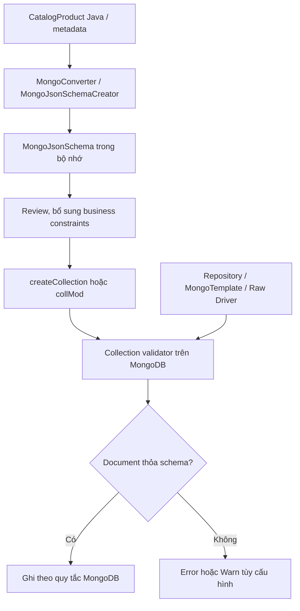

# MongoJsonSchema và sinh schema từ metadata

## 1. Bài toán: entity Java đúng nhưng dữ liệu MongoDB vẫn có thể sai

MongoDB cho phép những document trong cùng collection có cấu trúc khác nhau. Tính linh hoạt này có ích khi thay đổi mô hình, nhưng cũng gây khó khăn nếu nhiều ứng dụng, batch job hoặc raw MongoDB Driver cùng ghi vào một collection.

Giả sử dịch vụ quản lý danh mục sử dụng **Spring Data MongoDB** với entity `CatalogProduct`. Java định nghĩa giá dạng `BigDecimal`, trạng thái `enum` và danh sách `tags`, nhưng dữ liệu thực tế có thể xuất hiện:

```javascript
// Document hợp lệ theo hợp đồng ứng dụng.
{
  _id: "product-01",
  tenant_id: "tenant-A",
  sku: "KB-001",
  name: "Bàn phím cơ",
  price_amount: NumberDecimal("1850000.00"),
  status: "ACTIVE",
  tags: ["keyboard", "wireless"],
  schemaVersion: 1
}

// Document do một job cũ ghi sai kiểu.
{
  _id: "product-02",
  tenant_id: "tenant-A",
  sku: 12345,
  name: "Chuột",
  price_amount: "650000",
  status: "UNKNOWN_STATE",
  tags: "mouse",
  schemaVersion: "1"
}
```

Cả hai đều là BSON document hợp lệ về mặt cú pháp. Tuy nhiên, document thứ hai vi phạm hợp đồng của nhiều service: `sku` và `tags` sai kiểu, tiền được lưu thành string, còn `schemaVersion` không phải integer.

**MongoDB JSON Schema validation** cho phép gắn một bộ quy tắc với collection để MongoDB tự kiểm tra document khi ghi. Spring Data MongoDB cung cấp:

- **`MongoJsonSchema`:** mô hình Java để xây và biểu diễn MongoDB JSON Schema.
- **`MongoJsonSchemaCreator`:** tạo schema ban đầu từ metadata ánh xạ entity và converter.
- **`CollectionOptions.schema(...)`:** gắn schema vào collection lúc tạo.
- **`MongoTemplate` / `ReactiveMongoTemplate`:** thao tác collection và dữ liệu dưới các quy tắc validator đã cấu hình.
- **`collMod`:** thay đổi validator của collection đã tồn tại mà không cần xóa dữ liệu.

Bài thuộc chương **Collection và schema** của module **SPRING_DATA_MONGODB**, liên kết việc ánh xạ document với repository, `MongoTemplate`, index, transaction, reactive access, kiểm thử và chẩn đoán hiệu năng.

**Thông điệp xuyên suốt:** *sinh ra một đối tượng `MongoJsonSchema` trong Java không tự kích hoạt xác thực ở MongoDB*. Validation ở server chỉ có hiệu lực khi schema được cấu hình thành **collection validator**, với `validationLevel` và `validationAction` thích hợp.

## 2. Ba lớp hợp đồng dữ liệu không được đánh đồng

| Lớp | Công cụ thường dùng | Phạm vi tác động |
| --- | --- | --- |
| **Mô hình Java** | `@Document`, `@Field`, `@MongoId`, `MongoConverter` | Chuyển Java object thành BSON và ngược lại |
| **Validation ứng dụng** | Bean Validation, service/domain rules | Kiểm tra ở những đường gọi ứng dụng được cấu hình |
| **Validation phía MongoDB** | `validator: {$jsonSchema: ...}` | Kiểm tra thao tác insert/update trên collection theo cấu hình |

Ví dụ `@Field(targetType = FieldType.DECIMAL128)` hướng dẫn Spring Data ghi `BigDecimal` thành BSON Decimal128. Annotation đó **không** tự biến một collection đã có dữ liệu sai thành collection được validation chặt.

Tương tự, `@NotNull` ở lớp Java có thể được dùng bởi Bean Validation khi ứng dụng gọi validator đúng cách, nhưng **không nên mặc định** mọi annotation validation sẽ tự trở thành MongoDB `required` khi dùng schema generator. Phải quan sát schema thật được sinh.



Điểm quyết định nằm ở mũi tên **`createCollection`/`collMod`**. Nếu không triển khai schema đến server, việc khởi tạo `MongoJsonSchemaCreator` chỉ giúp quan sát/thiết kế, không bắt buộc những client khác ghi đúng cấu trúc.

## 3. MongoDB `$jsonSchema` là gì?

MongoDB hỗ trợ validation theo JSON Schema kể từ MongoDB 3.6, với những keyword như:

| Keyword | Ý nghĩa | Ví dụ |
| --- | --- | --- |
| `bsonType` | Kiểu BSON được chấp nhận | `"string"`, `"decimal"`, `"int"`, `"date"`, `"array"` |
| `required` | Danh sách field bắt buộc **phải hiện diện** | `["sku", "name"]` |
| `properties` | Quy tắc cho từng field trong object | `"price_amount": {...}` |
| `minLength` / `maxLength` | Độ dài string | `minLength: 2` |
| `pattern` | Regex cho string | Quy tắc mã SKU |
| `enum` | Tập giá trị được phép | `["ACTIVE","ARCHIVED"]` |
| `minimum` / `maximum` | Biên giá trị số | `minimum: NumberDecimal("0")` |
| `items` | Quy tắc phần tử array | `items: {bsonType:"string"}` |
| `minItems` / `maxItems` | Số phần tử của array | `maxItems: 30` |
| `additionalProperties` | Cho phép field ngoài `properties` hay không | `false` khi quản lý shape rất chặt |

**`bsonType` là phần mở rộng quan trọng của MongoDB**, khác với từ khóa JSON Schema `type` thuần. JSON Schema của MongoDB không phải mọi tính năng của mọi bản JSON Schema Draft; hãy kiểm tra danh sách keyword được server đang chạy hỗ trợ.

### 3.1. JSON Schema kiểm tra document nào?

`$jsonSchema` mô tả **một document MongoDB hoàn chỉnh** từ root, kể cả những subdocument bên trong. Schema không phải chỉ là DTO của một API response.

Đối với collection có `_id`, MongoDB tạo `_id` khi insert thiếu khóa phù hợp; nếu bạn dùng `additionalProperties:false` thì còn cần đưa `_id` vào `properties`. Nếu Spring Data ghi field discriminator `_class`, field đó cũng phải được tính đến.

### 3.2. `required` khác “không được null”

Schema:

```javascript
{
  bsonType: "object",
  required: ["name"],
  properties: {
    name: { bsonType: "string" }
  }
}
```

- Thiếu `name`: không hợp lệ do `required`.
- `name: null`: không hợp lệ do `bsonType:"string"`.
- `name: ""`: **vẫn là string hợp lệ**, vì chưa đặt `minLength`.
- `name: "Bàn phím"`: hợp lệ theo ba quy tắc trên.

Nếu field **không bắt buộc** nhưng có thể là null:

```javascript
description: {
  bsonType: ["string", "null"]
}
```

Nếu field chỉ cho phép string khi xuất hiện nhưng không bắt buộc, bỏ `description` khỏi `required` và giữ `bsonType:"string"`; khi vắng field, nó không bị kiểm tra như một giá trị null.

## 4. Thiết kế schema bằng `mongosh` trước khi viết Java

Dùng một collection thử nghiệm tên `catalog_products_demo`:

```javascript
db.createCollection("catalog_products_demo", {
  validator: {
    $jsonSchema: {
      bsonType: "object",
      required: [
        "tenant_id",
        "sku",
        "name",
        "price_amount",
        "status",
        "schemaVersion"
      ],
      properties: {
        _id: {
          bsonType: "string"
        },
        tenant_id: {
          bsonType: "string",
          minLength: 1
        },
        sku: {
          bsonType: "string",
          minLength: 3
        },
        name: {
          bsonType: "string",
          minLength: 2
        },
        price_amount: {
          bsonType: "decimal",
          minimum: NumberDecimal("0")
        },
        status: {
          enum: ["DRAFT", "ACTIVE", "ARCHIVED"]
        },
        schemaVersion: {
          bsonType: "int",
          minimum: 1
        },
        tags: {
          bsonType: "array",
          items: { bsonType: "string" },
          maxItems: 30
        },
        shipping: {
          bsonType: "object",
          required: ["country"],
          properties: {
            country: { bsonType: "string" },
            postalCode: { bsonType: "string" }
          }
        }
      }
    }
  },
  validationLevel: "strict",
  validationAction: "error"
});
```

Ví dụ này là một **hợp đồng validation thủ công**:

- `tenant_id`, `sku`, `name`, `price_amount`, `status`, `schemaVersion` là các field bắt buộc.
- `price_amount` phải là BSON Decimal128 không âm.
- `status` chỉ nhận ba giá trị.
- `tags` nếu có phải là array gồm string và tối đa 30 phần tử.
- `shipping.country` phải hiện diện **nếu có subdocument `shipping`**; bản thân `shipping` đang là optional vì không có trong root `required`.

**Không cài schema quá chặt ngay trên production** nếu collection có dữ liệu cũ. Ví dụ này dành cho database test hoặc migration đã được review.

### 4.1. Thử document hợp lệ

```javascript
db.catalog_products_demo.insertOne({
  _id: "product-01",
  tenant_id: "tenant-A",
  sku: "KB-001",
  name: "Bàn phím cơ",
  price_amount: NumberDecimal("1850000.00"),
  status: "ACTIVE",
  schemaVersion: NumberInt(1),
  tags: ["keyboard", "wireless"],
  shipping: {
    country: "VN",
    postalCode: "700000"
  }
});
```

Kết quả mong đợi: insert được acknowledgement nếu không có lỗi khác như trùng `_id`.

### 4.2. Thử document sai kiểu

```javascript
db.catalog_products_demo.insertOne({
  _id: "product-02",
  tenant_id: "tenant-A",
  sku: 1001,
  name: "Chuột",
  price_amount: "650000",
  status: "ACTIVE",
  schemaVersion: NumberInt(1)
});
```

Kết quả mong đợi: server từ chối do không khớp validation rules; MongoDB thường báo lỗi validation với mã **121 — DocumentValidationFailure** trong những trường hợp điển hình.

**Không viết test chỉ so khớp nguyên văn thông báo lỗi**. Nội dung `errInfo`/error message có thể đổi theo phiên bản; hãy kiểm tra loại lỗi và xác minh document không xuất hiện sau khi thao tác bị từ chối.

### 4.3. Kiểm tra validator đã nằm trên collection

```javascript
db.getCollectionInfos({
  name: "catalog_products_demo"
})[0].options;
```

Bạn cần thấy `validator`, `validationLevel` và `validationAction` phù hợp. Đây là cách phân biệt **schema tồn tại trong Java** với **schema thực sự đã được cài trên MongoDB**.

## 5. Entity Spring Data MongoDB làm đầu vào sinh schema

Ta chọn một entity đại diện hợp đồng lưu trữ.

```java
import java.math.BigDecimal;
import java.util.List;

import org.springframework.data.mongodb.core.mapping.Document;
import org.springframework.data.mongodb.core.mapping.Field;
import org.springframework.data.mongodb.core.mapping.FieldType;
import org.springframework.data.mongodb.core.mapping.MongoId;

@Document(collection = "catalog_products")
public record CatalogProduct(
    @MongoId(FieldType.STRING)
    String id,

    @Field("tenant_id")
    String tenantId,

    String sku,
    String name,

    @Field(
        value = "price_amount",
        targetType = FieldType.DECIMAL128
    )
    BigDecimal price,

    ProductStatus status,
    List<String> tags,

    int schemaVersion,
    Boolean active,

    ShippingInfo shipping
) {
    public enum ProductStatus {
        DRAFT, ACTIVE, ARCHIVED
    }

    public record ShippingInfo(
        String country,
        String postalCode
    ) {}
}
```

### 5.1. Những metadata có ý nghĩa khi tạo schema

| Metadata / Java type | Tác dụng có thể kiểm chứng |
| --- | --- |
| `@Document(collection = "...")` | Chỉ collection mà entity được ánh xạ |
| `@MongoId(FieldType.STRING)` | Chỉ rõ ý đồ lưu `_id` dạng string |
| `@Field("tenant_id")` | Ánh xạ property Java `tenantId` sang BSON `tenant_id` |
| `@Field(targetType = DECIMAL128)` | Hướng converter ghi tiền ở dạng BSON decimal |
| `ProductStatus enum` | Có thể tạo ràng buộc các tên enum |
| `List<String> tags` | Sinh mô tả kiểu array và phần tử theo metadata khả dụng |
| `int schemaVersion` | Primitive Java; generator coi đây là field bắt buộc |
| `Boolean active` | Wrapper; có thể vắng hoặc null theo thực tế model |
| `ShippingInfo` | Một subdocument với các property lồng nhau |

**Cẩn thận với ID:** kiểu `String` có thể được Spring Data chuyển thành BSON ObjectId khi dùng một số kiểu mapping ID mặc định và giá trị chuyển đổi phù hợp. `@MongoId(FieldType.STRING)` giúp làm rõ schema của khóa ID. Một schema yêu cầu `_id` string sẽ từ chối document có `_id` ObjectId.

### 5.2. Sinh schema không đồng nghĩa tự suy ra tất cả nghiệp vụ

Từ Java `String sku`, generator không thể tự biết SKU phải có **ít nhất ba ký tự**, không trùng trong một tenant, và phải đúng chuẩn mã. Từ `BigDecimal price`, nó không tự biết **giá phải ≥ 0**. Đây là những quy tắc cần review và bổ sung.

Tương tự, domain model có `active` và `status` nhưng business muốn `status=ARCHIVED => active=false`. Phép suy luận cross-field đó không tự xuất hiện chỉ vì có hai property Java.

## 6. `MongoJsonSchemaCreator`: tạo schema từ mapping metadata

API trung tâm nằm tại **`org.springframework.data.mongodb.core.MongoJsonSchemaCreator`**:

```java
import org.springframework.data.mongodb.core.MongoJsonSchemaCreator;
import org.springframework.data.mongodb.core.MongoTemplate;
import org.springframework.data.mongodb.core.schema.MongoJsonSchema;

public class CatalogSchemaGenerator {

    private final MongoTemplate template;

    public CatalogSchemaGenerator(MongoTemplate template) {
        this.template = template;
    }

    public MongoJsonSchema generate() {
        return MongoJsonSchemaCreator
            .create(template.getConverter())
            .createSchemaFor(CatalogProduct.class);
    }
}
```

Phân tích:

1. `template.getConverter()` lấy **`MongoConverter`** mà ứng dụng đang sử dụng.
2. `MongoJsonSchemaCreator.create(converter)` tạo schema creator có nhận thức về mapping/conversions.
3. `createSchemaFor(CatalogProduct.class)` duyệt metadata của domain type, tạo **`MongoJsonSchema`**.
4. Kết quả **chỉ là schema object trong bộ nhớ**; không tạo collection, không sửa validator, không tự gọi `collMod`.

Sử dụng converter thật quan trọng khi ứng dụng có custom converters hoặc quy tắc lưu field khác mặc định. Không dùng một `MongoJsonSchemaCreator` tách khỏi cấu hình converter rồi mong schema của nó phản ánh mọi type mapping production.

### 6.1. Xem BSON schema được sinh

```java
import org.bson.Document;

MongoJsonSchema generated = MongoJsonSchemaCreator
    .create(template.getConverter())
    .createSchemaFor(CatalogProduct.class);

Document rootSchema = generated.schemaDocument();
Document validatorDocument = generated.toDocument();

System.out.println(rootSchema.toJson());
System.out.println(validatorDocument.toJson());
```

Cần phân biệt:

- `schemaDocument()`: nội dung root schema (ví dụ `{type:"object",properties:{...}}`).
- `toDocument()`: dạng document chứa wrapper **`$jsonSchema`** dùng trong validator.

**Mapping caveat:** Javadoc của `MongoJsonSchema` lưu ý các tên field có thể cần được xử lý bằng `JsonSchemaMapper` để áp dụng tùy biến tên property. Khi dùng `@Field` và custom converters, **kiểm tra output BSON thực tế** để xác minh nó chứa `tenant_id` và `price_amount`, không chỉ nhìn property Java trong source.

Đừng ghi một validator chưa được mapping đúng vào production. Nếu cần bộ rules được review và lưu độc lập, có thể chọn schema BSON thủ công với tên field **đúng như trong MongoDB**.

### 6.2. Có thể sinh schema cho lớp khác với entity nguồn không?

`MongoJsonSchemaCreator` nhận `Class<?>`, nhưng input nên là **type phản ánh document thực sự được lưu**, không phải DTO response chứa thiếu field. Nếu truyền `ProductSummaryDto.class` có `id,name,price`, schema kết quả không tự đại diện cho những field khác trong collection `catalog_products`.

Muốn xác định collection và schema của document được lưu, dùng domain type có mapping thích hợp, rồi review output tương ứng.

## 7. Quy tắc sinh schema từ metadata: cần biết phần nào là “đoán được”

Theo tài liệu Spring Data MongoDB, schema generator áp dụng các quy tắc chính:

| Kiểu / annotation | Cách mô tả schema điển hình |
| --- | --- |
| Primitive Java (`int`, `boolean`,...) | Field **required** |
| `String` và các simple types | Kiểu BSON tương ứng |
| `Enum` | String với `enum` các tên enum |
| `List<T>`, array Java thông thường | Array; nội dung tùy metadata generic |
| `Map<K,V>` | Object |
| Class/record lồng nhau | Object với các property lồng nhau |
| `byte[]` | BSON binary data (`binData`) |
| `@Transient` | Không đưa property vào schema |
| `@Field(...)` | Mapping field name / target BSON type theo metadata và converter |
| `@MongoId(...)` | Cung cấp thông tin cụ thể hơn về kiểu BSON của `_id` |
| Custom converters | Có thể ảnh hưởng kiểu BSON được suy luận |

Ví dụ một class đơn giản:

```java
import org.springframework.data.annotation.Transient;

public class ExampleMetadata {
    public String name;
    public int revision;
    public Boolean published;

    @Transient
    public String computedLabel;
}
```

Ý nghĩa mong đợi:

- `revision` primitive được xem là bắt buộc khi sinh schema.
- `published` dạng `Boolean` wrapper không mặc nhiên bắt buộc.
- `computedLabel` bị bỏ qua do `@Transient`.
- `name` là một string field nhưng không tự bị buộc `minLength>0`.

**Không dùng “property non-null trong constructor” làm bằng chứng schema generator đã tự hiểu business required.** Kiểm chứng phần `required` do creator tạo và bổ sung các trường thực sự bắt buộc theo hợp đồng.

## 8. `@MongoId`, `@Field` và mâu thuẫn kiểu BSON

Đây là nhóm sai lệch làm nhiều dự án bị từ chối ghi sau khi cài validator.

### 8.1. String ID hay ObjectId?

Hai entity có thể cùng dùng `String id` trong Java nhưng ánh xạ BSON khác nhau theo annotation/converter:

```java
// Chỉ rõ BSON string ID.
@MongoId(FieldType.STRING)
String id;
```

so với một entity dùng `@Id String id` mà chuyển đổi sang ObjectId trong các điều kiện thích hợp.

Nếu collection đang có:

```javascript
{ _id: ObjectId("64f000000000000000000001"), name: "A" }
{ _id: "product-02", name: "B" }
```

thì validator ép `_id` chỉ string sẽ gây khó khăn khi cập nhật document ID ObjectId cũ. Trước khi chốt schema, thống kê BSON type hiện có và lên kế hoạch migration.

### 8.2. Decimal128 khác string hoặc double

Model:

```java
@Field(
    value = "price_amount",
    targetType = FieldType.DECIMAL128
)
BigDecimal price;
```

Khi converter ghi đúng cấu hình, giá được lưu ở BSON Decimal128. Validator tương ứng:

```javascript
price_amount: {
  bsonType: "decimal",
  minimum: NumberDecimal("0")
}
```

Giá `"1850000.00"` (string) hay `1850000.00` được shell biểu diễn thành double theo ngữ cảnh **không tương đương** Decimal128.

**Không thêm `bsonType:["decimal","double","string"]` mãi mãi chỉ để “tránh lỗi”** nếu mục tiêu là chuẩn hóa tiền. Có thể cần một giai đoạn tương thích tạm thời có kế hoạch migration rõ, rồi siết về decimal.

### 8.3. Field rename và nested paths

Java:

```java
@Field("tenant_id")
String tenantId;
```

MongoDB schema:

```javascript
tenant_id: {
  bsonType: "string"
}
```

Một validator viết nhầm `tenantId` sẽ yêu cầu field khác với field Spring Data thực sự ghi. Khi có nested class và `@Field` cho field con, cũng phải xác minh tên BSON của **từng cấp**.

## 9. Xây `MongoJsonSchema` thủ công bằng builder

Không nhất thiết phải bắt đầu từ generator. Spring Data cung cấp `MongoJsonSchema.builder()` và các factory method của `JsonSchemaProperty`.

```java
import static org.springframework.data.mongodb.core.schema
    .JsonSchemaProperty.object;
import static org.springframework.data.mongodb.core.schema
    .JsonSchemaProperty.string;

import org.springframework.data.mongodb.core.schema.MongoJsonSchema;

MongoJsonSchema schema = MongoJsonSchema.builder()
    .required("sku", "name")
    .properties(
        string("sku").minLength(3),
        string("name").minLength(2),
        object("shipping")
            .properties(
                string("country").minLength(2),
                string("postalCode").minLength(5)
            )
    )
    .build();
```

Đây là một **schema thủ công tối giản** dành cho ví dụ builder, không phải validator đầy đủ của `CatalogProduct`. Schema không bắt buộc `shipping` hiện diện; nó chỉ mô tả shape khi `shipping` được ghi.

Mặt mạnh của builder:

- Có type-safe API cho những quy tắc JSON Schema phổ biến.
- Tránh nhập JSON thô cho schema đơn giản.
- Dễ dùng chung factory method và đọc được từ code Java.

Mặt hạn chế:

- Cấu trúc có nhiều quy tắc đặc biệt có thể làm builder dài và khó review.
- Không tự suy ra invariants business khi bạn chỉ khai báo kiểu.
- Tên field ở schema phải được đối chiếu với BSON thực tế, nhất là khi dùng mapping đổi tên.
- Có thể cần dùng `MongoJsonSchema.of(Document)` cho schema BSON do nhóm dữ liệu duy trì như một bản chuẩn độc lập.

### 9.1. Schema thủ công bằng BSON Document

```java
import org.bson.Document;
import org.springframework.data.mongodb.core.schema.MongoJsonSchema;

Document rawSchema = Document.parse("""
{
  "bsonType": "object",
  "required": ["sku", "name"],
  "properties": {
    "sku":  { "bsonType": "string", "minLength": 3 },
    "name": { "bsonType": "string", "minLength": 2 }
  }
}
""");

MongoJsonSchema schema = MongoJsonSchema.of(rawSchema);
```

Chuỗi text block yêu cầu Java 15+; trong dự án Java cũ, có thể thay bằng string thông thường hoặc xây `Document` bằng `append`.

**Cần lưu ý:** `rawSchema` ở đây là **root schema**, không bọc `$jsonSchema`. Khi gọi `schema.toDocument()` sẽ có wrapper `$jsonSchema`. Không bọc hai lần, vì validator `{$jsonSchema:{$jsonSchema:...}}` không phải cấu trúc hợp lệ.

## 10. Kết hợp schema sinh từ metadata với nghiệp vụ

Chiến lược thực tế thường là:

1. Dùng `MongoJsonSchemaCreator` tạo **bản nháp type/schema** từ domain model.
2. In `schemaDocument()` hoặc xuất BSON để review.
3. Bổ sung điều kiện business như `required`, `minimum`, `minLength`, `enum`, `maxItems` và null policy.
4. Đối chiếu tên field BSON, converter, tài liệu cũ và đường ghi dữ liệu.
5. Đưa validator đã review vào một migration/versioned configuration; **không** tự ghi validator mới vào production mỗi lần deploy chỉ vì entity Java đổi.

Ví dụ hợp đồng cần bổ sung:

| Quy tắc | Sinh từ kiểu Java? | Cần thiết kế bổ sung? |
| --- | --- | --- |
| `schemaVersion` là BSON int | Có thể từ primitive `int` | Kiểm tra version hợp lệ ≥ 1 |
| `tenant_id` là string | Có thể từ metadata mapping | Bắt buộc và nonempty |
| `price_amount` là Decimal128 | Từ target BSON type/converter thích hợp | Không âm; chính sách currency |
| `sku` là string | Có | MinLength/pattern và **unique index** |
| `status` là enum | Thường có enum values | Quy tắc chuyển trạng thái |
| `tags` là array | Có thể | MaxItems, item type, uniqueness nội bộ nếu cần |
| `active` là `Boolean` | Có thể | Có bắt buộc không? có null không? |

### 10.1. Có nên tự sửa `schemaDocument()` bằng Java?

Về kỹ thuật, `schema.schemaDocument()` trả `Document` có thể được xử lý; nhưng mutation tùy tiện một `Document` sau khi sinh dễ làm schema bị thiếu/ghi đè nhầm trường. Với một validator production:

- Xây schema chuẩn một cách có kiểm soát, có test và review.
- Nếu cần ghép schema, sử dụng khả năng `MongoJsonSchema.merge(...)`/schema builder theo version phù hợp, **nhưng không giả định merge sẽ giải quyết mọi xung đột type**.
- Khi hai nguồn quy định cùng field với quy tắc khác nhau, cần quyết định **bộ quy tắc nào thắng**, không âm thầm ghi đè.
- Ghi lại “tại sao” có min/max/enum; đó không phải kiến thức có thể suy ra từ type Java.

## 11. Tạo collection có schema bằng `MongoTemplate`

Sau khi đã review `MongoJsonSchema`, có thể tạo collection và gắn validator ngay khi tạo.

```java
import org.springframework.data.mongodb.core.CollectionOptions;
import org.springframework.data.mongodb.core.MongoTemplate;
import org.springframework.data.mongodb.core.MongoJsonSchemaCreator;
import org.springframework.data.mongodb.core.schema.MongoJsonSchema;

public void createCatalogCollection(MongoTemplate template) {
    MongoJsonSchema schema = MongoJsonSchemaCreator
        .create(template.getConverter())
        .createSchemaFor(CatalogProduct.class);

    CollectionOptions options = CollectionOptions.empty()
        .schema(schema)
        .strictValidation()
        .failOnValidationError();

    template.createCollection(
        CatalogProduct.class,
        options
    );
}
```

Cú pháp `createCollection(Class<T>, CollectionOptions)` dùng metadata entity để chọn collection tương ứng `@Document(collection="catalog_products")`.

**Vì sao cần review trước khi chạy?** Đoạn trên cài đặt **schema sinh tự động**, có thể chưa có các business constraints như giá ≥ 0 hoặc SKU pattern. Trong hệ thống thật, thay biến `schema` bằng **schema đã được review** và kiểm thử.

### 11.1. Collection đã tồn tại thì sao?

`createCollection(...)` là thao tác **tạo collection**, không phải cập nhật validator của một collection đã tồn tại. Nếu collection đã có, lệnh tạo có thể thất bại; **đừng xóa collection để chạy lại** trong production.

Với collection hiện hữu, sử dụng `collMod` theo một migration được kiểm soát (mục 12). Kiểm tra tồn tại bằng `template.collectionExists(...)` chỉ giúp quyết định nhánh tạo mới, **không chứng minh validator đang đúng phiên bản**.

### 11.2. Không đặt bootstrap nguy hiểm vào mọi startup

Nếu nhiều instance application cùng khởi động, việc mỗi instance tự thực thi `createCollection`/`collMod` có thể tạo race và khó kiểm soát rollout.

Một cách vận hành đáng tin cậy hơn là dùng migration/deployment step có ownership, permission, audit và khả năng rollback. Runtime service bình thường chỉ có quyền đọc/ghi cần thiết; không nhất thiết phải được cấp quyền thay đổi cấu trúc collection.

## 12. Collection đã có dữ liệu: cập nhật validator bằng `collMod`

MongoDB hỗ trợ lệnh `collMod` để thay đổi validator mà không xóa collection.

Ví dụ một schema nhỏ để minh họa:

```javascript
db.runCommand({
  collMod: "catalog_products",
  validator: {
    $jsonSchema: {
      bsonType: "object",
      required: ["tenant_id", "sku", "name"],
      properties: {
        tenant_id: { bsonType: "string" },
        sku: { bsonType: "string", minLength: 3 },
        name: { bsonType: "string", minLength: 2 }
      }
    }
  },
  validationLevel: "moderate",
  validationAction: "warn"
});
```

Lệnh này có nghĩa:

- Cập nhật bộ validator trên collection `catalog_products` đang tồn tại.
- Đặt level `moderate` để có cơ chế chuyển tiếp với dữ liệu cũ không hợp lệ.
- Đặt action `warn` để ghi nhận vi phạm nhưng chưa chặn ghi.
- **Không tự sửa mọi document cũ** thành hợp lệ.

Đây là cấu hình **chuyển tiếp**, không phải bảo vệ cuối cùng. Sau khi đo lường và sửa dữ liệu, có thể chuyển sang `strict` và `error` theo kế hoạch.

### 12.1. Gọi `collMod` qua `MongoTemplate`

Với migration do ứng dụng Java thực thi, `MongoTemplate.executeCommand(...)` có thể gửi command BSON:

```java
import org.bson.Document;
import org.springframework.data.mongodb.core.MongoTemplate;

public Document addCatalogValidation(MongoTemplate template) {
    Document schema = Document.parse("""
    {
      "bsonType": "object",
      "required": ["tenant_id", "sku", "name"],
      "properties": {
        "tenant_id": {"bsonType": "string"},
        "sku": {"bsonType": "string", "minLength": 3},
        "name": {"bsonType": "string", "minLength": 2}
      }
    }
    """);

    Document command = new Document("collMod", "catalog_products")
        .append(
            "validator",
            new Document("$jsonSchema", schema)
        )
        .append("validationLevel", "strict")
        .append("validationAction", "error");

    return template.executeCommand(command);
}
```

Đoạn này minh họa một **migration chủ đích**; không nên gọi trong mọi request. Ngoài việc kiểm tra kết quả command, hãy đọc lại `getCollectionInfos` và test insert/update hợp lệ/sai sau migration.

### 12.2. Các bước migration có rollback plan

1. Xác định contract BSON hiện tại, gồm field alias và type.
2. Sinh schema draft từ metadata, review với DBAs/người sở hữu dữ liệu.
3. Chạy kiểm tra dữ liệu cũ trên môi trường an toàn.
4. Chọn hành vi chuyển tiếp `moderate/warn` nếu phù hợp.
5. Sửa dữ liệu hoặc nâng writer lên version mới.
6. Chuyển thành `strict/error` khi có bằng chứng dữ liệu và write paths đã tương thích.
7. Giám sát lỗi validation và tỷ lệ dữ liệu cũ chưa hợp lệ.
8. Chuẩn bị lệnh `collMod` thay validator về bản trước nếu cần rollback **quy tắc**; rollback schema **không tự hồi phục dữ liệu đã bị thay đổi**.

## 13. `validationLevel`: strict, moderate, off và phiên bản mới

Trong các phiên bản MongoDB phổ biến, ba mức chủ yếu là:

| `validationLevel` | Hành vi |
| --- | --- |
| `strict` | Áp dụng validator cho tất cả insert và update, kể cả update document cũ không hợp lệ |
| `moderate` | Áp dụng cho insert và update document trước đó **đang hợp lệ**; update document cũ không hợp lệ không bị buộc phải pass schema |
| `off` | Không áp dụng validation cho insert/update |

### 13.1. Tại sao `strict` có thể chặn sửa document cũ?

Giả sử document cũ thiếu `sku` nhưng collection mới có validator yêu cầu `sku`.

```javascript
{
  _id: "legacy-01",
  name: "Sản phẩm cũ"
}
```

Với `strict/error`, một update chỉ sửa `name` vẫn có thể bị từ chối vì **document sau cập nhật** vẫn thiếu `sku`. Với `moderate`, MongoDB có cơ chế bỏ qua validation khi update document **đã không hợp lệ** từ trước; điều này hữu ích trong rollout có dữ liệu legacy.

**Đừng diễn giải moderate thành “chỉ validate field được sửa”.** Nó dựa trên việc document trước đó có khớp validator hay không, không chỉ dựa tên field của `$set`.

### 13.2. Không retroactively sửa dữ liệu cũ

Thay validator của collection sang `strict` không có nghĩa mọi document cũ sẽ tự được quét và sửa. Document cũ không hợp lệ vẫn có thể tồn tại; tác động thể hiện khi insert/update theo level.

**Version note:** MongoDB 9.0 bổ sung mức `constraint` có yêu cầu đặc biệt: bảo đảm các document hiện có đều thỏa validator bằng bước kiểm tra khi chuyển mức, kèm quy tắc về validation action và sửa validator. Không dùng `constraint` khi deployment là MongoDB 8.x hoặc cũ hơn; xem tài liệu đúng version và đánh giá chi phí quét collection.

### 13.3. Chọn level theo rollout, không theo sở thích cá nhân

- Collection mới, chưa có dữ liệu: thường `strict` là lựa chọn dễ hiểu.
- Collection cũ, nhiều document chưa được chuẩn hóa: cân nhắc `moderate` trong một giai đoạn có giám sát.
- `off`: chủ động tắt validation; không coi đây là giải pháp lâu dài cho dữ liệu sai.
- `constraint` (MongoDB 9.0+): chỉ dùng khi thật sự cần bảo đảm mạnh hơn và đã chuẩn bị dữ liệu, chi phí vận hành, giới hạn thay đổi validator.

## 14. `validationAction`: error, warn và một lựa chọn mới

`validationAction` quy định MongoDB làm gì khi một thao tác bị xác định vi phạm validation theo `validationLevel` đã chọn.

| `validationAction` | Hành vi |
| --- | --- |
| `error` | Từ chối thao tác ghi vi phạm; đây là mặc định phổ biến |
| `warn` | Cho phép thao tác ghi, ghi lại cảnh báo vi phạm trong log |
| `errorAndLog` (MongoDB 8.1+) | Từ chối và ghi log lỗi validation |

**`warn` không có nghĩa writer thấy thao tác thất bại.** Job có thể nhận acknowledgement thành công dù validator nhận ra vi phạm và log cảnh báo. Vì vậy nếu rollout dùng `warn`, phải giám sát log/metrics chứ không chỉ đếm exception từ service.

Kết hợp dễ hiểu:

| Level | Action | Ý nghĩa thực tế |
| --- | --- | --- |
| strict | error | Chặn mọi insert/update cho document sau ghi không hợp lệ |
| strict | warn | Quan sát vi phạm của mọi insert/update, nhưng vẫn cho ghi |
| moderate | error | Chặn invalid writes đối với insert và update document đã hợp lệ |
| moderate | warn | Giai đoạn chuyển tiếp, quan sát vi phạm của tập được validate |
| off | bất kỳ | Validation không được thực thi |

Nếu cần đảm bảo dữ liệu luôn hợp lệ, chỉ chọn `warn` để “tránh làm gián đoạn” **không đạt mục tiêu cuối**. Nó là bước triển khai có kiểm soát, cần có ngày kết thúc hoặc tiêu chí chuyển sang `error`.

## 15. Kiểm toán dữ liệu cũ bằng `$jsonSchema` trong query

MongoDB có query operator `$jsonSchema`. Bạn có thể dùng nó để tìm document phù hợp với một schema, hoặc kết hợp `$nor` để tìm document **không phù hợp**.

Ví dụ schema audit tối giản:

```javascript
const schema = {
  bsonType: "object",
  required: ["tenant_id", "sku", "price_amount"],
  properties: {
    tenant_id: { bsonType: "string" },
    sku: { bsonType: "string" },
    price_amount: { bsonType: "decimal" }
  }
};

// Tìm document KHÔNG khớp quy tắc.
db.catalog_products.find({
  $nor: [
    { $jsonSchema: schema }
  ]
});
```

Đây là công cụ **kiểm tra dữ liệu**, không phải lệnh migration. Kết quả có thể gồm:

- Document thiếu SKU.
- Document lưu giá string/double.
- Document thiếu tenant.
- Document sai kiểu BSON dù code Java tưởng giá là `BigDecimal`.

### 15.1. Đếm lỗi trước khi sửa

```javascript
db.catalog_products.countDocuments({
  $nor: [
    { $jsonSchema: schema }
  ]
});
```

Khi cần phân loại nguyên nhân, xây aggregation thống kê `$type` theo field/nhóm, kết hợp batch xử lý thay vì tải toàn bộ dữ liệu lỗi về Java.

Lưu ý `$jsonSchema` không tự có một index có thể phục vụ mọi quy tắc phức tạp; kiểm tra `explain("executionStats")`, giới hạn phạm vi và tránh quét collection lớn vào giờ cao điểm nếu chưa biết chi phí.

### 15.2. Kiểm tra kiểu BSON bằng aggregation

```javascript
db.catalog_products.aggregate([
  {
    $project: {
      skuType: { $type: "$sku" },
      priceType: { $type: "$price_amount" },
      tagsType: { $type: "$tags" }
    }
  },
  {
    $group: {
      _id: {
        skuType: "$skuType",
        priceType: "$priceType",
        tagsType: "$tagsType"
      },
      count: { $sum: 1 }
    }
  },
  { $sort: { count: -1 } }
]);
```

Chỉ thực hiện trên database mà bạn được phép đọc, theo phạm vi đã kiểm soát. Kết quả `$type:"missing"`, `"null"`, `"string"` và `"decimal"` giúp phát hiện sai lệch. Nó không tự sửa dữ liệu.

## 16. Không để `additionalProperties:false` làm hỏng đường ghi Spring Data

Một schema quá chặt:

```javascript
{
  bsonType: "object",
  additionalProperties: false,
  properties: {
    sku: { bsonType: "string" },
    name: { bsonType: "string" }
  }
}
```

có thể từ chối document vì những field **không nằm trong `properties`**, kể cả:

- MongoDB `_id`.
- Spring Data discriminator `_class`, tùy cấu hình mapping.
- Field `tenant_id`, `price_amount`, `schemaVersion`, metadata auditing hoặc một field ứng dụng vừa bổ sung.

Nếu thực sự muốn cấm field ngoài danh sách, phải khai báo **đầy đủ**:

```javascript
{
  bsonType: "object",
  additionalProperties: false,
  required: ["sku", "name"],
  properties: {
    _id: { bsonType: "string" },
    _class: { bsonType: "string" },
    tenant_id: { bsonType: "string" },
    sku: { bsonType: "string" },
    name: { bsonType: "string" },
    price_amount: { bsonType: "decimal" },
    status: { bsonType: "string" },
    schemaVersion: { bsonType: "int" }
  }
}
```

Đây vẫn chỉ là **một ví dụ rút gọn**, thiếu `tags`, `shipping`, `active` và các field khác của entity đầy đủ, nên **chưa dùng được nguyên văn** cho mọi cách ghi `CatalogProduct`. Khi có converter tạo field mới, phải cập nhật schema.

### 16.1. Không nên cấm mọi field lạ ở mọi collection

Nếu schema có nhu cầu tiến hóa nhanh hoặc nhiều writer với rollout lệch phiên bản, `additionalProperties:false` có thể làm triển khai khó khăn. Có thể bắt đầu bằng validation type/required cho những field quan trọng nhất, sau đó siết dần khi đã thống nhất lifecycle và chiến lược migration.

**Tách hai mục tiêu:** giảm dữ liệu sai kiểu là khác với việc cấm mọi field chưa được đăng ký. Chọn mức chặt tương xứng với rủi ro nghiệp vụ và khả năng vận hành.

## 17. Enum, array, subdocument và tính đa hình

### 17.1. Enum Java

```java
public enum ProductStatus {
    DRAFT, ACTIVE, ARCHIVED
}
```

Khi dùng converter mặc định, enum thường lưu tên string. Schema generator có thể tạo `enum` với ba giá trị. Nhưng nếu ứng dụng dùng custom converter lưu mã `"A"`, `"D"` hoặc giá trị số, schema phải phản ánh **BSON thực tế** do converter xuất ra; enum name Java không còn là nguồn chân lý duy nhất.

Khi thêm enum constant mới, nếu validator cũ vẫn chỉ cho ba giá trị, writer mới có thể bị từ chối. Cần **triển khai schema và ứng dụng có thứ tự tương thích**.

### 17.2. Array

```javascript
tags: {
  bsonType: "array",
  items: { bsonType: "string" },
  maxItems: 30
}
```

Quy tắc này kiểm tra kiểu phần tử và chiều dài array khi ghi; nó **không tự tạo multikey index** cho truy vấn tag. Nếu cần tìm sản phẩm theo tag, vẫn phải tạo index phù hợp và kiểm tra query plan.

### 17.3. Embedded document

```javascript
shipping: {
  bsonType: "object",
  required: ["country"],
  properties: {
    country: { bsonType: "string" },
    postalCode: { bsonType: "string" }
  }
}
```

`shipping.country` chỉ được yêu cầu **khi field `shipping` có mặt với kiểu object hợp lệ**. Để bắt buộc mọi product phải có shipping, thêm `"shipping"` vào root `required`.

Nếu một ứng dụng có nhiều subtype cùng trong collection, generator từ **một concrete class** có thể chưa đại diện đủ mọi subtype. Spring Data có khả năng merge schema và chỉ định type bổ sung trên `MongoJsonSchemaCreator` ở những dòng hỗ trợ, nhưng việc merge cũng cần xử lý xung đột giữa những property cùng tên mà khác kiểu.

## 18. Trường hợp generator không thể đoán chính xác

### 18.1. `Object`, generic type và Map động

```java
public record FlexibleEvent(
    String kind,
    Object payload,
    java.util.Map<String, Object> attributes
) {}
```

Một schema tạo từ `Object payload` hoặc `Map<String,Object> attributes` không thể tự biết mọi subtype thực tế. Kết quả có thể khá rộng (object với ít ràng buộc), dẫn tới cảm giác “đã có schema” nhưng vẫn nhận dữ liệu không đúng hợp đồng.

Các hướng xử lý:

- Thay `Object` bằng sealed hierarchy hoặc DTO có kiểu rõ khi có thể.
- Sử dụng `oneOf`/`anyOf` hoặc phân loại theo `kind` trong schema thủ công phù hợp với keyword MongoDB hỗ trợ.
- Dùng `MongoJsonSchemaCreator.property("payload")` để cung cấp thêm các type được phép khi API/phiên bản hỗ trợ.
- Chia collection nếu subtype có lifecycle và schema rất khác nhau.
- Viết test cho **mỗi subtype**, không chỉ subtype phổ biến nhất.

### 18.2. Custom converter và property converter

Một value object có thể được ghi thành một BSON string hoặc Document:

```java
public record Money(java.math.BigDecimal amount, String currency) {}
```

Nếu có `@WritingConverter` biến `Money` thành một `Document` hoặc Decimal128, schema creator phải được cung cấp converter phù hợp để suy luận kiểu. Tuy nhiên, một converter phức tạp hoặc logic tùy điều kiện vẫn có thể cần schema **do con người review**.

Không tự suy rằng chỉ vì creator chạy không lỗi thì mọi variant của converter đã được bao phủ. Việc schema mô tả sai BSON tạo ra validator chặn cả những write hợp lệ.

### 18.3. Auditing và field do framework tạo

Các field như `createdAt`, `lastModifiedAt`, `_class` và version có thể được framework tự điền tùy cách thiết lập. Nếu validator yêu cầu field nhưng write path khác (raw driver, bulk, migration) không đi qua callbacks/auditing, thao tác có thể bị từ chối.

Đây đôi khi là **điều mong muốn** để buộc mọi writer tuân thủ một hợp đồng; khi đó phải cập nhật tất cả writer chứ không làm yếu validator âm thầm.

## 19. Quan hệ với repository, `MongoTemplate` và bulk writes

Khi server validator đã được cài vào collection, các lệnh ghi thông thường được kiểm tra bất kể lệnh xuất phát từ:

- `MongoRepository.save(...)` hoặc `insert(...)`.
- `MongoTemplate.insert(...)`, `save(...)`, `updateFirst(...)`, `upsert(...)`.
- `MongoTemplate.bulkOps(...)`.
- MongoDB Java Driver trực tiếp.
- `mongosh` hoặc một service khác.

**Tùy chọn ngoại lệ:** một số thao tác/role hỗ trợ `bypassDocumentValidation`; đừng coi schema validator là biện pháp phân quyền bất khả vượt qua. Quyền database và quy trình vận hành vẫn rất quan trọng.

### 19.1. Partial update vẫn phải tôn trọng schema kết quả

```java
import org.springframework.data.mongodb.core.MongoTemplate;
import org.springframework.data.mongodb.core.query.Criteria;
import org.springframework.data.mongodb.core.query.Query;
import org.springframework.data.mongodb.core.query.Update;

Query query = Query.query(
    Criteria.where("id").is("product-01")
);

Update update = new Update()
    .set("name", "Bàn phím mới");

template.updateFirst(
    query,
    update,
    CatalogProduct.class
);
```

Server kiểm tra **document sau update** theo level/action được chọn. Nếu update làm `name` thành chuỗi một ký tự khi có `minLength:2`, nó có thể bị từ chối. Nếu document cũ đã thiếu `sku`, `strict` còn có thể ngăn update không liên quan.

### 19.2. Bulk và kết quả từng phần

Một unordered bulk có nhiều update, trong đó một update vi phạm validator, có thể vẫn áp dụng được các operation độc lập khác. `ORDERED` dừng sớm khi gặp lỗi nhưng không tự rollback các thao tác đã thành công ngoài transaction.

Vì thế schema validation không biến bulk thành all-or-nothing. Khi xử lý import có retry, cần operationId/idempotency và đối soát kết quả theo từng thao tác, đặc biệt khi client mất phản hồi sau ghi.

### 19.3. Validation không đảm bảo uniqueness

`$jsonSchema` có thể yêu cầu SKU là string đúng format, nhưng không ngăn **hai document có cùng SKU trong một tenant**. Cần unique compound index:

```javascript
db.catalog_products.createIndex(
  { tenant_id: 1, sku: 1 },
  { unique: true, name: "uniq_tenant_sku" }
);
```

`@Indexed(unique=true)` hoặc `@CompoundIndex` là phương diện **index**, không phải `MongoJsonSchema`. Spring Data MongoDB không mặc định auto-create mọi index annotation ở nhiều dòng hiện đại; phải quản lý index migration riêng.

## 20. Reactive MongoDB và validation

`ReactiveMongoTemplate` sử dụng những quy tắc validator **cùng collection** như MongoTemplate imperative. Reactive không thay đổi semantics server-side.

```java
import org.springframework.data.mongodb.core.ReactiveMongoTemplate;

import reactor.core.publisher.Mono;

public Mono<CatalogProduct> createProductReactive(
    ReactiveMongoTemplate template,
    CatalogProduct product
) {
    return template.insert(product);
}
```

Nếu product vi phạm validator với `validationAction:error`, publisher có thể kết thúc bằng lỗi database/driver được Spring chuyển đổi ở tầng phù hợp. Không dùng `onErrorResume(...)` để **giả vờ lưu thành công** khi dữ liệu bị từ chối.

### 20.1. Tạo collection reactive khi thực sự cần

Ở những dòng Spring Data hỗ trợ, `ReactiveMongoTemplate.createCollection(...)` có thể nhận `CollectionOptions`, nhưng chỉ nên gọi trong migration/provisioning được điều phối. Đừng để nhiều request subscribe rồi cùng cố tạo/collMod collection.

### 20.2. Transaction không thay thế schema validation

MongoDB transaction có thể gom nhiều thao tác ghi vào một đơn vị commit/rollback trên deployment hỗ trợ. Tuy nhiên, **transaction không tự sửa document sai kiểu**. Validator vẫn áp dụng cho những write thuộc transaction theo semantics server.

Nếu cần giao dịch nhiều document imperative, dùng `MongoTransactionManager`; reactive dùng `ReactiveMongoTransactionManager` và context tương ứng. Không coi việc thêm `@Transactional` là cơ chế “bỏ qua lỗi validation”.

## 21. Kiểm thử tích hợp: schema đã được cài và server thực sự từ chối dữ liệu sai

Một unit test chỉ assert `MongoJsonSchemaCreator.createSchemaFor(...)` trả về object không chứng minh MongoDB đã cài validator. Cần kiểm thử cả **schema sinh** lẫn **hành vi server**.

### 21.1. Integration test với collection riêng

Ví dụ dùng JUnit 5, AssertJ và Spring Boot `@DataMongoTest`; test tạo collection có tên riêng và xóa sau khi kết thúc.

```java
import static org.assertj.core.api.Assertions.assertThat;
import static org.assertj.core.api.Assertions.assertThatThrownBy;

import java.util.UUID;

import com.mongodb.MongoWriteException;

import org.bson.Document;
import org.junit.jupiter.api.Test;
import org.springframework.beans.factory.annotation.Autowired;
import org.springframework.boot.test.autoconfigure.data.mongo.DataMongoTest;
import org.springframework.data.mongodb.core.CollectionOptions;
import org.springframework.data.mongodb.core.MongoTemplate;
import org.springframework.data.mongodb.core.schema.MongoJsonSchema;

@DataMongoTest
class MongoJsonSchemaValidationIntegrationTest {

    @Autowired MongoTemplate template;

    @Test
    void collectionValidatorRejectsWrongBsonTypes() {
        String collection = "schema_test_"
            + UUID.randomUUID().toString().replace("-", "");

        MongoJsonSchema schema = MongoJsonSchema.of(
            Document.parse("""
            {
              "bsonType": "object",
              "required": ["sku", "price_amount"],
              "properties": {
                "sku": { "bsonType": "string" },
                "price_amount": { "bsonType": "decimal" }
              }
            }
            """)
        );

        template.createCollection(
            collection,
            CollectionOptions.empty()
                .schema(schema)
                .strictValidation()
                .failOnValidationError()
        );

        try {
            template.getCollection(collection).insertOne(
                new Document("_id", "valid")
                    .append("sku", "KB-001")
                    .append(
                        "price_amount",
                        new org.bson.types.Decimal128(
                            new java.math.BigDecimal("120000.00")
                        )
                    )
            );

            assertThat(
                template.getCollection(collection)
                    .countDocuments()
            ).isEqualTo(1L);

            assertThatThrownBy(() ->
                template.getCollection(collection).insertOne(
                    new Document("_id", "invalid")
                        .append("sku", 123)
                        .append("price_amount", "120000")
                )
            ).isInstanceOf(MongoWriteException.class);

            assertThat(
                template.getCollection(collection)
                    .countDocuments()
            ).isEqualTo(1L);
        } finally {
            template.dropCollection(collection);
        }
    }
}
```

Test đi qua **raw driver collection** để chắc chắn dữ liệu sai không bị Java mapping tự chuyển thành kiểu hợp lệ trước khi gửi. Nếu database không cấp quyền tạo/xóa collection, test cần được điều chỉnh sang môi trường test có quyền phù hợp.

Code này là ví dụ để học; ở bước soạn Markdown **không chạy test** theo quy trình STEP 4.

### 21.2. Test schema sinh từ metadata

```java
import static org.assertj.core.api.Assertions.assertThat;

import org.bson.Document;
import org.junit.jupiter.api.Test;
import org.springframework.beans.factory.annotation.Autowired;
import org.springframework.boot.test.autoconfigure.data.mongo.DataMongoTest;
import org.springframework.data.mongodb.core.MongoJsonSchemaCreator;
import org.springframework.data.mongodb.core.MongoTemplate;
import org.springframework.data.mongodb.core.schema.MongoJsonSchema;

@DataMongoTest
class GeneratedProductSchemaTest {

    @Autowired MongoTemplate template;

    @Test
    void generatedSchemaUsesExpectedMappedFields() {
        MongoJsonSchema schema = MongoJsonSchemaCreator
            .create(template.getConverter())
            .createSchemaFor(CatalogProduct.class);

        Document root = schema.schemaDocument();

        assertThat(root).isNotNull();
        assertThat(root.toJson())
            .contains("schemaVersion");

        // Tiếp tục kiểm tra tenant_id, price_amount, enum,
        // _id và cấu trúc nested theo converter thực tế.
    }
}
```

**Chú ý:** việc kiểm tra `root.toJson()` chứa một chuỗi chỉ là bước bắt đầu. Test production nên truy vấn `properties` theo cấu trúc BSON rồi so sánh từng type/required, thay vì chỉ dò chuỗi. Vì mapping tên field có thể cần xử lý riêng, test phải kiểm tra **validator thực sự được cài** trên collection sau khi triển khai schema.

### 21.3. Các test case phải bổ sung

| Case | Kỳ vọng |
| --- | --- |
| `@MongoId(FieldType.STRING)` | `_id` string, không bị hiểu thành ObjectId |
| `@Field("tenant_id")` | Validator dùng đúng tên BSON |
| `@Field(targetType=DECIMAL128)` | Ghi Decimal128 và schema type tương ứng |
| Primitive `int schemaVersion` | Required được sinh/duyệt đúng |
| Wrapper `Boolean active` | Null/missing theo chính sách dự kiến |
| Enum thêm constant mới | Migration schema và writer tương thích |
| `List<String> tags` | Array items string, maxItems nếu được bổ sung |
| Nested `shipping` | Required theo cấp đúng |
| `@Transient` | Không được suy thành field lưu |
| Custom converter | Schema phản ánh BSON được ghi |
| `additionalProperties:false` | Không từ chối `_id`/`_class` ngoài ý muốn |
| `strict/error` | Insert/update sai bị từ chối |
| `moderate/error` | Dữ liệu legacy invalid được xử lý theo quy tắc moderate |
| `warn` | Lệnh có thể thành công nhưng violation được log |
| `collMod` | Server validator mới được áp dụng, dữ liệu cũ không tự sửa |
| Bulk writes | Lỗi từng phần được ghi nhận, không mặc định rollback cả bulk |
| Reactive insert | Publisher phản ánh lỗi validation |
| Unique index | Chặn trùng SKU theo tenant, độc lập schema |

## 22. Chẩn đoán khi validator từ chối một thao tác ghi hợp lệ theo cảm nhận

| Triệu chứng | Nên kiểm tra |
| --- | --- |
| Java `BigDecimal` nhưng MongoDB báo expected decimal | Converter/custom mapping, BSON thực tế trước ghi |
| Java `String id` nhưng validator yêu cầu ObjectId | `@MongoId`/`@Id`, dữ liệu legacy có kiểu khác |
| Field `tenantId` đã set nhưng validator báo thiếu `tenant_id` | Mapping `@Field` và tên được generator/validator tạo |
| Thêm enum constant mới bị từ chối | `enum` của validator chưa được migration |
| Update mỗi `name` nhưng lỗi thiếu field khác | `strict` kiểm tra document sau update, dữ liệu cũ invalid |
| Raw insert thành công nhưng repository insert lỗi | Converter thêm `_class`/auditing hoặc ghi BSON khác |
| Repository insert thành công nhưng raw insert sai cũng thành công | Chưa cài validator hoặc `warn/off`/bypass |
| `@Indexed(unique=true)` không chặn trùng | Index chưa được tạo/đúng scope; schema validator không tạo unique index |
| Migration `collMod` báo thành công nhưng data cũ vẫn sai | Validator không retroactively sửa document |
| `additionalProperties:false` chặn mọi ghi | Thiếu `_id`/`_class` và các field thật |
| API reactive trả lỗi sau subscribe | MongoDB validation được thực thi khi publisher được thực thi |
| Đọc/aggregation vẫn thấy document sai | Validation kiểm soát write; dữ liệu cũ có thể còn |

### 22.1. Quy trình kiểm tra nhanh

1. Đọc validator thật bằng `db.getCollectionInfos({name:"..."})`.
2. Xác nhận `validationLevel` và `validationAction`.
3. Kiểm tra BSON document được ghi, không chỉ Java getter.
4. Đối chiếu `required`/`properties`/`bsonType` và field aliases.
5. Nếu là schema vừa thay đổi, kiểm tra data legacy.
6. Xem lỗi MongoDB và `errInfo` (tránh log dữ liệu nhạy cảm).
7. Tạo một insert/update tối giản trên **database test** để tái hiện.
8. Sửa writer/schema theo hợp đồng có version, không âm thầm tắt validation.
9. Nếu cần, chạy audit `$jsonSchema` để thống kê phạm vi ảnh hưởng.

## 23. Hiệu năng, index và độ an toàn của schema validation

Schema validation có chi phí kiểm tra khi ghi. Với một validator đơn giản yêu cầu vài field, chi phí có thể nhỏ so với I/O, nhưng validator có subdocument sâu, arrays dài hoặc nhiều biểu thức có thể tăng CPU và độ trễ.

Điểm quan trọng:

- **Validator không tạo index** cho `sku`/`tenant_id` hoặc các field array.
- **Index không thay validator** cho điều kiện type/required hoặc cấu trúc document.
- Đọc dữ liệu không tự bị lọc vì schema; document cũ không hợp lệ vẫn có thể xuất hiện.
- Query `$jsonSchema` để audit toàn collection có thể tốn chi phí; dùng filter phân vùng, giờ chạy phù hợp và `explain`.
- Collection lớn, nhiều writer và deployment lệch version cần kế hoạch rollout/giám sát.
- `bypassDocumentValidation` có thể có trong những đường có quyền tương ứng; kiểm soát quyền database và audit thay vì coi validator là hệ thống authorization.

Ví dụ index độc lập:

```javascript
db.catalog_products.createIndex(
  { tenant_id: 1, sku: 1 },
  { unique: true, name: "uniq_tenant_sku" }
);

db.catalog_products.find({
  tenant_id: "tenant-A",
  status: "ACTIVE"
}).explain("executionStats");
```

Query plan ở đây giúp đánh giá đường đọc, **không đo trực tiếp** CPU của validator khi insert. Để đánh giá overhead của schema validation, đo write throughput, p95/p99 write latency và error rate trên dữ liệu đại diện trong môi trường thử nghiệm.

## 24. Checklist triển khai theo vòng đời schema

| Bước | Câu hỏi cần trả lời |
| --- | --- |
| Chọn entity nguồn | Có phản ánh document BSON thực tế, không chỉ DTO response? |
| Sinh draft | Đã dùng `MongoJsonSchemaCreator` với converter thật? |
| Kiểm tra type | `_id`, `price_amount`, enum, array, nested fields đúng? |
| Required/null | Field nào phải hiện diện, field nào được null/missing? |
| Business rules | Đã bổ sung min/max/pattern/enum/array length cần thiết? |
| Mapping | Tên BSON sau `@Field` và type conversion đã được test? |
| Extra fields | `_id`, `_class`, auditing và version có được cho phép? |
| Legacy data | Đã tìm document vi phạm trước migration? |
| Migration | Có owner, version, rollback plan và môi trường test? |
| Validator action | `warn` chỉ quan sát hay `error` thực sự chặn? |
| Validation level | strict/moderate/off/constraint phù hợp server version? |
| Collection mới | `createCollection(...schema(...))` được chạy một lần có kiểm soát? |
| Collection cũ | `collMod` đúng schema, không xóa collection để tạo lại? |
| Dữ liệu đa hình | Schema có bao phủ subtype và custom converter? |
| Bulk/retry | Đã xử lý lỗi từng phần và idempotency? |
| Reactive | Có test lỗi validation khi subscribe? |
| Index | Unique và query indexes được quản lý riêng? |
| Quyền | Không cấp quyền bypass/DDL quá rộng cho application? |
| Kiểm thử | Có test raw driver và repository/template/DTO? |
| Quan sát | Có metrics cho validation failures, logs và write latency? |
| Rollout | Writer mới và validator mới đã phối hợp theo thứ tự tương thích? |

## 25. Tài liệu chính thức và lưu ý phiên bản

`MongoJsonSchema` và `MongoJsonSchemaCreator` thuộc Spring Data MongoDB; `$jsonSchema`, `collMod`, `validationLevel` và `validationAction` do MongoDB Server quy định. Không coi các API/hành vi mới nhất là có sẵn ở mọi version.

Các nguồn chính thức dùng để đối chiếu:

- [Spring Data MongoDB — JSON Schema](https://docs.spring.io/spring-data/mongodb/reference/mongodb/mapping/mapping-schema.html)
- [Spring Data MongoDB — MongoJsonSchemaCreator API](https://docs.spring.io/spring-data/mongodb/reference/api/java/org/springframework/data/mongodb/core/MongoJsonSchemaCreator.html)
- [Spring Data MongoDB — MongoJsonSchema API](https://docs.spring.io/spring-data/mongodb/reference/api/java/org/springframework/data/mongodb/core/schema/MongoJsonSchema.html)
- [Spring Data MongoDB — CollectionOptions API](https://docs.spring.io/spring-data/mongodb/reference/api/java/org/springframework/data/mongodb/core/CollectionOptions.html)
- [MongoDB Manual — Schema Validation](https://www.mongodb.com/docs/manual/core/schema-validation/)
- [MongoDB Manual — Specify Validation Level](https://www.mongodb.com/docs/manual/core/schema-validation/specify-validation-level/)
- [MongoDB Manual — Handle Invalid Documents](https://www.mongodb.com/docs/manual/core/schema-validation/handle-invalid-documents/)
- [MongoDB Manual — Modify Schema Validation](https://www.mongodb.com/docs/manual/core/schema-validation/update-schema-validation/)
- [MongoDB Manual — `$jsonSchema` Operator](https://www.mongodb.com/docs/manual/reference/operator/query/jsonSchema/)
- [MongoDB Manual — `collMod` Command](https://www.mongodb.com/docs/manual/reference/command/collmod/)

**Lưu ý phiên bản:** MongoDB 8.1 bổ sung `validationAction:"errorAndLog"`, còn MongoDB 9.0 bổ sung `validationLevel:"constraint"`. Nếu môi trường chạy MongoDB 7.x hoặc 8.0, không áp dụng những lựa chọn mới này. Một số builder/overload Spring Data có thể khác nhau giữa 3.x, 4.x và 5.x; xác minh bằng Javadoc của phiên bản dependency thực tế.

**Kết luận:** Trong Spring Data MongoDB, **`MongoJsonSchema`** mô tả BSON schema còn **`MongoJsonSchemaCreator`** sinh bản nháp từ metadata ánh xạ và converter. Generator giúp tái sử dụng kiến thức từ `@Document`, `@Field`, `@MongoId`, enum, primitive và nested types, nhưng **không tự nắm toàn bộ bất biến nghiệp vụ**. Chỉ sau khi cài schema thành **collection validator** qua `CollectionOptions.schema(...)` hoặc `collMod`, MongoDB mới thực thi validation theo `validationLevel`/`validationAction`. Muốn vận hành an toàn, phải đối chiếu BSON thật, audit dữ liệu legacy, quản lý migration theo version, kiểm thử cả raw driver lẫn Spring Data, và tiếp tục dùng unique index/transaction/authorization cho những vấn đề nằm ngoài phạm vi JSON Schema.

