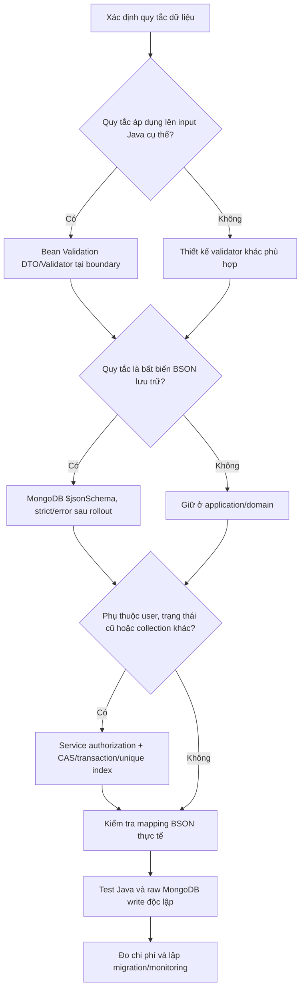

# Phân biệt Bean Validation trong Java với validation tại MongoDB

Trong hệ thống dùng **Spring Data MongoDB**, hai loại kiểm tra dữ liệu rất dễ bị nhầm là cùng một cơ chế:

- **Bean Validation** (Jakarta Validation) kiểm tra **đối tượng Java** theo các ràng buộc như `@NotBlank`, `@NotNull`, `@Size`, `@DecimalMin`, `@Valid`.
- **MongoDB collection validation** kiểm tra **document BSON được ghi xuống database**, thường với bộ quy tắc `$jsonSchema` gắn trên collection.

Chúng giải quyết những vấn đề có liên quan nhưng **không thay thế nhau**. Một request HTTP có thể bị Bean Validation từ chối trước khi tới service; một script `mongosh` không đi qua controller Java nhưng vẫn có thể bị MongoDB từ chối vì vi phạm schema. Ngược lại, việc thêm `@NotNull` vào entity không tự tạo validator trong MongoDB, còn một collection có `$jsonSchema` cũng không tự đưa lỗi trực tiếp vào danh sách `ConstraintViolation` của Jakarta Validation.

Ví dụ, một đơn hàng phải có mã khách hàng không rỗng, tiền không âm, trạng thái hợp lệ và thời gian tạo:

```text
HTTP client
    │
    ▼
CreateOrderRequest  ── @Valid / Bean Validation ──► lỗi đầu vào (400)
    │ hợp lệ
    ▼
Service ── xác thực tenant, trạng thái, nghiệp vụ ──► lỗi nghiệp vụ/quyền
    │
    ▼
MongoRepository / MongoTemplate
    │ BSON insert/update
    ▼
MongoDB collection ── $jsonSchema validator ──► lỗi ghi (ví dụ code 121)
    │ hợp lệ
    ▼
Document được lưu
```

Đây là bài thuộc chương **Collection và schema** của module **SPRING_DATA_MONGODB**: kết nối, ánh xạ và thao tác document qua repository hoặc `MongoTemplate`, kiểm thử, transaction, index và chẩn đoán lỗi dữ liệu. Trọng tâm là phân biệt **phạm vi, thời điểm, tính bắt buộc và giới hạn** của validation trong Java so với MongoDB, từ đó thiết kế nhiều lớp bảo vệ phù hợp.

Sau bài học, bạn sẽ có thể:

1. Phân biệt **Jakarta Bean Validation**, validation nghiệp vụ và **MongoDB collection validator**.
2. Dùng `@Valid`, `@Validated` và `Validator` để kiểm tra DTO/Java object đúng điểm gọi.
3. Viết MongoDB `$jsonSchema` với `bsonType`, `required`, `properties`, `enum`, `minimum`, `items`.
4. Giải thích vì sao `repository.save(...)`, `MongoTemplate.updateFirst(...)`, raw driver và `mongosh` có thể đi qua **những đường kiểm tra Java khác nhau**, nhưng cùng chịu validator phía MongoDB khi ghi vào collection.
5. Hiểu `validationLevel`, `validationAction`, dữ liệu legacy và trường hợp được phép bypass.
6. Xác định mapping BSON như `ObjectId`, `Decimal128`, BSON Date và ảnh hưởng của `_class`.
7. Kiểm thử cả lỗi Java lẫn lỗi từ database, kể cả các trường hợp update/bulk write.
8. Thiết kế migration schema an toàn mà không vô tình cấm ghi dữ liệu hiện có.

## 1. Ba lớp kiểm tra phải được gọi đúng tên

| Lớp | Ví dụ quy tắc | Thực thi ở đâu? | Có kiểm tra mọi nguồn ghi vào MongoDB? |
| --- | --- | --- | --- |
| **Jakarta Bean Validation** | `@NotBlank`, `@DecimalMin("0")` | JVM tại điểm ứng dụng thực sự gọi validation | **Không**. Script, driver khác và đường Java không gọi validator có thể bỏ qua |
| **Validation nghiệp vụ/ủy quyền** | Chỉ owner được đổi trạng thái; không oversell | Service/domain hoặc cơ chế ghi có điều kiện | Không tự có; cần thiết kế riêng |
| **MongoDB collection validation** | BSON `totalAmount` phải là `decimal`, status thuộc enum | MongoDB server khi xử lý write vào collection có validator | Áp dụng theo cấu hình, level/action và quyền bypass; **không tuyệt đối với mọi lệnh** |

Ví dụ:

```java
@NotNull
@DecimalMin("0.00")
private BigDecimal totalAmount;
```

Đây là quy tắc cho **giá trị BigDecimal của Java object**. Trong database, quy tắc BSON tương ứng có thể là:

```javascript
{
  totalAmount: {
    bsonType: "decimal",
    minimum: NumberDecimal("0.00")
  }
}
```

Hai cấu trúc khác nhau ở ít nhất ba điểm:

- Bean Validation có thể chạy **trước khi** entity được ánh xạ sang BSON.
- MongoDB validator nhìn **BSON type thực tế**, chẳng hạn Decimal128, chứ không nhìn class `BigDecimal` Java.
- Các thông báo lỗi, quy trình cấu hình và khả năng bypass khác nhau.

### 1.1. Không phải “@Valid trong entity thì database đã an toàn”

`@Document` là metadata để Spring Data biết collection nào lưu entity; `@Field`, `@Id` và `@Version` phục vụ mapping/ghi dữ liệu. Chúng **không tự thay thế** `$jsonSchema` của database.

Tương tự, `@Valid` **không phải một MongoDB index**, không tạo BSON constraint và không tự ràng buộc những client không chạy trong JVM.

### 1.2. Không phải “có MongoDB schema thì Java không cần validation”

Nếu chỉ dựa vào MongoDB validator, một request sai có thể đi qua controller, service, converter và network trước khi server từ chối. Bean Validation giúp trả thông điệp đầu vào dễ hiểu sớm hơn; nó cũng có thể kiểm tra cấu trúc DTO không tồn tại nguyên dạng trong BSON, như trường xác nhận, định dạng email đầu vào hoặc đối tượng lồng nhau của request.

**Kết luận:** dùng Bean Validation để bảo vệ **hợp đồng đầu vào Java**, dùng validation nghiệp vụ cho **bất biến domain**, và MongoDB validator để đặt **rào chắn lưu trữ ở phía server**.

## 2. Ví dụ domain: đơn hàng nhiều tenant

Một hệ thống nhận lệnh tạo đơn hàng. Client cung cấp mã khách hàng, số tiền và các tag; **tenantId và trạng thái mặc định do server xác định**, không nhận quyền tenant từ JSON của client.

Document dự kiến:

```javascript
{
  _id: ObjectId("665f1f2a4b6c7d8e9f001234"),
  tenantId: "T1",
  customerId: "C-100",
  status: "NEW",
  totalAmount: NumberDecimal("150.00"),
  createdAt: ISODate("2026-11-20T09:00:00Z"),
  tags: ["online", "priority"]
}
```

Giới hạn của bài thực hành:

| Field | Hợp đồng |
| --- | --- |
| `_id` | BSON ObjectId |
| `tenantId` | String có ít nhất một ký tự không phải khoảng trắng, tối đa 64 ký tự |
| `customerId` | String không blank, tối đa 80 ký tự |
| `status` | Một trong `NEW`, `PAID`, `CANCELLED` |
| `totalAmount` | BSON Decimal128, lớn hơn hoặc bằng 0 |
| `createdAt` | BSON Date |
| `tags` | Array 1–20 chuỗi không blank, mỗi chuỗi tối đa 40 ký tự |

Đây là **quy tắc ví dụ** để học validation, không phải schema nghiệp vụ bắt buộc cho mọi hệ thống thương mại điện tử. Một hệ thống khác có thể cho phép đơn nháp không có tags hoặc dùng bảng trạng thái nhiều giai đoạn hơn.

### 2.1. DTO tiếp nhận từ API

Với dự án dùng **Jakarta Validation** (Spring Boot 3+/Jakarta namespace), một Java record có thể khai báo:

```java
import java.math.BigDecimal;
import java.util.List;
import jakarta.validation.constraints.DecimalMin;
import jakarta.validation.constraints.NotBlank;
import jakarta.validation.constraints.NotNull;
import jakarta.validation.constraints.Size;

public record CreateOrderRequest(

    @NotBlank
    @Size(max = 80)
    String customerId,

    @NotNull
    @DecimalMin("0.00")
    BigDecimal totalAmount,

    @NotNull
    @Size(min = 1, max = 20)
    List<
        @NotBlank
        @Size(max = 40)
        String
    > tags
) {}
```

Ở đây:

- `@NotBlank` loại `null`, chuỗi rỗng và chuỗi chỉ chứa khoảng trắng (với các CharSequence phù hợp).
- `@Size(max = 80)` giới hạn chiều dài của mã khách hàng, **không tự yêu cầu** chuỗi phải khác null.
- `@NotNull` đảm bảo `totalAmount`/`tags` không phải null.
- `@DecimalMin("0.00")` kiểm tra giá trị số trong Java, không quy định BSON type.
- `@Size(min=1,max=20)` kiểm tra độ dài danh sách, còn ràng buộc trên **phần tử** `List<@NotBlank @Size(max=40) String>` kiểm tra từng tag.

Các constraint trên container element đòi hỏi Bean Validation provider hỗ trợ theo Jakarta Validation; Spring Boot thường dùng Hibernate Validator khi khai báo dependency validation phù hợp.

### 2.2. Entity được mapping sang MongoDB

```java
import java.math.BigDecimal;
import java.time.Instant;
import java.util.List;
import org.bson.types.ObjectId;
import org.springframework.data.annotation.Id;
import org.springframework.data.mongodb.core.mapping.Document;
import org.springframework.data.mongodb.core.mapping.Field;
import org.springframework.data.mongodb.core.mapping.FieldType;

@Document(collection = "orders_schema_lab")
public class OrderDocument {
    @Id
    private ObjectId id;

    private String tenantId;
    private String customerId;
    private String status;

    @Field(targetType = FieldType.DECIMAL128)
    private BigDecimal totalAmount;

    private Instant createdAt;
    private List<String> tags;

    protected OrderDocument() {}

    public OrderDocument(
            String tenantId,
            String customerId,
            String status,
            BigDecimal totalAmount,
            Instant createdAt,
            List<String> tags) {
        this.tenantId = tenantId;
        this.customerId = customerId;
        this.status = status;
        this.totalAmount = totalAmount;
        this.createdAt = createdAt;
        this.tags = List.copyOf(tags);
    }

    public ObjectId getId() { return id; }
    public String getTenantId() { return tenantId; }
    public String getCustomerId() { return customerId; }
    public String getStatus() { return status; }
    public BigDecimal getTotalAmount() { return totalAmount; }
    public Instant getCreatedAt() { return createdAt; }
    public List<String> getTags() { return tags; }
}
```

`@Id` ánh xạ `id` thành BSON `_id`. `@Field(targetType = FieldType.DECIMAL128)` định hướng lưu BigDecimal thành Decimal128. `Instant` được ánh xạ sang giá trị thời gian MongoDB phù hợp (thường BSON Date theo cấu hình mapping). Các kiểu Java và BSON cần được **xác minh bằng raw document**, không chỉ nhìn class.

### 2.3. Tại sao DTO và entity nên có ranh giới?

`CreateOrderRequest` không chứa tenantId hoặc status vì chúng không do client quyết định. Service tạo `OrderDocument` với tenant đáng tin cậy và status ban đầu `NEW`. Điều này ngăn kiểu lỗi “client tự gửi tenantId của người khác” ngay từ hợp đồng API.

Một entity có thể được đọc qua repository, cập nhật bởi job, hoặc tạo từ migration, trong khi DTO chỉ đại diện một request cụ thể. Đặt validation ở đúng tầng giúp không nhầm giữa quy tắc **input**, **business transition** và **lưu trữ**.

## 3. Jakarta Bean Validation: kiểm tra ở đâu và khi nào?

Bean Validation là một **đặc tả API** để khai báo và đánh giá constraint trên Java object, không phải tính năng riêng của MongoDB. Trong ứng dụng Spring Boot, bạn cần một provider như **Hibernate Validator** và dependency phù hợp.

Ví dụ cấu hình dependency Maven cho một ứng dụng Spring Boot hỗ trợ starter này:

```xml
<dependency>
    <groupId>org.springframework.boot</groupId>
    <artifactId>spring-boot-starter-validation</artifactId>
</dependency>
```

Với Spring Boot 3+ thường dùng `jakarta.validation.*`; các dự án Spring Boot 2.x/Java EE cũ có thể còn `javax.validation.*`. Không trộn hai namespace bằng cách đổi import trong một ví dụ rồi mong provider của phiên bản khác tự tương thích.

### 3.1. `@Valid` ở HTTP boundary

Trong Spring MVC, khi validation infrastructure được cấu hình, có thể áp dụng:

```java
import jakarta.validation.Valid;
import org.springframework.http.ResponseEntity;
import org.springframework.web.bind.annotation.PostMapping;
import org.springframework.web.bind.annotation.RequestBody;
import org.springframework.web.bind.annotation.RequestMapping;
import org.springframework.web.bind.annotation.RestController;

@RestController
@RequestMapping("/orders")
public class OrderController {

    private final OrderApplicationService service;

    public OrderController(OrderApplicationService service) {
        this.service = service;
    }

    @PostMapping
    public ResponseEntity<Void> create(
            @Valid @RequestBody CreateOrderRequest request) {

        // Ví dụ service đã kiểm tra tenant từ security context.
        service.createForAuthenticatedTenant(request);
        return ResponseEntity.accepted().build();
    }
}
```

Trong ví dụ, `OrderApplicationService` là **service do ứng dụng tự triển khai**, không phải một class có sẵn trong Spring Data. Phương thức `createForAuthenticatedTenant` phải lấy tenant từ security context đáng tin cậy và quản lý kết quả/lỗi theo hợp đồng API. Controller chỉ minh họa **điểm kích hoạt `@Valid`**.

Khi một request có:

```json
{
  "customerId": "   ",
  "totalAmount": -20.5,
  "tags": []
}
```

thì `@NotBlank`, `@DecimalMin` và `@Size(min=1)` đều có thể tạo lỗi constraint. Trong Spring MVC thông dụng, lỗi validation của `@RequestBody` được xử lý thành HTTP 400 qua exception handling của framework hoặc handler do ứng dụng cấu hình. Tên exception và cách xử lý có thể khác theo chữ ký method và phiên bản Spring MVC; thường gặp `MethodArgumentNotValidException`.

**Không có nghĩa** cứ đặt `@Valid` ở bất kỳ method nào là validation sẽ chạy. Tầng framework phải thực sự kích hoạt validation, hoặc code phải gọi một `Validator`. Ví dụ gọi trực tiếp constructor `new CreateOrderRequest(...)` không mặc nhiên kích hoạt kiểm tra các annotation.

### 3.2. Dùng `jakarta.validation.Validator` một cách tường minh

Một bước xử lý có thể kiểm tra object mà không phụ thuộc HTTP controller:

```java
import jakarta.validation.ConstraintViolation;
import jakarta.validation.ConstraintViolationException;
import jakarta.validation.Validator;
import java.util.Set;

public class ValidatedOrderInput {

    private final Validator validator;

    public ValidatedOrderInput(Validator validator) {
        this.validator = validator;
    }

    public void requireValid(CreateOrderRequest request) {
        Set<ConstraintViolation<CreateOrderRequest>> violations =
            validator.validate(request);

        if (!violations.isEmpty()) {
            throw new ConstraintViolationException(violations);
        }
    }
}
```

Cách gọi tường minh phù hợp với job, message consumer hoặc một lớp service muốn xác nhận validation trước khi ghi. Tuy nhiên, nó chỉ kiểm tra **object đã truyền vào**, không tự quét mọi entity của database hay can thiệp các client ngoài JVM.

### 3.3. `@Valid` cho đối tượng lồng nhau

Giả sử request có địa chỉ giao hàng:

```java
import jakarta.validation.Valid;
import jakarta.validation.constraints.NotBlank;
import jakarta.validation.constraints.NotNull;

public record AddressRequest(
    @NotBlank String city,
    @NotBlank String street
) {}

public record ShippingRequest(
    @NotNull @Valid AddressRequest address
) {}
```

`@Valid` trên `address` kích hoạt **cascade validation** cho các constraint trong `AddressRequest`. Nếu chỉ đặt `@NotNull` lên `address` mà không `@Valid`, giá trị address không-null vẫn có thể chứa `city = " "` mà chưa bị kiểm tra các field bên trong tại điểm đó.

Với danh sách object lồng nhau, có thể dùng `List<@Valid ItemRequest>` theo Jakarta Bean Validation version hỗ trợ. Khi áp dụng validation cho aggregate nhiều cấp, hãy kiểm tra cả việc có **chu trình tham chiếu**, quan hệ cha-con và hiệu năng kiểm tra object graph.

### 3.4. `@Validated`, method validation và groups

`@Validated` là annotation của Spring, thường dùng để hỗ trợ **method-level validation** và chọn validation group. Ví dụ về ràng buộc input của method:

```java
import jakarta.validation.constraints.NotBlank;
import org.springframework.stereotype.Service;
import org.springframework.validation.annotation.Validated;

@Service
@Validated
public class OrderLookupService {

    public String normalizeCustomerId(
            @NotBlank String customerId) {
        return customerId.trim();
    }
}
```

Tùy phiên bản/configuration, method validation qua Spring proxy chỉ chạy khi lời gọi **đi qua proxy** tương ứng. Gọi method từ một method khác **trong cùng object** (self-invocation) có thể bỏ qua cơ chế interception, nên không được đặt toàn bộ tính đúng đắn vào một annotation mà không kiểm thử điểm gọi.

Bean Validation còn hỗ trợ groups:

```java
public interface CreateGroup {}
public interface UpdateGroup {}
```

Sau đó có thể khai báo constraint chỉ thuộc nhóm cần thiết và gọi validator với group tương ứng. Nhưng **groups không tự trở thành MongoDB schema version**. Khi dùng nhiều groups, tránh tạo hàng loạt rules trùng nhau khó bảo trì; khác biệt giữa tạo mới và cập nhật nên được mô tả rõ ở API/domain.

### 3.5. `@NotNull`, `@NotEmpty` và `@NotBlank` khác nhau

| Constraint | Kiểm tra | Ví dụ vượt qua? |
| --- | --- | --- |
| `@NotNull` | Giá trị không null | String `""` vẫn qua |
| `@NotEmpty` | String/collection/mảng... không rỗng theo kiểu được hỗ trợ | String `"   "` vẫn có thể qua |
| `@NotBlank` | CharSequence có ít nhất một ký tự không phải whitespace | `"   "` không qua |
| `@Size(min=1,max=20)` | Độ dài/size trong khoảng; null thường được coi hợp lệ | `null` không bị loại nếu thiếu `@NotNull` |
| `@DecimalMin("0.00")` | Giá trị số không dưới ngưỡng; null thường được coi hợp lệ | Cần thêm `@NotNull` nếu field bắt buộc |

**Quan trọng:** nhiều constraint thường **coi null hợp lệ** để cho phép tách quy tắc “có mặt” khỏi quy tắc “đúng định dạng/giá trị”. Đừng chỉ đặt `@Size` hoặc `@DecimalMin` rồi mặc định field bắt buộc phải xuất hiện.

### 3.6. Bean Validation không phải toàn bộ domain invariant

Các annotation rất phù hợp với ràng buộc cục bộ:

- Mã khách hàng không blank.
- Số tiền không âm.
- Kích thước danh sách không vượt giới hạn.
- Ngày tháng có định dạng/kiểu đầu vào hợp lệ.

Nhưng ví dụ “chỉ chuyển NEW sang PAID khi thanh toán đã CAPTURED”, “không được đặt hàng vượt tồn kho”, “tenant hiện tại có quyền sửa đơn” là **quy tắc nghiệp vụ có trạng thái hoặc phụ thuộc hệ thống**. Chúng có thể cần service logic, một truy vấn cập nhật có điều kiện, transaction và/hoặc các constraint phù hợp khác. Không nên kéo truy vấn database vào một `ConstraintValidator` cho mọi annotation một cách thiếu kiểm soát, gây nhiều truy vấn không dự đoán và race condition.

## 4. Điểm mù: annotation Java không tự chạy trên mọi đường ghi

Giả sử entity cũng được gắn:

```java
@NotBlank
private String customerId;
```

Điều này **không** đồng nghĩa mọi đoạn code sau sẽ bị Bean Validation chặn một cách tự động:

```java
repository.save(entity);

mongoTemplate.insert(entity);

mongoTemplate.updateFirst(query, update, OrderDocument.class);

mongoTemplate.getCollection("orders_schema_lab")
    .insertOne(rawBsonDocument);
```

Phân biệt rõ:

| Đường ghi | Bean Validation có tự chạy? | MongoDB collection validator |
| --- | --- | --- |
| Controller nhận `@Valid @RequestBody` rồi gọi `save` | Có thể đã chạy trên **DTO** ở HTTP boundary | Có, theo validator/level/action server khi ghi |
| Service gọi `validator.validate(entity)` rồi `save` | **Có**, vì gọi tường minh | Có |
| `repository.save(entity)` từ job không validate | **Không được giả định** có Bean Validation tự động | Có |
| `MongoTemplate.updateFirst(...)` với `$set` | Không dựng entity đầy đủ để chạy DTO Bean Validation | Có |
| Repository update method `@Update` | Không giống chu trình validate một object Java | Có |
| Driver Java thao tác raw BSON | Không chạy Bean Validation của DTO | Có |
| `mongosh` hoặc ứng dụng ngôn ngữ khác | Không chạy Bean Validation Java | Có |

MongoDB validator là điểm chung của các đường ghi đó **nếu** collection thực sự có validator ở chế độ enforce phù hợp và write không được bypass. Chính vì vậy nó có giá trị phòng vệ bổ sung.

### 4.1. Có thể kết hợp Spring Data lifecycle với Bean Validation

Spring Data MongoDB có cơ chế lifecycle events/callbacks cho entity, và các phiên bản hỗ trợ những cách tích hợp validation ở **trước khi chuyển entity thành document** (chẳng hạn listener/callback validation phù hợp). Nếu ứng dụng chủ động cấu hình để validate entity trước khi `save`, đường ghi entity có thể nhận lỗi Bean Validation.

Tuy nhiên:

- Không nên suy ra rằng Bean Validation **tự động bật cho mọi entity** chỉ vì class có `@Document` và `@NotBlank`.
- Tên class cấu hình, timing và behavior callbacks/listeners có thể khác theo phiên bản Spring Data MongoDB.
- Query update qua `MongoTemplate.updateFirst`, `Update` hay raw driver **không chạy lại Bean Validation trên toàn bộ entity** chỉ vì có callback khi save.
- Lifecycle callback khi đọc/ghi không đồng nghĩa với **MongoDB collection validation** phía server.

Một cách dễ kiểm chứng là tạo entity có customerId blank, gọi `save` trong integration test và xem Java có reject trước khi gửi MongoDB hay không. Test phải nêu rõ configuration validation được bật hay chưa.

### 4.2. Không dùng kiểm tra Java để thay thế điều kiện atomic

Nguy cơ lost update:

```java
// Minh họa luồng có rủi ro concurrency.
OrderDocument order = repository.findById(id).orElseThrow();
// Kiểm tra status == NEW ở JVM.
// Một request khác có thể sửa status ngay sau đây.
repository.save(order);
```

Bean Validation có thể xác nhận mỗi field hợp lệ, nhưng **không đảm bảo** status/phiên bản vẫn như lúc đọc khi lưu. Với transition cần compare-and-set, có thể dùng filter chứa `_id`, tenant, expected status, expected version và update nguyên tử trong MongoDB. Một collection `$jsonSchema` kiểm tra shape/type cũng **không thay thế** quy tắc state transition.

## 5. MongoDB collection validation bằng `$jsonSchema`

MongoDB cho phép cấu hình **validator ở cấp collection**. Một cách phổ biến là bộ quy tắc `$jsonSchema`, mô tả field bắt buộc, BSON type và một số giới hạn nội dung.

### 5.1. `$jsonSchema` nhìn BSON, không nhìn Java class

Ví dụ schema cho `orders_schema_lab`:

```javascript
const orderSchema = {
  $jsonSchema: {
    bsonType: "object",
    required: [
      "tenantId",
      "customerId",
      "status",
      "totalAmount",
      "createdAt",
      "tags"
    ],
    properties: {
      _id: {
        bsonType: "objectId"
      },
      tenantId: {
        bsonType: "string",
        minLength: 1,
        maxLength: 64,
        pattern: "\\S"
      },
      customerId: {
        bsonType: "string",
        minLength: 1,
        maxLength: 80,
        pattern: "\\S"
      },
      status: {
        bsonType: "string",
        enum: ["NEW", "PAID", "CANCELLED"]
      },
      totalAmount: {
        bsonType: "decimal",
        minimum: NumberDecimal("0.00")
      },
      createdAt: {
        bsonType: "date"
      },
      tags: {
        bsonType: "array",
        minItems: 1,
        maxItems: 20,
        items: {
          bsonType: "string",
          minLength: 1,
          maxLength: 40,
          pattern: "\\S"
        }
      }
    }
  }
};
```

Trong `mongosh` JavaScript, chuỗi `"\\S"` tạo pattern regex kiểm tra **có ít nhất một ký tự không phải whitespace**. Đây là điều kiện nhằm bắt trường hợp `"   "` mà `minLength:1` một mình không loại được. Cách xác định Unicode whitespace có thể khác giữa Jakarta Validation và regex/engine MongoDB; khi ứng dụng có nhiều loại ký tự khoảng trắng quốc tế, cần test các ca biên cụ thể.

### 5.2. `required` không đồng nghĩa non-null hoặc non-blank

`required` đảm bảo **tên field phải tồn tại** trong document BSON. Nếu chỉ viết:

```javascript
{
  $jsonSchema: {
    bsonType: "object",
    required: ["customerId"]
  }
}
```

thì một document chứa `customerId: null` **vẫn có field đó**. Muốn loại null, phải thêm `properties.customerId.bsonType: "string"` (không cho `"null"`). Muốn loại chuỗi rỗng hoặc chỉ whitespace, cần thêm điều kiện tương ứng như `minLength` và `pattern` theo hợp đồng.

Đây là khác biệt quan trọng với `@NotBlank` Java, vốn kết hợp kiểm tra null, chuỗi rỗng và whitespace trên CharSequence.

### 5.3. Kiểu BSON: `decimal`, `long`, `int`, `date` và `objectId`

Các từ khóa `bsonType` có ý nghĩa ở **storage layer**:

| Java hoặc BSON đầu vào | BSON type mong muốn | Ghi chú |
| --- | --- | --- |
| `ObjectId` Java | `objectId` | ID/FK cần thống nhất giữa các collection |
| `BigDecimal` với mapping Decimal128 | `decimal` | Tránh mặc định một BSON String tương đương số tiền |
| `Instant` với mapping Date phù hợp | `date` | BSON Date biểu diễn thời điểm UTC, độ phân giải ms |
| `Long` Java | `long` | BSON Int64; không coi là `int` Int32 |
| `Integer` Java | `int` | BSON Int32; data cũ có thể là long |
| `Boolean` Java | `bool` | String `"false"` không phải boolean |
| `List<String>` | `array` với `items.bsonType:"string"` | Có thể kết hợp `minItems/maxItems` |

Nếu schema yêu cầu Decimal128 nhưng converter đang lưu String hoặc Double, MongoDB có thể từ chối ghi dù `@DecimalMin` Java đã pass. Đây là **lỗi không tương thích mapping/schema**, không phải lỗi số tiền về mặt số học.

### 5.4. MongoDB schema không biết mọi annotation của Jakarta

MongoDB không nhận Java source/bytecode làm định nghĩa schema. Nó không tự hiểu `@Email`, `@Past`, `@Valid`, group validation, custom `ConstraintValidator`, DTO khác biệt hay message localization.

Bạn phải **chủ động biểu diễn phần storage invariant cần thiết** bằng validator MongoDB. Một số ràng buộc Java không có bản dịch 1–1 sang `$jsonSchema`; khi đó giữ chúng ở application/domain và có thể dùng thêm cơ chế MongoDB phù hợp nếu cần bảo vệ lưu trữ.

## 6. Tạo collection validator: `createCollection` và `collMod`

### 6.1. Tạo collection mới

MongoDB có thể tạo một collection cùng validator ngay từ đầu:

```javascript
db.createCollection("orders_schema_lab", {
  validator: orderSchema,
  validationLevel: "strict",
  validationAction: "error"
});
```

Ở đây `orderSchema` là object `$jsonSchema` đã khai báo ở mục 5.1 trong **cùng phiên `mongosh`**.

- `validator` là điều kiện mà document phải đáp ứng.
- `validationLevel` xác định phạm vi document/operation mà validator được kiểm tra.
- `validationAction` xác định server **từ chối** hay **cảnh báo** đối với những document không đạt.

**Không chạy lệnh này nguyên dạng trên collection chung đã tồn tại.** Ở mục thực hành, ta sẽ tạo một **collection riêng có tên ngẫu nhiên**, tránh xung đột với service/người dùng khác.

### 6.2. Thay validator của collection đang có

Với collection đã tồn tại, dùng lệnh **`collMod`** theo quy trình quản lý schema:

```javascript
db.runCommand({
  collMod: "orders_schema_lab",
  validator: orderSchema,
  validationLevel: "strict",
  validationAction: "error"
});
```

Lệnh này thay cấu hình collection validator; nó **không tự chuyển đổi toàn bộ document cũ** thành schema mới. Vì vậy, nếu dữ liệu legacy đang vi phạm rule, cần khảo sát và migration trước khi bật chế độ từ chối nghiêm ngặt.

Trong production, `collMod` phải được xem là **schema migration vận hành**: có quyền phù hợp, change review, rollout plan, observability và rollback. Không gọi nó mỗi lần API khởi động hoặc mỗi request nếu không có thiết kế quản lý tương ứng.

### 6.3. Xác minh server đã nhận validator

Trong `mongosh`:

```javascript
db.getCollectionInfos({ name: "orders_schema_lab" });
```

Kiểm tra cấu hình validator, `validationLevel` và `validationAction` trong metadata collection. Đừng chỉ dựa vào việc Java entity có `@NotBlank` hoặc một file cấu hình migration đã được commit: điều quan trọng là **trạng thái schema thực tế trên MongoDB server**.

### 6.4. Validator không đồng nghĩa với index

`$jsonSchema` và index giải quyết hai bài toán khác nhau:

| Tính năng | Mục đích | Có tự tạo ràng buộc đối ứng? |
| --- | --- | --- |
| `$jsonSchema` với `required`/`bsonType` | Kiểm tra shape/type của BSON document khi ghi | Không tự tạo index |
| Compound index `{tenantId:1,status:1}` | Tối ưu filter/sort | Không tự cấm status ngoài enum |
| Unique index `{tenantId:1,customerId:1}` | Ràng buộc uniqueness theo khóa cụ thể, nếu phù hợp domain | Không kiểm tra customerId blank |
| Bean Validation `@NotBlank` | Kiểm tra String Java tại điểm gọi validator | Không tạo index/validator phía MongoDB |

Nếu có yêu cầu customerId duy nhất theo tenant, một **unique index** được thiết kế đúng có thể bảo vệ tính duy nhất ở database tốt hơn việc service “query kiểm tra rồi insert” (vốn có race condition). Nhưng unique index cũng không thay `@NotBlank` hoặc JSON Schema type rule.

## 7. `validationLevel` và `validationAction`: hai công tắc khác nhau

### 7.1. Mức kiểm tra: `strict` và `moderate`

| `validationLevel` | Insert mới | Update document cũ đang hợp lệ | Update document cũ **đang không hợp lệ** |
| --- | --- | --- | --- |
| `strict` | Kiểm tra | Kiểm tra | **Kiểm tra**; có thể chặn nếu document sau update còn sai |
| `moderate` | Kiểm tra | Kiểm tra | **Không áp dụng validation theo cách thông thường** cho document vốn đã sai; dùng cho giai đoạn tương thích |

`strict` là lựa chọn dễ hiểu khi collection đã được chuẩn hóa. Nó làm cho một update như:

```javascript
db.orders_schema_lab.updateOne(
  { _id: orderId },
  { $set: { status: "BROKEN" } }
);
```

bị từ chối khi status không thuộc enum.

Với **dữ liệu cũ đã không hợp lệ**, một update `$set` chỉ thay field không liên quan có thể vẫn bị chặn ở `strict`, vì server đánh giá **document sau cập nhật** theo validator. Đây có thể là vấn đề khi rollout schema mới lên collection có hàng triệu document lịch sử.

`moderate` là cơ chế hỗ trợ tương thích: MongoDB kiểm tra insert mới và update những document **đang hợp lệ**; các update đối với document **đã không hợp lệ** không phải chịu kiểm tra theo cùng cách. Do đó nó **không nên được xem là trạng thái bảo vệ cuối cùng** nếu mục tiêu là chặn mọi dữ liệu không hợp lệ trong tất cả document.

### 7.2. Hành động: `error` và `warn`

| `validationAction` | Khi write vi phạm validator | Có thể sử dụng để |
| --- | --- | --- |
| `error` | MongoDB **từ chối ghi** không hợp lệ trong phạm vi validation áp dụng | Enforce storage invariant |
| `warn` | MongoDB cho phép ghi nhưng ghi nhận **cảnh báo validation** phía server | Quan sát mức độ vi phạm trước khi bật chặn |

**`warn` không phải chế độ bảo mật.** Nếu dữ liệu không hợp lệ vẫn được ghi, ứng dụng phải biết và giám sát vi phạm; không nên tuyên bố collection “đã enforce schema” khi chỉ bật warn.

Phân biệt:

- `strict + error`: áp dụng rộng và từ chối vi phạm.
- `strict + warn`: đánh giá rộng nhưng không từ chối; phù hợp giai đoạn phát hiện lỗi.
- `moderate + error`: từ chối vi phạm đối với insert và update các document đang hợp lệ, nhưng bỏ qua một phần trường hợp legacy đang sai.
- `moderate + warn`: quan sát có giới hạn, không bảo vệ mạnh trên toàn tập.

Ngoài các mode trên, MongoDB các phiên bản mới có thể bổ sung tùy chọn validation khác; nội dung bài tập dùng **`error`/`warn` và `strict`/`moderate`** vì hai cặp này biểu diễn rõ khác biệt cơ bản. Khi triển khai phải xem khả năng hỗ trợ theo MongoDB version thực tế.

### 7.3. Validator ở MongoDB có thể được bypass khi được phép

MongoDB hỗ trợ khả năng **bypass document validation** trong một số lệnh/driver API, dành cho những tác vụ và quyền được cho phép. Nếu người dùng hoặc ứng dụng có quyền tương ứng và chủ động bật bypass, dữ liệu trái validator có thể đi vào collection.

Vì vậy:

- Không trao quyền bypass cho các tài khoản ứng dụng thông thường nếu không có lý do rõ ràng.
- Không dùng bypass làm cách “chữa” lỗi sản xuất hằng ngày.
- Với migration có chủ đích, cần audit những lần bypass và có kế hoạch đưa dữ liệu trở lại schema chuẩn.
- Một validator **không phải** bằng chứng rằng ngay cả administrator hoặc công cụ có quyền đặc biệt cũng tuyệt đối không thể ghi dữ liệu khác schema.

Ở bài thực hành này, **không sử dụng bypass**: mục tiêu là thấy MongoDB từ chối write sai schema.

## 8. So sánh rule Java và MongoDB: tương ứng không hoàn toàn 1–1

| Hợp đồng dữ liệu | Bean Validation / Java | MongoDB `$jsonSchema` |
| --- | --- | --- |
| Không được null | `@NotNull` | `required` + `bsonType` không chấp nhận null |
| String không blank | `@NotBlank` | `bsonType:"string"`, `minLength` và `pattern` loại whitespace |
| String dài tối đa N | `@Size(max=N)` | `maxLength:N` |
| List có 1–20 phần tử | `@NotNull @Size(min=1,max=20)` | `required` + `bsonType:"array"` + `minItems/maxItems` |
| Mọi tag phải là String | `List<String>` + constraint phần tử | `items:{bsonType:"string",...}` |
| Tiền không âm | `@DecimalMin("0.00")` | `minimum:NumberDecimal("0.00")` với `bsonType:"decimal"` |
| Giá trị status cố định | Enum Java hoặc custom constraint | `enum:["NEW","PAID","CANCELLED"]` |
| Thời gian phải đúng kiểu | `Instant` Java; có thể thêm constraint | `bsonType:"date"` |
| Chỉ chuyển NEW → PAID khi hợp lệ | Service/domain + update có điều kiện | JSON Schema đơn thuần không biết lịch sử trạng thái |
| Chỉ tenant T1 được sửa order T1 | Authentication/authorization | JSON Schema không tự biết người dùng đã xác thực |
| Customer ID duy nhất mỗi tenant | Logic domain kết hợp unique index | JSON Schema trên từng document không tự enforce uniqueness toàn collection |
| Quan hệ payment.orderId trỏ order có thật | Service/transaction/consistency workflow | JSON Schema của payment không tự tạo foreign key |

### 8.1. Group validation và document version

Một DTO “tạo đơn” và một DTO “đổi trạng thái” có thể dùng constraints khác nhau. Bean Validation có groups hoặc DTO riêng cho từng thao tác. Trong MongoDB, document lưu trữ phải tuân thủ **schema lưu trữ ở thời điểm ghi**, bất kể request đến từ endpoint nào.

Do đó, một field bắt buộc ở API tạo mới nhưng có thể bị ẩn/không xuất hiện trong API update **không có nghĩa được phép xóa field đó khỏi document**. Với `$set` partial update, field còn lại trong document vẫn được giữ; còn `$unset` có thể loại field và khiến MongoDB validator từ chối.

### 8.2. Thông điệp lỗi khác nhau

Bean Validation có thể trả:

```text
customerId: must not be blank
totalAmount: must be greater than or equal to 0.00
```

MongoDB khi ghi sai schema thường trả lỗi write với **code 121 (DocumentValidationFailure)**, kèm thông tin chi tiết tùy phiên bản/driver. Mã 121 là một dấu hiệu hữu ích, nhưng loại Java exception cụ thể có thể phụ thuộc driver, bulk operation và Spring exception translation.

**Không trả nguyên văn toàn bộ validation error của database ra client công khai**, vì thông điệp có thể chứa tên field nội bộ, rule, dữ liệu hoặc thông tin không phù hợp công bố. Ứng dụng nên log có kiểm soát và chuyển thành mã lỗi API ổn định.

## 9. Những thao tác có thể “qua mặt Java validation” nhưng không qua server

### 9.1. Raw insert từ một ứng dụng khác

Một admin script hoặc dịch vụ viết bằng ngôn ngữ khác:

```javascript
db.orders_schema_lab.insertOne({
  tenantId: "T1",
  customerId: "",
  status: "NEW",
  totalAmount: NumberDecimal("10.00"),
  createdAt: new Date(),
  tags: ["online"]
});
```

Nó không đi qua `@Valid` của `CreateOrderRequest`. Nếu collection có validator enforce customerId không blank, MongoDB vẫn có thể từ chối write. Đây là giá trị trực tiếp của **storage validation**.

### 9.2. Partial update từ `MongoTemplate`

Giả sử record hợp lệ đã được lưu:

```java
import org.springframework.data.mongodb.core.query.Criteria;
import org.springframework.data.mongodb.core.query.Query;
import org.springframework.data.mongodb.core.query.Update;

Query scope = Query.query(
    Criteria.where("id").is(orderId)
        .and("tenantId").is(trustedTenantId)
);

Update change = new Update()
    .set("status", "UNKNOWN");

mongoTemplate.updateFirst(
    scope, change, OrderDocument.class
);
```

Đường ghi `Update` không tạo một `CreateOrderRequest` mới để `@Valid` kiểm tra. Khi `$jsonSchema.status.enum` đang enforce, MongoDB từ chối vì document sau update không hợp lệ. Nhưng nếu `validationAction = "warn"` hoặc quyền bypass được dùng, write có thể không bị từ chối bởi validator.

### 9.3. `$unset` field bắt buộc

```java
Update removeCustomer = new Update()
    .unset("customerId");
```

Một Java DTO hoàn toàn hợp lệ lúc tạo đơn **không ngăn được** thao tác query update này nếu nó được gọi từ một job. MongoDB validator với `required:["customerId"]` sẽ chặn xóa field khi validation strict/error áp dụng.

### 9.4. Bulk writes và transaction

MongoDB có thể áp dụng collection validation cho các write khác nhau như insert/update/bulk operations trong phạm vi validation bình thường. Tuy nhiên:

- **Bulk write** có thể có nhiều kết quả lỗi; cần phân tích ordered/unordered và hợp đồng retry.
- Nếu dùng **transaction** được hỗ trợ, lỗi validation trong một write có thể làm transaction không thể commit theo quy trình lỗi/rollback tương ứng.
- **MongoDB validator không biến nhiều write độc lập thành một transaction**; việc mỗi document hợp lệ không bảo đảm toàn bộ workflow nhiều collection nhất quán.
- Khi application dùng nhiều nguồn ghi, nên kiểm tra cùng schema qua các client test, chứ không giả định chỉ riêng Java repository quyết định dữ liệu được phép lưu.

## 10. Thực hành `mongosh`: Java không được gọi nhưng MongoDB vẫn chặn

Mục tiêu là chứng minh validator của MongoDB hoạt động với **insert/update BSON trực tiếp**, không cần tồn tại một controller Java. Thực hành dùng database riêng cho học tập `spring_data_training` và một **collection có tên duy nhất mỗi phiên**.

**Không chạy trên production.** Các lệnh dùng collection được tạo bởi chính phiên thực hành; không sửa validator hay xóa dữ liệu của collection dùng chung.

### 10.1. Tạo collection riêng với validator

Trong `mongosh`:

```javascript
use spring_data_training

const labCollectionName =
  "orders_schema_lab_" + new ObjectId().toHexString();

const schema = {
  $jsonSchema: {
    bsonType: "object",
    required: [
      "tenantId", "customerId", "status",
      "totalAmount", "createdAt", "tags"
    ],
    properties: {
      _id: { bsonType: "objectId" },
      tenantId: {
        bsonType: "string",
        minLength: 1,
        maxLength: 64,
        pattern: "\\S"
      },
      customerId: {
        bsonType: "string",
        minLength: 1,
        maxLength: 80,
        pattern: "\\S"
      },
      status: {
        bsonType: "string",
        enum: ["NEW", "PAID", "CANCELLED"]
      },
      totalAmount: {
        bsonType: "decimal",
        minimum: NumberDecimal("0.00")
      },
      createdAt: {
        bsonType: "date"
      },
      tags: {
        bsonType: "array",
        minItems: 1,
        maxItems: 20,
        items: {
          bsonType: "string",
          minLength: 1,
          maxLength: 40,
          pattern: "\\S"
        }
      }
    }
  }
};

db.createCollection(labCollectionName, {
  validator: schema,
  validationLevel: "strict",
  validationAction: "error"
});

const lab = db.getCollection(labCollectionName);

printjson({
  collection: labCollectionName,
  metadata: db.getCollectionInfos({
    name: labCollectionName
  }).map(x => x.options)
});
```

Chạy toàn bộ ví dụ ở mục 10 trong **cùng phiên `mongosh`**, vì biến `labCollectionName` và `lab` chỉ tồn tại trong phiên này. Tên được tạo có ObjectId ngẫu nhiên để tránh đụng dữ liệu của người khác.

### 10.2. Insert một document hợp lệ

```javascript
const validId = new ObjectId();

const accepted = lab.insertOne({
  _id: validId,
  tenantId: "T1",
  customerId: "C-100",
  status: "NEW",
  totalAmount: NumberDecimal("150.00"),
  createdAt: ISODate("2026-11-20T09:00:00Z"),
  tags: ["online", "priority"]
});

printjson(accepted);
printjson(lab.findOne({ _id: validId }));
// Dự kiến có một document NEW hợp lệ.
```

Insert này không đi qua `@Valid` của Java, nhưng validator MongoDB cho phép vì document đáp ứng schema.

### 10.3. Một hàm nhỏ để quan sát write bị từ chối

```javascript
function expectValidationFailure(label, writeAction) {
  try {
    writeAction();
    print("UNEXPECTED PASS: " + label);
  } catch (error) {
    printjson({
      caseName: label,
      code: error.code,
      message: String(error.message).slice(0, 250)
    });
  }
}
```

Trong những lệnh không vi phạm unique key hay lỗi khác, MongoDB thường trả lỗi validation với `code = 121`. Các phiên bản driver/shell có thể bọc lỗi khác nhau, vì thế luôn kiểm tra nguyên nhân cụ thể thay vì suy luận mọi exception đều là schema validation.

### 10.4. Thiếu field bắt buộc

```javascript
expectValidationFailure("missing customerId", () => {
  lab.insertOne({
    tenantId: "T1",
    status: "NEW",
    totalAmount: NumberDecimal("10.00"),
    createdAt: new Date(),
    tags: ["online"]
  });
});
```

`customerId` bị thiếu; `required` từ chối document.

### 10.5. Có field nhưng blank

```javascript
expectValidationFailure("blank customerId", () => {
  lab.insertOne({
    tenantId: "T1",
    customerId: "    ",
    status: "NEW",
    totalAmount: NumberDecimal("10.00"),
    createdAt: new Date(),
    tags: ["online"]
  });
});
```

Ở đây field đã tồn tại, vì thế chỉ `required` không đủ. Điều kiện `pattern:"\\S"` trong schema mới ngăn giá trị chỉ gồm whitespace.

### 10.6. Tiền không âm nhưng BSON type sai

Một String trông giống số tiền:

```javascript
expectValidationFailure("amount stored as String", () => {
  lab.insertOne({
    tenantId: "T1",
    customerId: "C-101",
    status: "NEW",
    totalAmount: "100.00",
    createdAt: new Date(),
    tags: ["online"]
  });
});
```

`"100.00"` có nội dung hợp lý khi đọc bằng mắt nhưng BSON type là **String**, khác `decimal`.

Một Decimal128 âm:

```javascript
expectValidationFailure("negative decimal", () => {
  lab.insertOne({
    tenantId: "T1",
    customerId: "C-101",
    status: "NEW",
    totalAmount: NumberDecimal("-1.00"),
    createdAt: new Date(),
    tags: ["online"]
  });
});
```

Trường hợp này đúng BSON type nhưng không đạt `minimum:0`. Hai loại lỗi cần phân biệt vì cách sửa khác nhau: **chuẩn hóa converter/type** so với **sửa giá trị nghiệp vụ**.

### 10.7. Trạng thái ngoài enum

```javascript
expectValidationFailure("unknown status", () => {
  lab.insertOne({
    tenantId: "T1",
    customerId: "C-102",
    status: "BROKEN",
    totalAmount: NumberDecimal("10.00"),
    createdAt: new Date(),
    tags: ["online"]
  });
});
```

MongoDB không có Java enum `OrderStatus`, nhưng có quy tắc `enum` trong validator BSON. Khi thay đổi tập trạng thái nghiệp vụ, cần đồng bộ DTO/service, các producer khác và schema server theo quy trình rollout.

### 10.8. Array không đủ hoặc phần tử invalid

```javascript
expectValidationFailure("empty tags", () => {
  lab.insertOne({
    tenantId: "T1",
    customerId: "C-103",
    status: "NEW",
    totalAmount: NumberDecimal("10.00"),
    createdAt: new Date(),
    tags: []
  });
});

expectValidationFailure("blank tag element", () => {
  lab.insertOne({
    tenantId: "T1",
    customerId: "C-104",
    status: "NEW",
    totalAmount: NumberDecimal("10.00"),
    createdAt: new Date(),
    tags: ["online", "   "]
  });
});
```

`minItems` kiểm tra số phần tử của array; `items` cùng pattern kiểm tra từng phần tử, tương tự hai lớp constraint `@Size` và `List<@NotBlank String>` ở DTO.

### 10.9. Update document hợp lệ thành không hợp lệ

```javascript
expectValidationFailure("update invalid status", () => {
  lab.updateOne(
    { _id: validId, tenantId: "T1" },
    { $set: { status: "BROKEN" } }
  );
});

expectValidationFailure("unset required field", () => {
  lab.updateOne(
    { _id: validId, tenantId: "T1" },
    { $unset: { customerId: "" } }
  );
});

printjson(lab.findOne({ _id: validId }));
// Document hợp lệ ban đầu vẫn còn status NEW và customerId C-100.
```

Đây là trường hợp thể hiện rõ tác dụng của validator: dù chỉ gửi `$set` hoặc `$unset`, MongoDB đánh giá kết quả write theo schema enforce phù hợp. Không cần ứng dụng nạp `OrderDocument` và gọi `@Valid` trước khi server phát hiện lỗi.

### 10.10. Thử `warn` — ghi sai nhưng không bị chặn

Với collection **chỉ dùng cho lab**, có thể chuyển:

```javascript
db.runCommand({
  collMod: labCollectionName,
  validationLevel: "strict",
  validationAction: "warn"
});

const warned = lab.insertOne({
  tenantId: "T1",
  customerId: "   ",
  status: "BROKEN",
  totalAmount: NumberDecimal("10.00"),
  createdAt: new Date(),
  tags: ["online"]
});

printjson(warned);
// Lệnh có thể thành công mặc dù document vi phạm schema.
```

Ở chế độ `warn`, MongoDB cho phép write và ghi cảnh báo theo cơ chế server, nên **không còn thể hiện bảo vệ dữ liệu bằng reject**. Cần đọc log/monitor của server theo quyền được cấp; kết quả `insertOne` thành công không chứa toàn bộ thông tin quan sát cảnh báo.

Đưa lại `error`:

```javascript
db.runCommand({
  collMod: labCollectionName,
  validationLevel: "strict",
  validationAction: "error"
});
```

**Lưu ý:** document không hợp lệ vừa được chèn trong lúc `warn` **không tự biến mất** khi đổi lại `error`. Nó trở thành một ví dụ legacy invalid trong collection. Một update vào document này ở `strict/error` có thể bị chặn nếu document sau update vẫn không hợp lệ.

### 10.11. Cleanup chỉ collection do chính phiên tạo

```javascript
printjson({
  collection: labCollectionName,
  documents: lab.countDocuments({})
});

// Chỉ thực hiện sau khi xác nhận tên collection là tên
// ngẫu nhiên do chính phiên lab này vừa tạo.
lab.drop();
```

`drop()` xóa toàn collection, nên nó **chỉ an toàn trong ví dụ này vì collection có tên riêng được tạo mới cho phiên**. Không dùng `drop()` trên collection của ứng dụng hay collection chia sẻ; nếu đang thực hành trong môi trường nhiều người, hãy xác minh quyền sở hữu trước khi cleanup.

## 11. Service Java: validate input trước, server vẫn kiểm tra BSON

Một service có thể gọi `Validator` tường minh ngay cả khi controller cũng dùng `@Valid`. Cách này hữu ích nếu chức năng tạo đơn còn được gọi từ batch job, message consumer hoặc một luồng không qua HTTP:

```java
import java.time.Instant;
import java.util.Set;
import jakarta.validation.ConstraintViolation;
import jakarta.validation.ConstraintViolationException;
import jakarta.validation.Validator;
import org.bson.types.ObjectId;
import org.springframework.data.mongodb.core.MongoTemplate;

public class OrderWriteService {

    private final MongoTemplate template;
    private final Validator validator;

    public OrderWriteService(
            MongoTemplate template,
            Validator validator) {
        this.template = template;
        this.validator = validator;
    }

    public ObjectId create(
            String trustedTenantId,
            CreateOrderRequest request) {

        // Vẫn cần xác định và xác thực tenant ở boundary.
        if (trustedTenantId == null
                || trustedTenantId.isBlank()) {
            throw new IllegalArgumentException(
                "Tenant chưa được xác định"
            );
        }
        if (request == null) {
            throw new IllegalArgumentException("Thiếu request");
        }

        Set<ConstraintViolation<CreateOrderRequest>> errors =
            validator.validate(request);
        if (!errors.isEmpty()) {
            throw new ConstraintViolationException(errors);
        }

        OrderDocument order = new OrderDocument(
            trustedTenantId,
            request.customerId(),
            "NEW",
            request.totalAmount(),
            Instant.now(),
            request.tags()
        );

        OrderDocument saved = template.insert(order);
        return saved.getId();
    }
}
```

**Các trách nhiệm trong luồng này:**

1. Boundary xác định user/tenant đã được xác thực; ví dụ method chỉ nhận `trustedTenantId` có nguồn đáng tin cậy.
2. `Validator` kiểm tra DTO Java và đưa lỗi sớm.
3. Service chọn trạng thái `NEW` và thời điểm tạo; client không tự quyết định.
4. `MongoTemplate.insert` mapping thành BSON.
5. MongoDB validator kiểm tra document thực tế khi write.

Nếu service có lỗi ánh xạ, một producer khác ghi sai schema, hoặc một job dùng raw driver, MongoDB validator vẫn tạo lớp bảo vệ lưu trữ. Nhưng nếu MongoDB validator đang ở `warn` hoặc bị bypass, service không thể xem nó là hàng rào chặn mạnh.

### 11.1. Validation Java không nhất thiết biết BSON cuối cùng

Ví dụ `BigDecimal totalAmount = new BigDecimal("100.00")` vượt qua `@DecimalMin("0.00")`. Nhưng kết quả lưu phụ thuộc mapping và converter:

- Nếu mapping ra BSON **Decimal128**, phù hợp `bsonType:"decimal"`.
- Nếu một converter tùy biến biến BigDecimal thành **String**, schema từ chối vì sai kiểu.
- Nếu một nguồn ghi khác lưu **Double**, các giá trị có thể bị ảnh hưởng độ chính xác so với chính sách tiền tệ và không đạt rule decimal.

Vì vậy, test phải đọc dữ liệu bằng raw MongoDB driver, không chỉ gọi repository đọc entity (vì conversion có thể che sự khác biệt BSON).

### 11.2. Khi ứng dụng dùng `repository.save(...)`

`MongoRepository<OrderDocument,ObjectId>` có thể được dùng thay `MongoTemplate.insert` khi thiết kế phù hợp:

```java
public interface OrderRepository
        extends MongoRepository<OrderDocument, ObjectId> {
}
```

Và:

```java
OrderDocument saved = orderRepository.save(order);
```

Nhưng cần tách hai câu hỏi:

- **Ứng dụng đã gọi Bean Validation cho object chưa?** Đây là trách nhiệm của boundary/service hoặc lifecycle validation đã được cấu hình.
- **Collection có validator đang enforce không?** Đây là cấu hình MongoDB server; không phụ thuộc việc Java gọi `save` hay `insert`.

Không khẳng định `repository.save` mặc định phải gọi `validator.validate(order)` chỉ vì entity có annotation.

### 11.3. Exception mapping ở API

Một hợp đồng API có thể phân loại lỗi:

| Nguồn lỗi | Dấu hiệu thường gặp | Hướng xử lý |
| --- | --- | --- |
| Bean Validation DTO HTTP | Các field constraint không đạt; Spring MVC báo lỗi argument validation | Trả **400 Bad Request** với thông báo field được kiểm soát |
| Bean Validation ở service | `ConstraintViolationException` do service ném | Quy đổi thành lỗi đầu vào hoặc lỗi nội bộ tùy nguồn dữ liệu |
| MongoDB collection validation | Lỗi write BSON, thường code 121 | Log server/driver có kiểm soát; quy đổi theo nguyên nhân |
| Trùng unique key | Duplicate key error (thường code 11000) | Xử lý conflict nghiệp vụ, không gộp thành lỗi schema |
| Stale version/transition sai | Filter CAS không còn match | Trả conflict hoặc kết quả trạng thái phù hợp API |
| Thiếu quyền tenant | Authorization failure | Không để exception DB lộ sự tồn tại của dữ liệu tenant khác |

Đối với một request client có giá trị không hợp lệ đã lọt xuống database do thiếu Java validation, ứng dụng có thể trả mã 4xx phù hợp sau khi phân loại rõ. Nhưng **không tự động chuyển mọi lỗi MongoDB code 121 thành lỗi do client**: nó cũng có thể là bug của converter, migration hoặc code server. Không trả raw stack trace/server validation details ra Internet.

## 12. Migration schema: rollout validator trên collection có dữ liệu cũ

Một hệ thống đã hoạt động có thể chứa document từ nhiều phiên bản code:

```javascript
// Document cũ: amount là String, thiếu tags.
{
  tenantId: "T1",
  customerId: "C-OLD",
  status: "NEW",
  totalAmount: "100.00",
  createdAt: ISODate("2026-01-01T00:00:00Z")
}
```

Nếu áp dụng ngay `strict + error` yêu cầu amount Decimal128 và tags array, việc ghi **mới** sai bị chặn (đúng mục đích), nhưng một số **update trên document cũ** cũng có thể bị chặn do document sau update vẫn vi phạm schema. Đây là vấn đề **tương thích dữ liệu** chứ không phải lý do bỏ validator hoàn toàn.

### 12.1. Bước 1 — Khảo sát BSON thực tế

Trên bản sao dữ liệu hoặc môi trường được phép khảo sát:

```javascript
db.orders.aggregate([
  {
    $group: {
      _id: {
        amountType: { $type: "$totalAmount" },
        tagsType: { $type: "$tags" },
        createdType: { $type: "$createdAt" }
      },
      documentCount: { $sum: 1 }
    }
  },
  { $sort: { documentCount: -1 } }
]);
```

`$type` có thể giúp nhận diện BSON type và field thiếu (thường được biểu diễn khác với field null). Trên collection lớn, aggregation này có chi phí; hãy lập kế hoạch truy vấn, sampling, backup và quyền truy cập phù hợp.

Sau đó thống kê:

- Bao nhiêu document thiếu field bắt buộc?
- Bao nhiêu amount là String, Double, Int32 hoặc Decimal128?
- Bao nhiêu status nằm ngoài tập hỗ trợ?
- Có tag rỗng, tag không phải String hoặc array quá dài không?
- Có dữ liệu đang được ghi bởi **phiên bản ứng dụng cũ** không?

### 12.2. Bước 2 — Đồng bộ các producer

Trước khi siết validator, đảm bảo **mọi luồng ghi** đã tương thích:

- HTTP application dùng DTO/Bean Validation đúng.
- Job và message consumer đã cập nhật mapping.
- Các dịch vụ khác ngôn ngữ vẫn ghi BSON đúng type.
- Migration/ETL dùng Decimal128 và BSON Date phù hợp.
- Các method `Update`, `$set`, `$unset` không bỏ field bắt buộc.

Nếu producer cũ vẫn ghi String amount, bật `strict+error` ngay sẽ gây lỗi hàng loạt ở production. Schema rollout phải phối hợp với việc triển khai code.

### 12.3. Bước 3 — Quan sát trước khi chặn

Trên môi trường đã được review và **đã gắn một validator được duyệt vào collection**, có thể chuyển chế độ để quan sát write sai trước khi từ chối:

```javascript
db.runCommand({
  collMod: "orders",
  validationLevel: "strict",
  validationAction: "warn"
});
```

Ví dụ này **giả định `orders` đã có validator** từ một lệnh `createCollection`/`collMod` trước đó; lệnh chỉ đổi level/action, **không tạo mới validator**. Nếu collection chưa có schema, phải triển khai `validator` được phê duyệt trước. Không copy lệnh vào production nếu chưa xác nhận đúng collection và quy trình thay đổi. `warn` giúp ghi nhận những write vi phạm mà chưa từ chối chúng. Cần biết log/monitor nào sẽ thu thập cảnh báo và ai chịu trách nhiệm xử lý.

Nếu tình trạng legacy invalid khiến các update thông thường gặp khó khăn, `moderate` có thể là một phương án chuyển tiếp, nhưng nó **không enforce đầy đủ trên mọi document**. Nêu rõ rủi ro và thời hạn kết thúc chuyển tiếp.

### 12.4. Bước 4 — Backfill và chuẩn hóa dữ liệu

Kế hoạch migration cần:

1. Backup/snapshot và xác nhận khả năng phục hồi.
2. Chạy migration theo batch với marker/ID/range rõ ràng.
3. Kiểm tra parsing trước khi chuyển String amount sang Decimal128; dữ liệu `"abc"` không thể được ép kiểu như tiền.
4. Bổ sung tags mặc định **chỉ khi nghiệp vụ cho phép**; không tự gán `["unknown"]` để đánh lừa schema.
5. Chuyển status legacy theo bảng mapping được product/domain phê duyệt.
6. Đảm bảo các producer đã dừng tạo dữ liệu sai trong khi backfill.
7. Đối soát số lượng, sample raw BSON và business invariant.

Một biểu thức MongoDB như `$convert` có thể giúp chuyển kiểu trong pipeline, nhưng cần xử lý `onError`/`onNull`, dữ liệu lẫn tạp và kế hoạch batch. **Không chạy một `updateMany({})` chuyển đổi mọi document mà chưa kiểm tra dữ liệu và phạm vi.**

### 12.5. Bước 5 — Chuyển sang enforce

Sau khi dữ liệu/producers đã sạch và các test đạt, chuyển từ `warn` sang `error`, và khi không còn cần ngoại lệ legacy, sử dụng `strict`:

```javascript
db.runCommand({
  collMod: "orders",
  validationLevel: "strict",
  validationAction: "error"
});
```

Tình trạng thành công cần được chứng minh bằng:

- Metadata collection phản ánh mode đã triển khai.
- Một write test có chủ đích trên **môi trường kiểm thử** được từ chối vì schema.
- Các đường ghi hợp lệ của ứng dụng và batch tiếp tục thành công.
- Monitoring không có lỗi validation bất thường sau rollout.
- Có runbook xử lý rollback/migration nếu phát hiện producer chưa cập nhật.

**Không đánh dấu migration xong chỉ vì lệnh `collMod` trả về `ok:1`**. Thành công kỹ thuật của thay đổi metadata chưa chứng minh toàn bộ data lifecycle đã tương thích.

### 12.6. Schema evolution và khả năng đọc document cũ

Khi thêm field mới:

- Nếu field có thể mặc định hợp lý, service có thể tương thích tạm với document thiếu field rồi backfill.
- Nếu bắt buộc khi tạo mới nhưng chưa có trong document cũ, cần phối hợp schema version, đọc tương thích và validation mode.
- Nếu đổi tên field, Java `@Field` và MongoDB `properties` phải được cập nhật theo lộ trình.
- Khi nhiều phiên bản ứng dụng chạy đồng thời, schema phải tương thích với **các phiên bản đang ghi**, không chỉ bản mới nhất.

Tránh bật `additionalProperties:false` theo phản xạ nếu chưa kiểm tra các field mapping như `_id`, `_class` và field legacy. Nếu dùng `additionalProperties:false`, phải liệt kê các field được phép (gồm metadata thật sự tồn tại) và thử với document do Spring Data ghi, nếu không có thể từ chối cả dữ liệu hợp lệ theo ứng dụng.

## 13. Kiểm thử tích hợp: phải chứng minh hai tầng độc lập

Để kiểm tra thiết kế validation, một test chỉ gọi `validator.validate(request)` hoặc chỉ xác nhận `repository.save` thành công chưa đủ. Cần ít nhất hai nhóm test:

1. **Bean Validation:** Một DTO sai bị Java reject, bất kể MongoDB có tồn tại hay không.
2. **MongoDB validation:** Một raw BSON write sai bị server reject **dù không chạy Bean Validation Java**.

### 13.1. Ma trận ca kiểm thử

| Ca | Thử ở tầng nào? | Kết quả mong đợi |
| --- | --- | --- |
| Customer ID blank | Bean Validation DTO | Có `ConstraintViolation` của `customerId` |
| Amount âm | Bean Validation DTO | Có `ConstraintViolation` của `totalAmount` |
| Tags rỗng | Bean Validation DTO | Có `ConstraintViolation` của `tags` |
| Tag chứa toàn whitespace | Bean Validation phần tử List | Có lỗi phần tử `tags` |
| Object hợp lệ | Bean Validation DTO | Không có violation |
| Thiếu customerId trong raw BSON | MongoDB strict/error | Write bị từ chối |
| CustomerId null hoặc blank trong BSON | MongoDB strict/error | Write bị từ chối theo type/pattern |
| Amount là String `"100.00"` | MongoDB strict/error | Bị từ chối vì cần Decimal128 |
| Status ngoài enum | MongoDB strict/error | Bị từ chối |
| `$set` status từ NEW sang BROKEN | MongoDB strict/error | Update bị từ chối, document gốc giữ nguyên |
| `$unset` customerId | MongoDB strict/error | Update bị từ chối |
| `validationAction:warn` | MongoDB | Write sai có thể thành công; cần quan sát cảnh báo |
| Document legacy invalid ở `moderate` | MongoDB | Kiểm tra behavior khi update dữ liệu cũ theo chế độ |
| Request tenant giả mạo | Authentication/service | Không được sử dụng tenant do client tự chọn |
| Converter BigDecimal sai kiểu | Java mapping + MongoDB | BSON schema chặn trước khi lưu nếu enforce |

### 13.2. JUnit 5: kiểm tra Bean Validation trên DTO

Ví dụ sau dùng Jakarta Validation provider:

```java
import static org.junit.jupiter.api.Assertions.*;

import java.math.BigDecimal;
import java.util.List;
import java.util.Set;
import java.util.stream.Collectors;
import jakarta.validation.ConstraintViolation;
import jakarta.validation.Validation;
import jakarta.validation.Validator;
import jakarta.validation.ValidatorFactory;
import org.junit.jupiter.api.Test;

class OrderRequestValidationTest {

    @Test
    void invalidDtoIsRejectedBeforeDatabase() {
        try (ValidatorFactory factory =
                 Validation.buildDefaultValidatorFactory()) {

            Validator validator = factory.getValidator();

            CreateOrderRequest invalid =
                new CreateOrderRequest(
                    "   ",
                    new BigDecimal("-1.00"),
                    List.of()
                );

            Set<ConstraintViolation<CreateOrderRequest>> errors =
                validator.validate(invalid);

            Set<String> paths = errors.stream()
                .map(v -> v.getPropertyPath().toString())
                .collect(Collectors.toSet());

            assertTrue(paths.contains("customerId"));
            assertTrue(paths.contains("totalAmount"));
            assertTrue(paths.contains("tags"));
        }
    }

    @Test
    void validDtoHasNoViolations() {
        try (ValidatorFactory factory =
                 Validation.buildDefaultValidatorFactory()) {

            Validator validator = factory.getValidator();

            CreateOrderRequest valid =
                new CreateOrderRequest(
                    "C-100",
                    new BigDecimal("100.00"),
                    List.of("online")
                );

            assertTrue(validator.validate(valid).isEmpty());
        }
    }
}
```

Đây là **unit test** không yêu cầu MongoDB. Nó chứng minh constraints của DTO hoạt động khi `Validator` được gọi, nhưng **không chứng minh** collection có `$jsonSchema` hoặc server từ chối một raw write sai.

### 13.3. JUnit 5 + `@DataMongoTest`: MongoDB từ chối BSON sai

Mã sau yêu cầu Java hỗ trợ text block và một **MongoDB test độc lập** (ví dụ Testcontainers). Test tạo collection có **tên ngẫu nhiên**, gắn một subset các quy tắc schema cần kiểm tra, rồi drop đúng collection của mình trong `finally`. Nó cố tình gọi **MongoDB Java Driver trực tiếp**, không gọi `Validator` hay `repository.save`.

```java
import static org.junit.jupiter.api.Assertions.*;
import static com.mongodb.client.model.Filters.eq;
import static com.mongodb.client.model.Updates.set;

import com.mongodb.MongoWriteException;
import com.mongodb.client.MongoCollection;
import java.math.BigDecimal;
import java.util.Date;
import java.util.List;
import java.util.UUID;
import org.bson.Document;
import org.bson.types.Decimal128;
import org.bson.types.ObjectId;
import org.junit.jupiter.api.Test;
import org.springframework.beans.factory.annotation.Autowired;
import org.springframework.boot.test.autoconfigure.data.mongo.DataMongoTest;
import org.springframework.data.mongodb.core.MongoTemplate;

@DataMongoTest
class MongoCollectionValidationTest {

    @Autowired
    MongoTemplate template;

    @Test
    void serverRejectsInvalidBsonWithoutBeanValidation() {
        String collectionName = "schema_validation_test_" +
            UUID.randomUUID().toString().replace("-", "");

        // Schema rút gọn: chỉ các rule cần xác minh trong test.
        Document validator = Document.parse("""
            {
              "$jsonSchema": {
                "bsonType": "object",
                "required": [
                  "tenantId", "customerId", "status",
                  "totalAmount", "createdAt", "tags"
                ],
                "properties": {
                  "_id": { "bsonType": "objectId" },
                  "tenantId": { "bsonType": "string" },
                  "customerId": {
                    "bsonType": "string", "minLength": 1
                  },
                  "status": {
                    "enum": ["NEW", "PAID", "CANCELLED"]
                  },
                  "totalAmount": {
                    "bsonType": "decimal", "minimum": 0
                  },
                  "createdAt": { "bsonType": "date" },
                  "tags": {
                    "bsonType": "array", "minItems": 1
                  }
                }
              }
            }
            """);

        template.getDb().runCommand(
            new Document("create", collectionName)
                .append("validator", validator)
                .append("validationLevel", "strict")
                .append("validationAction", "error")
        );

        MongoCollection<Document> coll =
            template.getDb().getCollection(collectionName);

        try {
            ObjectId id = new ObjectId();
            Document valid = new Document("_id", id)
                .append("tenantId", "T1")
                .append("customerId", "C-100")
                .append("status", "NEW")
                .append("totalAmount",
                    new Decimal128(new BigDecimal("10.00")))
                .append("createdAt", new Date())
                .append("tags", List.of("online"));

            coll.insertOne(valid);

            // Không qua Spring Data entity/Bean Validation:
            // String amount sai với BSON decimal.
            Document wrongAmount = new Document("_id", new ObjectId())
                .append("tenantId", "T1")
                .append("customerId", "C-101")
                .append("status", "NEW")
                .append("totalAmount", "10.00")
                .append("createdAt", new Date())
                .append("tags", List.of("online"));

            MongoWriteException insertError = assertThrows(
                MongoWriteException.class,
                () -> coll.insertOne(wrongAmount)
            );
            assertEquals(121, insertError.getError().getCode());

            // Cập nhật trực tiếp một document đang hợp lệ.
            MongoWriteException updateError = assertThrows(
                MongoWriteException.class,
                () -> coll.updateOne(
                    eq("_id", id),
                    set("status", "INVALID")
                )
            );
            assertEquals(121, updateError.getError().getCode());

            Document stored = coll.find(eq("_id", id)).first();
            assertNotNull(stored);
            assertEquals("NEW", stored.getString("status"));
        } finally {
            // Chỉ drop collection riêng được tạo bởi test này.
            coll.drop();
        }
    }
}
```

Phân tích:

- `Document.parse` chỉ đọc **schema JSON hardcoded trong source test**, không parse đầu vào do user gửi.
- Khi tạo collection, `validator` là BSON object gồm `$jsonSchema`, không phải Java Bean Validation.
- `wrongAmount` có giá trị String `"10.00"`, nên vi phạm `bsonType:"decimal"`.
- Update `status = INVALID` vi phạm enum; raw driver nhận write error mà không cần `@Valid`.
- Assert document gốc còn `status = NEW` xác nhận update thất bại không thay đổi field.
- `finally` chỉ dọn collection ngẫu nhiên của test. Trên môi trường thật cần tài khoản test có quyền tạo/drop collection, không dùng database production.

**Tình trạng code:** ví dụ chưa được chạy khi soạn tài liệu. Cần cấu hình MongoDB test phù hợp, phiên bản MongoDB/Java Driver và Spring Boot đang dùng, các dependency JUnit/Hibernate Validator, và chạy thử bằng quy trình QA sau bước viết bài. Không nên để một test cần quyền tạo/drop collection tự kết nối tới production.

### 13.4. Test sự khác biệt giữa `warn` và `error`

Trong một integration test **dùng collection riêng**, có thể:

1. Bật `validationAction: "error"` và khẳng định raw insert vi phạm bị reject.
2. Chuyển `collMod` sang `"warn"`.
3. Insert cùng document vi phạm rồi xác minh write được chấp nhận.
4. Khôi phục `"error"`.
5. Đọc lại document vi phạm và xác nhận **nó vẫn tồn tại**; đổi mode không làm retroactive cleanup.

Test này giúp tránh bug vận hành khi một nhóm nhầm `warn` là “schema đã bật chặn”. Cần có công cụ/permission phù hợp để quan sát log cảnh báo riêng; test không nên cố giả định mọi cảnh báo đều được trả về response của insert.

### 13.5. Test update qua Spring Data

Ngoài driver raw, tạo một `OrderDocument` hợp lệ với `MongoTemplate.insert`, sau đó gọi:

```java
Query query = Query.query(
    Criteria.where("id").is(orderId)
        .and("tenantId").is("T1")
);

Update change = new Update().unset("customerId");

template.updateFirst(query, change, OrderDocument.class);
```

Với collection validator `strict+error` yêu cầu customerId, thao tác này phải bị chặn theo hành vi MongoDB, dù Java không tạo DTO mới. Trong test, bắt exception phù hợp với **Spring Data exception translation của phiên bản dự án**, không khẳng định mọi đường driver/template đều trả chính xác cùng một class exception.

### 13.6. Phân biệt test tính đúng đắn với test vận hành

Một integration test có fixture nhỏ có thể xác nhận schema reject/accept và mapping BSON, nhưng **không chứng minh chi phí validation trên hàng triệu write/giây**, thời gian migration hay tác động latency của validator phức tạp.

Hiệu năng cần đo riêng trên workload đại diện. Schema validation hoạt động ở đường ghi, không thay query index, và không nên bị tối ưu bằng cách tắt `validationAction:error` nếu nó đang bảo vệ bất biến lưu trữ quan trọng.

## 14. Lỗi thường gặp và cách xử lý

| Triệu chứng | Nguyên nhân thường gặp | Hướng xử lý |
| --- | --- | --- |
| `@NotBlank` trên entity nhưng raw insert vẫn lưu blank | Không có Bean Validation ở đường raw write; collection chưa enforce | Cấu hình MongoDB validator và kiểm thử raw BSON |
| `@Valid` không chạy khi gọi constructor | Constructor Java không tự kích hoạt Bean Validation | Gọi `Validator` hoặc kiểm tra tại framework boundary |
| Request controller không bị reject như mong muốn | Thiếu validation provider, `@Valid` hoặc cấu hình thích hợp | Kiểm tra dependency, annotation và test HTTP |
| Method `@Validated` không kiểm tra tham số | Lời gọi không qua proxy/interceptor, hoặc method validation chưa cấu hình | Kiểm tra Spring configuration và đường gọi thực tế |
| `@Size(max=80)` không loại null | `@Size` không phải `@NotNull` | Thêm constraint presence phù hợp |
| `@NotNull` không loại chuỗi `"   "` | Chỉ kiểm tra không-null | Dùng `@NotBlank` cho String |
| JSON Schema có `required` nhưng vẫn chấp nhận null | `required` chỉ kiểm tra field tồn tại | Thêm `bsonType` không chấp nhận null |
| MongoDB cho phép String chỉ whitespace | Chỉ có `minLength`, chưa kiểm tra non-whitespace | Thêm `pattern`/quy tắc dữ liệu phù hợp |
| MongoDB từ chối BigDecimal hợp lệ trong Java | BSON thực tế là String/Double nhưng schema yêu cầu decimal | Kiểm tra converter và `@Field(targetType = DECIMAL128)` |
| Lỗi 121 sau `$unset` | Field bị loại nằm trong `required` | Không unset field bắt buộc; sửa logic update |
| Update query bypass Bean Validation entity | Update ở BSON level, không validate Java object đầy đủ | Validate input/service và dùng server validator |
| Đặt `@Document` nhưng collection không có schema | Mapping annotation không tạo MongoDB `$jsonSchema` | Tạo/đổi validator qua migration |
| Dữ liệu legacy bị chặn khi update field không liên quan | `strict/error` kiểm tra document sau update còn sai schema | Backfill, rollout có kiểm soát hoặc dùng compatibility mode tạm thời |
| `moderate` không chặn update trên document vốn invalid | Đây là đặc tính của level moderate | Không xem moderate là enforcement đầy đủ; dọn legacy và chuyển strict |
| `warn` không chặn write lỗi | `validationAction:"warn"` chỉ ghi cảnh báo | Chuyển sang error sau khi đã xử lý vi phạm |
| Đã đổi warn → error nhưng vẫn có invalid document | Thay mode không tự sửa dữ liệu lịch sử | Backfill/đối soát riêng |
| Một tài khoản có thể bypass validator | Có quyền/option bypass phù hợp | Áp dụng least privilege và audit |
| Error code 121 bị trả thẳng ra Internet | API leak chi tiết schema/server | Dùng error mapping/observability an toàn |
| Error code 11000 bị nhầm lỗi JSON Schema | Đây thường là duplicate unique key, không phải code 121 | Phân loại lỗi riêng |
| `additionalProperties:false` chặn entity hợp lệ | BSON còn `_id`, `_class` hoặc field chưa được liệt kê | Kiểm tra raw BSON và properties cho mọi field cho phép |
| Collection validator không chặn trạng thái chuyển ngược | JSON Schema kiểm tra document hiện tại, không biết lịch sử | Service/domain + CAS/query điều kiện |
| Hai request đồng thời tạo customerId trùng | Service chỉ query tồn tại rồi insert, có race | Dùng unique index nếu bất biến yêu cầu |
| Payment trỏ order không tồn tại | JSON Schema không tạo foreign key giữa collection | Thiết kế consistency/transaction/đối soát |
| Unit test DTO pass nhưng write production lỗi | Mapping BSON/schema khác expected | Test driver raw trên MongoDB test và check metadata validator |
| Test server không phát lỗi dù đã viết JSON Schema | Collection chưa có validator, mode warn hoặc dùng sai database | Xác minh `getCollectionInfos`/connection/validation mode |

### 14.1. Tách lỗi schema khỏi lỗi nghiệp vụ

Ví dụ một đơn có `status = "PAID"` hoàn toàn hợp lệ theo enum schema, nhưng ứng dụng muốn cấm từ `CANCELLED` chuyển về `PAID`. Collection validator **không thể suy ra** document trước update có status gì chỉ từ JSON Schema của document sau update.

Lệnh ghi nên chứa điều kiện nghiệp vụ:

```javascript
db.orders.updateOne(
  {
    _id: orderId,
    tenantId: trustedTenantId,
    status: "NEW"
  },
  {
    $set: { status: "PAID" }
  }
);
```

Nếu status đã là CANCELLED, filter không khớp nên không ghi. **Đó là concurrency/business guard**, còn `enum` của collection validator bảo vệ để không ai ghi `status = "BROKEN"`. Hai lớp kiểm tra hoạt động khác nhau.

### 14.2. Tách lỗi validation khỏi lỗi quyền truy cập

MongoDB schema có thể yêu cầu `tenantId` phải là String không blank, nhưng nó **không biết token của người gọi được phép truy cập tenant nào**. Client gửi `tenantId = "T2"` là String hợp lệ theo schema, nhưng có thể vi phạm quyền nếu user thuộc T1.

Do đó:

- Lấy tenant từ identity/context đã được server xác thực.
- Áp dụng tenant vào filter query/update và dữ liệu insert.
- Kiểm soát role/privilege của tài khoản kết nối MongoDB.
- Với các báo cáo/lookup đa collection, kiểm tra tenant ở tất cả phạm vi truy vấn cần thiết.
- Không trả chi tiết tồn tại của document tenant khác khi filter thất bại.

Không có annotation `@NotBlank` hoặc `$jsonSchema.bsonType` nào thay thế được authorization.

## 15. Kiến trúc validation khi có nhiều đường ghi

Một sản phẩm Spring Data MongoDB thực tế thường có:

```text
                         ┌─ HTTP API ─ @Valid DTO ─┐
                         │                          │
                         ├─ Message consumer ──────┤
                         │                          │
                         ├─ Scheduled batch ────────┤
                         │                          │
                         └─ Admin/import tool ──────┤
                                                    ▼
                                      Business/service rules
                                                    │
                         ┌──────────────────────────┼────────────────────┐
                         ▼                          ▼                    ▼
                  MongoRepository             MongoTemplate         Java Driver
                         │                          │                    │
                         └──────────────────────────┼────────────────────┘
                                                    ▼
                                        BSON write to MongoDB
                                                    │
                                       $jsonSchema validator
                                                    │
                                      accepted / rejected / warned
```

Điểm chung cuối cùng là **MongoDB storage layer**, nhưng đừng chỉ dựa vào nó để trả lỗi hợp đồng đầu vào:

| Nhu cầu | Thiết kế thực tế |
| --- | --- |
| Lỗi input dễ hiểu và sớm | Bean Validation cho DTO ở từng boundary |
| Lệnh batch tạo đơn từ message | Validate message/DTO ở consumer hoặc service |
| Không vượt quyền tenant | Authentication/authorization + scoped query |
| Chuyển trạng thái hợp lệ khi cạnh tranh | Conditional update/CAS và domain invariant |
| Không lưu String vào Decimal128 field | Mapping/test + MongoDB `bsonType:"decimal"` |
| Không lưu status ngoài enum từ bất kỳ client | Collection validator ở `strict/error` sau rollout |
| Không có mã duy nhất trùng | Unique index phù hợp, nếu nghiệp vụ yêu cầu |
| Ghi nhiều collection nhất quán | Transaction/workflow/outbox phù hợp |
| Thay đổi schema không gây outage | Migration theo giai đoạn, quan sát, backfill |

### 15.1. Khi nào có thể chỉ dùng Java validation?

Một hệ thống nhỏ có một writer duy nhất và dữ liệu ít biến động có thể trước mắt dựa chủ yếu vào validation ở application, nếu rủi ro được chấp nhận. Nhưng cần hiểu rằng:

- Mọi luồng ghi phải thực sự đi qua validation đó.
- Khi thêm script, ETL hoặc service khác, assumption không còn đúng.
- Mapping có thể tạo BSON khác kiểu dù object Java đã pass.
- Lỗi code hoặc bypass ở một đường ghi vẫn có thể tạo dữ liệu sai.

Do đó, đối với bất biến lưu trữ quan trọng, **MongoDB collection validation thường là lớp phòng vệ bổ sung có giá trị**.

### 15.2. Khi nào cần MongoDB validator mạnh?

Đặc biệt đáng cân nhắc khi:

- Nhiều ứng dụng/ngôn ngữ cùng ghi vào một collection.
- Dữ liệu cần định dạng BSON nhất quán để query/index/aggregation hoạt động.
- Trường bắt buộc và enum status là bất biến lưu trữ ổn định.
- Dữ liệu lịch sử đã được chuẩn hóa và có migration lifecycle rõ ràng.
- Có yêu cầu kiểm tra lỗi write ở nguồn thay vì phát hiện sau khi báo cáo sai.

Tuy nhiên, validator phức tạp có thể làm tăng chi phí ghi, khó tiến hóa schema và cần xử lý legacy. Nên chọn bộ quy tắc đủ mạnh cho invariant ổn định, không cố nhét toàn bộ business workflow vào một JSON Schema.

### 15.3. Observability và vận hành

Khi triển khai validator, cần theo dõi:

1. Số lần write bị từ chối do schema.
2. Phân bố lỗi theo ứng dụng, job, endpoint và phiên bản producer.
3. Các field/BSON type thường xuyên vi phạm.
4. Số document legacy còn chưa được migrate.
5. Mode validator thực tế sau deploy.
6. Thay đổi về write latency/throughput.
7. Tỷ lệ retry/transaction abort/bulk write errors.
8. Những lần được phép bypass và lý do.

Không log bừa toàn bộ document, thông tin khách hàng hoặc nội dung thanh toán chỉ để debug validator. Cần có chính sách masking/redaction, retention và phân quyền vận hành.

## 16. Quy trình quyết định: kiểm tra ở Java hay ở MongoDB?



**Ví dụ lựa chọn:**

```text
customerId không blank          -> Bean Validation và MongoDB schema
totalAmount không âm            -> Bean Validation và MongoDB schema
totalAmount phải BSON Decimal128-> MongoDB schema + Spring Data mapping
client không được chọn tenant   -> API/security/service
NEW -> PAID phải hợp lệ         -> service + conditional update
customerId duy nhất trong tenant-> unique index nếu domain yêu cầu
payment tham chiếu order có thật-> consistency workflow, không phải JSON Schema thuần
```

### 16.1. Checklist trước khi bật collection validation

1. **Có DTO validation đúng chỗ không?** Endpoint/job/consumer nào chưa gọi validator?
2. **Có quyền truy cập đúng không?** Tenant lấy từ ngữ cảnh đáng tin cậy?
3. **Rule BSON có rõ không?** `required`, `bsonType`, `enum`, pattern và giới hạn array?
4. **Có field metadata nào ngoài schema không?** `_id`, `_class`, field legacy?
5. **Dữ liệu hiện tại đã được khảo sát chưa?** BSON type, missing, null, out-of-range?
6. **Mọi producer đã tương thích chưa?** Java service, ETL, job, script?
7. **`validationLevel` và `validationAction` là gì?** Có nhầm warn/moderate thành enforce không?
8. **Cần rollout/migration không?** Backup, backfill, quan sát, rollback?
9. **Có quyền bypass không?** Ai được phép và có audit không?
10. **Đã test insert và update raw BSON chưa?** `$set` và `$unset` có bị chặn như mong đợi?
11. **Có test trường hợp hợp lệ không?** Không được chặn dữ liệu đúng schema?
12. **Có mapping lỗi API phù hợp không?** Không để lộ server/internal field?
13. **Có theo dõi write lỗi sau rollout không?** Monitoring và người chịu trách nhiệm?
14. **Có business rule ngoài schema không?** State transition, uniqueness, cross-collection?

## 17. Bài tập thực hành

**Bài 1 — So sánh ba lớp validation.** Với quy tắc “customerId bắt buộc, amount không âm, user T1 không được sửa đơn của T2”, xác định phần nào nên đặt trong Bean Validation, phần nào nên đặt trong MongoDB `$jsonSchema` và phần nào thuộc authentication/service. Giải thích vì sao không thể chỉ chọn một lớp.

**Bài 2 — `@NotNull` và `@NotBlank`.** Tạo DTO có `customerId = null`, `customerId = ""`, `customerId = "   "` và `customerId = "C-100"`. So sánh kết quả với `@NotNull`, `@NotEmpty`, `@NotBlank` và `@Size(min=1)` bằng một `Validator` trong unit test.

**Bài 3 — Constraint trên collection.** Tạo `List<@NotBlank String> tags` với `@NotNull` và `@Size(min=1,max=20)`. Thử `null`, `[]`, `["online","  "]`, danh sách hợp lệ. Nêu vì sao validation trên **container** và **element** khác nhau.

**Bài 4 — DTO lồng nhau.** Tạo `AddressRequest(city,street)` với `@NotBlank`. Dùng `@Valid` trong `ShippingRequest` và kiểm tra một address không-null nhưng city blank. So sánh trường hợp có và không có cascade validation.

**Bài 5 — Điểm kích hoạt.** Có ba đường: controller `@Valid @RequestBody`, consumer gọi `new CreateOrderRequest(...)` và service gọi `validator.validate(request)`. Chỉ ra đường nào chắc chắn kích hoạt Bean Validation khi cấu hình đúng, đường nào không tự kích hoạt.

**Bài 6 — Raw MongoDB insert.** Tạo collection riêng với `$jsonSchema` bắt buộc customerId String không blank. Dùng `mongosh` insert một document không có customerId, một document có customerId null, một document có customerId chỉ whitespace. Xác minh kết quả và giải thích phần đóng góp của `required`, `bsonType` và `pattern`.

**Bài 7 — Decimal128.** Trong Java tạo `BigDecimal("150.00")`, khai báo `@Field(targetType = FieldType.DECIMAL128)`, lưu document rồi đọc raw BSON. So sánh với raw insert chứa `totalAmount:"150.00"` String. Một schema `bsonType:"decimal"` xử lý hai trường hợp thế nào?

**Bài 8 — Update bypass Java validation.** Tạo document hợp lệ. Dùng `MongoTemplate.updateFirst` đặt `status = "BROKEN"` rồi thử `$unset customerId`. Nếu MongoDB validator là `strict+error`, kết quả mong đợi là gì? Nếu validator bị tắt hoặc ở warn, điều gì thay đổi?

**Bài 9 — Chế độ warn và error.** Trên collection chỉ dành cho lab, thử insert sai schema với `validationAction:"warn"` và `validationAction:"error"`. Ghi lại write result, server log/cảnh báo nếu có quyền, và xác nhận document sai đã ghi trong lúc warn **không tự biến mất** khi đổi về error.

**Bài 10 — `moderate` và legacy.** Một collection có document cũ thiếu tags nhưng update job muốn sửa customerId. Giải thích hành vi có thể khác giữa `strict` và `moderate` khi validator yêu cầu tags. Đề xuất cách migrate để cuối cùng dùng strict/error.

**Bài 11 — `additionalProperties:false`.** Một entity Spring Data lưu `_id`, `_class`, tenantId và customerId. Hãy thiết kế JSON Schema cho phép đúng các field cần thiết khi bật `additionalProperties:false`, sau đó test dữ liệu do Spring Data ghi. Thảo luận rủi ro khi một phiên bản entity mới thêm field.

**Bài 12 — Schema version rollout.** Một triệu order đang có amount lưu String; service mới muốn lưu Decimal128. Lập kế hoạch khảo sát, cập nhật producer, chuyển validator sang warn, backfill theo batch, chuyển strict/error, monitoring và rollback. Chỉ rõ tại sao không nên áp dụng strict/error ngay khi chưa migrate.

**Bài 13 — So sánh error codes.** Tạo lỗi JSON Schema và một lỗi unique index trên database test, rồi phân biệt code 121 với duplicate key error. Thiết kế exception mapping API không tiết lộ raw document hoặc internal schema.

**Bài 14 — Không nhầm schema với authorization.** Client gửi `tenantId = "T2"` cho user T1. Cả Bean Validation `@NotBlank` và MongoDB `bsonType:"string"` có thể chấp nhận input. Đề xuất cơ chế lấy tenant từ identity và filter update theo tenant.

**Bài 15 — Không nhầm schema với transition.** Schema cho phép status NEW/PAID/CANCELLED. Giải thích vì sao nó vẫn không cấm CANCELLED → PAID. Viết `updateOne` chỉ chuyển NEW → PAID khi `_id` và tenant khớp.

**Bài 16 — Đường ghi đa ứng dụng.** Có Spring Boot API, Python ETL và `mongosh` admin cùng ghi collection. Đề xuất cách kiểm tra schema cho cả ba và danh sách quyền tối thiểu để tránh bypass validator ngoài dự kiến.

**Bài 17 — Kiểm thử hai tầng.** Viết một JUnit test dùng `Validator` trên DTO và một `@DataMongoTest` dùng raw driver ghi BSON sai vào collection có validator. Test phải chứng minh việc Java test pass không thay thế kiểm chứng database server.

**Bài 18 — Validation trên array.** Trong JSON Schema dùng `minItems/maxItems/items` để yêu cầu 1–20 tag String không blank. Test array rỗng, phần tử số, phần tử String trắng và danh sách hợp lệ.

**Bài 19 — Kiểm tra metadata.** Dùng `db.getCollectionInfos` để xác minh collection đang áp dụng validator nào, `validationLevel` nào và `validationAction` nào. Giải thích vì sao annotation Java không chứng minh được trạng thái thực của server.

**Bài 20 — Quyết định kiến trúc.** Với từng yêu cầu — input email đúng format, tổng tiền Decimal128, mã khách hàng duy nhất mỗi tenant, trạng thái được phép chuyển, tham chiếu order tồn tại, quyền tenant và lịch sử schema — chọn Bean Validation, JSON Schema, unique index, service/CAS, transaction hoặc workflow migration phù hợp. Nêu trade-off và cách kiểm thử.

## 18. Tổng kết

**Bean Validation trong Java** và **validation tại MongoDB** nằm ở **hai lớp khác nhau**. `@Valid`, `@Validated` và `jakarta.validation.Validator` kiểm tra Java object **khi có điểm kích hoạt validation**; chúng hữu ích cho hợp đồng API/DTO, thông báo lỗi sớm và đối tượng lồng nhau. Nhưng chúng không tự tạo schema ở database và không đảm bảo mọi `save`/`update`/raw write đều được kiểm tra.

**MongoDB collection validation** áp dụng lên **document BSON** ở server, điển hình qua `$jsonSchema` với `required`, `bsonType`, `enum`, `minimum` và các quy tắc array. Khi dùng `validationLevel:"strict"` và `validationAction:"error"` trên collection đã chuẩn hóa, nó có thể chặn raw insert, update, script và writer khác ngôn ngữ ghi dữ liệu trái schema. Ngược lại, `warn` không từ chối write, `moderate` không bao phủ mọi update legacy invalid, và tài khoản có quyền bypass có thể là ngoại lệ phải quản trị.

Một thiết kế đáng tin cậy thường kết hợp **DTO Bean Validation + service/domain authorization và conditional updates + MongoDB validator + index/transaction khi bất biến yêu cầu**. Trước khi bật validator nghiêm ngặt trên hệ thống có dữ liệu cũ, cần khảo sát BSON thật, đồng bộ producer, migration, kiểm thử raw driver và theo dõi lỗi.

**Điều cốt lõi:** Java validation kiểm tra **giá trị trong chương trình và hợp đồng đầu vào**; MongoDB validation kiểm tra **hình dạng và kiểu dữ liệu cuối cùng được lưu**. Đừng đánh đồng nơi khai báo constraint với nơi nó thực sự được thực thi.


