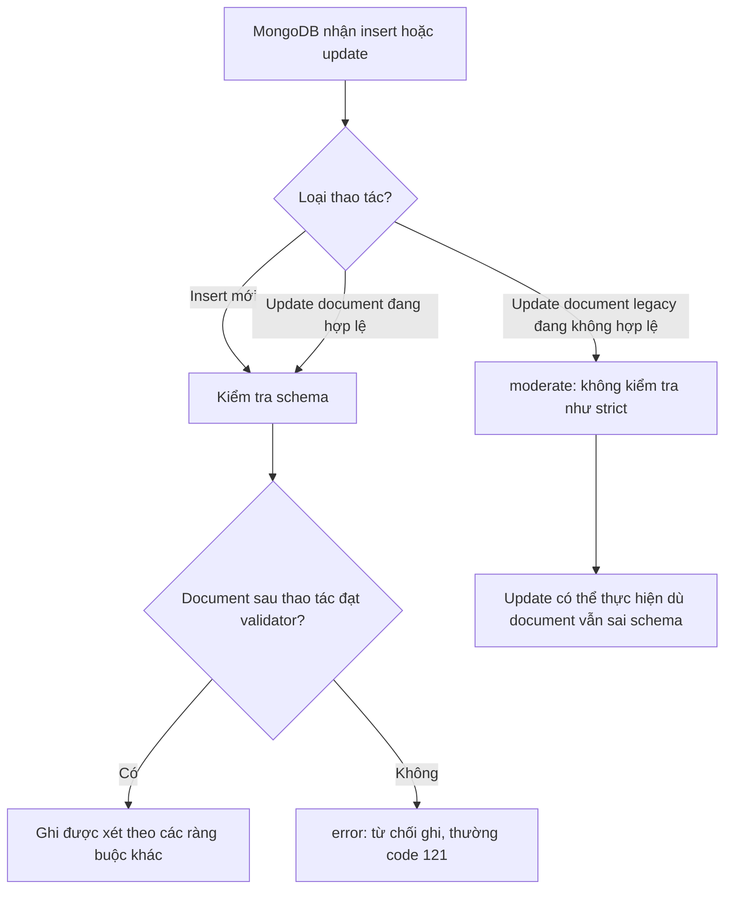

# Đổi validator khi dữ liệu cũ chưa phù hợp schema mới

## 1. Bài toán: muốn siết schema nhưng không thể sửa toàn bộ dữ liệu trong một lần

MongoDB cho phép các document trong một collection có cấu trúc và kiểu BSON khác nhau. Sự linh hoạt này hữu ích khi sản phẩm thay đổi nhanh, nhưng sau vài năm vận hành, dữ liệu có thể tồn tại ở nhiều phiên bản:

- Document mới có đủ trường, đúng kiểu và giá trị theo quy ước mới.
- Document cũ thiếu field chưa từng được bắt buộc.
- Một số chương trình cũ lưu tiền dưới dạng `String`, chương trình mới lưu `Int64`.
- Trạng thái đơn hàng có cả `"paid"`, `"PAID"` và những mã không còn hợp lệ.
- Một ứng dụng đã triển khai schema mới, trong khi các worker hoặc dịch vụ khác vẫn ghi schema cũ.

Giả sử collection `fulfillment_orders` chuẩn bị áp dụng quy tắc mới: mọi đơn phải có `tenantId`, `state` thuộc tập cho phép, `totalCents` là BSON `long` không âm, `currency` và `schemaVersion=2`.

Nếu ngay lập tức bật **validator nghiêm ngặt** trong khi dữ liệu cũ chưa được kiểm kê, những lần cập nhật document legacy có thể thất bại, dù cập nhật đó chỉ thêm một ghi chú vận hành. Ngược lại, nếu nới validator vô hạn để “tránh lỗi”, các document mới vẫn có thể tiếp tục ghi sai và nợ dữ liệu ngày càng lớn.

**Câu hỏi thiết kế:** làm cách nào đổi MongoDB collection validator mà:

1. Không nhầm dữ liệu tồn tại từ trước với dữ liệu hợp lệ.
2. Không làm gián đoạn các luồng ghi quan trọng.
3. Có thể ngăn **ghi mới** không phù hợp schema.
4. Có kế hoạch sửa, kiểm kê và chứng minh các document legacy đã đạt chuẩn.
5. Chuyển được sang chế độ kiểm tra nghiêm ngặt mà không cần giả định `collMod` tự sửa dữ liệu?

Bài này nằm trong chương **Collection và schema** của module **SPRING_DATA_MONGODB**. Chúng ta sẽ thực hành với MongoDB `$jsonSchema` và `collMod`, kết hợp `MongoTemplate`, repository, kiểm thử tích hợp, quyền truy cập, vận hành và chẩn đoán lỗi.

**Kết luận quan trọng ngay từ đầu:** thay validator là thay **quy tắc kiểm tra những lần ghi tương lai**, không phải một migration tự động sửa các document đã tồn tại. Để triển khai an toàn, phải tách **quan sát, kiểm soát ghi mới, chuyển đổi dữ liệu cũ và xác minh hoàn tất**.

## 2. Validator, validationLevel và validationAction là ba khái niệm khác nhau

Một collection có thể lưu một **validator** để xác định document hợp lệ. Hai option bổ sung quyết định **khi nào** việc kiểm tra được áp dụng và **hệ thống xử lý thế nào** nếu không hợp lệ.

| Thuộc tính | Quyết định | Ví dụ |
| --- | --- | --- |
| `validator` | Điều kiện một document phải đáp ứng | `$jsonSchema` với `required`, `bsonType`, `enum` |
| `validationLevel` | Những lần ghi nào được xét validator | `strict`, `moderate`, `off` |
| `validationAction` | Xử lý ghi không hợp lệ khi được kiểm tra | `error`, `warn`; một số server mới có thêm lựa chọn phiên bản cụ thể |

Ví dụ MongoDB command:

```javascript
db.runCommand({
  collMod: "fulfillment_orders",
  validator: {
    $jsonSchema: {
      bsonType: "object",
      required: ["tenantId", "state"],
      properties: {
        tenantId: { bsonType: "string" },
        state: { enum: ["PENDING", "PAID", "CANCELLED"] }
      }
    }
  },
  validationLevel: "moderate",
  validationAction: "error"
});
```

Command trên thay cấu hình validator của **collection đã tồn tại**. `collMod` không tự chạy lại từng document để viết lại `state` hoặc bổ sung `tenantId`. Tất cả yêu cầu cập nhật data phải được thiết kế riêng.

### 2.1. Validation không phải schema của Java

Spring Data MongoDB có annotation `@Document`, `@Field`, `@MongoId` và hệ thống converter để ánh xạ Java object với BSON. Nhưng một Java entity hợp lệ **không tự tạo ra** MongoDB validator tương đương trên server.

Ngược lại, validator trên MongoDB vẫn kiểm soát các lệnh ghi từ **mongosh, Java driver, Spring Data, công cụ ETL hoặc dịch vụ khác** khi thao tác không được miễn kiểm tra. Vì vậy, muốn có quy tắc chung cho nhiều producer, server-side validator là một lớp bảo vệ hữu ích.

Tuy nhiên, validator không tự thay thế validation nghiệp vụ ở Java, giới hạn quyền tenant, unique index, transaction hoặc kiểm tra luồng trạng thái.

## 3. Hai trục điều khiển: strict/moderate và error/warn

### 3.1. strict: kiểm tra mọi lần insert và update thông thường

Với `validationLevel: "strict"`, MongoDB áp dụng validator cho những document được tạo mới và document được cập nhật, theo các quy tắc thực thi tương ứng.

Điểm dễ nhầm: **strict không xóa hoặc tự từ chối tất cả dữ liệu cũ ngay khi chạy collMod**. Những document cũ đang không hợp lệ vẫn nằm trong collection; chúng có thể gặp lỗi khi một thao tác sau đó cố cập nhật chúng mà kết quả không đạt validator.

### 3.2. moderate: kiểm tra insert và update trên document vốn đã hợp lệ

Với `validationLevel: "moderate"`, MongoDB kiểm tra **insert** và những update trên document **đã hợp lệ theo validator**. Khi một document cũ vốn không đạt validator, những update lên document đó không bị áp quy tắc validator theo cách strict áp dụng.

Điều này tạo ra một **khoảng chuyển tiếp** rất hữu ích:

- Document **mới** phải tuân thủ schema khi `validationAction: "error"`.
- Document **đã hợp lệ** không được tự do trở thành document sai schema sau update.
- Document **legacy đang không hợp lệ** vẫn có thể được sửa dần, kể cả trong thời gian chưa đạt trọn vẹn schema.

**Mặt trái:** `moderate + error` **không bảo đảm tất cả document trong collection hợp lệ**. Nó cũng không bảo đảm mọi lần cập nhật document legacy đều được kiểm tra. Đây là chính sách chuyển tiếp, không nên dùng như bằng chứng đã hoàn tất migration.

### 3.3. error và warn quyết định xử lý khi phát hiện vi phạm

- `validationAction: "error"`: lệnh ghi bị kiểm tra mà vi phạm validator sẽ thất bại; MongoDB thường báo lỗi **DocumentValidationFailure**, mã **121**.
- `validationAction: "warn"`: MongoDB cho phép ghi tiếp tục và phát cảnh báo theo cơ chế logging của server. Ứng dụng có thể thấy ghi thành công, **không** mặc nhiên nhận exception.

Không dùng `warn` lâu dài như một cơ chế chặn dữ liệu sai. Nếu cần biết có bao nhiêu record vi phạm, phải xây kiểm kê và giám sát phù hợp; log cảnh báo không tự tạo một báo cáo đầy đủ, có thể tra cứu mãi.

### 3.4. Bảng hành vi nên ghi nhớ

Giả sử một lần ghi có kết quả **không đạt validator**, và bỏ qua các lỗi khác như unique index hoặc write conflict:

| Lựa chọn | Insert document mới sai schema | Update document cũ vốn hợp lệ thành sai | Update document cũ vốn đã sai và vẫn sai |
| --- | --- | --- | --- |
| `strict + error` | Bị từ chối | Bị từ chối | Bị từ chối |
| `strict + warn` | Cho phép, ghi cảnh báo | Cho phép, ghi cảnh báo | Cho phép, ghi cảnh báo |
| `moderate + error` | Bị từ chối | Bị từ chối | **Có thể thực hiện**, không bị kiểm tra như strict |
| `moderate + warn` | Cho phép, ghi cảnh báo | Cho phép, ghi cảnh báo | Có thể thực hiện, thường không bị kiểm tra |
| `off` | Không áp kiểm tra validator cho ghi tương ứng | Không áp kiểm tra | Không áp kiểm tra |

`validationLevel: "off"` không có nghĩa xóa validator; nó tắt áp dụng validation cho những thao tác tương ứng. Không sử dụng `off` làm cách mặc định “vượt qua migration” vì dữ liệu mới có thể tiếp tục lệch schema.

## 4. Dữ liệu mẫu: v2 chặt chẽ hơn v1

### 4.1. Dữ liệu đã hợp lệ theo v2

```javascript
db.fulfillment_orders.insertOne({
  _id: "o-101",
  tenantId: "shop-01",
  state: "PAID",
  totalCents: NumberLong("120000"),
  currency: "VND",
  schemaVersion: NumberInt("2")
});
```

Giả định `totalCents` là **số đơn vị tiền nhỏ nhất** theo hợp đồng của hệ thống. Với VND, cần định nghĩa rõ cách diễn giải đơn vị; tên `totalCents` ở ví dụ là quy ước lưu số nguyên, không phải lời khuyên mặc định đổi mọi giao dịch VND ra “cent”. Trong ứng dụng thật, nên đặt tên field nhất quán với mô hình tiền và loại tiền cụ thể.

### 4.2. Dữ liệu legacy có kiểu và mã trạng thái cũ

```javascript
db.fulfillment_orders.insertOne({
  _id: "o-102",
  tenantId: "shop-01",
  state: "paid",
  totalCents: "80000",
  currency: "VND"
  // Không có schemaVersion.
});
```

Document này sẽ không thỏa validator v2 vì:

1. `state` dùng `"paid"`, không nằm trong enum chuẩn mới.
2. `totalCents` là BSON String, không phải Int64.
3. Thiếu `schemaVersion`.

### 4.3. Dữ liệu legacy thiếu thông tin nghiệp vụ

```javascript
db.fulfillment_orders.insertOne({
  _id: "o-103",
  tenantId: "shop-01",
  state: "PENDING",
  totalCents: NumberInt("5000")
  // Thiếu currency và schemaVersion; amount đang là Int32.
});
```

Không thể chỉ viết:

```javascript
// KHÔNG LÀM MÙ QUÁNG:
db.fulfillment_orders.updateMany(
  { currency: { $exists: false } },
  { $set: { currency: "VND" } }
);
```

vì thiếu `currency` không chứng minh tất cả đơn đều thuộc VND. Để hoàn tất migration, cần một **nguồn đáng tin cậy** như hệ thống thanh toán, cấu hình lịch sử của tenant, chứng từ hoặc dữ liệu gốc khác.

### 4.4. Quy tắc mới phải được viết rõ

Ta muốn có `validator v2`:

| Field | Bắt buộc | Kiểu/ràng buộc |
| --- | --- | --- |
| `tenantId` | Có | BSON String |
| `state` | Có | `PENDING`, `PAID`, `CANCELLED` |
| `totalCents` | Có | BSON `long`, không âm |
| `currency` | Có | `VND` hoặc `USD` theo phạm vi ví dụ |
| `schemaVersion` | Có | BSON `int`, giá trị `2` |

Các field như `_id` hoặc `_class` có thể tồn tại thêm. Theo mặc định, `$jsonSchema` không cấm các property khác nếu không yêu cầu `additionalProperties: false`. Điều này hữu ích khi dùng Spring Data và có metadata type hint; nếu sau này bật `additionalProperties: false`, phải tính đến `_id`, `_class` và các field thực tế được converter ghi.

**Đặt điều kiện minimum không âm** là quy định cho document mới. Những đơn có giá trị âm do hoàn tiền/phí điều chỉnh có thể cần loại document hoặc mô hình event riêng; validator không tự hiểu ngữ nghĩa kế toán.

## 5. Khai báo $jsonSchema v2 trong mongosh

### 5.1. Định nghĩa schema để tái sử dụng

```javascript
const orderSchemaV2 = {
  bsonType: "object",
  required: [
    "tenantId",
    "state",
    "totalCents",
    "currency",
    "schemaVersion"
  ],
  properties: {
    tenantId: {
      bsonType: "string",
      description: "Tenant của đơn hàng"
    },
    state: {
      enum: ["PENDING", "PAID", "CANCELLED"]
    },
    totalCents: {
      bsonType: "long",
      minimum: 0
    },
    currency: {
      enum: ["VND", "USD"]
    },
    schemaVersion: {
      bsonType: "int",
      enum: [NumberInt("2")]
    }
  }
};

const orderValidatorV2 = {
  $jsonSchema: orderSchemaV2
};
```

`bsonType: "long"` nghĩa là BSON Int64. Một document có `NumberInt("5000")` là Int32 nên **không tự đạt schema** dù cả hai biểu diễn giá trị số học 5000.

### 5.2. Validator hỗ trợ hơn một quy tắc

MongoDB validator có thể dùng `$jsonSchema` và những query expression được hỗ trợ (ví dụ kết hợp các điều kiện được phép). Nhưng cho migration ban đầu, nên ưu tiên quy tắc **dễ giải thích, dễ truy vấn kiểm kê và dễ kiểm thử**.

Không nhồi tất cả luật nghiệp vụ thành JSON Schema. Chẳng hạn “PAID chỉ khi có giao dịch thanh toán đã xác thực” là quy tắc xuyên collection/hệ thống, không thể được một schema validator trên document đơn lẻ tự kiểm chứng.

### 5.3. Có nên thêm schemaVersion vào mọi document?

`schemaVersion` giúp ứng dụng và job migration biết document đang theo hợp đồng nào. Tuy nhiên, nó **chỉ là một field dữ liệu**; nếu script đặt `schemaVersion: 2` nhưng chưa chuyển các field khác, document có thể vẫn không đạt validator.

Đối với hệ thống có nhiều phiên bản đọc/ghi cùng hoạt động, cần phân biệt rõ:

- Version của **code ứng dụng**.
- Version của **schema document**.
- Version của **validator được cấu hình**.
- Version của **quy trình migration** và thời điểm áp dụng.

Các số này liên quan nhau nhưng không đồng nghĩa.

## 6. Trước collMod: kiểm kê document vi phạm

### 6.1. Kiểm tra dữ liệu theo chính validator dự kiến

MongoDB hỗ trợ `$jsonSchema` như một query expression để tìm document thỏa schema. Có thể phủ định điều kiện bằng `$nor`:

```javascript
db.fulfillment_orders.find({
  $nor: [
    { $jsonSchema: orderSchemaV2 }
  ]
});
```

Với fixture phần 4, query sẽ tìm `o-102` và `o-103`. Đây là một cách kiểm kê **theo schema mục tiêu**, không chỉ theo một trường cụ thể.

Đếm số document không phù hợp:

```javascript
db.fulfillment_orders.countDocuments({
  $nor: [
    { $jsonSchema: orderSchemaV2 }
  ]
});
// Với fixture chỉ có o-101, o-102, o-103: dự kiến 2.
```

**Không nhầm `countDocuments` với việc tự chạy validator cho toàn collection khi đổi cấu hình.** Đây là một lệnh đọc kiểm kê do ta chủ động gọi.

### 6.2. Kiểm kê nguyên nhân lỗi, không chỉ số lượng

Một query liệt kê document invalid cho biết “có lỗi” nhưng chưa nói tất cả nguyên nhân. Cần xem:

```javascript
db.fulfillment_orders.aggregate([
  {
    $project: {
      _id: 1,
      state: 1,
      currency: 1,
      stateType: { $type: "$state" },
      amountType: { $type: "$totalCents" },
      currencyType: { $type: "$currency" },
      versionType: { $type: "$schemaVersion" }
    }
  }
]);
```

`$type` trong aggregation giúp phân biệt `"missing"`, `"null"`, `"string"`, `"int"` và `"long"`. Khi migration trên dữ liệu lớn, nên xuất báo cáo **số lượng theo từng nhóm nguyên nhân** và lấy mẫu document thực tế, tránh để job chỉ sửa một lỗi rồi bỏ qua lỗi thứ hai.

### 6.3. Chi phí của audit

`$jsonSchema` với nhiều điều kiện có thể tốn tài nguyên trên collection lớn. Không chạy kiểm kê toàn bộ quá thường xuyên trên primary bận rộn mà không đánh giá thời gian, read preference, tài nguyên và tính nhất quán của kết quả.

Với dữ liệu cực lớn, có thể chia theo tenant, thời gian hoặc khóa ổn định, đồng thời giữ một bản thống kê tổng cuối. Tuy nhiên, **audit từng chunk có thể quan sát các thời điểm khác nhau** nếu ghi vẫn đang diễn ra; cần xác định chiến lược cutover và kiểm tra cuối.

## 7. Giai đoạn A: strict + warn để quan sát mà chưa chặn ghi

Trước khi triển khai, sao lưu/học kỹ tác động, kiểm tra quyền chạy `collMod` và thống nhất thời điểm thay đổi. Trên collection đã tồn tại:

```javascript
db.runCommand({
  collMod: "fulfillment_orders",
  validator: orderValidatorV2,
  validationLevel: "strict",
  validationAction: "warn"
});
```

Trong giai đoạn này:

- Các thao tác insert/update không đạt schema vẫn có thể được thực hiện.
- Server có thể ghi cảnh báo vi phạm theo chính sách logging.
- Đường ghi vẫn phải được ứng dụng **quan sát riêng**: tỷ lệ payload không hợp lệ, nguồn ghi, version producer và document ID trong hệ thống giám sát an toàn.

**Vì sao nên chọn strict ở giai đoạn quan sát?** Nó cho phép xem những lần update trên legacy document vi phạm validator, thay vì bỏ qua chúng như cách `moderate` thường làm. Tuy nhiên, log không phải nguồn kiểm kê hoàn hảo và không tự cho biết có bao nhiêu legacy document chưa được chạm tới.

### 7.1. Việc gắn warn không xác minh dữ liệu cũ tức thì

Ngay sau `collMod`, `o-102` và `o-103` vẫn nằm trong collection; chúng không tự bị “đánh dấu lỗi” bằng một field hay bắt buộc được liệt kê trên log nếu chưa có hoạt động ghi tương ứng.

Để biết tỷ lệ dữ liệu legacy, dùng query kiểm kê ở phần 6. Không kết luận “không có log validator” đồng nghĩa “toàn collection đã sạch”.

### 7.2. Nguy cơ khi để warn quá lâu

Một service cũ vẫn có thể ghi document sai mà HTTP request trả thành công. Khi đó số lượng invalid có thể **tăng lên** trong lúc nhóm migration sửa dữ liệu cũ. Cần đặt thời hạn và tiêu chí chuyển sang chặn ghi sai, không để warn là chế độ dài hạn chỉ để tránh sự cố.

## 8. Giai đoạn B: moderate + error để chặn ghi mới, cho phép sửa legacy

Khi các **producer tạo document mới** đã hỗ trợ schema v2, chuyển sang:

```javascript
db.runCommand({
  collMod: "fulfillment_orders",
  validator: orderValidatorV2,
  validationLevel: "moderate",
  validationAction: "error"
});
```

Trạng thái lúc này:



### 8.1. Thử insert sai: bị chặn

```javascript
db.fulfillment_orders.insertOne({
  _id: "o-new-invalid",
  tenantId: "shop-01",
  state: "paid",
  totalCents: "9000"
});
// Dự kiến lỗi DocumentValidationFailure (code 121).
```

Trong `moderate + error`, **insert mới** không được miễn validation. Việc thiếu `currency`, `schemaVersion` và sai type của `totalCents` làm nó không hợp lệ.

### 8.2. Thử update document đang hợp lệ thành sai: bị chặn

```javascript
db.fulfillment_orders.updateOne(
  { _id: "o-101" },
  { $set: { state: "paid" } }
);
// Dự kiến lỗi validation: o-101 vốn hợp lệ, update làm sai enum.
```

### 8.3. Thử update document legacy vẫn sai: có thể thành công

```javascript
db.fulfillment_orders.updateOne(
  { _id: "o-102" },
  { $set: { migrationNote: "Đang đối soát" } }
);
// Với moderate, document vốn không đạt schema nên
// update này có thể được áp dụng, dù sau update vẫn chưa hợp lệ.
```

Đây là **lợi ích và rủi ro** của moderate. Lợi ích: không khóa toàn bộ luồng xử lý legacy. Rủi ro: một worker cũ vẫn có thể tiếp tục cập nhật document sai nhiều lần mà không bị validator này ngăn.

Vì vậy phải:

1. Có danh sách hoặc dashboard document chưa đạt schema.
2. Thiết kế migration có khả năng chạy lại và đối soát.
3. Giới hạn thời gian cho giai đoạn moderate.
4. Không gắn nhãn “đã bảo vệ toàn bộ dữ liệu” chỉ vì insert mới đã bị chặn.

### 8.4. moderate không thay thế chặn producer cũ

Trong cùng giai đoạn, một producer cũ **insert** document sai sẽ nhận lỗi; nếu nó retry vô hạn, có thể gây quá tải và mất dữ liệu trong hàng đợi. Phải nâng cấp consumer/producer trước cutover, chuẩn bị handling cho lỗi 121 và theo dõi dead-letter queues hoặc các bản ghi bị từ chối.

## 9. Migration: sửa đúng dữ liệu, không chỉ đổi schemaVersion

### 9.1. Phân nhóm theo khả năng xác minh

| Nhóm legacy | Có thể làm gì? | Điều không được tự suy đoán |
| --- | --- | --- |
| `state="paid"` và chứng từ xác nhận đã thanh toán | Chuyển thành `"PAID"` | Không giả định mọi chuỗi gần giống đều là PAID |
| `totalCents="80000"`, format được xác minh là số nguyên dương | Chuyển thành BSON Int64 | Không ép mọi String tùy ý thành 0 |
| Thiếu `currency` nhưng có nguồn thanh toán xác nhận VND | Bổ sung VND với dấu vết kiểm chứng | Không mặc định toàn bộ collection là VND |
| Thiếu thông tin không thể khôi phục | Đưa vào danh sách review/ngoại lệ | Không dựng giá trị giả cho đủ validator |
| Document có giá trị âm cần giải thích | Kiểm tra bản chất hoàn tiền/điều chỉnh | Không tự đổi thành trị tuyệt đối |

Migration phải thể hiện **nghĩa của dữ liệu** trước khi thỏa mãn kiểu BSON. Một migration làm mọi document đạt `$jsonSchema` nhưng sai thông tin tiền hoặc trạng thái có thể nguy hiểm hơn việc tạm thời chấp nhận document legacy đang chờ đối soát.

### 9.2. Chuyển một document đã được xác minh

Giả sử đã kiểm tra `o-102` thực sự được thanh toán và `"80000"` là số nguyên theo đơn vị tiền mà hệ thống sử dụng:

```javascript
db.fulfillment_orders.updateOne(
  {
    _id: "o-102",
    state: "paid",
    totalCents: "80000",
    currency: "VND"
  },
  {
    $set: {
      state: "PAID",
      totalCents: NumberLong("80000"),
      schemaVersion: NumberInt("2")
    },
    $unset: {
      migrationNote: ""
    }
  }
);
```

Query đặt điều kiện cũ nhằm tránh ghi đè nếu document đã được dịch vụ khác cập nhật giữa lúc kiểm tra và migration. Nếu `matchedCount=0`, cần xem vì sao, **không tự động dùng một update rộng hơn** để ép thành công.

Lệnh `$set`/`$unset` có thể chạy lại an toàn hơn nhiều so với `$inc` hoặc cộng dồn doanh thu; tuy nhiên điều kiện query và tính nhất quán với các cập nhật đồng thời vẫn cần thiết.

### 9.3. Không tự sửa dữ liệu thiếu nguồn xác thực

`o-103` thiếu `currency`. Nếu **chưa biết đồng tiền**, giữ document trong danh sách review. Khi có chứng từ thanh toán hoặc nguồn vận hành xác minh đó là VND, mới cập nhật:

```javascript
db.fulfillment_orders.updateOne(
  {
    _id: "o-103",
    currency: { $exists: false },
    totalCents: { $type: "int" },
    state: "PENDING"
  },
  {
    $set: {
      currency: "VND",
      totalCents: NumberLong("5000"),
      schemaVersion: NumberInt("2")
    }
  }
);
```

**Điều kiện bắt buộc nằm ngoài code:** phải có bằng chứng đáng tin rằng `o-103` dùng VND. Đoạn trên không tự suy ra đồng tiền từ `tenantId` hay `state`. Ở môi trường thật, lưu audit trail cho quyết định migration ở nơi được phép và tránh ghi thông tin nhạy cảm không cần thiết vào document.

### 9.4. Chuyển kiểu hàng loạt có kiểm soát

Trên bộ dữ liệu lớn, không thể viết từng câu lệnh cho mọi ID. Một hướng là dùng **aggregation pipeline update** cho những record mà format đã được kiểm chứng:

```javascript
db.fulfillment_orders.updateMany(
  {
    state: "paid",
    currency: "VND",
    totalCents: { $type: "string" }
  },
  [
    {
      $set: {
        state: "PAID",
        totalCents: {
          $convert: {
            input: "$totalCents",
            to: "long",
            onError: null,
            onNull: null
          }
        },
        schemaVersion: NumberInt("2")
      }
    }
  ]
);
```

**Đây mới là khung minh họa, không phải lệnh migration an toàn để chạy thẳng trên production.** Nếu chuỗi không chuyển được, `onError: null` tạo document vẫn sai schema; dưới `moderate`, nó có thể được ghi vì document cũ vốn đã không hợp lệ. Vì vậy trước khi cập nhật phải:

1. Xác định format hợp lệ bằng bước audit riêng (ví dụ chỉ chữ số, không dấu phân tách ngoài hợp đồng).
2. Thử conversion trên bản sao/staging, đếm các giá trị `null` sau chuyển.
3. Lưu danh sách ID thất bại và **không cập nhật** những record này.
4. Chia migration theo batch/tenant, kiểm tra `matchedCount`, `modifiedCount` và trạng thái sau mỗi batch.
5. Chạy lại query `$jsonSchema` để bảo đảm không làm số invalid tăng.

Thực tế, một job Java đọc BSON thô, kiểm tra format bằng logic có test, chuyển sang `Long`/`Decimal128` đúng chính sách, sau đó dùng `MongoTemplate` hoặc bulk write theo chunk có thể an toàn và dễ quan sát hơn một updateMany áp dụng cho toàn collection.

### 9.5. Đừng coi migration thành công chỉ vì modifiedCount tăng

`modifiedCount > 0` chỉ nói có document đã thay đổi. Nó không khẳng định:

- Tất cả document mục tiêu được sửa.
- Không có giá trị sai nghiệp vụ.
- Không có document mới bị producer cũ ghi vào giữa lúc chạy.
- Không tồn tại document thiếu currency hoặc enum sai.
- Không có tình huống race làm migration ghi đè dữ liệu mới.

**Bằng chứng quan trọng nhất** cho schema là kết quả kiểm kê theo validator sau migration, kết hợp xác minh nghiệp vụ và kiểm tra producer.

## 10. Giai đoạn C: strict + error khi dữ liệu đã đạt yêu cầu

Sau khi các producer mới đã sẵn sàng và audit trả về **0 document vi phạm**, chuyển sang:

```javascript
db.runCommand({
  collMod: "fulfillment_orders",
  validator: orderValidatorV2,
  validationLevel: "strict",
  validationAction: "error"
});
```

Lúc này:

- Insert mới sai schema bị từ chối.
- Update document hiện có tạo kết quả sai schema bị từ chối.
- Các thao tác ghi hợp lệ vẫn phải đáp ứng những ràng buộc khác như unique index, quyền và transaction.

### 10.1. Kiểm tra trước và ngay sau cutover

```javascript
// Trước cutover:
db.fulfillment_orders.countDocuments({
  $nor: [{ $jsonSchema: orderSchemaV2 }]
});
// Yêu cầu: 0 theo chính sách triển khai đã chọn.

// Sau cutover, kiểm tra lại:
db.fulfillment_orders.countDocuments({
  $nor: [{ $jsonSchema: orderSchemaV2 }]
});
```

Trong hệ thống có ghi đồng thời, **một lần count=0 không tạo snapshot vĩnh viễn**. Cần phối hợp cutover producer/validator, giám sát các luồng ghi và chạy xác minh lại. Với nhiều dịch vụ, định nghĩa thời điểm “mọi producer đã hỗ trợ v2” và cách rollback triển khai nếu còn service cũ.

### 10.2. Nếu vẫn còn legacy thì sao?

Không tự gắn nhãn hoàn tất và không thay strict theo kiểu mong mọi lần update cũ sẽ không xảy ra. Có một số lựa chọn cần đánh giá:

1. Giữ `moderate + error` tạm thời với deadline rõ, tiếp tục đối soát.
2. Tách/quarantine document không thể sửa và điều chỉnh các đường đọc/ghi theo chính sách nghiệp vụ.
3. Thiết kế validator chuyển tiếp có nhiều nhánh schema hợp lệ, nếu thật sự cần hỗ trợ đồng thời v1/v2 trong một thời gian.
4. Dừng luồng ghi cũ, nâng cấp producer hoặc hoàn tất việc migrate trước khi bật strict.

Không làm giả `schemaVersion` hoặc tự lấp dữ liệu thiếu chỉ để đạt chỉ tiêu count=0.

## 11. Chiến lược tương thích hai schema khi rollout kéo dài

### 11.1. Validator mở rộng có chủ đích

Nếu một số dịch vụ chưa thể nâng cấp ngay, có thể tạo validator cho phép **hai dạng document đã định nghĩa**, thay vì tắt validation hoàn toàn:

```javascript
const transitionalValidator = {
  $or: [
    {
      $jsonSchema: {
        bsonType: "object",
        required: ["tenantId", "state", "totalCents"],
        properties: {
          tenantId: { bsonType: "string" },
          state: { enum: ["PENDING", "PAID", "CANCELLED"] },
          totalCents: { bsonType: "long", minimum: 0 }
        }
      }
    },
    {
      $jsonSchema: orderSchemaV2
    }
  ]
};
```

Ở ví dụ này, **nhánh đầu là schema chuyển tiếp minh họa**, không phải schema v1 lịch sử đầy đủ; nó quá rộng nếu được áp lâu dài, vì một document thiếu `currency` hoặc `schemaVersion` vẫn có thể được chấp nhận. Ngoài ra, nếu nhánh đầu đã chứa toàn bộ điều kiện của nhánh v2 thì `$or` không tạo nhiều giá trị. Khi thực hiện thật, các nhánh phải có **discriminator** hoặc điều kiện rõ ràng để tránh vô tình cho phép một document v2 không hoàn chỉnh “lọt” vào nhánh v1.

Ví dụ kiểm tra theo schemaVersion:

```javascript
const versionedValidator = {
  $or: [
    {
      $and: [
        { schemaVersion: { $exists: false } },
        {
          $jsonSchema: {
            bsonType: "object",
            required: ["tenantId", "state", "totalCents"],
            properties: {
              tenantId: { bsonType: "string" },
              state: { enum: ["paid", "pending"] },
              totalCents: { bsonType: "string" }
            }
          }
        }
      ]
    },
    { $jsonSchema: orderSchemaV2 }
  ]
};
```

**Lưu ý:** ví dụ này phản ánh hai loại legacy cụ thể và không bao gồm `o-103` (vốn có totalCents Int32). Nếu cần hỗ trợ loại đó, phải xác định thêm contract thực tế. Không copy validator chuyển tiếp sang production khi chưa kiểm kê dữ liệu và ràng buộc nghiệp vụ đầy đủ.

### 11.2. Kế hoạch kết thúc tương thích ngược

Một validator chấp nhận đồng thời v1/v2 có thể giúp triển khai từng phần, nhưng cần:

- Ngày dừng ghi v1 và danh sách producer còn dùng v1.
- Đo số lượng document còn ở mỗi version.
- Job migration tất cả v1 còn lại sang v2.
- Kiểm kê những nhánh legacy không còn được dùng.
- Cutover cuối sang validator chỉ cho phép v2.

Nếu không có kế hoạch dừng hỗ trợ v1, validator chuyển tiếp dễ trở thành **kẽ hở thường trực** cho dữ liệu cũ hoặc sai.

### 11.3. Ưu tiên không phá reader cũ

Không chỉ kiểm soát write path. Một reader cũ có thể:

- Không hiểu trạng thái `CANCELLED`.
- Không đọc được `totalCents` dạng BSON Int64 nếu trước đây chỉ xử lý String.
- Ghi lại toàn document bằng `save`, vô tình xóa `currency` hoặc `schemaVersion`.
- Deserialize enum không hỗ trợ giá trị mới.

Với Spring Data, cần đánh giá converter, entity mapping và các lần gọi `save` trên object chỉ đọc được một phần. Rollout schema nên theo hướng **expand → migrate → contract** thay vì thay đổi một lần rồi hy vọng mọi ứng dụng tương thích.

## 12. Spring Data MongoDB: entity và kiểu BSON phải khớp validator

### 12.1. Entity cho document v2

```java
package example.orders;

import org.springframework.data.mongodb.core.mapping.Document;
import org.springframework.data.mongodb.core.mapping.FieldType;
import org.springframework.data.mongodb.core.mapping.MongoId;

@Document(collection = "fulfillment_orders")
public record FulfillmentOrder(
    @MongoId(FieldType.STRING) String id,
    String tenantId,
    String state,
    long totalCents,
    String currency,
    int schemaVersion
) {}
```

Với converter phổ biến, `long` được lưu thành BSON Int64, `int` thành Int32. Tuy nhiên, **không dùng record v2 này để đọc bừa mọi legacy document chưa migrate**. Một số document có `totalCents` dạng String, thiếu `currency` hoặc sai `state`; converter có thể ép kiểu, đặt mặc định hoặc báo lỗi tùy field và cấu hình. Trước migration, nên đọc raw `Document` để kiểm soát BSON type thật.

### 12.2. Repository chỉ định hợp đồng dữ liệu đã sạch

```java
package example.orders;

import java.util.List;
import org.springframework.data.mongodb.repository.MongoRepository;

public interface FulfillmentOrderRepository
        extends MongoRepository<FulfillmentOrder, String> {

    List<FulfillmentOrder> findByTenantIdAndState(
        String tenantId, String state
    );
}
```

Repository hữu ích khi document đã phù hợp với mô hình Java. Với dữ liệu lịch sử chưa đạt v2, custom repository hoặc `MongoTemplate` đọc raw BSON đôi khi thích hợp hơn để audit/migrate.

### 12.3. Bẫy của @NotNull và Bean Validation

`@NotNull` trên Java DTO/entity hoặc validation khi nhận request chỉ áp dụng ở **các đường đi cụ thể của ứng dụng**, không tự đảm bảo mọi thao tác từ `mongosh`, ETL hoặc driver độc lập đều bị kiểm tra. MongoDB `$jsonSchema` là một ranh giới ở server, nhưng cũng không thay thế quy tắc Java.

**Không coi annotation Java là migration MongoDB.** Việc deploy Java class mới không làm `collMod`, không tạo ngay validator mới và không sửa BSON đã lưu.

## 13. Spring Data MongoTemplate: thay validator qua collMod

### 13.1. MongoTemplate.executeCommand

`MongoTemplate` cung cấp cách gửi MongoDB command. Ví dụ sau cho thấy cách dùng BSON `Document` để thay validator **sau khi collection đã tồn tại**:

```java
package example.orders;

import java.util.List;
import org.bson.Document;
import org.springframework.data.mongodb.core.MongoTemplate;
import org.springframework.stereotype.Service;

@Service
public class OrderSchemaAdministration {

    private final MongoTemplate template;

    public OrderSchemaAdministration(MongoTemplate template) {
        this.template = template;
    }

    private Document schemaV2() {
        return new Document("bsonType", "object")
            .append("required", List.of(
                "tenantId", "state", "totalCents",
                "currency", "schemaVersion"
            ))
            .append("properties", new Document()
                .append("tenantId",
                    new Document("bsonType", "string"))
                .append("state",
                    new Document("enum", List.of(
                        "PENDING", "PAID", "CANCELLED"
                    )))
                .append("totalCents",
                    new Document("bsonType", "long")
                        .append("minimum", 0))
                .append("currency",
                    new Document("enum", List.of("VND", "USD")))
                .append("schemaVersion",
                    new Document("bsonType", "int")
                        .append("enum", List.of(2))));
    }

    public Document changeValidator(
            String validationLevel,
            String validationAction) {

        if (!List.of("strict", "moderate").contains(
                validationLevel)) {
            throw new IllegalArgumentException(
                "Không hỗ trợ validationLevel này"
            );
        }
        if (!List.of("warn", "error").contains(
                validationAction)) {
            throw new IllegalArgumentException(
                "Không hỗ trợ validationAction này"
            );
        }

        Document command = new Document(
            "collMod", "fulfillment_orders"
        ).append(
            "validator",
            new Document("$jsonSchema", schemaV2())
        ).append(
            "validationLevel", validationLevel
        ).append(
            "validationAction", validationAction
        );

        return template.executeCommand(command);
    }
}
```

Các mức được đưa vào allowlist chỉ phục vụ ví dụ; điều đó **không biến API thay schema thành endpoint dành cho client**. Lệnh `collMod` là thao tác quản trị có ảnh hưởng rộng. Trong production, hãy thực hiện qua quy trình migration/deployment có quyền hạn phù hợp, kiểm soát thay đổi và cơ chế rollback, không cung cấp một HTTP API công khai để bất kỳ người dùng nào có thể đổi validator.

### 13.2. Cấu hình validate theo từng giai đoạn

Với service quản trị đã có, kế hoạch triển khai có thể tương ứng:

```java
// Giai đoạn A: quan sát.
admin.changeValidator("strict", "warn");

// Giai đoạn B: chặn ghi mới sai, cho phép xử lý legacy.
admin.changeValidator("moderate", "error");

// Giai đoạn C: kiểm soát nghiêm khi data đã sạch.
admin.changeValidator("strict", "error");
```

Ba lệnh này là **các bước ở những thời điểm triển khai khác nhau**, không chạy nối tiếp ngay lập tức trong một lần khởi động ứng dụng. Trước mỗi bước cần đạt điều kiện chuyển trạng thái, đặc biệt là producer compatibility và kết quả audit.

### 13.3. Spring Data có API dựng MongoJsonSchema

Ngoài raw `Document`, Spring Data MongoDB có các kiểu hỗ trợ JSON Schema như `MongoJsonSchema` và những operation liên quan. Khi dự án dùng DSL, nên kiểm tra API của đúng phiên bản Spring Data. Nhưng dù build JSON schema bằng DSL hay raw BSON, **ngữ nghĩa của validationLevel/validationAction trên MongoDB server không thay đổi**.

Với migration dài, lưu định nghĩa validator dưới quản lý phiên bản (trong hệ thống migration được phép) để có thể review/diff/rollback. Bài worker này chỉ viết tài liệu, không tạo hoặc sửa file migration ngoài phạm vi.

## 14. Xác nhận validator đang áp dụng thật trên collection

### 14.1. Đọc metadata collection

Trong mongosh:

```javascript
db.getCollectionInfos({
  name: "fulfillment_orders"
});
```

Xem các field trong `options`:

```javascript
{
  validator: {
    $jsonSchema: { /* schema đã cấu hình */ }
  },
  validationLevel: "moderate",
  validationAction: "error"
}
```

Kết quả minh họa ở trên chỉ trích các trường cần kiểm tra; object metadata thực tế còn có những thông tin khác. Không chỉ dựa vào việc `db.runCommand({collMod:...})` không ném lỗi rồi kết luận đúng schema nếu deployment có nhiều database hoặc collection cùng tên.

### 14.2. Kiểm tra database và collection đích

Một lỗi nguy hiểm là chạy `collMod` trên database staging/prod nhầm hoặc trên collection có tên gần giống. Trước khi thay:

1. Xác nhận connection string/database đã được ủy quyền.
2. Kiểm tra collection tồn tại và không phải view khác phạm vi.
3. Đọc metadata hiện tại, lưu thông tin validator cũ để rollback có kiểm soát.
4. Đối chiếu checksum/nội dung schema phiên bản muốn áp.
5. Xác minh trạng thái sau command và kiểm thử ghi hợp lệ/không hợp lệ.

### 14.3. Lỗi 121 và thông tin chi tiết

Khi `validationAction: "error"` từ chối một insert/update, MongoDB thường báo `DocumentValidationFailure` (code 121). Trong một số phiên bản server/driver, lỗi có `errInfo` hoặc chi tiết các quy tắc validator không được đáp ứng.

Không ghi nguyên payload lỗi vào log production nếu nó chứa dữ liệu nhạy cảm của khách hàng. Ghi mã lỗi, tên collection, loại thao tác, correlation ID, phiên bản ứng dụng và thông tin đã redaction theo chính sách.

### 14.4. Không xử lý 121 giống lỗi network

Validation failure thường là lỗi **dữ liệu hoặc phiên bản producer**, không phải một sự cố tạm thời có thể khắc phục bằng retry y hệt payload.

```text
Insert document sai schema
    -> MongoDB trả code 121
    -> ứng dụng không retry vô hạn cùng payload
    -> phân loại lỗi (input, producer version, migration)
    -> trả lỗi hợp đồng hoặc đưa vào luồng xử lý thủ công
```

Đối với queue consumer, nên có dead-letter/poison-message handling, monitoring và khả năng replay sau khi sửa dữ liệu hoặc nâng cấp producer, thay vì làm hàng đợi bị kẹt.

## 15. Những phương án tạm vượt validation cần cảnh giác

### 15.1. bypassDocumentValidation không phải cách khắc phục chung

MongoDB có cơ chế `bypassDocumentValidation` cho một số thao tác ghi với quyền thích hợp. Nó không phải một cờ “ai cũng được bỏ qua validator”.

Nếu một migration được cấp quyền bypass để nạp dữ liệu, việc này có thể tránh lỗi validation trong thao tác cụ thể nhưng **cũng bỏ mất lớp kiểm tra dữ liệu**. Chỉ dùng khi:

- Đã có phê duyệt và kiểm soát quyền phù hợp.
- Xác định chính xác tập document được chuyển.
- Có kiểm tra dữ liệu trước và sau riêng.
- Có dấu vết và kế hoạch thu hồi quyền bypass.

Không đưa quyền bypass cho application account thường chỉ để che lỗi giữa schema và entity.

### 15.2. Tắt validationLevel hoàn toàn

`validationLevel: "off"` có thể cho phép ghi trong một cửa sổ khẩn cấp, nhưng đồng thời tạo cơ hội cho **mọi producer** tiếp tục ghi sai. Một số tình huống vận hành đặc biệt có thể cần, nhưng đây là biện pháp rủi ro cao và phải đi kèm bảo vệ bổ sung, giới hạn thời gian, audit và kế hoạch bật lại.

### 15.3. Dùng warn nhưng quên giám sát

`validationAction: "warn"` không tự bảo vệ toàn vẹn dữ liệu. Nếu không có dashboard và tiêu chí kết thúc, nhóm vận hành có thể nhầm rằng validator đã triển khai thành công trong khi số document sai schema vẫn tăng.

## 16. Validator không thay thế unique index, transaction hoặc authorization

### 16.1. $jsonSchema không bảo đảm duy nhất xuyên document

Validator có thể yêu cầu `tenantId` và `externalOrderId` là String, nhưng không bảo đảm không có hai document cùng (`tenantId`, `externalOrderId`).

Nếu nghiệp vụ cần uniqueness:

```javascript
db.fulfillment_orders.createIndex(
  { tenantId: 1, externalOrderId: 1 },
  {
    name: "uk_tenant_external_order",
    unique: true
  }
);
```

Phải kiểm kê dữ liệu trùng trước khi tạo unique index. Trong ví dụ schema v2 phía trên, `externalOrderId` chưa được khai báo bắt buộc; nếu muốn dùng index này trong production, cần xác định rõ contract và hành vi với document thiếu field, bao gồm các lựa chọn sparse/partial index phù hợp. Một unique compound index thông thường có thể có quy tắc đối với giá trị null/missing cần kiểm tra.

### 16.2. Validator không biến bulk write thành transaction

Nếu bulk ghi ba document và thao tác thứ hai lỗi validation, những thao tác đã thành công **có thể vẫn được ghi** khi không có transaction, tùy ordered/unordered và lỗi cụ thể.

Muốn thay đổi nhiều document cùng commit/abort, cần multi-document transaction đúng cấu hình MongoDB và Spring Data. Validation chỉ đánh giá từng thao tác/document thuộc phạm vi kiểm tra, không tự tạo tính nguyên tử cho toàn bulk.

### 16.3. Validator không thay thế phân quyền tenant

Chỉ vì document có `tenantId: "shop-01"` đúng kiểu String không có nghĩa người gọi được phép đọc hoặc sửa nó. Phân quyền phải đến từ server-side authentication/authorization, filter tenant và chính sách truy cập dữ liệu.

## 17. Hiệu năng và lưu ý vận hành khi đổi validator

### 17.1. Chi phí trên write path

Validation có chi phí CPU để kiểm tra document được ghi. Schema quá phức tạp hoặc quá nhiều quy tắc cũng có thể tăng chi phí và độ khó chẩn đoán. Cần benchmark với tài liệu ghi điển hình, đặc biệt nếu lượng update lớn và nhiều service cùng thao tác.

Tuy nhiên, **không bỏ validator chỉ vì “có thêm chi phí”**. Mục tiêu là tìm cân bằng giữa bảo vệ dữ liệu và mức tải chấp nhận được, đồng thời giữ những quy tắc nghiệp vụ phức tạp ở lớp thích hợp.

### 17.2. collMod là thay đổi metadata có ảnh hưởng rộng

`collMod` có thể yêu cầu quyền quản trị và tương tác với hoạt động khác trên collection. Với cluster bận rộn, xem hướng dẫn vận hành và kiểm thử thời điểm triển khai. Không gọi `collMod` mỗi lần request hoặc mỗi lần repository được khởi tạo.

Một hệ thống triển khai nhiều phiên bản đồng thời nên có một nguồn quản lý migration duy nhất, tránh hai instance liên tục sửa validator qua lại.

### 17.3. Bulk migration theo chunk

Nếu có hàng triệu document:

1. Đọc theo khoảng ID/tenant/time đã xác định.
2. Chỉ chọn document thực sự sai schema và có thể chuyển an toàn.
3. Ghi bằng `$set`/pipeline update có điều kiện.
4. Giới hạn số document mỗi chunk và độ đồng thời.
5. Theo dõi `matchedCount`, `modifiedCount`, lỗi, thời gian và rollback strategy.
6. Đọc lại mẫu document bằng raw BSON; chạy `$jsonSchema` audit theo lô.
7. Tiếp tục cho tới khi đạt tiêu chí cuối cùng trước strict cutover.

**Không dùng `$inc` như một cách “đánh dấu đã migrate”** nếu job có thể bị retry; một phép cộng lặp không idempotent. Nên sử dụng version/migration marker với điều kiện đúng, đối chiếu payload và các invariant.

### 17.4. Độ mới của audit trong hệ thống đang ghi

Nếu application vẫn đang ghi v1, trong khi audit chạy hàng giờ, số liệu đếm ở đầu và cuối có thể thay đổi. Cần giới hạn thời điểm cutover, xác minh producer, audit cuối và giám sát liên tục sau khi chuyển.

Một collection có count invalid=0 vào 10:00 nhưng xuất hiện document mới lỗi lúc 10:01 không phải đã được “migrate xong” về mặt vận hành.

## 18. Kiểm thử tích hợp strict, moderate và migration

Một kiểm thử đầy đủ cần chứng minh **hành vi thực tế trên MongoDB server**, không chỉ kiểm tra object `Document` dựng schema trong Java.

### 18.1. Kịch bản cần chứng minh

1. Insert document legacy **trước** khi bật validator.
2. Bật `moderate + error`.
3. Insert document mới invalid → **bị từ chối**.
4. Update legacy invalid mà vẫn invalid → **có thể thực hiện**.
5. Insert document mới valid → thành công.
6. Update document mới valid thành invalid → **bị từ chối**.
7. Migrate document legacy thành valid.
8. Chuyển `strict + error`.
9. Update biến document thành invalid → **bị từ chối**.
10. Audit cuối không còn document invalid.

Test dưới đây tạo collection có tên ngẫu nhiên để tránh xung đột với dữ liệu thật.

### 18.2. JUnit 5 + MongoDB test instance

```java
package example.orders;

import static com.mongodb.client.model.Filters.eq;
import static com.mongodb.client.model.Updates.set;
import static org.junit.jupiter.api.Assertions.*;

import java.util.List;
import java.util.UUID;
import com.mongodb.MongoWriteException;
import com.mongodb.client.MongoCollection;
import org.bson.Document;
import org.junit.jupiter.api.Test;
import org.springframework.beans.factory.annotation.Autowired;
import org.springframework.boot.test.autoconfigure.data.mongo.DataMongoTest;
import org.springframework.data.mongodb.core.MongoTemplate;

@DataMongoTest
class CollectionValidatorMigrationTest {

    @Autowired
    MongoTemplate template;

    private Document validator() {
        Document properties = new Document()
            .append("tenantId", new Document("bsonType", "string"))
            .append("state", new Document("enum", List.of(
                "PENDING", "PAID", "CANCELLED"
            )))
            .append("totalCents", new Document("bsonType", "long")
                .append("minimum", 0))
            .append("currency", new Document("enum", List.of(
                "VND", "USD"
            )))
            .append("schemaVersion",
                new Document("bsonType", "int")
                    .append("enum", List.of(2)));

        return new Document("$jsonSchema",
            new Document("bsonType", "object")
                .append("required", List.of(
                    "tenantId", "state", "totalCents",
                    "currency", "schemaVersion"
                ))
                .append("properties", properties));
    }

    private void changeValidator(
            String collection,
            String level,
            String action) {

        template.executeCommand(
            new Document("collMod", collection)
                .append("validator", validator())
                .append("validationLevel", level)
                .append("validationAction", action)
        );
    }

    @Test
    void moderateAllowsLegacyUpdatesButRejectsNewInvalidData() {
        String collectionName =
            "validator_test_" +
            UUID.randomUUID().toString().replace("-", "");

        template.getDb().createCollection(collectionName);
        MongoCollection<Document> collection =
            template.getDb().getCollection(collectionName);

        try {
            // Legacy insert trước khi tạo validator:
            collection.insertOne(
                new Document("_id", "legacy")
                    .append("tenantId", "tenant-01")
                    .append("state", "paid")
                    .append("totalCents", "100")
            );

            changeValidator(
                collectionName, "moderate", "error"
            );

            MongoWriteException rejectedInsert =
                assertThrows(MongoWriteException.class, () ->
                    collection.insertOne(
                        new Document("_id", "new-invalid")
                            .append("tenantId", "tenant-01")
                            .append("state", "paid")
                            .append("totalCents", "100")
                    )
                );
            assertEquals(121,
                rejectedInsert.getError().getCode());

            // Document vốn invalid: moderate không chặn
            // việc thêm ghi chú, dù nó vẫn invalid.
            collection.updateOne(
                eq("_id", "legacy"),
                set("reviewed", true)
            );
            assertEquals(
                true,
                collection.find(eq("_id", "legacy"))
                    .first().getBoolean("reviewed")
            );

            // Tạo một document hợp lệ mới.
            collection.insertOne(
                new Document("_id", "valid")
                    .append("tenantId", "tenant-01")
                    .append("state", "PAID")
                    .append("totalCents", 100L)
                    .append("currency", "VND")
                    .append("schemaVersion", 2)
            );

            // Khi document vốn hợp lệ, moderate chặn
            // update biến nó thành invalid.
            MongoWriteException rejectedUpdate =
                assertThrows(MongoWriteException.class, () ->
                    collection.updateOne(
                        eq("_id", "valid"),
                        set("state", "paid")
                    )
                );
            assertEquals(121,
                rejectedUpdate.getError().getCode());

            // Migrate document legacy từ dữ liệu đã xác minh:
            collection.updateOne(
                eq("_id", "legacy"),
                com.mongodb.client.model.Updates.combine(
                    set("state", "PAID"),
                    set("totalCents", 100L),
                    set("currency", "VND"),
                    set("schemaVersion", 2)
                )
            );

            changeValidator(
                collectionName, "strict", "error"
            );

            MongoWriteException rejectedStrictUpdate =
                assertThrows(MongoWriteException.class, () ->
                    collection.updateOne(
                        eq("_id", "legacy"),
                        set("state", "paid")
                    )
                );
            assertEquals(121,
                rejectedStrictUpdate.getError().getCode());

            Document invalidQuery = new Document(
                "$nor", List.of(validator())
            );
            assertEquals(0L,
                collection.countDocuments(invalidQuery));

        } finally {
            // Collection chỉ thuộc test này.
            collection.drop();
        }
    }
}
```

**Điều kiện chạy:** `@DataMongoTest` chỉ tạo Spring test context; không bảo đảm MongoDB server tự có sẵn. Cấu hình MongoDB test riêng hoặc Testcontainers theo Spring Boot version; tài khoản phải có quyền `createCollection`, `collMod` và `drop` trên database thử.

Trong thực tế, exception có thể được Spring Data translate khác đi khi dùng `MongoTemplate.insert/update`; test này cố ý dùng **raw MongoDB Java driver** để kiểm tra MongoDB error code 121 trực tiếp. Không suy ra rằng mọi service sẽ nhận đúng class `MongoWriteException`.

### 18.3. Test strict + warn trước khi chặn

Có thể thêm một test trên collection tách biệt:

```java
changeValidator(collectionName, "strict", "warn");

// Invalid document vẫn có thể insert thành công,
// vì hành động là warn, không phải error.
collection.insertOne(
    new Document("_id", "warn-invalid")
        .append("tenantId", "tenant-01")
        .append("state", "paid")
);

assertNotNull(
    collection.find(eq("_id", "warn-invalid")).first()
);
```

Đoạn này chỉ là một **phần của method test** đã khởi tạo `collectionName`/`collection` và đặt đúng giai đoạn warn. Nó không tự kiểm tra log server; để xác nhận cảnh báo, cần môi trường logging/profiler có cấu hình phù hợp.

### 18.4. Ca biên cần test thêm

| Trường hợp | Kỳ vọng |
| --- | --- |
| `totalCents` là BSON Int32 | Invalid khi schema yêu cầu `long` |
| `totalCents` là String `"100"` | Invalid, trừ khi migration chuyển sang Int64 |
| `totalCents` = -1L | Invalid do minimum 0 |
| Thiếu `currency` | Invalid |
| `currency = "EUR"` | Invalid khi enum chỉ có VND/USD |
| Thiếu `schemaVersion` | Invalid |
| `schemaVersion=2L` (Int64) | Invalid khi yêu cầu Int32 |
| `state="paid"` | Invalid |
| `state="PAID"` | Valid nếu các trường khác đúng |
| Document có `_class` của Spring Data | Không bị loại chỉ vì có field thêm, nếu schema cho phép |
| Insert mới sai dưới moderate + error | Bị từ chối |
| Update legacy invalid dưới moderate | Có thể thực hiện dù vẫn invalid |
| Update legacy invalid dưới strict + error | Bị từ chối nếu kết quả vẫn invalid |
| Bulk có một operation lỗi schema | Có thể partial success nếu không có transaction |

## 19. Giám sát và tiêu chí triển khai

Một rollout an toàn cần **tiêu chí định lượng**, không chỉ câu “đã đổi validator”.

| Giai đoạn | Mục tiêu | Tiêu chí xem xét chuyển tiếp |
| --- | --- | --- |
| Kiểm kê ban đầu | Hiểu số document và loại lỗi | Có thống kê theo tenant/field/type |
| `strict + warn` | Quan sát producer hiện tại | Lỗi mới đã được sửa ở nguồn ghi, log/metrics có người theo dõi |
| `moderate + error` | Chặn ghi mới sai, vẫn xử lý legacy | Producer đã tương thích; không có retry storm; số legacy invalid giảm |
| Migration | Chuyển dữ liệu cũ đúng nghiệp vụ | Audit cuối gần 0, các ngoại lệ có chủ sở hữu và quyết định xử lý |
| `strict + error` | Bảo vệ toàn bộ những lần ghi tiếp theo | Audit 0 theo scope, mọi producer/reader hỗ trợ v2 |
| Theo dõi sau cutover | Ngăn hồi quy | Không tăng lỗi 121 bất thường, dữ liệu và latency ổn định |

### 19.1. Một vài chỉ số nên có

- Số document vi phạm `orderSchemaV2` theo thời điểm.
- Tỷ lệ vi phạm theo `tenantId`, phiên bản producer và nhóm lỗi.
- Số lỗi MongoDB code 121 theo operation/collection.
- Số chunk migration thành công/thất bại và ID cần đối soát.
- Tốc độ xuất hiện document schema cũ sau khi chặn ghi mới.
- Thời gian write p95/p99 và CPU server trước/sau validator.
- Số request/queue message bị retry hoặc đưa vào dead-letter.

Không log tràn lan toàn document khách hàng để làm dashboard. Chỉ thu thập metadata cần thiết và có chính sách bảo mật/retention phù hợp.

### 19.2. Kế hoạch rollback

Nếu cutover sang strict + error gây lỗi ghi nghiêm trọng:

1. Dừng/giảm luồng ghi lỗi nếu có thể.
2. Xác định producer/version đang ghi sai và nhóm dữ liệu bị tác động.
3. Nếu phải giảm mức kiểm soát, xem xét **trở lại moderate + error** theo quyền/quy trình triển khai thay vì tắt validation vô thời hạn.
4. Duy trì audit/metrics, giải quyết nguyên nhân và lên lịch siết lại.
5. Khôi phục validator cũ từ cấu hình đã lưu nếu quy trình rollback yêu cầu và đã đánh giá tác động.

**Nới validator chỉ là xử lý sự cố vận hành**, không làm dữ liệu cũ hay request bị từ chối tự trở thành hợp lệ.

## 20. Những lỗi thường gặp và cách chẩn đoán

| Triệu chứng | Nguyên nhân có thể | Hướng xử lý |
| --- | --- | --- |
| Vừa bật strict đã có update legacy lỗi 121 | Document cũ không đạt schema v2 | Audit, migrate hoặc dùng moderate chuyển tiếp |
| Bật moderate nhưng dữ liệu cũ vẫn sai | Moderate không retroactively sửa document | Chạy migration và query audit |
| Dùng moderate + error mà một update invalid vẫn thành công | Document vốn đã invalid nên được miễn kiểm tra trong moderate | Xem trạng thái trước update; không coi moderate là đã sạch |
| Bật warn nhưng client không nhận exception | Warn chỉ cảnh báo, cho phép ghi | Theo dõi log và kiểm kê dữ liệu |
| Tạo validator rồi dữ liệu sai vẫn tồn tại | `collMod` không chạy migration | Tách schema change và data migration |
| `NumberInt` không đạt field `bsonType:"long"` | BSON Int32 khác Int64 | Chuyển đúng type có kiểm soát |
| Migration chuyển amount thành null | `$convert.onError:null` che conversion fail | Kiểm tra nguồn, loại record lỗi trước ghi |
| Đã set schemaVersion=2 nhưng validator vẫn từ chối | Các field khác còn sai | Audit đầy đủ theo `$jsonSchema` |
| Nhiều producer cũ retry không ngừng | Insert invalid mới bị chặn | Nâng cấp producer, xử lý 121 không retry vô hạn |
| JSON schema hợp lệ nhưng business sai | Validator chỉ kiểm tra cấu trúc/giá trị cục bộ | Thêm business checks, transaction và đối soát |
| Dữ liệu có `_class` bị lỗi unexpected property | `additionalProperties:false` chưa tính field mapping | Rà schema BSON thực và converter |
| `collMod` không chạy | Không đủ quyền, sai database/collection, command lỗi | Kiểm tra role, namespace và command result |
| Tạo unique index lỗi dù validator đã qua | Có khóa trùng xuyên document | Kiểm kê uniqueness riêng |
| Báo cáo count invalid=0 rồi lại tăng | Producer chưa nâng cấp hoặc audit/cutover không đồng bộ | Chặn ghi sai, xem phiên bản writer, audit lại |
| Spring Data entity đọc legacy lỗi | Java type/enum mới không đọc được BSON cũ | Dùng raw Document hoặc converter/migration có test |
| Ghi bulk bị thiếu một phần | Một operation lỗi validation, bulk không tự atomic | Xử lý partial success hoặc transaction |

### Checklist chẩn đoán theo trình tự

1. Xem `getCollectionInfos` để biết validator, `validationLevel` và `validationAction` **thật**.
2. Xác minh collection/database và version MongoDB/driver.
3. Xem raw BSON của document (type, missing/null, enum, currency).
4. Dùng query `$nor + $jsonSchema` để kiểm kê theo schema mục tiêu.
5. Phân biệt insert mới, update document vốn hợp lệ và update legacy vốn invalid.
6. Kiểm tra log/correlation ID/error code 121; không retry mù quáng.
7. Kiểm tra các producer đang ghi cùng collection, đặc biệt job batch/ETL.
8. Với migration, xem old filter, matched/modified counts và xử lý concurrent writes.
9. Chạy integration test cho moderate/strict/warn và các kiểu BSON.
10. Chỉ đánh dấu kết thúc khi schema đúng **và** nghiệp vụ/khả năng vận hành đạt tiêu chí.

## 21. Bài tập thực hành

### Bài 1 — Quan sát không chặn

Tạo collection thử có một document legacy thiếu `currency`. Đặt validator v2 với `strict + warn`. Thử insert thêm một document invalid; kiểm tra ghi có thành công không, tìm hiểu cách đọc cảnh báo server và đếm document invalid bằng `$jsonSchema`.

### Bài 2 — moderate so với strict

Trên collection thử khác, tạo một document valid và một document invalid **trước khi bật validator**. Chuyển sang `moderate + error` rồi:

- Insert một document mới invalid.
- Update document valid thành invalid.
- Thêm field ghi chú vào document legacy invalid.

Dự đoán hành vi. Sau đó chuyển sang `strict + error` và chạy lại update legacy vẫn invalid để quan sát khác biệt.

### Bài 3 — Type migration

Ghi ba giá trị `totalCents` dạng Int32, Int64 và String. Tạo `$jsonSchema` yêu cầu `bsonType:"long"`. Kiểm kê từng loại bằng `$type`; xây job chuyển chỉ những String hợp lệ sang Long, không ép String sai thành 0.

### Bài 4 — Thiếu currency

Tạo một số order không có `currency`. Dựng bảng phân loại: order có thể khôi phục từ chứng từ thanh toán, order có thể xác minh từ lịch sử tenant, và order không đủ dữ liệu. Chỉ migrate nhóm có nguồn đáng tin; thiết kế luồng review cho nhóm còn lại.

### Bài 5 — Rollout có hai phiên bản producer

Giả lập producer v1 và v2. Trình bày kế hoạch `warn → moderate/error → strict/error`, điều kiện nâng cấp producer, thời gian chuyển tiếp, dashboard invalid và rollback khi v1 tiếp tục ghi.

### Bài 6 — Kiểm thử Spring Data

Triển khai integration test phần 18 bằng MongoDB test instance. Kiểm tra mã 121 với raw driver, confirm moderate cho phép update legacy invalid và strict từ chối update tạo document invalid. Chạy audit cuối.

### Bài 7 — Schema v1/v2 song song

Tạo validator có hai nhánh rõ ràng theo `schemaVersion`. Thiết kế cách bảo đảm một document tự nhận v2 không thể lọt vào nhánh v1 và nêu thời điểm gỡ bỏ nhánh cũ.

### Bài 8 — Bulk và tính nguyên tử

Tạo bulk insert ba orders, operation thứ hai invalid theo validator. So sánh ordered/unordered ngoài transaction và bulk trong MongoDB transaction phù hợp. Giải thích vì sao schema validation khác với all-or-nothing.

### Câu hỏi tự kiểm tra

- `collMod` có tự sửa hay xóa document cũ không?
- `validator`, `validationLevel` và `validationAction` khác nhau như thế nào?
- Vì sao `strict + warn` hợp cho quan sát ban đầu?
- `moderate + error` áp dụng cho insert mới ra sao?
- Một update document legacy vốn invalid có thể đi qua moderate mà vẫn invalid không?
- Vì sao count invalid=0 phải được đối chiếu với hoạt động producer đang diễn ra?
- `bsonType:"long"` có chấp nhận `NumberInt("100")` không?
- Tại sao chuyển `"not-a-number"` thành null hoặc 0 không phải migration tiền tệ an toàn?
- Gắn `schemaVersion=2` có đủ để document đáp ứng schema v2 không?
- Validator có bảo đảm unique key xuyên document hoặc transaction không?
- Trường hợp nào nên cân nhắc schema v1/v2 song song với discriminator rõ ràng?
- Lỗi 121 nên được retry giống timeout kết nối không?
- Vì sao không dùng `@Document` hoặc `@NotNull` như bằng chứng MongoDB đã có server validator?
- Khi nào việc quay lại moderate + error là giải pháp khẩn cấp chấp nhận được, và cần theo dõi gì?

## Ghi nhớ

**Đổi validator khi dữ liệu cũ chưa phù hợp schema mới là một quy trình migration có kiểm soát, không phải một lệnh collMod duy nhất.** Dùng `strict + warn` để quan sát vi phạm trong những lần ghi, `moderate + error` để **chặn insert mới và update document hợp lệ trở thành sai** nhưng vẫn cho phép xử lý document legacy vốn invalid, rồi dùng `strict + error` khi các producer và dữ liệu đã đạt yêu cầu. **`collMod` không retroactively sửa document**, và moderate không chứng minh toàn collection đã sạch. Hãy dùng `$jsonSchema` để kiểm kê, chuyển kiểu BSON và điền dữ liệu dựa trên nguồn xác thực, kiểm tra cả schema lẫn nghiệp vụ, rồi xác minh bằng test và metrics. Trong **Spring Data MongoDB**, entity/repository và `MongoTemplate` cần thống nhất kiểu BSON, nhưng Java annotations không tự thay thế validator trên server; unique index, transaction và authorization vẫn có trách nhiệm riêng.

## Tài liệu tham khảo

- [MongoDB Manual — Schema Validation](https://www.mongodb.com/docs/manual/core/schema-validation/)
- [MongoDB Manual — Specify Validation Level for Existing Documents](https://www.mongodb.com/docs/manual/core/schema-validation/specify-validation-level/)
- [MongoDB Manual — Specify Validation Action](https://www.mongodb.com/docs/manual/core/schema-validation/specify-validation-action/)
- [MongoDB Manual — Modify Schema Validation](https://www.mongodb.com/docs/manual/core/schema-validation/update-schema-validation/)
- [MongoDB Manual — $jsonSchema](https://www.mongodb.com/docs/manual/reference/operator/query/jsonSchema/)
- [MongoDB Manual — collMod Command](https://www.mongodb.com/docs/manual/reference/command/collMod/)
- [MongoDB Manual — Bypass Document Validation](https://www.mongodb.com/docs/manual/core/schema-validation/bypass-document-validation/)
- [Spring Data MongoDB Reference — JSON Schema](https://docs.spring.io/spring-data/mongodb/reference/mongodb/mapping/mapping-schema.html)
- [Spring Data MongoDB Reference — MongoTemplate](https://docs.spring.io/spring-data/mongodb/reference/mongodb/template-api.html)
