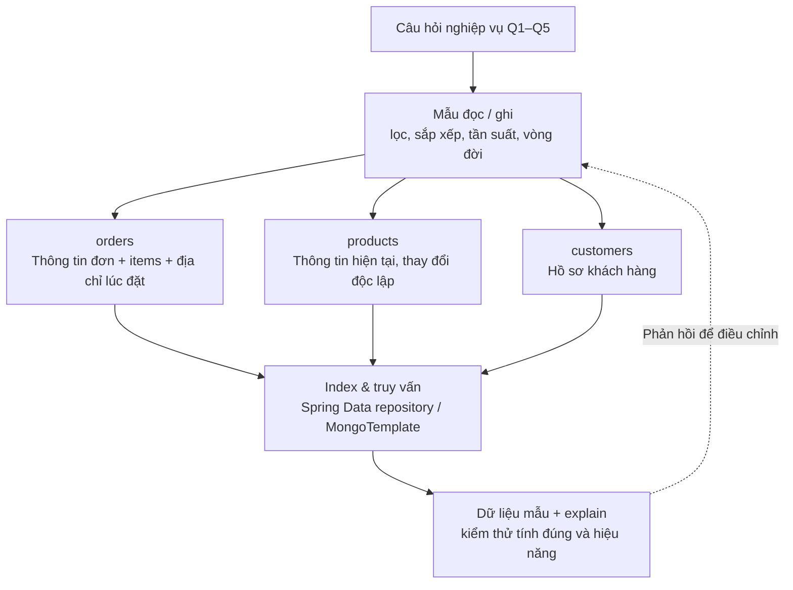

# Thiết kế theo mẫu truy cập và câu hỏi nghiệp vụ

## 1. Vì sao bắt đầu từ câu hỏi nghiệp vụ?

Khi thiết kế document trong **Spring Data MongoDB**, câu hỏi đầu tiên không nên chỉ là “hệ thống có những thực thể nào?”, mà là **“người dùng và hệ thống cần đọc, ghi, lọc, sắp xếp và cập nhật dữ liệu như thế nào?”**. MongoDB lưu các document BSON trong collection; Spring Data MongoDB ánh xạ document thành entity Java và cho phép thao tác qua repository hoặc `MongoTemplate`. Vì vậy, lựa chọn cấu trúc document ảnh hưởng trực tiếp đến số truy vấn, khả năng dùng index, tính nhất quán và hiệu năng của mã Java.

Ví dụ, một ứng dụng bán sách có `Customer`, `Product` và `Order`. Nếu sao chép máy móc mô hình quan hệ thành nhiều collection rồi ghép mọi thứ khi đọc, trang chi tiết đơn hàng có thể phải truy vấn nhiều lần. Ngược lại, nếu nhúng *mọi đơn hàng của khách* vào một document khách hàng, document có thể tăng mãi và khó cập nhật. Thiết kế phù hợp thường nằm giữa hai cực này, dựa trên **mẫu truy cập thực tế, vòng đời dữ liệu và ràng buộc nghiệp vụ**.

Mục tiêu của bài học là biến một tập hợp câu hỏi kinh doanh thành mô hình document, truy vấn và index có thể kiểm thử, đồng thời nhận diện những trường hợp cần aggregation, transaction hoặc cơ chế kiểm soát đồng thời.

## 2. Chuyển yêu cầu thành bảng mẫu truy cập

Giả sử nhóm sản phẩm xác nhận các yêu cầu sau cho ứng dụng bán sách. Tần suất và thời gian phản hồi trong bảng là **giả định minh họa**; khi làm dự án thật, cần thay bằng số đo và mức phục vụ đã thống nhất.

| Mã | Câu hỏi hoặc thao tác nghiệp vụ | Bộ lọc, sắp xếp và dữ liệu trả về | Đặc điểm tải cần biết |
| --- | --- | --- | --- |
| Q1 | Khách hàng xem 20 đơn gần nhất của mình | `customer_id`; sắp `created_at` giảm dần, dùng `_id` để phá hòa; chỉ cần thông tin tóm tắt | Đọc thường xuyên, dữ liệu tăng theo thời gian |
| Q2 | Mở một đơn để xem mặt hàng, giá tại thời điểm mua và địa chỉ giao | Tìm theo `_id`; trả về danh sách hàng và thông tin giao hàng của đơn | Đọc ít hơn Q1 nhưng cần dữ liệu đầy đủ, ổn định |
| Q3 | Tìm sách đang bán theo mã SKU | `products.sku`; trả thông tin hiện tại, giá hiện tại và trạng thái bán | Đọc nhiều, tên và giá sản phẩm có thể đổi |
| Q4 | Nhân viên chuyển đơn từ `PAID` sang `PACKING` | `_id` + trạng thái hiện tại; cập nhật trạng thái nếu hợp lệ | Ghi có cạnh tranh, tránh chuyển trạng thái sai |
| Q5 | Bộ phận vận hành thống kê số đơn theo ngày và trạng thái | Lọc khoảng ngày; gom nhóm theo ngày, trạng thái | Truy vấn tổng hợp theo kỳ, có thể quét nhiều document |

Sau đó cần hỏi rõ từng mẫu truy cập:

1. **Ai thực hiện và dùng màn hình nào?** Ví dụ Q1 là danh sách ngắn trên điện thoại, nên không cần tải toàn bộ `items` và địa chỉ.
2. **Lọc và sắp xếp theo trường nào?** Một yêu cầu “xem đơn gần đây” chưa đủ; phải xác định lọc theo khách nào, khoảng thời gian nào, thứ tự và phân trang.
3. **Dữ liệu có tăng không giới hạn?** Số đơn của một khách có thể tăng vô hạn; số mặt hàng trong *một đơn* thường có thể bị giới hạn bằng quy tắc đặt hàng.
4. **Trường nào thay đổi độc lập?** Giá sản phẩm thay đổi không được làm thay đổi giá đã chốt trong đơn cũ.
5. **Những thay đổi nào phải nhất quán?** Chuyển trạng thái đơn trong một document khác với trừ tồn kho ở một document sản phẩm.
6. **Mức tải và độ trễ mong muốn là bao nhiêu?** Chẳng hạn phân vị p95 của Q1 dưới 200 ms khi có nhiều đơn là một mục tiêu *cần xác nhận và đo*, không phải đặc tính bảo đảm của MongoDB.

Một bản thiết kế tốt nên giữ bảng mẫu truy cập cùng với schema và index. Khi có tính năng mới, nhóm phát triển kiểm tra lại xem mô hình hiện tại còn hỗ trợ các truy vấn quan trọng hay không.

## 3. Từ mẫu truy cập đến ranh giới document

Với năm mẫu truy cập trên, ta có thể chọn ba collection chính: `customers`, `products` và `orders`. Document đơn hàng là một **aggregate nghiệp vụ**: người dùng thường cần đọc toàn bộ thông tin đã chốt của đơn cùng một lúc.



Một document trong `orders` có thể trông như sau (cú pháp dưới đây là minh họa trong `mongosh`, nơi `ObjectId` và `ISODate` biểu diễn kiểu BSON):

```javascript
{
  _id: ObjectId("507f1f77bcf86cd799439011"),
  customer_id: "CUS-007",
  created_at: ISODate("2026-11-10T09:30:00Z"),
  status: "PAID",
  currency: "VND",
  items: [
    {
      sku: "BOOK-101",
      title_at_purchase: "Lập trình với Spring Data",
      unit_price_minor: 159000,
      quantity: 2
    }
  ],
  shipping: {
    recipient: "Nguyen A",
    city: "Ha Noi",
    address_line: "Dia chi giao hang tai thoi diem dat"
  },
  total_minor: 318000
}
```

Trong ví dụ, `total_minor` và `unit_price_minor` là số nguyên ở **đơn vị tiền nhỏ nhất theo đơn vị tiền tệ**; với VND, ví dụ biểu diễn số đồng. Ứng dụng thật cần một quy tắc tiền tệ, làm tròn và kiểm tra tràn số nhất quán; không nên dùng số thực nhị phân để tính tiền một cách tùy tiện.

Document `products` có thể lưu dữ liệu hiện tại:

```javascript
{
  _id: ObjectId("507f191e810c19729de860ea"),
  sku: "BOOK-101",
  title: "Lập trình với Spring Data - bản mới",
  current_price_minor: 179000,
  currency: "VND",
  available_stock: 36
}
```

Hai document có thể cùng nhắc đến `BOOK-101` nhưng phục vụ hai mục đích:

- `orders.items[].title_at_purchase` và `unit_price_minor` là **bản chụp lịch sử**: phải giữ lại tên và giá khách đã chấp nhận khi mua.
- `products.title`, `current_price_minor` và `available_stock` là **trạng thái hiện tại** của sản phẩm: có thể thay đổi độc lập.
- `orders.customer_id` là **tham chiếu logic** tới khách. Địa chỉ giao tại thời điểm đặt là bản chụp thuộc về đơn, vì khách có thể sửa địa chỉ hồ sơ sau đó.

Mô hình này cho phép Q2 đọc phần lớn dữ liệu từ **một document đơn hàng**, trong khi Q3 không phải sửa mọi đơn lịch sử mỗi lần giá sách thay đổi.

## 4. Chọn nhúng document hay tham chiếu?

MongoDB hỗ trợ document lồng nhau và mảng. Khả năng này giúp lưu chung dữ liệu thường đọc cùng nhau, nhưng không có quy tắc “luôn nhúng” hoặc “luôn tham chiếu”.

| Tiêu chí | Nhúng (embed) | Tham chiếu (reference) |
| --- | --- | --- |
| Dữ liệu thường được đọc cùng nhau | Phù hợp, thường lấy trong một lần đọc | Có thể cần thêm truy vấn hoặc `$lookup` |
| Số phần tử con | Tốt khi kích thước được giới hạn và dự đoán được | Thường phù hợp hơn với quan hệ tăng không giới hạn |
| Vòng đời thay đổi | Tốt khi phần con đi theo cha, hoặc là bản chụp lịch sử | Tốt khi phần con thay đổi và được quản lý độc lập |
| Tính nhất quán khi cập nhật | Thay đổi trong một document có tính nguyên tử | Cập nhật nhiều document có thể cần transaction hoặc quy trình bù |
| Chi phí | Có thể lặp dữ liệu và tăng kích thước document | Có thể thêm round trip, join hoặc logic tổng hợp |

**Áp dụng cho bài toán bán sách:**

1. **Nhúng `items` vào `orders`.** Chi tiết mặt hàng và giá chốt được đọc cùng đơn. Đặt giới hạn số dòng hàng theo nghiệp vụ để mảng không tăng vô hạn.
2. **Nhúng `shipping` dạng snapshot.** Khi người dùng sửa địa chỉ trong `customers`, đơn đã đặt vẫn giữ đúng điểm giao trước đó.
3. **Tham chiếu `customer_id`.** Không đưa toàn bộ lịch sử đơn vào document khách hàng; mỗi đơn có vòng đời riêng và số đơn không có giới hạn tổng hữu ích.
4. **Giữ `products` độc lập.** Giá, tồn kho, trạng thái bán thay đổi thường xuyên. SKU trong đơn cho phép truy vết sản phẩm; bản chụp giá phục vụ lịch sử giao dịch.

Nếu một khách có 100.000 đơn, thiết kế `customers.orders: [...]` sẽ gây mảng tăng liên tục, ghi vào một document lớn và có nguy cơ chạm giới hạn kích thước document BSON **16 MiB**. Tách mỗi đơn thành một document của `orders` giúp phân trang, lọc và lập chỉ mục theo khách hàng/thời điểm.

Mặt khác, cũng không nên tách mỗi thuộc tính của đơn thành một collection nếu mọi màn hình đều cần chúng cùng nhau. Việc tách quá nhỏ khiến logic phải ghép dữ liệu và khó bảo đảm tính nhất quán.

### Trùng lặp dữ liệu có chủ đích

Tên sách trong `products` và `title_at_purchase` trong `orders` là hai giá trị có ý nghĩa thời gian khác nhau. Đây là sự trùng lặp **có mục đích nghiệp vụ**. Với trường lặp phục vụ tăng tốc đọc nhưng phải đồng bộ theo dữ liệu nguồn, hãy quy định nơi sở hữu dữ liệu, thời điểm cập nhật và hành vi khi đồng bộ chậm; nếu không, số liệu có thể sai mà khó phát hiện.

## 5. Thiết kế truy vấn trước khi quyết định index

Một thiết kế document chưa hoàn chỉnh nếu thiếu ví dụ truy vấn thực tế. Từ bảng Q1–Q5, có thể viết truy vấn MongoDB rồi mới suy ra index phù hợp.

### Q1: 20 đơn mới nhất của một khách

```javascript
db.orders.find(
  {
    customer_id: "CUS-007",
    created_at: { $gte: ISODate("2026-10-01T00:00:00Z") }
  },
  {
    _id: 1,
    created_at: 1,
    status: 1,
    currency: 1,
    total_minor: 1
  }
).sort({ created_at: -1, _id: -1 }).limit(20)
```

Truy vấn có **điều kiện bằng** trên `customer_id`, **điều kiện khoảng** trên `created_at`, sau đó sắp giảm dần theo thời điểm và `_id`. Trường `_id` giải quyết trường hợp hai đơn có cùng thời điểm tạo, giúp thứ tự ổn định khi phân trang.

Một index ứng viên:

```javascript
db.orders.createIndex(
  { customer_id: 1, created_at: -1, _id: -1 },
  { name: "orders_customer_time_id" }
)
```

Thứ tự khóa được chọn từ **hình dạng truy vấn**: lọc theo một khách trước, sau đó quét dữ liệu theo thời gian và thứ tự cần trả. Đây là index ứng viên cho Q1, không phải quy tắc chung cho mọi màn hình. Nếu ứng dụng thường lọc theo `status` trước, cần đo workload đó và cân nhắc index khác.

Để danh sách nhẹ hơn, projection chỉ lấy các trường cần hiển thị, không tải `items` hoặc `shipping`. Projection giúp giảm dữ liệu truyền về và chi phí chuyển đổi ở ứng dụng; việc truy vấn có được *covered* hoàn toàn bởi index hay không cần xem execution plan thực tế.

### Phân trang khi dữ liệu liên tục tăng

`skip`/`limit` dễ dùng ở trang đầu, nhưng `skip` lớn có thể khiến database phải đi qua nhiều kết quả trước khi trả trang mong muốn. Với danh sách vô hạn, có thể dùng **keyset pagination** (cursor dựa vào thời điểm và `_id`):

```javascript
const lastCreatedAt = ISODate("2026-11-10T09:30:00Z");
const lastId = ObjectId("507f1f77bcf86cd799439011");

db.orders.find({
  customer_id: "CUS-007",
  $or: [
    { created_at: { $lt: lastCreatedAt } },
    { created_at: lastCreatedAt, _id: { $lt: lastId } }
  ]
}).sort({ created_at: -1, _id: -1 }).limit(20)
```

Cursor phải được lấy từ **dòng cuối của trang trước**, mang cả hai khóa sắp xếp; các điều kiện lọc khác (ví dụ khoảng ngày) phải được giữ nhất quán giữa các trang. Thiết kế này giúp giảm chi phí bỏ qua số lượng lớn bản ghi; không tự động tạo ra snapshot bất biến nếu dữ liệu đang có thay đổi đồng thời.

### Q2, Q3: truy vấn một đơn và một sản phẩm

Q2 tìm theo `_id` sử dụng index `_id` mặc định của collection `orders`. Q3 tra cứu theo SKU có thể sử dụng index:

```javascript
db.products.createIndex(
  { sku: 1 },
  { unique: true, name: "products_sku_unique" }
)

db.products.findOne({ sku: "BOOK-101" })
```

`unique: true` phản ánh quy tắc “mỗi SKU là duy nhất” **nếu** đó thực sự là ràng buộc của hệ thống. Trước khi tạo index duy nhất trên dữ liệu sẵn có, phải xử lý bản ghi trùng hoặc không phù hợp. Định danh `_id` vốn có chỉ mục duy nhất riêng.

## 6. Ánh xạ từ document đến entity và API Spring Data MongoDB

MongoDB chứa field lưu trữ như `customer_id`, `created_at`, trong khi mã Java thường đặt tên theo camelCase. Spring Data cho phép mô tả phép ánh xạ đó bằng `@Document`, `@Id` và `@Field`.

Ví dụ trích đoạn entity:

```java
import java.time.Instant;
import java.util.List;
import org.bson.types.ObjectId;
import org.springframework.data.annotation.Id;
import org.springframework.data.mongodb.core.mapping.Document;
import org.springframework.data.mongodb.core.mapping.Field;

@Document(collection = "orders")
public class OrderDocument {
    @Id
    private ObjectId id;

    @Field("customer_id")
    private String customerId;

    @Field("created_at")
    private Instant createdAt;

    private String status;

    private List<OrderItem> items;

    @Field("total_minor")
    private long totalMinor;

    private String currency;

    protected OrderDocument() {}

    // Constructor, getter và các kiểu OrderItem/ShippingSnapshot
    // được lược bớt để tập trung vào quyết định ánh xạ.
}
```

Một repository có thể phục vụ phiên bản đơn giản của Q1:

```java
import java.time.Instant;
import java.util.List;
import org.bson.types.ObjectId;
import org.springframework.data.mongodb.repository.MongoRepository;

public interface OrderRepository
        extends MongoRepository<OrderDocument, ObjectId> {

    List<OrderDocument>
    findTop20ByCustomerIdAndCreatedAtGreaterThanEqualOrderByCreatedAtDescIdDesc(
        String customerId, Instant fromInclusive);
}
```

Repository giúp diễn đạt truy vấn ổn định bằng tên phương thức. Khi điều kiện thay đổi theo màn hình, `MongoTemplate` linh hoạt hơn:

```java
import java.time.Instant;
import java.util.List;
import org.springframework.data.domain.Sort;
import org.springframework.data.mongodb.core.MongoTemplate;
import org.springframework.data.mongodb.core.query.Criteria;
import org.springframework.data.mongodb.core.query.Query;

public class OrderLookup {
    private final MongoTemplate mongoTemplate;

    public OrderLookup(MongoTemplate mongoTemplate) {
        this.mongoTemplate = mongoTemplate;
    }

    public List<OrderDocument> recentOrders(String customerId, Instant from) {
        Query query = Query.query(
            Criteria.where("customerId").is(customerId)
                .and("createdAt").gte(from)
        );
        query.with(Sort.by(
            Sort.Order.desc("createdAt"),
            Sort.Order.desc("id")
        ));
        query.limit(20);
        return mongoTemplate.find(query, OrderDocument.class);
    }
}
```

Ở phía Java, `customerId` và `createdAt` là tên property. Spring Data MongoDB dựa vào metadata mapping để tạo truy vấn trên `customer_id` và `created_at`; `id` được ánh xạ tới `_id`. Lợi ích của thiết kế theo mẫu truy cập là **cả API Java và index MongoDB đều bắt nguồn từ cùng một câu hỏi Q1**, tránh tình trạng method repository có vẻ đúng nhưng truy vấn thực tế không dùng được index.

Ví dụ `recentOrders` hiện trả entity đầy đủ. Nếu UI chỉ cần tóm tắt đơn, nên dùng phép chiếu hoặc DTO tương ứng để hạn chế truyền và ánh xạ những trường lớn không cần thiết; kiểm tra kết quả mapping trong kiểm thử tích hợp.

## 7. Thiết kế cho cập nhật và tính nhất quán

Thiết kế không chỉ phục vụ đọc. Với Q4, giả sử quy tắc nghiệp vụ cho phép chuyển `PAID → PACKING` đúng một lần. Một phép cập nhật có điều kiện giúp tránh tình huống hai nhân viên cùng xử lý dựa trên trạng thái cũ:

```java
import com.mongodb.client.result.UpdateResult;
import org.bson.types.ObjectId;
import org.springframework.data.mongodb.core.MongoTemplate;
import org.springframework.data.mongodb.core.query.Criteria;
import org.springframework.data.mongodb.core.query.Query;
import org.springframework.data.mongodb.core.query.Update;

public class OrderTransition {
    private final MongoTemplate mongoTemplate;

    public OrderTransition(MongoTemplate mongoTemplate) {
        this.mongoTemplate = mongoTemplate;
    }

    public boolean startPacking(ObjectId orderId) {
        Query query = Query.query(
            Criteria.where("id").is(orderId)
                .and("status").is("PAID")
        );
        Update update = new Update().set("status", "PACKING");
        UpdateResult result =
            mongoTemplate.updateFirst(query, update, OrderDocument.class);
        return result.getModifiedCount() == 1;
    }
}
```

Vì điều kiện và cập nhật áp dụng trên **cùng document đơn hàng**, MongoDB thực hiện phép cập nhật document đó một cách nguyên tử. Nếu trạng thái không còn là `PAID`, câu lệnh không chuyển thành `PACKING` và phương thức trả `false`. Quy tắc trạng thái nghiệp vụ phức tạp hơn còn cần thông báo lỗi, kiểm soát quyền và ghi nhận lịch sử đúng cách.

**Ranh giới nguyên tử không tự động mở rộng sang document khác.** Nếu đặt đơn đồng thời phải tạo đơn và giảm tồn kho trong `products`, cần thiết kế kiểm soát tồn kho, idempotency và cách xử lý thất bại. Transaction nhiều document là một lựa chọn khi hạ tầng MongoDB và cấu hình Spring hỗ trợ (ví dụ cấu hình transaction manager trên replica set/sharded deployment); transaction có thêm chi phí và không thay thế việc thiết kế ranh giới document hợp lý. Một số quy trình với dịch vụ ngoài có thể dùng sự kiện, trạng thái trung gian và thao tác bù.

Với các trường tăng nhanh, chẳng hạn nhật ký trạng thái dài hàng chục nghìn sự kiện, nên đánh giá một collection sự kiện riêng thay vì cứ nối thêm vào mảng `orders.status_history`. Trường hợp cần lưu lịch sử ngắn và có giới hạn có thể nhúng; quyết định dựa trên khối lượng và yêu cầu truy xuất.

## 8. Câu hỏi tổng hợp và aggregation

Q5 khác Q1: giao diện vận hành muốn **số đơn theo ngày và trạng thái**, không cần tải mọi đơn về Java rồi tự nhóm. MongoDB aggregation có thể thực hiện lọc và gom nhóm gần nơi lưu dữ liệu:

```javascript
db.orders.aggregate([
  {
    $match: {
      created_at: {
        $gte: ISODate("2026-11-01T00:00:00Z"),
        $lt: ISODate("2026-12-01T00:00:00Z")
      }
    }
  },
  {
    $group: {
      _id: {
        day: {
          $dateToString: {
            format: "%Y-%m-%d",
            date: "$created_at",
            timezone: "Asia/Ho_Chi_Minh"
          }
        },
        status: "$status"
      },
      order_count: { $sum: 1 }
    }
  },
  { $sort: { "_id.day": 1, "_id.status": 1 } }
])
```

Thời điểm trong MongoDB thường được biểu diễn theo UTC; việc gom theo “ngày nghiệp vụ” phải xác định **múi giờ**. Khoảng thời gian lọc và múi giờ gom nhóm cũng phải được thống nhất: ví dụ lọc “tháng 11 theo giờ Việt Nam” nên chuyển đầu và cuối tháng ở múi giờ đó thành UTC trước khi gửi truy vấn. Hai giá trị UTC cố định trong ví dụ chỉ là một khoảng minh họa, chưa diễn đạt chính xác ranh giới tháng theo múi giờ Việt Nam.

Q5 có thể cần index theo `created_at`, hoặc mô hình báo cáo riêng khi dữ liệu rất lớn và báo cáo chạy thường xuyên. Không nhất thiết dùng lại index `{ customer_id, created_at, _id }` của Q1: nếu không lọc `customer_id`, tiền tố index đó ít phù hợp. Một index ứng viên cho lọc theo thời gian là:

```javascript
db.orders.createIndex(
  { created_at: -1 },
  { name: "orders_created_at" }
)
```

Chỉ thêm index sau khi có dữ liệu và kế hoạch đo. Mỗi index tốn không gian và làm tăng công việc khi ghi; một collection có nhiều index không nhất thiết nhanh hơn trên toàn bộ workload. Nếu báo cáo lặp lại thường xuyên và quét lượng lớn document, có thể cần cache hoặc collection tổng hợp với chính sách cập nhật và đối soát rõ ràng.

## 9. Kiểm thử thiết kế bằng dữ liệu và kế hoạch thực thi

Thiết kế theo mẫu truy cập phải được kiểm chứng. Đừng kết luận index hiệu quả chỉ vì thứ tự khóa “trông đúng”. Chuẩn bị dữ liệu đại diện về số khách, số đơn mỗi khách, tỉ lệ trạng thái, số mặt hàng trong đơn và tốc độ phát triển; trường hợp nhiều đơn của một khách đặc biệt quan trọng cho Q1.

Trong `mongosh`, có thể xem thống kê của truy vấn Q1:

```javascript
db.orders.find({
  customer_id: "CUS-007",
  created_at: { $gte: ISODate("2026-10-01T00:00:00Z") }
}).sort({ created_at: -1, _id: -1 })
  .limit(20)
  .explain("executionStats")
```

Các thông tin cần đọc gồm:

| Chỉ dấu | Câu hỏi kiểm tra |
| --- | --- |
| `winningPlan`, `IXSCAN`, `COLLSCAN` | Có dùng index dự kiến không, hay quét collection? |
| `totalKeysExamined` | Phải duyệt bao nhiêu khóa index để tìm kết quả? |
| `totalDocsExamined` | Có phải đọc nhiều document hơn số document trả về không? |
| `nReturned` | Số kết quả thực sự trả về có phù hợp với `limit` và bộ lọc không? |
| `executionTimeMillis` | Thời gian trong phép đo này ra sao, khi chạy lặp lại với tải đại diện thì thế nào? |

Không nên xem riêng một chỉ số hay một lần chạy làm kết luận. Index scan có thể vẫn đọc nhiều khóa nếu bộ lọc không chọn lọc. Một `COLLSCAN` trên collection cực nhỏ đôi khi không đáng lo, nhưng trở thành vấn đề khi collection tăng. Hãy kiểm tra cả độ trễ phía ứng dụng, số truy vấn mỗi request, bytes truyền và tác động lên tốc độ ghi.

Với Spring Data MongoDB, nên có kiểm thử tích hợp trên MongoDB thực (ví dụ môi trường kiểm thử bằng Testcontainers) để xác minh tên field ánh xạ, kết quả repository, thứ tự phân trang, cập nhật trạng thái và index được tạo đúng như dự kiến. `@DataMongoTest` có thể hỗ trợ phần kiểm thử lớp truy cập dữ liệu tùy cấu hình dự án.

Một bộ ca kiểm thử tối thiểu cho mô hình này gồm: hai đơn có cùng `created_at`; một khách có hàng nghìn đơn; một đơn có tối đa số dòng hàng được phép; sản phẩm đổi giá sau khi đặt đơn; hai yêu cầu chuyển trạng thái đồng thời; và báo cáo cắt qua ranh giới ngày theo múi giờ nghiệp vụ.

## 10. Những lỗi thiết kế phổ biến

| Dấu hiệu | Vấn đề thường xuất hiện | Cách điều chỉnh |
| --- | --- | --- |
| `customers.orders` chứa toàn bộ lịch sử đơn | Mảng tăng không giới hạn, khó phân trang, document lớn | Lưu từng đơn tại `orders`, index `customer_id` và thời điểm |
| Đơn hàng chỉ chứa SKU, không có tên và giá lúc mua | Đơn cũ “đổi giá” khi tra sản phẩm hiện tại | Nhúng snapshot của mặt hàng vào đơn |
| Sao chép toàn bộ thông tin sản phẩm vào mọi nơi và cập nhật đồng loạt | Chi phí ghi lớn, rủi ro không đồng bộ | Chỉ snapshot trường cần cho lịch sử; tham chiếu dữ liệu hiện tại |
| Mọi màn hình đều tải document đơn đầy đủ | Tốn bandwidth và mapping, đặc biệt với `items`/`shipping` | Dùng projection/DTO cho danh sách |
| Index chỉ theo `created_at` cho Q1 | Lọc theo khách kém hiệu quả khi nhiều khách | Thử index kết hợp `customer_id` và khóa sắp xếp |
| Index theo `customer_id` được kỳ vọng tối ưu báo cáo toàn hệ thống | Truy vấn báo cáo không có điều kiện theo khách | Đo và thiết kế index riêng cho câu hỏi báo cáo |
| `skip` rất lớn để đọc trang sâu | Phải bỏ qua nhiều kết quả, độ trễ tăng | Cân nhắc cursor/keyset pagination |
| Nhúng lịch sử sự kiện không giới hạn vào đơn | Document lớn, cập nhật thường xuyên | Tách sự kiện hoặc giữ lịch sử nhúng có giới hạn |
| Giả định cập nhật đơn và tồn kho là một thao tác nguyên tử | Có thể sai lệch giữa nhiều document | Thiết kế transaction hoặc luồng xử lý có bù/idempotency |

## 11. Quy trình ra quyết định có thể áp dụng ngay

Khi nhận một yêu cầu mới trong dự án Spring Data MongoDB, hãy thực hiện tuần tự:

1. **Ghi câu hỏi nghiệp vụ thành truy vấn cụ thể.** Ai truy cập, bộ lọc nào, thứ tự nào, số dòng mỗi lần và mức độ thường xuyên?
2. **Xác định vòng đời của từng nhóm trường.** Trường nào là snapshot, trường nào là dữ liệu hiện tại, trường nào tăng không giới hạn?
3. **Vẽ ranh giới document.** Ưu tiên nhúng dữ liệu thường đọc/cập nhật cùng nhau và có kích thước kiểm soát được; dùng tham chiếu khi vòng đời hoặc khả năng phát triển độc lập.
4. **Thiết kế truy vấn và index chung một lượt.** Lấy các truy vấn quan trọng làm đầu vào cho thứ tự khóa index; cân nhắc projection và phân trang.
5. **Mô tả ràng buộc cập nhật.** Xác định thao tác nguyên tử một document, chuyển trạng thái có điều kiện, và nơi cần xử lý nhất quán nhiều document.
6. **Viết entity/repository/`MongoTemplate` theo schema đã chọn.** Đối chiếu tên property Java với tên field BSON qua `@Field`, `@Id`.
7. **Đo bằng dữ liệu đại diện.** Xem `explain("executionStats")`, kiểm thử kết quả, trạng thái cạnh tranh, trang sâu và aggregation; sửa thiết kế nếu không đạt yêu cầu.
8. **Ghi lại giả định và thời điểm cần xem xét lại.** Mẫu truy cập có thể thay đổi khi sản phẩm có thêm báo cáo, bộ lọc hay quy mô mới.

### Tự luyện tập

Hãy trả lời ba câu trước khi xem gợi ý:

**Tình huống A.** Ứng dụng cần lấy 20 đơn mới nhất của từng khách, đôi lúc mở chi tiết một đơn. Nên nhúng danh sách tất cả đơn vào `customers` không? **Gợi ý:** không; mỗi đơn là document riêng và nên có index phục vụ lọc khách/sắp thời gian.

**Tình huống B.** Khách mua một cuốn sách giá 159.000 đồng. Một tuần sau giá niêm yết đổi thành 179.000 đồng. Đơn cũ hiển thị giá nào? **Gợi ý:** giá lúc đặt hàng, lưu như snapshot trong `orders.items`.

**Tình huống C.** Đã có index `{ customer_id: 1, created_at: -1 }` nhưng báo cáo đếm mọi đơn trong tháng vẫn chậm. Vì sao? **Gợi ý:** báo cáo không lọc theo `customer_id`, nên index tối ưu cho Q1 không nhất thiết hữu ích; cần phân tích aggregation và plan theo mẫu báo cáo thực.

**Điểm cốt lõi:** document là quyết định về **cách dữ liệu được truy cập và thay đổi**. Mẫu truy cập quyết định nên nhúng gì, tham chiếu gì, tạo index nào và dùng repository, `MongoTemplate` hay aggregation như thế nào. Sau cùng, thiết kế chỉ được xác nhận khi hành vi nghiệp vụ đúng và kết quả kiểm thử hiệu năng đáp ứng tải thực tế.
