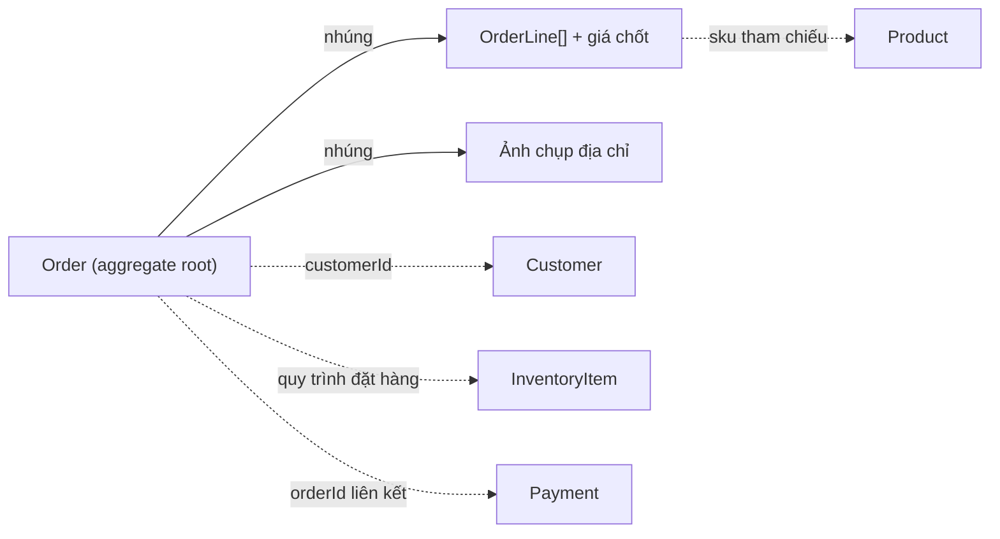
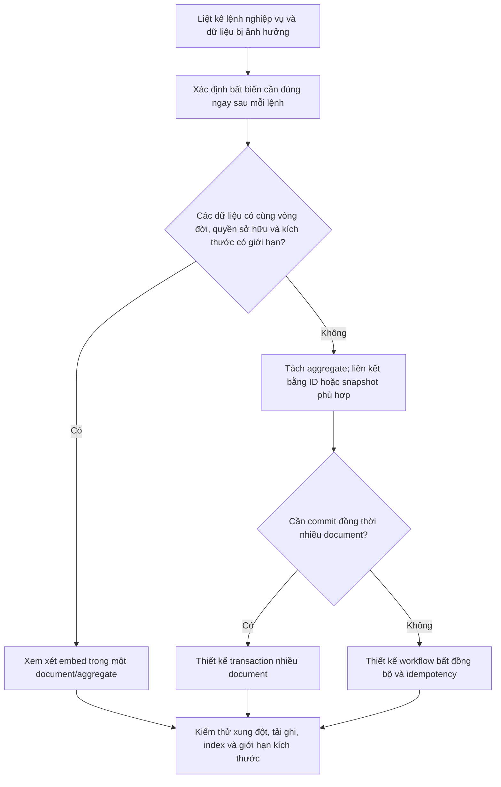

# Xác định ranh giới aggregate và dữ liệu cần cập nhật cùng nhau

Một quyết định quan trọng khi thiết kế document MongoDB là **dữ liệu nào phải thay đổi cùng nhau để luôn đúng về mặt nghiệp vụ**. Quyết định này xác định ranh giới *aggregate* và ảnh hưởng trực tiếp đến cách nhúng document, tham chiếu bằng ID, sử dụng repository hoặc `MongoTemplate` trong Spring Data MongoDB, xử lý xung đột ghi và khi nào cần transaction nhiều document.

Ví dụ, khi khách hàng thêm một dòng hàng vào đơn đang soạn, danh sách dòng hàng và tổng tiền đơn cần thống nhất. Nhưng khi giá sản phẩm trong catalog thay đổi, không nên tự động thay đổi giá đã chốt trong đơn hàng cũ. Hai tình huống cùng liên quan đến "sản phẩm" nhưng có ranh giới nhất quán khác nhau.

Sau bài này, bạn có thể:

- Xác định aggregate root và các **bất biến nghiệp vụ** (*invariants*) phải được bảo vệ trong một lần thay đổi.
- Quyết định dữ liệu nên **embed**, **reference** hay lưu **snapshot** trong document.
- Khai thác tính nguyên tử của thao tác ghi **một document** trong MongoDB.
- Dùng `@Version`, thao tác ghi có điều kiện, `MongoTemplate` và transaction khi cần.
- Đánh giá ảnh hưởng của kích thước document, mức tăng trưởng, truy vấn, index và tranh chấp ghi đến ranh giới aggregate.

## 1. Aggregate là ranh giới nhất quán nghiệp vụ

Trong cách tiếp cận Domain-Driven Design (DDD), **aggregate** là một nhóm đối tượng được quản lý như một đơn vị nhất quán. Bên ngoài chỉ nên thay đổi trạng thái của nhóm này thông qua **aggregate root**. Aggregate root giữ trách nhiệm kiểm tra và duy trì các quy tắc phải luôn đúng sau một thao tác nghiệp vụ hoàn tất.

Ví dụ với `Order`:

- Đơn đã xác nhận không được thêm dòng hàng tùy ý.
- Số lượng của mỗi dòng phải lớn hơn 0.
- Tổng tiền phải phù hợp với các dòng hàng và quy tắc tính tiền của đơn.
- Địa chỉ giao hàng được chốt theo phiên bản tại thời điểm đặt đơn, không tự đổi theo hồ sơ khách hàng.

Các dữ liệu liên quan tới những quy tắc đó thường thuộc cùng aggregate `Order`. Ngược lại, số lượng tồn kho của một SKU chịu quy tắc và tải ghi riêng, nên thường được quản lý bởi aggregate kho hàng khác.

**Phân biệt hai thuật ngữ:** *aggregate* trong thiết kế domain là ranh giới nhất quán; *aggregation pipeline* của MongoDB (`$match`, `$group`, `$lookup`...) là cơ chế xử lý/truy vấn dữ liệu. Chúng không phải cùng một khái niệm.

### Aggregate và document liên quan thế nào?

MongoDB bảo đảm mỗi thao tác ghi trên **một document** là nguyên tử, kể cả khi thao tác thay đổi nhiều trường hoặc nhiều phần tử nhúng trong document đó. Vì vậy, ánh xạ **một aggregate thành một document** thường là điểm xuất phát hợp lý: một lần ghi có thể duy trì các bất biến nằm trọn trong document.

Tuy nhiên, **không có quy tắc bắt buộc mỗi aggregate phải là một document trong mọi trường hợp**. Aggregate lớn, chứa tập dữ liệu không giới hạn hoặc có các thành phần ghi nóng có thể đòi hỏi thiết kế khác. Nếu một bất biến thực sự phải được bảo đảm đồng thời trên nhiều document, cần cơ chế phối hợp phù hợp, chẳng hạn transaction nhiều document hoặc thay đổi lại ranh giới nghiệp vụ.

## 2. Bắt đầu từ các hành vi và bất biến, không bắt đầu từ bảng dữ liệu

Trước khi vẽ document, hãy liệt kê **lệnh nghiệp vụ** (*commands*) và trả lời: "Nếu hệ thống dừng ngay sau một thao tác ghi, những điều gì bắt buộc vẫn đúng?" 

| Hành vi | Dữ liệu phải nhất quán ngay | Ranh giới gợi ý |
| --- | --- | --- |
| Thêm dòng hàng vào đơn nháp | `lines` và `totalMinor`; chỉ cho phép khi trạng thái là `DRAFT` | Trong `Order` |
| Xác nhận đơn hàng | Trạng thái đơn phải chuyển theo quy tắc hợp lệ | Trong `Order`; có thể cần phối hợp với tồn kho |
| Thay đổi giá niêm yết | Giá hiện hành của sản phẩm | `Product`, độc lập với đơn đã chốt |
| Giữ hàng trong kho | Số tồn có sẵn không được âm hoặc vượt quá giới hạn đặt ra | `InventoryItem` hoặc đơn vị quản lý tồn phù hợp |
| Cập nhật địa chỉ tài khoản | Hồ sơ khách hàng hiện tại | `Customer`; không tự sửa ảnh chụp địa chỉ ở đơn cũ |
| Nhận kết quả thanh toán | Ghi nhận giao dịch/phiên thanh toán, đối soát và cập nhật đơn | Thường liên quan `Payment` và `Order`, cần quy trình nhất quán liên aggregate |

Đừng gom tất cả thứ "có liên quan" thành một aggregate. Sự liên quan ở màn hình hoặc trong câu truy vấn **không đồng nghĩa** với yêu cầu cập nhật nguyên tử.

Một cách phân tích hữu ích:

1. **Bất biến:** điều gì phải đúng tức thời sau mỗi lệnh? Ví dụ `available >= 0`.
2. **Chủ sở hữu:** đối tượng gốc nào chịu trách nhiệm thay đổi giá trị này?
3. **Vòng đời:** các thành phần có được tạo, đổi và xóa cùng nhau không?
4. **Kích thước và tần suất ghi:** tập con có tăng vô hạn hoặc bị nhiều tiến trình cập nhật đồng thời không?
5. **Nhu cầu đọc:** màn hình hoặc use case nào thường đọc các dữ liệu cùng lúc?
6. **Mức chấp nhận trễ:** dữ liệu nào có thể đồng bộ sau vài giây bằng sự kiện hoặc quy trình bù?

## 3. Ví dụ: ranh giới của đơn hàng thương mại điện tử

Giả sử ứng dụng bán sách có các khái niệm `Order`, `OrderLine`, `Product`, `Customer`, `InventoryItem` và `Payment`.

### 3.1. Document đơn hàng chứa những gì?

Trong `mongosh`, một document `orders` có thể trông như sau:

```javascript
{
  _id: ObjectId("665f1f2a4b6c7d8e9f001234"),
  customerId: ObjectId("665f1f2a4b6c7d8e9f005678"),
  status: "DRAFT",
  currency: "VND",
  lines: [
    { sku: "BK-101", quantity: 2, unitPriceMinor: 129000 },
    { sku: "BK-202", quantity: 1, unitPriceMinor: 49000 }
  ],
  totalMinor: 307000,
  shippingAddressSnapshot: {
    recipient: "Nguyen Van A",
    city: "Ha Noi",
    street: "So 10 Duong Mau"
  },
  version: 3,
  createdAt: ISODate("2026-11-20T02:00:00Z")
}
```

Ở đây:

- `lines` là những thành phần **thuộc sở hữu của đơn**: không có lý do tồn tại độc lập nếu đơn bị xóa theo chính sách dữ liệu của hệ thống.
- `unitPriceMinor` lưu **giá tại thời điểm tạo/chốt dòng hàng**, thay vì luôn tham chiếu giá mới nhất từ `Product`. Ví dụ dùng đơn vị tiền nhỏ nhất do hệ thống quy ước; đối với VND, ví dụ này lưu số tiền bằng VND nguyên.
- `totalMinor` là giá trị dẫn xuất phải được cập nhật nhất quán cùng `lines` theo chính sách tính tiền. Ví dụ chưa xét thuế, khuyến mại và phí giao hàng.
- `shippingAddressSnapshot` bảo toàn địa chỉ dùng cho đơn này, ngay cả khi khách hàng thay đổi hồ sơ.
- `customerId` tham chiếu `Customer`; hồ sơ khách hàng tồn tại và thay đổi độc lập.
- `version` có thể dùng để phát hiện xung đột ghi khi Spring Data MongoDB quản lý entity với `@Version`.

Một số hệ thống chọn tính lại `totalMinor` từ `lines` khi đọc để tránh lưu dữ liệu dẫn xuất. Nếu vẫn lưu tổng tiền vì mục đích truy vấn, hiển thị hoặc báo cáo, phải thiết kế mọi lệnh thay đổi dòng hàng sao cho tổng tiền không sai lệch.

### 3.2. Tại sao không nhúng toàn bộ Product, Inventory và Payment?

Một sản phẩm được nhiều đơn hàng tham chiếu; giá niêm yết, mô tả và trạng thái bán được cập nhật độc lập. Tồn kho thường có tần suất thay đổi cao và chịu tranh chấp ghi. Thanh toán có nhiều lần thử, phản hồi bất đồng bộ và yêu cầu đối soát riêng.

Nếu nhúng **trạng thái sống** của các đối tượng đó vào mọi đơn:

- Cập nhật giá hay tồn kho sẽ phải sửa rất nhiều đơn liên quan, dễ tạo dữ liệu không nhất quán.
- Document đơn có thể phình lớn do lịch sử thanh toán hoặc biến thể sản phẩm.
- Các tác vụ độc lập tranh chấp ghi vào cùng document dù không cần chung một ranh giới.

Thiết kế điển hình là:



Các mũi tên nét đứt biểu diễn quan hệ logic hoặc ID tham chiếu; chúng không phải khóa ngoại được MongoDB tự động kiểm tra.

## 4. Quyết định embed, reference hay lưu snapshot

| Phương án | Nên dùng khi | Cần lưu ý |
| --- | --- | --- |
| **Embed** document con vào root | Cùng vòng đời; tập con tương đối nhỏ và có giới hạn; thường đọc/ghi cùng nhau; cần nguyên tử trong một document | Document tăng kích thước; cập nhật tập lớn gây tranh chấp; chỉ mục trên mảng có chi phí |
| **Reference** bằng ID | Đối tượng có vòng đời riêng; được nhiều aggregate dùng; tập liên quan rất lớn hoặc thay đổi độc lập | Không có join tự động; cần truy vấn bổ sung hoặc `$lookup` khi cần tổng hợp |
| **Snapshot** một số thuộc tính | Cần giữ giá trị lịch sử, như đơn giá và địa chỉ đã chốt | Cần đặt tên và quy tắc cập nhật rõ: ảnh chụp không phải bản sao cần đồng bộ mọi lúc |
| **Tách thành document khác trong cùng quy trình** | Kích thước, tần suất ghi hoặc ranh giới nghiệp vụ khiến việc nhúng không phù hợp | Xác định rõ phần nào cần transaction và phần nào chấp nhận nhất quán cuối cùng |

Các tiêu chí có ảnh hưởng mạnh nhất:

**Giới hạn tăng trưởng.** MongoDB có giới hạn kích thước **16 MiB cho một BSON document**. Mảng các dòng hàng trong một đơn thường có thể giới hạn bởi chính sách kinh doanh, nhưng lịch sử sự kiện, log truy cập, bình luận hoặc thông điệp kéo dài vô hạn thường không nên nhúng hết vào một document.

**Tải ghi và tranh chấp.** Hàng trăm nhân viên cùng cập nhật một document "tổng" sẽ tạo điểm nghẽn và nhiều xung đột hơn so với chia theo các aggregate sở hữu độc lập. Một document lớn hoặc mảng liên tục tăng cũng có tác động đến lưu trữ và chi phí cập nhật.

**Mẫu truy vấn.** Đọc đơn cùng các dòng hàng trong một lần truy vấn rất thuận lợi khi nhúng. Ngược lại, truy xuất và phân trang hàng triệu sự kiện con riêng lẻ thuận tiện hơn nếu mỗi sự kiện là document riêng với chỉ mục phù hợp.

**Chủ sở hữu giá trị.** Khách hàng sở hữu địa chỉ hiện tại trong hồ sơ; đơn hàng sở hữu ảnh chụp địa chỉ được dùng khi xác nhận. Đây là hai giá trị khác ý nghĩa dù có cùng trường tên.

## 5. Tính nguyên tử một document và giới hạn của nó

MongoDB bảo đảm một thao tác ghi vào một document là **atomic**, kể cả khi dùng `$set`, `$push`, `$inc` và nhiều trường trong cùng lệnh. Đây là lợi thế trực tiếp khi những dữ liệu phải nhất quán đã nằm cùng document.

### 5.1. Cập nhật dòng hàng và tổng tiền cùng một lệnh

Ví dụ thêm một dòng hàng vào đơn nháp. Giả sử mã SKU hợp lệ và số lượng, đơn giá đã được xác nhận:

```javascript
const orderId = ObjectId("665f1f2a4b6c7d8e9f001234");
const quantity = 2;
const priceMinor = 45000;

const result = db.orders.updateOne(
  { _id: orderId, status: "DRAFT" },
  {
    $push: {
      lines: {
        sku: "BK-303",
        quantity: quantity,
        unitPriceMinor: priceMinor
      }
    },
    $inc: { totalMinor: quantity * priceMinor }
  }
);

print(result.matchedCount);  // 1 khi tìm được đơn còn DRAFT
print(result.modifiedCount); // 1 khi thực sự cập nhật
```

Hai thay đổi `$push` và `$inc` được ghi nguyên tử trên **cùng document**. Điều kiện `status: "DRAFT"` tránh sửa đơn đã chuyển trạng thái trước khi thao tác này chạy.

Tuy nhiên, ví dụ chỉ đúng khi tổng tiền là phép cộng các giá dòng hàng như đã quy ước. Với thuế, chiết khấu, đổi tỷ giá hoặc quy tắc khuyến mại phức tạp, cần một thiết kế cập nhật bảo đảm **toàn bộ** bất biến, chẳng hạn tính lại qua aggregate root và optimistic locking hoặc một update pipeline phù hợp. Không ghép tùy tiện `$push` và `$inc` nếu công thức nghiệp vụ không đơn giản.

### 5.2. Điều kiện kiểm tra và cập nhật trong cùng thao tác

Để giảm nguy cơ tranh chấp, đặt điều kiện trong chính bộ lọc:

```javascript
// Ví dụ giữ hàng ở một document kho riêng:
db.inventory.updateOne(
  { sku: "BK-303", available: { $gte: 2 } },
  { $inc: { available: -2 } }
);
```

Kiểm tra `available >= 2` và giảm tồn kho diễn ra trong cùng thao tác ghi một document, ngăn hai yêu cầu đồng thời cùng trừ kho vượt lượng còn lại cho SKU tương ứng. Nhưng thay đổi này **không đồng thời cập nhật Order**: đó là hai document, nên cần quyết định một cơ chế phối hợp ở cấp quy trình.

### 5.3. Điều atomic không tự giải quyết

- **Hai document**: ghi thành công vào `orders` rồi lỗi khi ghi `inventory` có thể tạo trạng thái dở dang nếu không có transaction hoặc quy trình phục hồi.
- **Lost update**: hai tiến trình đọc cùng một bản Order, mỗi bên sửa một bản Java khác nhau rồi `save` lần lượt có thể ghi đè thay đổi của nhau nếu không có kiểm tra phiên bản.
- **Tính hợp lệ nghiệp vụ**: MongoDB không biết những quy tắc như "chỉ xác nhận đơn có ít nhất một dòng hàng" trừ khi ứng dụng đưa quy tắc vào lệnh và điều kiện ghi.
- **Độ bền và khả năng quan sát**: atomicity khác với write concern, read concern, kiểm soát lỗi mạng và khả năng xử lý lệnh bị gửi lại. Độ bền và yêu cầu đọc nhất quán phải được cấu hình phù hợp.

## 6. Hiện thực aggregate root trong Spring Data MongoDB

Spring Data MongoDB hỗ trợ ánh xạ nested object, `MongoRepository` và `MongoTemplate`. Mẫu dưới đây chọn `Order` làm aggregate root; mã nghiệp vụ chỉ thao tác với các dòng hàng thông qua phương thức trên root.

### 6.1. Ánh xạ document và bất biến

```java
import java.util.ArrayList;
import java.util.List;
import java.util.Objects;

import org.bson.types.ObjectId;
import org.springframework.data.annotation.Id;
import org.springframework.data.annotation.Version;
import org.springframework.data.mongodb.core.mapping.Document;

@Document(collection = "orders")
public class Order {
    @Id
    private ObjectId id;

    @Version
    private Long version;

    private ObjectId customerId;
    private String status;
    private List<OrderLine> lines = new ArrayList<>();
    private long totalMinor;

    protected Order() { } // Spring Data dùng khi ánh xạ dữ liệu

    public Order(ObjectId customerId) {
        this.customerId = Objects.requireNonNull(customerId);
        this.status = "DRAFT";
    }

    public void addLine(String sku, int quantity, long unitPriceMinor) {
        if (!"DRAFT".equals(status)) {
            throw new IllegalStateException("Chỉ sửa đơn đang DRAFT");
        }
        if (sku == null || sku.isBlank() || quantity <= 0
                || unitPriceMinor < 0) {
            throw new IllegalArgumentException("Dòng hàng không hợp lệ");
        }

        long lineTotal = Math.multiplyExact(quantity, unitPriceMinor);
        long newTotal = Math.addExact(totalMinor, lineTotal);
        lines.add(new OrderLine(sku, quantity, unitPriceMinor));
        totalMinor = newTotal;
    }

    public ObjectId getId() {
        return id;
    }

    public long getTotalMinor() {
        return totalMinor;
    }

    public static class OrderLine {
        private String sku;
        private int quantity;
        private long unitPriceMinor;

        protected OrderLine() { }

        public OrderLine(String sku, int quantity, long unitPriceMinor) {
            this.sku = sku;
            this.quantity = quantity;
            this.unitPriceMinor = unitPriceMinor;
        }
    }
}
```

`OrderLine` được lưu bên trong document `orders` vì không có annotation `@Document` riêng hoặc repository riêng; khi thay đổi dòng hàng, nghiệp vụ gọi `order.addLine(...)` để giữ tổng tiền đồng bộ. Ví dụ dùng `long` cho giá trị tiền nguyên đơn vị theo quy ước; với hệ thống đa tiền tệ hoặc số thập phân, cần chính sách làm tròn và kiểu lưu phù hợp (ví dụ BSON Decimal128).

Đây là ví dụ rút gọn. Trong hệ thống sản xuất còn phải xác định giới hạn số dòng hàng, chống trùng SKU nếu quy tắc yêu cầu, kiểm soát thao tác xóa/sửa dòng, cách tính thuế/khuyến mại và kiểm tra quyền truy cập.

### 6.2. Repository và optimistic locking

```java
import org.bson.types.ObjectId;
import org.springframework.data.mongodb.repository.MongoRepository;

public interface OrderRepository
        extends MongoRepository<Order, ObjectId> {
}
```

Khi có `@Version`, Spring Data kiểm tra phiên bản hiện có trước khi ghi entity qua cơ chế save của Spring Data và tăng phiên bản khi ghi thành công. Một phiên làm việc đơn giản:

```java
Order order = orderRepository.findById(orderId)
    .orElseThrow(() -> new IllegalArgumentException("Không có đơn"));

order.addLine("BK-303", 2, 45000);
orderRepository.save(order); // Có thể ném OptimisticLockingFailureException
```

Nếu hai yêu cầu cùng đọc phiên bản `3` rồi cùng sửa, yêu cầu lưu thành công đầu tiên làm version tăng; yêu cầu thứ hai không được âm thầm ghi đè, mà nhận xung đột optimistic locking. Ứng dụng có thể đọc lại, đánh giá lại nghiệp vụ và thử lại **có giới hạn**, hoặc trả lỗi xung đột (ví dụ HTTP 409) tùy yêu cầu.

**Điều kiện để phát hiện xung đột:** dùng API ghi tôn trọng `@Version` và write concern có xác nhận (acknowledged). Một câu lệnh cập nhật tùy biến chỉ lọc theo `_id` sẽ không tự mang điều kiện so khớp phiên bản như thao tác `save` có optimistic locking. Nếu cần kiểm tra version trong update tùy biến, hãy đưa điều kiện đó vào bộ lọc.

### 6.3. MongoTemplate khi cần cập nhật có điều kiện

Khi chỉ chuyển một trạng thái đơn hàng mà không cần tải toàn bộ aggregate, có thể đặt điều kiện ngay tại MongoDB:

```java
import org.bson.types.ObjectId;
import org.springframework.data.mongodb.core.MongoTemplate;
import org.springframework.data.mongodb.core.query.Criteria;
import org.springframework.data.mongodb.core.query.Query;
import org.springframework.data.mongodb.core.query.Update;

public boolean confirmDraft(MongoTemplate template, ObjectId orderId) {
    Query query = Query.query(
        Criteria.where("_id").is(orderId)
                .and("status").is("DRAFT")
    );
    Update update = new Update().set("status", "CONFIRMED");
    return template.updateFirst(query, update, Order.class)
                   .getModifiedCount() == 1;
}
```

Đây là cập nhật **một document**. Kết quả `false` có thể do không tìm thấy đơn, đơn không ở trạng thái `DRAFT` hoặc điều kiện khác không đạt; cần phân loại tình huống theo API nghiệp vụ. Ví dụ chỉ minh họa kiểm tra chuyển trạng thái; nếu việc xác nhận phải kiểm tra thêm bất biến (dòng hàng không rỗng, thanh toán hợp lệ...), ứng dụng phải bổ sung điều kiện hoặc thực hiện quy trình nhất quán tương ứng.

Khi nhiều con đường cùng ghi Order (repository, template, script), hãy xác lập một cơ chế quản lý `version` và invariants thống nhất. Tránh để một đường cập nhật bypass các điều kiện mà đường khác dựa vào.

## 7. Khi một thao tác phải cập nhật nhiều aggregate

Xét lệnh "đặt hàng và trừ kho":

1. Đơn đang `DRAFT`.
2. Hàng còn đủ, được trừ đúng số lượng.
3. Đơn chuyển sang `CONFIRMED` nếu và chỉ nếu việc trừ kho thành công.

`Order` và `InventoryItem` có vòng đời độc lập. Nếu yêu cầu **hai thay đổi cùng thành công hoặc cùng thất bại**, có thể dùng transaction nhiều document của MongoDB trên hạ tầng hỗ trợ (thông thường replica set hoặc sharded cluster).

### 7.1. Cấu hình Spring Data MongoDB transaction

Với truy cập đồng bộ, Spring quản lý transaction qua `MongoTransactionManager`:

```java
import org.springframework.context.annotation.Bean;
import org.springframework.context.annotation.Configuration;
import org.springframework.data.mongodb.MongoDatabaseFactory;
import org.springframework.data.mongodb.MongoTransactionManager;

@Configuration
class MongoTxConfig {
    @Bean
    MongoTransactionManager mongoTransactionManager(
            MongoDatabaseFactory databaseFactory) {
        return new MongoTransactionManager(databaseFactory);
    }
}
```

Ví dụ service giao dịch trên **một SKU** để tập trung vào ranh giới transaction:

```java
import org.bson.types.ObjectId;
import org.springframework.stereotype.Service;
import org.springframework.transaction.annotation.Transactional;
import org.springframework.data.mongodb.core.MongoTemplate;
import org.springframework.data.mongodb.core.query.Criteria;
import org.springframework.data.mongodb.core.query.Query;
import org.springframework.data.mongodb.core.query.Update;

@Service
public class OrderConfirmationService {
    private final MongoTemplate template;

    public OrderConfirmationService(MongoTemplate template) {
        this.template = template;
    }

    @Transactional
    public void confirmOneItem(
            ObjectId orderId, ObjectId inventoryId, long quantity) {
        if (quantity <= 0) {
            throw new IllegalArgumentException("quantity phải dương");
        }

        Query inventoryQuery = Query.query(
            Criteria.where("_id").is(inventoryId)
                    .and("available").gte(quantity)
        );
        long changedStock = template.updateFirst(
            inventoryQuery,
            new Update().inc("available", -quantity),
            InventoryItem.class
        ).getModifiedCount();
        if (changedStock != 1) {
            throw new IllegalStateException("Hết hàng hoặc không có SKU");
        }

        Query orderQuery = Query.query(
            Criteria.where("_id").is(orderId)
                    .and("status").is("DRAFT")
        );
        long changedOrder = template.updateFirst(
            orderQuery,
            new Update().set("status", "CONFIRMED"),
            Order.class
        ).getModifiedCount();
        if (changedOrder != 1) {
            throw new IllegalStateException("Không thể xác nhận đơn");
        }
    }
}
```

`InventoryItem` ở ví dụ là entity `@Document` riêng có trường số `available` và `_id` được ánh xạ từ `id`. Mọi lệnh dùng `MongoTemplate` phải tham gia cùng transaction/session do Spring quản lý. Khi ngoại lệ runtime làm transaction rollback, cả hai cập nhật đều không được commit. Phương thức `@Transactional` cần được gọi qua Spring proxy; gọi nội bộ từ phương thức khác trong cùng instance có thể khiến transaction không được áp dụng như mong đợi.

**Phạm vi ví dụ:** đây chưa phải chức năng đặt hàng hoàn chỉnh. Thực tế cần lấy danh sách hàng từ chính aggregate Order đã xác thực, kiểm tra số lượng từng SKU, xử lý giá/khuyến mại, chống lặp yêu cầu bằng idempotency key và quyết định thứ tự khóa/cập nhật để hạn chế xung đột. Không tin giá trị `quantity` từ client nếu nó có thể khác nội dung đơn hàng.

### 7.2. Có nên luôn dùng transaction nhiều document?

Không. Transaction nhiều document tốn thêm chi phí quản lý phiên, tài nguyên và xử lý xung đột, làm tăng độ phức tạp khi tải cao. Nếu các dữ liệu vốn có thể cùng nằm trong **một document hợp lý**, thiết kế đúng ranh giới có thể đơn giản hơn transaction.

Khi yêu cầu **không bắt buộc tức thời**, cân nhắc:

- Ghi thay đổi trong aggregate gốc và phát sự kiện domain/integration theo cơ chế đáng tin cậy.
- Xử lý bất đồng bộ ở aggregate khác, thiết kế **idempotent** để sự kiện được gửi/nhận lại không gây xử lý trùng.
- Theo dõi trạng thái `PENDING` / `COMPLETED` / `FAILED` và có thao tác bù khi cần.
- Dùng transactional outbox hoặc phương án ghi sự kiện đáng tin cậy nếu cần tránh mất sự kiện giữa thao tác DB và message broker.

Ví dụ gửi yêu cầu thanh toán qua cổng bên ngoài không thể được MongoDB transaction bao trùm cùng một cách như hai document MongoDB. Cần workflow, khóa idempotency, webhook reconciliation và xử lý kết quả trễ hoặc lặp.

## 8. Thiết kế ranh giới theo mẫu truy vấn và hiệu năng

Ranh giới nghiệp vụ là ưu tiên đầu tiên; sau đó kiểm chứng bằng mẫu truy vấn thực tế:

| Truy vấn/thao tác phổ biến | Gợi ý thiết kế | Rủi ro cần đo |
| --- | --- | --- |
| Hiển thị một đơn cùng 5–30 dòng | Embed `lines` trong `orders` | Kích thước document; xử lý cập nhật dòng và tổng |
| Hiển thị lịch sử 100.000 thay đổi của một đơn | Lưu `order_events` riêng, truy vấn theo `orderId` | Chỉ mục, phân trang và lưu trữ sự kiện |
| Tìm tất cả đơn của khách theo ngày | Index `customerId` kết hợp ngày tạo, lọc và phân trang | Selectivity, số key/document phải quét |
| Trừ tồn kho SKU bị truy cập đồng thời | Giữ aggregate tồn kho riêng và ghi có điều kiện | Điểm nóng theo SKU và retry do tranh chấp |
| Xem giá sản phẩm hiện tại | Truy vấn `Product` | Không nhầm giá hiện tại với giá chốt trong Order |
| Phân tích doanh thu theo tháng | Aggregation pipeline trên dữ liệu đã chuẩn hóa phù hợp | Tải phân tích, index, chiến lược read model |

Ví dụ chỉ mục phục vụ trang lịch sử đơn:

```javascript
db.orders.createIndex({ customerId: 1, createdAt: -1 });
db.order_events.createIndex({ orderId: 1, occurredAt: -1 });
```

Chỉ mục giúp cách đọc phù hợp hơn, nhưng không biến dữ liệu ở hai collection thành một aggregate. Dùng `explain("executionStats")` và số liệu thực tế để kiểm tra số khóa/document được quét, chứ không mặc định càng nhiều index càng tốt. Chỉ mục cũng có chi phí duy trì khi ghi.

## 9. Quy trình quyết định ranh giới aggregate

Áp dụng theo trình tự này cho từng use case:



Những câu hỏi cần trả lời trong bản thiết kế:

1. **Aggregate root là ai?** Đối tượng nào chấp nhận lệnh và bảo vệ quy tắc?
2. **Invariants là gì?** Có thể kiểm tra chúng trong một thao tác ghi một document không?
3. **Độ lớn tối đa của document là bao nhiêu?** Con số này có dựa trên giới hạn nghiệp vụ thật không?
4. **Dữ liệu nào là bản sao lịch sử?** Nó có được phép khác nguồn hiện hành không?
5. **Ai có quyền ghi?** Có đường cập nhật nào bỏ qua aggregate root, `@Version` hoặc điều kiện chuyển trạng thái không?
6. **Nếu lỗi giữa chừng sẽ ra sao?** Transaction, retry, event và thao tác bù được xác định thế nào?
7. **Sẽ kiểm chứng điều gì?** Đề xuất được giả thuyết về kích thước document, tải đồng thời, thời gian truy vấn và số lần ghi.

## 10. Các lỗi thiết kế thường gặp

**Nhúng dữ liệu chỉ vì thường hiển thị cùng nhau.** Màn hình chi tiết đơn hiển thị thông tin sản phẩm nhưng thông tin product không vì thế thuộc sở hữu của Order. Có thể lưu snapshot thuộc tính cần thiết và tham chiếu bản gốc cho thông tin hiện hành.

**Tách mọi entity thành collection riêng theo thói quen thiết kế quan hệ.** Điều này có thể biến một thao tác cập nhật vốn đơn giản thành nhiều lệnh ghi hoặc transaction, đồng thời tạo ra nhiều lượt đọc khi lấy danh sách dòng hàng.

**Đặt quá nhiều hành vi vào một aggregate "khổng lồ".** Root lớn, mảng không giới hạn và điểm nóng ghi làm giảm hiệu năng và tăng xác suất xung đột.

**Kiểm tra trước rồi ghi sau mà không có điều kiện.** Đọc `available=2` rồi sau đó trừ 2 là không an toàn khi có concurrent requests. Điều kiện `available >= 2` phải nằm trong chính lệnh cập nhật tồn kho.

**Coi `@Version` là khóa giao dịch mọi thứ.** Version ngăn ghi đè một entity trong các đường ghi có kiểm tra version; nó không tự tạo atomicity giữa Order và Inventory, và không thay thế quy tắc nghiệp vụ.

**Chỉ sửa order nhưng quên quy trình bên ngoài.** Xác nhận đơn có thể kéo theo kho, thanh toán và giao hàng. Cần phân biệt dữ liệu phải đúng **ngay lập tức** với dữ liệu có thể được đồng bộ bằng workflow.

## 11. Kiểm thử theo các bất biến

Thay vì chỉ kiểm tra document có lưu được không, hãy kiểm thử **mỗi bất biến dưới tranh chấp và lỗi**:

- **Một document:** thêm dòng hàng phải tăng tổng đúng một lần; đơn đã `CONFIRMED` không nhận thêm dòng hàng.
- **Concurrent save:** hai yêu cầu sửa cùng một version phải dẫn đến một thành công và một xung đột, hoặc hành vi hợp nhất hợp lệ do ứng dụng thiết kế.
- **Kho:** hai yêu cầu cùng giữ hàng không làm `available` âm; kiểm tra `matchedCount`/`modifiedCount` khi lệnh có điều kiện không khớp.
- **Transaction:** cố ý tạo lỗi sau cập nhật kho trước cập nhật đơn; khi transaction hoạt động đúng, cả hai thay đổi đều rollback.
- **Idempotency:** gửi lại cùng một lệnh hoặc cùng sự kiện không tạo thêm lần trừ kho/thanh toán trái quy tắc.
- **Tăng trưởng:** tạo đơn ở giới hạn số dòng dự kiến; đo kích thước BSON, số lần đọc/ghi và độ trễ khi cập nhật.

Đối với kiểm thử tích hợp Spring Data MongoDB, dùng MongoDB thật hoặc Testcontainers cấu hình replica set khi muốn kiểm thử transaction. Một MongoDB standalone không đáp ứng cùng điều kiện transaction nhiều document như replica set. Khi xác minh hiệu năng, dùng workload đại diện và số liệu query thực tế.

## 12. Bài tập tự luyện

**Bài 1 — Phân tích ranh giới.** Một ứng dụng học trực tuyến có Course, Lesson, Enrollment, Progress và Comment. Hãy xác định aggregate root cho từng nhóm, chỉ rõ dữ liệu nào nên nhúng và dữ liệu nào tăng không giới hạn nên tách; nêu ít nhất ba bất biến cần giữ tức thời.

**Bài 2 — Thiết kế Order.** Mở rộng ví dụ đơn hàng với thao tác đổi số lượng một dòng hàng và xóa dòng. Viết phương thức trên `Order` bảo đảm tổng tiền luôn khớp; xác định cách ngăn cập nhật khi đơn đã xác nhận.

**Bài 3 — Hai yêu cầu cùng trừ kho.** SKU X còn 1 sản phẩm, hai client đồng thời mua mỗi người 1 sản phẩm. Viết bộ lọc và cập nhật `MongoTemplate` để chỉ một yêu cầu trừ kho thành công. Giải thích vì sao cách đọc số lượng trước rồi ghi sau có thể sai.

**Bài 4 — Thay đổi ranh giới.** Hệ thống ban đầu nhúng toàn bộ `orderEvents` trong `Order`. Sau một năm, mỗi đơn có hàng chục nghìn sự kiện. Đề xuất cách tách collection, các index, truy vấn phân trang và chiến lược bảo đảm sự kiện không bị mất hoặc ghi trùng.

**Bài 5 — Transaction hay workflow?** So sánh hai quy trình: (a) giữ kho và xác nhận Order cùng nằm trong MongoDB; (b) tạo yêu cầu thanh toán qua cổng bên ngoài. Với mỗi quy trình, xác định phần nào có thể transaction và phần nào cần idempotency, retry hay xử lý bù.

### Ghi nhớ

**Ranh giới aggregate được xác định bằng những quy tắc phải luôn đúng cùng nhau.** Trong Spring Data MongoDB, một aggregate lưu gọn trong một document tận dụng tốt thao tác ghi nguyên tử của MongoDB. Chỉ nhúng các thành phần có vòng đời, kích thước và quyền sở hữu phù hợp; tham chiếu những aggregate độc lập và dùng snapshot khi cần lưu trạng thái lịch sử. Khi bất biến trải qua nhiều document, hãy chủ động chọn transaction hoặc workflow bất đồng bộ, đồng thời kiểm thử xung đột và các tình huống lỗi.
