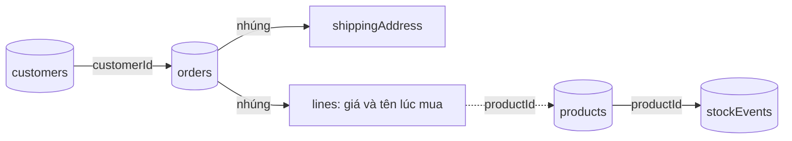

# Chọn nhúng dữ liệu hay tham chiếu sang collection khác

Khi thiết kế document trong **MongoDB**, một quyết định quan trọng là lưu dữ liệu liên quan **bên trong cùng document (embedding)** hay lưu ở **collection riêng và liên kết bằng ID (referencing)**. Quyết định này tác động trực tiếp đến số lần truy vấn, kích thước document, cách cập nhật, tính nhất quán và khả năng mở rộng của ứng dụng.

Trong **Spring Data MongoDB**, cả hai cách đều có thể biểu diễn bằng Java object và truy cập qua `MongoRepository` hoặc `MongoTemplate`. Tuy nhiên, ánh xạ thuận tiện **không thay thế việc thiết kế cấu trúc BSON cho đúng nhu cầu thực tế**. Bài học thuộc chương **Thiết kế document**, tập trung vào cách lựa chọn và kiểm chứng thiết kế; các ví dụ cũng liên hệ tới aggregation, index, transaction, reactive access, kiểm thử và chẩn đoán hiệu năng dữ liệu.

Sau bài này, bạn có thể:

- Phân biệt embedding và referencing bằng cấu trúc document và mô hình truy vấn.
- Chọn phương án dựa trên **cách dữ liệu được đọc/ghi cùng nhau**, quan hệ số lượng (cardinality), mức tăng trưởng và vòng đời dữ liệu.
- Nhận diện trường hợp cần **kết hợp nhúng và tham chiếu** thay vì áp dụng một lựa chọn tuyệt đối.
- Ánh xạ các mô hình bằng Spring Data MongoDB, hiểu giới hạn của `@DocumentReference` và `@DBRef`.
- Xác định index, truy vấn, kiểm thử và chỉ số đo hiệu năng cần xem xét trước khi chốt thiết kế.

## 1. Hai mô hình lưu trữ cơ bản

Giả sử hệ thống thương mại điện tử có `orders`, `customers` và `products`.

### 1.1. Nhúng: dữ liệu liên quan nằm trong document cha

Một đơn hàng cần giữ nguyên địa chỉ nhận hàng và thông tin dòng sản phẩm **tại thời điểm mua**. Những dữ liệu này thường được đọc cùng đơn hàng và có vòng đời gắn với đơn hàng, nên phù hợp để nhúng:

```javascript
// Collection: orders
{
  _id: "ORD-1001",
  customerId: "CUS-15",
  shippingAddress: {
    recipient: "An",
    city: "Đà Nẵng",
    street: "12 Đường Hoa"
  },
  lines: [
    { productId: "PROD-1", sku: "BK-01", nameAtPurchase: "Sổ tay",
      unitPriceVnd: 85000, quantity: 2 },
    { productId: "PROD-2", sku: "PN-02", nameAtPurchase: "Bút mực",
      unitPriceVnd: 25000, quantity: 1 }
  ],
  totalVnd: 195000,
  createdAt: ISODate("2026-11-20T02:00:00Z")
}
```

Truy vấn một đơn hàng có thể trả về **địa chỉ và toàn bộ các dòng hàng trong một lần đọc document**:

```javascript
db.orders.findOne({ _id: "ORD-1001" });
```

**Lợi ích:** dữ liệu thường dùng cùng nhau được lấy trong một truy vấn; các thay đổi bên trong **một document** có tính nguyên tử ở cấp document. **Đánh đổi:** document lớn hơn, có thể lặp dữ liệu và trở nên khó cập nhật khi các phần nhúng cần thay đổi đồng loạt.

### 1.2. Tham chiếu: document giữ ID của document khác

Mỗi sản phẩm có giá bán, trạng thái tồn kho và mô tả hiện hành. Các thông tin này được dùng bởi nhiều chức năng ngoài đơn hàng, nên nên có nguồn dữ liệu riêng:

```javascript
// Collection: products
{ _id: "PROD-1", sku: "BK-01", name: "Sổ tay",
  currentPriceVnd: 90000, stock: 120 }
{ _id: "PROD-2", sku: "PN-02", name: "Bút mực",
  currentPriceVnd: 25000, stock: 80 }

// Collection: orders (rút gọn ví dụ)
{
  _id: "ORD-1001",
  customerId: "CUS-15",
  lines: [
    { productId: "PROD-1", quantity: 2, unitPriceVnd: 85000 },
    { productId: "PROD-2", quantity: 1, unitPriceVnd: 25000 }
  ]
}
```

Trường `productId` là **tham chiếu logic**. MongoDB không tự tạo ràng buộc khóa ngoại kiểu quan hệ cho ID này. Ứng dụng phải quyết định cách xử lý khi sản phẩm bị xóa, ẩn hoặc không tồn tại.

Để lấy thông tin sản phẩm mới nhất, có thể truy vấn theo danh sách ID:

```javascript
db.products.find({ _id: { $in: ["PROD-1", "PROD-2"] } });
```

**Lợi ích:** nguồn dữ liệu sản phẩm được quản lý tập trung; thay đổi giá hiện hành không phải cập nhật tất cả đơn hàng. **Đánh đổi:** dữ liệu phân tán giữa collection, có thể cần thêm truy vấn hoặc aggregation `$lookup`; một thao tác nghiệp vụ sửa nhiều document có thể cần cơ chế điều phối hoặc transaction.

Điểm đáng chú ý: ví dụ đơn hàng **đã kết hợp cả hai kỹ thuật**. `customerId` và `productId` dùng để truy cập thực thể hiện hành; `shippingAddress`, `nameAtPurchase` và `unitPriceVnd` là bản chụp lịch sử. Đây thường là lựa chọn thực tế hơn việc nhúng toàn bộ sản phẩm hoặc chỉ lưu duy nhất `productId`.

## 2. Những câu hỏi quyết định nên nhúng hay tham chiếu

Không có quy tắc “quan hệ một-nhiều thì luôn nhúng” hoặc “đã có collection riêng thì luôn tham chiếu”. Hãy bắt đầu từ truy vấn và hành vi cập nhật.

| Câu hỏi | Nghiêng về **nhúng** | Nghiêng về **tham chiếu** |
| --- | --- | --- |
| **Có thường đọc cùng nhau không?** | Phần con gần như luôn được đọc cùng document cha | Phần con thường được truy vấn riêng hoặc bởi nhiều chức năng |
| **Số lượng phần con có giới hạn không?** | Ít, có giới hạn rõ ràng và kích thước dự đoán được | Tăng không giới hạn, có thể lên hàng nghìn hoặc hàng triệu |
| **Vòng đời có gắn với cha không?** | Phần con chỉ có nghĩa trong document cha | Phần con tồn tại, được quản lý và phân quyền độc lập |
| **Cập nhật có diễn ra cùng nhau không?** | Muốn thay đổi nhiều trường liên quan một cách nguyên tử trong một document | Thực thể con được sửa thường xuyên, độc lập với cha |
| **Có chia sẻ cho nhiều thực thể không?** | Giá trị là bản chụp hoặc bản sao có chủ đích | Một thực thể được tham chiếu từ nhiều nơi và cần nguồn chuẩn |
| **Có cần phân trang, lọc và sắp xếp phần con độc lập không?** | Không, tập phần con nhỏ và đọc trọn vẹn | Có, như bình luận, nhật ký hoạt động, lịch sử giao dịch |
| **Dữ liệu có thay đổi nhanh không?** | Ít thay đổi, bản chụp lịch sử là điều mong muốn | Thay đổi thường xuyên và mọi nơi phải nhìn thấy giá trị mới |

### 2.1. Cardinality và tăng trưởng document

- **Một–một:** thông tin bổ sung nhỏ, luôn đi cùng thực thể chính (ví dụ địa chỉ giao hàng của *một đơn hàng*) thường phù hợp để nhúng. Nếu có yêu cầu phân quyền, truy cập hoặc vòng đời riêng, tham chiếu vẫn hợp lý.
- **Một–ít (one-to-few):** một cấu hình có vài tùy chọn hoặc một bài viết có vài thẻ cố định thường có thể nhúng mảng nhỏ.
- **Một–nhiều lớn:** bình luận, sự kiện, giao dịch phát sinh liên tục nên thường tách thành collection riêng. Tránh mảng tăng mãi trong một document cha.
- **Nhiều–nhiều:** ví dụ người dùng tham gia nhiều nhóm và nhóm có nhiều người dùng; thường dùng tham chiếu hoặc collection trung gian như `memberships` để quản lý quan hệ, vai trò và thời điểm tham gia.

MongoDB có **giới hạn kích thước BSON document là 16 MiB**. Tuy nhiên, thiết kế có thể trở nên chậm hoặc tốn tài nguyên **trước khi** chạm giới hạn này: mảng lớn tạo document nặng, tăng dữ liệu đọc qua mạng, ảnh hưởng cập nhật và làm index đa trị (multikey) phình to.

**Dấu hiệu cần tránh:** nhúng hàng trăm nghìn bình luận vào một bài viết chỉ vì đó là quan hệ một–nhiều. Khi giao diện chỉ hiển thị 20 bình luận mỗi trang, một collection `comments` với `postId` và index thích hợp thường hiệu quả hơn.

### 2.2. Tính nhất quán và yêu cầu nguyên tử

MongoDB bảo đảm tính nguyên tử của **một thao tác ghi trên một document**, bao gồm các phần tử nhúng được cập nhật cùng trong thao tác đó. Đây là lý do nhúng phù hợp với các dữ liệu cần thay đổi cùng lúc, chẳng hạn trạng thái đơn hàng và vài thuộc tính đi kèm.

Khi cập nhật **nhiều document**, một thao tác ghi lên document A không tự làm ghi lên document B trở thành nguyên tử. Nếu nghiệp vụ bắt buộc commit/rollback cả hai, có thể cần **multi-document transaction** trên môi trường MongoDB hỗ trợ, thông qua session/transaction manager phù hợp của Spring Data. Transaction có chi phí; không nên dùng nó chỉ để bù cho một mô hình dữ liệu có thể đơn giản hóa bằng cách nhúng.

Ngược lại, nhúng cùng một tên khách hàng vào 100.000 đơn hàng có thể là hợp lý **nếu đây là bản chụp lịch sử**. Nếu sản phẩm yêu cầu hiển thị **tên hiện tại** của khách hàng, việc nhân bản tên thành nhiều nơi tạo ra bài toán đồng bộ. Vì vậy hãy xác định rõ **giá trị lịch sử bất biến** và **giá trị hiện hành** ngay trong yêu cầu nghiệp vụ.

## 3. Cách thiết kế từ các truy vấn thực tế

Giả sử hệ thống hỗ trợ:

1. Mở trang chi tiết đơn hàng, bao gồm địa chỉ và các dòng đã mua.
2. Tra cứu lịch sử đơn của một khách hàng, 20 đơn/trang, mới nhất trước.
3. Xem thông tin tồn kho và giá bán hiện hành của một sản phẩm.
4. Tìm các đơn chứa một SKU hoặc sản phẩm nhất định.

Từ đó, có thể xác định:

| Dữ liệu | Vị trí đề xuất | Lý do |
| --- | --- | --- |
| `orders.shippingAddress` | Nhúng trong `orders` | Bản chụp địa chỉ lúc đặt hàng; thường đọc cùng đơn |
| `orders.lines[]` với số dòng giới hạn hợp lý | Nhúng trong `orders` | Dòng hàng gắn với đơn, cần xem đồng thời và giữ giá lúc mua |
| `orders.customerId` | Tham chiếu logic sang `customers` | Khách hàng tồn tại độc lập và có nhiều đơn |
| `orders.lines[].productId` | Tham chiếu logic sang `products` | Tra cứu thông tin sản phẩm/tồn kho hiện hành khi cần |
| `products` | Collection riêng | Quản lý giá hiện hành, tồn kho, mô tả và cập nhật độc lập |
| Lịch sử thay đổi tồn kho có thể tăng vô hạn | Collection sự kiện riêng | Cần truy vấn/phân trang theo thời gian, tránh mảng vô hạn trong sản phẩm |

Sơ đồ quan hệ logic (không hàm ý MongoDB tự thi hành khóa ngoại):



### 3.1. Truy vấn và index phù hợp với thiết kế

Ví dụ tìm 20 đơn mới nhất của khách hàng:

```javascript
db.orders.createIndex({ customerId: 1, createdAt: -1 });

db.orders.find({ customerId: "CUS-15" })
  .sort({ createdAt: -1 })
  .limit(20);
```

Index ghép trên `customerId` và `createdAt` có thể hỗ trợ cả lọc và sắp xếp theo mẫu truy vấn này. Nếu cần phân trang sâu, cân nhắc **keyset pagination** với khóa sắp xếp ổn định (chẳng hạn `createdAt` và `_id`), thay vì tăng `skip` quá lớn.

Nếu cần tìm các đơn chứa sản phẩm cụ thể:

```javascript
db.orders.createIndex({ "lines.productId": 1 });
db.orders.find({ "lines.productId": "PROD-1" }).limit(20);
```

Index trên trường trong mảng trở thành **multikey index**. Nó giúp một số truy vấn trên mảng, nhưng chi phí lưu trữ và cập nhật index tăng theo lượng phần tử. Hãy kiểm tra index với dữ liệu gần thực tế và `explain("executionStats")`.

### 3.2. Khi cần kết hợp dữ liệu giữa hai collection

Ứng dụng có thể tải đơn hàng rồi truy vấn sản phẩm theo danh sách ID, hoặc sử dụng **aggregation `$lookup`** tại MongoDB Server:

```javascript
db.orders.aggregate([
  { $match: { _id: "ORD-1001" } },
  { $unwind: "$lines" },
  {
    $lookup: {
      from: "products",
      localField: "lines.productId",
      foreignField: "_id",
      as: "product"
    }
  },
  { $unwind: { path: "$product", preserveNullAndEmptyArrays: true } },
  {
    $project: {
      _id: 1,
      productId: "$lines.productId",
      nameAtPurchase: "$lines.nameAtPurchase",
      currentName: "$product.name",
      quantity: "$lines.quantity"
    }
  }
]);
```

`$lookup` giống thao tác kết hợp dữ liệu ở mức khái niệm, nhưng không nên mặc định nó miễn phí hay tốt hơn việc nhúng. Hãy đo số document được ghép, index ở collection đích, số dữ liệu truyền về và số vòng giao tiếp mạng. Trong ví dụ trên, `preserveNullAndEmptyArrays` cho phép giữ dòng đơn nếu sản phẩm gốc không còn tồn tại.

## 4. Ánh xạ dữ liệu nhúng bằng Spring Data MongoDB

Một cấu trúc embedded đơn giản có thể được ánh xạ thành các kiểu Java lồng nhau. Ví dụ dưới đây minh họa Java 17+ và Spring Data MongoDB:

```java
import java.time.Instant;
import java.util.List;
import org.springframework.data.annotation.Id;
import org.springframework.data.mongodb.core.mapping.Document;

@Document(collection = "orders")
public record Order(
        @Id String id,
        String customerId,
        Address shippingAddress,
        List<Line> lines,
        long totalVnd,
        Instant createdAt
) {
    public record Address(String recipient, String city, String street) {}

    public record Line(
            String productId,
            String sku,
            String nameAtPurchase,
            long unitPriceVnd,
            int quantity
    ) {}
}
```

`Address` và `Line` không khai báo `@Document`; Spring Data ánh xạ chúng thành **document lồng** trong một document `orders`. `customerId` và `productId` vẫn là **String ID thông thường**: đọc đơn hàng không tự tải collection `customers` hay `products`.

Repository cho đơn hàng:

```java
import java.util.List;
import org.springframework.data.domain.Pageable;
import org.springframework.data.mongodb.repository.MongoRepository;

public interface OrderRepository extends MongoRepository<Order, String> {
    List<Order> findByCustomerIdOrderByCreatedAtDesc(
            String customerId, Pageable pageable);
}
```

Ví dụ sử dụng:

```java
import org.springframework.data.domain.PageRequest;

List<Order> firstPage = orderRepository
        .findByCustomerIdOrderByCreatedAtDesc(
                "CUS-15", PageRequest.of(0, 20));
```

Spring Data sinh truy vấn từ tên phương thức, chuyển document BSON thành `Order` và các record con. Truy vấn này vẫn cần index phù hợp khi lượng đơn lớn; repository không tự làm mất chi phí lọc/sắp xếp tại server.

### 4.1. Tham chiếu logic bằng ID: cách dễ quan sát nhất

Trong nhiều hệ thống, chỉ lưu ID như `customerId` hoặc `productId` là đủ. Khi cần sản phẩm hiện hành, truy vấn theo **một tập ID** để tránh mô hình **N+1 queries**:

```java
import java.util.List;
import java.util.Map;
import java.util.function.Function;
import java.util.stream.Collectors;
import java.util.stream.StreamSupport;
import org.springframework.data.annotation.Id;
import org.springframework.data.mongodb.core.mapping.Document;
import org.springframework.data.mongodb.repository.MongoRepository;
import org.springframework.stereotype.Service;

@Document(collection = "products")
record Product(@Id String id, String sku, String name, long currentPriceVnd) {}

interface ProductRepository extends MongoRepository<Product, String> {}

@Service
class ProductLookupService {
    private final ProductRepository productRepository;

    ProductLookupService(ProductRepository productRepository) {
        this.productRepository = productRepository;
    }

    Map<String, Product> findCurrentProducts(Order order) {
        List<String> productIds = order.lines().stream()
                .map(Order.Line::productId)
                .distinct()
                .toList();

        return StreamSupport
                .stream(productRepository.findAllById(productIds).spliterator(), false)
                .collect(Collectors.toMap(Product::id, Function.identity()));
    }
}
```

Đoạn trên giả sử kiểu `Order` của ví dụ trước cùng package; các kiểu package-private được gom cùng một khối cho dễ đọc và có thể tách thành file riêng trong dự án. Trong ứng dụng thật, nên giới hạn số ID theo trang/kích thước yêu cầu và quy định việc xử lý những ID không còn tồn tại. Dữ liệu lịch sử vẫn lấy từ `order.lines()`; kết quả truy vấn sản phẩm chỉ phục vụ các yêu cầu cần thông tin hiện hành.

### 4.2. `@DocumentReference` và `@DBRef` khác gì ID thủ công?

Spring Data MongoDB có các cơ chế biểu diễn quan hệ tham chiếu:

| Cách dùng | Ý nghĩa | Cần lưu ý |
| --- | --- | --- |
| **ID thủ công** (`String productId`) | Lưu giá trị định danh; service chủ động tải dữ liệu liên quan | Minh bạch về số truy vấn, dễ batch, không tự tải object khác |
| **`@DocumentReference`** | Spring Data quản lý ánh xạ và truy xuất tham chiếu logic theo cấu hình | Tự tải hay tải lười tùy khai báo; có thể phát sinh truy vấn bổ sung, không tự lưu lan sang entity đích |
| **`@DBRef`** | Lưu tham chiếu theo định dạng DBRef của MongoDB | Có chi phí phân giải tham chiếu; DBRef không làm MongoDB tự thi hành foreign key hay tự join trong mọi truy vấn |

Ví dụ quan hệ giữa bài viết và tác giả (không dùng làm cơ chế giữ giá lịch sử của đơn hàng):

```java
import org.springframework.data.annotation.Id;
import org.springframework.data.mongodb.core.mapping.Document;
import org.springframework.data.mongodb.core.mapping.DocumentReference;

@Document(collection = "authors")
public record Author(@Id String id, String displayName) {}

@Document(collection = "posts")
public class Post {
    @Id
    private String id;

    @DocumentReference(lazy = true)
    private Author author;

    // Các field khác, constructor/getter/setter thích hợp.
}
```

Với cấu hình tham chiếu mặc định phổ biến, `@DocumentReference` lưu ID của tác giả và Spring Data có thể phân giải ID thành `Author` khi truy cập. Tính năng, cấu trúc lưu và hành vi lazy phụ thuộc phiên bản Spring Data và cấu hình mapping; **cần xác minh với phiên bản đang dùng**. `lazy = true` có thể gặp giới hạn proxy/khả năng truy cập trong một số kiểu Java và bối cảnh runtime; không nên xem lazy loading là miễn phí.

Đặc biệt, **`@DBRef`/`@DocumentReference` không tự động lưu cascade** một đối tượng mới hoặc thay đổi đối tượng được tham chiếu. Hãy lưu các thực thể liên quan theo cách có chủ đích và kiểm thử kết quả trên database.

### 4.3. N+1 queries và số lần round-trip

Giả sử hiển thị 20 đơn hàng, mỗi đơn có 5 sản phẩm. Nếu vòng lặp gọi `findById` cho mỗi dòng, ứng dụng có thể gửi tới **100 lần tìm sản phẩm** ngoài truy vấn đơn hàng, trừ các cơ chế gộp/cache hiện có. Tập hợp danh sách ID và tải theo batch thường giảm đáng kể round-trip.

Ngược lại, nhúng thông tin lịch sử đã cần hiển thị (tên và giá khi mua) có thể loại bỏ hoàn toàn việc tải sản phẩm trong màn hình hóa đơn. Chỉ lấy sản phẩm hiện hành khi giao diện thực sự cần.

## 5. Kết hợp nhúng và tham chiếu: ba mẫu thiết kế hữu ích

### 5.1. Snapshot / extended reference

Lưu `productId` **và** một vài thông tin được dùng thường xuyên, chẳng hạn `nameAtPurchase` và `unitPriceVnd`. Đây là bản sao **có chủ đích**:

- **Giá trị lịch sử** ở đơn hàng không đổi khi bảng giá hiện hành thay đổi.
- **Giá trị hiện hành** ở `products` vẫn là nguồn chuẩn để báo giá/tồn kho.
- Quy tắc nghiệp vụ cần định nghĩa lúc nào tạo snapshot, lúc nào đọc bản hiện hành.

Không nhúng mọi thuộc tính của `products` theo thói quen; chỉ sao chép phần phục vụ truy vấn hoặc yêu cầu lịch sử.

### 5.2. Subset pattern

Ví dụ bài viết có hàng chục nghìn bình luận. Trang chi tiết chỉ cần **3 bình luận nổi bật**:

```javascript
// Collection: posts
{
  _id: "POST-1",
  title: "Bài viết về MongoDB",
  commentCount: 24785,
  featuredComments: [
    { commentId: "C-12", authorName: "Lan", preview: "Rất hữu ích" },
    { commentId: "C-87", authorName: "Minh", preview: "Ví dụ dễ hiểu" }
  ]
}

// Collection: comments
{ _id: "C-12", postId: "POST-1", authorId: "U-1",
  body: "Rất hữu ích", createdAt: ISODate("2026-11-18T09:00:00Z") }
```

Nhúng **tập con có giới hạn** phục vụ trang đầu; để toàn bộ bình luận trong collection riêng nhằm phân trang, lọc và cập nhật. Cần xác định cách đồng bộ `featuredComments`, vì đây là dữ liệu dẫn xuất có thể tạm thời cũ.

### 5.3. Membership / collection trung gian cho nhiều–nhiều

Với nhóm có hàng triệu thành viên, không nên duy trì mảng `memberIds` không giới hạn trên một document `groups`. Có thể dùng:

```javascript
// Collection: memberships
{ _id: "M-1", groupId: "G-1", userId: "U-1",
  role: "ADMIN", joinedAt: ISODate("2026-10-01T00:00:00Z") }
```

Index gợi ý:

```javascript
db.memberships.createIndex(
  { groupId: 1, userId: 1 },
  { unique: true }
);
db.memberships.createIndex({ userId: 1, groupId: 1 });
```

Index đầu tránh một cặp nhóm–người dùng bị ghi trùng (sau khi đã làm sạch dữ liệu cũ); index sau hỗ trợ tìm các nhóm của một người dùng. Thiết kế index phải đi theo những truy vấn cần chạy, không chỉ theo cấu trúc lưu trữ.

## 6. Tránh các lỗi thiết kế thường gặp

| Lỗi | Hậu quả có thể xảy ra | Cách xử lý |
| --- | --- | --- |
| Nhúng mảng tăng vô hạn | Document lớn, chậm, cuối cùng có thể vượt 16 MiB | Tách collection phần con, đánh index theo ID cha và thời gian |
| Chỉ lưu ID dù luôn cần một vài thông tin bất biến | Thêm truy vấn cho mỗi màn hình; hóa đơn cũ đổi nội dung khi nguồn thay đổi | Nhúng snapshot nhỏ có ý nghĩa nghiệp vụ |
| Sao chép dữ liệu hiện hành khắp nơi mà không có chiến lược đồng bộ | Kết quả đọc không nhất quán | Quy định nguồn chuẩn, thời điểm đồng bộ, chấp nhận độ trễ hoặc dùng tham chiếu |
| Gọi repository tìm từng tham chiếu trong vòng lặp | N+1 queries, nhiều round-trip | Gom ID, dùng `findAllById` hoặc aggregation khi thích hợp |
| Tưởng `@DocumentReference` là JOIN tự động miễn phí | Truy vấn phát sinh khó thấy, hiệu năng bất ngờ | Đo truy vấn thực tế, kiểm soát lazy/eager và batch |
| Coi ID tham chiếu là foreign key có ràng buộc | Dữ liệu mồ côi khi xóa hoặc thay ID | Định nghĩa chính sách xóa, kiểm tra tồn tại và xử lý đối chiếu dữ liệu |
| Nhúng chỉ để tránh mọi transaction | Khó quản lý dữ liệu dùng chung và vòng đời độc lập | Xem lại ranh giới aggregate; dùng transaction nơi nghiệp vụ thực sự yêu cầu |
| Tạo nhiều index cho tất cả trường nhúng | Chi phí ghi, bộ nhớ và lưu trữ tăng | Tạo index theo truy vấn; đo `explain` và write cost |

## 7. Kiểm thử và chẩn đoán thiết kế

Trong môi trường Spring Data MongoDB, có thể dùng **`@DataMongoTest`** và MongoDB test instance (ví dụ Testcontainers) để kiểm tra cách ánh xạ, dữ liệu nhúng, repository và index. Mock repository đơn thuần không cho thấy số round-trip, cách phân giải `@DocumentReference` hay kế hoạch truy vấn tại server.

Một quy trình kiểm chứng thực tế:

1. **Liệt kê 3–5 truy vấn quan trọng nhất**, kèm tần suất, số bản ghi và mục tiêu thời gian phản hồi.
2. **Tạo dữ liệu đại diện**, gồm trường hợp có nhiều phần tử và trường hợp thực thể được tham chiếu đã bị xóa.
3. **Đo kích thước document và số lần đọc/ghi** từ ứng dụng; quan sát connection pool và số truy vấn phát sinh.
4. **Chạy `explain("executionStats")`** trên các query/aggregation quan trọng để kiểm tra `COLLSCAN`, `IXSCAN`, số document quét và dữ liệu trả về.
5. **Đo đường đọc và đường ghi**: embedding có thể giảm round-trip đọc nhưng làm tài liệu lớn hơn; referencing có thể khiến các truy vấn phải ghép hoặc batch.
6. **Kiểm thử tính nhất quán** khi đổi giá sản phẩm, cập nhật địa chỉ, xóa tài khoản, hoàn đơn và giao dịch nhiều document.
7. **Chạy lại với dữ liệu tăng trưởng**; một mô hình hoạt động tốt ở 100 dòng có thể kém ở hàng triệu dòng.

Một truy vấn không dùng index **không luôn luôn sai** khi tập dữ liệu rất nhỏ; ngược lại, có index cũng không bảo đảm nhanh nếu filter không chọn lọc hoặc trả về quá nhiều dữ liệu. Kết luận nên dựa trên truy vấn thực tế, số byte xử lý, chi phí cập nhật và hiệu năng dưới tải.

Với ứng dụng **reactive**, mô hình nhúng/tham chiếu vẫn tuân theo các nguyên tắc trên. `ReactiveMongoRepository` và `ReactiveMongoTemplate` giúp xử lý I/O theo Reactive Streams, nhưng không loại bỏ N+1, không tăng giới hạn 16 MiB và không thay đổi chi phí truy vấn tại server. Thiết kế dữ liệu và truy vấn vẫn là yếu tố cốt lõi.

## 8. Bài tập áp dụng

Một nền tảng học tập có `courses`, `lessons`, `enrollments` và `lessonProgress`:

- Mỗi khóa học có 12–50 bài học. Danh sách bài có tiêu đề, thứ tự và mô tả ngắn, hiển thị trên trang khóa học.
- Nội dung bài có thể rất lớn và được chỉnh sửa riêng.
- Mỗi khóa học có thể có hàng trăm nghìn học viên.
- Tiến độ của từng học viên thay đổi liên tục khi họ hoàn thành bài.

**Hãy chọn vị trí dữ liệu cho từng nhóm và giải thích lý do.** Một phương án:

| Dữ liệu | Thiết kế gợi ý | Lập luận |
| --- | --- | --- |
| Metadata khóa học, danh sách đề mục bài nhỏ, có giới hạn | Nhúng các mục tóm tắt trong `courses` | Trang khóa học thường đọc cả danh sách; chỉ nhúng trường nhỏ cần hiển thị |
| Nội dung đầy đủ của từng bài | Collection `lessons`, tham chiếu bằng `courseId` | Có vòng đời chỉnh sửa riêng, có thể lớn; xem riêng từng bài |
| Quan hệ học viên–khóa học | Collection `enrollments` | Số lượng tăng lớn, cần tra cứu theo học viên hoặc khóa học |
| Tiến độ từng học viên theo bài | Collection `lessonProgress` hoặc nhúng một tập có giới hạn vào enrollment tùy quy mô | Cập nhật thường xuyên; cần đo cardinality và truy vấn chính |

Ví dụ index có thể cân nhắc cho `enrollments`: `{ studentId: 1, courseId: 1 }` (unique khi nghiệp vụ không cho đăng ký trùng), cùng một index theo `courseId` nếu cần thống kê/danh sách học viên. Không quyết định index chỉ từ tên trường; kiểm tra hướng truy vấn và phân trang trước.

## 9. Checklist ra quyết định

Trước khi chốt mô hình, hãy tự trả lời:

1. **Màn hình/API nào đọc dữ liệu này?** Đọc cùng nhau hay đọc độc lập?
2. **Số lượng phần tử con tối đa và tốc độ tăng trưởng là bao nhiêu?** Có nguy cơ mảng không giới hạn hoặc document quá lớn không?
3. **Dữ liệu cần là bản chụp lịch sử hay giá trị hiện hành?** Ai là nguồn chuẩn?
4. **Những trường nào phải thay đổi nguyên tử?** Một document có đủ hay cần transaction nhiều document?
5. **Những truy vấn sẽ lọc/sắp xếp/phân trang theo trường nào?** Index có hỗ trợ không?
6. **Nếu tham chiếu bị mất, ứng dụng xử lý thế nào?** Xóa cascade ở tầng nghiệp vụ, giữ snapshot, từ chối xóa hay hiển thị “đã xóa”?
7. **Đã đo query count, document size, index cost và latency với dữ liệu gần thực tế chưa?**

**Nguyên tắc cốt lõi:** nhúng khi dữ liệu nhỏ/có giới hạn, chung vòng đời và thường được dùng cùng nhau; tham chiếu khi dữ liệu lớn/tăng không giới hạn, được dùng độc lập hoặc cần một nguồn chuẩn để cập nhật. Khi cả hai nhu cầu cùng xuất hiện, hãy **giữ tham chiếu tới thực thể hiện hành và nhúng một snapshot/tập con vừa đủ**. Spring Data MongoDB hỗ trợ ánh xạ và truy vấn theo thiết kế ấy, còn MongoDB Server quyết định chi phí thực thi thực tế.
